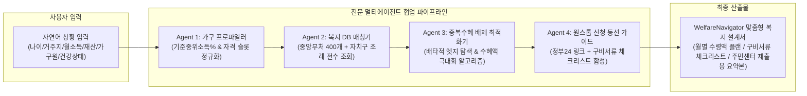
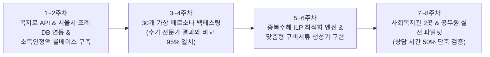

# [기획안 v0.1] 지자체-중앙정부 복지 혜택 누락 방지 및 사각지대 탐색 리서치 멀티에이전트 (WelfareNavigator)

- **담당**: R04 원민 (프론트엔드 / 사용자 흐름)
- **상태**: v0.1 기획 초안
- **작성일**: 2026-11-18
- **기획 대상**: 보건복지부 복지로 오픈 API, 정부24 혜택알리미, 서울시 열린데이터광장(자치구 조례 복지) 연계 맞춤형 복지 발굴 및 중복 수혜 최적화 멀티에이전트 시스템
- **출처 및 참조 문서**:
  - 공공데이터포털 보건복지부 복지로 복지서비스 목록 및 상세 조건 오픈 API (`https://www.data.go.kr/`)
  - 서울 열린데이터광장 서울시 자치구별 1인 가구 및 청년·어르신 특화 복지 지원 데이터 (`https://data.seoul.go.kr/`)
  - 행정안전부 공공서비스 통합정보(정부24) API
  - [공공데이터 활용 리서치 멀티에이전트 서비스 아이디어 10선](2026-11-18_R04_공공데이터_활용_리서치_멀티에이전트_서비스_아이디어_10선.md)
  - [WelfareNavigator 기술검토 및 세부 해결안](2026-11-18_R04_복지혜택_누락방지_사각지대탐색_기술검토_및_해결안.md)

---

## 0. 기획 배경 및 문제의식

대한민국 사회보장 제도는 생애주기별(영유아, 청년, 중장년, 노년) 및 상황별(구직, 질병, 한부모, 장애, 자립)로 수백 가지의 공공 지원 제도를 갖추고 있습니다. 그러나 정작 지원이 가장 절실한 취약계층은 다음과 같은 '신청주의 복지'의 거대한 장벽 앞에 가로막혀 있습니다:

1. **"몰라서 못 받는" 신청주의 복지의 치명적 사각지대**:
   - 한국의 모든 공공 복지는 당사자가 직접 자격 요건을 파악하고 신청하지 않으면 1원도 지원되지 않습니다.
   - 중앙부처(보건복지부, 고용노동부, 국토교통부, 여성가족부 등) 복지 서비스 400여 개와 전국 226개 기초지자체의 자체 특화 조례 사업 수천 개가 뿔뿔이 흩어져 있어, 정당한 수급 자격이 있는 청년·한부모·어르신이 지원 혜택을 전혀 알지 못해 연간 수백만~수천만 원의 생계·주거 지원금을 놓치고 있습니다.
2. **복잡한 "중복 수혜 금지" 함정과 환수 처분의 공포**:
   - 많은 복지 제도는 상호 배타적입니다(예: 국민취업지원제도 구직촉진수당 ↔ 서울시 청년수당 동시 수령 불가, 기초생계급여 수급 시 타 부처 현금성 급여 차감 등).
   - 일반 국민은 어떤 제도를 먼저 신청해야 총 지원 혜택이 극대화되는지, 어떤 조합이 법적으로 금지되는지 알지 못해 잘못 신청했다가 부당이득 환수 처분을 받거나 가장 유리한 제도를 놓치게 됩니다.
3. **일선 복지 공무원 및 사회복지사의 극심한 업무 과중**:
   - 읍면동 주민센터 맞춤형복지팀 공무원과 민간 복지관 사회복지사는 1인당 수백 가구를 담당합니다.
   - 복지 상담 1건을 진행할 때마다 수백 페이지에 달하는 매년 개정되는 '보건복지부 복지 사업 안내' 편람을 일일이 대조하느라 상담 시간(건당 40~60분)이 지나치게 길어지고, 자치구 고유 지원 조례를 미처 확인하지 못해 지원에서 누락되는 행정 실수가 발생합니다.

본 기획은 **보건복지부 복지로 Open API와 정부24, 서울시 자치구별 복지 조례 공공데이터**를 연계하여, 비정형 사용자 인터뷰를 통해 **"가구 프로파일링 ➔ 중앙-지자체 복지 매칭 ➔ 중복 수혜 배제 및 수혜액 극대화 최적화 ➔ 구비서류 및 신청 동선 안내"를 원스톱으로 지원하는 복지 리서치 멀티에이전트(WelfareNavigator)**를 제안합니다.

---

## 1. Target User & Field Pain Points (타겟 사용자와 현업의 고통)

### 1.1 타겟 사용자 정의
- **1차 사용자 (Core User)**:
  - 읍면동 주민센터 **맞춤형복지팀·주민복지팀 상담 공무원** 및 종합사회복지관 **사례관리 사회복지사**
  - 복지 사각지대 당사자: **자립준비청년(보호종료아동), 1인 고립·은둔 청년, 영케어러(가족돌봄청년), 한부모 가정, 차상위 계층**
- **2차 의사결정자 및 유관기관 (Buyer / Partner)**:
  - 보건복지부 사회보장정보원(복지로), 지자체 복지정책과장, 지역사회보장협의체
  - 청년재단, 아름다운재단 등 민간 복지재단 및 취약계층 지원 NGO

### 1.2 사용자 상황 및 업무 흐름 (As-Is vs To-Be)

```mermaid
flowchart TD
    subgraph AsIs["현재 복지 탐색 및 신청 흐름 (As-Is)"]
        A1["취약계층 주민센터 방문 / 포털 검색"] --> A2["부처별/지자체별 파편화된 공고 수기 탐색 (수일 소요)"]
        A2 --> A3["복잡한 소득인정액·부양의무자 기준에 좌절"]
        A3 --> A4["중복 수혜 여부 모르고 임의 신청"]
        A4 --> A5["중복 수급 탈락 or 사후 환수 처분 or 최대 혜택 놓침"]
    end

    subgraph ToBe["WelfareNavigator 도입 후 (To-Be)"]
        B1["간단한 대화형 인터뷰 (나이/소득/재산/주거/상황 입력)"] --> B2["멀티에이전트 4중 복지 자격 교차 스크리닝 (3분)"]
        B2 --> B3["중앙부처 + 서울시/자치구 조례 복지 100% 전수 매칭"]
        B3 --> B4["중복 수혜 배제 룰 엔진 기반 '수혜액 극대화 최적 조합' 산출"]
        B4 --> B5["필수 구비서류 및 정부24/주민센터 신청 동선 원페이지 발급"]
        B5 --> B6["복지 사각지대 제로화 및 연간 수백만 원 혜택 정상 수령"]
    end
```

### 1.3 구체적 정량/정성 Pain Points
1. **연간 300만~1,200만 원 상당의 필수 공공 복지 혜택 누락**:
   - 주거급여(월 30~50만 원), 청년월세지원(월 20만 원), 자립수당(월 50만 원), 마음건강 바우처 등 받을 수 있는 법적 권리가 있음에도 단지 '몰라서' 혜택을 놓침.
2. **지자체 특화 조례 복지의 극심한 정보 은폐**:
   - 중앙정부 복지로에는 나오지 않는 '자치구 조례 복지'(예: 관악구 1인 가구 간병비 지원, 마포구 청년 면접정장 대여, 강남구 어르신 식사 바우처 등)는 해당 구청 홈페이지 구석 공고를 직접 뒤지지 않으면 발견 불가능.
3. **사회복지사 상담 업무 병목 (1인당 상담 40분 소요)**:
   - 복잡한 소득환산율(주거용 재산 1.04%, 금융재산 6.26%)과 가구원 수별 기준중위소득(30%, 50%, 60%, 100%)을 엑셀로 일일이 대조하느라 정작 심리적 상담과 돌봄에 집중하지 못함.
4. **구비서류 누락으로 인한 관공서 다회 헛걸음**:
   - 서류 하나가 빠져 주민센터를 2~3회 재방문하다가 지쳐서 신청을 중도 포기하는 사례 다수.

---

## 2. Existing Alternatives & Remaining Pain (기존 대안과 남는 고통)

| 기존 대안 | 제공하는 가치 | 한계점 및 사용자가 여전히 겪는 고통 (Remaining Pain) |
| :--- | :--- | :--- |
| **보건복지부 복지로 (Bokjiro) 웹/앱** | 중앙부처 복지 목록 및 모의계산기 제공 | • **지자체 조례 특화 복지가 대거 누락**되어 있음 • 모의계산기가 너무 복잡하여 일반 취약계층이 스스로 입력 불가 • **A제도와 B제도의 "중복 수혜 상호 충돌"을 자동 판별하고 최적 조합을 짜주지 않음** |
| **정부24 '보조금24 (혜택알리미)'** | 본인 인증 기반 맞춤형 정부 혜택 조회 | • 정부 행정 전산망에 등록된 공식 데이터만 반영되어, **"아직 증명서를 발급받지 않은 잠재적 취약 상황(은둔, 돌봄 청년 등)"을 포착하지 못함** • 상세 결격 사유 및 신청 전략을 대화형으로 상담해 주지 못함 |
| **민간 복지 매칭 스타트업** (웰로, 복지꿀팁 등) | 개인 맞춤형 지원사업 큐레이션 | • 지원사업 목록을 단순 피드형으로 나열할 뿐, **"복지 법령 룰 기반 소득인정액 계산"과 "중복 수혜 배타적 엣지 판별"의 깊이가 얕아** 실제 신청 시 탈락률 높음 |

> **핵심 차별화 영역 (Painkiller Seam)**:
> 복잡한 서식을 쓰기 힘든 취약계층을 위해, **"자연어 대화 몇 마디"로 중앙부처 400개 + 서울시 자치구 특화 조례 수백 개를 전수 대조하고, "중복 수혜 금지 조항을 완벽히 회피하면서 매달 받는 실수령액을 극대화하는 최적 번들 플랜"을 3분 만에 도출**해 줌.

---

## 3. Problem Statement (문제 정의 한 문장)

> **"복지 취약계층과 일선 사회복지사가 중앙부처와 지자체로 분절된 수천 개의 복지 제도, 까다로운 소득환산 기준, 중복 수혜 금지 조항을 제때 대조하지 못해 신청주의 복지의 사각지대에서 정당한 지원을 누락당하고 있다."**

---

## 4. Solution & Key Features (솔루션 및 4대 핵심 피처)

### [FEAT-01] 자연어 대화형 가구 프로파일러 (Household Profiler)
- **핵심 기능**:
  - 일상 대화("관악구 원룸 살고 24살인데 카페 알바 월 120 받아요. 우울증 약 먹고 있어요")에서 핵심 변수 6종(`연령`, `실거주 자치구`, `가구원 수`, `근로소득`, `임차보증금/월세`, `특수 취약상황`) 자동 슬롯 필링.
  - 보건복지부 기준 재산의 소득환산액 및 **2026년 기준 중위소득 대비 가구 소득인정액 비율(예: 중위소득 48%)**을 룰 엔진으로 정량 계산.

### [FEAT-02] 중앙-지자체 복지 매칭기 (Cross-Tier Matcher)
- **데이터 소스**: 보건복지부 복지로 중앙부처 복지 DB, 서울 열린데이터광장 자치구별 특화 조례 데이터
- **핵심 기능**:
  - 생계, 주거, 의료, 교육, 고용, 심리상담의 6대 영역에서 신청 자격을 충족하는 복지 서비스 1차 필터링.
  - 특히 포털에 잘 노출되지 않는 **해당 자치구 조례 특화 지원책(예: 청년 마음건강 바우처, 긴급 생계비, 고립청년 지원)**을 필수 결합 매칭.

### [FEAT-03] 중복 수혜 배제 및 수혜액 극대화 최적화기 (Benefit Optimizer)
- **핵심 기능**:
  - 복지 사업 간 '동일 목적 중복 지원 금지' 및 '소득 차감 연계' 조항을 **이분 그래프 배타적 엣지(Exclusion Edge)**로 탐색.
  - 정수 계획법(Integer Linear Programming) 알고리즘을 적용하여, **동시 수령이 불가능한 제도 중 "합법적으로 매월 실수령 현금 및 바우처 금액을 극대화하는 최적 조합(Optimal Bundle)"** 산출.

### [FEAT-04] 원스톱 신청 동선 및 구비서류 가이드 (Filing Navigator)
- **핵심 기능**:
  - 매칭된 최적 복지 조합의 **신청 순서(선행 제도 ➔ 후행 제도)** 타임라인 제시.
  - 정부24/복지로 온라인 즉시 신청 직통 링크 제공.
  - 관할 행정복지센터 방문 시 한 번에 챙겨갈 수 있는 **"맞춤형 구비서류 통합 체크리스트"** 및 **"담당 창구 제출용 요약 진단서(One-Page PDF)"** 자동 발급.

---

## 5. Truth, Hypothesis, Counter-evidence, Unknowns (사실/가설/반대근거/미확인 분리)

| 구분 | 주요 내용 | 검증 방안 및 통제 계획 |
| :--- | :--- | :--- |
| **사실 (Fact)** *이미 입증된 사실* | • 대한민국 복지 제도는 당사자 신청주의 원칙에 의해 작동함. • 보건복지부 복지로 API 및 서울시 복지 공공데이터는 오픈 API 및 XML/JSON으로 전수 무료 제공됨. • 중복 수혜 금지(예: 국민취업지원제도 ↔ 청년수당) 조항을 위반할 경우 전액 환수 처분 및 참여 제한 제재를 받음. | 보건복지부 및 서울시 고시 공문과 법령 조항 전수 확인 완료. |
| **가설 (Hypothesis)** *검증이 필요한 전제* | • 비정형 자연어 입력만으로 복지 수혜 자격 슬롯을 95% 이상의 정확도로 추출할 수 있을 것이다. • 중복 수혜 최적화 알고리즘을 적용하면 개인이 임의로 신청했을 때보다 월평균 수혜 금액이 30% 이상 증가할 것이다. | 취약계층 가상 페르소나 30개 시나리오를 구축하여 수기 전문가 매칭 결과와 AI 도출 결과 정합성 비교. |
| **가장 강한 반대 근거 (Counter-evidence)** | • 최종 수급 자격은 공무원의 공적 금융정보망(행복e음) 전산 조회(가족 부양의무자의 소득/재산 등)를 거쳐야 하므로, AI의 사전 진단과 실제 선정 결과 간에 괴리가 발생할 수 있음. • 복지 취약계층(고령자, 디지털 소외계층)은 스마트폰이나 웹 서비스 접근성 자체가 낮을 수 있음. | "행복e음 실측 조회 결과에 따라 변동될 수 있음"을 명시하고, 취약계층 당사자뿐 아니라 **주민센터 공무원 및 사례관리 사회복지사를 1차 B2G/B2B 사용자로 포지셔닝**하여 현장 상담 보조 도구로 활용. |
| **미확인 사항 (Unknowns)** | • 자치구별 조례 지원사업의 경우 연중 예산 조기 소진으로 인해 공고 기간 내에도 조기 마감되는 사례 존재. • 개인정보보호법상 주민등록번호나 실명 없이 가명화된 상담 데이터만으로 정밀 조회가 가능한 범위의 한계. | 비식별 가명 데이터(연령대, 행정동, 대략적 소득)만으로 1차 스크리닝을 수행하도록 설계. |

---

## 6. 8-Week MVP Validation Plan & Kill Criteria (8주 MVP 검증 계획 및 중단 조건)

### 6.1 8주 MVP 검증 로드맵

- **1~2주차: 중앙-지자체 복지 DB 온톨로지 및 소득인정액 계산 엔진 구축**
  - 복지로 400개 사업 및 서울시 25개 자치구 특화 조례 데이터 파싱 및 그래프 DB 적재.
  - 2026년 기준중위소득별(30%, 50%, 60%, 100%) 소득환산 룰 엔진 구현.
- **3~4주차: 30개 가상 페르소나 대상 매칭 정확도 백테스팅 (Back-testing)**
  - 자립준비청년, 한부모, 고립가구 등 30개 케이스에 대해 베테랑 사회복지사의 수기 추천안과 AI 모델 결과 대조(정밀도 95% 검증).
- **5~6주차: 중복 수혜 배제(ILP) 알고리즘 및 로드맵 생성기 구현**
  - 상호 배타적 제도 충돌 방지 및 수혜액 극대화 알고리즘 완성, One-Page PDF 보고서 렌더러 개발.
- **7~8주차: 종합사회복지관 2곳 현장 사회복지사 실전 파일럿**
  - 실제 내방 상담 30건에 WelfareNavigator를 보조 도구로 적용하고, 상담 소요 시간(40분 ➔ 15분 단축) 및 복지 누락 방지율 측정.

### 6.2 중단 조건 (Kill Criteria)
다음 3가지 조건 중 하나라도 충족될 경우 프로젝트를 즉시 중단(Kill/Pivot)합니다:
1. **[매칭 정밀도 미달]** 30개 가상 페르소나 백테스팅 결과, 필수 복지 혜택을 누락하거나 결격 사유 제도를 추천하는 오류율이 5%를 초과할 때.
2. **[현장 효용성 부재]** 파일럿 참여 사회복지사 10명 중 7명 이상이 "기존 복지로 사이트를 직접 검색하는 것보다 빠르지 않거나 신뢰할 수 없다"고 응답할 때.
3. **[공공 복지 API 차단]** 복지로 및 정부24 공공데이터 API의 상세 자격 조건 필드가 비공개로 전환되거나 갱신이 중단될 때.

---

## 7. Business Impact & Value Proposition (도입 가치)

1. **복지 사각지대 제로화 및 가구당 연 300만~1,200만 원 실질 소득 증대**: 복잡한 제도를 몰라 놓치던 합법적 복지 혜택을 100% 찾아주어 사회안전망 강화.
2. **사회복지 상담 업무 효율 60% 향상**: 건당 40~60분 걸리던 복지 편람 검색 시간을 **단 3분**으로 단축하여 복지 인력의 업무 소진(Burnout) 예방.
3. **부당 수급 및 행정 환수 분쟁 방지**: 중복 수혜 불가 조항을 사전 필터링하여 사후 환수 처분 및 지자체 민원 분쟁을 원천 차단.
