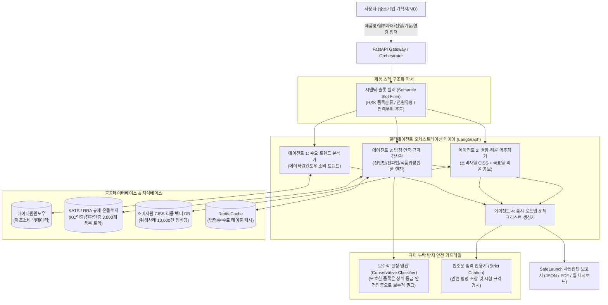

# [기술검토 및 세부 해결안 v0.1] 중소 제조·소비재 신제품 규제·인증 스크리닝 및 시장성 평가 리서치 멀티에이전트 (SafeLaunch)

- **담당**: R04 원민 (프론트엔드 / 사용자 흐름)
- **상태**: v0.1 기술 검토 초안
- **작성일**: 2026-11-18
- **연계 기획안**: [중소 제조·소비재 신제품 규제·인증 스크리닝 기획안 v0.1](2026-11-18_R04_중소제조_신제품_규제인증_스크리닝_기획안.md)
- **대상 공공데이터**:
  - 데이터원윈도우 (`data1window.kr`): 제조·소비 데이터, 유통 트렌드
  - 공공데이터포털 (`data.go.kr`): 국가기술표준원 KC인증 정보, 한국소비자원 소비자위해정보(CISS), 식약처 식품용기 기준규격, 국립전파연구원 전파인증 기준

---

## 1. 시스템 아키텍처 및 데이터 흐름도

SafeLaunch는 **"자연어 제품 스펙의 슬롯 필링 ➔ 4대 공공데이터 비동기 병렬 조회 ➔ 규제 룰 엔진 기반 법정 인증 결정 ➔ 리콜 결함 매핑 및 출시 타임라인 합성"** 파이프라인으로 구성됩니다.



---

## 2. 핵심 기술 난제 및 세부 엔지니어링 해결안

### [난제 1] 비전문가의 모호한 제품 설명 ➔ 법정 품목분류 매핑 오류 (Semantic Slot Filling)
- **문제점**:
  - 사용자는 "충전식 휴대용 텀블러"라고 입력하지만, 법률적으로는 ① 리튬이온 2차 전지(전안법 안전확인), ② 전열 기구(전안법 공급자적합성), ③ 블루투스 온도제어(전파법 적합등록), ④ 스테인리스 내식 용기(식품위생법) 등 복합 품목으로 쪼개져야 함.
  - LLM 단독 추론 시 일부 부품의 법적 인증 대상을 누락(False Negative)할 치명적 위험 존재.
- **해결안 (계층형 슬롯 필링 및 HSK/KATS 온톨로지 매핑)**:
  1. **구조화 슬롯 필러(Slot Filler)**:
     - 사용자 텍스트에서 5대 핵심 속성(`전원 유형`, `무선통신 여부`, `가열/냉각 방식`, `식품/피부 접촉 여부`, `사용 대상 연령`)을 강제 추출하는 Pydantic 스키마 정의.
  2. **국표원 품목 트리 그래프 탐색(Ontology Graph Traversal)**:
     - 추출된 속성들을 KATS 제품분류 3계층 트리(대분류 ➔ 중분류 ➔ 품목명)와 그래프 노드로 매핑하여 해당되는 법정 규제를 전수 집합(Union)으로 도출.

### [난제 2] 법정 규제 법령 및 기술표준(KS/KC) 개정 반영 및 환각 차단
- **문제점**:
  - 전기용품안전기준, 유해물질공통안전기준 등은 매년 개정되며, LLM 사전학습 가중치에만 의존할 경우 폐지된 기준이나 잘못된 시험 항목을 제시하는 환각 발생.
- **해결안 (국가법령정보센터 API RAG + 결정론적 룰 엔진 결합)**:
  1. **결정론적 룰 엔진 우선 (Deterministic Rules First)**:
     - 품목별 인증 등급(안전인증/안전확인/공급자적합성) 판정은 LLM이 아닌, 법제처 공포 법령 서식에 기반한 코드 룰베이스(Rule-base Engine)로 100% 결정론적 처리.
  2. **동적 법조문 RAG (Dynamic Legal RAG)**:
     - 국가법령정보센터 Open API를 통해 해당 법률(전안법 시행규칙 별표 등) 최신 전문을 실시간 조회하여 보고서에 해당 조항 원문을 정확히 각주 Citation.

### [난제 3] 한국소비자원 비정형 위해사례 텍스트에서의 결함 패턴 마이닝
- **문제점**:
  - 한국소비자원 위해정보(CISS)와 리콜 공보는 "사용 중 손잡이 부근에서 스파크가 튀며 연기 발생"과 같은 서술형 비정형 텍스트로 구성되어 있어 정량 분석이 어려움.
- **해결안 (Few-shot NER & 결함 트리플 추출기)**:
  1. **결함 트리플(Defect Triple) 추출**:
     - `[부품(Component)] - [결함 현상(Failure Mode)] - [위해 원인(Root Cause)]` 트리플 자동 추출 (예: `[배터리 보호회로] - [과충전 발열] - [PCM 소자 규격 미달]`).
  2. **클러스터링 및 Do-Not-Design 규칙 생성**:
     - 최근 5개년 동종 품목 위해사례를 벡터 임베딩 후 HDBSCAN으로 클러스터링하여, 발생 빈도 상위 3대 결함 요소를 추출하고 기획자에게 "설계 시 회피 권고안"으로 변환.

### [난제 4] 공인 시험 수수료 및 소요 기간의 비공개/변동성 추정
- **문제점**:
  - 시험인증기관(KTR, KCL, KTC 등)의 검사 수수료는 시료 수, 시험 항목 수에 따라 변동되므로 단일 수치로 단정하면 오해 소지 발생.
- **해결안 (표준 수수료 테이블 기반 Min-Max 구간 추정)**:
  - 국표원 고시 표준 검사 수수료 테이블을 기반으로 `[최소 기본 수수료 ~ 추가 항목 포함 최대 수수료]`의 신뢰구간(Range)을 제시하고, "시료 2개 제출 기준, 평균 영업일 20일(급행 시 10일)"과 같은 실무적 가이드라인 제공.

---

## 3. 1건 E2E PoC 시나리오 및 입출력 JSON 스키마

### 3.1 시나리오 정의
- **기획 제품명**: 휴대용 캠핑용 스마트 보온·살균 텀블러 (PureBoil-Go)
- **주요 스펙**:
  - 본체: 스테인리스 스틸(SUS304) 수조 (식품 접촉)
  - 전원: 18650 리튬이온 충전 배터리 (3.7V, 5,000mAh) 내장, USB-C 충전
  - 기능: 바닥면 발열 코일로 80℃ 가열 + 뚜껑 내장 UV-C LED 살균 기능
  - 통신: 스마트폰 앱 연동 블루투스 5.0 (온도 제어)
  - 타깃: 성인 캠핑족 / 1인 가구

### 3.2 입력 JSON 스키마 (User Input)
```json
{
  "request_id": "REQ-SAFE-2026-1118-001",
  "product_concept": {
    "product_name": "휴대용 캠핑용 스마트 보온·살균 텀블러 (PureBoil-Go)",
    "category_hint": "주방가전 / 생활용품",
    "target_user_age_group": "ADULT",
    "materials": [
      {"component": "수조 내부", "material_type": "스테인리스 스틸 (SUS304)", "food_contact": true},
      {"component": "외관 하우징", "material_type": "ABS 플라스틱", "food_contact": false},
      {"component": "뚜껑 실리콘 패킹", "material_type": "식품용 실리콘", "food_contact": true}
    ],
    "power_source": {
      "type": "RECHARGEABLE_BATTERY",
      "battery_spec": "리튬이온 3.7V 5000mAh",
      "charging_port": "USB Type-C (5V/2A)"
    },
    "features": [
      "전열 코일 수조 직접 가열 (최대 80도)",
      "뚜껑 내부 UV-C LED 살균 모듈",
      "Bluetooth BLE 무선 연결 앱 제어"
    ]
  }
}
```

### 3.3 에이전트 간 내부 중간 산출물 (Intermediate Representation)
```json
{
  "agent_1_market_trend": {
    "search_volume_growth_yoy": "+47.2%",
    "popular_keywords": ["캠핑 텀블러", "무선 가열 텀블러", "살균 보온병", "차박 전기포트"],
    "market_attractiveness_score": 84.0
  },
  "agent_2_recall_history": {
    "similar_items_analyzed": 142,
    "top_defect_modes": [
      {"issue": "리튬 배터리 단락으로 인한 바닥면 소손/발화", "frequency": "38%", "source": "소비자원 CISS"},
      {"issue": "스테인리스 납/카드뮴 용출 기준 초과", "frequency": "24%", "source": "식약처 수거검사"},
      {"issue": "UV-C LED 누설로 인한 각막/피부 자극", "frequency": "12%", "source": "국표원 리콜"}
    ],
    "do_not_design_rules": [
      "KC 인증을 취득한 정품 보호회로(PCM) 내장 배터리 셀 사용 필수",
      "SUS304 성분 분석 성적서 및 유해물질 용출 시험 사전 진행 필수",
      "텀블러 개폐 감지 센서 연동 (뚜껑 열릴 시 UV-C LED 즉시 소등 회로 설계 필수)"
    ]
  },
  "agent_3_compliance_rules": {
    "applicable_regulations": [
      {
        "law_name": "전기용품 및 생활용품 안전관리법 (전안법)",
        "subject": "내장 리튬 2차 전지 셀",
        "cert_grade": "안전확인 (Safety Confirmation)",
        "estimated_cost_krw": 1500000,
        "lead_time_weeks": 4
      },
      {
        "law_name": "방송통신망법 (전파법)",
        "subject": "Bluetooth BLE 무선 모듈 및 본체 전자기적합성",
        "cert_grade": "적합등록 (Electromagnetic Compatibility)",
        "estimated_cost_krw": 900000,
        "lead_time_weeks": 3
      },
      {
        "law_name": "식품위생법",
        "subject": "식품용 기구 및 용기·포장 (스테인리스 수조 및 실리콘 패킹)",
        "cert_grade": "식품용 기구 기준규격 검사 (용출 시험)",
        "estimated_cost_krw": 600000,
        "lead_time_weeks": 2
      }
    ]
  }
}
```

### 3.4 최종 출력 JSON 스키마 (Final Synthesis Report)
```json
{
  "report_id": "REP-SAFE-2026-1118-001",
  "generated_at": "2026-11-18T15:40:00Z",
  "feasibility_matrix": {
    "market_attractiveness": "HIGH (84/100)",
    "regulatory_complexity": "HIGH (복합 인증 3종)",
    "overall_verdict": "추진 권고 (단, 금형 전 식품용기 용출 및 배터리 KC 성적서 선확보 필수)",
    "total_estimated_cert_cost_krw": "2,800,000 ~ 3,500,000",
    "total_cert_lead_time_weeks": "5~6주 (병렬 접수 기준)"
  },
  "mandatory_certifications": [
    {
      "agency": "국가기술표준원 (전안법)",
      "target": "전기용품 안전확인 (내장 전지)",
      "doc_required": ["시료 3개", "배터리 사양서", "보호회로도"],
      "penalty_if_violated": "3년 이하 징역 또는 3천만 원 이하 벌금"
    },
    {
      "agency": "국립전파연구원 (전파법)",
      "target": "방송통신기자재등의 적합등록 (EMC/RF)",
      "doc_required": ["시료 1개", "회로도", "부품배치도", "사용자설명서"]
    },
    {
      "agency": "식품의약품안전처 (식품위생법)",
      "target": "식품용 기구 안전성 시험 (중금속 용출)",
      "doc_required": ["완제품 시료 2개", "재질증명서 (SUS304)"]
    }
  ],
  "do_not_design_checklist": [
    "경고: 뚜껑이 열린 상태에서 UV-C LED가 점등되면 국표원 리콜 대상. '물리적 마이크로 스위치' 적용 필수",
    "경고: 배터리 충전 단자 부위에 방수 고무 실링(IPX4 이상) 미적용 시 침수로 인한 발화 리콜 위험",
    "경고: 미인증 저가 배터리 사용 시 통관 보세창고 전량 압류 대상"
  ],
  "launch_gantt_timeline": [
    {"week": "W1-W2", "action": "부품 선정 및 배터리 기취득 KC 성적서 공급업체 확인 (비용 절감 팁)"},
    {"week": "W3-W4", "action": "기구 샘플로 식약처 식품용기 검사 선접수 (소요 2주)"},
    {"week": "W5-W8", "action": "작동 시제품으로 전파인증(EMC) 및 전안법 안전확인 병렬 접수 (소요 4주)"},
    {"week": "W9", "action": "쿠팡/스마트스토어 상세페이지 필수 KC 마크 및 식품용 도안 라벨 인쇄 후 출시"}
  ]
}
```

---

## 4. 8주 주차별 엔지니어링 마일스톤 및 기술 스택

| 주차 | 목표 (Milestone) | 세부 구현 내용 | 산출물 |
| :--- | :--- | :--- | :--- |
| **1~2주차** | 규제 온톨로지 & 리콜 DB 구축 | • 국표원 제품분류(전안법/어린이법) 온톨로지 그래프화<br/>• 소비자원 CISS 및 리콜 공보 크롤링/임베딩<br/>• 식약처 기구용기 기준규격 테이블 파싱 | `data/reg_ontology.json`<br/>`data/recall_vector_store`<br/>`adapters/ciss_crawler.py` |
| **3~4주차** | 슬롯 필러 & 규제 룰 엔진 개발 | • Pydantic 기반 자연어 제품 스펙 시맨틱 파서 구현<br/>• 전안법/전파법/식품위생법 매핑 룰 엔진 작성<br/>• 기출 인증 제품 50종 대상 정확도 백테스팅 | `core/slot_filler.py`<br/>`core/compliance_rules.py`<br/>`tests/test_reg_accuracy.py` |
| **5~6주차** | 결함 마이닝 & 멀티에이전트 연계 | • Few-shot NER 결함 트리플 추출기 구현<br/>• LangGraph 기반 4개 에이전트 상태머신 결합<br/>• 법조문 및 공공 출처 Strict Citation 가드레일 | `agents/recall_auditor.py`<br/>`agents/orchestrator.py` |
| **7~8주차** | 셀러 체크리스트 생성기 & 실전 PoC | • Gantt 및 온라인 입점 체크리스트 PDF 자동 생성기<br/>• 중소 제조사/와디즈 메이커 10곳 대상 실전 테스트<br/>• 사용자 피드백 수렴 및 룰베이스 예외 케이스 튜닝 | `reports/seller_checklist.py`<br/>`docs/poc/maker_feedback_report.md` |

### 기술 스택 (Tech Stack)
- **Backend / API**: Python 3.11, FastAPI, Pydantic v2
- **Agent Orchestration**: LangGraph, LangChain
- **Vector DB & Search**: Qdrant / Chroma (리콜 사례 10,000건 임베딩 검색)
- **Rule Engine**: Python NetworkX (품목 분류 및 규제 그래프 탐색)
- **Cache & Storage**: Redis (규제 기준 및 법령 전문 캐시), PostgreSQL
- **LLM**: Claude 3.5 Sonnet / GPT-4o (슬롯 필링 및 체크리스트 합성)
- **Report Rendering**: WeasyPrint (온라인 판매자용 입점 체크리스트 PDF 생성)
