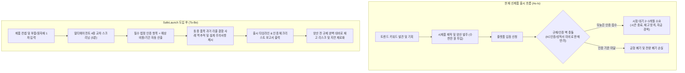
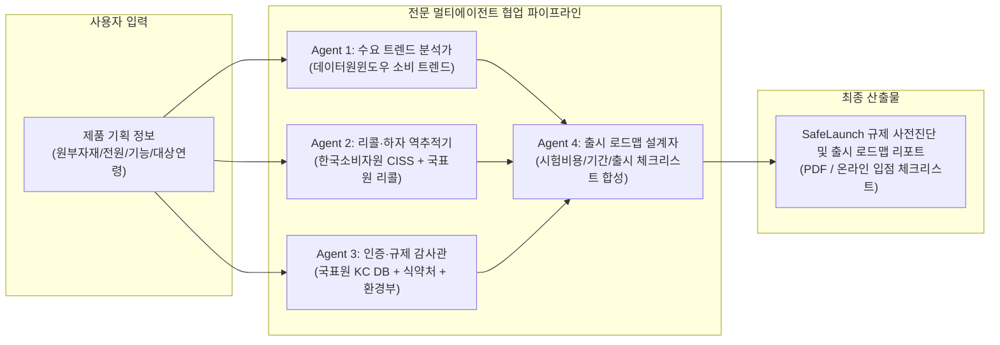
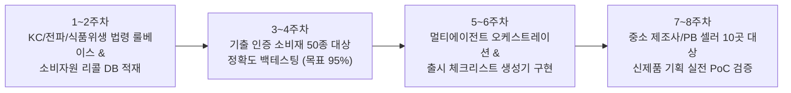

# [기획안 v0.1] 중소 제조·소비재 신제품 규제·인증 스크리닝 및 시장성 평가 리서치 멀티에이전트 (SafeLaunch)

- **담당**: R04 원민 (프론트엔드 / 사용자 흐름)
- **상태**: v0.1 기획 초안
- **작성일**: 2026-11-18
- **기획 대상**: 데이터원윈도우, 공공데이터포털(국표원 KC인증, 한국소비자원 위해정보, 식약처) 연계 신제품 기획 및 법정 인증 사전 스크리닝 멀티에이전트 시스템
- **출처 및 참조 문서**:
  - 데이터원윈도우 제조·소비 빅데이터 (`https://www.data1window.kr/`)
  - 공공데이터포털 국가기술표준원 제품안전정보 및 KC인증 오픈 API (`https://www.data.go.kr/`)
  - 한국소비자원 소비자위해정보(CISS) 및 결함 리콜 공보 데이터 (`https://www.data.go.kr/`)
  - 식품의약품안전처 식품용 기구 및 용기·포장 기준규격 공공데이터 (`https://www.data.go.kr/`)
  - [공공데이터 활용 리서치 멀티에이전트 서비스 아이디어 10선](2026-11-18_R04_공공데이터_활용_리서치_멀티에이전트_서비스_아이디어_10선.md)
  - [SafeLaunch 기술검토 및 세부 해결안](2026-11-18_R04_중소제조_신제품_규제인증_스크리닝_기술검토_및_해결안.md)

---

## 0. 기획 배경 및 문제의식

국내 중소 제조기업 및 이커머스 PB(자체 브랜드) 셀러는 트렌드 변화에 맞춰 연간 수만 종의 생활용품, 소형 가전, 뷰티/헬스케어, 유아동 소비재 신제품을 기획하고 출시합니다. 그러나 상품 출시 과정에서 다음과 같은 치명적인 법적·비용적 리스크가 반복되고 있습니다:

1. **"사후 인증 발견"에 따른 수천만 원 재고 매몰 및 출시 마비**:
   - 기획자가 SNS나 이커머스에서 급상승하는 트렌드 키워드만 보고 금형을 제작하고 원부자재를 발주해 완제품을 생산했으나, 이커머스 플랫폼(쿠팡, 네이버 스마트스토어 등) 입점 단계에서 **"이 제품은 KC 전기용품 안전확인 및 방송통신기자재 적합등록, 또는 어린이제품안전특별법 대상 품목이므로 공인 시험성적서가 없으면 판매 불가"**라는 통보를 받음.
   - 시험인증 취득에 최소 2~3개월이 소요되어 골든타임을 놓치고, 이미 생산된 수천만~수억 원 상당의 완제품 재고가 창고에 묶여 중소기업의 현금흐름이 마비됨.
2. **과거 결함 및 리콜 이력의 미인지로 인한 제품 사고 및 과태료**:
   - 동종 유사 제품이 과거 어떤 설계 결함(예: 리튬 배터리 과열 보호회로 미비, 플라스틱 가소제 기준치 초과, 유아 질식 부품)으로 리콜되었는지 파악하지 못해 동일한 설계 실수를 반복함.
   - 출시 후 국가기술표준원이나 소비자원 불시 수거검사에서 적발되어 전량 리콜 명령, 과태료 수천만 원 부과, 브랜드 폐업으로 이어짐.
3. **영세 제조사를 위한 규제 컨설팅의 높은 문턱**:
   - 대기업은 사내 법무/품질인증팀이 모든 규격(KS, KC, CE, FDA)을 사전 검토하지만, 5~30인 규모 중소 제조사는 전문 인력이 전무함.
   - 시험인증기관(KTR, KCL, KTC 등)이나 행정사 컨설팅은 건당 200~500만 원의 비용이 들어 초기 아이데이션 단계의 수많은 후보 품목을 검토하기 불가능함.

본 기획은 **데이터원윈도우(제조·소비 트렌드 빅데이터)와 공공데이터포털(국표원 KC인증, 소비자원 리콜/위해정보, 식약처 규격)**을 연계하여, 제품 기획 초기 단계에서 **"소비 트렌드 매력도 평가 ➔ 필수 법정 인증 항목 자동 판별 ➔ 동종 품목 리콜 결함 역추적 ➔ 출시 로드맵 체크리스트 발급"을 자율 수행하는 리서치 멀티에이전트(SafeLaunch)**를 제안합니다.

---

## 1. Target User & Field Pain Points (타겟 사용자와 현업의 고통)

### 1.1 타겟 사용자 정의
- **1차 사용자 (Core User)**:
  - 생활용품, 소형가전, 유아동용품, 주방용품 분야 **중소 제조기업 상품기획팀장 및 MD** (직원 5~50인 규모)
  - 이커머스 PB 브랜드 창업자 및 크라우드 펀딩(와디즈, 텀블벅) 메이커
- **2차 의사결정자 (Buyer / Approver)**:
  - 중소 제조사 대표이사(CEO), 품질관리(QC) 담당자
  - 유통 플랫폼(쿠팡, 스마트스토어, 올리브영) 상품 입점 심사역

### 1.2 사용자 상황 및 업무 흐름 (As-Is vs To-Be)

### 1.3 구체적 정량/정성 Pain Points
1. **사후 인증 발견으로 인한 2~3개월 출시 지연 및 시즌 아웃**:
   - 계절성 상품(예: 여름 휴대용 선풍기, 겨울 보온용품)의 경우 2개월 지연은 해당 연도 매출 100% 증발을 의미함.
2. **평균 3,000만~8,000만 원 상당의 초도 생산 재고 매몰**:
   - 안전확인 미취득 상태로 수입/제조 통관된 물품은 국내 판매 불가로 전량 보세창고 압류 또는 폐기 처리됨.
3. **복잡다단한 법률 체계에 따른 규제 확인 불가**:
   - 제품 1개에 '전기용품 및 생활용품 안전관리법(전안법)', '전파법', '어린이제품안전특별법', '식품위생법(식품접촉부위)' 등 3~4개 부처 법령이 동시 적용되어 비전문가가 규제 누락 없이 체크하는 것이 불가능함.
4. **리콜 적발 시 브랜드 신뢰도 추락 및 최대 3년 이하 징역/3천만 원 벌금**:
   - 무인증 유통 적발 시 행정형벌 및 네이버/쿠팡 계정 영구 정지 리스크.

---

## 2. Existing Alternatives & Remaining Pain (기존 대안과 남는 고통)

| 기존 대안 | 제공하는 가치 | 한계점 및 사용자가 여전히 겪는 고통 (Remaining Pain) |
| :--- | :--- | :--- |
| **공인 시험인증기관 상담** (KTR, KCL, KTC, FITI 등) | 공인된 시험 성적서 발급 및 공식 규격 안내 | • 완제품 샘플과 회로도, 부품 명세서가 완비된 **'사후 단계'에서만 공식 접수 가능** • 초기 기획 단계의 "이 부품을 쓰면 인증 대상인가?"라는 가벼운 질의에는 전화 연결조차 어렵고 불친절함 |
| **인증 대행 행정사/컨설팅 업체** | 인증 서류 대행 및 시험기관 매칭 | • 건당 **200~500만 원의 높은 수수료** 발생 • 신제품 기획 단계에서 10개 후보 중 1개를 골라야 하는 중소기업에게는 비용 부담으로 이용 불가 |
| **국가기술표준원/소비자원 포털 수기 검색** | 무료 공개된 법정 기준 및 리콜 공보 열람 | • 법률 용어(안전인증, 안전확인, 공급자적합성확인)가 지나치게 어렵고 품목 분류표가 파편화되어 있어 비전문가가 내 제품에 딱 맞는 항목을 찾을 수 없음 |

> **핵심 차별화 영역 (Painkiller Seam)**:
> 수백만 원의 대행료를 낼 수 없고 샘플이 없는 기획 초기 단계의 영세 제조사를 위해, **"제품 설명(부품·소재·기능)"만 텍스트로 넣으면 공공 안전 규제 DB와 리콜 이력을 교차 대조하여 '필수 인증 목록, 예상 비용/기간, 설계 회피 가이드'를 5분 만에 무료/저비용으로 진단**해 줌.

---

## 3. Problem Statement (문제 정의 한 문장)

> **"중소 제조사 및 이커머스 PB 기획자가 트렌드에 맞춰 신제품을 기획하면서도, 복잡한 법정 안전인증(KC·생활화학·식품위생) 요건과 과거 리콜 결함 이력을 사전에 스크리닝하지 못해 출시 직전 시험성적서 지연으로 수천만 원의 재고가 묶이거나 리콜 처분을 당하는 위기를 겪고 있다."**

---

## 4. Solution & Key Features (솔루션 및 4대 핵심 피처)

### [FEAT-01] 소비 트렌드 및 시장성 분석기 (Trend Miner)
- **데이터 소스**: 데이터원윈도우(제조·소비 데이터, 유통/판매 트렌드), 공공데이터포털(소비자 물가지수)
- **핵심 기능**:
  - 기획 제품 카테고리의 최근 2개년 검색량, 판매량 추이 및 급상승 연관 키워드 추출.
  - 시장 내 지배적 가격대(포지셔닝) 및 주요 소구점(친환경, 초경량, 무선, 살균 등) 도출.

### [FEAT-02] 결함·리콜 이력 역추적기 (Recall Auditor)
- **데이터 소스**: 한국소비자원 소비자위해정보(CISS), 국가기술표준원 제품리콜 공보 API
- **핵심 기능**:
  - 최근 5개년 동종/유사 품목의 **리콜 처분 이력 및 소비자 고발 결함 패턴(과열, 파손, 유해물질 검출 등)** 전수 마이닝.
  - "이 제품 설계 시 절대 피해야 할 부품/구조(Do-Not-Design Checklist)" 자동 생성 (예: "충전 단자 방수 등급 IPX4 미만 적용 시 감전/부식 리콜 다발").

### [FEAT-03] 법정 인증·규제 룰 엔진 감사관 (Compliance Checker)
- **데이터 소스**: 국가기술표준원 KC인증 대상 품목 DB, 국립전파연구원 방송통신기자재 적합성평가 기준, 식약처 기구용기 기준, 환경부 안전확인대상생활화학제품 DB
- **핵심 기능**:
  - **다중 부처 규제 매핑**: 제품 스펙(예: 배터리 내장 + 무선통신 + 물 접촉)에 따라 적용되는 법령(전안법 + 전파법 + 식품위생법) 자동 판별.
  - **인증 등급 분류**: 안전인증(가장 엄격, 공장심사 필요) ➔ 안전확인(시험기관 시험) ➔ 공급자적합성확인(자체 성적서) 3단계 자동 분류.
  - **예상 시험 수수료 및 소요 기간 정량 추정**: (예: "KC 안전확인 약 120만 원 / 4주 소요, 전자파 적합등록 약 80만 원 / 3주 소요").

### [FEAT-04] 출시 로드맵 및 셀러 체크리스트 생성기 (Launch Synthesizer)
- **핵심 기능**:
  - 시장 매력도(트렌드 점수) vs 규제 허들(비용·기간 점수)을 결합한 종합 Feasibility 스코어 산출.
  - 금형 제작 전 **'시험 성적서 필수 준비 타임라인(Gantt)'** 제시.
  - 쿠팡, 스마트스토어, 와디즈 제출용 **"온라인 상품 등록 필수 서류 체크리스트"** 및 경고 라벨 표기 의무 가이드 발행.

---

## 5. Truth, Hypothesis, Counter-evidence, Unknowns (사실/가설/반대근거/미확인 분리)

| 구분 | 주요 내용 | 검증 방안 및 통제 계획 |
| :--- | :--- | :--- |
| **사실 (Fact)** *이미 입증된 사실* | • KC인증, 전파인증, 식품용기 검사는 대한민국 법률상 유통 전 취득이 강제되는 법적 의무임. • 미인증 제품 판매 시 3년 이하 징역 또는 3천만 원 이하 벌금 및 플랫폼 판매 정지 처분을 받음. • 국표원 및 소비자원 리콜 데이터는 공공 오픈 API 및 웹 공보로 전수 공개되어 있음. | 국가법령정보센터 전안법/전파법 법조문 및 실제 KATS 제품안전정보포털 데이터 스키마 확인 완료. |
| **가설 (Hypothesis)** *검증이 필요한 전제* | • 비전문가인 기획자가 입력한 자연어 제품 설명만으로 필수 법정 인증 항목을 95% 이상의 정확도로 자동 판별할 수 있을 것이다. • 과거 리콜 결함 사례를 기획 단계에서 인지시키면 제품 설계 결함 발생률을 50% 이상 감소시킬 것이다. | 2024~2025년 실제 KC 인증을 받은 대표 소비재 50종(스펙 텍스트)을 모델에 투입하여 정답률 검증(F1-score). |
| **가장 강한 반대 근거 (Counter-evidence)** | • 최종 법적 책임은 제조사에 있으므로, AI가 "인증 불필요"로 오판하거나 누락했을 때 발생하는 법적 리스크(과태료)에 대한 법적 책임 회피 어려움. • 신제품의 혁신적 융복합 기능(예: 화장품과 마사지기 결합)의 경우 현행 법령상 분류 기준이 모호해 공무원 유권해석이 필수적임. | "본 보고서는 사전 스크리닝 참고용이며 공식 인증은 지정 시험기관 확인 필요"라는 법적 면책 고지 및 불명확 품목은 '유권해석 필요(Gray Zone)'로 명시적 분리. |
| **미확인 사항 (Unknowns)** | • 시험인증기관별(KTR vs KTC vs KCL) 실제 검사 수수료와 소요 기간의 비공개 할인율 및 일정 지연 변동성. • 해외 직구/수입 대행 상품의 경우 국내 제조 상품과 적용되는 면제 조항이 달라 파싱 복잡도 증가. | 국내 제조 및 정식 수입 상품(B2B OEM/ODM)을 Phase 1 타깃으로 한정. |

---

## 6. 8-Week MVP Validation Plan & Kill Criteria (8주 MVP 검증 계획 및 중단 조건)

### 6.1 8주 MVP 검증 로드맵

- **1~2주차: 법정 인증 룰베이스 구축 및 리콜 DB 연동**
  - 전안법, 전파법, 어린이제품안전특별법 기준 3,000개 품목 분류 체계 온톨로지화.
  - 최근 5개년 국표원/소비자원 리콜 10,000건 텍스트 임베딩 및 데이터베이스 적재.
- **3~4주차: 기출 인증 제품 50종 대상 분류 정확도 검증 (Back-testing)**
  - 실제 판매 중인 융복합 소비재 50종(예: 가습기, 무선이어폰, 유아용 젖병 소독기 등)의 사양을 입력하고 실제 취득한 인증 목록과 100% 일치하는지 평가.
- **5~6주차: 4대 멀티에이전트 연계 및 셀러 체크리스트 생성기 개발**
  - 트렌드 ➔ 리콜 ➔ 규제 ➔ 로드맵 합성 파이프라인 완성 및 PDF/웹 대시보드 렌더러 구축.
- **7~8주차: 중소 제조기업 및 와디즈 메이커 10곳 실전 PoC 시범 적용**
  - 실제 신제품 기획 중인 메이커 10팀에게 사전 진단서 제공 후 실효성 및 유료 결제 의사(WTP) 측정.

### 6.2 중단 조건 (Kill Criteria)
다음 조건 중 하나라도 해당할 경우 프로젝트를 즉시 중단(Kill/Pivot)합니다:
1. **[인증 판별 치명적 오류]** 50종 백테스팅 결과, 필수 '안전인증/안전확인' 대상을 '공급자적합성/비대상'으로 누락(False Negative)하는 오류가 5% 이상 발생할 때 (치명적 법적 리스크).
2. **[셀러 유용성 기각]** 10개 파일럿 기업 중 7개 이상이 "이 보고서가 있어도 시험기관에 처음부터 다시 물어봐야 하므로 시간이 절약되지 않는다"고 응답할 때.
3. **[공공 규제 API 변경]** 국가기술표준원 및 공공데이터포털의 인증 기준 데이터 제공이 중단되거나 라이선스 분쟁 발생 시.

---

## 7. Business Impact & Value Proposition (도입 가치)

1. **사전 인증 스크리닝 소요 시간 95% 단축**: 2~3주 동안 법령 찾고 헤매던 시간을 **단 5분**으로 단축.
2. **출시 지연 및 재고 폐기 리스크 제로화**: 양산 착수 전 필수 시험 항목과 소요 기간(4~8주)을 사전 확보하여 재고 매몰 비용(건당 수천만 원) 방지.
3. **고가 컨설팅 비용 절감**: 건당 200~500만 원 상당의 인증 컨설팅 비용을 대체하여 중소기업 및 청년 창업자의 신제품 런칭 장벽 제거.
