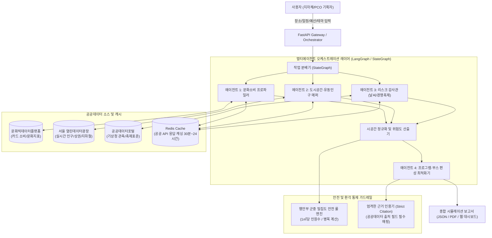

# [기술검토 및 세부 해결안 v0.1] 지역 축제·문화행사 흥행 예측 및 프로그램 최적화 리서치 멀티에이전트 (FestivaPulse)

- **담당**: R04 원민 (프론트엔드 / 사용자 흐름)
- **상태**: v0.1 기술 검토 초안
- **작성일**: 2026-11-18
- **연계 기획안**: [지역 축제·문화행사 흥행 예측 기획안 v0.1](2026-11-18_R04_지역축제_문화행사_흥행예측_기획안.md)
- **대상 공공데이터**:
  - 문화빅데이터플랫폼 (`bigdata-culture.kr`): 지역별 문화소비 성향, 공연/축제 선호도
  - 서울 열린데이터광장 (`data.seoul.go.kr`): 실시간 도시데이터 API, 대중교통 승하차 API, 상권분석 API
  - 공공데이터포털 (`data.go.kr`): 기상청 과거 기후통계 API, 전국공연축제표준데이터 API

---

## 1. 시스템 아키텍처 및 데이터 흐름도

FestivaPulse는 **"비동기 공공데이터 팬아웃 수집 ➔ 시공간 데이터 융합 및 정규화 ➔ 위험도/밀집도 룰 기반 계산 ➔ LLM 기반 프로그램·부스 편성 최적화"**의 4단계 파이프라인으로 구성됩니다.



---

## 2. 핵심 기술 난제 및 세부 엔지니어링 해결안

### [난제 1] 이종 데이터 간 '시공간 축(Spatio-Temporal)' 불일치
- **문제점**:
  - 문화소비 데이터: 시·군·구 / 읍·면·동 단위의 월간·분기별 집계 통계.
  - 서울시 도시데이터: 특정 POI(주요 115개 장소) 및 지하철역 기준 실시간(5분~10분) 인구 추정치.
  - 기상청 데이터: 지점 관측소(AWS) 좌표 기준 과거 10년 시계열 기온/강수량 통계.
  - 전국축제데이터: 행사 시작일~종료일 기준 단일 위경도 좌표.
  - 축제 기획자는 "특정 공원(반경 500m)의 특정 주말(토/일 14:00~21:00)"이라는 좁은 시공간의 예측을 요구하므로 단순 조인(Join) 불가.
- **해결안 (H3 공간 인덱싱 & 인구 가중치 역보간 모델)**:
  1. **H3 육각 격자(Hexagonal Hierarchical Spatial Index) 표준화**:
     - 행사 후보지 좌표를 Uber H3 인덱스(Resolution 8, 반경 약 460m)로 변환.
     - 주변 지하철역 승하차 데이터와 행정동 인구 데이터를 H3 격자별 거리 감쇠 함수(Gaussian Distance Decay)로 역보간하여 배후 유동인구 기여도를 정량화.
  2. **시간대별 프로파일 분해**:
     - 월간 문화소비 데이터를 해당 지역의 '주말 카드 소비 비율' 및 '시간대별 상권 매출 패턴'을 가중치로 곱해 축제 시간대(14:00~21:00)의 예상 소비 강도로 정규화(Normalizing).

### [난제 2] 실시간 도시데이터 트래픽 부하 및 Rate Limit 극복
- **문제점**:
  - 서울 열린데이터광장 실시간 도시데이터는 일일 호출 쿼터(기본 1,000회)가 존재하며, 축제 기획자가 장소와 일정을 변경하며 시뮬레이션을 반복할 경우 쿼터 소진 위험.
- **해결안 (Redis 기반 계층형 캐싱 & 사전 프리페치)**:
  1. **정적/동적 데이터 분리 캐싱**:
     - 정적 데이터(기상청 10년 통계, 과거 축제 목록): Redis에 TTL 30일 설정.
     - 준동적 데이터(문화소비 트렌드, 상권 분석): Redis에 TTL 7일 설정.
     - 실시간 데이터(실시간 인구 혼잡도): Redis에 TTL 15분 설정.
  2. **오전 4시 배치 프리페치(Pre-fetch)**:
     - 서울시 내 축제 다발 50개 주요 거점(홍대, 반포 한강공원, 성수 등)에 대해 매일 새벽 과거 동요일·동시간대 인구 패턴을 사전 가공해 캐시에 적재.

### [난제 3] 문화소비 정형 수치와 비정형 트렌드 키워드의 결합 및 추천 환각 방지
- **문제점**:
  - LLM에게 "이 지역에 어울리는 축제 프로그램을 추천해줘"라고 요청하면, 해당 지역의 실제 소비 성향과 무관하게 유명 K-POP 아이돌이나 대중가요 무대를 무차별 환각(Hallucination) 추천하는 경향이 있음.
- **해결안 (슬롯 필링 기반 제약 충족 최적화 & 임베딩 코사인 유사도)**:
  1. **지역 문화 DNA 벡터화**:
     - 문화빅데이터플랫폼의 카드 소비 상위 5개 업종(예: 전시/공연, 독서, 카페, 체험)과 선호 장르 통계를 임베딩 벡터로 변환.
  2. **공공 공연예술 DB(KOPIS) 기반 후보군 필터링**:
     - 임의의 아티스트를 생성하지 않고, 실제 공공 예술인/인디밴드/공연 DB 풀 내에서 지역 문화 벡터와 코사인 유사도가 0.75 이상인 공연 형태(예: 어쿠스틱 인디, 재즈 페어링, 가족 참여형 마술극 등)만 슬롯에 매핑.

### [난제 4] 군중 밀집도 안전사고 방지를 위한 결정론적(Deterministic) 룰 엔진
- **문제점**:
  - 축제 흥행 시 특정 시간대 군중 쏠림으로 인한 안전사고(압사 위험 등)를 LLM의 자유 생성 텍스트로 평가할 경우 심각한 안전 불감증 초래 가능.
- **해결안 (행정안전부 '다중운집 행사 안전관리 가이드라인' 수식 직접 구현)**:
  - 축제장 유효 면적($A_{net}$) = 총 부지 면적 - (무대 면적 + 부스 면적 + 소방 통로).
  - 시간대별 예상 순간 동시 체류 인원($N_t$)을 $A_{net}$으로 나누어 **1㎡당 인원수(Density Index)** 산출:
    - **1.0명/㎡ 이하**: [안전 (Green)]
    - **1.1~2.0명/㎡**: [주의 (Yellow)] - 안전요원 추가 배치
    - **2.1~3.0명/㎡**: [경계 (Orange)] - 일방통행 동선 통제
    - **3.1명/㎡ 초과**: [심각 (Red)] - 행사장 진입 차단 및 예비 부지 개방
  - 이 계산은 LLM에 맡기지 않고 Python 룰 엔진 코드로 100% 결정론적으로 실행하여 보고서에 경고등으로 표출.

---

## 3. 1건 E2E PoC 시나리오 및 입출력 JSON 스키마

### 3.1 시나리오 정의
- **행사명**: 2027 홍대 레드로드 청년 인디 버스킹 & 컬처 페스티벌
- **주최/장소**: 마포구청 / 홍대 레드로드 R1~R5 구역 (총 5,000㎡)
- **일정**: 2027년 5월 15일(토) 14:00 ~ 21:00
- **예산**: 2억 원 / 목표 집객: 15,000명

### 3.2 입력 JSON 스키마 (User Input)
```json
{
  "request_id": "REQ-FEST-2027-0515-MAPO",
  "festival_name": "홍대 레드로드 청년 인디 버스킹 & 컬처 페스티벌",
  "location": {
    "region_name": "서울특별시 마포구 서교동",
    "site_name": "홍대 레드로드 일대",
    "coordinates": {"lat": 37.5543, "lng": 126.9234},
    "total_area_sqm": 5000,
    "effective_area_sqm": 3200
  },
  "schedule": {
    "target_date": "2027-05-15",
    "start_time": "14:00",
    "end_time": "21:00"
  },
  "budget_krw": 200000000,
  "theme": "청년 문화, 인디 음악, 로컬 F&B",
  "target_capacity": 15000
}
```

### 3.3 에이전트 간 내부 중간 산출물 (Intermediate Representation)
```json
{
  "agent_1_culture_profile": {
    "top_genres": ["인디 락/어쿠스틱 (42%)", "거리 버스킹/스트리트 댄스 (28%)", "플리마켓/공예 (18%)"],
    "target_demographics": "20대(51%), 30대(29%)",
    "consumption_index_score": 88.5
  },
  "agent_2_urban_spatial": {
    "nearby_subway_stations": ["홍대입구역 (2호선/공항철도)", "합정역 (6호선)"],
    "hourly_baseline_floating_pop": [
      {"hour": 14, "expected_pop": 8200},
      {"hour": 17, "expected_pop": 13400},
      {"hour": 19, "expected_pop": 18200},
      {"hour": 21, "expected_pop": 14500}
    ],
    "fnb_absorb_ratio": 0.65
  },
  "agent_3_risk_audit": {
    "weather_risk": {
      "may_rain_probability_10yr_avg": 0.12,
      "strong_wind_risk": "LOW",
      "risk_level": "SAFE"
    },
    "competing_events": [
      {
        "event_name": "신촌 거리예술 축제",
        "distance_km": 1.8,
        "conflict_severity": "MEDIUM",
        "mitigation": "19:00 헤드라이너 공연 시간대 1시간 시차 분산 권고"
      }
    ]
  }
}
```

### 3.4 최종 출력 JSON 스키마 (Final Synthesis Report)
```json
{
  "report_id": "REP-FEST-2027-0515-001",
  "generated_at": "2026-11-18T15:30:00Z",
  "executive_summary": {
    "feasibility_score": 87.2,
    "grade": "EXCELLENT",
    "verdict": "추진 권고 (타깃 적합성 우수, 인근 행사와 1시간 시차 편성 필수)",
    "expected_total_attendance": 16800,
    "budget_efficiency_score": "HIGH"
  },
  "optimized_program_schedule": [
    {
      "time_slot": "14:00 - 16:00",
      "stage_type": "버스킹 존 A/B/C",
      "recommended_genre": "신진 인디 뮤지션 어쿠스틱 릴레이",
      "target_crowd": "오후 유입 청년 및 외국인 관광객",
      "expected_occupancy_sqm": 0.8
    },
    {
      "time_slot": "16:00 - 18:30",
      "stage_type": "메인 무대",
      "recommended_genre": "스트리트 댄스 배틀 및 인디 밴드 라이브",
      "expected_occupancy_sqm": 1.7
    },
    {
      "time_slot": "19:00 - 21:00",
      "stage_type": "메인 무대 (헤드라이너)",
      "recommended_genre": "인디 록 밴드 합동 콘서트",
      "expected_occupancy_sqm": 2.6,
      "safety_alert": "WARNING: 19:30~20:30 구간 밀집도 2.6명/㎡ 예상. R2 구역 일방통행 통제선 운영 필수"
    }
  ],
  "booth_layout_recommendation": {
    "total_booths": 32,
    "fnb_foodtrucks": 10,
    "fnb_rationale": "인근 서교동 상권과의 마찰 최소화를 위해 디저트/핑거푸드로 한정",
    "craft_experience_booths": 14,
    "safety_info_booths": 8
  },
  "safety_risk_matrix": {
    "peak_density_hour": 20,
    "peak_density_val": 2.65,
    "required_safety_staff": 42,
    "evacuation_routes_verified": true
  },
  "citations": [
    {"source": "문화빅데이터플랫폼", "dataset_id": "DS-CULT-2026-Q3-MAPO"},
    {"source": "서울 열린데이터광장", "dataset_id": "OA-CITYDATA-HONGDAE-2026"},
    {"source": "기상청", "dataset_id": "AWS-403-SEOUL-MAY-HIST"}
  ]
}
```

---

## 4. 8주 주차별 엔지니어링 마일스톤 및 기술 스택

| 주차 | 목표 (Milestone) | 세부 구현 내용 | 산출물 |
| :--- | :--- | :--- | :--- |
| **1~2주차** | 데이터 파이프라인 & 어댑터 구축 | • 서울 열린데이터광장 API 클라이언트 구현<br/>• 문화빅데이터플랫폼 CSV/API 수집기 구현<br/>• 기상청 기후 통계 캐싱 레이어(Redis) 구축 | `adapters/seoul_city.py`<br/>`adapters/culture_data.py`<br/>`adapters/weather.py` |
| **3~4주차** | 시공간 정규화 & 안전 룰 엔진 개발 | • Uber H3 공간 격자 변환 모듈 구현<br/>• 행안부 군중 밀집도(1㎡당 인원수) 룰 엔진 구현<br/>• 서울시 5개 축제 과거 실측치 기반 백테스팅 | `core/spatial_h3.py`<br/>`core/crowd_safety_rules.py`<br/>`tests/test_backtest.py` |
| **5~6주차** | 멀티에이전트 오케스트레이션 | • LangGraph 기반 4개 에이전트 상태 전이 정의<br/>• KOPIS 공연 DB 연계 무대 라인업 최적화 프롬프트 튜닝<br/>• 출처 엄격 검증기(Strict Citation Guardrail) 적용 | `agents/orchestrator.py`<br/>`agents/program_synthesizer.py` |
| **7~8주차** | UI/보고서 생성기 & 실전 PoC | • FastAPI 엔드포인트 연동 및 PDF/웹 리포트 렌더러 개발<br/>• 마포구/종로구 가상 축제 시나리오 E2E 테스트<br/>• 지자체 실무자 대상 시연 및 피드백 수집 | `web/report_generator.py`<br/>`docs/poc/poc_evaluation_report.md` |

### 기술 스택 (Tech Stack)
- **Backend / Engine**: Python 3.11, FastAPI, Pydantic v2
- **Agent Orchestration**: LangGraph, LangChain-Core
- **Data & Spatial**: Uber H3 (Python `h3`), Shapely, Pandas, Polars
- **Cache & Storage**: Redis (API 응답 캐싱), PostgreSQL (사후 축제 이력 저장)
- **LLM**: GPT-4o / Claude 3.5 Sonnet (엄격한 JSON 스키마 및 가드레일 적용)
- **Document Generation**: WeasyPrint / ReportLab (지자체 보고용 PDF 자동 발행)
