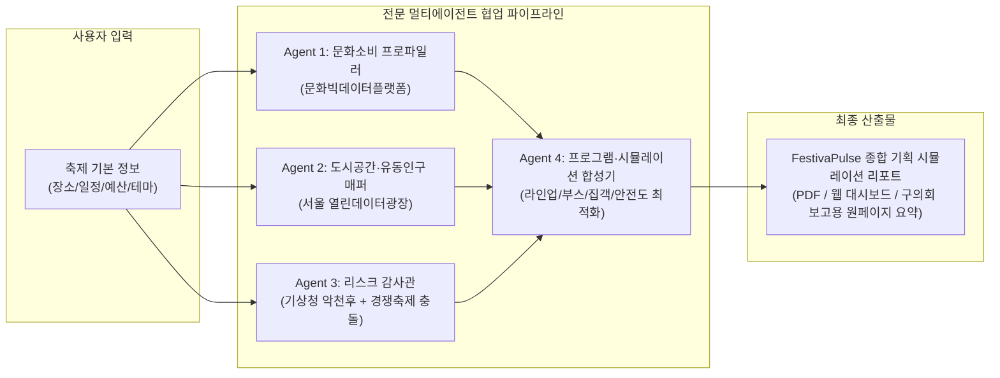
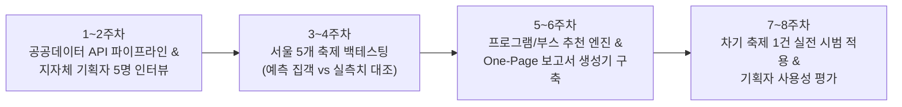

# [기획안 v0.1] 문화빅데이터플랫폼 및 공공데이터 기반 지역 축제·문화행사 흥행 예측 및 프로그램 최적화 리서치 멀티에이전트 (FestivaPulse)

- **담당**: R04 원민 (프론트엔드 / 사용자 흐름)
- **상태**: v0.1 기획 초안
- **작성일**: 2026-11-18
- **기획 대상**: 문화빅데이터플랫폼, 서울 열린데이터광장, 공공데이터포털 연계 축제 기획 시뮬레이션 멀티에이전트 시스템
- **출처 및 참조 문서**:
  - 문화빅데이터플랫폼 (`https://www.bigdata-culture.kr/bigdata/user/main.do`)
  - 서울 열린데이터광장 실시간 도시데이터 및 상권분석 (`https://data.seoul.go.kr/`)
  - 공공데이터포털 기상청 기상자료개방포털 및 전국공연축제표준데이터 (`https://www.data.go.kr/`)
  - [공공데이터 활용 리서치 멀티에이전트 서비스 아이디어 10선](2026-11-18_R04_공공데이터_활용_리서치_멀티에이전트_서비스_아이디어_10선.md)
  - [FestivaPulse 기술검토 및 세부 해결안](2026-11-18_R04_지역축제_문화행사_흥행예측_기술검토_및_해결안.md)

---

## 0. 기획 배경 및 문제의식

전국 지방자치단체 및 문화재단이 주최하는 지역 축제와 문화행사는 매년 수천 건에 달하며, 투입되는 공공 예산만 연간 수조 원에 이릅니다. 지역 경제 활성화와 주민 문화 향유라는 명분에도 불구하고, 현업의 기획 및 운영 실태는 다음과 같은 만성적 문제점에 직면해 있습니다:

1. **"감(Intuition)과 전년도 관행 복사"에 의존하는 주먹구구식 기획**:
   - 담당 주무관과 기획자가 교체될 때마다 전년도 한글(HWP) 기획서 서식과 예산안을 그대로 복사하여 답습합니다.
   - 실제 행사 예정지의 배후 유동인구 연령층이나 소비 성향을 정밀 분석하지 않고, 기획자의 주관적 취향이나 섭외 가능한 연예인 위주로 무대 프로그램을 편성하여 타깃 관람객과의 미스매칭이 발생합니다.
2. **이종 공공데이터의 극심한 사일로화(Silo)**:
   - 문화예술 소비 성향(문화빅데이터플랫폼), 유동인구 및 상권(서울 열린데이터광장), 날씨 및 기후 리스크(기상청), 유사 축제 일정(공공데이터포털) 등 유용한 공공데이터가 완전히 분절되어 있습니다.
   - 기획자가 이를 종합 대조하여 시뮬레이션하기에는 데이터 가공 역량과 시간이 턱없이 부족합니다.
3. **일정 충돌 및 기상 악천후로 인한 흥행 참패와 예산 매몰**:
   - 인근 자치구에서 동일 주말에 대형 축제가 열리는 사실을 뒤늦게 알거나, 해당 지역의 과거 5개년 국지성 호우·강풍 통계를 확인하지 않고 야외 부스를 설치했다가 행사가 파행을 겪고 수억 원의 지자체 예산이 허공으로 사라집니다.

본 기획은 **문화빅데이터플랫폼 + 서울시 실시간 도시데이터 + 기상청 및 전국 축제 표준데이터**를 연계하여, 축제 기획 초기 단계에서 **"지역민 문화소비 성향 ➔ 배후지 시공간 유동인구 ➔ 기상·경쟁 축제 위험도"를 다각도로 교차 검증하고, 최적의 프로그램·부스 편성안 및 예상 집객 시뮬레이션 보고서를 자율 도출하는 리서치 멀티에이전트(FestivaPulse)**를 제안합니다.

---

## 1. Target User & Field Pain Points (타겟 사용자와 현업의 고통)

### 1.1 타겟 사용자 정의
- **1차 사용자 (Core User)**:
  - 지자체 문화재단(예: 서울문화재단, 마포문화재단 등) 축제·공연 기획팀 주무관 및 대리급 실무자
  - 축제·이벤트 전문 기획대행사(PCO, 대행사) AE 및 기획팀장
- **2차 의사결정자 (Buyer / Approver)**:
  - 지자체 문화관광과장, 문화재단 본부장/대표이사
  - 시·구의회 문화복지위원회 예산 심의위원 (사후 성과 평가 및 감사 담당)

### 1.2 사용자 상황 및 업무 흐름 (As-Is vs To-Be)

```mermaid
flowchart TD
    subgraph AsIs["현재 축제 기획 흐름 (As-Is)"]
        A1["전년도 기획서 복사 및 감에 의한 기획"] --> A2["공공 포털/포털 검색 (개별 수기 조사 3~4주)"]
        A2 --> A3["연예인/무대 위주 관행적 프로그램 편성"]
        A3 --> A4["현장 운영: 타깃 불일치 / 우천·경쟁축제로 집객 실패"]
        A4 --> A5["수억 원 예산 낭비 및 의회 감사 지적"]
    end

    subgraph ToBe["FestivaPulse 도입 후 (To-Be)"]
        B1["행사 테마 / 후보 장소 / 일정 1차 입력"] --> B2["멀티에이전트 자율 교차 리서치 (10분)"]
        B2 --> B3["배후 유동인구 + 문화소비 + 날씨 + 경쟁축제 종합 분석"]
        B3 --> B4["데이터 기반 최적 시간대별 프로그램 & F&B 부스 추천"]
        B4 --> B5["예상 집객수 및 안전 밀집도 시뮬레이션 보고서 도출"]
        B5 --> B6["기획 성공률 극대화 및 지자체 예산 집행 타당성 확보"]
    end
```

### 1.3 구체적 정량/정성 Pain Points
1. **과도한 사전 리서치 및 기획서 작성 기간 (3~4주 소요)**:
   - 지역 문화 현황 조사, 인근 상권 분석, 섭외 타당성 조사를 엑셀과 한글 문서로 일일이 작성하느라 정작 현장 안전 및 주민 소통에 쓸 시간이 부족함.
2. **수억 원 예산 투입 대비 집객 목표 미달 (예산 낭비)**:
   - 행사 1건당 평균 2억~8억 원의 시·구비가 투입되나, 타깃 관람객 연령 불일치로 집객 목표치 대비 40% 이상 미달하는 사례 빈번.
3. **군중 밀집도 및 안전사고 통제 미비**:
   - 시간대별 예상 방문객 집중 시간과 병목 지점을 사전에 수치로 예측하지 못해 안전요원 배치 오류 및 안전사고 위험 노출.
4. **객관적 근거 부재로 인한 심의 통과 난항**:
   - "왜 이 가수를 부르는가?", "왜 F&B 부스를 여기에 20개 배치하는가?"에 대해 상급자 및 구의회를 설득할 객관적 데이터 지표가 없음.

---

## 2. Existing Alternatives & Remaining Pain (기존 대안과 남는 고통)

| 기존 대안 | 제공하는 가치 | 한계점 및 사용자가 여전히 겪는 고통 (Remaining Pain) |
| :--- | :--- | :--- |
| **통신사 빅데이터 유동인구 보고서** (SKT 지오비전, KT 빅데이터 등) | 행정동/격자 단위 정밀 유동인구 통계 제공 | • 건당 **수백만~수천만 원의 고비용** 발생 • 대부분 **"사후 집계 보고서"** 형태여서 기획 단계에서 프로그램 편성 인사이트를 주지 못함 • 문화 소비 성향이나 날씨 리스크와의 결합 불가 |
| **행사 전문 기획대행사(PCO) 외주 용역** | 기획안 작성부터 무대 연출, 현장 운영 일괄 대행 | • 제안 용역비만 수천만 원 소요 • 대행사 역시 데이터 기반 분석보다는 기존 섭외 네트워크와 시각적 화려함 위주로 제안하여 실패 위험 잔존 |
| **공공데이터포털 수기 다운로드** | 무료 오픈 API 및 CSV 데이터 | • **시공간 단위 불일치**: 문화소비 데이터는 시·군·구 단위, 도시데이터는 격자/포인트 단위, 기상청은 관측소 단위여서 일반 기획자가 결합 분석 불가 • 방대한 수치를 기획 인사이트(무대 라인업, 부스 종류)로 변환해주는 추론 레이어 부재 |

> **핵심 차별화 영역 (Painkiller Seam)**:
> 고가의 상용 통신사 데이터를 구매할 수 없는 지자체 실무자를 위해, **무료 공공 빅데이터(문화 + 실시간 도시 + 기상 + 축제)를 멀티에이전트가 10분 만에 시공간 결합하여 '흥행 가능성 - 위험 요인 - 추천 프로그램 편성 - 안전 밀집도'를 원스톱으로 시뮬레이션**해 줌.

---

## 3. Problem Statement (문제 정의 한 문장)

> **"지자체 및 문화재단 축제 기획자가 수억 원의 공공 예산을 투입하면서도, 배후 유동인구 특성·문화소비 성향·기상 및 경쟁 축제 리스크를 종합 시뮬레이션하지 못해 관행적 기획에 따른 집객 실패, 예산 낭비, 의회 감사 지적의 불안을 겪고 있다."**

---

## 4. Solution & Key Features (솔루션 및 4대 핵심 피처)

### [FEAT-01] 문화소비 성향 및 관람객 선호 분석기 (Culture Profiler)
- **데이터 소스**: 문화빅데이터플랫폼(공연/축제 소비 데이터, 지역별 문화 향유 실태, 도서/콘텐츠 선호도)
- **핵심 기능**:
  - 축제 대상 자치구 및 인접 지역민의 최근 3개년 문화소비 결제 패턴 및 선호 장르(인디밴드, 전통예술, 클래식, 가족극, 힙합 등) 추출.
  - 연령대별(2030 청년, 4050 학부모, 65+ 고령층) 지배적 여가 소비 키워드 클러스터링.

### [FEAT-02] 행사장 배후지 시공간 유동인구 매퍼 (Urban Spatial Mapper)
- **데이터 소스**: 서울 열린데이터광장(실시간 도시데이터 API, 대중교통 지하철/버스 승하차 API, 우리마을가게 상권분석)
- **핵심 기능**:
  - 행사 예정지 반경 1km 공간의 요일별, 시간대별(10시~22시) 유동인구 볼륨 및 성별·연령 분포 추정.
  - 대중교통 접근성 및 인근 식음료(F&B) 상권 인프라 용량(동시 수용 가능 인원) 계산.

### [FEAT-03] 일정 충돌 및 기상 악천후 리스크 감사관 (Risk Auditor)
- **데이터 소스**: 공공데이터포털(전국공연축제표준데이터, 기상청 기상자료개방포털 과거 기후통계 API)
- **핵심 기능**:
  - **경쟁 행사 충돌 검사**: 반경 10km 이내, 동일 주말에 개최 예정인 타 지자체·민간 대형 축제 스케줄 자동 크롤링 및 타깃 관람객 분산 위험도 경고.
  - **기후 리스크 검사**: 과거 10개년 해당 주간의 평균 강수 확률, 일 최고기온/최저기온, 강풍 일수를 분석하여 "야외 부스 침수/강풍 붕괴 위험 등급" 부여.

### [FEAT-04] 프로그램·부스 편성 최적화 및 집객 시뮬레이터 (Program Synthesizer)
- **핵심 기능**:
  - 에이전트 1~3의 분석값을 종합하여, 타깃 방문객 페르소나에 최적화된 **시간대별 무대 타임테이블(공연 장르 및 추천 아티스트 성향)** 자동 도출.
  - 배후 상권과의 상생을 고려한 **F&B 푸드트럭 및 체험 부스 적정 수량·카테고리 비율** 추천.
  - **시간대별 예상 집객 수 및 안전 밀집도 지수(1㎡당 인원수)** 산출 ➔ 안전요원 필요 인원 및 병목 구역 가이드 제시.
  - 구의회 및 상급자 보고용 **"데이터 기반 축제 타당성 검토 요약본(One-Page Summary)"** 즉시 발행.

---

## 5. Truth, Hypothesis, Counter-evidence, Unknowns (사실/가설/반대근거/미확인 분리)

| 구분 | 주요 내용 | 검증 방안 및 통제 계획 |
| :--- | :--- | :--- |
| **사실 (Fact)** *이미 입증된 사실* | • 문화빅데이터플랫폼, 서울 열린데이터광장, 기상청 데이터는 오픈 API 또는 정기 CSV로 무료 제공됨. • 지자체 축제 기획 시 구의회 보고 및 내부 결재를 위한 객관적 근거 문서가 필수적임. • 야외 행사는 기상(우천) 및 인근 경쟁 행사에 따라 관람객 편차가 50% 이상 발생함. | 실제 공공 API 호출 테스트 및 데이터 스키마 정합성 검증 완료. |
| **가설 (Hypothesis)** *검증이 필요한 전제* | • 문화소비 데이터와 실시간 유동인구 데이터를 결합하면, 축제 당일 시간대별 집객수를 오차율 25% 이내로 사전 예측할 수 있을 것이다. • 공무원/기획자는 감에 의한 기획보다 AI가 제시한 데이터 기반 라인업과 부스 배치안을 실제 기획서에 70% 이상 채택할 것이다. | 서울시 내 최근 1년간 개최된 축제 5건(마포, 반포 등)의 사후 실측 유동인구와 모델 예측치 백테스팅(Back-testing). |
| **가장 강한 반대 근거 (Counter-evidence)** | • 축제 흥행은 섭외된 '초청 연예인 1명의 파급력(팬덤 동원)'에 의해 좌우되므로, 배후 유동인구나 지역 소비 성향 모델링의 영향력이 미미할 수 있음. • 지자체 축제는 지역구 의원이나 단체장의 입김, 지역 상인회의 입김이 강해 데이터 기반 최적화안이 현장에 그대로 반영되기 어려움. | 연예인 의존형 축제가 아닌 '지역 커뮤니티·문화 체험형 축제(예산 2~5억 원 규모)'로 1차 타깃을 집중 정의. |
| **미확인 사항 (Unknowns)** | • 서울 외 지방 소도시의 경우 실시간 도시데이터(지하철/버스/혼잡도) 인프라가 서울만큼 촘촘하지 않아 예측 정밀도가 떨어질 위험. • 문화빅데이터플랫폼의 카드 소비 데이터 업데이트 주기가 월/분기 단위여서 실시간성 반영 한계 존재. | 서울 및 수도권(데이터 인프라 완비 지역)을 Phase 1 타깃으로 제한하고, 전국 확장은 정적 인구통계 보정 모델 적용. |

---

## 6. 8-Week MVP Validation Plan & Kill Criteria (8주 MVP 검증 계획 및 중단 조건)

### 6.1 8주 MVP 검증 로드맵

- **1~2주차: 데이터 파이프라인 연동 및 현업 인터뷰**
  - 서울 열린데이터광장(도시데이터), 문화빅데이터플랫폼, 기상청 API 연동 파이프라인 구축.
  - 마포문화재단, 종로문화재단 등 지자체 축제 실무자 5명 심층 인터뷰(기획서 작성 애로사항 및 보고 시 필수 지표 확인).
- **3~4주차: 과거 축제 데이터 기반 백테스팅 (Back-testing)**
  - 2024~2025년 서울시 내 주요 축제 5건(예: 신촌 물총축제, 마포 서강나루 축제 등)에 대해 당시 날씨·경쟁행사·배후인구를 입력하고, 실제 집객수와의 상관계수 검증.
- **5~6주차: 멀티에이전트 오케스트레이션 및 리포트 생성기 개발**
  - 4개 전문 에이전트(문화, 공간, 위험, 합성) 연계 및 PDF/웹 시뮬레이션 리포트 생성기 구현.
- **7~8주차: 지자체/PCO 대상 실전 PoC 시범 적용**
  - 2027년 상반기 개최 예정인 지자체 축제 1건의 기획안 작성에 실제 시뮬레이터 적용 후 기획자 정량/정성 평가 수집.

### 6.2 중단 조건 (Kill Criteria)
다음 3가지 조건 중 하나라도 충족될 경우 프로젝트를 즉시 중단(Pivot 또는 Kill)합니다:
1. **[예측 타당성 미달]** 과거 5개 축제 백테스팅 결과, 모델의 시간대별 집객수 예측 오차율(MAPE)이 40%를 초과하여 통계적 유의미성을 확보하지 못할 때.
2. **[현업 유용성 기각]** 인터뷰 및 PoC에 참여한 지자체 실무자 5명 중 4명 이상이 "이 보고서가 있어도 구의회/상급자 결재에 실질적 도움이 되지 않는다"고 응답할 때.
3. **[데이터 접근성 차단]** 서울시 실시간 도시데이터 또는 문화빅데이터플랫폼의 핵심 API 접근이 영구 제한되거나 라이선스 문제로 상용 서비스화가 불가능할 때.

---

## 7. Business Impact & Value Proposition (도입 가치)

1. **기획 소요 시간 70% 단축**: 3~4주 걸리던 선행 조사 및 기획서 초안 작성 작업을 단 **10분** 만에 고품질 데이터 기반으로 완료.
2. **공공 예산 집행 타당성 확보**: 감에 의존한 편성이 아닌 "객관적 공공데이터 지표"를 첨부하여 구의회 감사 지적 방어 및 상급 기관 평가 가점 획득.
3. **안전사고 제로화**: 시간대별 병목 구역과 최대 밀집도 사전 시뮬레이션을 통해 경찰/소방/안전요원의 최적 배치 가이드라인 제공.
