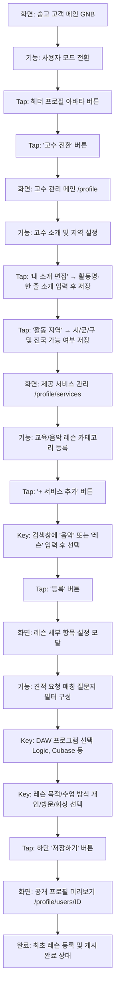

# 숨고(Soomgo) 분석 기반 고수전환·등록 및 교육신청 사용자흐름·서비스절차 설계 보고서

- **문서 ID:** REPORT-RESEARCH-SOOMGO-FLOW-20261124
- **작성일자:** 2026-11-24
- **분석 대상:** 숨고(https://soomgo.com/) 실서비스 프로덕션 UI/UX
- **참조 프레임워크:** 마이 에이아이 오피스(My AI Office) 유저 플로우(UFL) 및 서비스 흐름도(SFL) 표준 규격
- **연계 프로젝트:** R02 음악 레슨 강사 플랫폼 등록 지원 서비스 (PHASE-20261123-01 / TASK-030)

---

## 1. 분석 개요 및 목적

### 1.1 배경 및 목적
본 보고서는 국내 대표 전문가 매칭 플랫폼인 **숨고(Soomgo)**의 실제 서비스 동작 체계를 라이브 브라우징 분석(`ego-browser`)하여, 우리 프로젝트의 핵심 타깃인 **"음악 레슨 강사의 최초 고수 전환, 프로필 등록, 교육/레슨 서비스 카테고리 신청 및 상세 항목 게시"** 절차를 심층 분석한 결과물입니다.

특히, **마이 에이아이 오피스(My AI Office)**의 정규 아키텍처 메뉴인 **「사용자흐름설계(User Flow)」**와 **「서비스절차설계(Service Flow)」** 표준 데이터 구조(JSON 및 Mermaid 다이어그램 규격)를 그대로 계승·투영하여, 추후 우리 서비스의 자동/반자동 등록 파이프라인 설계에 즉시 반영될 수 있는 정량적 설계 사양을 제공합니다.

### 1.2 핵심 분석 영역
1. **고객/고수 모드 전환 체계 (Role Switch):** 단일 계정 내 고객 모드 ↔ 고수 모드 전환 및 최초 고수 온보딩 동선
2. **고수 프로필 관리 아키텍처 (Profile Hub):** 프로필 완성도(%) 기반의 단계별 진척 유도 체계 (기본정보 / 전문성 / 신뢰도 / 서비스 범위)
3. **교육(음악 레슨) 카테고리 신청 및 등록 (Service Catalog):** 서비스 검색, 추천 서비스 추가, 제공 서비스 목록 관리
4. **서비스 상세 질문·필터 설정 (Questionnaire & Matching Criteria):** 소프트웨어 툴(Logic, Cubase 등), 목적(취미/입시), 수업방식, 대상 연령 등 세부 속성 매핑
5. **게시 및 고객 노출 (Public Presentation):** 고수 프로필 공개 뷰(미리보기) 및 견적 요청 진입점

---

## 2. 마이 에이아이 오피스(My AI Office) 설계 프레임워크 참조 기준

본 분석은 마이 에이아이 오피스의 표준 설계 원본(`planning/user-flows.json`, `planning/service-flows.json`, `service-flow.js`, `user-flow.js`)의 규칙을 엄격히 준용합니다.

| 구분 | 유저 플로우 (User Flow, UFL) | 서비스 절차/흐름도 (Service Flow, SFL) |
| :--- | :--- | :--- |
| **목적** | 사용자의 행동 및 시스템 결정에 따른 분기/결합 논리적 흐름 구조화 | 화면 내 구체적인 인터랙션(`Tap`, `Drag` 등)과 단계별 처리 상태 직렬화 |
| **기본 방향** | 좌우(LR) 또는 상하(TD) 네트워크 그래프 | 세로(Vertical) 순차 프로세스 흐름 |
| **요소 유형** | - `terminal`: 시작/종료 노드<br>- `process`: 화면 및 프로세스<br>- `decision`: 분기/선택 조건<br>- `output`: 결과 및 시스템 출력<br>- `merge`: 분기 결합 노드 | - `screen`: 단위 화면 명칭<br>- `func`: 핵심 기능 단위<br>- `step`: 일반 인터랙션 동작 (`Tap: ...`)<br>- `key`: 핵심 입력/선택 이벤트<br>- `done`: 절차 완료 상태 |
| **표현 형식** | Mermaid `flowchart LR` / `flowchart TD` + Nodes/Edges Schema | Mermaid `graph TD` + Steps / Action Schema |

---

## 3. 숨고 고수 등록 및 교육신청 실서비스 구조 분석

### 3.1 단일 계정 기반 전환(Role Switching) 메커니즘
- 숨고는 고객(의뢰인) 계정과 고수(전문가) 계정을 별도로 분리하지 않고 **단일 로그인 세션 내에서 스위칭(`btn.change-user-type`)**하는 아키텍처를 취합니다.
- **고객 모드:** GNB에 `견적요청`, `고수찾기`, `둘러보기`, `바로예약`, `받은견적` 노출 → 사용자 드롭다운 메뉴 최하단에 `[고수 전환]` 버튼 배치.
- **고수 모드:** GNB에 `요청･견적`, `스마트견적`, `채팅`, `프로필`, `캐시충전(스토어)` 노출 → 사용자 드롭다운 메뉴 최하단에 `[고객 전환]` 버튼 배치.
- **신규 전환 시:** 미등록 사용자일 경우 고수 기본 정보(활동 지역, 대표 서비스 1종)를 입력받는 약식 온보딩 단계를 거쳐 즉시 고수 프로필 허브로 진입합니다.

### 3.2 고수 프로필 완성도(Gamified Completion) 유도 구조
숨고는 등록 장벽을 낮추기 위해 최소 정보만으로도 고수 전환을 허용하되, `/profile` 종합 화면에서 **완성도 지표(예: 15% 완성)**를 제시하여 추가 등록을 유도합니다:
1. **기본 정보 설정:** 프로필 이미지, 한 줄 소개(80자 제한), 대표 서비스 지정
2. **서비스 범위 등록:** 활동 지역(시/군/구 단위), 활동 가능 범위(전국 이동 가능 또는 반경 설정), 제공 서비스 목록
3. **전문성 증명:** 경력/학력(각 10%), 서비스 상세설명(10%), 사진 및 동영상(10%), 포트폴리오(10%), 질문답변(10%)
4. **신뢰도 및 정산:** 본인인증(5%), 사업자등록증, 공식 자격증, 결제수단(5%), 숨고페이 계좌(10%)

### 3.3 교육(음악 레슨) 카테고리 신청 및 세부 질문지(Questionnaire) 구조
숨고의 교육 서비스 등록은 단순 텍스트 작성이 아니라, **고객의 견적 요청서 질문과 1:1로 맞물리는 '선택형 질문 필터'**를 설정하는 방식입니다.

- **진입 경로:** `/profile` → `제공 서비스` 카드 클릭 → `/profile/services` 이동
- **카테고리 탐색:**
  - 상단에 현재 등록된 서비스 리스트(예: `미디/컴퓨터작곡 레슨`) 표시
  - `[+ 서비스 추가]` 버튼 클릭 시 대화형 모달 오픈
  - 검색창(`"서비스를 빠르게 찾아보세요"`)에 키워드("음악", "레슨", "작곡" 등) 입력 시 즉시 연관 카테고리 실시간 필터링
  - 또는 하단 추천 서비스 칩(`작곡/편곡 레슨`, `음향/레코딩 레슨`, `보컬 레슨` 등) 원클릭 추가
- **레슨 세부 속성(질문지 매칭 필터) 설정 항목:**
  1. **사용 소프트웨어/장비:** 로직 프로 X, 큐베이스, 에이블톤 라이브, FL 스튜디오, 개러지밴드, 상담 후 결정 등
  2. **레슨 목적:** 취미, 입시 준비, 전문 작업 준비
  3. **선수 지식(악기 연주 능력):** 건반 연주 가능, 코드만 가능, 전혀 불가
  4. **수강생 연령대:** 10대 미만 ~ 50대 이상 (복수 선택)
  5. **수강생 성별:** 남자, 여자
  6. **레슨 진행 형태:** 1:1 개인 레슨, 그룹 레슨, 학원, 온라인/화상 레슨
  7. **진행 장소/방식:** 고수 작업실 방문, 수강생 방문(출장), 온라인 원격 수업, 무관

### 3.4 공개 프로필 게시(Public Profile Preview)
- 모든 필수 설정이 완료되거나 저장되면 즉시 `https://soomgo.com/profile/users/{userId}` 형태의 고유 URL이 발급됩니다.
- 고객 검색 결과에 노출되며, 고객은 해당 화면에서 고수의 활동명, 한 줄 소개, 대표 레슨 서비스, 포트폴리오, 활동 지역을 확인하고 `[견적 요청하기]` 또는 `[지정 요청]`을 보낼 수 있습니다.

---

## 4. [마이 에이아이 오피스 표준] 유저 플로우 (User Flow, UFL) 설계서

### 4.1 유저 플로우 다이어그램 (Mermaid)

```mermaid
flowchart LR
    Start([시작]) --> Login[숨고 로그인 세션]
    Login --> ModeCheck{현재 계정 상태}
    
    ModeCheck -- "고객 모드" --> UserGNB[고객 GNB 메뉴]
    UserGNB --> ClickSwitch[사용자 메뉴 '고수 전환' 클릭]
    ClickSwitch --> SwitchSuccess[고수 모드로 즉시 전환]
    
    ModeCheck -- "고수 모드" --> GosuGNB[고수 GNB 메뉴]
    SwitchSuccess --> GosuGNB
    
    GosuGNB --> NavProfile[프로필 관리 화면 /profile]
    NavProfile --> CompCheck{프로필 필수 항목 확인}
    
    CompCheck --> IntroEdit[내 소개/활동명/시간 편집]
    CompCheck --> LocEdit[활동 지역/이동범위 설정]
    CompCheck --> ServiceNav[제공 서비스 관리 /profile/services]
    
    ServiceNav --> AddServiceBtn[+ 서비스 추가 클릭]
    AddServiceBtn --> SearchModal[서비스 검색/선택 모달]
    SearchModal --> InputKeyword[음악/레슨 키워드 검색 또는 추천 칩 선택]
    InputKeyword --> SelectCategory[카테고리 선택 e.g. 미디/작곡 레슨]
    SelectCategory --> ConfirmAdd[서비스 목록에 추가 완료]
    
    ConfirmAdd --> DetailConfig[레슨 세부 항목/질문지 설정]
    DetailConfig --> SetTool[소프트웨어 DAW/악기 선택]
    SetTool --> SetTarget[목적/연령/성별 대상 선택]
    SetTarget --> SetMethod[수업 방식 개인/방문/화상 선택]
    SetMethod --> SaveDetail[세부 항목 저장]
    
    IntroEdit --> MergeProfile((프로필 통합))
    LocEdit --> MergeProfile
    SaveDetail --> MergeProfile
    
    MergeProfile --> PreviewBtn[미리보기 버튼 클릭]
    PreviewBtn --> PublicView[고객 공개 프로필 화면 /profile/users/ID]
    PublicView --> Published([최초 고수등록 및 레슨 게시 완료])
```



### 4.2 유저 플로우 노드·엣지 명세서 (UFL Schema)

```json
{
  "id": "UFL-SOOMGO-001",
  "title": "숨고 고수전환 및 최초 레슨 등록·게시 흐름",
  "category": "전문가 온보딩 / 레슨 등록",
  "lead": "숨고 일반 계정에서 고수로 전환한 뒤 음악 레슨 카테고리를 검색·추가하고 세부 매칭 질문지를 구성하여 최종 프로필을 게시하는 전체 사용자 흐름입니다.",
  "page": "soomgo.com/profile",
  "dir": "LR",
  "nodes": [
    { "id": "n1", "type": "terminal", "label": "시작", "note": "숨고 웹 접속" },
    { "id": "n2", "type": "process", "label": "로그인 세션 확인", "note": "간편/일반 로그인 유지" },
    { "id": "n3", "type": "decision", "label": "고객/고수 모드 판별", "note": "현재 active role 확인" },
    { "id": "n4", "type": "process", "label": "고수 모드 전환", "note": "드롭다운 '고수 전환' 클릭" },
    { "id": "n5", "type": "process", "label": "프로필 관리 대시보드", "note": "/profile 진입 및 완성도 점검" },
    { "id": "n6", "type": "process", "label": "제공 서비스 설정 이동", "note": "/profile/services 이동" },
    { "id": "n7", "type": "process", "label": "서비스 카테고리 검색", "note": "음악/작곡/레슨 검색 모달" },
    { "id": "n8", "type": "process", "label": "레슨 세부 항목 매핑", "note": "DAW, 레슨 목적, 온·오프라인 형태 설정" },
    { "id": "n9", "type": "process", "label": "활동 지역 및 소개 설정", "note": "활동 가능 반경 및 소개글 동기화" },
    { "id": "n10", "type": "output", "label": "공개 프로필 미리보기", "note": "/profile/users/{id} 노출 검증" },
    { "id": "n11", "type": "terminal", "label": "게시 완료", "note": "고객 견적 요청 수신 준비 완료" }
  ]
}
```

---

## 5. [마이 에이아이 오피스 표준] 서비스 절차 (Service Flow, SFL) 설계서

### 5.1 서비스 절차 흐름도 (Mermaid)



### 5.2 서비스 절차 단계별 명세서 (SFL Steps Schema)

```json
{
  "id": "SFL-SOOMGO-001",
  "title": "숨고 최초 고수등록 및 음악 레슨 게시 서비스 절차",
  "category": "전문가등록/레슨게시",
  "lead": "고객 모드에서 고수로 전환한 뒤 프로필 기본정보, 음악 레슨 카테고리 추가, 세부 견적 질문지 설정 및 공개 게시까지의 UI 인터랙션 단위 서비스 절차입니다.",
  "page": "/profile",
  "steps": [
    {
      "type": "screen",
      "label": "GNB 헤더 영역",
      "action": ""
    },
    {
      "type": "func",
      "label": "고수 모드 전환",
      "action": ""
    },
    {
      "type": "step",
      "label": "프로필 메뉴 열기",
      "action": "Tap: 헤더 우측 사용자 아바타 아이콘 클릭"
    },
    {
      "type": "step",
      "label": "고수 전환 실행",
      "action": "Tap: 드롭다운 내 '고수 전환' 버튼 클릭"
    },
    {
      "type": "screen",
      "label": "고수 프로필 종합 관리 화면 (/profile)",
      "action": ""
    },
    {
      "type": "func",
      "label": "강사 기본 소개 및 활동지 등록",
      "action": ""
    },
    {
      "type": "step",
      "label": "내 소개 편집",
      "action": "Tap: '내 소개 편집' 클릭 후 활동명(30자), 한 줄 소개(80자), 연락시간 지정 후 저장"
    },
    {
      "type": "step",
      "label": "활동 지역 설정",
      "action": "Tap: '활동 지역' 및 '활동 가능 범위' 클릭하여 거점 및 출장 반경 설정"
    },
    {
      "type": "screen",
      "label": "제공 서비스 관리 화면 (/profile/services)",
      "action": ""
    },
    {
      "type": "func",
      "label": "음악 레슨 카테고리 신청 및 등록",
      "action": ""
    },
    {
      "type": "step",
      "label": "서비스 추가 진입",
      "action": "Tap: '+ 서비스 추가' 버튼 클릭"
    },
    {
      "type": "key",
      "label": "서비스 검색 및 선택",
      "action": "Key: 검색창에 '음악' 또는 '미디' 입력 후 '미디/컴퓨터작곡 레슨' 체크"
    },
    {
      "type": "step",
      "label": "서비스 1차 등록",
      "action": "Tap: '등록' 버튼 클릭"
    },
    {
      "type": "screen",
      "label": "레슨 세부 항목 설정 화면",
      "action": ""
    },
    {
      "type": "func",
      "label": "고객 매칭용 세부 질문지 필터 설정",
      "action": ""
    },
    {
      "type": "key",
      "label": "소프트웨어 도구 선택",
      "action": "Key: 로직 프로 X, 큐베이스, 에이블톤, FL 스튜디오 등 복수 체크"
    },
    {
      "type": "key",
      "label": "수업 목적 및 형태 선택",
      "action": "Key: 취미/입시 준비 및 1:1개인레슨, 방문/화상 수업 방식 선택"
    },
    {
      "type": "step",
      "label": "세부 항목 저장",
      "action": "Tap: 하단 '저장하기' 버튼 클릭"
    },
    {
      "type": "screen",
      "label": "공개 프로필 미리보기 화면 (/profile/users/{id})",
      "action": ""
    },
    {
      "type": "done",
      "label": "고수등록 및 레슨 게시 완료",
      "action": "고객 검색 리스트 노출 및 견적 요청 수신 대기 상태 도달"
    }
  ]
}
```

---

## 6. 우리 프로젝트(R02 음악 레슨 자동/반자동 등록 지원)에의 적용점 및 시사점

### 6.1 크몽·탈잉 대비 숨고의 아키텍처적 특성 비교
1. **사전 승인 심사 대기 없음:** 크몽은 판매글 등록 후 1~3일간의 전문가 심사(반려/승인)가 필수적이나, 숨고는 **프로필과 서비스 항목을 등록하는 즉시 실시간 공개/게시**됩니다.
2. **단일 계정 스위칭의 이점:** 별도의 복잡한 강사 승인 절차 없이, 일반 계정에서 스위칭 버튼 클릭 1회로 고수 권한이 부여되므로 초기 진입 장벽이 가장 낮습니다.
3. **질문지 기반 매칭 필터의 중요성:** 숨고는 자유 양식의 긴 상세페이지보다 **'어떤 DAW를 가르치는지', '출장/방문/화상 중 무엇이 가능한지'**와 같은 정형화된 메타데이터가 견적 수신의 성패를 가릅니다.

### 6.2 자동화/반자동 보조 도구 설계 가이드라인
- **데이터 매핑 파이프라인:**
  우리 서비스가 강사로부터 1회 수집한 데이터(음악 전공, 보유 DAW, 거점 지역, 희망 수강료, 온/오프라인 여부)를 숨고의 7대 질문 항목(프로그램, 목적, 건반, 연령, 성별, 형태, 진행방식)에 1:1로 매핑하는 변환 룰셋을 정의합니다.
- **실행 모드 분리:**
  - `Plan A (브라우저 확장 보조)`: 강사가 숨고 로그인 상태를 유지한 상태에서, 확장 프로그램이 `/profile/services`의 질문지 폼을 원클릭으로 자동 체크하고 저장하도록 지원.
  - `Plan B (원격 브라우저 대행)`: 일회성 인증 후 서버 에이전트가 헤드리스/CDP 세션을 통해 입력 대행 (약관상 비정상 매크로 제약 검증 필요).
- **초안 관리:** 강사가 작성한 레슨 소개글(한 줄 소개 80자, 상세설명 500자 이상)을 글자수 제한에 맞게 사전에 교정하여 오탈자나 글자수 초과로 인한 등록 실패를 방지합니다.
