# 숨고(Soomgo) 고수전환 및 레슨 등록 절차 화면 스크린샷 상세 보고서

- **문서 ID:** REPORT-RESEARCH-SOOMGO-SCREENSHOTS-20261124
- **작성일자:** 2026-11-24
- **조사 환경:** macOS / ego-browser v2.2.1 / Chromium 브라우저 세션
- **연관 산출물:** [사용자흐름 및 서비스절차 분석 보고서](2026-11-24_숨고_고수등록_교육신청_사용자흐름_서비스절차_설계분석보고서.md)
- **스크린샷 저장 경로:** `docs/members/R04/workspace/screenshots/`

---

## 1. 개요 및 화면 흐름 요약

본 문서는 숨고(https://soomgo.com/)의 실제 웹 프로덕션 환경에서 **"고객 모드에서 고수 모드로의 전환 → 프로필 관리 대시보드 → 강사 소개 편집 → 음악/레슨 서비스 카테고리 검색 및 추가 → 레슨 세부 질문지/필터 설정 → 활동 지역 지정 → 포트폴리오 관리 → 최종 공개 프로필 미리보기 및 요청·견적 대시보드"**에 이르는 전 과정을 하나도 빠짐없이 캡처하고, 각 화면의 핵심 UI 요소와 동작 사양을 상세히 기록한 스크린샷 절차 화면 보고서입니다.

---

## 2. 단계별 화면 상세 분석 및 스크린샷

### STEP 01. 숨고 메인 홈 화면 (고수 계정 기본 GNB)
- **화면 설명:** 숨고 접속 시 로그인된 고수 계정의 기본 홈 화면입니다. 상단 GNB에 고수용 전용 메뉴(요청･견적, 스마트견적, 채팅, 프로필, 캐시충전)가 배치되어 있습니다.
- **주요 UI 요소:**
  - 좌측 상단: 로고 및 대메뉴 (견적요청, 고수찾기, 둘러보기)
  - 중앙: 서비스 검색창 및 AI 견적 요청 버튼
  - 우측 상단: 요청･견적, 스마트견적, 채팅, 프로필 링크, 사용자 프로필 아바타 버튼
- **스크린샷 파일:** [01_home.png](file:///Users/wonmin/orca/projects/Last%20Project/docs/members/R04/workspace/screenshots/01_home.png)

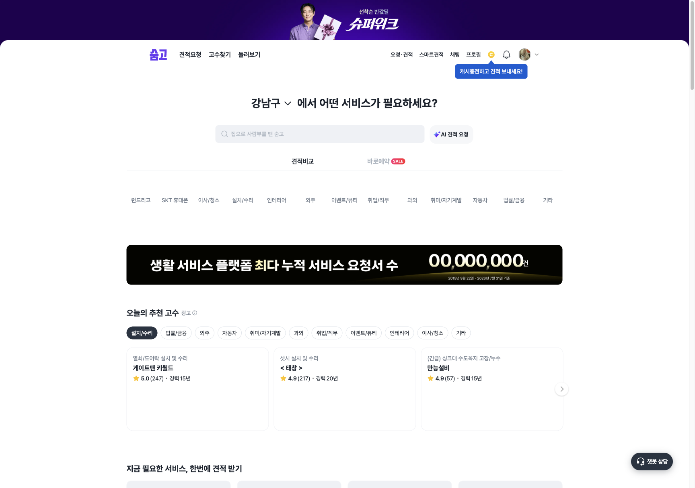

---

### STEP 02. 고수 계정 사용자 메뉴 (고객 전환 진입점)
- **화면 설명:** 헤더 우측 상단의 사용자 아바타를 클릭했을 때 열리는 드롭다운 메뉴입니다. 고수 활동명, 평점, 리뷰 요약, 프로필 관리, 마이페이지 링크와 함께 최하단에 **`[고객 전환]`** 버튼이 위치합니다.
- **주요 UI 요소:**
  - 고수 타이틀: `이원민 고수님`
  - 활동 요약: 평점 0, 리뷰 0
  - 메뉴 링크: `프로필 관리` (`/profile`), `마이페이지` (`/mypage`)
  - 모드 전환 버튼: `고객 전환` (`button.css-1vwyj90.er3ts4y4`)
  - 로그아웃 버튼
- **스크린샷 파일:** [02_user_menu.png](file:///Users/wonmin/orca/projects/Last%20Project/docs/members/R04/workspace/screenshots/02_user_menu.png)

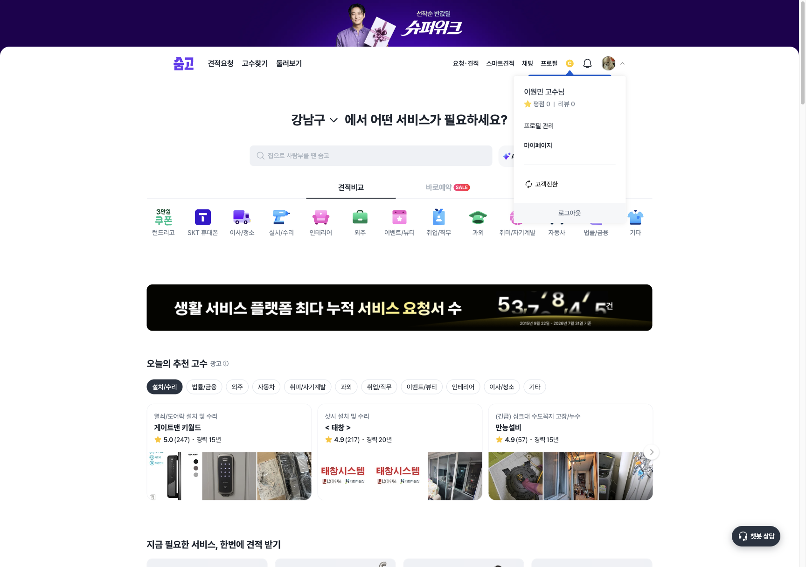

---

### STEP 03. 고객 모드로 전환된 메인 홈 화면
- **화면 설명:** `[고객 전환]` 버튼을 클릭하여 일반 의뢰인(고객) 모드로 전환된 상태의 홈 화면입니다. GNB의 고수용 메뉴가 고객용 메뉴로 동적 전환됩니다.
- **주요 UI 요소:**
  - GNB 변경: `요청･견적/스마트견적`이 사라지고 `받은견적` (`/received/quotes`), `채팅`, `고수찾기`, `바로예약`으로 교체
- **스크린샷 파일:** [03_customer_mode_home.png](file:///Users/wonmin/orca/projects/Last%20Project/docs/members/R04/workspace/screenshots/03_customer_mode_home.png)

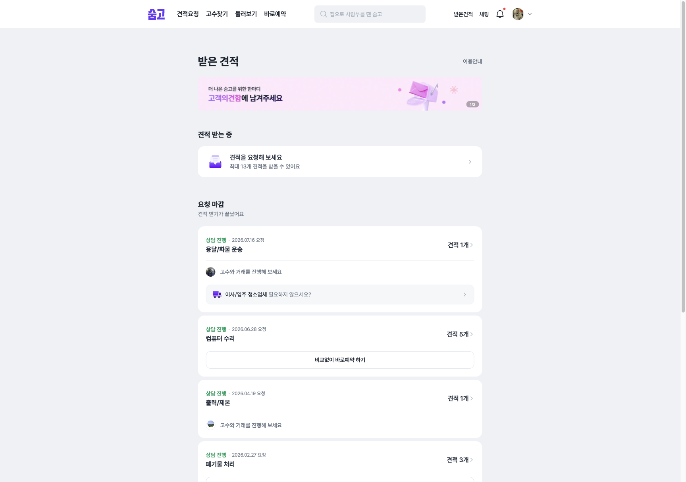

---

### STEP 04. 고객 모드 사용자 드롭다운 (고수 전환 진입점)
- **화면 설명:** 고객 모드 상태에서 다시 고수 모드로 돌아가거나 최초 고수로 활동하기 위한 진입점입니다.
- **주요 UI 요소:**
  - 사용자 명칭: `이원민 고객 님`
  - 고객용 메뉴: `받은견적`, `마이페이지`
  - 고수 전환 버튼: `[고수 전환]` (`button.er3ts4y4`) 클릭 시 즉시 고수 대시보드로 복귀/전환
- **스크린샷 파일:** [04_customer_dropdown_gosu_switch.png](file:///Users/wonmin/orca/projects/Last%20Project/docs/members/R04/workspace/screenshots/04_customer_dropdown_gosu_switch.png)

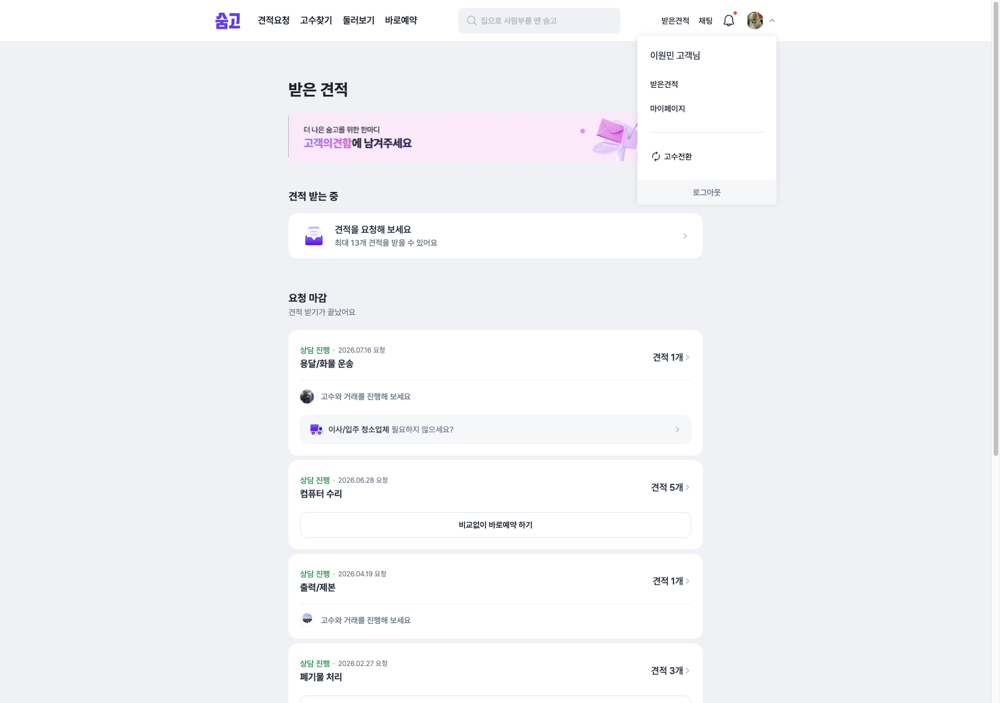

---

### STEP 05. 고수 모드 복귀 메인 화면 (요청·견적 홈)
- **화면 설명:** `[고수 전환]` 클릭 후 고수 전용 홈/대시보드로 전환된 화면입니다.
- **스크린샷 파일:** [05_gosu_home.png](file:///Users/wonmin/orca/projects/Last%20Project/docs/members/R04/workspace/screenshots/05_gosu_home.png)

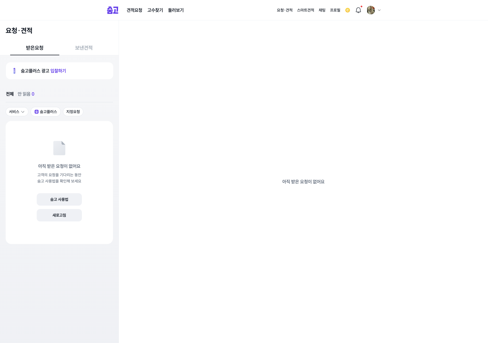

---

### STEP 06. 고수 프로필 종합 관리 대시보드 (`/profile`)
- **화면 설명:** 고수 활동의 모든 프로필과 레슨 정보를 등록·관리하는 메인 허브 화면입니다.
- **주요 UI 요소 및 섹션 구조:**
  1. **헤더 배너:** 프로필 사진, 고수 활동명(`이원민`), 대표 서비스명(`미디/컴퓨터작곡 레슨 서비스`), 평점/리뷰/고용수 요약
  2. **핵심 버튼:** `내 소개 편집`, `미리보기` (공개 화면 확인), `내 활동 분석`
  3. **완성도 프로그레스 바:** `15% 완성` (항목 입력 시 퍼센티지 증가하여 고수 등록 유도)
  4. **섹션 1: 서비스 범위:** 활동 지역, 활동 가능 범위(전국 이동 가능 등), 대표 서비스(5%), 제공 서비스 목록
  5. **섹션 2: 전문성 증명:** 경력(10%), 학력(10%), 서비스 상세 설명(10%), 사진 및 동영상(10%), 포트폴리오(10%), 질문답변(10%)
  6. **섹션 3: 신뢰도 및 결제:** 본인인증(5%), 사업자등록증, 공식 자격증, 결제 수단(5%), 숨고페이 정산정보(10%)
- **스크린샷 파일:** [06_gosu_profile_overview_full.png](file:///Users/wonmin/orca/projects/Last%20Project/docs/members/R04/workspace/screenshots/06_gosu_profile_overview_full.png)

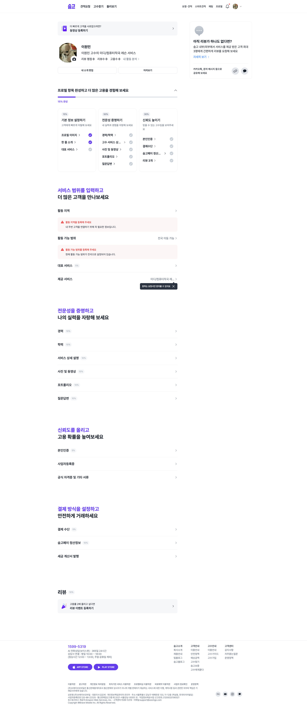

---

### STEP 07. 고수 내 소개 편집 모달
- **화면 설명:** `[내 소개 편집]` 클릭 시 노출되는 모달로, 강사의 기본 프로필 메타데이터를 설정합니다.
- **입력 필드 사양:**
  - `숨고 활동명`: 강사 이름 또는 예명/업체명 (최대 30자)
  - `한 줄 소개`: 검색 목록 및 프로필 상단에 노출되는 핵심 슬로건 (최대 80자)
  - `연락 가능 시간`: 시작 시간 ~ 종료 시간 (드롭다운)
  - `직원수`: 1인(프리랜서) 또는 학원/스튜디오 규모 선택
  - `링크`: 유튜브, 사운드클라우드, 인스타그램 등 외부 포트폴리오 링크
  - 하단 `[저장]` 버튼
- **스크린샷 파일:** [07_edit_introduction.png](file:///Users/wonmin/orca/projects/Last%20Project/docs/members/R04/workspace/screenshots/07_edit_introduction.png)

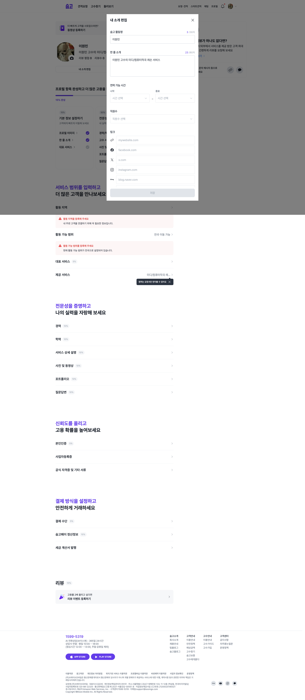

---

### STEP 08. 제공 서비스 관리 화면 (`/profile/services`)
- **화면 설명:** 프로필 대시보드에서 `제공 서비스`를 클릭하여 이동하는 전용 페이지로, 고수가 제공하는 레슨/서비스 목록을 종합 관리합니다.
- **주요 UI 요소:**
  - 상단 안내: "서비스 세부 항목을 설정해 주세요. 고수님에게 가장 잘 맞는 고객 요청을 보내드려요."
  - 등록된 서비스 카드: `미디/컴퓨터작곡 레슨` (상태: `항목 미설정`, 우측 수정/삭제 버튼 제공)
  - 신규 등록 버튼: `[+ 서비스 추가]`
  - 추천 서비스 칩: `작곡/편곡 레슨`, `음악 편집 및 제작`, `음향/레코딩 레슨`, `피아노/키보드 레슨`, `보컬 레슨` 등 관련 음악 분야 원클릭 추천
- **스크린샷 파일:** [08_profile_services_page.png](file:///Users/wonmin/orca/projects/Last%20Project/docs/members/R04/workspace/screenshots/08_profile_services_page.png)

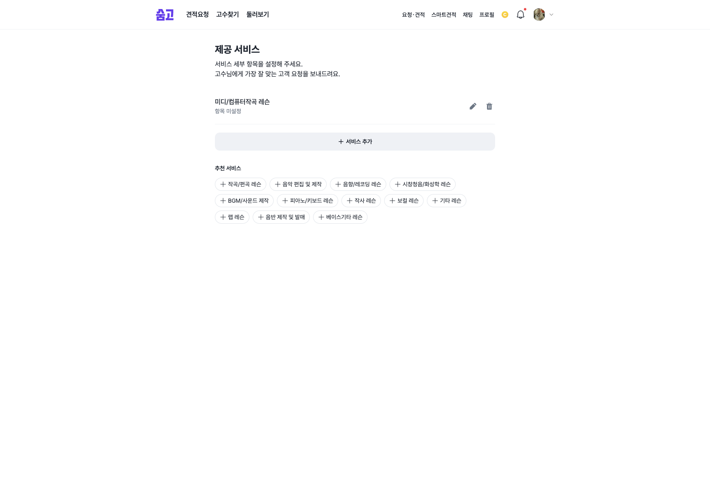

---

### STEP 09. 신규 서비스 추가 및 카테고리 선택 모달
- **화면 설명:** `[+ 서비스 추가]` 버튼을 눌렀을 때 열리는 서비스 검색 및 대분류 카테고리 선택 모달입니다.
- **주요 UI 요소:**
  - 상단 검색창: `서비스를 빠르게 찾아보세요` 플레이스홀더
  - 대분류 탭: 이사/청소, 설치/수리, 인테리어, 외주, 이벤트/뷰티, 과외, 취미/자기계발 등
  - 하단 선택 완료: `[등록]` 버튼
- **스크린샷 파일:** [09_add_service_modal_open.png](file:///Users/wonmin/orca/projects/Last%20Project/docs/members/R04/workspace/screenshots/09_add_service_modal_open.png)

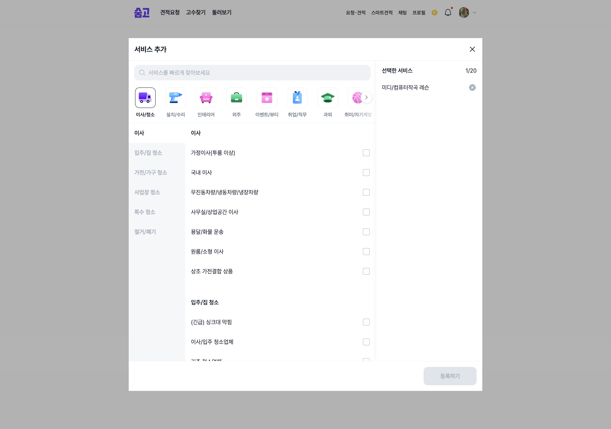

---

### STEP 10. 서비스 카테고리 검색 결과 (음악/레슨 키워드)
- **화면 설명:** 검색창에 "음악" 키워드를 입력했을 때 실시간으로 필터링되어 나타나는 카테고리 리스트입니다.
- **조회된 음악 레슨 카테고리:**
  - `미디/컴퓨터작곡 레슨`, `작곡/편곡 레슨`, `음악 편집 및 제작`, `음향/레코딩 레슨`, `시창청음/화성학 레슨`, `피아노/키보드 레슨`, `보컬 레슨`, `기타 레슨`, `베이스기타 레슨` 등
- **스크린샷 파일:** [10_service_search_results.png](file:///Users/wonmin/orca/projects/Last%20Project/docs/members/R04/workspace/screenshots/10_service_search_results.png)

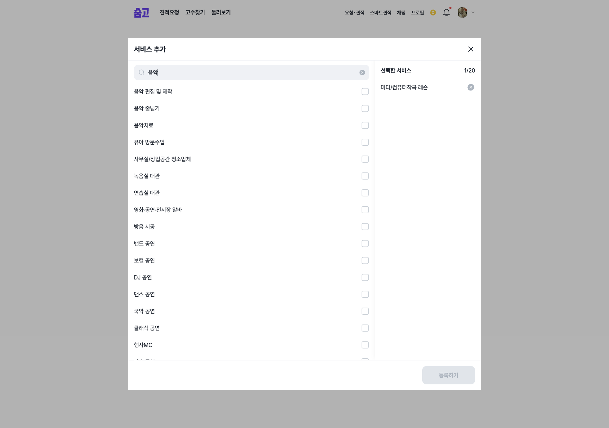

---

### STEP 11. 음악 레슨 세부 항목 및 질문지(Questionnaire) 설정 전체 화면
- **화면 설명:** 서비스 항목 우측의 연필(수정) 아이콘을 클릭했을 때 열리는 **가장 핵심적인 매칭 질문지 구성 화면**입니다. 고객이 견적을 요청할 때 응답하는 문항과 직결됩니다.
- **상세 문항 및 선택 옵션:**
  1. **어떤 프로그램을 배우기 원하시나요? (DAW 선택):**
     - 고수와 상담 후 결정 / 로직 프로 X (Logic Pro X) / 큐베이스 (Cubase) / 에이블톤 (Ableton) / FL 스튜디오 / 개러지밴드
  2. **레슨 목적이 무엇인가요?:**
     - 취미 / 입시 준비 / 작업 준비
  3. **건반을 칠 수 있나요?:**
     - 네, 건반을 칠 수 있어요 / 네, 코드만 칠 수 있어요 / 아니요
  4. **레슨생 연령대:**
     - 10대 미만 / 10대 / 20대 / 30대 / 40대 / 50대 이상
  5. **레슨생 성별:**
     - 남자 / 여자
  6. **레슨 형태:**
     - 개인 레슨 / 그룹 레슨 / 온라인·화상 레슨 / 학원
  7. **진행 방식:**
     - 어떤 방식이든 상관없음 / 고수가 있는 곳으로 방문(강사 작업실) / 레슨생 위치로 방문(출장) / 온라인 원격 수업
  - 하단: `[저장하기]` 버튼
- **스크린샷 파일:** [11_service_detail_configuration_full.png](file:///Users/wonmin/orca/projects/Last%20Project/docs/members/R04/workspace/screenshots/11_service_detail_configuration_full.png)

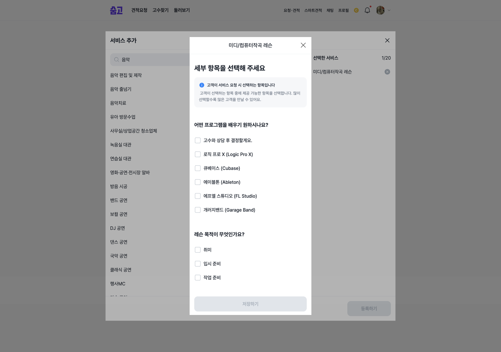

---

### STEP 12. 최종 공개 프로필 미리보기 화면 (`/profile/users/{userId}`)
- **화면 설명:** 설정된 모든 정보를 바탕으로 실제 의뢰인(고객)에게 노출되는 공개 고수 프로필 웹페이지입니다.
- **주요 UI 요소:**
  - 상단: 프로필 사진, 강사명(`이원민`), 대표 서비스(`미디/컴퓨터작곡 레슨`), 활동 지역(`서울특별시 강남구`)
  - 액션: `고수 찜하기`, `공유하기`, `[견적 요청하기]` 고정 플로팅 버튼
  - 탭 메뉴: 고수 정보, 사진 및 동영상, 서비스 상세설명, 질문답변, 리뷰 목록
- **스크린샷 파일:** [12_gosu_public_profile_preview_full.png](file:///Users/wonmin/orca/projects/Last%20Project/docs/members/R04/workspace/screenshots/12_gosu_public_profile_preview_full.png)

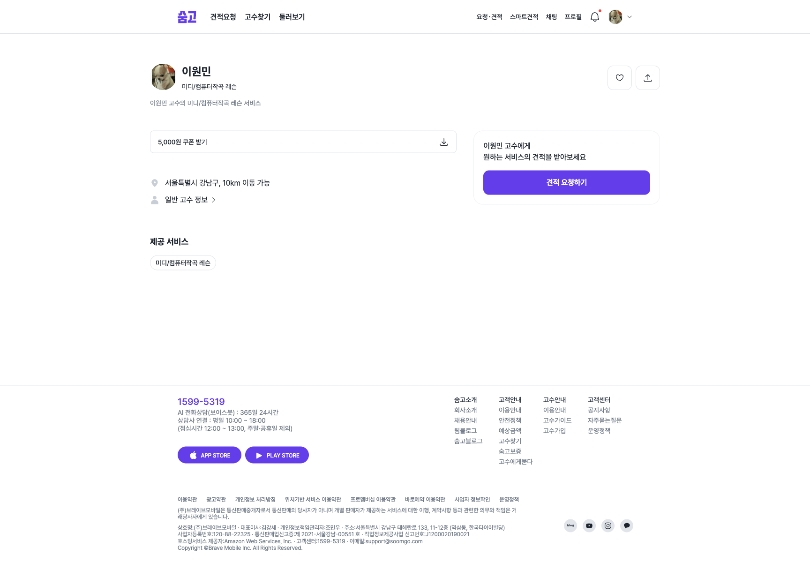

---

### STEP 13. 스마트견적 (자동 견적 발송 및 레슨 필터링) 설정
- **화면 설명:** 바쁜 강사를 대신하여 설정된 조건에 맞는 고객 요청서가 들어오면 자동으로 견적서를 발송하는 스마트견적(`instant-match`) 설정 화면입니다.
- **스크린샷 파일:** [14_instant_match_settings.png](file:///Users/wonmin/orca/projects/Last%20Project/docs/members/R04/workspace/screenshots/14_instant_match_settings.png)

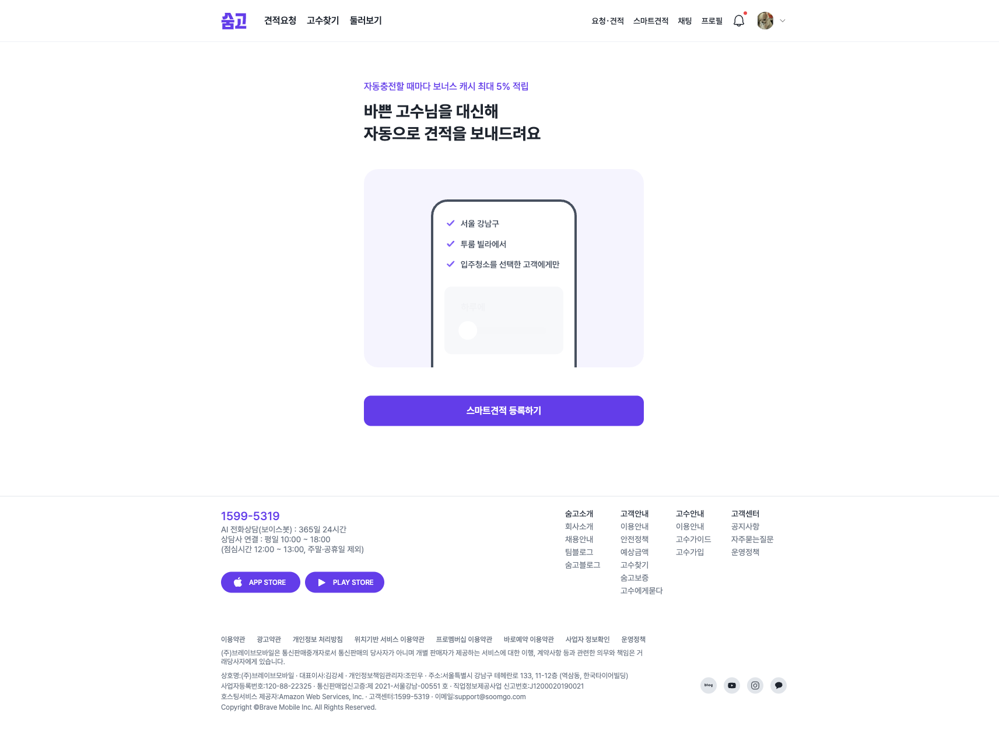

---

### STEP 14. 요청·견적 관리 대시보드 (`/requests/received`)
- **화면 설명:** 고객이 보낸 견적 요청서 목록을 확인하고 직접 견적서를 발송하는 관리 화면입니다.
- **주요 UI 요소:**
  - 탭: `받은요청` / `보낸견적`
  - 필터: `전체`, `안 읽음`, `서비스별 필터`, `숨고플러스(광고)`, `지정요청`
- **스크린샷 파일:** [15_requests_received_quotes.png](file:///Users/wonmin/orca/projects/Last%20Project/docs/members/R04/workspace/screenshots/15_requests_received_quotes.png)

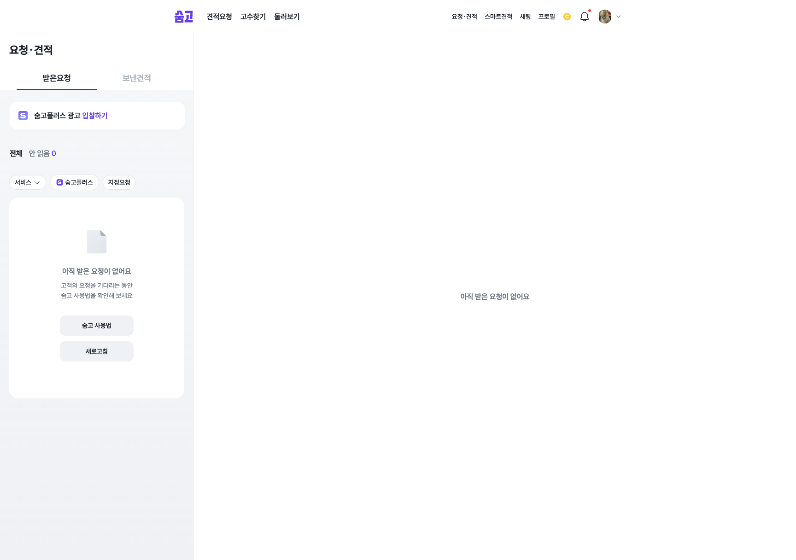

---

### STEP 15. 활동 지역 및 이동 가능 범위 설정
- **화면 설명:** 강사의 기본 활동 지역(시/군/구)과 출장 레슨 가능 여부(전국 또는 인접 시군구 반경)를 지정하는 설정 화면입니다.
- **스크린샷 파일:** [16_location_settings_modal.png](file:///Users/wonmin/orca/projects/Last%20Project/docs/members/R04/workspace/screenshots/16_location_settings_modal.png)

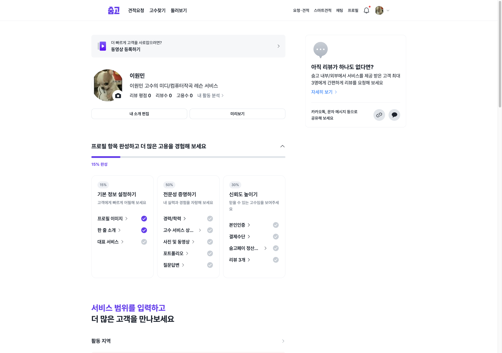

---

### STEP 16. 포트폴리오 및 전문성 증빙 관리 화면
- **화면 설명:** 레슨 강사의 음원, 연주 영상, 작업 결과물 사진을 등록하여 프로필 신뢰도를 높이는 포트폴리오 관리 진입 화면입니다.
- **스크린샷 파일:** [17_portfolio_settings.png](file:///Users/wonmin/orca/projects/Last%20Project/docs/members/R04/workspace/screenshots/17_portfolio_settings.png)

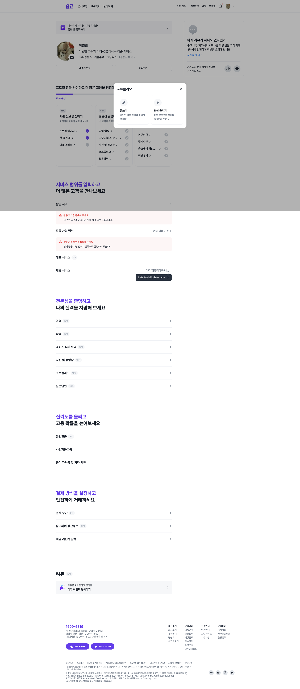

---

## 3. 스크린샷 파일 색인 목록 (Index Table)

| 번호 | 파일명 | 대상 단계 | 주요 관측 내용 |
| :---: | :--- | :--- | :--- |
| 1 | `01_home.png` | 메인 홈 | 고수 GNB 헤더 및 메인 검색창 |
| 2 | `02_user_menu.png` | 사용자 메뉴 | 고수 계정 드롭다운 및 `고객 전환` 버튼 |
| 3 | `03_customer_mode_home.png` | 고객 모드 | 고객 모드 전환 후 GNB 변화 (`받은견적`) |
| 4 | `04_customer_dropdown_gosu_switch.png` | 모드 전환 | 고객 드롭다운 및 `고수 전환` 버튼 |
| 5 | `05_gosu_home.png` | 고수 홈 | 고수 복귀 후 대시보드 화면 |
| 6 | `06_gosu_profile_overview_full.png` | 프로필 허브 | 프로필 완성도(15%), 전 섹션 종합 대시보드 |
| 7 | `07_edit_introduction.png` | 소개 편집 | 활동명(30자), 한줄소개(80자), 연락시간 모달 |
| 8 | `08_profile_services_page.png` | 제공 서비스 | `/profile/services` 서비스 목록 및 추천 칩 |
| 9 | `09_add_service_modal_open.png` | 서비스 추가 | 신규 서비스 검색 및 대분류 카테고리 모달 |
| 10 | `10_service_search_results.png` | 서비스 검색 | "음악" 키워드 실시간 검색 결과 리스트 |
| 11 | `11_service_detail_configuration_full.png` | 질문지 설정 | DAW, 목적, 연령, 수업형태 등 7대 질문 필터 |
| 12 | `12_gosu_public_profile_preview_full.png` | 공개 게시 | `/profile/users/{id}` 고객 노출 최종 프로필 |
| 13 | `14_instant_match_settings.png` | 스마트견적 | 자동 견적 발송 및 레슨 필터링 조건 설정 |
| 14 | `15_requests_received_quotes.png` | 요청·견적 | 받은 요청서 관리 및 필터 대시보드 |
| 15 | `16_location_settings_modal.png` | 활동 지역 | 거점 지역(강남구 등) 및 출장 반경 설정 |
| 16 | `17_portfolio_settings.png` | 포트폴리오 | 음원/영상/작업물 등록 진입 화면 |
