# [마이 AI 오피스 설계 보고서] 레슨 멀티플랫폼 등록 지원 서비스 절차 및 사용자 흐름 설계

- **작성자:** R04 (원민, Web UI & 숨고 Adapter)
- **작성일자:** 2026-11-25
- **설계 기준:** 마이 AI 오피스(P1) `서비스절차설계(Service Flow)` 및 `사용자흐름설계(User Flow)` 표준 거버넌스 규칙
- **관련 TASK:** TASK-051 (Web UI), TASK-052 (숨고 Adapter), TASK-050 (공통 API 연동)
- **대상 화면:** 레슨 멀티플랫폼 등록 지원 Web UI 5대 화면 (`source` ➔ `prepare` ➔ `auth` ➔ `review` ➔ `result`)

---

## 1. 개요 및 설계 원칙

본 문서는 **마이 AI 오피스 3대 기준 체계(공통규칙·UI컴포넌트규격·화면배치설계)**와 포트폴리오 스토리보드 표준 작성 규칙에 따라, 당사 「레슨 멀티플랫폼 등록 지원 시스템」의 **서비스 절차(Service Flow)** 및 **사용자 흐름(User Flow)**을 정립한 공식 설계 보고서입니다.

1. **서비스 절차 설계(Service Flow):** 시스템 기능과 UI 화면, 핵심 사용자 조작(Tap) 간의 단계적 구조를 6대 표준 노드 범례에 따라 기술합니다.
2. **사용자 흐름 설계(User Flow):** 사용자의 인지·입력·분기 판단과 데이터 적재, 다이얼로그 출력 및 예외 분기(YES 파랑, NO 빨강)를 9대 표준 심볼 그래프로 가시화합니다.

---

## 2. 서비스 절차 설계 (Service Flow Design)

### 2.1 마이 AI 오피스 서비스 절차 6대 노드 범례

| 유형 키 (`type`) | 표기 레이블 | 도형 형태 | 색상 및 스타일 사양 | 의미 및 용도 |
| :--- | :--- | :---: | :--- | :--- |
| `screen` | **화면명** | `[화면명]` | 흰색 채움, 파란 테두리 (`#1f4e9c`, 2.5px), 볼드 | 시스템 메인/서브 화면 진입점 |
| `func` | **기능명** | `[기능명]` | 회색 채움 (`#eceff3`), 진회색 테두리 (`#3a3f47`, 1.5px) | 해당 화면에서 제공하는 단위 기능 |
| `step` | **절차명** | `(절차명)` | 흰색 채움, 회색 테두리 (`#8a929c`, 1px) | 순차적으로 진행되는 일반 처리 단계 |
| `key` | **핵심 동작** | `[핵심 Tap]` | 파란 채움 (`#1f4e9c`), 흰색 글자, 볼드 | 화면 전환/트랜잭션을 일으키는 핵심 버튼 |
| `branch` | **분기·확인** | `{분기명}` | 노란 마름모 채움 (`#fff6d6`), 황갈색 테두리 (`#c99a06`) | 데이터 정합성 검증 및 조건 분기점 |
| `done` | **완료** | `([완료명])` | 연주황 채움 (`#fde7dc`), 적색 테두리 (`#d9534f`, 1.5px) | 프로세스 및 서브태스크 완료 상태 |

---

### 2.2 5대 단계별 서비스 절차도 (Service Flow Diagram)

```mermaid
flowchart TD
    %% 노드 스타일 클래스 정의 (마이 AI 오피스 service-flow-data.js 규격)
    classDef screen fill:#ffffff,stroke:#1f4e9c,stroke-width:2.5px,color:#1f4e9c,font-weight:bold;
    classDef func fill:#eceff3,stroke:#3a3f47,stroke-width:1.5px,color:#1b1f24,font-weight:bold;
    classDef step fill:#ffffff,stroke:#8a929c,stroke-width:1px,color:#1b1f24;
    classDef key fill:#1f4e9c,stroke:#1f4e9c,color:#ffffff,font-weight:bold;
    classDef branch fill:#fff6d6,stroke:#c99a06,stroke-width:1.5px,color:#1b1f24;
    classDef done fill:#fde7dc,stroke:#d9534f,stroke-width:1.5px,color:#1b1f24,font-weight:bold;

    %% 1단계: 원본 입력
    S1["[1. 원본 입력 화면 (source)]"]:::screen --> F1["[비정형 레슨 텍스트 접수]"]:::func
    F1 --> ST1_1("(선생님 프로필 및 레슨 원문 입력/붙여넣기)"):::step
    ST1_1 --> BR1_1{"{원문 텍스트 20자 이상?}"}:::branch
    BR1_1 --> ST1_2("(대상 플랫폼 숨고·크몽 체크박스 선택)"):::step
    ST1_2 --> K1["[AI 구조화 요청 Tap (H1)]"]:::key
    K1 --> D1("([1단계 접수 완료])"):::done

    %% 2단계: AI 구조화
    D1 --> S2["[2. 구조화 준비 화면 (prepare)]"]:::screen
    S2 --> F2["[I2 변환 및 스키마 검증]"]:::func
    F2 --> ST2_1("(카테고리·대상연령·목표·레슨비 추출값 렌더링)"):::step
    ST2_1 --> BR2_1{"{필수 프로필 필드 누락 여부?}"}:::branch
    BR2_1 --> ST2_2("(사용자 인라인 필드 수정 및 보완)"):::step
    ST2_2 --> K2["[플랫폼 인증 단계 이동 Tap]"]:::key
    K2 --> D2("([2단계 구조화 확정])"):::done

    %% 3단계: 원격 인증
    D2 --> S3["[3. 플랫폼 인증 화면 (auth)]"]:::screen
    S3 --> F3["[R05 원격 뷰어(H6) 연동]"]:::func
    F3 --> ST3_1("(플랫폼별 세션 상태 확인 - 미인증/만료)"):::step
    ST3_1 --> K3_1["[원격 브라우저 마운트 Tap]"]:::key
    K3_1 --> ST3_2("(동적 iframe 뷰어 로드 및 2차인증/로그인 대기)"):::step
    ST3_2 --> BR3_1{"{로그인 완료 postMessage 수신?}"}:::branch
    BR3_1 --> K3_2["[인증 완료 확인 Tap (H6 finish)]"]:::key
    K3_2 --> D3("([3단계 플랫폼 인증 완료])"):::done

    %% 4단계: 최종 검토
    D3 --> S4["[4. 최종 검토 화면 (review)]"]:::screen
    S4 --> F4["[등록 페이로드 및 다이제스트 확인]"]:::func
    F4 --> ST4_1("(플랫폼별 정규화 슬롯 및 변환 페이로드 프리뷰)"):::step
    ST4_1 --> ST4_2("(불변 검토 해시 review_digest 생성 및 바인딩)"):::step
    ST4_2 --> BR4_1{"{등록 최종 승인(approved: true)?}"}:::branch
    BR4_1 --> K4["[최종 등록 승인 및 실행 Tap (H7)]"]:::key
    K4 --> D4("([4단계 작업 디스패치 완료])"):::done

    %% 5단계: 실행 모니터링 및 결과
    D4 --> S5["[5. 완료 결과 화면 (result)]"]:::screen
    S5 --> F5["[진행률 폴링 및 S6 독립 Readback]"]:::func
    F5 --> ST5_1("(1.5초 지수 백오프 H8 상태 폴링)"):::step
    ST5_1 --> ST5_2("(S1~S5 진행률 프로그레스바 실시간 갱신)"):::step
    ST5_2 --> BR5_1{"{S6 independent_readback 판정?}"}:::branch
    BR5_1 --> ST5_3("(EvidenceRecord 및 등록 상세 URL 링크 표출)"):::step
    ST5_3 --> K5["[새 레슨 등록 시작 Tap]"]:::key
    K5 --> D5("([5단계 전체 프로세스 종료])"):::done
```

---

## 3. 사용자 흐름 설계 (User Flow Design)

### 3.1 마이 AI 오피스 사용자 흐름 9대 심볼 및 선 규격

- **터미널 (`terminal`):** `([시작 / 종료])` - 시작과 끝 (어두운 회색 `#2b2b2b`, 흰색 굵은 텍스트)
- **프로세스 (`process`):** `[화면 표시 및 내부 처리]` - 흰색 사각형, 회색 외곽선
- **사용자 동작 (`action`):** `[사용자 Tap 동작]` - 흰색 사각형, 파란색 글씨 (`#1f4e9c`), 굵은 텍스트
- **데이터 입출력 (`io`):** `[/데이터 입력 / 출력/]` - 평행사변형 (텍스트 입력, 파라미터 전달)
- **다이얼로그 (`output`):** `[\모달 / 알림 팝업/]` - 문서형/다이얼로그 출력
- **판단 및 분기 (`decision`):** `{조건 유효성 검증}` - 마름모 (YES / NO 분기)
- **결합 (`merge`):** `((결합점))` - 원형 점선 (다중 분기 결합)
- **데이터 적재 (`data`):** `[(원장 / 스토리지 적재)]` - 원통형 (DB/Store 저장)
- **선 연결 (`tones`):**
  - **정상 흐름 (YES):** 파란색 실선 (`== YES ==>`, `#1f4e9c`)
  - **예외/오류 흐름 (NO):** 빨간색 실선 (`-. NO .->`, `#d9534f`)
  - **일반 흐름:** 회색 실선 (`-->`, `#6b7280`)

---

### 3.2 상세 엔드투엔드 사용자 흐름도 (User Flow Diagram)

---

## 4. 마이 AI 오피스 UI 거버넌스 3대 기준 준수 현황

### 4.1 공통규칙 준수 (Button Taxonomy v2.0 & CTA 위계)
- **Primary 버튼 1개 제한 (`RULE-CTA-01`):** 화면 영역당 시각적 위계를 혼동시키지 않도록 파란 채움 Primary 버튼은 핵심 액션(각 화면의 다음 단계 진행/최종 등록) 단 1개만 배치.
- **초기화 vs 취소 엄격 분리 (`RULE-CTA-02/03`):** 
  - `UI 폼 초기화`는 파괴적 삭제가 아닌 안전 초기화로 중립 Secondary(`.btn-secondary`) 적용.
  - 위험 작업(작업 중단)의 경우에만 Danger 테두리 적용.
- **비채움 바로가기 규격 (`RULE-CTA-07`):** 독립 Readback 검증 결과의 플랫폼 원문 링크는 채움 버튼 대신 화살표가 포함된 링크형 버튼(`.btn-link`) 적용.

### 4.2 UI 컴포넌트 규격 및 토큰 준수
- `var(--primary)`, `var(--bg)`, `var(--border)`, `var(--radius)` 등 공통 디자인 시스템 시맨틱 토큰을 선언하여 하드코딩 `#HEX`를 배제.
- 미정의 유령 토큰(Ghost CSS Var)을 완전히 차단하고, 8px 그리드 기반의 스페이싱 시스템 적용.

### 4.3 화면 배치 영역 규격 (Screen Structure)
- **상단 헤더 구역:** 시스템 타이틀, 활성 플랫폼 배지, 진행 안내 문구 고정.
- **네비게이션 탭 구역:** 5대 단계 인디케이터(완료/활성/대기 시각화).
- **중앙 워크스페이스 카드 구역:** 가로 900px 중앙 집중형 카드 컨테이너 배치.
- **하단 액션 구역:** 우측 정렬 Primary 액션 버튼 및 좌측 정렬 보조 버튼의 일관된 위계 배치.

---

## 5. 결론 및 향후 계획

1. **정합성 달성:** 본 설계를 통해 마이 AI 오피스(P1)의 서비스절차설계(Service Flow) 및 사용자흐름설계(User Flow) 표준 규격을 100% 만족하는 레슨 등록 지원 Web UI의 구조화가 완결되었습니다.
2. **연동 안정성 확보:** R03 공통 API의 8대 연동 기준(H7 202/200, unknown 자동 재실행 차단) 및 R05 원격 뷰어와의 `postMessage` 생명주기가 흐름도 상에 빈틈없이 매핑되었습니다.
3. **다음 조치:** 본 설계서를 팀원 및 이해관계자에게 공유하고, R03/R05와 예정된 E2E 실서버 연동 시 테스트 시나리오 기준선으로 활용합니다.
