# [마이 AI 오피스 설계 보고서] 레슨 멀티플랫폼 등록 지원 서비스 절차 및 사용자 흐름 설계

## 문서 정보

| 항목 | 내용 |
|---|---|
| 문서 ID | REPORT-R04-SERVICE-USER-FLOW-20261125 |
| 버전 | **v1.2 (수정 보완본)** |
| 최초 작성일 | 2026-11-25 (v1.0) |
| 최종 수정일 | 2026-11-26 (v1.2) |
| 작성자 | R04 (원민) |
| 문서 상태 | 1~5절: **이전 설계 기록(v1.0) · 참고 보존** / 0절: v1.0 대조 / **Ⅱ부(6~10절): 현행 기준 R04 제안 초안 · 미합의** |
| 관련 TASK | v1.0: TASK-050·051·052 (보류된 이전 구현 TASK) · v1.1 대조 기준: TASK-056 |
| 현행 기준 | [기획안 V1.2](../../../artifacts/planning/lesson-registration-20261123/proposal-v1.2.md) · [PHASE-20261126-01](../../../human/phase-intents/PHASE-20261126-01.md) · [R04 사용자 스토리 원본](../../../artifacts/planning/lesson-registration-20261126/R04/independent-result.json) |

### 변경 이력

| 버전 | 날짜 | 변경 내용 | 변경 사유 |
|---|---|---|---|
| v1.0 | 2026-11-25 | 5단계 Web UI(source→prepare→auth→review→result) 기준 서비스 절차도·사용자 흐름도 최초 작성 | TASK-051 Web UI 구현 |
| v1.1 | 2026-11-26 | ① 문서 지위를 '이전 설계 기록'으로 정정 ② 0절 신설: 기획안 V1.2·TASK-056 사용자 스토리 44건과 v1.0 흐름 대조, 누락 행동·현행 근거 없는 항목 표시 ③ 5절 결론 중 '100% 만족·빈틈없이 매핑·E2E 기준선' 주장 철회 ④ 1~4절 v1.0 본문은 기록으로 원문 보존 | R01 지시: 기획안 V1.2 기준으로 사용자 스토리·범위 확정 후 DB→API·프로토콜→상세 설계 순서로 변경, 기존 API·UI 설계를 후속 설계 기준으로 쓰지 않음 |
| v1.2 | 2026-11-26 | Ⅱ부 신설: ① 공통 오류·예외 22종(ERR-01~22) ② 반복 구간 9종과 탈출 조건(L1~L9) ③ 현행 기준 서비스 절차도 6종(SF-01~06) ④ 사용자 흐름도 4종(UF-01~04). 기능명세서·메뉴화면구성·메뉴구조도·화면목록(IA) 문서와 ID 연결 | 사용자 요청: 공통 오류·예외·루프를 분석해 별도 서비스 절차도·사용자 흐름도로 보완 |

> **이 문서를 읽는 방법:** 0절은 v1.0과 현행 기준의 대조 결과, **Ⅱ부(6~10절)는 현행 기준으로 새로 그린 서비스 절차도·사용자 흐름도(R04 제안 초안)**다. 1~5절은 v1.0 당시 설계를 그대로 보존한 기록이며 **현행 설계 기준으로 사용하지 않는다.** 새 설계 기준이 확정되기 전에는 v1.0의 API(H1~H8)·UI·화면 흐름을 후속 설계 근거로 쓰지 않는다.

---

## 0. v1.1 수정 보완: 현행 기준(기획안 V1.2 · TASK-056)과의 대조

### 0.1 목적과 범위

R01 지시에 따라 v1.0 흐름이 현행 사용자 스토리 후보와 어디서 맞고 어디서 어긋나는지 기록한다. 이 절은 **이전 설계 기록을 보완하는 작업**이며 새 UI·API·화면 흐름을 제안하지 않는다. 사용자 스토리 ID는 R04 독립 조사 후보(TASK-056)이고, 최종 행동 범위는 R01 통합 작업(TASK-058)에서 확정된다.

### 0.2 v1.0 단계별 대조

| v1.0 단계·요소 | 대응 사용자 스토리 후보 (R04) | 판정 |
|---|---|---|
| 1. 원본 입력: 프로필·레슨 원문 입력 | US-001 원본 텍스트 입력 · US-027 이미지 업로드 | 대응 |
| 1. 원문 20자 이상 검증 | 없음 | 현행 기획 근거 없음 (v1.0 구현 규칙) |
| 1. 숨고·크몽 체크박스 선택 | US-005 대상 플랫폼 선택 | 재검토: 현행은 7개 플랫폼 조사 범위, 구현 플랫폼 수는 별도 결정 |
| (누락) 신규·수정·갱신 업무 종류 선택 | US-029 | v1.0에 없음 |
| 2. 추출값 렌더링 (I2 변환) | 시스템 이벤트 R04-EVT-001 | 사용자 행동 아님 (시스템 처리) |
| 2. 누락 필드 인라인 보완 | US-006 누락 정보 보완 입력 | 대응 |
| (누락) 플랫폼 제약 충돌 대안 선택 | US-007 | v1.0에 없음 |
| 3. R05 원격 뷰어 마운트·로그인 | US-008 플랫폼 공식 화면에서 직접 로그인 | 재검토: 원격 뷰어·postMessage·H6 방식은 현행 미결정 |
| 3. 인증 실패 시 재시도 | US-024 | 대응 |
| (누락) 인증 실패 플랫폼 건너뛰기 | US-038 | v1.0에 없음 |
| (누락) 외부 기존 객체 조회·지정, 변경 전후 차이 검토 | US-009 · US-030 · US-010 | v1.0에 없음 (수정·갱신 업무 전제) |
| 4. 페이로드 프리뷰 | US-011 최종 입력안 검토 | 대응 |
| 4. 최종 등록 승인 (H7) | US-031 입력안 승인 | 부분 대응: 현행 후보는 입력안 승인과 실행 범위 승인(US-012·032)을 분리 |
| 4. review_digest·expected_revision·HTTP 202/200/409 | 없음 | 현행 근거 없음 (v1.0 API 구현 세부, DB→API 단계 이후 재설계 대상) |
| (누락) 승인 거절·승인 철회 | US-023 · US-037 | v1.0에 없음 |
| 5. 1.5초 백오프 폴링·진행률 | 시스템 처리 | 사용자 행동 아님, 현행 근거 없음 |
| 5. 결과 판정·증빙 링크 표출 | US-013 결과 확인 · US-041 증빙 링크 열기 | 대응 |
| 5. unknown 시 자동 재실행 차단·수동 안내 | US-026 반영 여부 조회 요청 | 대응 (행동 명칭 재정의) |
| 5. 실패 시 원인 안내 | US-017 반려·실패 사유 확인 | 대응 |
| 5. 새 레슨 등록 시작 | US-028 · US-022 | 대응 |

### 0.3 v1.0에 없는 현행 사용자 행동 후보

v1.0은 **최초 1회 등록** 흐름만 다룬다. 현행 기획 V1.2의 등록·수정·갱신·결과 확인·상태 관리 범위에서 아래 행동은 v1.0 흐름에 없다.

- 원본 관리: US-002 목록 조회 · US-003 수정 · US-025 삭제 요청
- 플랫폼 정보: US-004 지원 업무 범위 열람 · US-040 필수 제약 열람 · US-036 신규 플랫폼 추가 요청
- 상태 관리: US-014 상태 목록 조회 · US-015 수동 갱신 요청 · US-016 상태 변화 확인 · US-042 알림 확인
- 반려 대응·종료: US-033 수정 제안 검토 · US-039 연동 해제 요청
- 조건부(E01~E05): US-018·043·044 모니터링 설정 · US-019 세션 위험 고지 · US-034 세션 유지 승인 · US-020 감지 알림 · US-021 모니터링 중단 · US-035 세션 파기

→ R04 후보 44건 중 v1.0에 대응하는 스토리 14건, 대응이 없는 스토리 30건(0.2절 누락 10건 + 이 절 20건).

### 0.4 v1.0 주장 중 철회·보류 항목

| v1.0 서술 | v1.1 판단 |
|---|---|
| "표준 규격을 100% 만족", "구조화가 완결" | 철회. 현행 사용자 스토리 후보 30건이 흐름에 없음 |
| "R03 API 8대 연동 기준·R05 postMessage가 빈틈없이 매핑" | 철회. 이전 API 계약 기준이며 현행 설계 기준 아님 |
| "E2E 실서버 연동 테스트 시나리오 기준선으로 활용" | 철회. 실제 외부 실행 금지(mock-only)와 현행 단계 순서에 맞지 않음 |
| 4절 UI 거버넌스(버튼 위계·토큰·배치) | 보류. 상세 설계 단계에서 재검토할 참고 자료 |

### 0.5 후속 연결

- 이 문서는 R01 통합 사용자 흐름 작성 시 **누락 점검용 참고 자료**로만 쓴다.
- 새 서비스 절차·사용자 흐름의 R04 제안 초안은 Ⅱ부에 있다. R01이 사용자 스토리·서비스 범위를 확정한 뒤 확정본을 만들며, 이 초안을 자동으로 현행 설계로 승격하지 않는다.

---

# Ⅱ부. v1.2 현행 기준 서비스 절차도·사용자 흐름도 (공통 오류·예외·루프 반영, R04 제안 초안)

> **작성 기준과 한계:** [기획안 V1.2](../../../artifacts/planning/lesson-registration-20261123/proposal-v1.2.md) 피처(F01~F29, E01~E05)와 [R04 사용자 스토리 후보 44건](../../../artifacts/planning/lesson-registration-20261126/R04/independent-result.json)을 기준으로 작성한 **R04 제안 초안**이다. 현재 단계([PHASE-20261126-01](../../../human/phase-intents/PHASE-20261126-01.md))에서 서비스 범위·MVP·DB·API는 R01이 확정하므로, 이 문서는 범위 결정을 위한 검토 자료이며 확정 설계가 아니다. 이전 설계(11/25 Web UI·API H1~H8)를 근거로 쓰지 않았고, API·기술 스택은 정하지 않는다.

## 6. 공통 오류·예외 분석

기획 8.7 대표 예외 13종에 R04가 화면 흐름에서 추가로 찾은 공통 오류를 더해 22개로 정리했다. 코드(ERR-xx)는 [기능명세서](2026-11-26_R04_레슨등록지원_기능명세서.md)와 [메뉴화면구성](2026-11-26_R04_레슨등록지원_메뉴화면구성.md)에서 같은 의미로 쓴다.

| 코드 | 상황 | 발생 화면 | 사용자에게 보이는 것 | 처리 원칙 | 복귀·루프 | 관련 피처 / 스토리 | 근거 |
|---|---|---|---|---|---|---|---|
| ERR-01 | 입력값 누락·형식 오류 | SCR-011·012·022 | 항목 옆 오류 문구, 저장 버튼 유지 | 입력 내용 보존, 잘못된 항목만 표시 | L1 재입력 | F01·F04·F10 / US-001·003·006 | 기획 8.7 |
| ERR-02 | 첨부 파일 형식·용량 오류, 사용 권리 미확인 | SCR-011 | 파일별 오류와 권리 확인 요청 | 해당 파일만 제외, 권리 미확인 자료는 외부 전송 안 함 | L1 재업로드 | F01 / US-027 | 기획 9.5 |
| ERR-03 | 서비스 저장 실패·네트워크 오류 | 모든 저장 화면 | 저장 실패 토스트와 다시 시도 | 입력 보존, 같은 요청 중복 저장 방지 | 재시도 | F05 / - | R04 추가 |
| ERR-04 | 서비스 로그인 세션 만료 | 로그인 화면 전체 | 재로그인 안내 | 재로그인 후 원래 화면으로 복귀(작성 내용 보존은 결정 필요) | 재로그인 | A01 / - | R04 추가 |
| ERR-05 | 미지원·미확인 업무 선택 | SCR-020·021 | '미지원/미확인' 표시, 선택 불가 | 확인되지 않은 업무는 실행 대상에서 제외 | 재선택 | F06·F07 / US-004·005 | 기획 9.2 |
| ERR-06 | 필수 정보 부족·불확실 | SCR-022 | 보완 필요 항목 목록 | 필요한 사실만 요청, 추정값 자동 입력 금지 | L2 보완·재검증 | F09·F10 / US-006 | 기획 8.7 |
| ERR-07 | 플랫폼 제약 충돌 | SCR-023 | 충돌 사유와 대안 | 대안 제시 후 사용자 결정, 자동 변경 금지 | L2 재검증 | F11 / US-007 | 기획 8.7 |
| ERR-08 | 유효한 입력 대안 없음 | SCR-023 | 해당 플랫폼 업무 수행 불가 안내 | 해당 플랫폼만 제외, 다른 플랫폼은 계속 | 플랫폼 제외 후 진행 | F11 / US-005 | 기획 8.7 |
| ERR-09 | 인증 실패·취소·만료 | SCR-024 | 실패 사유, 재시도·건너뛰기·종료 선택 | 비밀번호·인증코드 저장 안 함 | L3 재인증 | F12 / US-008·024·038 | 기획 8.7·9.4 |
| ERR-10 | 계정 불일치·권한 부족 | SCR-024 | 확인된 계정과 필요한 권한 안내 | 실행하지 않고 계정 확인 요청 | L3 재인증 | F13 / US-008 | 기획 8.7 |
| ERR-11 | 대상 불명확·중복 후보·기존 등록 존재 | SCR-025 | 후보 목록, 중복 등록 경고 | 대상 확정 전 실행 금지 | L4 대상 재지정 | F14 / US-009·030 | 기획 8.7 |
| ERR-12 | 외부 게시 정보 변경 감지 | SCR-026·028 | 비교 시점 이후 변경됨 안내 | 오래된 정보로 덮어쓰지 않음, 재조회·재비교 | L5 재검증·재승인 | F15·F18 / US-010 | 기획 9.3 |
| ERR-13 | 사용자 승인 거절 | SCR-027 | 거절 확인, 수정으로 돌아가기 | 해당 업무 실행 안 함 | 수정 화면 복귀 또는 종료 | F16·F17 / US-023 | 기획 8.7 |
| ERR-14 | 승인 이후 중요 조건 변경 | SCR-027·028 | 실행 보류와 재확인 요청 | 실행 보류, 재검증·재승인 | L5 재검증·재승인 | F18 / US-011·031 | 기획 8.7 |
| ERR-15 | 실행 중 오류 | SCR-028·029 | 영향받은 플랫폼과 확인된 결과 | 영향받은 업무만 중단, 확인된 결과 반환 | 후속 조치 안내 | F22·F24 / US-013 | 기획 8.7 |
| ERR-16 | 실행 결과 미확인 | SCR-029 | '미확인' 표시, 반영 여부 조회 | 무조건 재실행 금지, 기존 외부 효과 확인 | L6 반영 여부 재조회 | F22 / US-026 | 기획 8.7·9.3 |
| ERR-17 | 일부 플랫폼만 완료 | SCR-029 | 플랫폼별 독립 결과 | 완료된 플랫폼 결과 유지, 나머지만 후속 조치 | 플랫폼별 후속 조치 | F24 / US-013 | 기획 8.7 |
| ERR-18 | 심사 반려 | SCR-030·033 | 반려 사유와 후속 조치 | 확인된 사유만 표시, 수정 작업 연결 | L7 반려 대응 | F29 / US-017·033 | 기획 8.7 |
| ERR-19 | 상태 조회 실패 | SCR-030·032 | 마지막 관측 상태와 조회 불가 구분 | 조회 실패를 상태 변화로 기록하지 않음 | L8 상태 갱신 재요청 | F27 / US-015 | 기획 8.7 |
| ERR-20 | 같은 대상 동시 작업·중복 실행 시도 | SCR-020·028 | 진행 중 작업 안내 | 미확인 외부 효과가 있으면 새 실행 차단 | 진행 중 작업으로 이동 | F18 / US-026 | 기획 9.2 |
| ERR-21 | 인증 유지 승인 철회·모니터링 기간 만료 | SCR-060~062 | 자동 접근 중단 안내 | 자동 접근 중단, 인증 세션 폐기 | 수동 갱신으로 전환 | E05 / US-021·035 | 기획 8.7 |
| ERR-22 | 진행 중 작업이 있는 원본 수정·삭제 | SCR-012·014 | 진행 중 작업 안내 | 처리 방식 미결정(후보: 작업 종료 후 반영) | R01 결정 필요 | F04·F05 / US-003·025 | 미도출 행동 |

## 7. 반복(루프) 구간과 탈출 조건

모든 반복 구간에는 사용자가 빠져나갈 수 있는 선택지를 둔다. 시스템이 같은 외부 업무를 자동으로 다시 실행하는 반복은 두지 않는다.

| 루프 | 이름 | 진입 | 반복 동작 | 탈출 조건 | 무한 반복 방지 |
|---|---|---|---|---|---|
| L1 | 입력 검증 | ERR-01·02 | 입력 → 검증 → 오류 표시 → 재입력 | 검증 통과 또는 사용자가 작성 취소 | 사용자가 언제든 취소 가능. 자동 재시도 없음 |
| L2 | 보완·재검증 | ERR-06·07 | 보완 입력·대안 선택 → 변환·검증 재실행 | 누락·충돌 없음 또는 해당 플랫폼 제외(ERR-08) | 보완할 수 없으면 플랫폼 제외로 탈출 |
| L3 | 재인증 | ERR-09·10 | 공식 화면 로그인 → 결과 확인 → 재시도 | 인증·권한 확인, 건너뛰기, 작업 종료 | 재시도 상한은 미결정. 매 실패마다 건너뛰기·종료 선택 제공 |
| L4 | 대상 재지정 | ERR-11 | 후보 조회 → 대상 지정 → 확인 | 대상 확정 또는 신규 등록 전환 | 대상이 없으면 신규 등록으로 전환 |
| L5 | 재검증·재승인 | ERR-12·14 | 재조회·재비교 → 입력안 검토 → 재승인 | 조건 일치 후 승인 또는 거절 | 거절하면 실행하지 않고 종료 |
| L6 | 반영 여부 재조회 | ERR-16 | 외부 반영 여부 조회 → 미확인 유지 시 재조회 | 반영 확인(성공 정정) 또는 사용자가 미확인 유지 선택 | 재실행으로 넘어가지 않음. 조회 간격·상한 미결정 |
| L7 | 반려 대응 | ERR-18 | 사유 확인 → 수정 → 재승인 → 재제출 → 상태 확인 | 승인·게시 확인 또는 재제출 포기 | 반복 반려 시에도 사용자가 연동 해제·보류 선택 가능 |
| L8 | 상태 갱신 요청 | ERR-19 | 갱신 요청 → 조회 → 결과 표시 | 최신 상태 확인 또는 조회 불가 표시 | 요청 빈도 제한은 미결정 |
| L9 | 자동 모니터링 주기 | E03 | 주기 도래 → 자동 확인 → 변화 시 알림 | 사용자 중단, 기간 만료, 승인 철회 | 조건부 범위. 최소 주기·기간 상한 R01 결정 |

## 8. 서비스 절차도 (마이 AI 오피스 6대 노드)

노드: 화면명(파란 테두리) → 기능명(회색) → 절차명(흰색) → 핵심 동작 Tap(파란 채움) → 분기·확인(노란 마름모) → 완료(주황). 선: YES·정상은 파란색, NO·예외는 빨간색.

### 8.1 SF-01 원본 레슨 관리

- 업무구분: 업무 접수 · 관련 화면: SCR-010·011·012·014

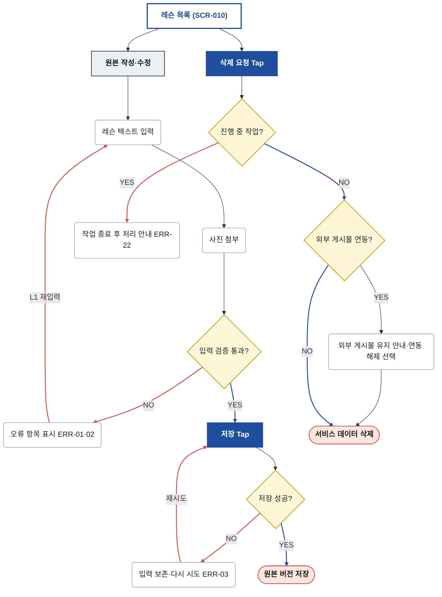

### 8.2 SF-02 플랫폼 작업 준비 (신규·추가 등록, 수정, 갱신)

- 업무구분: 업무 접수 · 관련 화면: SCR-020·021·022·023

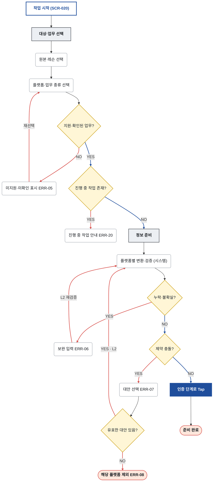

### 8.3 SF-03 플랫폼 인증·작업 대상 확인

- 업무구분: 업무 실행 · 관련 화면: SCR-024·025·026

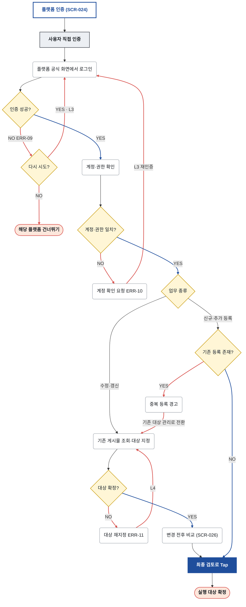

### 8.4 SF-04 최종 승인·실행·결과 확인

- 업무구분: 의사결정 · 관련 화면: SCR-027·028·029·02A

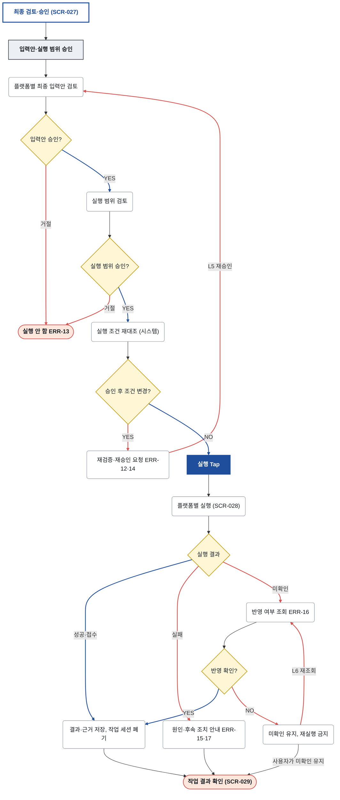

### 8.5 SF-05 게시 현황·상태 갱신·반려 대응

- 업무구분: 모니터링 · 관련 화면: SCR-030·031·032·033

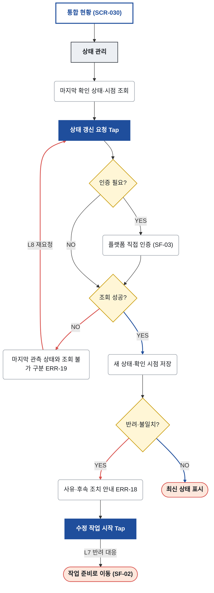

### 8.6 SF-06 조건부 자동 모니터링

- 업무구분: 모니터링 · 관련 화면: SCR-060·061·062

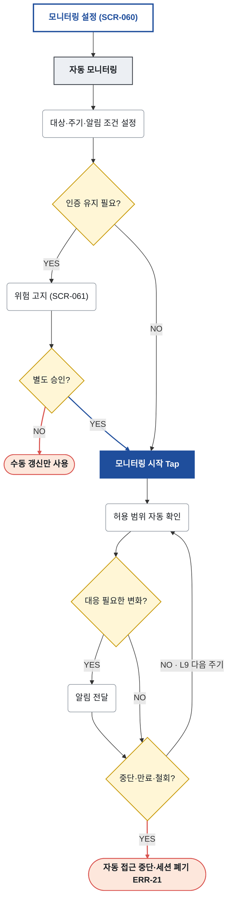

## 9. 사용자 흐름도 (마이 AI 오피스 9대 심볼)

심볼: 시작/끝(검정) · 프로세스 동작 · 사용자 동작 Tap(파란 글자) · 입력/출력(평행사변형) · 다이얼로그 출력 · 판단·분기(마름모) · 결합(점선 원) · 프로세스 진행(생략) · DB 적재(원통). 선: YES 파란색, NO·예외 빨간색.

### 9.1 UF-01 신규·추가 등록 작업 (정상·오류·예외·반복)

- 업무구분: 업무 실행

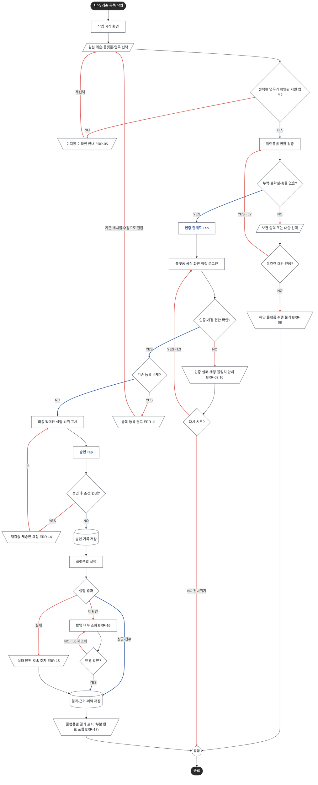

### 9.2 UF-02 기존 게시물 수정·갱신 작업

- 업무구분: 업무 실행

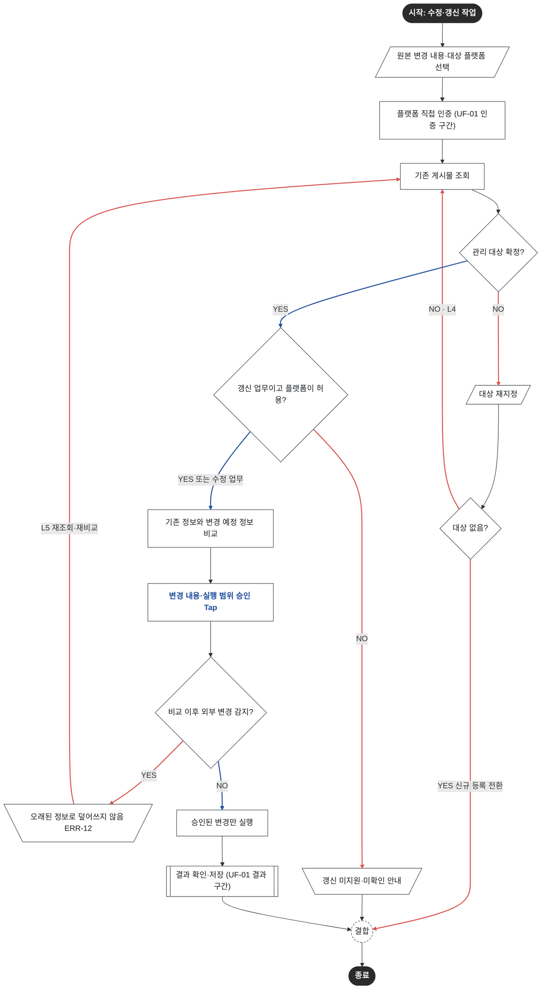

### 9.3 UF-03 게시 현황 확인·상태 갱신·반려 대응

- 업무구분: 모니터링

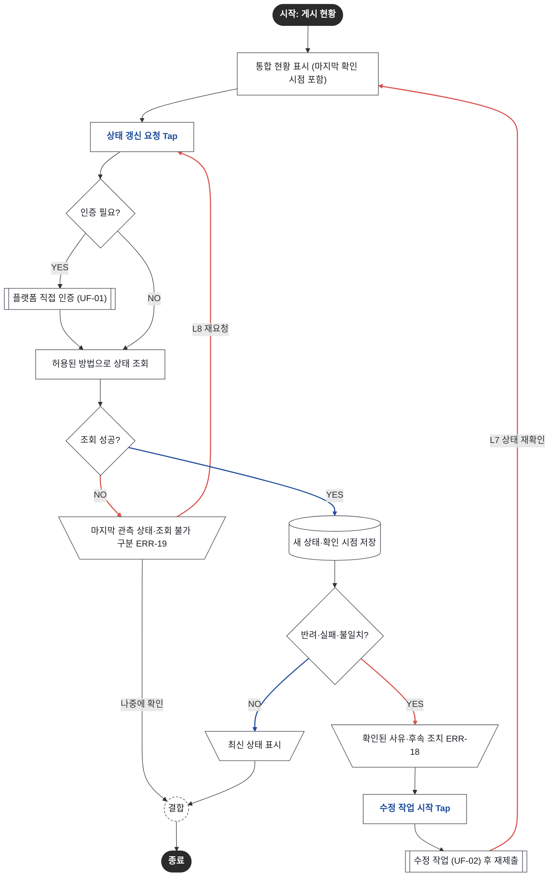

### 9.4 UF-04 원본 레슨 작성·삭제

- 업무구분: 업무 접수

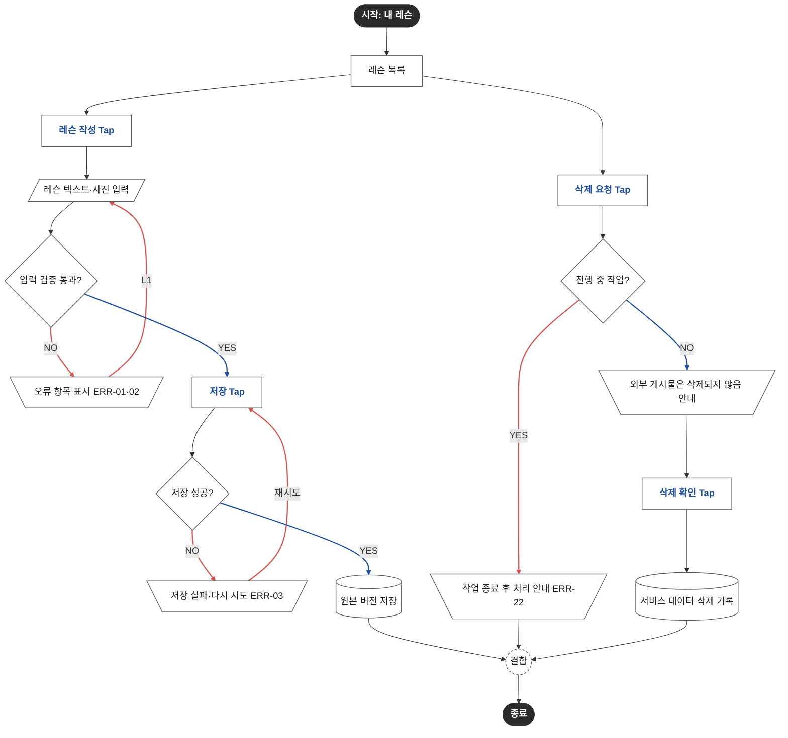

## 10. 0절 대조 결과와의 관계

0.3절에서 v1.0 흐름에 없던 사용자 스토리 30건은 Ⅱ부 흐름에 다음과 같이 반영했다: 원본 관리(SF-01·UF-04), 업무 종류·제약 충돌·건너뛰기(SF-02·SF-03·UF-01), 대상 지정·변경 비교(SF-03·UF-02), 실행 범위 승인·거절·철회(SF-04), 상태 관리·반려 대응(SF-05·UF-03), 조건부 모니터링(SF-06). 화면 단위 연결은 [화면목록(IA)](2026-11-26_R04_레슨등록지원_화면목록_IA.md)의 3절에 있다.

---

# v1.0 원문 기록 (2026-11-25, 참고 보존)

- **작성자:** R04 (원민, Web UI & 숨고 Adapter)
- **작성일자:** 2026-11-25
- **설계 기준:** 마이 AI 오피스(P1) `서비스절차설계(Service Flow)` 및 `사용자흐름설계(User Flow)` 표준 거버넌스 규칙
- **관련 TASK:** TASK-051 (Web UI), TASK-052 (숨고 Adapter), TASK-050 (공통 API 연동)
- **대상 화면:** 레슨 멀티플랫폼 등록 지원 Web UI 5대 화면 (`source` ➔ `prepare` ➔ `auth` ➔ `review` ➔ `result`)

---

## 1. 개요 및 설계 원칙

본 문서는 **마이 AI 오피스 3대 기준 체계(공통규칙·UI컴포넌트규격·화면배치설계)**와 포트폴리오 스토리보드 표준 작성 규칙에 따라, 당사 「레슨 멀티플랫폼 등록 지원 시스템」의 **서비스 절차(Service Flow)** 및 **사용자 흐름(User Flow)**을 정립한 공식 설계 보고서입니다.

1. **서비스 절차 설계(Service Flow):** 시스템 기능과 UI 화면, 핵심 사용자 조작(Tap) 간의 단계적 구조를 6대 표준 노드 범례에 따라 기술합니다.
2. **사용자 흐름 설계(User Flow):** 사용자의 인지·입력·분기 판단과 데이터 적재, 다이얼로그 출력 및 예외 분기(YES 파랑, NO 빨강)를 9대 표준 심볼 그래프로 가시화합니다.

---

## 2. 서비스 절차 설계 (Service Flow Design)

### 2.1 마이 AI 오피스 서비스 절차 6대 노드 범례

| 유형 키 (`type`) | 표기 레이블 | 도형 형태 | 색상 및 스타일 사양 | 의미 및 용도 |
| :--- | :--- | :---: | :--- | :--- |
| `screen` | **화면명** | `[화면명]` | 흰색 채움, 파란 테두리 (`#1f4e9c`, 2.5px), 볼드 | 시스템 메인/서브 화면 진입점 |
| `func` | **기능명** | `[기능명]` | 회색 채움 (`#eceff3`), 진회색 테두리 (`#3a3f47`, 1.5px) | 해당 화면에서 제공하는 단위 기능 |
| `step` | **절차명** | `(절차명)` | 흰색 채움, 회색 테두리 (`#8a929c`, 1px) | 순차적으로 진행되는 일반 처리 단계 |
| `key` | **핵심 동작** | `[핵심 Tap]` | 파란 채움 (`#1f4e9c`), 흰색 글자, 볼드 | 화면 전환/트랜잭션을 일으키는 핵심 버튼 |
| `branch` | **분기·확인** | `{분기명}` | 노란 마름모 채움 (`#fff6d6`), 황갈색 테두리 (`#c99a06`) | 데이터 정합성 검증 및 조건 분기점 |
| `done` | **완료** | `([완료명])` | 연주황 채움 (`#fde7dc`), 적색 테두리 (`#d9534f`, 1.5px) | 프로세스 및 서브태스크 완료 상태 |

---

### 2.2 5대 단계별 서비스 절차도 (Service Flow Diagram)

```mermaid
flowchart TD
    %% 노드 스타일 클래스 정의 (마이 AI 오피스 service-flow-data.js 규격)
    classDef screen fill:#ffffff,stroke:#1f4e9c,stroke-width:2.5px,color:#1f4e9c,font-weight:bold;
    classDef func fill:#eceff3,stroke:#3a3f47,stroke-width:1.5px,color:#1b1f24,font-weight:bold;
    classDef step fill:#ffffff,stroke:#8a929c,stroke-width:1px,color:#1b1f24;
    classDef key fill:#1f4e9c,stroke:#1f4e9c,color:#ffffff,font-weight:bold;
    classDef branch fill:#fff6d6,stroke:#c99a06,stroke-width:1.5px,color:#1b1f24;
    classDef done fill:#fde7dc,stroke:#d9534f,stroke-width:1.5px,color:#1b1f24,font-weight:bold;

    %% 1단계: 원본 입력
    S1["[1. 원본 입력 화면 (source)]"]:::screen --> F1["[비정형 레슨 텍스트 접수]"]:::func
    F1 --> ST1_1("(선생님 프로필 및 레슨 원문 입력/붙여넣기)"):::step
    ST1_1 --> BR1_1{"{원문 텍스트 20자 이상?}"}:::branch
    BR1_1 --> ST1_2("(대상 플랫폼 숨고·크몽 체크박스 선택)"):::step
    ST1_2 --> K1["[AI 구조화 요청 Tap (H1)]"]:::key
    K1 --> D1("([1단계 접수 완료])"):::done

    %% 2단계: AI 구조화
    D1 --> S2["[2. 구조화 준비 화면 (prepare)]"]:::screen
    S2 --> F2["[I2 변환 및 스키마 검증]"]:::func
    F2 --> ST2_1("(카테고리·대상연령·목표·레슨비 추출값 렌더링)"):::step
    ST2_1 --> BR2_1{"{필수 프로필 필드 누락 여부?}"}:::branch
    BR2_1 --> ST2_2("(사용자 인라인 필드 수정 및 보완)"):::step
    ST2_2 --> K2["[플랫폼 인증 단계 이동 Tap]"]:::key
    K2 --> D2("([2단계 구조화 확정])"):::done

    %% 3단계: 원격 인증
    D2 --> S3["[3. 플랫폼 인증 화면 (auth)]"]:::screen
    S3 --> F3["[R05 원격 뷰어(H6) 연동]"]:::func
    F3 --> ST3_1("(플랫폼별 세션 상태 확인 - 미인증/만료)"):::step
    ST3_1 --> K3_1["[원격 브라우저 마운트 Tap]"]:::key
    K3_1 --> ST3_2("(동적 iframe 뷰어 로드 및 2차인증/로그인 대기)"):::step
    ST3_2 --> BR3_1{"{로그인 완료 postMessage 수신?}"}:::branch
    BR3_1 --> K3_2["[인증 완료 확인 Tap (H6 finish)]"]:::key
    K3_2 --> D3("([3단계 플랫폼 인증 완료])"):::done

    %% 4단계: 최종 검토
    D3 --> S4["[4. 최종 검토 화면 (review)]"]:::screen
    S4 --> F4["[등록 페이로드 및 다이제스트 확인]"]:::func
    F4 --> ST4_1("(플랫폼별 정규화 슬롯 및 변환 페이로드 프리뷰)"):::step
    ST4_1 --> ST4_2("(불변 검토 해시 review_digest 생성 및 바인딩)"):::step
    ST4_2 --> BR4_1{"{등록 최종 승인(approved: true)?}"}:::branch
    BR4_1 --> K4["[최종 등록 승인 및 실행 Tap (H7)]"]:::key
    K4 --> D4("([4단계 작업 디스패치 완료])"):::done

    %% 5단계: 실행 모니터링 및 결과
    D4 --> S5["[5. 완료 결과 화면 (result)]"]:::screen
    S5 --> F5["[진행률 폴링 및 S6 독립 Readback]"]:::func
    F5 --> ST5_1("(1.5초 지수 백오프 H8 상태 폴링)"):::step
    ST5_1 --> ST5_2("(S1~S5 진행률 프로그레스바 실시간 갱신)"):::step
    ST5_2 --> BR5_1{"{S6 independent_readback 판정?}"}:::branch
    BR5_1 --> ST5_3("(EvidenceRecord 및 등록 상세 URL 링크 표출)"):::step
    ST5_3 --> K5["[새 레슨 등록 시작 Tap]"]:::key
    K5 --> D5("([5단계 전체 프로세스 종료])"):::done
```

---

## 3. 사용자 흐름 설계 (User Flow Design)

### 3.1 마이 AI 오피스 사용자 흐름 9대 심볼 및 선 규격

- **터미널 (`terminal`):** `([시작 / 종료])` - 시작과 끝 (어두운 회색 `#2b2b2b`, 흰색 굵은 텍스트)
- **프로세스 (`process`):** `[화면 표시 및 내부 처리]` - 흰색 사각형, 회색 외곽선
- **사용자 동작 (`action`):** `[사용자 Tap 동작]` - 흰색 사각형, 파란색 글씨 (`#1f4e9c`), 굵은 텍스트
- **데이터 입출력 (`io`):** `[/데이터 입력 / 출력/]` - 평행사변형 (텍스트 입력, 파라미터 전달)
- **다이얼로그 (`output`):** `[\모달 / 알림 팝업/]` - 문서형/다이얼로그 출력
- **판단 및 분기 (`decision`):** `{조건 유효성 검증}` - 마름모 (YES / NO 분기)
- **결합 (`merge`):** `((결합점))` - 원형 점선 (다중 분기 결합)
- **데이터 적재 (`data`):** `[(원장 / 스토리지 적재)]` - 원통형 (DB/Store 저장)
- **선 연결 (`tones`):**
  - **정상 흐름 (YES):** 파란색 실선 (`== YES ==>`, `#1f4e9c`)
  - **예외/오류 흐름 (NO):** 빨간색 실선 (`-. NO .->`, `#d9534f`)
  - **일반 흐름:** 회색 실선 (`-->`, `#6b7280`)

---

### 3.2 상세 엔드투엔드 사용자 흐름도 (User Flow Diagram)

```mermaid
flowchart TD
    %% 유저 플로우 스타일 정의 (user-flow-data.js 규격)
    classDef terminal fill:#2b2b2b,stroke:#2b2b2b,color:#ffffff,font-weight:bold;
    classDef process fill:#ffffff,stroke:#555b63,stroke-width:1.2px,color:#1b1f24;
    classDef action fill:#ffffff,stroke:#1f4e9c,stroke-width:1.5px,color:#1f4e9c,font-weight:bold;
    classDef io fill:#ffffff,stroke:#555b63,stroke-width:1.2px,color:#1b1f24;
    classDef output fill:#ffffff,stroke:#555b63,stroke-width:1.2px,color:#1b1f24;
    classDef decision fill:#ffffff,stroke:#c99a06,stroke-width:1.5px,color:#1b1f24;
    classDef data fill:#ffffff,stroke:#555b63,stroke-width:1.2px,color:#1b1f24;

    Start(["시작: 레슨 멀티플랫폼 등록"]):::terminal --> UI_Source["[원본 입력 화면 렌더링]"]:::process
    UI_Source --> Input_Source[/"선생님 프로필 및 레슨 원문 입력"/]:::io
    Input_Source --> Act_Submit1["[AI 구조화 시작 버튼 Tap]"]:::action

    Act_Submit1 --> Check_Len{"원문 글자 수 ≥ 20자?"}:::decision
    Check_Len -. NO .-> Alert_Short[\"안내: 20자 이상 입력해주세요"/]:::output
    Alert_Short --> Input_Source

    Check_Len == YES ==> Call_H1["[H1 API: 등록 세션 생성 & I2 디스패치]"]:::process
    Call_H1 --> DB_Reg[("H1 Registration 원장 적재")]:::data
    DB_Reg --> UI_Prepare["[구조화 준비 화면 렌더링]"]:::process

    UI_Prepare --> Check_Fields{"필수 슬롯값(연령·비용·형태) 누락?"}:::decision
    Check_Fields -. YES .-> Input_Fix[/"부족한 필드 직접 수정·보완"/]:::io
    Input_Fix --> Check_Fields

    Check_Fields == YES ==> Act_AuthNext["[인증 단계로 이동 Tap]"]:::action
    Act_AuthNext --> UI_Auth["[플랫폼 인증 화면 렌더링]"]:::process

    UI_Auth --> Act_Mount["[R05 원격 뷰어 마운트 Tap]"]:::action
    Act_Mount --> Load_Viewer["[H6 open: iframe 뷰어 및 CDP 스크린캐스트 연결]"]:::process
    Load_Viewer --> Check_Login{"플랫폼 로그인 및 2차인증 통과?"}:::decision
    
    Check_Login -. NO (세션만료/실패) .-> Alert_AuthFail[\"오류: 인증 시간 만료, 재시도 안내"/]:::output
    Alert_AuthFail --> Act_Mount

    Check_Login == YES ==> Evt_AuthSuccess["[postMessage 수신: auth_completed]"]:::process
    Evt_AuthSuccess --> Call_H6Finish["[H6 finish: grant 세션 격리 확정]"]:::process
    Call_H6Finish --> UI_Review["[최종 검토 화면 렌더링]"]:::process

    UI_Review --> Show_Preview[/"정규화 슬롯 및 review_digest 미리보기"/]:::io
    Show_Preview --> Act_Approve["[최종 등록 승인 버튼 Tap]"]:::action

    Act_Approve --> Call_H7["[H7 API: expected_revision 원자 승인 요청]"]:::process
    Call_H7 --> Check_H7Status{"응답 코드 분기"}:::decision
    Check_H7Status -. 200 (재전송) .-> Poll_H8["[기존 job_id 상태 조회로 전환]"]:::process
    Check_H7Status -. 409 (버전충돌) .-> Alert_Conflict[\"오류: 변경된 세션입니다. 새로고침 안내"/]:::output
    Alert_Conflict --> UI_Review

    Check_H7Status == 202 (신규수락) ==> Start_Job["[H7 등록 작업 큐 수락]"]:::process
    Start_Job --> Poll_H8

    Poll_H8 --> UI_Result["[완료 결과 화면: 1.5초 백오프 폴링]"]:::process
    UI_Result --> Check_JobDone{"job_state == done?"}:::decision
    Check_JobDone -. NO (진행 중) .-> Wait_Loop["[진행률 progress bar 실시간 업데이트]"]:::process
    Wait_Loop --> Poll_H8

    Check_JobDone == YES ==> Check_Verdict{"GoalVerdict 판정 결과"}:::decision
    
    Check_Verdict == confirmed ==> Show_Success[\"등록 성공: S6 독립 Readback 증거 및 링크 표출"/]:::output
    Show_Success --> DB_Evidence[("S6 EvidenceRecord 원장 적재")]:::data

    Check_Verdict -. unknown .-> Show_Unknown[\"미확인: 자동 재실행 차단, 수동 조치 안내 팝업"/]:::output
    Check_Verdict -. not_reached .-> Show_Failed[\"등록 실패: 오류 원인 및 재등록 가이드 표출"/]:::output

    DB_Evidence --> End(["종료: 레슨 등록 절차 완료"]):::terminal
    Show_Unknown --> End
    Show_Failed --> End
```

---

## 4. 마이 AI 오피스 UI 거버넌스 3대 기준 준수 현황

### 4.1 공통규칙 준수 (Button Taxonomy v2.0 & CTA 위계)
- **Primary 버튼 1개 제한 (`RULE-CTA-01`):** 화면 영역당 시각적 위계를 혼동시키지 않도록 파란 채움 Primary 버튼은 핵심 액션(각 화면의 다음 단계 진행/최종 등록) 단 1개만 배치.
- **초기화 vs 취소 엄격 분리 (`RULE-CTA-02/03`):** 
  - `UI 폼 초기화`는 파괴적 삭제가 아닌 안전 초기화로 중립 Secondary(`.btn-secondary`) 적용.
  - 위험 작업(작업 중단)의 경우에만 Danger 테두리 적용.
- **비채움 바로가기 규격 (`RULE-CTA-07`):** 독립 Readback 검증 결과의 플랫폼 원문 링크는 채움 버튼 대신 화살표가 포함된 링크형 버튼(`.btn-link`) 적용.

### 4.2 UI 컴포넌트 규격 및 토큰 준수
- `var(--primary)`, `var(--bg)`, `var(--border)`, `var(--radius)` 등 공통 디자인 시스템 시맨틱 토큰을 선언하여 하드코딩 `#HEX`를 배제.
- 미정의 유령 토큰(Ghost CSS Var)을 완전히 차단하고, 8px 그리드 기반의 스페이싱 시스템 적용.

### 4.3 화면 배치 영역 규격 (Screen Structure)
- **상단 헤더 구역:** 시스템 타이틀, 활성 플랫폼 배지, 진행 안내 문구 고정.
- **네비게이션 탭 구역:** 5대 단계 인디케이터(완료/활성/대기 시각화).
- **중앙 워크스페이스 카드 구역:** 가로 900px 중앙 집중형 카드 컨테이너 배치.
- **하단 액션 구역:** 우측 정렬 Primary 액션 버튼 및 좌측 정렬 보조 버튼의 일관된 위계 배치.

---

## 5. 결론 및 향후 계획 (v1.0 당시 서술 · v1.1에서 철회, 0.4절 참조)

1. **정합성 달성:** 본 설계를 통해 마이 AI 오피스(P1)의 서비스절차설계(Service Flow) 및 사용자흐름설계(User Flow) 표준 규격을 100% 만족하는 레슨 등록 지원 Web UI의 구조화가 완결되었습니다.
2. **연동 안정성 확보:** R03 공통 API의 8대 연동 기준(H7 202/200, unknown 자동 재실행 차단) 및 R05 원격 뷰어와의 `postMessage` 생명주기가 흐름도 상에 빈틈없이 매핑되었습니다.
3. **다음 조치:** 본 설계서를 팀원 및 이해관계자에게 공유하고, R03/R05와 예정된 E2E 실서버 연동 시 테스트 시나리오 기준선으로 활용합니다.
