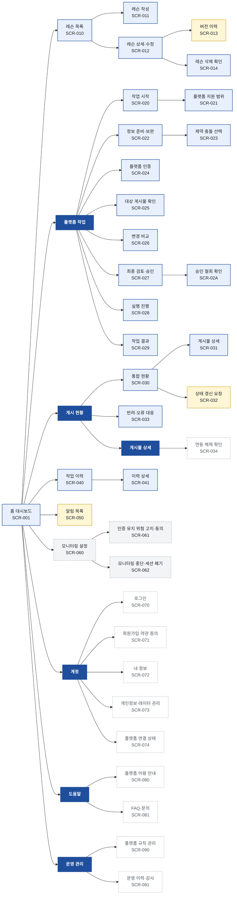

# 레슨 등록 지원 서비스 메뉴구조도

## 문서 정보

| 항목 | 내용 |
|---|---|
| 문서 ID | DESIGN-R04-MENUTREE-20261126 |
| 버전 | **v1.0 (최초 작성)** |
| 최초 작성일 | 2026-11-26 |
| 최종 수정일 | 2026-11-26 |
| 작성자 | R04 (원민) |
| 문서 종류 | 메뉴구조도 |
| 문서 상태 | R04 제안 초안 · 미합의 (R01 사용자 스토리·서비스 범위 확정 전 참고) |
| 관련 TASK | TASK-056 (사용자 스토리·플랫폼 조사 입력) · 범위 확정은 TASK-058 (R01) |
| 작성 규칙 | 마이 AI 오피스 「메뉴화면구성 > 앱 메뉴 구조도·프로젝트 화면 도식」(1~5뎁스 경로, 화면목록과 같은 화면 ID) |
| 관련 문서 | [기능명세서](2026-11-26_R04_레슨등록지원_기능명세서.md) · [기능범위정의_기능명세서](2026-11-26_R04_레슨등록지원_기능범위정의_기능명세서.md) · [메뉴화면구성](2026-11-26_R04_레슨등록지원_메뉴화면구성.md) · [메뉴구조도](2026-11-26_R04_레슨등록지원_메뉴구조도.md) · [화면목록_IA](2026-11-26_R04_레슨등록지원_화면목록_IA.md) · [서비스절차·사용자흐름 설계보고서](2026-11-25_R04_마이AI오피스_서비스절차_사용자흐름_설계보고서.md) |

### 변경 이력

| 버전 | 날짜 | 변경 내용 | 변경 사유 |
|---|---|---|---|
| v1.0 | 2026-11-26 | 1~4뎁스 메뉴 트리와 범위별 색 구분 도식, 메뉴 그룹별 화면 수 작성 | 사용자 요청: 마이 AI 오피스 규칙에 따른 메뉴구조도 작성 |

> **작성 기준과 한계:** [기획안 V1.2](../../../artifacts/planning/lesson-registration-20261123/proposal-v1.2.md) 피처(F01~F29, E01~E05)와 [R04 사용자 스토리 후보 44건](../../../artifacts/planning/lesson-registration-20261126/R04/independent-result.json)을 기준으로 작성한 **R04 제안 초안**이다. 현재 단계([PHASE-20261126-01](../../../human/phase-intents/PHASE-20261126-01.md))에서 서비스 범위·MVP·DB·API는 R01이 확정하므로, 이 문서는 범위 결정을 위한 검토 자료이며 확정 설계가 아니다. 이전 설계(11/25 Web UI·API H1~H8)를 근거로 쓰지 않았고, API·기술 스택은 정하지 않는다.

---
## 1. 범례

| 표시 | 의미 |
|---|---|
| 파란 채움 | 메뉴 그룹 (2뎁스) |
| 연한 파랑 | MVP 화면 |
| 노랑 | 확장 화면 |
| 회색 점선 | 조건부(자동 모니터링) 화면 |
| 흰색 점선 | 추가 후보 화면 (R01 결정 필요) |

각 노드에 화면 ID를 함께 적었다. 화면 ID·경로·화면 유형은 [화면목록(IA)](2026-11-26_R04_레슨등록지원_화면목록_IA.md)과 같다.

## 2. 전체 메뉴구조도



## 3. 메뉴 그룹별 화면 수

| 메뉴 (2뎁스) | 화면 수 | MVP | 확장 | 조건부 | 추가 후보 | 로그인 레벨 |
|---|---:|---:|---:|---:|---:|---|
| Home(홈) | 1 | 1 | 0 | 0 | 0 | 로그인 |
| 내 레슨 | 5 | 4 | 1 | 0 | 0 | 로그인 |
| 플랫폼 작업 | 11 | 11 | 0 | 0 | 0 | 로그인 |
| 게시 현황 | 5 | 3 | 1 | 0 | 1 | 로그인 |
| 작업 이력 | 2 | 2 | 0 | 0 | 0 | 로그인 |
| 알림 | 1 | 0 | 1 | 0 | 0 | 로그인 |
| 자동 모니터링 | 3 | 0 | 0 | 3 | 0 | 로그인 |
| 계정 | 5 | 0 | 0 | 0 | 5 | 로그인·비로그인 |
| 도움말 | 2 | 0 | 0 | 0 | 2 | 비로그인 |
| 운영 관리 | 2 | 0 | 0 | 0 | 2 | 운영자 |
| **합계** | **37** | 21 | 3 | 3 | 10 | |

## 4. 텍스트 트리

```text
└ 홈 대시보드 (SCR-001, 페이지, MVP)
    └ 레슨 목록 (SCR-010, 페이지, MVP)
        └ 레슨 작성 (SCR-011, 페이지, MVP)
        └ 레슨 상세·수정 (SCR-012, 페이지, MVP)
            └ 버전 이력 (SCR-013, 드로어, 확장)
            └ 레슨 삭제 확인 (SCR-014, 모달, MVP)
        └ 작업 시작 (SCR-020, 페이지, MVP)
            └ 플랫폼 지원 범위 (SCR-021, 드로어, MVP)
        └ 정보 준비·보완 (SCR-022, 페이지, MVP)
            └ 제약 충돌 선택 (SCR-023, 모달, MVP)
        └ 플랫폼 인증 (SCR-024, 페이지, MVP)
        └ 대상 게시물 확인 (SCR-025, 페이지, MVP)
        └ 변경 비교 (SCR-026, 페이지, MVP)
        └ 최종 검토·승인 (SCR-027, 페이지, MVP)
        └ 실행 진행 (SCR-028, 페이지, MVP)
        └ 작업 결과 (SCR-029, 페이지, MVP)
            └ 승인 철회 확인 (SCR-02A, 모달, MVP)
        └ 통합 현황 (SCR-030, 페이지, MVP)
            └ 게시물 상세 (SCR-031, 페이지, MVP)
            └ 상태 갱신 요청 (SCR-032, 모달, 확장)
        └ 반려·오류 대응 (SCR-033, 페이지, MVP)
            └ 연동 해제 확인 (SCR-034, 모달, 추가 후보)
    └ 작업 이력 (SCR-040, 페이지, MVP)
        └ 이력 상세 (SCR-041, 드로어, MVP)
    └ 알림 목록 (SCR-050, 페이지, 확장)
    └ 모니터링 설정 (SCR-060, 페이지, 조건부)
        └ 인증 유지 위험 고지·동의 (SCR-061, 모달, 조건부)
        └ 모니터링 중단·세션 폐기 (SCR-062, 모달, 조건부)
        └ 로그인 (SCR-070, 페이지, 추가 후보)
        └ 회원가입·약관 동의 (SCR-071, 페이지, 추가 후보)
        └ 내 정보 (SCR-072, 페이지, 추가 후보)
        └ 개인정보·데이터 관리 (SCR-073, 페이지, 추가 후보)
        └ 플랫폼 연결 상태 (SCR-074, 페이지, 추가 후보)
        └ 플랫폼 이용 안내 (SCR-080, 페이지, 추가 후보)
        └ FAQ·문의 (SCR-081, 페이지, 추가 후보)
        └ 플랫폼 규칙 관리 (SCR-090, 페이지, 추가 후보)
        └ 운영 이력·감사 (SCR-091, 페이지, 추가 후보)
```
