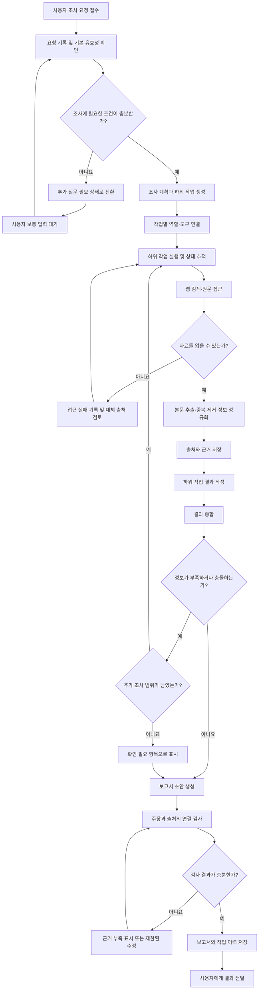

# 리서치 백엔드 데이터 흐름 초안

- 담당: R05 다혁 (백엔드)
- 상태: 초안
- 작성일: 2026-11-11
- 갱신일: 2026-11-11
- 출처: [11월 11일 리서치·기획·WBS 계획](../../../project/2026-11-11_리서치_기획_WBS_계획.md), [팀 헌장](../../../charter/팀_헌장.md)

## 목적과 범위

사용자의 조사 요청이 출처가 연결된 보고서가 되기까지, **백엔드에서 관리해야 할 처리 단계와 분기**를 보여준다. 현재 팀이 확정한 API 계약이나 구현 아키텍처가 아니라 R05의 논의용 초안이다. 중고거래 상품 비교는 가능한 시연 사례 중 하나이며, 이 흐름은 특정 조사 분야에 종속되지 않는다.

## 처리 흐름

## 흐름도에서 확인할 백엔드 책임

| 구간 | 백엔드가 관리할 것 | 아직 정하지 않은 것 |
|---|---|---|
| 요청 접수·추가 질문 | 요청의 식별과 상태, 보충 입력을 받은 뒤 이어서 처리할 위치 | 사용자가 입력할 필수 항목과 추가 질문 화면 |
| 계획·작업 배정 | 하위 작업의 식별, 실행 순서, 상태, 결과의 연결 | 역할을 고정할지 요청마다 구성할지, 병렬 실행 범위 |
| 자료 수집 | 접근 성공·실패, 수집 시점, 원문 출처와 작업의 연결 | 검색·수집 도구, 허용할 출처, 호출 한도 |
| 근거 저장·종합 | 어떤 조사 결과가 어떤 출처에 근거하는지 추적 | 출처 충돌 해결 기준, 저장 기간 |
| 보고서·검사 | 보고서 상태와 주장별 근거, 검사 실패 사유 | 보고서 형식, 검사 통과 기준, 재조사·수정 횟수 |

## 모든 단계에 걸친 실패 처리

- 외부 자료에 접근하지 못하면 실패한 출처와 이유를 남기고, 대체 출처를 찾을지 판단한다.
- 하위 작업이 시간 초과 또는 실패하면 해당 상태를 보존한다. 나머지 결과만으로 보고서를 만들 수 있는지는 MVP 기준에 따라 결정한다.
- 재검색과 보고서 수정에는 상한이 필요하다. 상한에 도달하면 확인되지 않은 항목을 명시하고 종료하는 안을 검토한다.
- 웹에서 읽은 내용은 **조사 자료**로 다루며, 그 안의 명령문이 작업 계획이나 서버 동작을 바꾸지 않도록 분리해야 한다.

## 팀과 맞춰야 할 결정

1. **R01 지효:** MVP에서 추가 질문·재조사·부분 완료를 어디까지 지원할지.
2. **R03 두나:** 하위 작업 분해 기준과 에이전트 역할의 고정·동적 구성 여부.
3. **R04 원민:** 사용자 입력, 진행 상태, 확인 필요 항목, 최종 보고서의 화면 흐름.
4. **R02 상옥:** 실행 환경, 검색·수집 도구의 접근 제약, 비용 및 호출 한도.

## 다음 단계

위 결정이 정리되면 R05가 **요청·하위 작업·출처·근거·보고서의 최소 데이터 항목**과 API 입출력 제안안을 작성한다. 팀에서 확정된 설계는 이 개인 초안이 아니라 공용 `docs/design/` 문서에 반영한다.
