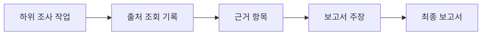

# 리서치 출처 저장 방식 초안

- 담당: R05 다혁 (백엔드)
- 상태: 초안
- 작성일: 2026-11-11
- 갱신일: 2026-11-11
- 출처: [R05 백엔드 데이터 흐름 초안](2026-11-11_리서치_백엔드_데이터_흐름_초안.md), [11월 11일 리서치·기획·WBS 계획](../../../project/2026-11-11_리서치_기획_WBS_계획.md)

## 결정 제안

**출처 URL 하나만 보고서에 붙이지 않고, `조회 기록 → 근거 → 보고서 주장`을 연결한다.** 같은 URL도 조회 시점에 따라 내용이 바뀔 수 있으므로, 출처 기록은 URL이 아니라 **조회 한 번**을 단위로 만든다. 이 구조는 출처와 생성 결과의 관계를 추적하려는 [W3C PROV 모델](https://www.w3.org/TR/prov-o/)을 참고하되, MVP에 필요한 항목만 사용한 R05의 제안이다.

## 1. 출처 조회 기록 `source_record`

웹 검색 결과나 원문 접근 시도마다 기록한다. **검색 결과만 본 상태**와 **원문을 읽은 상태**를 구분한다.

| 항목 | 용도 | MVP |
|---|---|---|
| `source_id` | 이 조회 기록의 고유 식별자 | 필수 |
| `request_id`, `task_id` | 어느 조사 요청·하위 작업에서 조회했는지 | 필수 |
| `original_url`, `resolved_url` | 발견한 URL과 이동 후 실제 URL | 필수, 실제 URL을 얻지 못하면 비움 |
| `title` | 사용자가 확인할 출처 제목 | 확인 가능하면 저장 |
| `retrieved_at` | 시스템이 조회한 시각 | 필수 |
| `published_at` | 자료 자체의 발행·수정일 | 확인될 때만 저장 |
| `access_status` | `search_only` / `fetched` / `failed` | 필수 |
| `content_type`, `content_hash` | 자료 형식과 내용 변경 여부 확인 | 수집 성공 시 저장 |
| `error_reason` | 접근 실패 이유 | 실패 시 저장 |

`published_at`을 알 수 없으면 `retrieved_at`으로 대체해 **발행일인 것처럼 표시하지 않는다**. 검색 결과에 URL과 제목만 있어도 `search_only`로 기록할 수 있지만, 본문을 읽은 것처럼 취급하지 않는다. 웹 검색 도구에 따라 인용 URL과 전체 조회 URL 목록이 구분될 수 있으므로 수집 단계에서 실제로 받은 항목을 확인한다. [OpenAI 공식 웹 검색 문서](https://developers.openai.com/api/docs/guides/tools-web-search)

## 2. 근거 항목 `evidence`

출처에서 **무엇을 확인했는지**를 작은 단위로 저장한다.

| 항목 | 용도 |
|---|---|
| `evidence_id`, `source_id` | 근거를 해당 조회 기록에 연결 |
| `finding` | 확인한 사실을 짧게 정리한 내용 |
| `locator` | 원문 안의 위치: 문단·제목·페이지 등, 확인 가능한 경우 |
| `excerpt` | 판단을 재확인하는 데 필요한 짧은 원문 발췌, 허용 범위에서만 저장 |
| `extracted_at` | 해당 근거를 추출한 시각 |

원문 전체를 기본으로 복사해 저장하지 않는다. 전체 본문 보존이 필요하면 출처별 이용 조건과 저장 기간을 따로 결정한다. 접근 실패 기록에서는 `evidence`를 만들지 않는다.

## 3. 보고서 주장과 인용 연결

보고서의 주요 주장 `report_claim`에 `claim_id`, `report_id`, 주장 문장, 검토 상태를 둔다. 별도 연결 관계로 한 주장에 **근거 1개 이상**, 한 근거에 **여러 주장**을 연결할 수 있게 한다.

- 근거가 연결된 주장은 보고서에서 해당 `source_record`의 URL·제목·조회 시각으로 인용한다.
- 서로 다른 자료가 충돌하면 관련 근거를 모두 연결하고 `conflicting`으로 표시한다.
- 근거가 없으면 URL을 만들어 넣지 않고 `unverified` 또는 `확인 필요`로 표시한다.
- `supported`는 **저장된 출처가 그 문장을 뒷받침한다**는 뜻이며, 내용 전체가 절대적으로 참이라는 보증은 아니다.
- 최종 인용 링크는 모델이 자유롭게 적은 문자열보다 **저장된 `source_id`에서 서버가 생성**하는 방식을 제안한다.

## 4. 저장 시점과 실패 처리

1. 자료 접근을 시도하면 `source_record`를 만들고 성공·검색만 가능·실패 상태를 남긴다.
2. 원문을 실제로 읽고 관련 내용을 확인했을 때만 `evidence`를 만든다.
3. 하위 작업 결과가 종합될 때 `report_claim`과 근거를 연결한다.
4. 최종 보고서를 제공하기 전, 중요한 주장에 유효한 근거 연결이 있는지 검사한다.
5. 접근 실패나 근거 부족은 작업 이력과 보고서의 `확인 필요` 항목에 반영한다.

## 5. 아직 팀과 정할 항목

| 결정 | 관련 담당 |
|---|---|
| 모든 핵심 주장에 근거를 요구할지, 어떤 문장을 핵심 주장으로 볼지 | R01 지효, R03 두나 |
| 사용자 화면에서 인용·조회 시각·충돌 표시를 어떻게 보여줄지 | R04 원민 |
| 원문 보존 여부, 저장 기간, 저장소, 수집 도구의 이용 조건과 비용 | R02 상옥, R01 지효 |
| 출처별 신뢰도 판단 기준과 재검사 상한 | R01 지효, R03 두나 |

## MVP에서 확인할 수 있는 최소 시험

- 같은 URL을 서로 다른 시각에 조회해도 기록이 구분되는가?
- 보고서 주장 하나에서 근거와 원문 URL까지 따라갈 수 있는가?
- 원문을 읽지 못한 검색 결과가 검증된 근거로 표시되지 않는가?
- 출처가 없는 주장을 `확인 필요`로 표시하는가?

이 초안은 **논리적 저장 구조**만 정한다. DB 제품, API 필드 이름과 형식, 보존 기간은 관련 담당자의 의견과 MVP 결정 후 공용 `docs/design/data/`에 확정한다.
