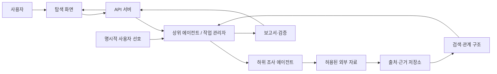

# 앱 탐색 도메인 기반 상위 에이전트 오케스트레이션 기획안 초안

- 담당: R05 임다혁 (백엔드, 논의용 초안)
- 상태: 초안
- 작성일: 2026-11-11
- 갱신일: 2026-11-11
- 출처: [기획서 잘 쓰는 법](https://gt.isitsoft.kr/publicproj/aio-01d4-stu/src/branch/main/Lecture/FinalProject/Doc/%EA%B8%B0%ED%9A%8D%EC%84%9C_%EC%9E%98_%EC%93%B0%EB%8A%94_%EB%B2%95.pdf), [팀 헌장](../../../charter/팀_헌장.md), [11월 11일 리서치·기획·WBS 계획](../../../project/2026-11-11_리서치_기획_WBS_계획.md), [R04 선행사례 조사 초안](../../../research/topics/03_AI_리서치_멀티에이전트_시스템_선행사례_및_구축방안_조사.md)
- 결정 상태: 아래의 사용자 문제, 기능 범위, 기술 구성, 수치 목표는 **팀 확정 전 제안**이다. 특히 앱 찾기를 첫 도메인으로 삼는 방향은 2026-11-11 사용자 제안을 반영했으며, 기존 중고거래 시연 후보의 대체 여부는 아직 팀 결정이 아니다.

## 한눈에 보는 제안

**프로젝트 목표:** 사용자의 목적과 성향을 이해한 상위 에이전트가 조사 계획과 하위 역할을 구성하고, 공개 출처를 조사해 근거가 연결된 앱 탐색 결과를 제공한다. 첫 도메인인 **앱 찾기**를 끝까지 구현한 뒤, 같은 오케스트레이션 구조를 다른 도메인에 적용할 수 있는지 확인한다.

**개발 접근:** 앱 찾기 한 사례에서 데이터 수집·출처 기록·보고서 생성 흐름을 먼저 완성한다. 그 위에 상위 에이전트의 작업 분해와 배정, 두 가지 탐색 모드, 기억 관리를 차례로 붙이는 **바텀업 방식**을 제안한다.

## 1. 왜 만드는가 — 문제와 사용자

### 문제 진술: 검증할 가설

앱을 찾는 사용자는 원하는 기능을 키워드로 정확히 표현하지 못하거나, 여러 앱의 설명·후기·요금·지원 환경을 따로 확인해야 한다. 현재 익숙한 선택지 외의 앱을 발견하고 싶은 경우에도 무엇을 비교해야 하는지 정하기 어렵다. 이 문제의 빈도와 실제 탐색 시간은 **사용자 인터뷰 및 비교 과제 수행으로 확인해야 한다**. 검증 전에는 사용자 전체의 불편이나 시간 절감 효과를 사실로 단정하지 않는다.

### 초기 대상 사용자: 가정

- **대표 사용자:** 특정 생활·학습·생산성 문제를 해결할 앱을 찾는 일반 사용자. 예: “공부 시간을 관리하고 싶은데 어떤 앱이 나에게 맞는지 모르겠다.”
- **목표:** 자신의 목적·사용 환경·선호에 맞는 후보를 찾고 선택 이유를 확인한다.
- **현재 행동:** 검색 결과와 앱 소개 페이지를 여러 개 열어 직접 비교한다.
- **확인할 질문:** 사용자는 빠른 추천, 새로운 발견, 출처 확인 중 무엇에 가장 큰 가치를 두는가? 개인 성향을 어느 수준까지 제공하려 하는가?

대표 사용자와 문제의 우선순위는 R01·R04의 조사 결과에 따라 조정한다.

## 2. 무엇을 만드는가 — 사용자 시나리오와 차별점

### 두 가지 탐색 모드

| 모드 | 사용자의 의도 | 시스템의 결과 |
|---|---|---|
| **익숙한 것 찾기** | 이미 아는 앱 종류나 기능에서 적합한 후보를 좁힌다. | 필수 조건과 개인 선호에 맞는 후보를 비교하고, 선택 근거와 미확인 조건을 보여준다. |
| **새로운 방향 찾기** | 문제는 알지만 어떤 종류의 앱을 써야 할지 모른다. | 목적과 연결된 인접 카테고리·사용 방식을 제시하고, 왜 새로운 후보를 포함했는지 설명한다. |

두 모드는 같은 출처·비교·보고서 구조를 사용한다. **새로운 방향 찾기**는 무작위로 낯선 앱을 추천하는 기능이 아니라, 사용자 목적과 이어지는 탐색 경로를 보여주는 기능으로 정의한다.

### 한 번의 시연: Before / After

- **기존 방식:** “공부에 집중하고 싶다” 검색 → 앱 목록을 여러 개 열기 → 기능과 요금·지원 환경을 직접 비교 → 어떤 앱이 적합한지 판단.
- **우리 서비스:** 목적과 사용 환경 입력 → 모드 선택 → 상위 에이전트가 비교 기준과 하위 조사 작업 구성 → 담당 에이전트가 앱·출처 조사 → 결과와 근거 검토 → 후보, 선택 이유, 다른 탐색 방향을 한 화면에서 확인.

### 차별화 가설

| 사용자가 보는 차이 | 제안하는 구현 | 검증할 질문 |
|---|---|---|
| **탐색 과정이 보인다** | ‘인터넷 지도’를 이번에는 조사한 앱·기능·목적·출처의 **관계 지도**로 제한해 표시한다. 웹 전체의 지도를 만드는 기능은 아니다. | 사용자가 추천 경로와 근거를 더 쉽게 이해하는가? |
| **나에게 맞는 이유가 보인다** | 사용자가 입력한 목적·운영체제·요금 선호 등 명시적 성향을 후보 평가에 반영한다. | 성향 반영이 실제 선택에 도움이 되는가? |
| **조사한 근거를 다시 찾을 수 있다** | RAG 방식으로 확인한 자료 중 관련 내용을 검색하고, 결과에 원문 링크·조회 시각을 연결한다. | 핵심 설명의 근거를 사용자가 따라갈 수 있는가? |
| **이전 조사 맥락을 재사용한다** | 앱, 기능, 카테고리, 출처 등의 최소 관계 구조를 정의한다. 온톨로지와 장기 기억의 범위는 별도 검증 후 정한다. | 구조화된 관계가 새로운 요청의 탐색에 실제로 도움이 되는가? |

RAG는 **외부 자료를 근거로 다시 찾는 기능**, 개인 성향 기억은 **사용자가 제공한 선호를 보존하는 기능**, 온톨로지는 **앱과 기능의 관계를 정의하는 구조**다. 세 가지를 같은 저장소나 같은 사실로 취급하지 않는다. 개인 성향의 지속 저장은 동의·수정·삭제 방식을 정한 뒤 적용한다.

## 3. 이번 구현 범위

### Must — 핵심 시연에 필요한 5개

1. 사용자가 목적·기본 조건과 탐색 모드 중 하나를 입력할 수 있다.
2. 상위 에이전트가 입력에 따라 하위 조사 작업을 만들고 준비된 역할에 배정한다.
3. 하위 작업의 진행·완료·실패를 기록하고 결과를 상위 에이전트가 종합한다.
4. 선별한 앱 자료에서 후보를 찾고, 각 핵심 설명에 **출처 링크와 조회 시각**을 연결한다.
5. 익숙한 것 찾기와 새로운 방향 찾기의 결과 차이 및 선택 이유를 보고서에 표시한다.

### Should / Could / 이번 범위 밖

| 우선순위 | 항목 |
|---|---|
| **Should** | 조사한 앱·기능·출처를 연결한 간단한 관계 지도, 근거 부족 표시, 제한된 추가 조사 |
| **Could** | 사용자 동의가 있는 지속적 선호 기억, 두 번째 도메인에 동일 구조 적용, 더 풍부한 탐색 지도 |
| **이번 범위 밖** | 인터넷 전체의 그래프 구축, 모든 앱의 실시간 색인, 임의 분야에 대한 정확한 자동 추천 보장, 개인 정보의 무동의 장기 저장, 에이전트 무제한 생성·무한 재조사 |

첫 시연용 앱 자료의 **건수와 분야는 데이터 접근성 조사 후 결정**한다. 후보 수를 먼저 정하고 근거 없는 앱 정보를 채워 넣지 않는다.

## 4. 요구사항과 완료 기준 제안

| 요구사항 | 확인 방법 |
|---|---|
| 두 모드가 같은 입력 조건에서 서로 다른 조사 계획 또는 후보 선정 이유를 만든다. | 팀이 정한 대표 요청을 두 모드로 실행해 계획·결과를 나란히 비교한다. |
| 상위 에이전트가 하위 작업의 배정·상태·실패 사유를 관리한다. | 시연 기록에서 요청 → 하위 작업 → 결과 → 보고서 연결을 따라간다. |
| 보고서의 주요 앱 정보에 근거가 연결된다. | 시연 결과의 주요 주장마다 저장된 출처를 열어 확인한다. 근거가 없으면 ‘확인 필요’로 표시한다. |
| 특정 자료가 실패해도 상태를 숨기지 않는다. | 접근 실패 사례를 실행해 실패 기록과 사용자 표시를 확인한다. |
| 실제 사용자가 결과를 이해하고 앱 선택에 활용할 수 있다. | 팀 밖 사용자에게 동일 과제를 수행하게 하고 이해하기 어려운 지점·선택 여부를 기록한다. |

수치형 목표(허용 소요 시간, 테스트 인원, 근거 연결률 등)는 **기준값을 측정하고 팀이 목표를 정한 뒤** 넣는다. 측정하지 않은 개선율은 기획서에 쓰지 않는다.

## 5. 어떻게 구현하는가 — 개념 구조

- **상위 에이전트:** 요청 명확화, 계획·역할 선택, 하위 작업 배정, 추가 조사 또는 종료 판단.
- **하위 에이전트:** 맡은 범위의 자료 검색·정리·비교. 역할 템플릿과 실제 개수는 R03과 결정.
- **백엔드:** 요청·작업 상태, 출처와 근거, 실패, 보고서 연결을 관리. 기존 [데이터 흐름 초안](2026-11-11_리서치_백엔드_데이터_흐름_초안.md)과 [출처 저장 방식 초안](2026-11-11_리서치_출처_저장_방식_초안.md)을 이 도메인에서 검증.
- **검색·관계 구조:** 자료를 다시 찾는 검색과 앱–기능–목적–출처의 최소 관계를 먼저 구현. 벡터 검색, 그래프 DB, 온톨로지 제품 선택은 작은 기술 검증 후 결정.
- **데이터:** 공식 앱 소개·정책·가격 페이지 등 공개 가능한 원문 후보를 조사한다. 자동 수집·보관 조건은 출처별로 확인하고, 확인 전에는 허용된 방식의 선별 자료로 시연한다.

## 6. 언제·누가 — 제안 일정

| 시점 | 실제로 확인할 결과물 | 주 담당 |
|---|---|---|
| **11월 13일 기획서·WBS** | 사용자 문제와 첫 도메인, 두 모드, Must 기능, 자료 출처·제약, 담당·의존성 결정 | R01 총괄, 각 영역 담당 |
| **11월 말까지** | 선별한 앱 자료로 한 요청의 입력 → 자료 조회 → 출처 연결 → 보고서 흐름 동작 | R05·R03, R02 데이터·환경 지원 |
| **12월 8일 중간 발표** | 상위 에이전트의 작업 분해·배정과 두 모드의 차이를 실제 화면에서 시연 | R01 통합, R03 에이전트, R04 화면, R05 API |
| **12월 중순~말** | 관계 지도·기억 범위를 검증하고 팀 밖 사용자 시험, 오류 수정 | 각 담당, R01 QA |
| **12월 31일** | 통합 테스트·배포 구조 기록 | R01·R02 |
| **2027년 1월 4일** | 최종 시연, 사용자 시험 결과, 남은 위험과 서비스 준비 판단 | R01 총괄 |

이는 [팀 헌장의 마감](../../../charter/팀_헌장.md)에 맞춘 **제안 일정**이다. 개인별 작업·기한은 WBS에서 1~3일 단위로 나누고 팀장이 최종 정리한다.

## 7. 성공 판단과 위험

### 성공 판단

1. 사용자가 앱 찾기 요청을 넣으면 상위 에이전트가 **요청에 맞는 하위 작업과 역할을 선택**하는가?
2. 두 탐색 모드가 다른 목적에 맞는 결과와 그 이유를 보여주는가?
3. 주요 결과에서 원문 출처와 조회 시각까지 따라갈 수 있는가?
4. 자료 부족·실패·충돌을 숨기지 않고 확인 필요로 표시하는가?
5. 팀 밖 사용자가 결과를 이해하고 앱 선택에 활용할 수 있는가?

### 우선 관리할 위험

| 위험 | 영향 | 대응 |
|---|---|---|
| 앱 자료의 자동 수집·보관 조건 미확인 | 데이터 연동 지연 | 출처별 이용 조건 확인, 허용된 선별 자료로 첫 시연 |
| 앱 정보·요금·지원 환경의 변화 | 오래된 추천 | 조회 시각 표시, 변경 가능 항목은 최신성 확인 |
| 지도·RAG·온톨로지·기억을 한꺼번에 구축 | 핵심 시연 지연 | 출처 연결과 최소 관계부터 구현, 지속 기억·넓은 지도는 후순위 |
| 상위 에이전트가 무한 재검색하거나 잘못 배정 | 시간·비용 증가 | 하위 작업 수·재조사 횟수에 상한을 두고 실패 이유 기록 |
| 개인 성향 정보의 과도한 저장 | 사용자 신뢰 저하 | 첫 단계는 요청 내 명시적 선호만 사용, 지속 저장은 별도 결정 |

## 8. 팀이 먼저 확정할 질문

1. **R01·R04:** 앱 찾기의 대표 사용자와 실제 문제는 무엇이며, 두 모드가 사용자에게 이해되는가?
2. **R01·R03:** 상위 에이전트가 동적으로 결정할 범위는 하위 작업·역할 선택 중 어디까지인가?
3. **R02:** 첫 시연에 쓸 앱 데이터의 출처, 접근 방식, 이용 조건과 비용은 무엇인가?
4. **R03·R05:** 하위 작업의 입출력, 실패·재조사 한도와 보고서 완료 기준은 무엇인가?
5. **R01 전체 조정:** 관계 지도, RAG, 최소 온톨로지, 개인 성향 기억 중 12월 8일까지 실제로 시연할 항목은 무엇인가?
6. **전체:** 기존 중고거래 상품 비교 시연 후보를 유지할지, 앱 찾기로 교체할지, 후속 도메인 검증 사례로 둘지 결정한다.

이 문서는 [강의 기획 가이드](https://gt.isitsoft.kr/publicproj/aio-01d4-stu/src/branch/main/Lecture/FinalProject/Doc/%EA%B8%B0%ED%9A%8D%EC%84%9C_%EC%9E%98_%EC%93%B0%EB%8A%94_%EB%B2%95.pdf)의 문제·사용자·범위·구성·검증 관점을 적용한 **R05 제안 초안**이다. 가이드의 예시 수치나 다른 프로젝트 사례를 우리 팀의 검증된 사실로 옮기지 않았다.
