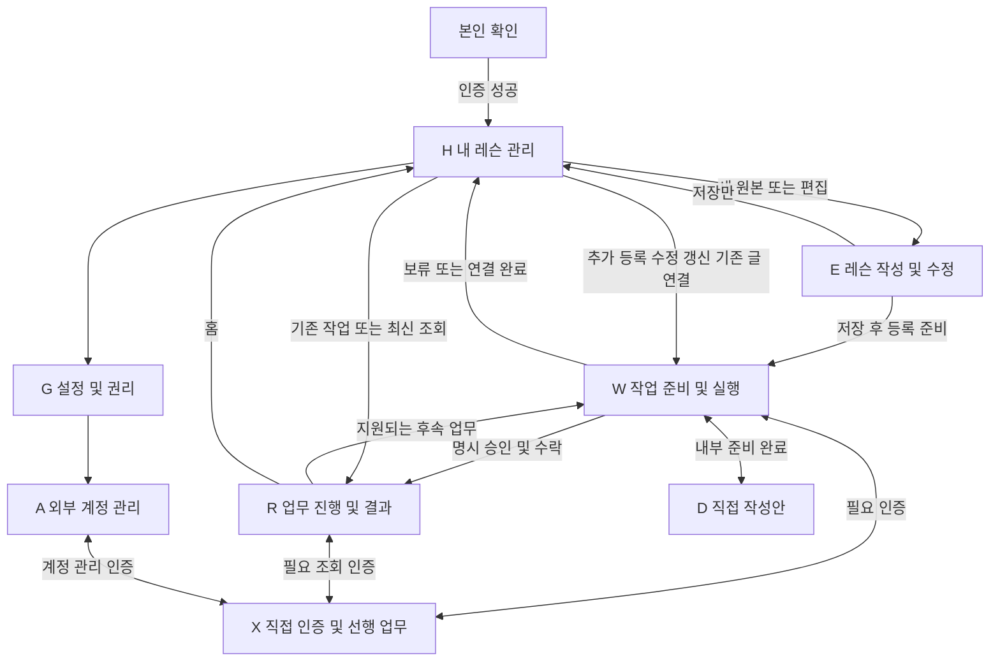

# 찾아you 추상 화면 설계 V1.0 — 원본 중심 최소 사용자 행동

<!-- Generated by tools/project_docs.py. Source: docs/artifacts/planning/lesson-registration-20261126/integrated/abstract-screen-v1.0.json -->
[작업 원본](../../artifacts/planning/lesson-registration-20261126/integrated/abstract-screen-v1.0.json) · [승인 서비스 범위](SERVICE-SCOPE-V1.0.md) · [V2.4 정상·오류 검토](USER-STORY-SEMANTIC-FLOWS-V2.4.md)

R01 검토 후보 · 제품 범위 V1.0 준수 · 화면 설계 미승인 · R1 보완 · 2026-11-27

개인 음악 레슨 강사가 원본 정보를 한 번 제공하고 필요한 플랫폼 업무를 최소한의 판단·입력·인증·승인으로 수행하도록 논리 화면/영역·제공 정보·사용자 행동·시스템 처리·화면 연결을 정의. UI 시각 디자인/DOM/엔드포인트/DB 스키마가 아님.

서비스 범위 V1.0은 승인 기준선. 이 화면 설계 및 단일 승인 UX·자동 추출/준비 등은 검토 후보. 7개 플랫폼 설계·44 업무 분류 유지, 공고 갱신 포함. 외부 실행 mock-only, 조건부 기능 미채택. 새 제품 범위/실제 외부 실행/main 병합/DB/API 상세 확정 없음.

## 사용자 가치와 설계 원칙

| 페인포인트 | 화면 설계 대응 | 검증 지표 |
| --- | --- | --- |
| UXP-01 플랫폼마다 같은 정보 재작성·검수 | E의 원본 재사용; W에서 자동 플랫폼 변환·검증; 불확실/충돌 항목만 질문 | 동일 사실 재입력 횟수·원본 제공/보완/검수 직접 시간 |
| UXP-02 등록·수정·갱신의 반복 조작과 감독 | H에서 원본/정확 등록물과 업무 선택; W에서 다중 대상 준비 및 최종 승인; R에서 시스템 처리·결과 자동 반영 | 업무별 사용자 직접 조작·인증·대기/감독 시간; 동일 완료 수준 |
| UXP-03 플랫폼마다 분산된 등록 정보·상태 확인 | H 한 원본 아래 연결 등록물과 마지막 관측을 표시; 명시 요청의 최신 조회만 R에서 수행 | 반복 사이트 방문·조회 횟수, 조회당 재인증 시간·관측 최신성 |
| UXP-04 실패 사유 탐색 및 재작업 | W/R의 해당 대상·문제 항목만 보완; 부분 효과·미확인 구분, 기존 성공값/대상/증거 보존 | 예외 후 다시 입력한 항목 수, 복구 직접 시간, 중복/잘못된 처리 건수 |

| ID | 원칙 | 규칙 |
| --- | --- | --- |
| UX-01 | 한 원본 중심 | H에서 원본별 등록물 및 진행 업무를 묶는다. 한 작업 묶음은 한 원본 기준을 기본 후보로 하고 여러 플랫폼 선택 가능. 원본 선택과 업무 버튼을 한 행에서 제공; 여러 원본의 자동 일괄 작업은 채택하지 않음. |
| UX-02 | 상황별 최소 직접 행동 | 입력·대상/의도 선택·사실 판단·직접 인증/필수 동의·명시 승인만 사용자에게 요구. 화면 표시·자동 변환·재검증·독립 관측·결과 기록/세션 종료는 별도 사용자 확인 버튼 없음. |
| UX-03 | 반복 입력 제거 | 원본 사실, 기존 선택, 검증된 플랫폼별 설정·현재 대상과 기준 revision 재사용. 과거 승인은 재사용하지 않으며 stale 관측·권한은 최신으로 간주하지 않음. |
| UX-04 | 업무 준비/검토 한 화면 | 플랫폼 선택·제약·보완·대상 인증·최종 비교를 W의 동일 작업 문맥에서 해결. 신규 작업의 선택 완료 후 준비를 명시 요청; H의 기존 등록물 수정/갱신 준비에서 명시한 동일 읽기 범위는 재요청하지 않음. 내부 변환은 선택 후 자동 가능, 외부 읽기는 명시 범위와 허용 확인 후만. |
| UX-05 | 인증은 필요할 때만 | 외부 계정 연결/식별은 업무용 인증과 다름. 유효한 업무 한정 인증만 사용; 실제 단계 허용 및 인증 필요가 확인된 대상에서 사용자 요청으로 X를 열고 같은 문맥으로 복귀. 자동 연결·장기 위임 미채택. 직접 가입·자격·약관·정산은 공식 경로에서 강사 직접. |
| UX-06 | 한 번의 분명한 실행 의도 | W에서 최종 내용·계정/대상·범위·효과·비용·제약을 함께 검토. 단일 명시 승인 및 실행 조작을 후보로 하되 내용/범위 두 논리 승인 독립 기록, 별도 필수 동의 유지. 수락 전 조건 확인; 중복/늦은 응답 동일 요청 조회. R 자동 진입/결과 갱신. |
| UX-07 | 오류는 발생한 곳에서 해결 | 입력/저장 오류 E, 준비/대상/제약 W, 인증 X, 효과/관측 R, 권리/폐기 G/A에 배치. 유효 정보 유지, 관련 대상만 보완, 성공/불명 효과 새 쓰기 차단. 에러 전용 전역 페이지나 전체 재시작 없음. |
| UX-08 | 관측과 성공을 분리 | 홈은 저장된 마지막 관측(시각/근거)만 표시. 최신 조회는 명시된 읽기 요청; 요청 종료·최신 관측·단계 효과·외부 native 상태·모집 가능·접근 종료를 독립 표현. |
| UX-09 | 실제 제공 범위 우선 | V1.0에 포함된 제품 업무와 실제 수행 가능을 구분. 7개 전부 표시 가능하되 허용/지원 불명 또는 hold/conditional은 실행 선택 차단, 확인된 내부 작성안 또는 보류. 현재 외부 실행 mock-only. |
| UX-10 | 사용자 의도를 보존하는 이탈 | H/뒤로/닫기로 자동 취소·재실행·재개하지 않는다. 원본/준비 저장 여부와 수락 업무를 구분하고 영향 있는 경우만 안내. 로그아웃/철회는 새 외부 접근 차단 및 기발생 효과 보존. 수락 작업 이탈/보존 상세 별도. |
| UX-11 | 불필요한 화면·설정 배제 | 초기 튜토리얼 확인, AI 추출 확인, 플랫폼별 별도 결과 방문, 성공 확인 클릭, 일반 모니터링/알림·관리자 화면·결제·재등록 메뉴를 기본 작업에 넣지 않는다. 필요시 상세 펼침·권리 행사 경로 제공. |

## 핵심 화면 및 조건부 영역

| ID | 화면 | 분류 | 진입 | 이탈 |
| --- | --- | --- | --- | --- |
| V0 | 본인 확인 | entry | 인증이 없거나 만료되었을 때만 | 동일 owner 새 인증 후 H 또는 검증된 안전 복귀 E/W/R/G/A; X/D는 원 호출로만, 자동 실행 없음; 실패 V0 |
| H | 내 레슨 관리 | core | 유효한 자체 인증 이후 또는 돌아오기 | E/W/R/G; 준비·결과는 같은 기록을 열기; 내부 삭제/해제 결과는 H |
| E | 레슨 작성·수정 | core | H 새 레슨 또는 기존 원본 편집 | 저장 확인 H/W; 실패·불명 E; 미저장 이탈 시 보존/폐기 선택; 저장 불명에서도 안전 이탈 가능, 명령 ID 보존 및 재접속 확인 명시 미저장 폐기만 LT-08; 기존 저장본·효과 유지. |
| W | 작업 준비·실행 | core | E 저장 후 시작, H 업무 버튼, R 지원되는 후속 준비 | X 또는 D 하위 영역; 준비/거절/조건 변경 W; 수락 R 자동; 내부 연결 확인 H 또는 W; 이탈 H 인라인 저장 불명 안전 이탈 H 및 정확 기존 기록으로 복귀; 기본 보완 H/E 필수 아님. |
| R | 업무 진행·결과 | core | W의 수락 결과 또는 H의 기존 작업/최신 조회 | R 동일 요청/결과 업데이트; X 필요시; W 새 준비; H 홈/이력 |
| G | 설정·개인정보 | aux | H 공통 메뉴 또는 필요한 권리 행사 경로 | A/H 또는 로그아웃 V0 |
| A | 외부 계정 관리 패널 | subview | G 계정 영역(별도 업무 필수 경유 아님) | X 또는 동일 A, G/H |
| X | 필요 대상의 외부 인증·직접 선행 업무 | subview | W/R/A의 명시 요청 및 해당 단계 허용 확인 후만 | 같은 W/R/A 대상/준비 또는 보류; 늦은 결과 적용 금지 |
| D | 직접 작성안 | subview | W에서 제한 대상의 내부 작성안 선택 및 충분한 사실/규격/권리 확인 후만 | 같은 W 또는 R에서 W를 거쳐 진입한 경우 원래 R; 보류 |

## 화면별 정보·행동·자동 처리

### V0 · 본인 확인

- 제공 정보: 이용 목적/최소 가입·공식 인증·복구 안내
- 사용자 행동: 직접 인증/필수 동의(신규만), 복구 선택
- 시스템 자동 처리: 동일 인증 주체·owner 식별, 기존 자료 중복 생성 방지
- 진입: 인증이 없거나 만료되었을 때만
- 이탈/복귀: 동일 owner 새 인증 후 H 또는 검증된 안전 복귀 E/W/R/G/A; X/D는 원 호출로만, 자동 실행 없음; 실패 V0
- 오류: ER-01 · ER-02

| 영역 | 제공 정보/업무 |
| --- | --- |
| V0.ident 본인 식별/복구 | 안내와 로그인·가입·복구 |

### H · 내 레슨 관리

- 제공 정보: 원본별 요약·저장 버전, 연결 등록물/계정 식별·업무 가능 여부, 마지막 관측/시각, 진행/미확인/보류 업무
- 사용자 행동: 새 레슨, 기존 원본 편집·추가 등록, 정확 행의 수정/갱신 준비, 기존 등록물 찾기, 필요한 행의 최신 조회, 결과 상세, 삭제/연결 해제(필요시)
- 시스템 자동 처리: 본인 내부 데이터만 읽기; 저장된 작업/관측/결과 표시; 지원되지 않는 업무의 이유 표시. 홈 진입으로 외부 조회 없음
- 진입: 유효한 자체 인증 이후 또는 돌아오기
- 이탈/복귀: E/W/R/G; 준비·결과는 같은 기록을 열기; 내부 삭제/해제 결과는 H
- 오류: ER-02 · ER-05 · ER-07 · ER-14 · ER-22 · ER-25 · ER-26 · ER-31

| 영역 | 제공 정보/업무 |
| --- | --- |
| H.overview 원본 중심 목록·상세 | 원본 카드 + 연결 외부 등록물 + 상태/시각 |
| H.work 업무 바로 시작 | 원본 행 추가 등록, 외부 행 수정/갱신 준비·최신 조회·기존 글 연결 |
| H.resume 진행/결과 및 복귀 | 기존 준비/수락/결과 행, 공통 메뉴·뒤로 |
| H.manage 원본/관계 내부 관리 | 원본 수정·삭제, 외부 등록물 연결 해제; 영향 확인은 해당 때만 |

### E · 레슨 작성·수정

- 제공 정보: 원문·첨부/직접 입력, 구조화된 사실과 근거, 불확실/충돌, 기준 버전, 저장 상태 및 원본 변경 영향
- 사용자 행동: 자료 제공/직접 입력, 필요한 권리/사실 확인·정정, 저장 또는 저장 후 등록 준비
- 시스템 자동 처리: 명시 추출 의도와 권리 충족 시 자동 추출 후보; 직접 입력은 생략; 입력 보존 및 동일 요청 저장 검증; 변경된 미실행 준비 영향 표시
- 진입: H 새 레슨 또는 기존 원본 편집
- 이탈/복귀: 저장 확인 H/W; 실패·불명 E; 미저장 이탈 시 보존/폐기 선택; 저장 불명에서도 안전 이탈 가능, 명령 ID 보존 및 재접속 확인 명시 미저장 폐기만 LT-08; 기존 저장본·효과 유지.
- 오류: ER-02 · ER-03 · ER-04 · ER-05 · ER-06 · ER-26

| 영역 | 제공 정보/업무 |
| --- | --- |
| E.input 원문/첨부/직접 입력 | 자료·권리 및 자동 추출/수신·검증 |
| E.facts 사실 확인 및 편집 | 근거·불확실·변경 항목만 정정; 기존 저장값 표시 |
| E.save 저장과 다음 행동 | 저장 또는 저장 후 등록 준비, revision/요청 결과 확인 |

### W · 작업 준비·실행

- 제공 정보: 선택 원본/revision·업무, 계정/객체 후보, 플랫폼 지원·제약, 대상별 준비 상태, 보완 항목, 최종 내용/변경 전후·효과·비용·범위·제외/보류 대상; 예정 검증용 읽기 범위/목적·권한, 최초 계정의 업무 사용 선택 공통 사실 보완 폼, 현재 원본 revision·영향 대상·공개 범위, 명시 저장 상태/동일 키 복귀.
- 사용자 행동: 새 대상 선택 및 준비 요청(같은 범위 H 요청이면 생략), 필요한 보완/인증/정확 대상 선택, 명시 제외·보류, 최종 승인 및 실행, 기존 등록물 내부 연결 공통 원본 사실이 필요한 경우 W에서 필요한 값만 수정·명시 저장; 전체 원본 편집은 별도 선택.
- 시스템 자동 처리: 내부 변환·검증·관련 대상 재검증, 명시 허용 읽기/권한 검증, 준비 결과와 승인 가능 상태 표시. 모든 선택 대상의 처리 상태 명시. 새 쓰기 전 현재 snapshot·권한·양 승인·이전 효과 확인 저장 커밋 확인 후 같은 미수락 준비/선택으로 영향 대상 모두 재검증. 저장 불명 동일 키 확인, 승인/새 실행 금지. 같은 owner/source의 관련 저장 불명(서버 pending 또는 호출 문맥에서 확인 불가)이 있으면 기존 명령 키 확인이 우선하며 영향받는 미수락 준비는 승인/수락 금지. 독립성이 입증된 준비 및 다른 원본은 유지. W 준비·승인 전 영향받는 변경은 ready/승인 가능 후보에 포함하지 않고 제한 사유를 먼저 표시한다. 독립 변경만 별도 지원·정확 승인 확인 후 계속하고 결합 불명은 결합 범위를 보류한다. 승인 이후에는 실행 직전 현재 조건을 재검증한다.
- 진입: E 저장 후 시작, H 업무 버튼, R 지원되는 후속 준비
- 이탈/복귀: X 또는 D 하위 영역; 준비/거절/조건 변경 W; 수락 R 자동; 내부 연결 확인 H 또는 W; 이탈 H 인라인 저장 불명 안전 이탈 H 및 정확 기존 기록으로 복귀; 기본 보완 H/E 필수 아님.
- 오류: ER-02 · ER-07 · ER-08 · ER-09 · ER-10 · ER-11 · ER-12 · ER-13 · ER-14 · ER-15 · ER-16 · ER-17 · ER-24 · ER-26 · ER-29 · ER-30 · ER-32

| 영역 | 제공 정보/업무 |
| --- | --- |
| W.selection 업무/대상/지원 범위 | 전달 문맥·신규 플랫폼 선택·기존 정확 대상·명시 준비 요청 |
| W.prepare 대상별 준비와 필요한 조치 | 자동 변환/허용 읽기/인증/정확 대상·보완/재검증 인라인 공통 원본 수정·명시 저장 및 동일 키 커밋/복귀 포함. |
| W.review 최종안·실행 경계 | 최종 내용/범위·변경 차이·갱신 효과/조건, 제외/보류 명시, 양 승인/수락 |
| W.link 기존 등록물 내부 연결 | 정확 계정/객체·원본 관계 확인 및 연결 요청 |
| W.limited 제한·내부 작성안 | 제한 사유·대상 보류/제외·허용 내부 작성안 준비 |

### R · 업무 진행·결과

- 제공 정보: 대상별 진행·확인 효과/미실행/불명, 부분 성공 단계, 최신 관측 성공/불가·마지막 관측 시각, native 상태·모집 가능, 근거/확인 링크, 세션 종료/폐기, 후속 조치; 상충 증거 분쟁/충돌 차단, 미전송과 전송 후 무효과 구별 최초 선택·수락·held/excluded·대기/진행/종료 수 및 개별 결과 분리. 미수락 보류·제외 사유와 조건부 새 업무 안내(기존 실패·잔여와 구분).
- 사용자 행동: 필요한 상세/근거 열기, 허용된 효과 재조회, 필요한 조회 인증, 반려/미발생/지원 잔여 업무 새 준비, 권리 행사 또는 홈 필요 보류·제외 후속의 새 업무 의도 선택 후 H에서 해당 대상만 준비; 기존 결과 유지.
- 시스템 자동 처리: 승인 조건 재확인·mock 업무 단계 처리·독립 결과 판정·이력/홈 반영·접근 차단/폐기; 조회만 요청이면 쓰기 없음. 화면 유지/성공 확인 불필요 독립 대상은 계속 처리; 모든 수락 대상 종료 시만 요청 종료. 자원 폐기는 화면 진입과 독립.
- 진입: W의 수락 결과 또는 H의 기존 작업/최신 조회
- 이탈/복귀: R 동일 요청/결과 업데이트; X 필요시; W 새 준비; H 홈/이력
- 오류: ER-02 · ER-07 · ER-11 · ER-12 · ER-14 · ER-15 · ER-16 · ER-17 · ER-18 · ER-19 · ER-20 · ER-21 · ER-22 · ER-23 · ER-26 · ER-29 · ER-31 · ER-32

| 영역 | 제공 정보/업무 |
| --- | --- |
| R.progress 진행 및 업무 효과 | 수락 요청/단계·진행·관측/기록·접근 종료 자동 대상별 lifecycle과 요청 집계, 개별 fence 영향 범위 분리. |
| R.result 결과·근거·이력 | 요청/효과/상태/목표·확인 시각·상세/링크·복귀 미수락 보류/제외 사유와 조건부 후속 새 업무 안내. |
| R.read 최신 조회/기존 효과 조회 | 명시 범위·필요 인증·마지막 관측 보존 |
| R.next 제한 및 후속 업무 | 철회·보완/새 준비 또는 보류; 잔여 업무 경계 |

### G · 설정·개인정보

- 제공 정보: 자체 계정 식별·열람/정정/삭제 요청 안내, 외부 계정 관리 패널 A, 로그아웃 및 영향 안내
- 사용자 행동: 필요한 권리 요청/공식 처리 경로, A 관리, 로그아웃
- 시스템 자동 처리: 본인 정보와 실제 접수/처리 상태만 표시; 새 접근 차단 및 세션 종료; 일반 회원탈퇴 UI 별도 미채택
- 진입: H 공통 메뉴 또는 필요한 권리 행사 경로
- 이탈/복귀: A/H 또는 로그아웃 V0
- 오류: ER-01 · ER-02 · ER-23 · ER-25 · ER-26

| 영역 | 제공 정보/업무 |
| --- | --- |
| G.rights 자체 계정·권리·로그아웃 | 권리 행사 경로·종료 결과/영향 |

### A · 외부 계정 관리 패널

- 제공 정보: 외부 플랫폼 계정 식별 관계, 권한 확인 상태/시각, 업무용 인증 상태와 폐기 상태 구분, 해제 영향
- 사용자 행동: 필요한 연결/재인증, 정확 계정 연결 해제
- 시스템 자동 처리: 허용된 계정 확인 및 관리 관계 기록; 장기 인증 보유 아님; 연결 해제 새 접근 차단/폐기 상태 확인
- 진입: G 계정 영역(별도 업무 필수 경유 아님)
- 이탈/복귀: X 또는 동일 A, G/H
- 오류: ER-02 · ER-07 · ER-11 · ER-12 · ER-13 · ER-23 · ER-25

| 영역 | 제공 정보/업무 |
| --- | --- |
| A.accounts 외부 계정 관계/접근 상태 | 연결·재인증·해제·복귀 |

### X · 필요 대상의 외부 인증·직접 선행 업무

- 제공 정보: 정확 플랫폼·기대 계정·목적·필요 직접 인증/선행 업무, 호출 문맥, 결과/제한 안내
- 사용자 행동: 공식 화면 직접 로그인/인증·가입·자격·약관·정산(필요한 것만), 불일치 계정 정정, 취소; 완료 통지가 실제 필요할 때만 1회
- 시스템 자동 처리: 계정·권한·generation·목적/만료 검증, 성공 시 원래 문맥 자동 복귀; 실패/취소 대상만 보류·접근 정리; 비밀 저장 금지
- 진입: W/R/A의 명시 요청 및 해당 단계 허용 확인 후만
- 이탈/복귀: 같은 W/R/A 대상/준비 또는 보류; 늦은 결과 적용 금지
- 오류: ER-07 · ER-11 · ER-12 · ER-13 · ER-23 · ER-26

| 영역 | 제공 정보/업무 |
| --- | --- |
| X.auth 외부 계정 직접 인증 | 명시 호출/직접 인증·권한 확인·동일 문맥 복귀·취소 |
| X.prereq 직접 선행 업무 | 가입·자격·동의·정산 공식 경로와 확인 |

### D · 직접 작성안

- 제공 정보: 확인된 내부 입력안·지원 제한·확인 필요 항목 및 직접 공식 경로 안내
- 사용자 행동: 내부 작성안 참고/사용자 직접 업무 또는 돌아가기. 외부 직접 결과 보고 기능 미채택.
- 시스템 자동 처리: 내부 준비 결과 표시; 서비스 대행/독립 관측 아님; 외부 접근/쓰기 없음
- 진입: W에서 제한 대상의 내부 작성안 선택 및 충분한 사실/규격/권리 확인 후만
- 이탈/복귀: 같은 W 또는 R에서 W를 거쳐 진입한 경우 원래 R; 보류
- 오류: ER-07 · ER-08 · ER-09 · ER-24 · ER-30 · ER-31

| 영역 | 제공 정보/업무 |
| --- | --- |
| D.guide 내부 작성안·안내 | 확인된 작성안·사용자 직접 참고·내부 완료·복귀 |

## 주요 업무별 최소 행동 흐름

아래는 행동의 의미 단위다. 자료 제공, 플랫폼 선택, 인증·동의 등에 여러 조작이 필요할 수 있으며 실제 클릭 수/절감은 측정하지 않았다. 기존 명시 요청을 반복시키지 않는다.

| 업무 | 화면 경로 | 필수 또는 의도 선택 | 자동 처리 | 조건부/제한 |
| --- | --- | --- | --- | --- |
| UJ-01 최초 등록(정상) | H→E→W→R | 새 레슨 선택; 보유 자료 제공/직접 입력; 저장 및 등록 준비; 신규 플랫폼 선택 및 준비 요청; 최종 승인·실행 | 자동 추출(의도/권리 충족)·구조화·변환·검증·실행/독립 확인·결과/이력·폐기 | 필요한 사실/직접 인증/필수 동의는 해당 경우만; 선택·자료·승인 생략 불가 |
| UJ-02 저장 원본 추가 등록 | H→W→R | 원본 행 추가 등록 선택; 신규 플랫폼 선택 및 준비 요청; 최종 승인·실행 | 저장 원본/유효 설정 재사용, 자동 검증·결과 기록 | E 방문/재입력/확인 클릭 없음; 인증 필요 대상만 X |
| UJ-03 기존 등록물 수정 | H→W→R | 정확 등록물의 수정 준비 선택; 미정인 변경값만 편집; 최종 승인·실행 | 현재 값의 명시 허용 조회, 차이/공유 영향 비교, 승인값·동일 객체 효과 확인 | 원본/대상/같은 준비 요청 반복 없음; 원본도 바꿀지 별도 명확한 의도 |
| UJ-04 공고 갱신 | H→W→R | 정확 기존 공고의 갱신 준비 선택; 갱신 조건/효과를 검토하고 최종 승인·실행 | 정확 객체·지원 방식·간격/횟수·비용/이전 효과 확인, 동일 공고 갱신 관측 | 원본 편집·변경값 입력·새 게시 금지; 뮬 후보만, 실제 허용/효과 미검증. 나머지 미확인 보류 |
| UJ-05 저장 상태 확인/최신 조회 | H 또는 H→R | 마지막 관측은 보기만; 최신 상태 필요시 정확 행 또는 범위를 선택해 조회 요청 | 본인 내부 저장 결과 표시; 명시 허용 조회·최신 관측/불가·시각 구분 | 마지막 상태 확인 0개 추가 조작(홈 도달 후); 쓰기 승인/원본 편집 없음; 인증 필요시만 |
| UJ-06 기존 글 관리 연결 | H→W→H | 원본 행의 기존 등록물 찾기·명시 읽기 범위 선택; 필요시 정확 후보 선택; 내부 연결 요청 | 허용 읽기·owner/정확 계정/객체 확인·동일 관계 조회 및 내부 연결 | 외부 글 변경 없음; 소유/효과 불명은 보류. 기존 관계 중복 생성 없음 |
| UJ-07 정보·규격 오류 및 인증 | W→W 또는 W→X→W | 강조된 항목만 정정·대안 선택/거절; 필요한 인증 대상에서 직접 인증/선행 업무 공통 사실 변경은 W 인라인 명시 저장; 플랫폼 표현만 변경하면 원본 저장 없음. | 관련 준비만 재검증·같은 문맥 복귀, 불허/실패 대상만 보류 저장 커밋 확인 후 동일 준비; 불명 동일 키, 안전 이탈/복귀. | 공통 사실과 플랫폼별 값 분리; 전체 재입력·인증 일괄 강제 없음 |
| UJ-08 부분 성공·실패·효과 불명 | R→R 또는 R→W→R | 필요한 경우 기존 효과 조회; 미발생 확정/별도 지원 잔여 업무만 새 준비·승인 선택 | 확인 효과와 미실행/불명 구분·보존; 성공/불명 재쓰기 차단; 후속 대상만 준비 다른 독립 수락 대상 계속; 전체 종료는 모든 수락 대상 종료. | 신규 전체 반복 금지; 관측 실패=미실행 아님; 반려 사유 추정 금지 |
| UJ-09 대행 제한과 내부 작성안 | W→D→W | 제한된 대상의 내부 작성안 선택; 필요한 경우 사실/권리 보완; 작성안 참고/직접 이용 또는 보류 | 충분한 내부 준비만 표시; 외부 접근/자동 복붙/제출 없음 | 사용자 직접 보고/증빙 기록 미채택; 대행 성공으로 표시하지 않음 |
| UJ-10 원본 편집·삭제/연결 해제 | H→E→H 또는 H | 수정 항목만 편집·저장; 삭제/연결 해제는 정확 대상·영향 확인 후 요청 | 기준 revision 검사, 영향 미실행 준비만 재검토; 내부 처리 확인 최신 원본/현재 편집만 유지, 필요 승인·효과 근거 별도; 명시 폐기. | 기존 외부 객체 자동 변경/삭제 없음; 보존 의무·불명 효과 영향 불명이면 제한 |
| UJ-11 외부 계정 관리 및 권리 | H→G→A→X→A 또는 G→V0 | 필요한 계정 연결/해제, 직접 인증 또는 권리 행사·로그아웃 | 계정 식별과 업무 인증/폐기 분리; 새 접근 차단 및 실제 처리 상태 표시 | 기본 업무 중 설정 필수 방문 없음; 장기 위임 미채택; 권리 자체 유지 |
| UJ-12 재방문·기존 작업 복귀 | V0→H/E/W/R/G/A 또는 H→W/R; X/D의 안전 원 호출로 복귀 | 필요시 동일 owner 재인증; 기존 준비/업무 행 열기 | 기존 준비/요청/효과 복원 및 현재 조건 검증, 수락 불명 동일 ID 확인 | 자동 실행·재개·새 요청 없음; 과거 승인 임의 재사용 금지 |

## 화면 전이 계약

| ID | 전이 | 주체 | 조건 | 보존/전달 문맥 |
| --- | --- | --- | --- | --- |
| T01 | V0 → H | 자동 | 동일 owner 인증 성공, 별도 검증된 복귀 문맥 없음 또는 복귀 불가 | 본인 원본/작업 목록; 다른 owner의 복귀 문맥 폐기 |
| T02 | H → E | 사용자 | 새 레슨 또는 정확 원본 편집 선택 | 원본 ID/revision 또는 신규 문맥 |
| T03 | E → H | 자동 | 저장 확인 및 저장만 선택; 또는 안전한 취소 | 정확 저장 버전/미저장 상태 |
| T04 | E → W | 자동 | 저장 및 등록 준비 선택, 저장 결과 확인 | 원본 ID/revision; 업무 CREATE |
| T05 | H → W | 사용자 | 저장 원본 추가 등록/정확 등록물 수정·갱신 준비/기존 글 찾기 | 원본·업무·계정/객체 후보·명시 읽기 범위(해당 시) R의 미수락 보류/제외 후속은 현재 조건 충족 대상만 새 준비/승인, 기존 결과 불변. |
| T06 | H → W | 사용자 | 저장된 준비 작업 열기 일반 준비 진입은 관련 저장 불명 없음/해소 확인 때만; 불명은 동일 키 자동 확인 경로 우선. | 동일 준비 ID/revision·현재 조건 검증; 자동 재개 없음 같은 owner/source의 관련 저장 불명(서버 pending 또는 호출 문맥에서 확인 불가)이 있으면 기존 명령 키 확인이 우선하며 영향받는 미수락 준비는 승인/수락 금지. 독립성이 입증된 준비 및 다른 원본은 유지. |
| T07 | H → R | 사용자 | 기존 수락 업무/결과 열기 또는 명시 최신 조회 요청 | 동일 요청 ID 또는 명시 읽기 대상; 쓰기 없음 |
| T08 | W → W | 자동/조건부 | 선택 완료/필요 보완/제약 해결/대상 확인/준비 결과 변경 | 해당 대상만 재준비·현재 revision; 변경 시 영향 승인 무효 |
| T09 | W → R | 자동 | 명시 최종 승인·요청 수락 확인 또는 기존 동일 요청 수락 확인 | 고정 대상/효과·준비 snapshot·요청 ID |
| T10 | W → R | 자동 | 수락 응답 유실로 동일 요청이 이미 수락됨을 확인 | 동일 요청; 새 쓰기 없음 |
| T11 | W → H | 사용자 | 내부 연결 확인 후 홈 또는 수락 전 보류/철회/이탈; 수락 불명에서도 화면 이탈 가능 | 기존 준비/수락 요청 ID 유지; 성공·취소·새 실행으로 해석하지 않음 |
| T12 | R → R | 자동/조건부 | 진행·관측·결과 갱신 또는 명시 허용 효과 조회 | 동일 요청/효과와 시각; 불명 새 쓰기 차단 |
| T13 | R → W | 사용자 | 지원되는 반려 보완/새 수정·갱신/미발생 확정 또는 잔여 업무 준비 선택 | 정확 기존 대상·기존 효과·새 요청 준비; 새 승인 필요 |
| T14 | R → H | 사용자 | 홈/뒤로 선택; 결과 확인은 완료 조건 아님 미수락 보류·제외 후속 안내의 명시 새 의도 선택도 H로 연결. | 기존 요청 유지; 이탈로 자동 취소/재실행 없음 |
| T15 | H → G | 사용자 | 설정/권리 행사 선택 | 본인 정보·영향 대상 |
| T16 | G → A | 사용자 | 외부 계정 관리 영역 선택 | 플랫폼/계정 관리 관계 |
| T17 | A → G | 사용자 | 관리 패널 닫기 | 기존 계정/폐기 상태 |
| T18 | G → H | 사용자 | 홈/설정 닫기 | 기존 선택/작업 |
| T19 | G → V0 | 자동 | G에서 명시 로그아웃 또는 서비스 인증 종료 | 새 접근 차단 및 기존 효과/업무 이력 보존; 재로그인 자동 실행 없음 |
| T20 | W → X | 사용자 | 필요 대상 인증 요청 및 허용 확인; 최초 계정도 W에서 직접 인증 가능 | 원 호출/목적/플랫폼·기대 계정 또는 최초 identity-only 문맥; 계정 확인 전 업무 접근 금지 |
| T21 | R → X | 사용자 | 허용 조회에 필요한 대상 인증 요청 | R 요청/관측·대상/계정·목적·generation |
| T22 | A → X | 사용자 | 명시 연결/재인증 요청 및 허용 확인 | 계정 관리 호출 문맥·목적·generation |
| T23 | X → W | 자동 | W 호출의 계정/권한 확인, 최초 계정의 명시 사용 선택 또는 실패/취소 | 정확 원 호출/대상/revision; 최초 업무 사용과 별도 관리 연결 동의 구분 |
| T24 | X → R | 자동 | R 호출의 계정/권한 확인, 또는 실패/취소 | 원래 요청/관측; 불명/취소 대상 보류 |
| T25 | X → A | 자동 | A 호출의 계정/권한 확인, 또는 실패/취소 | 원래 관리 관계 및 상태; 실패/취소 정리 |
| T26 | W → D | 자동 | 제한 대상 내부 작성안 선택 후 충분한 준비 확인 | 정확 내부 준비 revision·권리·지원 제한 |
| T27 | D → W | 사용자 | 작성안 닫기/돌아가기 | 원래 내부 준비, 외부 효과 없음 |
| T28 | D → R | 사용자 | 원래 R 호출에서 W를 통해 D 진입했고 결과로 돌아가기 | 원래 R 요청/관측; 외부 효과 없음 |
| T29 | E → E | 자동/조건부 | 추출/저장/충돌 오류 또는 필요한 보완 | 유효 입력·기준 revision·동일 저장 요청; 결과 확인 전 재저장 없음 |
| T30 | V0 → V0 | 조건부 | 본인 확인 실패/불명 | 공식 복구 또는 종료; 자료 노출 없음 |
| T31 | H → V0 | 자동 | 자체 서비스 인증 문맥 종료 확인(만료 또는 해당 owner의 서비스 권리 제한); 본인 정보 표시 및 새 접근 차단 | owner 검증 전 내용 비노출; 기존 저장/수락 ID와 안전 복귀 의도만 참조 |
| T32 | E → V0 | 자동 | 자체 서비스 인증 문맥 종료 확인(만료 또는 해당 owner의 서비스 권리 제한); 본인 정보 표시 및 새 접근 차단 | owner 검증 전 내용 비노출; 기존 저장/수락 ID와 안전 복귀 의도만 참조 |
| T33 | W → V0 | 자동 | 자체 서비스 인증 문맥 종료 확인(만료 또는 해당 owner의 서비스 권리 제한); 본인 정보 표시 및 새 접근 차단 | owner 검증 전 내용 비노출; 기존 저장/수락 ID와 안전 복귀 의도만 참조 |
| T34 | R → V0 | 자동 | 자체 서비스 인증 문맥 종료 확인(만료 또는 해당 owner의 서비스 권리 제한); 본인 정보 표시 및 새 접근 차단 | owner 검증 전 내용 비노출; 기존 저장/수락 ID와 안전 복귀 의도만 참조 |
| T35 | G → V0 | 자동 | 자체 서비스 인증 문맥 종료 확인(만료 또는 해당 owner의 서비스 권리 제한); 본인 정보 표시 및 새 접근 차단 | owner 검증 전 내용 비노출; 기존 저장/수락 ID와 안전 복귀 의도만 참조 |
| T36 | A → V0 | 자동 | 자체 서비스 인증 문맥 종료 확인(만료 또는 해당 owner의 서비스 권리 제한); 본인 정보 표시 및 새 접근 차단 | owner 검증 전 내용 비노출; 기존 저장/수락 ID와 안전 복귀 의도만 참조 |
| T37 | X → V0 | 자동 | 자체 서비스 인증 문맥 종료 확인(만료 또는 해당 owner의 서비스 권리 제한); 본인 정보 표시 및 새 접근 차단 | 정확 원 호출 W/R/A만 복귀 후보; 외부 인증 generation 무효 |
| T38 | D → V0 | 자동 | 자체 서비스 인증 문맥 종료 확인(만료 또는 해당 owner의 서비스 권리 제한); 본인 정보 표시 및 새 접근 차단 | 원 호출 W/R과 준비 ID만 복귀 후보 |
| T39 | V0 → E | 자동/조건부 | 동일 owner의 새 자체 인증 성공 및 기존 안전 복귀 의도/권한 확인 | 현재 revision·동일 명령 결과 확인; 외부 실행/인증 자동 재개 없음. 문맥 없거나 다른 owner면 H |
| T40 | V0 → W | 자동/조건부 | 동일 owner의 새 자체 인증 성공 및 기존 안전 복귀 의도/권한 확인 | 현재 revision·동일 명령 결과 확인; 외부 실행/인증 자동 재개 없음. 문맥 없거나 다른 owner면 H |
| T41 | V0 → R | 자동/조건부 | 동일 owner의 새 자체 인증 성공 및 기존 안전 복귀 의도/권한 확인 | 현재 revision·동일 명령 결과 확인; 외부 실행/인증 자동 재개 없음. 문맥 없거나 다른 owner면 H |
| T42 | V0 → G | 자동/조건부 | 동일 owner의 새 자체 인증 성공 및 기존 안전 복귀 의도/권한 확인 | 현재 revision·동일 명령 결과 확인; 외부 실행/인증 자동 재개 없음. 문맥 없거나 다른 owner면 H |
| T43 | V0 → A | 자동/조건부 | 동일 owner의 새 자체 인증 성공 및 기존 안전 복귀 의도/권한 확인 | 현재 revision·동일 명령 결과 확인; 외부 실행/인증 자동 재개 없음. 문맥 없거나 다른 owner면 H |
| T44 | E → H | 사용자 | 화면 이탈; 저장 불명 또는 미저장 편집 보존 정책에 따른 안전 이탈 | 기존 명령 ID 확인 가능; 성공 이동 아님; 명시 폐기 없이 정본 삭제 금지 |

## 상태 표현의 독립성

| 화면 | 상태 | 표시 | 금지/경계 |
| --- | --- | --- | --- |
| H | 원본 요약 | 확인된 원본/revision·내부 등록물 관계·최근 결과; 마지막 관측 시각/없음 | 외부 상태 최신 확인으로 표시 금지 |
| H/W | 지원 구분 | 제품 포함(우선/후순위)과 현재 실행 가능 여부 분리; hold/조건부/허용 불명은 이유·대안 | 선택된 대상의 제외/보류 묵시적 처리 금지 |
| E | 입력/저장 | 입력 수신·추출 진행/확인 필요·저장됨/충돌/저장 불명 | 저장 확인 전 성공 이동·재저장 금지 |
| W | 대상별 준비 | 미준비·준비 중·필요 보완/인증·검토 가능·제외/보류·수락 불명 | 최종 대상 목록과 조건·내용/범위 승인 고정; 미승인 대상 실행 금지 같은 owner/source의 관련 저장 불명(서버 pending 또는 호출 문맥에서 확인 불가)이 있으면 기존 명령 키 확인이 우선하며 영향받는 미수락 준비는 승인/수락 금지. 독립성이 입증된 준비 및 다른 원본은 유지. W 준비·승인 전 영향받는 변경은 ready/승인 가능 후보에 포함하지 않고 제한 사유를 먼저 표시한다. 독립 변경만 별도 지원·정확 승인 확인 후 계속하고 결합 불명은 결합 범위를 보류한다. 승인 이후에는 실행 직전 현재 조건을 재검증한다. |
| R | 요청과 단계 효과 | 수락/진행/종료·수락 불명, 단계별 미실행/효과 없음 확인/효과 확인/불명; 한 대상 및 다중 대상 부분 효과 | 종료를 성공으로, 관측 불가를 실패로 치환 금지 |
| H/R | 관측·native 상태·사용자 목표 | 최신 관측 성공/불가·마지막 관측 시각, 실제 접수/심사/공개/설정 값 및 모집 가능·불명 | 심사 접수=모집 가능, 미리보기=실제 공개 등 단정 금지 |
| A/X/R/G | 계정·접근·폐기 | 계정 식별/연결, 실제 현재 권한/업무 인증, 접근 차단 및 폐기 확인/불명 | 관리 연결 보유=재인증 불필요 아님 |
| W/D | 내부 작성안 | 내부 준비 완료·외부 미수행/미확인 | 사용자 직접 참고를 대행 완료로 표시 금지 |

## 오류의 화면 위치 및 복구

| 오류 ID | 조건 | 위치 | 대응 |
| --- | --- | --- | --- |
| ER-01 | 인증 실패·만료·가입 결과 불명·기존 owner 확인 실패 | V0 | 공식 재인증/복구 선택; 자료 표시 없음 |
| ER-02 | owner 불일치·대상 권한/존재 불명 | V0/H/호출 영역 | 본인·허용 대상만 표시; 정확 접근 확인 전 제한 |
| ER-03 | 수신 실패·필수 자료 부족·형식·첨부 권리 불명 | E | 유효 입력 보존, 문제 자료만 교체/제거/정정 |
| ER-04 | 추출 실패·원문 근거 없음·사실 충돌 | E | 확인값과 근거 보존; 필요한 사실만 직접 정정/재추출 |
| ER-05 | 원본 조회 실패·기준 revision 충돌 | E/H | 최신 저장본과 편집본 비교; 덮어쓰기 금지 |
| ER-06 | 저장 거절·응답 유실·성공/실패 구분 불가 | E | 같은 저장 요청 결과 확인 전 새 저장/성공 이동 금지; 안전 이탈 및 동일 요청 복귀 가능 |
| ER-07 | 업무·접근·읽기/쓰기 단계 불허·불명 | W/R/A | 제한 원인·허용 내부 작성안 선택 또는 보류; 외부 접근 없음 |
| ER-08 | 변환·검증 실패·필수값 불명 | W | 해당 대상 보완/재준비; 외부 실행 없음 |
| ER-09 | 단위/상한/세금/회차/제공 조건 불명 또는 충돌 | W | 사실·단위·대안 명시, 사용자 선택/거절 |
| ER-10 | 원본·규칙·권한·외부 값 변경, 준비 revision 불일치 | W | 변경된 대상만 재검증; 낡은 준비/승인 적용 금지 |
| ER-11 | 외부 로그인·추가 인증 실패·만료·취소 또는 결과 불명 | X→호출 영역 | 해당 대상만 재인증 또는 보류 |
| ER-12 | 실제 계정과 기대 계정 다름·권한 부족·소유권 불명 | X/W/R/A | 계정 자동 교체 금지; 정확 대상 선택/보류 |
| ER-13 | 외부 가입·전문가 인증·약관 동의·정산 미완료 또는 불명 | X→호출 영역 | 공식 직접 선행 업무 또는 보류; 민감 증빙 수집 없음 |
| ER-14 | 객체 없음·후보 충돌·오인 대상·내부 연결 불명 | W/R/H | 정확 대상 확인 또는 보류; 쓰기 없음 |
| ER-15 | 동일 요청/객체 존재 또는 이전 외부 효과 불명 | W/R | 기존 효과의 허용 읽기만, 새 쓰기 금지 |
| ER-16 | 내용/범위 거절·대상/조건/revision 변경·철회 | W/R | 수락 전 거절/철회/조건 변경 시 새 효과 차단; 기발생 효과 보존 |
| ER-17 | 요청 응답 유실·수락 여부 불명·중복 클릭 | W/R | 동일 요청 ID 조회; 기존 수락 R, 불명 유지 |
| ER-18 | 단계 사전조건 실패 또는 효과 없음이 독립 확인됨 | R→W | 효과 없음 확인 단계/별도 지원 잔여 업무만 새 준비·승인 |
| ER-19 | 외부 효과 단계 응답 유실·독립 확인 불가 | R | 효과 불명으로 표시; 허용 조회/보류, 새 쓰기 금지 |
| ER-20 | 반려·심사 중 수정 제한·사유 미제공·최초 모집 조건 불명 | R→W | 반려 실제 사유/불명, 지원되는 보완 업무 선택 |
| ER-21 | 성공·실패·미실행·미확인 대상 혼재 | R→W | 대상 내/대상 간 단계별 부분 효과; 성공/불명 제외, 지원 잔여 업무만 |
| ER-22 | 읽기 불허·만료·조회 실패·이전 관측 없음 | R/H | 최신 조회 불가·마지막 관측/시각 별도; 필요시 허용 재조회 |
| ER-23 | 폐기·해제·철회 결과 불명/실패 | R/A/G | 새 접근 차단 유지, 폐기 확인 불명 표시/운영 확인 |
| ER-24 | 작성안 미완료·권리 불명·사용자 보고만 있음 | W/D | 내부 준비 충분할 때만 D; 외부 대행 성공 아님 |
| ER-25 | 진행 업무·미확인 효과·보존 의무·소유권 충돌 | H/A/G | 내부 삭제/해제·권리 경계와 불명 효과/보존 영향 확인 |
| ER-26 | 미저장 변경·수락/진행 중 이탈·세션 만료 | H/V0/W/R | 기존 미저장/수락 상태 보존; 이탈로 자동 실행·취소·재개 없음 |
| ER-27 | 별도 정책 미채택·기간/범위/권한 불명·조회/알림 실패 | 미제공 | 자동 모니터링 화면 없음; 별도 채택 전 차단 |
| ER-28 | 철회·만료·종료/해제 불명 | 미제공 | 모니터링 기능 없음; 일반 업무 종료/철회는 ER-23 |
| ER-29 | 첫 모집 일정·대표 관계·같은 공고 갱신·공유 필드/비용/효과 불명 | W/R | 공유 필드/갱신/조건부 효과·정확 대상 확인; 미확인 실행 금지 |
| ER-30 | 재등록 허용·간격·유사 글 제한·신규 객체 불명 | W | 재등록 미제공/제한 안내; 내부 작성 또는 보류 |
| ER-31 | 근거 없음·접근 불가·링크/사유 불명 | R/H/D | 확인된 근거만 표시·조회 불가; 원인 추정 없음 |
| ER-32 | 실제 원인 또는 정확 선행 조건 미확인 | 호출 W/R | 안전 보류 및 기존 근거/효과 보존; 새 접근/쓰기 차단 |

## 플랫폼별 업무와 화면 연결

| 플랫폼 | 업무 ID | 제품 범위 | 화면 영역 | 완료 기준 |
| --- | --- | --- | --- | --- |
| 크몽 | PS-PL01-CREATE | included_priority | W.review/R.progress/R.result | 동일 계정의 신규 상품 식별과 심사 접수/심사 진행 상태, 승인 입력안과 일치하는 저장값 확인 |
| 크몽 | PS-PL01-READ | included_priority | W.prepare | 정확 계정·상품 식별 근거, 관측값·시각 확보; 링크 불명 별도 |
| 크몽 | PS-PL01-UPDATE | included_priority | W.review/R.progress/R.result | 동일 상품의 승인 변경값 저장 확인 및 필요한 경우 재심사 접수 확인 |
| 크몽 | PS-PL01-RENEW | hold_unverified_or_unsupported | W.limited | 미제공; 완료 판정 없음 |
| 크몽 | PS-PL01-STATUS | included_priority | R.read | 정확 상품의 최신 관측 또는 조회 불가·마지막 관측 반환; 조회 불가는 성공 상태 아님 |
| 크몽 | PS-PL01-RESPOND | included_priority | R.next | 근거 있는 안내와 선택 가능한 조치 제공; 사유 미확인 구분 |
| 탈잉 | PS-PL02-CREATE | included_priority | W.review/R.progress/R.result | 동일 계정 신규 클래스 식별, 저장값 및 심사 접수/진행 확인 |
| 탈잉 | PS-PL02-READ | included_priority | W.prepare | 계정·클래스 식별 근거 및 현재 관측값·시각 확보 |
| 탈잉 | PS-PL02-UPDATE | included_priority | W.review/R.progress/R.result | 동일 클래스 승인 변경값 저장 및 필요 시 재심사 접수 확인 |
| 탈잉 | PS-PL02-RENEW | hold_unverified_or_unsupported | W.limited | 미제공; 완료 판정 없음 |
| 탈잉 | PS-PL02-STATUS | included_priority | R.read | 최신 실제 상태 또는 조회 불가 및 마지막 관측 반환 |
| 탈잉 | PS-PL02-RESPOND | included_priority | R.next | 실제 사유 또는 미확인과 가능한 조치 반환 |
| 숨고 | PS-PL03-CREATE | included_priority | W.review/R.progress/R.result | 정확 프로필에 서비스가 새로 연결되고 승인된 모집 항목이 재조회에서 확인 |
| 숨고 | PS-PL03-READ | included_priority | W.prepare | 정확 프로필과 서비스의 식별 근거·현재 설정·시각 확보 |
| 숨고 | PS-PL03-UPDATE | included_priority | W.review/R.progress/R.result | 정확 프로필/서비스의 승인 변경값 저장·반영 확인; 공유 필드 영향 명시 |
| 숨고 | PS-PL03-RENEW | hold_unverified_or_unsupported | W.limited | 미제공; 완료 판정 없음 |
| 숨고 | PS-PL03-STATUS | included_priority | R.read | 선택 서비스의 등록/설정/공개 관측과 시각 또는 조회 불가 반환 |
| 숨고 | PS-PL03-RESPOND | included_priority | R.next | 확인 근거와 해결 가능 조치 또는 불명 안내 |
| 프람피 | PS-PL04-CREATE | included_later | W.review/R.progress/R.result | 프로필 식별 및 실제 저장/분야 연결 재조회 증거 확보 시만 |
| 프람피 | PS-PL04-READ | included_later | W.prepare | 정확 계정·프로필·하위 객체 식별 근거와 현재 내용·관측 시각 확인. 식별/조회 실패는 미확인. |
| 프람피 | PS-PL04-UPDATE | included_later | W.review/R.progress/R.result | 정확 프로필 및 선택한 하위 객체의 승인 변경값 저장 및 관측 확인; 공개 반영 별도. |
| 프람피 | PS-PL04-RENEW | hold_unverified_or_unsupported | W.limited | 미제공; 완료 판정 없음 |
| 프람피 | PS-PL04-STATUS | included_later | R.read | 정확 대상의 최신 관측 상태 및 시각 반환, 또는 조회 불가와 마지막 관측 반환. 공개/모집 가능은 별도 확인. |
| 프람피 | PS-PL04-RESPOND | included_internal_only | R.next | 내부 제한 사유 및 허용 다음 선택 제공 |
| 뮬 | PS-PL05-CREATE | included_later | W.review/R.progress/R.result | 신규 게시물 정확 식별 및 승인 내용·게시 상태 재조회 확인 |
| 뮬 | PS-PL05-READ | included_later | W.prepare | 게시물 식별 근거·내용·시각 및 확인된 링크 확보 |
| 뮬 | PS-PL05-UPDATE | included_later | W.review/R.progress/R.result | 같은 게시물 식별 및 승인 변경값의 저장 확인, 공개 노출 별도; 새 글 생성으로 대체하지 않음. |
| 뮬 | PS-PL05-RENEW | included_later | W.review/R.progress/R.result | 허용 갱신으로 대상 공고의 의도된 효과가 관측될 때만 완료 |
| 뮬 | PS-PL05-STATUS | included_later | R.read | 최신 관측 및 시각 또는 조회 불가 반환 |
| 뮬 | PS-PL05-RESPOND | included_internal_only | R.next | 확인된 사유와 보류/대안 반환 |
| 힙합플레이야 | PS-PL06-CREATE | included_later | W.review/R.progress/R.result | 정확 신규 게시물 식별 및 승인 내용·저장/게시 상태 확인 |
| 힙합플레이야 | PS-PL06-READ | included_later | W.prepare | 정확 글 식별 근거·내용·시각 확보 |
| 힙합플레이야 | PS-PL06-UPDATE | hold_unverified_or_unsupported | W.limited | 미제공; 완료 판정 없음 |
| 힙합플레이야 | PS-PL06-RENEW | hold_unverified_or_unsupported | W.limited | 미제공; 완료 판정 없음 |
| 힙합플레이야 | PS-PL06-STATUS | included_later | R.read | 최신 공개 관측 또는 조회 불가와 마지막 관측 반환 |
| 힙합플레이야 | PS-PL06-RESPOND | included_internal_only | R.next | 근거 있는 안내 또는 불명 표시 |
| 힙합LE | PS-PL07-CREATE | included_later | W.review/R.progress/R.result | 정확 게시물 식별 및 승인 내용·게시 상태 확인 |
| 힙합LE | PS-PL07-READ | included_later | W.prepare | 정확 게시물 식별 근거·내용·시각 및 확인된 링크 확보 |
| 힙합LE | PS-PL07-UPDATE | hold_unverified_or_unsupported | W.limited | 미제공; 완료 판정 없음 |
| 힙합LE | PS-PL07-RENEW | hold_unverified_or_unsupported | W.limited | 미제공; 완료 판정 없음 |
| 힙합LE | PS-PL07-STATUS | included_later | R.read | 최신 관측 또는 조회 불가와 마지막 관측 반환 |
| 힙합LE | PS-PL07-RESPOND | included_internal_only | R.next | 확인 근거와 다음 선택 또는 불명 표시 |
| 탈잉 | PS-PL02-FIRST-OPEN-SCHEDULE | conditional_not_adopted | 미제공 | 해당 클래스의 승인된 최초 일정·장소 저장 및 실제 신청 가능 확인(조건별 구분) |
| 숨고 | PS-PL03-REPRESENTATIVE-SERVICE | conditional_not_adopted | 미제공 | 정확 프로필의 대표 서비스 관계가 승인된 대상으로 반영됨을 독립 확인 |

## 검토 결정 및 사용성 검증

| ID | 결정 후보 | 상태 | 근거/제약 |
| --- | --- | --- | --- |
| ASD-01 | 4개 핵심 논리 화면 H/E/W/R + 필요 보조 영역 | 권장 | 홈에서 원본 중심 업무, W/R 통합; 실제 UI route/모달/반응형 배치는 FE 상세 설계. |
| ASD-02 | 원본 제공 의도 기반 자동 추출 및 저장 후 등록 준비 | 권장 | 별도 추출 확인 버튼 생략 후보; 법적 동의/불명 의도는 생략 금지. |
| ASD-03 | 업무 버튼의 명시 준비 범위 및 중복 조작 제거 | 권장 | H의 정확 등록물 준비 요청에 읽기 범위 표시, 동일 W 요청 반복 없음; 신규 플랫폼 선택 완료 후 명시 준비 1회. |
| ASD-04 | 최종 내용·범위 통합 검토 및 단일 실행 조작 | 권장(별도 승인 필요) | 양 논리 승인 독립 기록, 법적 필수 동의 별도. 불명/조건 변경 차단; 정확 대상 목록 표시. |
| ASD-05 | 한 원본 기준 다중 플랫폼 묶음, 대상별 준비·결과 | 권장 | 복수 원본 동시 실행은 미채택; hold/excluded/불명 자동 실행 금지. 업무별 독립 식별/효과. |
| ASD-06 | 이탈/저장·권리·복구 | 세부 검토 | 화면 이동은 실행/취소/재개 아님; 준비 저장/폐기·수락 작업 이탈/로그아웃 및 보존 세부 정책은 별도. |
| ASD-07 | 계정 관리 패널과 X/D 하위 영역 | 권장 | 별도 설정 필수 방문 없음; 장기 위임·모니터링·직접 결과 보고 미채택. |

| ID | 검증 상황 | 관찰/판정 |
| --- | --- | --- |
| UXT-01 | 동일 원본을 3개 플랫폼에 최초/추가 등록(모의) | 직접 작성/범용 도구/전용 서비스 비교. 같은 자료·조건·완료 기준, 반복 입력 수·조작·인증·보완·직접 시간 기록. 실제 절감 미측정. |
| UXT-02 | 저장 원본 추가 등록·기존 글 수정·갱신(모의) | E 방문 및 원본 재입력 0 목표(충분한 저장 정보), 정확 선택/필요 승인 유지. 갱신은 동일 객체만. |
| UXT-03 | 홈에서 마지막 상태 확인 및 명시 최신 조회(모의) | 홈 진입 외부 조회 0, 마지막 관측 확인 추가 조작 0 목표(홈 내 가시 요약), 최신 조회 별도 및 쓰기 0, 인증 필요 횟수 기록. |
| UXT-04 | 복수 대상 중 정보 누락·인증 실패·계정 불일치 | 문제 대상만 재입력/인증·제외/보류, 다른 준비 보존. 무단 계정 교체/외부 효과 0. |
| UXT-05 | 외부 단계 응답 유실·단일/복수 부분 성공·반려 | 확인된 효과 보존, 미확인/성공 재쓰기 0, 적절한 잔여/후속 업무만 새 준비. 잘못된 완료 판정 0. |
| UXT-06 | 저장/수락 응답 유실·더블클릭·화면 이탈·재로그인 | 동일 요청 조회, 중복 저장/요청/실행 0; 미저장 및 수락 구분, 새 접근 차단과 폐기 분리. |
| UXT-07 | 대행 제한/직접 작성안/권리·해제 | 미지원/조건부 메뉴에서 외부 접근/쓰기 0, 직접 작성 대행 성공 승격 0, 정확 내부 권리 경로. |
| UXT-08 | 업무별 사용성 비교 | 기존 이용자/신규 강사 과제 수행 관찰; 완료 여부·잘못된 대상·직접 시간·행동/재인증/예외·재작업·인지 부담 측정. 클릭 수만으로 가치 입증 금지. |

## 추적 및 제한

- 4개 핵심 화면, 9개 활성 논리 영역, 22개 세부 영역, 44개 전이 후보, 12개 주요 여정.
- 기획 기능 7개, 7 플랫폼·44 업무, V2.3 155 행동, R04 37 화면, 32 오류 관련 추적. 구조 정적 검사: pass_connector_js.

- 4개 핵심 논리 화면/보조 영역은 R01 검토 후보. 실제 route 개수·레이아웃·버튼 클릭 수와 동일하지 않음.
- 155개 기존 행동·37개 R04 화면·44개 업무·32 오류의 위치/관련 추적 검사이며 693개 분기 전수 의미 검증이나 실제 상태 머신 검증 아님.
- 최신 팀원 조사, 실제 플랫폼 권한·효과·제약 및 가치 실증 미확정. 사용자 행동 절감은 검증할 설계 가설.
- 공식 Python 생성기/CI 미실행; JS 구조 검사 및 프로젝션 생성기 미러로 생성. 승인 후 시스템 업무/책임·상태 전이·정상/오류 논리 및 사용자 스토리 확정. DB/API 미착수.

## R1 설계 보완 계약

R01 검토 후보 · 제품 범위 변경 없음 · 실제 실행 금지 · 기준 f99cef6

### UX-R1-01 · 최초 플랫폼 계정

W에서 필요한 대상만 X를 열고 최초 계정은 허용 identity-only 확인 뒤 정확 관측 계정을 현재 업무에 사용한다는 선택을 받는다. 기존 기대 계정 불일치 시 교체 금지. 지속 관리 연결은 명시 동의 또는 최종안에 표시한 연결 동의 때만 기록. G/A 필수 경유 없음.

관련: T20 · T23 · SW-14 · SW-15 · ER-12

### UX-R1-02 · 승인과 검증 읽기

최종안에 쓰기 효과·대상·필수 검증 읽기 범위/목적·권한·제한을 함께 표시. 양 논리 승인과 읽기 의도를 별도 기록. 승인된 readback은 자동; 새 범위/권한/인증만 필요시 사용자 조작.

관련: SW-21 · SW-22 · SW-28 · LT-32 · LT-44

### UX-R1-03 · 전역 인증 만료와 안전 복귀

저장/수락 불명에서 성공 이동·새 실행 금지, 화면 이탈 가능. 동일 owner·복귀 문맥·revision·명령 ID 검증 후 안전 복귀; X 자체는 재개하지 않고 W/R/A 원 호출로. 다른 owner면 H. 로그아웃/만료 새 접근 차단, 기존 진행 효과 안전 정리.

관련: T31 · T32 · T33 · T34 · T35 · T36 · T37 · T38 · T39 · T40 · T41 · T42 · T43 · T44

### UX-R1-04 · 잔여 업무와 충돌

R에서 확인 효과·미발생·불명·분쟁 및 가능한 후속 범위를 분리. 미검증 잔여 경로는 실행 버튼 대신 제한/확인 경로. 전체 업무 반복 금지.

관련: T13 · SW-31 · AX17

### UX-R1-05 · 행동 절감 수용 기준

동일 원본·플랫폼·완료 근거에서 직접 입력 필드 수, 사용자 결정 수, 인증 수, 감독 및 총 소요시간, 재작업 수를 수동 방식과 비교. 정상 등록/저장 원본 추가/수정/갱신/조회/부분효과 6종. 기준선/실측 없음; 절감 성과 미확정.

관련: UJ-01 · UJ-02 · UJ-03 · UJ-04 · UJ-05 · UJ-08

### UX-R4-01 · 인라인 보완과 동일 준비 복귀

T08 W 내부 SW-06/07 저장→동일 커밋 확인→기존 준비 재검증. T11 안전 이탈, T06 정확 저장 불명 기록 재열기. 기존 H/E 경로는 전체 원본 편집 선택 때만. 새 SELECT·외부 승인 자동 생성 없음.

관련: R4-01 · VE-105 · VE-106 · VE-107 · VE-108 · VE-109 · VE-110 · VE-111 · VE-112 · VE-113 · T08 · T06 · T11

### UX-R4-02 · 대상별 진행과 최소 수명주기

수락/진행/종료·선택/보류/제외 분리; LT-08 명시 폐기·원본 최신본·필요 승인 및 증거만 보존. 공개 정보의 허용·필요·권리·승인 확인. 관리자 전용 화면 없음.

관련: R4-03 · R4-04 · R4-05 · R4-06 · UJ-08 · UJ-10 · UJ-12
