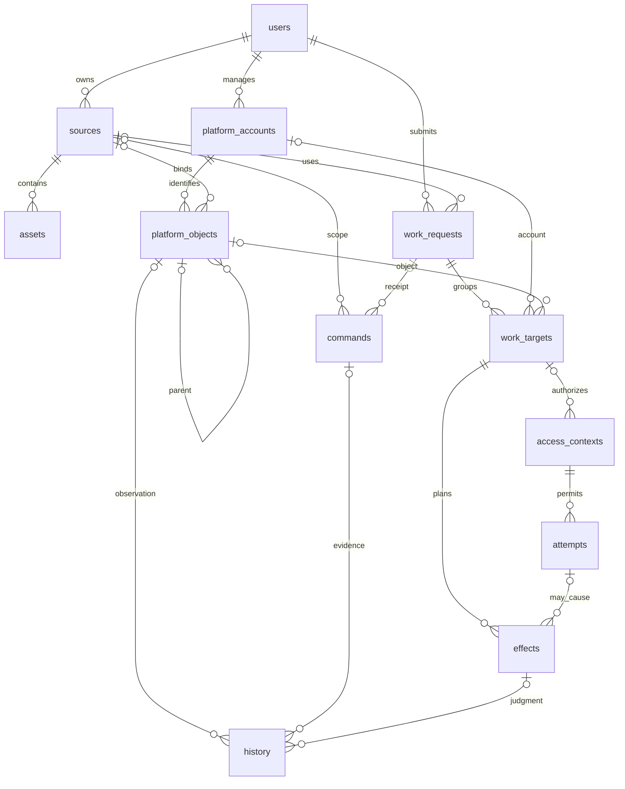

# DB 설계 통합 검토 — V5.1 최소 논리 후보 및 PostgreSQL 설계 입력

> 검토용. 12개 테이블·134개 후보 필드(12개 조건부). 논리 DB 승인 전, 실제 DDL/API/이관/실행 금지. 7 플랫폼 mock-only.

[정본 JSON](../../artifacts/planning/lesson-registration-20261126/integrated/db-design-review-20261127.json)에서 직접 작성한 읽기본. 공식 project_docs.py/CI는 미실행.

## 1. 기준선과 참고 자료

- normalized: [db-evidence-normalization-20261127.json](https://github.com/ik-e/chaja-you/blob/8ced4742147215622246df62479da2a01cb1ee53/docs/artifacts/planning/lesson-registration-20261126/integrated/db-evidence-normalization-20261127.json) (`8ced474`)
- inputs: [db-design-inputs-20261127.json](https://github.com/ik-e/chaja-you/blob/8ced4742147215622246df62479da2a01cb1ee53/docs/artifacts/planning/lesson-registration-20261126/integrated/db-design-inputs-20261127.json) (`8ced474`)
- prior_db: [db-minimal-v5.json](https://github.com/ik-e/chaja-you/blob/774465d765d2c776d6d415bc5222d2f02eff9d00/docs/artifacts/planning/lesson-registration-20261126/integrated/db-minimal-v5.json) (`774465d`)
- latest_v4: [db-minimal-v4.json](https://github.com/ik-e/chaja-you/blob/1608d9b6b41e6812ce116bacd9c123aa2f28a1f3/docs/artifacts/planning/lesson-registration-20261126/integrated/db-minimal-v4.json) (`1608d9b`)
- scope: [service-scope-v1.0.json](https://github.com/ik-e/chaja-you/blob/1608d9b6b41e6812ce116bacd9c123aa2f28a1f3/docs/artifacts/planning/lesson-registration-20261126/integrated/service-scope-v1.0.json) (`1608d9b`)
- system_work: [system-work-v1.0.json](https://github.com/ik-e/chaja-you/blob/1608d9b6b41e6812ce116bacd9c123aa2f28a1f3/docs/artifacts/planning/lesson-registration-20261126/integrated/system-work-v1.0.json) (`1608d9b`)
- screen: [abstract-screen-v1.0.json](https://github.com/ik-e/chaja-you/blob/1608d9b6b41e6812ce116bacd9c123aa2f28a1f3/docs/artifacts/planning/lesson-registration-20261126/integrated/abstract-screen-v1.0.json) (`1608d9b`)
- state: [logical-state-v1.0.json](https://github.com/ik-e/chaja-you/blob/1608d9b6b41e6812ce116bacd9c123aa2f28a1f3/docs/artifacts/planning/lesson-registration-20261126/integrated/logical-state-v1.0.json) (`1608d9b`)
- error: [error-response-v1.0.json](https://github.com/ik-e/chaja-you/blob/1608d9b6b41e6812ce116bacd9c123aa2f28a1f3/docs/artifacts/planning/lesson-registration-20261126/integrated/error-response-v1.0.json) (`1608d9b`)
- platform_work: [platform-work-v1.0.json](https://github.com/ik-e/chaja-you/blob/1608d9b6b41e6812ce116bacd9c123aa2f28a1f3/docs/artifacts/planning/lesson-registration-20261126/integrated/platform-work-v1.0.json) (`1608d9b`)
- story: [user-stories.json](https://github.com/ik-e/chaja-you/blob/9f09a8d064b7a19c4b279a78f8d2b68291e898cf/docs/artifacts/planning/lesson-registration-20261126/integrated/v3.1/user-stories.json) (`9f09a8d`)
- feedback: [instructor-api-db-design-inputs.json](https://github.com/ik-e/chaja-you/blob/774465d765d2c776d6d415bc5222d2f02eff9d00/docs/artifacts/planning/lesson-registration-20261126/instructor-api-db-design-inputs.json) (`774465d`)
- legacy_schema: [schema.sql](https://github.com/ik-e/chaja-you/blob/14b3e5f380fbe4379a6eeb67dc8c991a4e38c912/product/lesson-registration/src/lesson_registration/app/store/schema.sql) (`14b3e5f`)
- legacy_atomic: [atomic.py](https://github.com/ik-e/chaja-you/blob/14b3e5f380fbe4379a6eeb67dc8c991a4e38c912/product/lesson-registration/src/lesson_registration/app/store/atomic.py) (`14b3e5f`)
- legacy_contract: [data-schema-v4.1.json](https://github.com/ik-e/chaja-you/blob/774465d765d2c776d6d415bc5222d2f02eff9d00/docs/artifacts/design/lesson-registration-20261124/data-schema-v4.1.json) (`774465d`)
- physical_binding: [PHYSICAL-BINDING.json](https://github.com/ik-e/chaja-you/blob/14b3e5f380fbe4379a6eeb67dc8c991a4e38c912/product/lesson-registration/contracts/PHYSICAL-BINDING.json) (`14b3e5f`)
- implementation_binding: [IMPLEMENTATION-BINDING.json](https://github.com/ik-e/chaja-you/blob/14b3e5f380fbe4379a6eeb67dc8c991a4e38c912/product/lesson-registration/contracts/IMPLEMENTATION-BINDING.json) (`14b3e5f`)
- r04_auth: [independent-result.json](https://github.com/ik-e/chaja-you/blob/14b3e5f380fbe4379a6eeb67dc8c991a4e38c912/docs/artifacts/planning/lesson-registration-20261126/R04/independent-result.json) (`14b3e5f`)
- r05_auth: [independent-result.json](https://github.com/ik-e/chaja-you/blob/14b3e5f380fbe4379a6eeb67dc8c991a4e38c912/docs/artifacts/planning/lesson-registration-20261126/R05/independent-result.json) (`14b3e5f`)
- r02_taling: [taling-user-confirmation.json](https://github.com/ik-e/chaja-you/blob/14b3e5f380fbe4379a6eeb67dc8c991a4e38c912/docs/artifacts/planning/lesson-registration-20261126/R02/taling-user-confirmation.json) (`14b3e5f`)

정규화 후보 374개/25 의미군. 22개 원장 방향 미기재(탈잉 상세 자료에는 22개 항목 존재, 입출력 방향의 서버 실증 아님). R02 보고 96과 실제 배열 86 차이는 미해결. 플랫폼별 규격, 인증 TTL, 실제 외부 ID·반환/허용 검증은 별도.

## 2. 기능별 저장 요구

| ID | 필요 정보 | 업무 | 저장소 | 보존/완료 경계 |
|---|---|---|---|---|
| SR01 강사 본인·소유권 | 안정 owner ID, 검증 주체와 권리 상태; 본인 아닌 데이터 조회·쓰기 금지 | SW-01, SW-02, SW-03, SW-36 | users | 서버 검증 세션에서 owner를 도출, 사용자 입력 owner 신뢰 금지. 자체 로그인 비밀·세션 원문은 인증 계층. |
| SR02 레슨 원본 최신본·현재 편집 | 사용자별 복수 원본, 최신 원문/사실, revision, 현재 draft, 저장 결과 | SW-04, SW-05, SW-06, SW-07, SW-08, SW-35 | sources, commands | 원본 전문 이력 불필요. W 인라인 공통 사실 보완은 기존 SAVE_SOURCE 원자 처리 재사용, 선택한 작업으로 복귀. |
| SR03 첨부 및 사용 권리 | 불변 asset/digest, 현재 권리·공개 범위, 원본/승인 참조 | SW-04, SW-06, SW-07, SW-11, SW-12, SW-22, SW-33, SW-36 | assets, sources, work_targets, history | 파일 바이너리 비공개 저장소, 동일 파일 사용 승인 범위 구분, 권리 철회 시 새 전송 제한. 참조·보존 근거 확인 후 폐기. |
| SR04 외부 계정 식별 및 정확 관리 관계 | 정확 외부 계정·객체·환경·현재 원본 링크와 확인 근거 | SW-14, SW-15, SW-17, SW-18, SW-19, SW-29, SW-34 | platform_accounts, platform_objects, sources, commands, history | 원본 1:N, 객체 0..1 원본, 공유 프로필은 source_id NULL. 정확 계정/객체 식별 전 외부 쓰기 차단. |
| SR05 선택된 플랫폼 묶음과 준비 계획 | 정확 선택 대상, 채널별 준비값·필수 오류/제약·근거·영향 범위 | SW-09, SW-10, SW-11, SW-12, SW-13, SW-16, SW-19, SW-20, SW-21, SW-32 | sources, work_requests, work_targets, assets, history | 한 원본 기반 다중 대상; 작업 단위 채널 표현·규칙 버전. 전체 원본 수정이나 불필요한 필드 저장 금지. |
| SR06 인증 및 접근 문맥·폐기 | 정확 owner/platform/env/account/purpose/generation/expiry/cleanup | SW-14, SW-15, SW-16, SW-24, SW-33, SW-34 | access_contexts, platform_accounts, work_targets, history | 일시 격리 runtime의 인증 비밀은 앱 DB/로그에 없음; 계정 연결과 실제 업무 접근 권한 독립. |
| SR07 원자 승인 및 명령 멱등성 | 정확 선택·양 승인·동결 입력과 자료·명령 키/digest/영수증 | SW-07, SW-18, SW-21, SW-22, SW-23, SW-24, SW-35 | commands, sources, work_requests, work_targets, access_contexts, effects | 원본 저장과 수락은 동일 source 경계 lock, 관련 미해결 저장만 차단. 승인/선택/정확 수락 집합 동결. |
| SR08 외부 실행 및 전역 효과 경합 | 호출과 효과 분리, 정확 승인 범위·계정/객체/claim·일회 시작·불명 fence | SW-23, SW-24, SW-25, SW-26, SW-27, SW-28, SW-33 | work_targets, platform_accounts, platform_objects, access_contexts, attempts, effects, history | 전역 정규 계정 기준, 모든 claim 원자 예약. 외부 실행을 DB transaction과 동일시하지 않음. 확인·불명 효과 재실행 금지. |
| SR09 독립 상태·결과·복구 | 외부 관측, 효과 판정, 대상 결과, 목표, 실패/불명·후속 안내 | SW-28, SW-29, SW-30, SW-31, SW-32, SW-35 | attempts, effects, history, platform_objects, work_requests, work_targets, commands | 응답과 독립 확인 분리. 미수락 보류/제외는 실패가 아님. 후속은 새 명시 업무·새 승인, 이전 기록 불변. |
| SR10 권리·삭제·운영 품질 | 권리 요청·접근 차단·정리 의무·최소 운영 관측 | SW-08, SW-31, SW-33, SW-34, SW-36 | users, sources, assets, platform_accounts, platform_objects, access_contexts, commands, effects, history | 원본 retire/내부 연결 해제/외부 삭제를 구분; 품질 기준 미달 전달은 기존 history로, 관리자 제품·자동 외부 감시 테이블 없음. |

## 3. 최소 논리 DB 후보

| 테이블 | 필드 | 책임 | 분리 이유 |
|---|---:|---|---|
| users | 6 | 다른 데이터의 소유/권리 기준 | 외부 계정 또는 원본에 user를 병합하면 복수 원본·외부 계정의 독립 소유 및 권리 검증 상실. |
| sources | 7 | 강사가 관리하는 레슨 최신 사실의 정본 | 업무에 병합하면 동일 원본을 여러 대상에 재사용·독립 수정할 수 없고 과거 승인 정보와 섞임. |
| assets | 9 | 파일의 불변 식별·권리·저장 위치 | source JSON만으로 자료 참조/권리 철회·삭제 경합·승인된 파일 무결성 검증을 별도 앱에 재구현해야 함. 범위에 필요한 파일의 독립 lifecycle. |
| platform_accounts | 7 | 정확 외부 계정과 현재 관리 연결 | 하나의 계정에 여러 객체와 업무가 있고 일시 접근과 관계 수명 다름. 전역 계정 한도·경합은 정규 식별 tuple. |
| platform_objects | 8 | 업무와 독립인 관리 등록물·공유 프로필 | 기존 외부 직접 등록물도 연결 가능, 같은 등록물에 여러 수정/조회. 현재 source_id FK로 별도 링크 테이블 제거. |
| work_requests | 10 | 사용자가 한 번 선택·승인하는 원본 기반 대상 묶음 | 대상 행에 승인/선택 집합을 반복하면 전체 수락 원자성과 선택/보류/제외 보존이 어려움. |
| work_targets | 14 | 플랫폼별 독립 준비/실행/종료·필수 보완 | 묶음 JSON에 병합하면 동시 실행·실패 격리·정확 대상과 승인 scope FK를 재구현해야 함. |
| commands | 13 | 내부 저장·수락·연결 등의 요청 키와 결과 | 외부 호출과 무관한 명령도 응답 유실 복구 필요. append-only history로만 대체하면 원자 idempotency 상태/unique/잠금 책임이 사라지지 않음. |
| access_contexts | 15 | 권한 목적·세대·수명·폐기 책임 | 계정 또는 target에 병합하면 독립 조회, 반복 인증, 이전 문맥 차단/정리 불명 및 동시 접근 분리가 어려움. |
| attempts | 13 | 정확 읽기/쓰기 호출 자체 | 하나의 호출 여러 효과, 조회 호출은 효과 없음. 응답 성공을 외부 반영으로 오인하지 않기 위한 독립 시도 경계. |
| effects | 15 | 정확 변경 효과와 예약/불명·분쟁 guard | 호출과 합치면 부분 성공, 중복 전송 차단, 계정 총량/일일 한도 및 늦은 관측을 개별 관리 불가. |
| history | 17 | 권위 있는 관측/판정/관계·권리·정리 근거 | 현재 상태 컬럼만으로 독립 확인·조회 실패·과거 승인 최소 근거·늦은 판정 보존 불가. 별도 모든 종류별 테이블은 필요성 미입증. |

원본-등록물 1:N, 공유 프로필은 직접 source 연결 없음. 위 ERD는 핵심 관계만 표현; 상세 134 필드와 참조는 정본. 별도 link table 없음.

| 대안 테이블 수 | 판단 | 이유 |
|---:|---|---|
| 8 | not_recommended | account/object/access/call/effect/evidence를 여러 typed JSON에 합쳐도 독립 수명, 조회·잠금·무결성 요구가 사라지지 않음. |
| 11 | not_recommended_at_current_scope | request-target, attempt-effect, account-access, command-history 중 하나를 합치는 경우 다중 대상 수락·외부 호출/효과 구분·명령 멱등·권한 cleanup의 독립 정본을 잃거나 앱에 재구현. |
| 12 | recommended_review_candidate | V5.1의 승인된 원본 1:N FK로 별도 link table을 제거. 134 후보 필드(12 조건부 포함). 상위 요구/자료를 보완해도 새 테이블의 명시 기능 필요성 확인되지 않음. |
| 13 | conditional_not_adopted | proof 관계·복수 grant·복잡한 claim/공유 관계 독립 조회/삭제/제약 필요성이 물리 검증에서 확인되면 해당 관계 1개씩 추가. 예: 단일 credential_bindings 추가면 13개(이전 문서 '14번째'는 이전 13개 기준 잔류). |
| 17 | historical_not_recommended | 전체 불변 원본 버전/별도 실행·가드 테이블을 상시 보유하는 구조. 최신 원본만 필요한 승인 방향 및 최소 수집에 맞지 않음. |

### 조건부 필드 12개

| 필드 | 조건 |
|---|---|
| users.issuer | 외부 인증 공급자 namespace; 단일 공급자 고정이면 설정으로 대체 |
| users.subject | 공급자 검증 주체; 자체 인증 채택 시 해당 안정 주체 키로 대체 |
| users.created_at | 계정 발생 시각/보존 기산 후보; 구체 정책에 필요 없으면 제외 |
| sources.draft | 현재 편집과 저장 불명 복귀; 서버 영속은 동일 owner 재접속 조건에서 필요, 브라우저 임시만으로 충족 여부 검증 |
| platform_accounts.identity_namespace | 실제 외부 계정 키의 유효 범위; 플랫폼별 단일 namespace 입증시 설정/정규 키로 통합 |
| platform_objects.parent_id | 공유 프로필/상위 상품 관계; 실증된 단일 부모만, 관계 불명 hold |
| platform_objects.identity_namespace | 동일 계정 내 native key 유효 영역; 단일 범위 실증시 설정으로 유도 |
| platform_objects.locator | 정확 식별자로 위치 유도 불가한 플랫폼만 최소 관리 locator 보존 |
| work_targets.prior_target_id | 잔여/반려/후속의 원 업무 참조 필요시; 독립 새 추가 등록에는 NULL |
| commands.principal_key | 가입 전 검증 주체 멱등 scope 필요시; 가입 후 owner 기반으로 유도 가능, 인증 방식 결정 필요 |
| effects.prior_effect_id | 이전 미발생/잔여 효과에 대한 새 승인 lineage; 독립 신규는 NULL |
| history.related_object_id | 확인된 동일 클래스 등 두 번째 객체 관계; 불명 추정 금지 |

### 업무별 저장 요구 상세

| 업무 | 읽기/쓰기 테이블 | 최신 R4 처리 경계 |
|---|---|---|
| SW-01 서비스 본인 식별 | commands, users | 업무별 정본 읽기/필요 결과 저장; 실행 범위 미확정은 hold |
| SW-02 대상 소유권 및 목적별 접근 검증 | access_contexts, assets, commands, history, platform_accounts, platform_objects, sources, users, work_requests, work_targets | 업무별 정본 읽기/필요 결과 저장; 실행 범위 미확정은 hold |
| SW-03 본인 원본·등록물·작업 통합 읽기 | history, platform_accounts, platform_objects, sources, users, work_requests, work_targets | 업무별 정본 읽기/필요 결과 저장; 실행 범위 미확정은 hold |
| SW-04 원문·첨부·직접 입력 수신 | assets, sources | 자료와 원문 수신; 최소 저장, 비공개 asset 등록. 신규 미저장 shell은 관리 원본 목록에서 숨김. |
| SW-05 원본 사실 추출 및 구조화 | assets, sources | 업무별 정본 읽기/필요 결과 저장; 실행 범위 미확정은 hold |
| SW-06 사실·첨부 편집 및 원본 변경 영향 확인 | sources, work_requests, work_targets, assets | 확정 공통 사실 vs 채널 표현 분리; 원본 보완이 가격/권리/공유 관계에 미치는 정확 dependency_paths 판정. 미확인 범위 보류. |
| SW-07 원본 저장 및 동일 요청 확인 | assets, commands, history, sources, work_requests, work_targets | 동일 principal/kind/key digest 조회 우선. 서버 인지 예약은 source 및 선택적 work_request/scope/base revision 보존; source lock에서 CAS+command receipt 원자. 서버 미도달은 없음만으로 미커밋 확정 불가. |
| SW-08 원본 내부 삭제·관리 연결 해제 | assets, commands, effects, history, platform_objects, sources | 원본 retire, 정확 object.source_id 연결 해제와 물리 삭제 구분. latest binding 사건·승인/자료/효과 참조 보호. |
| SW-09 업무 의도·대상 묶음 확정 및 준비 요청 접수 | commands, sources, work_requests, work_targets | 업무별 정본 읽기/필요 결과 저장; 실행 범위 미확정은 hold |
| SW-10 제품 지원·단계 허용 및 제약 판정 | platform_accounts, work_requests, work_targets | 정확 플랫폼 업무·권한·제약 version pin, 작성안만 지원하는 경우 외부 효과 없음. 허용 불명 hold. |
| SW-11 플랫폼별 입력안 변환 | assets, sources, work_requests, work_targets | 공통 사실에서 채널별 단위/길이/옵션 변환. 채널 고유 값은 plan, 재사용 공통 사실만 명시 원본 저장. |
| SW-12 입력안·필수 사실·제약 검증 | assets, effects, sources, work_targets | 필수/선택 사용자 확인·공식 서버 검증 여부 구분. 실제 영향받는 조건만 차단, 규칙/근거 불명은 보류. |
| SW-13 필요 정보 요청·제약 대안 반영 | sources, work_targets, work_requests | W에서 신규 공통 사실 명시 저장 후 같은 request로 복귀; 영향 대상만 재검증. 채널 고유 표현은 현재 plan 갱신, 다른 대상 유지. |
| SW-14 필요 외부 인증 문맥 발급 및 직접 인증 연결 | access_contexts, work_targets | 일시 access_context 발급: owner/env/platform/context_key/generation/expiry와 최소 scope; secret/grant는 메모리 runtime. 오래된 generation 차단. |
| SW-15 외부 계정·권한 검증 및 관리 식별 관계 | access_contexts, history, platform_accounts, platform_objects, work_targets | 외부 계정 검증과 명시 management linked 구분; 정확 native identity와 저장 허용 확인. 동일 외부 계정 전역 scope는 owner 내부 ID와 독립. |
| SW-16 직접 선행 업무 확인 | access_contexts, history, work_targets | 탈잉 정산/뮬 약관 등 직접 선행 상태 최소 기록, 민감 값·동의 자체 수집 금지. |
| SW-17 허용 읽기·정확 외부 객체 식별 | access_contexts, attempts, history, platform_accounts, platform_objects, work_targets | 관리·공개 locator는 후보, 정확 namespace/key와 적격 관측 검증 후 객체 정본. 최신 조회 실패는 이전 관측 대체 아님. |
| SW-18 기존 외부 등록물의 내부 관리 연결 | commands, history, platform_accounts, platform_objects, sources | 정확 object 잠금 + source_id와 expected latest binding event CAS + history binding 사건 + command receipt. 공유 profile 직접 링크 금지. 내부 효과만. |
| SW-19 수정 전후 비교와 공유 효과 검토 | history, platform_objects, work_targets | 정확 동일 클래스/공유 프로필/계정 한도 관계 증거, 변경 전후 범위. W에서 영향받는 변경 hold; 결합 불명은 해당 범위 보류. |
| SW-20 동일 공고 갱신 조건 및 예정 효과 검토 | effects, history, platform_objects, work_targets | 동일 게시물 갱신 의미·대상/조건 확인; 새 글 및 유료·자동 갱신 제외. |
| SW-21 대상별 준비 판정 및 최종 승인안 제공 | access_contexts, assets, commands, effects, history, sources, work_requests, work_targets | 관련 저장 reserved 미해소 및 영향받는 가격/권리/공유 관계 변경은 ready 후보에서 제외. 독립 준비 유지; 영향 불명 해당 source 범위 hold. |
| SW-22 내용·범위 승인 및 요청 수락 | access_contexts, assets, commands, effects, history, sources, work_requests, work_targets | source/request/target 일관 lock에서 현재 revision, 관련 예약, selection revision, 양 승인 및 plan digest 재검증. 정확 ready subset 원자 동결; 선택·보류·제외 유지. save 선행→재검증, accept 선행→동결 보존. |
| SW-23 수락 업무의 대상별 실행 조정 | access_contexts, attempts, effects, history, work_requests, work_targets | 정확 수락 대상만 실행; 묶음 종료 파생, 비수락 대상 실패로 전환 금지. |
| SW-24 외부 변이 전 효과 식별·실행 허용 확보 | access_contexts, assets, attempts, effects, history, platform_accounts, platform_objects, users, work_requests, work_targets | 정규 계정 key 및 관련 root/scope 모든 claim을 정렬 잠금, 만료/권한/현재 정책과 unresolved 충돌 검증·원자 reserve. 네트워크 호출은 트랜잭션 밖. |
| SW-25 신규·추가 등록 단계 처리 | attempts, effects, work_targets | 승인 CREATE 단계 및 효과만, 한 attempt 여러 효과 가능; exact readback 전 확인 표시 금지. |
| SW-26 기존 정보 수정 단계 처리 | attempts, effects, work_targets | 정확 UPDATE 객체와 before/after 의도, 기존 객체 유지. 외부 관측 충돌 시 hold. |
| SW-27 동일 공고 갱신 단계 처리 | attempts, effects, work_targets | 정확 기존 공고 RENEW 효과, 미지원/불명 보류, 자동 재등록 금지. |
| SW-28 단계 효과 및 독립 관측 확인·기록 | assets, attempts, effects, history, platform_accounts, platform_objects, work_requests, work_targets | response, readback, effect_judgment, target_result, goal 구분. 늦은 근거는 새 version; 외부 쓰기 재개 없음. |
| SW-29 업무 결과 판정·기록 및 관리 관계 반영 | attempts, effects, history, platform_objects, work_requests, work_targets | 확인된 정확 객체 및 승인 원본만 자동 연결 후보. 이전 명시 해제/다른 연결/retire/권리 충돌이면 내부 연결 보류, 확인된 외부 효과 보존. |
| SW-30 사용자 요청 최신 상태 조회 및 관측 갱신 | access_contexts, attempts, effects, history, platform_accounts, platform_objects, work_targets, work_requests | 정확 목적/객체/계정의 read 순번과 적격 관측. unavailable은 마지막 정상 상태 삭제하지 않음. |
| SW-31 반려·제한·실패 및 잔여 업무 안내 | attempts, effects, history, work_targets | held/excluded는 실패/잔여 효과 아님. R에서 조건 안내 후 사용자가 명시 새 업무 선택 시 H에서 저장 원본·정확 대상·현재 조건 재검증 및 새 승인. |
| SW-32 제한 대상의 내부 작성안 제공 | history, sources, work_targets, work_requests | 허용된 내부 작성안 제공 완료≠외부 등록 성공, 외부 효과/자동 접근 없음. |
| SW-33 승인 철회·업무 제한 및 접근 차단 | access_contexts, assets, effects, history, users, work_requests, work_targets | 접근/효과 fence, 승인 철회와 종료 구분; 이미 확인·불명 효과 삭제/원복 금지. |
| SW-34 업무용 접근 종료·외부 계정 연결 해제 및 폐기 확인 | access_contexts, attempts, history, platform_accounts | 연결 해제와 접근 차단/cleanup proof 별개. 새 인증으로 옛 cleanup 불명 해소 금지. |
| SW-35 이탈·저장 작업 복귀·요청 일관성 확인 | access_contexts, commands, history, platform_objects, sources, users, work_requests, work_targets | 동일 키/영수증 재확인; 화면 복귀 자체는 재실행 아님. 지연 명령을 봉쇄한 경우에만 새 요청. |
| SW-36 자체 계정 권리 요청·서비스 로그아웃 | access_contexts, assets, attempts, commands, effects, history, platform_objects, sources, users, work_requests, work_targets | 권리 및 접근 종료의 최소 근거, 보존 근거/참조가 해소된 자료 삭제/익명화; 실제 기간 및 backup 정책 별도. |

### 테이블별 상세 필드

#### users

| 필드 | 타입 후보 | 목적/제거 영향 | 필요성 |
|---|---|---|---|
| id | uuid PK | 안정 owner와 모든 소유 FK; 삭제하면 격리 불가 | keep |
| issuer | text | 외부 인증 공급자 namespace; 단일 공급자 고정이면 설정으로 대체 | conditional |
| subject | text | 공급자 검증 주체; 자체 인증 채택 시 해당 안정 주체 키로 대체 | conditional |
| state | text | 현재 권리 제한/retire 판정; 별도 인증 성공과 구분 | keep |
| created_at | timestamptz | 계정 발생 시각/보존 기산 후보; 구체 정책에 필요 없으면 제외 | conditional |
| retired_at | timestamptz? | retire 이후 보존/폐기 기산 및 현재 제한 시점; 구체 기간은 정책 | keep |

- UNIQUE(issuer,subject); 제공자가 검증한 식별자만 수락; 삭제/보존 정책은 미확정
- issuer/subject는 인증 공급자 결정 후 자체 안정 주체 키로 대체 가능. 사용자 ID와 인증 주체를 동일시하지 않음.

#### sources

| 필드 | 타입 후보 | 목적/제거 영향 | 필요성 |
|---|---|---|---|
| id | uuid PK | 원본 독립 식별; 강사당 복수 원본과 업무/자료 연결 | keep |
| owner_id | uuid FK users | 원본 소유자; 타 강사 접근 금지 | keep |
| content | jsonb? | 최신 재사용 원문/확정 사실/자료 참조; 과거 전문 없음 | keep |
| revision | integer | CAS 및 낡은 준비/승인 차단; 값 동일 여부 해시 대안 가능 | keep |
| draft | jsonb? | 현재 편집과 저장 불명 복귀; 서버 영속은 동일 owner 재접속 조건에서 필요, 브라우저 임시만으로 충족 여부 검증 | conditional |
| state | text | draft_only/managed/retired; 미저장 shell과 저장 목록 분리 | keep |
| updated_at | timestamptz | 마지막 명시 저장 시각 및 정리 기준; draft 수정은 draft 내부 시각 | keep |

- 저장 시 owner·base revision·draft generation 검사/CAS 후 최신 content 교체 및 revision 증가, draft 정리와 command 영수증 원자 기록; 오래된 추출 응답은 무시; 신규 미저장 shell은 저장 원본 목록에 미표시; 한 원본당 서버 draft 하나(충돌 시 타 편집 덮어쓰기 금지)
- 원본당 복수 platform_objects 허용. 현재 source_id 연결·수락/효과/필요 자료 참조 확인 후 retire/물리 폐기; CAS+binding 사건을 통해 명시 해제, 외부 삭제 없음.

#### assets

| 필드 | 타입 후보 | 목적/제거 영향 | 필요성 |
|---|---|---|---|
| id | uuid PK | 불변 파일 ID; 승인과 현재 원본에서 같은 자료 정확 참조 | keep |
| source_id | uuid FK sources | 원본 범위 소유 및 역참조; 별도 owner 중복 불필요 | keep |
| storage_key | text | 비공개 파일의 실제 위치; URL이나 인증 비밀 아님 | keep |
| digest | text | 동일 승인 자료 무결성, 교체는 새 ID | keep |
| media_type | text | 검증된 파일 유형/플랫폼 규격; 확장자 추정 금지 | keep |
| size_bytes | bigint | 업로드 규격 검증용 불변 메타; 저장소 신뢰/비용 검증 시 유도 가능 | keep |
| rights_state | text | 허용/불명/철회; 새 사용 즉시 차단 | keep |
| rights_detail | jsonb | 정확 허용 목적/공개 범위와 최소 근거 | keep |
| created_at | timestamptz | 미참조 업로드/권리·정리 기산; 기간 별도 | keep |

- 파일 변경은 새 ID; content/draft의 첨부 목록은 해당 source의 asset만 참조(역참조 검사 포함); 현재 사용 역할/순서는 content.attachments에만 기록; 승인 plan에는 필요한 asset ID·digest·사용 범위를 고정; 권리 철회 시 새 사용 제한; 현재 원본에서 제거해도 아직 필요한 승인/실행 참조를 임의 삭제하지 않음; 실제 보존/삭제 정책 별도

#### platform_accounts

| 필드 | 타입 후보 | 목적/제거 영향 | 필요성 |
|---|---|---|---|
| id | uuid PK | 내부 owner 범위 관리/정확 식별 참조 | keep |
| owner_id | uuid FK users | 본인 연결 구분; 전역 경합 키에는 포함하지 않음 | keep |
| platform_key | text | 플랫폼 identity namespace 및 정책 선택 | keep |
| environment | text | mock/live 격리, 계정 단위 전역 잠금 구성 | keep |
| identity_namespace | text | 실제 외부 계정 키의 유효 범위; 플랫폼별 단일 namespace 입증시 설정/정규 키로 통합 | conditional |
| native_account_key | text | 검증된 실제 계정 정규 식별; 동일 계정 교차 owner 경합 공유 | keep |
| management_state | text | management_state로 명확화: unlinked/linked/retired; 업무 identity 확인을 관리 연결 승인으로 오인하지 않음 | redefine |

- UNIQUE(owner_id,environment,platform_key,identity_namespace,native_account_key); 연결 해제 시 기존 접근 문맥 차단 및 폐기 의무 기록; 재연결로 옛 접근 문맥을 활성화하지 않음; 관리 연결≠실제 접근 권한; 쿠키/비밀번호/토큰 없음; owner별 관리 연결 고유성과 경합 범위는 별개. 전역 정규 계정 key=(environment,platform_key,identity_namespace,native_account_key); 동일 key의 여러 owner 연결은 같은 잠금/한도 claim을 공유하며 다른 owner 데이터 공개·권한 부여 아님. 정규 식별 불명은 실행 보류.
- management_state=unlinked/linked/retired. 업무 인증 확인만으로 linked 변경 금지. 사용 허용·필요가 검증된 최소 식별 anchor와 proof만 기록; 관리 연결 목록은 linked만. owner별 연결 고유성 및 전역 정규 키 경합 분리. 실제 계정 식별 정보 저장 허용 불명 시 해당 외부 업무 hold.

#### platform_objects

| 필드 | 타입 후보 | 목적/제거 영향 | 필요성 |
|---|---|---|---|
| id | uuid PK | 정확 외부 등록물의 지속 내부 참조; 업무 이력과 독립 | keep |
| account_id | uuid FK platform_accounts | 정확 계정/owner/환경 및 정규 객체 키 구성 | keep |
| parent_id | uuid? FK platform_objects | 공유 프로필/상위 상품 관계; 실증된 단일 부모만, 관계 불명 hold | conditional |
| kind | text | 상품/클래스/프로필/서비스/게시물 등 identity 범위 | keep |
| identity_namespace | text | 동일 계정 내 native key 유효 영역; 단일 범위 실증시 설정으로 유도 | conditional |
| native_object_key | text | 정확 기존 객체 식별; URL/표시명으로 임의 추정 금지 | keep |
| locator | jsonb? | 정확 식별자로 위치 유도 불가한 플랫폼만 최소 관리 locator 보존 | conditional |
| source_id | uuid? FK sources | R01 승인 1:N 관계의 현재 연결 정본; 원본 재사용/정확 연결·해제에 필수. | add |

- UNIQUE(account_id,kind,identity_namespace,native_object_key); 부모 동일 계정, cycle 금지; 확인 전 후보는 target.plan에만 보존; URL/표시명/순서만으로 정확 식별 가정 금지; 현재 외부 상태는 history 적격 관측에서 조회
- 계정·객체의 마지막 식별 검증 시각은 적격 identity history에서 계산. 검증 근거를 함께 원자 기록하며 필요 참조보다 먼저 폐기하지 않는다.
- platform_objects.source_id nullable FK sources가 현재 관리 연결의 단일 정본. 동일 owner 및 정확 객체/권한·환경 확인; 다른 원본에 이미 연결된 객체를 암묵적으로 덮어쓰기 금지.
- 공통 프로필·계정 단위 공유 객체는 원본에 직접 연결하지 않는다. 확인된 계정/상하위 객체 관계로 영향 범위를 판정한다. 개별 레슨 객체 정확 식별 불명은 해당 업무 hold; 동일 원본이 동일 클래스라는 추정 금지.
- 링크/해제/재연결은 내부 효과만. 정확 객체/원본/현재 연결 세대(최신 적격 binding event ID; 연결 이력 없는 최초 객체는 명시 최초 표지) 확인. 객체 잠금에서 동일 키 영수증 확인을 우선하고, source_id CAS + 최신 binding event append + command receipt를 원자 기록. 해제는 NULL; 객체/실제 글 삭제 없음.
- 해제·재연결 후 지연된 이전 명령은 새 연결 사건 ID와 불일치하면 거절. 동일 key/digest는 기존 영수증 반환; 현재 연결이 같아도 자동 재처리하지 않는다. 사건 ID는 독립 링크 행을 대체; 현재 guard에 필요한 최신 사건은 참조/보존 의무 해소 전 삭제 금지.
- 등록 완료 후 자동 연결은 정확 객체와 승인 원본이 확인되고 여전히 연결 가능한 상태이며 기존 연결/권리·보존·미해결 명령과 충돌하지 않을 때만; 늦은 결과가 명시 해제 또는 다른 연결을 덮어쓰지 않음. 미확정/충돌은 내부 연결 보류하고 외부 효과 증거는 유지.
- 원본 retire/삭제와 연결 해제를 구분하며 기존 승인·효과·자료 참조 및 보존 근거 보호. 실제 물리 삭제/익명화 전 정확 참조 확인. 과거 전체 원본 또는 인증 비밀 저장 없음.

#### work_requests

| 필드 | 타입 후보 | 목적/제거 영향 | 필요성 |
|---|---|---|---|
| id | uuid PK | 일괄 선택/수락 묶음과 복귀 ID | keep |
| owner_id | uuid FK users | source 없는 관리/읽기 업무도 owner 유지 | keep |
| source_id | uuid? FK sources | 원본이 필요한 요청의 직접 연결; 독립 조회/관리 NULL | keep |
| source_revision | integer? | 요청 현재 기준 원본 revision; target 계산 근거와 다름, 수락 후 고정 | keep |
| environment | text | 준비 단계부터 mock/live 격리; 계정 미정에도 필요 | keep |
| selection_revision | integer | 선택/검토안 CAS와 승인 불일치 차단; digest 대안 가능 | keep |
| approval_state | text | approval_state none/presented/invalidated/frozen; 종료는 대상 lifecycle에서 계산 | redefine |
| approval | jsonb? | 양 논리 승인·정확 대상과 plan digest/읽기 범위 동결; 원본 전체 복제 금지 | keep |
| created_at | timestamptz | 요청 접수 순서/미수락 준비 보존 기산 | keep |
| accepted_at | timestamptz? | 수락 사실/시각; 읽기·내부 업무는 쓰기 승인과 분리 | keep |

- 전체 선택 대상의 처분과 plan은 work_targets가 정본; approval에 동일 입력값 반복 저장 안 함; 양 승인+정확한 target 집합/plan digest+command receipt를 원자 수락; 0 ready면 쓰기 수락 없음; 동결 후 선택/승인 변경 금지; 미수락 원본 변경은 revision 갱신 후 준비 재검증; 읽기/내부 업무는 쓰기 승인 요구하지 않음
- AX08 approval_state none/presented/invalidated/frozen. 승인 전 검토안 바뀌면 invalidated/새 선택 revision. 종료 여부는 수락 대상 lifecycle 전부 ended에서 유도; 수락 0인 경우 실행/실행종료로 표시하지 않는다. 읽기/내부 업무는 승인 없음과 수락/종료 구분.

#### work_targets

| 필드 | 타입 후보 | 목적/제거 영향 | 필요성 |
|---|---|---|---|
| id | uuid PK | 정확 선택/대상 업무 안정 ID; 선택 생성부터 재사용 | keep |
| request_id | uuid FK work_requests | 일괄 묶음 참조·선택/수락 집합 계산 | keep |
| platform_key | text | 계정 미확정 상태에서도 플랫폼별 규칙/처분 결정 | keep |
| operation_key | text | 등록/수정/갱신/조회 등 정확 업무 종류 | keep |
| account_id | uuid? FK platform_accounts | 정확 계정 binding; 후보/불명은 plan에만, 확인 후 FK | keep |
| object_id | uuid? FK platform_objects | 기존 정확 대상; CREATE 결과는 effects.object_id 및 history | keep |
| prior_target_id | uuid? FK work_targets | 잔여/반려/후속의 원 업무 참조 필요시; 독립 새 추가 등록에는 NULL | conditional |
| prepared_source_revision | integer? | 각 대상 입력 계산 revision; 영향 없음 증명 시 기존 값 보존과 기준 갱신 규칙 명시 | keep |
| prep_generation | integer | 같은 원본 revision에서 여러 준비/늦은 응답 구분 | keep |
| prep_state | text | AX06 단일 현재 준비 상태; 수락 뒤 consumed, 보류/제외 유지 | keep |
| profile_ref | text? | 사용한 규칙 버전 pin, 실제 값과 고정 설정 분리 | keep |
| plan | jsonb | 대상별 입력/검증/범위/필수 효과 및 읽기 계획, 수락 뒤 필요한 승인값 고정 | keep |
| lifecycle | text | AX09 수락·실행·fence·종료; 종료≠성공 | keep |
| ended_at | timestamptz? | 개별 종료 시각/보존 기산 및 재개 금지 | keep |

- 정확 target.id 및 선택 의도 중복 검사; source revision/계정/객체/owner/env 정합; 미확인 후보는 plan 안에만, 정확 binding 전 쓰기 금지; 승인 전 stale 조건 검사, 승인 후 필요한 입력/자료만 freeze; 새 변경/재심사/갱신은 새 대상/새 승인; 결과 객체는 effects.object_id와 history에서 유도
- 선택 시 안정 target.id를 발급하고 준비 command와 함께 중복 없는 정확 의도를 검증. 수락 전 표시 처분은 prep_state로 계산; 수락 target은 consumed+lifecycle!=not_accepted, 수락 안 된 선택은 held/excluded로 고정. frozen 후 selection 및 plan 변경 금지. 후속 신규 의도는 새 target/필요 승인; 기존 held를 실패로 변환하지 않음.
- SW-29 등록 후 연결은 현재 원본/권한 및 객체 binding guard가 유효할 때만. 기존 명시 해제·다른 연결을 늦은 외부 결과로 덮어쓰지 않고, 충돌 시 연결 보류 및 확인 효과 보존.

#### commands

| 필드 | 타입 후보 | 목적/제거 영향 | 필요성 |
|---|---|---|---|
| id | uuid PK | 서버 영수증/이력 내부 식별; 외부 client key와 책임 구분 | keep |
| owner_id | uuid? FK users | 검증 소유권; 최초 가입 전 주체만 nullable | keep |
| principal_key | text | 가입 전 검증 주체 멱등 scope 필요시; 가입 후 owner 기반으로 유도 가능, 인증 방식 결정 필요 | conditional |
| kind | text | 동일 key의 명령 종류/행동 분리 | keep |
| request_key | text | 호출자가 응답 유실에도 재사용하는 키; 서버 id와 별개 | keep |
| request_digest | text | 동일 키 다른 요청 거절; 정규 입력/범위 포함 | keep |
| state | text | reserved 기술 상태 + committed/rejected/no_commit_proven; AX04에서 reserved는 미확정, FE unknown은 별도 | redefine |
| receipt | jsonb? | 결과 ID/revision/거절 사유, 원자 영수증; 과거 전체 데이터 없음 | keep |
| created_at | timestamptz | 명령 예약/접수 기산; timeout만으로 미커밋 확정 금지 | keep |
| resolved_at | timestamptz? | 권위 있는 최종 명령 판정 시각 | keep |
| source_id | uuid? FK sources | R03-R4-02: 동일 원본의 다른 준비에서도 미해소 저장을 찾지 못하면 승인 우회; 원본 초안 shell 확보 후 저장 예약. | add |
| work_request_id | uuid? FK work_requests | 같은 저장 영수증과 원래 준비를 재연결, 일반 W 열기보다 불명 복구 우선. | add |
| scope | jsonb | 명령 digest만으로 영향 범위를 복원할 수 없음. 독립성 입증 전 관련 승인 보수적 차단. | add |

- UNIQUE(principal_key,kind,request_key); 동일 digest만 기존 결과 확인, 다르면 거절; DB 행 잠금과 최종 상태 CAS로 업무와 영수증 동일 트랜잭션; no_commit_proven은 이전 지연 커밋을 봉쇄한 경우만; 서버 미기록이면 호출자의 owner-scoped 기존 키 보존 필요; pending 상태에서 무조건 재실행 금지
- DB technical reserved 상태는 AX04 미확정(unrecorded), 미기록과 예약을 구분; FE response unknown은 DB 상태가 아니다. 원본 저장 명령은 원본 shell/정확 source_id와 선택적 W request_id/base_revision/영향 scope를 durable reservation으로 기록한 뒤 변이 시작. reservation·원본 CAS·수락 시 source/request lock 경계, 관련 pending 미해소 중 승인·새 저장 차단. 네트워크가 예약 전 유실될 경우 서버가 모르는 의도는 판정 불가; 사전 durable intent 확보/실행 fence와 동일 키 복구 프로토콜 후속 검증. 명령 최종 결과/변이 원자 기록; 만료만으로 no_commit_proven 금지.
- LINK/UNLINK는 정확 owner/source/object 및 기대 최신 binding event ID를 scope/request_digest에 pin. 동일 key/digest 확정 영수증 조회를 먼저 하고 object 잠금·현재 binding token 대조·source_id 변경·binding 사건·receipt를 동일 원자 트랜잭션으로 기록. 이전 세대 명령으로 새 관계 변경 금지.

#### access_contexts

| 필드 | 타입 후보 | 목적/제거 영향 | 필요성 |
|---|---|---|---|
| id | uuid PK | 새 인증마다 새 접근 ID, 정확 호출 시도 FK | keep |
| owner_id | uuid FK users | 서비스 owner와 외부 계정 분리 | keep |
| target_id | uuid? FK work_targets | 대상 업무 접근 문맥; 계정 관리/독립 확인은 NULL | keep |
| platform_key | text | 계정 미확인 시에도 플랫폼 제한 | keep |
| expected_account_id | uuid? FK platform_accounts | 기대 계정, 최초 미확정은 NULL; 확인 계정과 독립 비교 | keep |
| verified_account_id | uuid? FK platform_accounts | 현재 정확 확인된 계정; 일치 전 실행 금지 | keep |
| purpose | text | 인증/접근의 명시 목적, 읽기/쓰기 자격 분리 | keep |
| state | text | AX14 human/verifying/verified/blocked; none은 미생성 | keep |
| scope | jsonb | 허용된 정확 접근·읽기/쓰기 범위·근거·호출 문맥; 비밀 금지 | keep |
| expires_at | timestamptz | 권한 만료, 늦은 응답 차단 | keep |
| blocked_at | timestamptz? | 차단 시각, 이후 전송 금지; 폐기 성공과 별도 | keep |
| cleanup | jsonb | 비밀 없는 자원 식별·폐기 의무/확인/불명, 차단과 독립 | keep |
| context_key | text | 동일 호출 문맥의 새 인증 그룹; 다른 target의 독립 접근 보호 | keep |
| generation | integer | 동일 문맥의 최신 세대; ID만으로 최신성 판단 불가, unique/CAS | keep |
| environment | text | 계정/target 모두 NULL인 인증 문맥에서 환경 유도 불가. 혼합 실행/관측 차단. | add |

- 접근 ID 및 state로 이전 문맥 차단(재활성화 금지); 기대 계정·실제 계정 일치, 목적/범위/만료/권한 매번 검사; 차단과 폐기 의무 원자 기록; 이전 폐기 불명은 새 인증으로 해소되지 않음; 자원 식별자는 비밀 아닌 메타만; 인증 비밀 저장 금지
- UNIQUE(owner_id,context_key,generation); 새 문맥의 현재성은 해당 문맥 단위로 원자 확인. 동일 문맥의 이전 generation은 새 접근 불가. 별도 독립 문맥은 유지. blocked 및 cleanup 상태는 분리; ID·metadata 외 credential 금지.
- environment 필수, target/기대·확인 계정과 일치 검사. 계정/대상이 아직 없어도 환경 확정. 새 context generation은 정규 문맥 단위 lock/CAS.

#### attempts

| 필드 | 타입 후보 | 목적/제거 영향 | 필요성 |
|---|---|---|---|
| id | uuid PK | 호출 실행 전 안정 ID 발급; 시도와 증거 연결 | keep |
| target_id | uuid? FK work_targets | 관련 업무; 계정 확인 읽기만 NULL 허용 | keep |
| access_id | uuid FK access_contexts | 정확 업무 접근 ID 및 폐기/권한 근거 | keep |
| object_id | uuid? FK platform_objects | 정확 기존 조회/전송 객체; 신규 slot은 scope | keep |
| kind | text | read/write 분리; 읽기 성공≠외부 효과 | keep |
| purpose_key | text | 조회/독립 readback/정확 전송 목적 및 순서 scope | keep |
| scope | jsonb | 정확 객체/slot/목적/읽기 범위/승인 근거, 변경 금지 | keep |
| sequence_no | bigint? | 같은 읽기 대상·목적 요청 순서; 늦은 결과 비교, write NULL | keep |
| state | text | read pending/running/observed/unavailable (running은 AX11 pending); write reserved/started/sealed | redefine |
| requested_at | timestamptz | 접수/예약 시각 및 순서·보존 | keep |
| started_at | timestamptz? | 일회 시작 및 fence 이후 개시 금지 | keep |
| finished_at | timestamptz? | 호출 종료≠외부 효과 확정 | keep |
| failure_reason | text? | 조회/전송 실패 코드, 효과 불명과 분리 | keep |

- PRIMARY KEY(id), 예약 전 안정 ID; kind별 CHECK 및 목적/owner/env/account/target 일치; write는 target 필수, 승인된 효과 전체를 reserve하고 시작 상태 CAS로 같은 시도 일회 시작; read는 정확 목적/범위/순번 및 권한 검증, effect 확인 목적은 scope의 적격 effect 참조로 제한; 관측 결과 history append; read/write 결과를 외부 효과 성공으로 해석하지 않음

#### effects

| 필드 | 타입 후보 | 목적/제거 영향 | 필요성 |
|---|---|---|---|
| id | uuid PK | 개별 승인 효과 시도 ID, 원장 연결 | keep |
| target_id | uuid FK work_targets | 승인 대상 업무 | keep |
| attempt_id | uuid? FK attempts | 해당 write 호출 FK, 미시도는 NULL; 여러 효과 한 호출 | keep |
| prior_effect_id | uuid? FK effects | 이전 미발생/잔여 효과에 대한 새 승인 lineage; 독립 신규는 NULL | conditional |
| rule_key | text | 효과 계약 규칙 버전의 정확 항목 | keep |
| logical_effect_key | text | 같은 의미 효과 식별 및 중복/잔여 검사 | keep |
| intent_digest | text | 정확 승인 의도 digest; 값 변경/범위 확대 차단 | keep |
| root_key | text | 정규 외부 root 또는 신규 slot; owner 내부 ID만으로 경합 금지 | keep |
| scope_path | text | 겹치는 실제 변경 영역, 공유 프로필/하위 효과 | keep |
| object_id | uuid? FK platform_objects | slot→확인된 실제 객체, 후속 수정/연결 | keep |
| required | boolean | 해당 승인안 완료의 필수 효과 여부; 규칙만으로 조건부 효과 확정 불가 | keep |
| state | text | AX10 상태, 불명/미발생 독립; 성공 자동 재시도 금지 | keep |
| disputed | boolean | AX17 분쟁 차단은 확인/미발생 과거 판정과 독립 | keep |
| updated_at | timestamptz | 현재 판정/장기 미해소 정리·조회 기산; 사건 이력과 시간 정합 | keep |
| claims | jsonb | 정규 계정/한도 기간/공유 scope claim 및 반영 근거, 교차 owner 동일 경합 | keep |

- 대상 내 동일 효과 후보 중복 금지; attempt는 같은 target의 write, 여러 effects가 같은 attempt에 연결 가능; 정규 외부 계정 키를 통한 전역 잠금 하 모든 활성/불명/분쟁 효과 및 slot→확인 객체 관계와 scope 겹침 검사·원자 reserve; unknown/disputed 지속 저장; 권한 차단 뒤 시작 금지; 종료 후 늦은 증거는 history로 판정 보완만; 확인/불명 동일 효과 반복 금지, 새 시도는 새 승인+안전한 미발생/미시도 또는 새 의도 및 미해결 경합 없음
- claims는 종류별 schema(정규 account/정확 quota/기간 및 관측·예약 식별) 검증; 한 효과의 모든 scope/claim을 정규 계정 잠금 경계에서 동시에 획득. 최신 적격 관측에 이미 반영됐다는 증거 전 내부 미반영/불명 예약 보수적 포함. 외부 경합/이중 계상 판단 불가 시 hold; 내부 잠금만으로 외부 서버 한도 보장하지 않음. 동일 정규 계정의 모든 owner별 연결·관련 effects를 대상으로 조회/잠금/예약하며 owner_id 또는 내부 account_id를 quota key에 넣지 않는다. 총량 한도와 일일 한도는 종류별 기간을 구분하고 해당 요청의 모든 claim을 원자 획득한다.

#### history

| 필드 | 타입 후보 | 목적/제거 영향 | 필요성 |
|---|---|---|---|
| id | uuid PK | 적격 증거/관측/결과의 안정 ID | keep |
| owner_id | uuid FK users | 권한과 보존의 소유 범위, 다른 owner 정보 공개 금지 | keep |
| kind | text | response/observation/effect judgment/goal/rights 등 판정 종류 분리 | keep |
| target_id | uuid? FK work_targets | 대상 결과/준비 관련 관측에 직접 연결; 다른 참조에서 안전 유도시 중복 기록 금지 | keep |
| attempt_id | uuid? FK attempts | 정확 호출 응답/독립 관측과 연결 | keep |
| effect_id | uuid? FK effects | 정확 개별 효과 판정과 근거 | keep |
| object_id | uuid? FK platform_objects | 정확 외부 객체 관측/관계, 호출 없이 존재하는 직접 확인 포함 | keep |
| access_id | uuid? FK access_contexts | 접근/폐기 사건의 정확 문맥, 시도에서 유도시 중복 없음 | keep |
| command_id | uuid? FK commands | 영수증/권리·내부 효과의 증거 | keep |
| version_no | integer? | 판정 종류·정확 범위별 단조 버전, 늦은 관측과 분쟁 처리 | keep |
| observed_at | timestamptz? | 실제 관측 시각, 기록 도착 순서와 분리 | keep |
| recorded_at | timestamptz | 원장 기록/수신 시각 및 보존 기산 | keep |
| payload | jsonb | 종류별 최소 typed 사실/값/판정/권리; 인증 비밀/원문 전문 금지 | keep |
| proof_ids | uuid[] | 독립 근거 여러 건 연결; 검증된 ID와 범위/권리, 실제 FK 대안 시험 | keep |
| source_id | uuid? FK sources | 업무/명령을 경유하지 않는 원본 권리/삭제 직접 참조; 유도 가능하면 중복 기록 금지 | keep |
| account_id | uuid? FK platform_accounts | 객체 없는 계정 한도/연결/권리 직접 근거; 정규 전역 키는 계정에서 유도 | keep |
| related_object_id | uuid? FK platform_objects | 확인된 동일 클래스 등 두 번째 객체 관계; 불명 추정 금지 | conditional |

- append-only; kind별 필수 FK/값 검증; 동일 owner·대상·목적의 참조와 proof_ids 존재/적격/불변 검증(DB trigger 또는 등가 강제 검증, 실제 정책 검토); effect/result 판정 버전 원자 증가; response와 독립 observation 별개; 최신 조회 실패가 마지막 정상 관측을 삭제하지 않음; 과거 원본 전체/인증 비밀/불필요 원문 저장 안 함
- kind별 typed FK 요구: source 권리 사건 source_id, quota 계정/범위와 시각, 관계 사건 양쪽 정확 object 또는 명시 신규 target+기존 object·정규 계산 scope·근거. 동일 owner/env/허용 범위 검증. 동일 원본/제목/가격만으로 동일 클래스 관계 생성 금지. 최신 관계 확인/철회/불명은 정확 scope 및 적격 증거로 판정; 관계 이벤트의 버전 증가/충돌 hold.
- append-only는 업무 처리 중 임의 수정 금지이며 보존 기한 종료·권리 처리 시 합법적 삭제/익명화를 막는 요구 아님. JSON/배열 참조 검증 및 물리 삭제 계획은 실제 제약으로 후속 시험.
- kind별 필요한 direct ref만 기록; target→request→source, attempt→access→account처럼 고정 경로로 안전 유도 가능한 동일 참조는 중복 저장하지 않음. 정규 scope는 kind + 검증된 typed 대상/관계/목적/정책 bucket 및 환경으로 계산; version 순번은 해당 scope 원자 증가. 표현식 인덱스/typed projection 검증. 조회 증거 경합/삭제와 proof_ids 무결성이 불충분하면 proof relation 별도 후보.
- kind=management_binding: 정확 owner/source_id/object_id/command_id 또는 SW-29 승인 target/effect, action=link|unlink, 이전 binding event ref와 recorded_at. 한 object의 사건 순번/최신 적격 사건을 잠금에서 판정; 필요한 최신 guard/증거를 임의 폐기하지 않음. 해당 FK와 source_id의 상태 일치 검사. binding 사건으로만 현재 링크 식별하며 source_id가 현재 연결 정본.

### 논리 데이터 계약 후보

| 저장 위치 | 정보 | 의미 및 경계 |
|---|---|---|
| sources.content | schema_version + 선택 raw_text + facts(typed) + fact_status/provenance + attachments[].asset_id,role,order | 정규화된 사실·불명/명시 승인; 채널별 변환안·과거 전문 제외. 원문이 재사용에 필요할 때만. 기존 fields가 아니라 JSON leaf 후보. |
| sources.content.facts.price | amount: decimal exact; currency: code; unit: total\|per_session\|per_hour\|package 후보; session_count: positive integer?; minutes_per_session: positive integer?; tax_state: included\|excluded\|unknown; 조건/근거 참조 | 채널 규격은 plan. KRW 150000 총 6회×120분 → 회당 25000·시간당 12500 산술 후보; 채널 제약·세금·할인/패키지 조건 확인 전 저장/승인된 외부 가격 아님. |
| sources.content.facts.curriculum | ordered array of confirmed session/step facts and allowed asset refs, duration if known; unknown explicitly recorded | 플랫폼 회차 구조와 파일 규격을 plan에서 변환. 대량 반복 관측을 실제 서버 허용 상한으로 사용 금지. |
| sources.content.facts.instructor_profile | display name/intro/experience/skills/portfolio if relevant and explicitly verified; links/contact/disclosure separate | 외부 실제 계정/공유 프로필 정본 아님. 타 원본에 자동 복사/외부 민감 신분/정산/증빙 파일 저장 금지. |
| work_targets.plan | schema/profile/rule_version refs; binding; channel_values; common_fact_refs; dependency_paths; validated_source_revision; issues/hold/prerequisite_status; before_after; asset_refs; effect_specs/readback_specs; policy_evidence_refs | 승인 전 재검증, 승인 후 필요한 실행값·자료/digest 고정. 현재 원본이 바뀌어도 동결된 승인 plan 변경 금지. 승인 전 영향 없는 대상만 검증 근거와 함께 revision 갱신. |
| work_requests.approval | content_confirmed_at,scope_confirmed_at,actor_ref,consent_refs,selection_revision,accepted_target_ids,target_plan_digests | 동일 전체 입력/plan 복제 금지. 서버 canonical bytes/digest, 정확 수락 집합과 원자 영수증. |
| commands.scope / receipt | expected revision/generation, affected_fact_paths, precise refs and binding token; receipt result/revision/rejection/proof | 예약/미도달/확정 영수증과 사용자 응답 불명 구분. raw secret 미저장. |
| access_contexts.scope / cleanup | exact allowed read/write and proof refs; opaque nonsecret resource id and cleanup verdict/proof | grant·쿠키·토큰·비밀번호 원문 없음. owner/env/purpose/generation/currentness 확인. |
| effects.claims / attempts.scope | typed root/object/slot + scope paths + exact canonical account tuple/claim type/period/units/policy & observation refs; exact call plan | 전역 계정 잠금 아래 모든 claim 원자; 외부 효과 원자화 주장 금지. 같은 원본/제목으로 동일 클래스 추정 금지. |
| history.payload / proof_ids | kind별 typed schema, eligible observation/ref, verdict/version/scope, minimum rights/binding/error/cleanup evidence | raw response/credentials/불필요 전체 원본은 제외. proof_ids는 DB FK가 아닌 배열이므로 정합 검증 필요; 삭제/보존과 경쟁 조건 검사. |

### 외부 계정 및 인증

| 플랫폼 | 계정/객체 경계 | R04 방식 후보 | 실제 검증 |
|---|---|---|---|
| 크몽 | 관리 목록 번호·공개 URL·접수/심사 참조는 같은 ID로 단정하지 않음. | Web Cookie/Session (이메일/소셜 로그인 + 본인인증) | 조사 가설, TTL/재사용·대행 허용 미확인 |
| 탈잉 | 클래스명·등록일은 고유키 아님. 실제 클래스/일정/회차 외부 식별자 미확인. | Web Session (이메일/소셜 로그인) | 조사 가설, TTL/재사용·대행 허용 미확인 |
| 숨고 | 프로필과 제공 서비스별 식별자는 별도 후보. 라벨·대표명·미리보기 URL을 확정 키로 쓰지 않음. | Web Session (이메일/소셜 로그인 + 휴대폰 인증) | 조사 가설, TTL/재사용·대행 허용 미확인 |
| 프람피 | 등록 단계 URL은 프로필 고유 ID 아님. 학교 검색과 이력 ID 미확인. | Web Cookie/Session | 조사 가설, TTL/재사용·대행 허용 미확인 |
| 뮬 | 목록 번호와 상세 공유 주소의 번호 및 고유 범위 확인 전 분리. | Web Cookie/Session (아이디/비밀번호) | 조사 가설, TTL/재사용·대행 허용 미확인 |
| 힙합플레이야 | 게시판과 글 번호 조합 후보. 이동/수정 후 고유성 미확인. | Web Cookie/Session | 조사 가설, TTL/재사용·대행 허용 미확인 |
| 힙합LE | 공개 상세 숫자 경로 후보, 실제 작성 후 반환·관리 ID·권한 미확인. | Web Cookie/Session | 조사 가설, TTL/재사용·대행 허용 미확인 |

계정 식별/관리 연결과 일시 업무 인증은 별개. 비밀번호·쿠키·토큰·원격 grant·정산 정보 원문은 앱 DB에 저장하지 않는다. 명시 권한 확보 후 최소 식별 및 적격 증거만. 힙합LE 타인 계정·대리 로그인 제한 자료 별도 보존.

## 4. 결정 및 남은 판단

| ID | 상태 | 결정 | 영향 |
|---|---|---|---|
| DC01 | accepted_direction | 원본 1:N 등록물, 객체 0..1 원본; 공유 profile은 source_id NULL | 별도 source_object_links 제거. 실제 객체 단일 원본 연결 규칙은 제품 의도이며 native 식별 실증 별도. |
| DC02 | accepted_direction | 최신 원본만 유지, 승인 업무에 필요한 값/자료·최소 근거만 동결 | source_revision은 CAS·현재성, 버전 전문 FK 아님. source 삭제와 업무 보존 분리. |
| DC03 | accepted_direction | 외부 반영은 정확 계정/객체/단계의 독립 확인 근거가 있을 때만 | 응답, 독립 관측, 효과/결과, 공개/목표 분리. |
| DC04 | accepted_direction | W에서 공통 사실 명시 저장 후 같은 준비로 복귀; 채널 고유 표현은 업무 plan | 채널 전용 선호의 영구 보존 기능은 새 요구로 판단; 현재 필요성을 입증하지 못해 새 테이블/field 없음. |
| DC05 | accepted_direction | 기본 장기 외부 인증 비밀 저장 없음, 일시 격리 runtime·접근 메타만 | 장기 위임 별도 미채택. 실제 공식 허용·필요성·보안·폐기 승인 시 관리형 vault opaque ref 또는 별도 grants 검토. |
| DC06 | recommendation_pending_R01 | 초기 동일 외부 계정 활성 연결 1 owner 제한 | 개별 강사 목표에 맞아 권장. 아직 제품 제약 미승인; 기본 DDL 후보에 partial unique 강제하지 않음. owner별 데이터 격리와 정규 계정 전역 claim은 승인 여부와 무관. |
| DC07 | draft_policy_not_approved | 공통 사용자·플랫폼 ID namespace와 보존·삭제·인증 제공자 | 필요 최소 식별 안정성 및 실제 허용을 확인. 12개 조건부 필드 검토. 운영 TTL/보존 기간 임의 수치 확정 금지. |
| DC08 | evidence_gate | 7 플랫폼 native ID, 실제 반환/서버 규격/권한·세션 수명 | R04 웹 로그인 방식은 가설, 세션 TTL/저장/위임 미확인. 실제 접근·쓰기 차단. 22개 원장 방향 누락의 상세 자료 후보 보존. |
| DC09 | evidence_gate | R02 96 대 86 집계 불일치 | 원본 배열 86개 및 세부 자료를 근거로 설계하되 누락 10개 존재 단정 금지. R02 원본 수정/배정하지 않음. |
| DC10 | physical_gate | 12개 논리 후보의 PostgreSQL 무결성·동시성·보존 시험 | jsonb/proof array와 claim 조회 검증이 불충분하면 관계 테이블·정규화 재검토; 12개를 절대 최소로 단정하지 않음. 사용자 승인 후 DDL. |
| DC11 | accepted_direction | 7개 설계, 갱신 지원 범위, 운영 기준선 알림 | 모든 플랫폼 동일 기능 가정 금지. 뮬 갱신 후순위 후보, 나머지 6 hold; 관리자 전용 제품/별도 테이블 불필요(현재 범위). |

## 5. PostgreSQL 물리 설계 입력(DDL 승인 전)

134개 후보 필드의 PostgreSQL 타입/nullable/PK/FK 후보는 정본 physical_design.type_map. 구체 DDL 및 실제 적용 전 논리 DB·조건부 필드 승인 필요.

| 제약 | 후보 | 확인 필요 |
|---|---|---|
| PK/FK | 모든 id PK uuid. 원본/계정/객체/요청/대상/접근/시도/효과/근거 직접 FK. 기본 삭제 RESTRICT/NO ACTION, 소유·권한 검증 후 명시 폐기; cascade에 의해 확인 효과 삭제 금지. | 모든 관계; owner/env 일치는 단순 FK만으로 성립하지 않으므로 쓰기 transaction/constraint trigger로 강제; 필요 composite key/복합 FK 검토. |
| UNIQUE | users(issuer,subject) 인증 방식에 따라; platform_accounts(owner_id,environment,platform_key,identity_namespace,native_account_key); platform_objects(account_id,kind,identity_namespace,native_object_key); commands(principal_key,kind,request_key); access_contexts(owner_id,context_key,generation); effects(target_id,logical_effect_key) 정확 의미 키 유일 후보. | 동일 외부 계정 active 1인 partial UNIQUE는 DC06 승인 전 적용 금지. nullable key unique NULL 의미·정규 namespace 필수 여부 검증. |
| CHECK | revision/selection_revision/prep_generation/generation/sequence_no의 비음수/유효 범위; state enum 후보는 V5.1 dictionary; work_targets prep_state/lifecycle 수락 관계, attempts read/write별 필요 FK·상태, ended_at·expiry·시간 일관성. | 정확 stage 및 신규 상태 값은 상위 상태명세/물리 승인에 고정; DB CHECK는 다른 행 참조 못 하므로 cross-row guard는 별도. |
| INDEX | sources(owner_id,updated_at,id); platform_accounts(environment,platform_key,identity_namespace,native_account_key); platform_objects(account_id,source_id), parent_id; work_requests(owner_id,created_at,id); work_targets(request_id,lifecycle), account_id/object_id; commands(owner_id,source_id,state); access_contexts(owner_id,context_key,generation); attempts(access_id,object_id,sequence_no); effects(target_id,state), root_key/scope_path, unresolved claim lookup; history(object_id,kind,observed_at,recorded_at), account_id/source_id/target_id/effect_id + kind & version. | 실제 query/EXPLAIN 및 데이터 분포 확인 후 확정; JSONB typed expression/GIN은 필요한 쿼리에만. 인덱스 존재 자체가 무결성 증명 아님. |
| OWNER/ENV | 모든 외부 접근/조회/변이의 owner는 서버 검증 principal에서 도출; 관계 join에서 동일 owner/env/platform/account 및 목적을 검증. parent same account, no cycle; shared profile source_id NULL. RLS 또는 안전한 store 권한/검증된 owner-scoped view 선택. | DB role/adapter는 raw write 권한 없음; cross-owner read/write, non-disclosure 및 proof refs 검증. RLS 단독으로 업무별 scope 충분하지 않음. |
| TYPED JSON | content/draft/plan/approval/scope/claims/history.payload 종류별 versioned schema; legacy IB-02 standard validator 재사용 후보. JSON·배열 참조는 실제 FK가 아니므로 same-owner/exists/reverse refs/rights/lock 및 삭제 guard 검사; DB trigger/검증된 유일 write interface 중 강제 가능한 경계 선택. | 실패/동시 삭제/우회 쓰기 시험 필요. 보장 실패하면 proof relation/asset relation/claim relation을 독립적으로 검토. 증거 필요 없이 테이블 추가 금지. |
| CURRENT/RETENTION | 최신 원본 및 정확 최신 eligible history/current binding guard의 보존; 업무 중 append-only와 적법 보존 종료/권리 삭제 구분. 원문/비밀·민감 자료 제외. 파일 storage 삭제는 DB 참조 확인 및 처리 결과 기록. | 기간/backup 폐기/익명화와 접근 제어는 승인 필요. 정리 실패를 삭제 완료로 표시 금지. |

| 원자 경계 | 설계 | 안전 조건 |
|---|---|---|
| TX01 SAVE_SOURCE | 검증 owner/principal + stable key/digest 예약(기존 receipt 우선) → source row lock 및 관련 scope → base revision/generation CAS → content 교체/revision+1, 필요한 draft 정리 및 영향받는 미수락 준비 stale → 명령 receipt 동시 commit. source lock이 공유 승인 경계. | 저장 미도달과 늦은 커밋 봉쇄; 데이터 변경과 receipt 분리 실패 금지. |
| TX02 ACCEPT | 정확 source row→request→target 안정 순서 lock, 관련 미해결 SAVE_SOURCE와 dependency scope 확인, revision/selection/digest/양 승인·권리·정확 ready subset 검증. 승인/target consumed 및 lifecycle/효과 계획/command receipt 동시 commit. | 저장 먼저면 영향 있는 승인안 stale, 수락 먼저면 승인 snapshot 불변. 독립 scope만 별도 진행. |
| TX03 LINK/UNLINK | 동일 key/digest 결과 우선, canonical source/object lock(전역 lock order 규칙), 검증된 동일 owner/account/env/권한/현재 source_id 및 latest binding event token 대조. source_id CAS+history binding+receipt 원자 commit. 공유 profile 직접 연결 금지. | late result는 명시 해제/다른 링크/retire를 덮어쓰지 않음. 외부 효과는 그대로. |
| TX04 AUTH/REVOKE | owner/context_key 잠금에서 새 generation 및 과거 접근 차단; expires_at/목적/account 확인. 차단 상태와 cleanup 의무 원자 기록; runtime 정리는 별도 실행/독립 증거 기록. | old generation 재활성화 금지. cleanup 불명은 새 인증 성공으로 지우지 않음. |
| TX05 RESERVE/START | 모든 관련 canonical account key를 결정적 순서로 lock(advisory transaction lock 후보; hash 충돌은 과도 직렬화만, exact tuple 비교). 정확 root/scope/claims/권한/정책 현재성 및 unresolved fence 확인, 다중 claims와 attempt/effect 일괄 예약. 별도 start CAS 후 DB commit. 외부 I/O는 DB lock 밖, 불명은 재실행하지 않음. | 내부 예약 경합만 제어; 외부 사용자/서버 독립 경합은 불명 hold. worker crash 후 외부 effect 성공 추정 금지. |
| TX06 READBACK/RESULT | exact target/effect/account/identity scope에서 eligible observation append 및 version lock, response와 별개. effect 판정/대상 결과/목표 구분, 최신 unavailable은 마지막 관측 유지. late evidence 판정만 업데이트; ended 실행 재개 없음. | confirmed는 적격 독립 증거 필수, partial/unknown/disputed 구분. 수락 대상 모두 종료에서 묶음 종료 파생. |
| TX07 RIGHTS/DELETE | exact owner/source/asset/links/approved refs/effect/cleanup lock 및 현재 권리 확인. 새 접근/사용 차단, 합법 보존/참조 확인 후 명시 retire/unlink/물리 삭제; 파일과 backup 정리 독립 확인. | 누락·실패·법적 보존 의무 처리; 실제 외부 게시물 삭제 없음. |

### 이전 실제 SQLite 구조와 영향

직접 읽은 원본 [schema.sql](https://github.com/ik-e/chaja-you/blob/14b3e5f380fbe4379a6eeb67dc8c991a4e38c912/product/lesson-registration/src/lesson_registration/app/store/schema.sql)에 10개 테이블 존재(meta 기술 메타 포함). 제품 코드는 그대로 보존.

| 이전 | 후보 | 이관 원칙 |
|---|---|---|
| sources | sources | 기존 previous_source_id 불변 체인 → 확인된 단일 레슨 lineage 최신본 및 안정 ID 후보; branch/owner 충돌 격리. 전체 과거 전문 복사 금지. seq/created는 새 계약의 의미 확인 후 사용. |
| assets, source_assets | assets, sources.content.attachments | 기존 blob은 검증된 합성 자료만 비공개 object storage; owner/digest/mime/size·권리 상태 및 순서 참조. 기존 bool rights_confirmed가 실제 사용권 증명이라는 추정 금지. |
| registrations, jobs | work_requests, work_targets, commands, access_contexts | 기존 등록 1:1 job은 정확 개별 요청/대상으로 보존. 서로 다른 등록을 새 묶음으로 임의 합치지 않음. revision/승인 scope/idempotency/상태는 검증 후 mapping. registrations.job_state 중복은 단일 정본의 projection; auth_json·connection secret 원문 이관 금지. |
| dispatch_permits | attempts, access_contexts, effects | permit token/lease 비밀 원문 이관 금지. 실제 합성 승인/효과/불명 및 정확 scope 근거만. 기술 lease 구체 구현은 R03/R05 협의. |
| effects | effects | 기존 effect_key/operation/step/binding digest 의미 검증. unknown/reserved/confirmed를 임의 none_confirmed로 바꾸지 않음. 정확 canonical scope 불명은 격리/hold. |
| observations, evidence | history, attempts | 정확 kind·목적·method·proof/관측 시점, eligible 상태로 분리. 단순 응답 또는 test assertion을 독립 관측으로 승격 금지. |
| meta | 기술 metadata/설정 | 제품 업무 정본 12개와 분리. 기존 mock의 seq/schema version은 migration metadata 후보. |
| 신규(기존 없음) | users, platform_accounts, platform_objects | 검증된 owner_ref 및 정확 외부 object/account 정규 식별이 있는 합성 fixtures만 변환. 외부 실계정 정보, 모호한 ID·URL은 추정 생성 금지. |

### 강사 피드백 추적

| 항목 | 설계 입력 반영 | 상태 |
|---|---|---|
| A1 | SW-01~36 업무 read/write와 12 여정, 44 플랫폼 업무, 32 오류 매핑. 실제 endpoint/JSON schema/profile/API examples는 승인 후 후속. | 설계 반영/실행 미검증 |
| A2 | users vs platform_accounts vs access_contexts; owner-derived identity, 401/404/403 경계·cross-owner/WS tests, provider 미결정. | 설계 반영/실행 미검증 |
| A3 | revision/generation/command reserve; stale·late result·scope/old draft 보존. 30초/재시도 0 후보 기존 기록 유지, 수치 승인 없음. | 설계 반영/실행 미검증 |
| A4 | V4.1/pinned replay 및 IB-02 기존 validator 유지; 새 logical review commit+refs, 변경 후 별도 계약/fixture pin. | 설계 반영/실행 미검증 |
| D1 | owner/account/source/object/request/evidence 관계와 134 필드 참조; cross-owner·FK/typed payload 경계. | 설계 반영/실행 미검증 |
| D2 | PostgreSQL 타입 134개 후보, key/index/transaction/migration plan; 기존 실제 SQLite schema 10개를 직접 대조. DDL/실제 시험 보류. | 설계 반영/실행 미검증 |
| D3 | 17 axes의 정본 위치; request 종료 파생, native status/goal/effect 및 exact result 분리, 중복 job_state 제거 방향. | 설계 반영/실행 미검증 |
| D4 | command/attempt/effect/history 및 owner/rights/cleanup/retention; unknown/late readback와 비밀 배제, 삭제 시험 계획. | 설계 반영/실행 미검증 |

### PostgreSQL 검증 계획

| 사례 | 상황 | 기대 |
|---|---|---|
| T01 | 사용자 A 두 레슨과 사용자 B 한 레슨 | 두 A source에 독립 최신 content/revision; B 조회 금지 |
| T02 | 동일 원본의 미수락 준비 A/B: A 저장 pending·응답 유실 중 B 수락 시도, 다른 원본 준비 C; 저장/수락 두 커밋 순서 | 동일 owner/source 원자 경계에서 영향받는 B 수락 차단/재검증, 독립 C 유지; 수락 선행 snapshot 불변, 저장 선행 미수락 영향 stale; 과거 전문 없음 |
| T03 | 원본 저장 응답 유실 → H 동일 준비 일반 열기, 같은 key 확인; 서버 미도달/지연 응답·커밋/거절/미커밋 | 기존 동일 키 우선 자동 확인; 같은 준비 복귀, 다른 digest 거절, 새 저장/승인 0 중 불명. 권위 거절/미커밋+지연 봉쇄 후 새 의도; 새 source 생성 없음 |
| T04 | 기존 글 직접 등록 후 내부 연결·해제 | 정확 기존 object 유지; source_id=NULL/새 binding event+receipt; 외부 effect 0. |
| T05 | 같은 공유 프로필이 두 레슨과 연관 | 공유 profile source_id=NULL. 정확 동일 계정/하위 서비스 관계로 두 레슨 영향 판단, 개별 관리 객체만 0..1 연결; 관계 불명 hold. |
| T06 | 선택 5건 중 수락 3, 보류 1, 제외 1 | 5개 처분 보존, 수락 3만 실행; A 종료/B 불명/C 계속; 모든 수락 종료 후 close 이후 조건 해소된 미수락 신규 대상만 새 H→W 준비·새 승인, 이전 성공/불명 및 5개 처분 불변. 조건 미충족 보류. |
| T07 | 상품 저장 확인·첨부 불명·심사 미시도 | 한 attempt에 여러 effects; 확인/불명 반복 금지, 독립 남은 효과만 새 승인 후보 |
| T08 | 크몽 동일 실제 계정·서로 다른 차자유 owner의 동시 요청 2개: (a) 등록 99/100, (b) 일일 한도 1개 남음(각각 독립 시험) | owner별 내부 ID와 무관한 동일 정규 계정 claim 원자 경쟁: 각각 최대 1개 자격, 나머지 hold/fence; 반영 증거 전 보수적 예약, 외부 경합/중복 계상 불명은 둘 다 hold |
| T09 | 탈잉 미선택, 다른 플랫폼 동일 클래스 가격 변경 | 정확 관계+현재 계약/가격 증거 확인; 준비·실행 모두 불명/충돌 영향 변경 hold, 독립 저장·효과 및 정확 승인 확인된 소개 문구/다른 대상 유지; 결합 불명 범위 hold. 원본 같음만으로 관계 단정 안 함 W 영향 변경 ready/승인 가능 표시 0; 제한 사유, 실행 직전 재검증. |
| T10 | 숨고 서비스 CREATE 중 공통 활동명 제한 | 같은 계정 프로필 root 변경 effect 분리; 결합 불명 차단, 독립 서비스 추가만 허용 후보 |
| T11 | 최신 상태 조회 실패 또는 늦은 readback | attempt unavailable, 마지막 적격 history 보존; native status/목표/업무 판정 별개, ended 재개 안 함 |
| T12 | 접근 만료·재인증·이전 폐기 불명 | 새 generation, 과거 access 차단; cleanup unknown 유지, 운영 통지; 기존 효과 변경 없음 |
| T13 | 첨부 권리 철회 및 원본 삭제 | 새 접근/쓰기 제한; 필요한 승인 자료 참조를 정확 보호, 정책 해소 후 폐기; 외부 삭제 없음 |
| T14 | 공개 주소/연락처 허용 불명 또는 직접 정산/약관 | 허용 범위 전송 안 함; 직접 선행 상태만 저장, 원문 비밀 없음 |
| T15 | 뮬 갱신 요청 vs 미지원 플랫폼 | 동일 객체 정확 갱신 효과만; 미확인/다른 6개 hold, 자동 재게시 없음 |
| T16 | 운영 기준 미달·폐기 불명 | 기존 최소 관측/상태로 판정/전달; 관리자 제품·테이블 없음. 계측 미확정은 판정 불가 |
| T17 | 원본 저장 reserved와 승인 요청 동시, 원본 다른 source 독립 | 관련 source 영향 범위 승인 hold; 무관 원본 유지. save 선행 stale, accept 선행 immutable plan. |
| T18 | 다른 owner의 object 또는 proof ID를 payload/array로 주입, 동시에 자료 삭제 | 같은 owner/env 및 참조 검증 실패; data/effect 0, 필요한 참조는 삭제 거절. |
| T19 | 동일 객체 link→unlink→재연결 이후 지연 unlink와 늦은 자동 연결 | old binding token 거절; 명시 해제/새 링크 보호; 같은 key/digest 영수증 반환. |
| T20 | R 결과의 보류/제외를 재선택하여 추가 등록 | 새 명시 요청/대상·승인, 기존 미수락 처분과 수락/확인/불명 기록 불변. |
| T21 | PostgreSQL 이관 대상 fixture에 모호한 source lineage·비밀·unknown effect | 모호한 레코드 격리, raw token 제거, unknown fence 보존, row/reference/semantic reconciliation 실패시 rollback. |
| T22 | 운영 품질 표준 미달 및 계측 불충분, 정리 오류 | 최소 내부 history/기존 상태 기반 적격 경보 정보만 전달, 계측 불충분은 미판정; 외부 자동 조회 및 관리자 기능 미채택. |

## 6. 검증 결과

- 최신 R4와 공통 업무 36/36, 플랫폼 업무 44/44, 오류 32/32, 상태 축 17/17, 여정 12/12의 ID 집합 일치.
- 12 테이블, 134/134 후보 필드 읽기/쓰기 참조, 12 조건부, 참조 오류 0, FK 대상 오류 0; 10 저장 요구와 8 강사 피드백 연결.
- 134 타입 후보·7 원자 처리 경계·22 시험 설계. 실제 PostgreSQL DDL/DB·외부 시험 0, 공식 CI 미실행.
- 12개는 현행 기능을 위한 권장 후보이며 수학적 최소성 증명 아님. 실제 JSON 관계·scope 경합·보존/권한 검증 실패 시 테이블/필드 조정.

## 7. 다음 승인 경계

논리 후보·동일 외부 계정 활성 1인 제약·조건부 필드/사용자 인증 및 보존 정책을 결정한 뒤 PostgreSQL DDL/트랜잭션 구현·합성 검증으로 진입. 실제 플랫폼 ID/권한/응답 실증 전 live 금지. main·팀원 작업·기존 제품 코드는 변경하지 않음.
