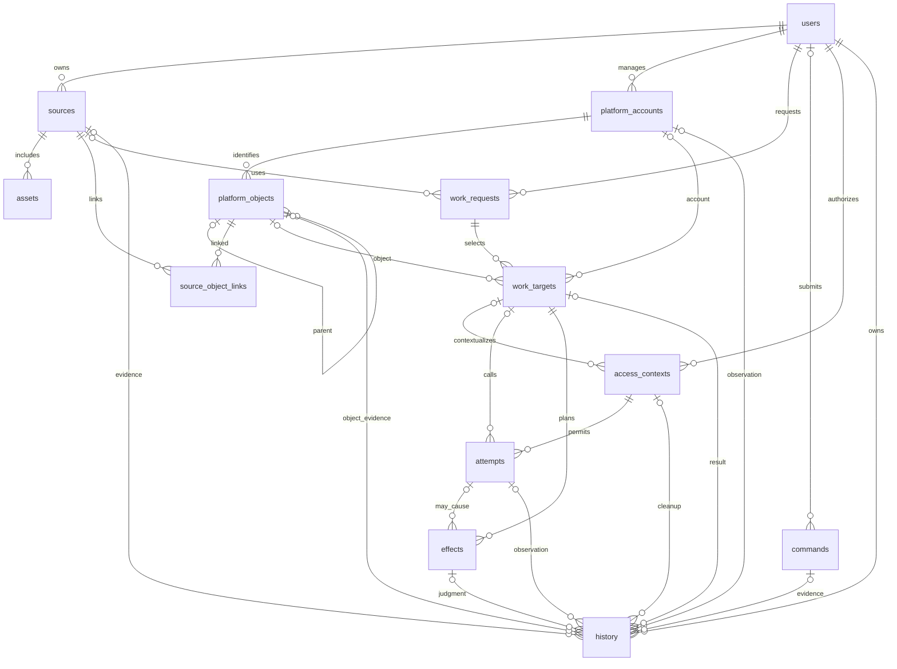

# 찾아you 최소 논리 DB V4 — V3.1-R4 저장 요구 재도출 및 비교

<!-- Generated by tools/project_docs.py. Sources: docs/artifacts/planning/lesson-registration-20261126/integrated/db-minimal-v4.json -->
[원본](../../artifacts/planning/lesson-registration-20261126/integrated/db-minimal-v4.json)에서 생성한 프로젝션입니다. 변경은 원본에 반영한 뒤 `uv run --no-project python tools/project_docs.py`로 재생성합니다.

V3.1-R4 논리 검토 기준으로 R01 요청에 따른 독립 DB 비교 후보. 최종 승인/구현/실서비스 허용이 아니다.

## 결론 및 대안 비교
기존 13개를 정답으로 전제하지 않고 R4 사용자 행동에서 저장 요구·수명·동시성/삭제 책임을 재도출했다. 기본 13개를 유지하되 7개 명시 필드와 제약을 보완하는 V4를 권장한다. 이는 수학적 최솟값을 증명한 것이 아니라 현행 기능을 유지하면서 검증 가능한 정본 경계를 선택한 후보이다.

| 대안 | 테이블 수 | 장점 | 문제 | 판정 |
| --- | --- | --- | --- | --- |
| 8개 통합형(개념 대안) | 8 | 표면 테이블 수 감소, 초기 CRUD 단순 | 첨부 권리·정확 계정/객체/링크, 호출·효과·증거가 다형 JSON/타입에 섞임. 독립 FK, 동시성, 삭제, proof 및 scope 검증을 앱이 재구현. 별도 상태/인덱스/제약 요구는 사라지지 않음. | 비권장; 논리 기능 축소 또는 동일 복잡성 이관 |
| 12개 연결 단순형 | 12 | 한 원본→여러 개별 게시물이라는 확정 1:N 제약이면 직접 FK가 단순 | 한 공유 객체를 복수 원본과 연결할 수 없고 직접 연결/해제 시 외부 객체와 관리 연결 수명이 결합. 공유 프로필 객체는 단순 원본 소유로 볼 수 없음. 정확 객체의 단일 원본 제한은 아직 제품 결정/검증 없음. | 조건부 채택 후보; 단일 원본 제약이 증명되면 12개 재평가 |
| 기존 V3/R4 재대조 | 13 | 최신 원본, 독립 업무/시도/효과/관측, 권리·복구 경계 포함 | R2 기준 상세 구조에서 R4 정책 관계·계정 한도 claim·인증 현재성·원본별 근거의 구체 저장/조회 계약이 모호 | 비교 기준 |
| V4 R4 재도출 권장안 | 13 | 기존 의미 경계와 최소 데이터 유지. 7개 명시 필드로 현재성·다중 scope·관계 근거를 구체화. 새 관리자·플랫폼 규칙·원본 이력 테이블 없음. | typed JSON 참조·정책 근거 및 원자성의 실제 PostgreSQL 검증 필요; 링크 N:M 필요와 history relation query는 후속 검증 | 현행 범위에서 권장 후보, 최종 승인 아님 |
| 이전 V2 | 17 | 다수 버전/연결/실행 기록 직접 분리 | 과거 전체 원본 보존은 현재 제품 범위 아님. 조회·전송 통합과 effects를 통한 fence로 별도 정본 중복 감소 가능. | 이력 유지; 현재 범위에 채택하지 않음 |
| 14개 관계 또는 인증 확장 | 14 | 독립 관계 검색/권리/해제 또는 장기 인증의 lifecycle이 실제 기능이면 별도 관리 용이 | 현재 장기 인증 저장/별도 관계 관리 기능·검증된 cardinality 요구가 없음. 둘 모두 필요하면 각각 별개 결정. | 조건부 확장만; 기본 13개에 포함하지 않음 |

V3 대비 136 → 143 필드(7개 추가), 기존 테이블 제거/추가 없음. V2 17개는 이력. 12개 대안은 단일 원본 관계가 입증될 때 재평가.

## 저장 요구사항과 연결
| 정보 요구 | 업무 | 저장 책임 | 규칙 |
| --- | --- | --- | --- |
| 강사 여러 명·원본 여러 개 | SW-01, SW-02, SW-03, SW-07 | users, sources | owner_id 1:N. 강사별 여러 원본 ID, 동일 source 최신본 1개. |
| 원문·자료 및 원본 저장/보완 | SW-04, SW-05, SW-06, SW-07, SW-08 | sources, assets, commands, history | 원문/확정 사실 content, 현재 draft 1개 후보, 자료 권리, 저장 key와 결과 원자 커밋. 이력 전체 저장 금지. |
| 계정/정확 등록물과 내부 연결 | SW-15, SW-17, SW-18, SW-34 | platform_accounts, platform_objects, source_object_links, commands, history | 계정/객체/연결은 각각 별도 수명, 비밀 보관 없음. |
| 플랫폼별 정보 준비 및 선택 | SW-09, SW-10, SW-11, SW-12, SW-13, SW-19, SW-20, SW-21, SW-32 | sources, work_requests, work_targets, assets, platform_accounts, platform_objects, history | 고정 규칙은 설정/코드, 현재 입력안/검증·정확 범위만 plan. 제한/보류 및 이유 포함. |
| 직접 인증, 권한 및 선행 업무 | SW-14, SW-15, SW-16, SW-33, SW-34, SW-35, SW-36 | users, platform_accounts, access_contexts, commands, history | 실제 인증 비밀 저장 없음, 직접 처리 결과/근거만. 정확 문맥·세대·차단/정리 확인. |
| 승인과 대상별 수락 | SW-21, SW-22, SW-23, SW-24 | work_requests, work_targets, commands, access_contexts, effects | 선택과 실제 수락 분리. 정확 실행 대상 집합/고정 plan 및 승인 원자 커밋; 승인 전 stale. |
| 등록·수정·갱신 및 안전 실행 | SW-24, SW-25, SW-26, SW-27, SW-28, SW-29 | work_targets, platform_accounts, platform_objects, source_object_links, attempts, effects, history | 호출/효과/관측 분리, 일부 성공 보존, 실제 계정/객체/공유 정책 claim 확인. |
| 상태 조회·결과·후속 및 복귀 | SW-28, SW-29, SW-30, SW-31, SW-32, SW-35 | work_requests, work_targets, commands, attempts, effects, history, platform_objects, source_object_links | 최신 적격 관측과 조회 실패 구분, 목표/결과/종료 분리, 새 쓰기는 새 승인과 안전 조건. |

## ERD — 논리 관계


ERD는 주요 FK 관계를 표시한다. 상세 FK, 복수 object/계정·prior 참조와 종류별 무결성은 원본 필드 사전 참조. 외부 실제 관계 cardinality는 미검증.

## 테이블별 역할·수명·분리 근거
| 테이블 | 역할 | 수명 주기 | 분리 필요성 |
| --- | --- | --- | --- |
| users | 사용자별 레슨 및 외부 관리 정보 격리, 본인 재확인·권리 제한. 로그인 자체는 인증 서비스. | 가입/검증 → active/restricted/retired → 필요 참조 해소 후 폐기 | 소유권이 다른 모든 데이터의 기준. 없으면 본인 분리와 재접속 식별 불가. |
| sources | 한 강사가 레슨 종류마다 독립 원본 ID를 갖고 최신 원문/정규 사실 및 필요 현재 draft를 저장. | 생성 → 명시 저장/CAS → 변경 → retire → 참조·정책 해소 후 삭제 | 한 원본을 여러 플랫폼 업무가 사용; 사용자 행 또는 업무에 넣으면 여러 원본의 독립 수정·재사용이 불가. |
| assets | 파일 식별/digest, 저장 위치와 권리 상태. 파일 바이너리는 object storage 후보. | 등록 → 사용/승인 참조 → 권리 제한/제거 → 필요한 참조 해소 후 폐기 | 파일과 텍스트 수정 주기가 다르고 승인 이후에도 동일 파일을 보호해야 한다. JSON 배열에만 넣으면 역참조 및 권리 검증 부담이 커진다. |
| platform_accounts | 어떤 강사가 어떤 플랫폼의 확인된 계정을 관리하는지. 토큰·비밀번호·쿠키 아님. | 정확 식별/연결 → 이용/검증 → 해제 → 새 연결/권리 처리 | 하나의 계정에 여러 등록물·업무가 있고 객체 없이도 계정 연결·해제가 존재. 한도·공유 프로필 효과의 계정 기준. |
| platform_objects | 확인된 상품·클래스·게시물·프로필·서비스 관계의 식별, 필요한 parent 관계. | 독립 식별 → 연결/조회/수정/갱신 → 현재 상태 관측; 삭제는 외부 사실/내부 보존 정책에 따름 | 직접 등록된 글은 우리 업무 없이 존재; 같은 객체에 여러 작업·관측이 이어진다. URL/표시명은 정확 식별 대체 아님. |
| source_object_links | 정확 원본↔정확 외부 객체의 현재 연결/해제. | 검증된 내부 연결 → 해제/재연결 → 필요 참조 해소 후 폐기 | 원본과 외부 객체의 생명주기는 독립; 동일 공유 객체가 복수 원본과 연관될 수 있으나 실제 필요/허용은 미확인. 1:N 제품 제약을 채택할 경우만 통합 검토. |
| work_requests | 최초 선택한 플랫폼 묶음, 원본 revision, 정확한 대상별 승인안 digest, 논리 내용/범위 승인 및 수락 시각. | 준비 → 제시 → 수락/동결 → 모든 수락 대상 종료 후 close | 사용자가 한 번에 선택·승인하는 묶음과 실제 대상별 실행 상태는 별개. 원자 수락 및 보류/제외 표시. |
| work_targets | 업무 유형·대상·입력안·오류·준비 상태·수락 이후 동결된 필요한 계획·개별 종료. | 선택 → 준비/보류/제외 → 수락/실행 → 종료; 새 의도는 새 target | 플랫폼별 필수·가격·효과·실패 독립. 하나의 요청 JSON으로 합치면 동시 실행·잠금 및 대상별 FK/판정이 어려워진다. |
| commands | 저장·연결·해제·수락·권리 요청 등 동일 명령 key/digest/결과. | pending → committed/rejected/no_commit_proven; 확인된 동일 요청 재조회; 보존 기한 이후 폐기 | 등록 업무가 없는 원본 저장과 연결도 응답 유실 복구 필요. history append-only와 현재 key의 원자적 일회 처리 책임이 다름. |
| access_contexts | 정확 owner·플랫폼·기대/확인 계정·호출 문맥 generation·목적·권한·만료·폐기 의무. 비밀 없음. | 발급 → 직접 인증/검증 → 차단 → 폐기 확인/불명; 새 인증 새 ID | 한 업무에서 여러 인증 가능, 한 인증 문맥에서 여러 허용 호출 가능. 화면 이탈과 폐기 확인 독립. |
| attempts | 하나의 읽기 또는 쓰기 호출의 목적·정확 대상·순서·상태/시각. | 예약/요청 → 시작 → 응답/종료/불가; 늦은 관측은 history | 전송 성공과 외부 효과 성공은 다르다. 조회는 효과 생성 없이 존재하고 한 쓰기 호출이 여러 효과를 가질 수 있다. |
| effects | 개별 변경의 승인 의도·정확 scope·복수 경합 claim·미시도/예약/진행/확인/불명/분쟁. | 예정 → 예약/시작 → 독립 확인 또는 미발생/불명; 차단 상태 유지/증거 기반 해소 | 한 호출에서 상품 저장·이미지·심사 접수 등 결과가 다를 수 있다. 확인된 효과 재실행 및 unknown 재시도 차단. |
| history | 독립 관측·결과·정확 정책/관계 근거·최소 오류/권리/폐기·품질 관측. | 적격 사건 append → 최신 판정 projection; 보존 근거 만료 후 삭제/익명화 | 외부 native 상태/업무 결과/모집 목표·조회 실패·뒤늦은 근거가 서로 다름. 과거 원본 전문 저장 금지. |

## 상세 데이터 사전
### users

| 필드 | 후보 타입 | 의미 |
| --- | --- | --- |
| id | uuid PK | 내부 사용자 |
| issuer | text | 서비스 인증 제공자 |
| subject | text | 검증된 제공자 사용자 ID |
| state | text | active/restricted/retired |
| created_at | timestamptz | 생성 시점 |
| retired_at | timestamptz? | 접근 종료 시점 |

무결성: UNIQUE(issuer,subject); 제공자가 검증한 식별자만 수락; 삭제/보존 정책은 미확정

### sources

| 필드 | 후보 타입 | 의미 |
| --- | --- | --- |
| id | uuid PK | 레슨 원본의 안정된 ID |
| owner_id | uuid FK users | 강사 |
| content | jsonb? | 해당 레슨의 최신 저장 원문(재사용이 필요한 사용자 원문만), 정규화된 사실·불명/출처·금액 단위·커리큘럼·권리/공개 범위·첨부 참조를 typed JSON으로 보존. 이전 전체 원본 없음. |
| revision | integer | 최신 저장본 변경 번호. optimistic CAS와 준비 stale 판정만; 원본 버전 FK 아님. |
| draft | jsonb? | 현재 미저장 편집 1건, 기준 revision·편집 generation·추출 요청 ID·입력/문제·자료 |
| state | text | draft_only/managed/retired |
| created_at | timestamptz | 생성 시점 |
| updated_at | timestamptz | 마지막 명시 저장 시점(미저장 시 생성 시점) |

무결성: 저장 시 owner·base revision·draft generation 검사/CAS 후 최신 content 교체 및 revision 증가, draft 정리와 command 영수증 원자 기록; 오래된 추출 응답은 무시; 신규 미저장 shell은 저장 원본 목록에 미표시; 한 원본당 서버 draft 하나(충돌 시 타 편집 덮어쓰기 금지)

### assets

| 필드 | 후보 타입 | 의미 |
| --- | --- | --- |
| id | uuid PK | 불변 파일 ID |
| source_id | uuid FK sources | 소유 원본(사용자는 원본에서 유도) |
| storage_key | text | 비공개 저장소 키 |
| digest | text | 파일 동일성·무결성 |
| media_type | text | 파일 유형 |
| size_bytes | bigint | 파일 크기 |
| rights_state | text | 사용 허용/불명/철회 상태 |
| rights_detail | jsonb | 공개/사용 허용 범위 및 근거 |
| created_at | timestamptz | 업로드 시점 |

무결성: 파일 변경은 새 ID; content/draft의 첨부 목록은 해당 source의 asset만 참조(역참조 검사 포함); 현재 사용 역할/순서는 content.attachments에만 기록; 승인 plan에는 필요한 asset ID·digest·사용 범위를 고정; 권리 철회 시 새 사용 제한; 현재 원본에서 제거해도 아직 필요한 승인/실행 참조를 임의 삭제하지 않음; 실제 보존/삭제 정책 별도

### platform_accounts

| 필드 | 후보 타입 | 의미 |
| --- | --- | --- |
| id | uuid PK | 내부 계정 관리 ID |
| owner_id | uuid FK users | 강사 |
| platform_key | text | 플랫폼 |
| environment | text | mock/live 구분 |
| identity_namespace | text | 계정 ID의 유효 범위 |
| native_account_key | text | 정확하게 확인된 외부 계정 ID |
| state | text | linked/retired |
| verified_at | timestamptz | 계정 식별 확인 시점 |
| updated_at | timestamptz | 연결 상태 변경 시점 |

무결성: UNIQUE(owner_id,environment,platform_key,identity_namespace,native_account_key); 연결 해제 시 기존 접근 문맥 차단 및 폐기 의무 기록; 재연결로 옛 접근 문맥을 활성화하지 않음; 관리 연결≠실제 접근 권한; 쿠키/비밀번호/토큰 없음; owner별 관리 연결 고유성과 경합 범위는 별개. 전역 정규 계정 key=(environment,platform_key,identity_namespace,native_account_key); 동일 key의 여러 owner 연결은 같은 잠금/한도 claim을 공유하며 다른 owner 데이터 공개·권한 부여 아님. 정규 식별 불명은 실행 보류.

### platform_objects

| 필드 | 후보 타입 | 의미 |
| --- | --- | --- |
| id | uuid PK | 서비스 내부 객체 ID |
| account_id | uuid FK platform_accounts | 정확 외부 계정 |
| parent_id | uuid? FK platform_objects | 검증된 상위 프로필/상품 등 |
| kind | text | product/class/profile/service/post 등 |
| identity_namespace | text | 객체 식별 범위 |
| native_object_key | text | 검증된 외부 객체 ID |
| locator | jsonb? | 확인된 관리/공개 위치 |
| verified_at | timestamptz | 정확 식별 확인 시점 |

무결성: UNIQUE(account_id,kind,identity_namespace,native_object_key); 부모 동일 계정, cycle 금지; 확인 전 후보는 target.plan에만 보존; URL/표시명/순서만으로 정확 식별 가정 금지; 현재 외부 상태는 history 적격 관측에서 조회

### source_object_links

| 필드 | 후보 타입 | 의미 |
| --- | --- | --- |
| id | uuid PK | 관리 연결 ID |
| source_id | uuid FK sources | 원본 |
| object_id | uuid FK platform_objects | 외부 객체 |
| state | text | linked/retired |
| linked_at | timestamptz | 연결 시점 |
| ended_at | timestamptz? | 해제 시점 |

무결성: 동일 owner 및 정확한 객체/권한 확인; 활성 (source_id,object_id) UNIQUE; 해제 및 재연결 이력 보존; 외부 객체 삭제하지 않음

### work_requests

| 필드 | 후보 타입 | 의미 |
| --- | --- | --- |
| id | uuid PK | 업무 묶음 ID |
| owner_id | uuid FK users | 요청자 |
| source_id | uuid? FK sources | 선택한 원본(원본이 필요 없는 조회/관리 업무는 NULL) |
| source_revision | integer? | 선택/승인 기준 원본 revision |
| environment | text | mock/live |
| selection_revision | integer | 선택·검토안 변경 번호 |
| review_state | text | preparing/presented/frozen/closed |
| approval | jsonb? | 내용/범위 논리 승인 증거와 시각, 직접 동의 확인 참조, 정확 실행 대상 집합 및 plan digest; 각 target의 전체 입력값은 중복 저장하지 않음. |
| created_at | timestamptz | 요청 생성 |
| accepted_at | timestamptz? | 쓰기 업무 수락 시점 |

무결성: 전체 선택 대상의 처분과 plan은 work_targets가 정본; approval에 동일 입력값 반복 저장 안 함; 양 승인+정확한 target 집합/plan digest+command receipt를 원자 수락; 0 ready면 쓰기 수락 없음; 동결 후 선택/승인 변경 금지; 미수락 원본 변경은 revision 갱신 후 준비 재검증; 읽기/내부 업무는 쓰기 승인 요구하지 않음

### work_targets

| 필드 | 후보 타입 | 의미 |
| --- | --- | --- |
| id | uuid PK | 대상 업무 ID |
| request_id | uuid FK work_requests | 상위 묶음 |
| selection_key | text | 묶음 내 선택 항목 |
| platform_key | text | 대상 플랫폼 |
| operation_key | text | CREATE/UPDATE/RENEW/READ/STATUS/LINK 등 정확 업무 |
| disposition | text | selected/ready/accepted/held/excluded 등 검토 처분 |
| account_id | uuid? FK platform_accounts | 확인된 대상 계정 |
| object_id | uuid? FK platform_objects | 기존 정확 대상(신규는 NULL) |
| prior_target_id | uuid? FK work_targets | 잔여/반려 수정 등 이전 업무 |
| prepared_source_revision | integer? | 입력안 계산에 사용한 원본 revision |
| prep_generation | integer | 늦은 준비 응답 차단 |
| prep_state | text | unprepared/preparing/issues/ready/held/excluded/stale/consumed |
| profile_ref | text? | 재현 가능한 플랫폼 업무 규칙 버전 |
| plan | jsonb | 준비 단계에 필요한 플랫폼 고유 값·정규 사실 참조·단위 변환·보완·검증 상태·현재 정책/객체·효과 계획. 수락 뒤에는 실제 업무에 필요한 승인값/자료/digest·정확 범위와 규칙 버전만 불변. 과거 전체 원본 복사 금지. |
| lifecycle | text | not_accepted/accepted/running/fencing/ended |
| ended_at | timestamptz? | 실행 종료(결과 성공과 별개) |

무결성: UNIQUE(request_id,selection_key); source revision/계정/객체/owner/env 정합; 미확인 후보는 plan 안에만, 정확 binding 전 쓰기 금지; 승인 전 stale 조건 검사, 승인 후 필요한 입력/자료만 freeze; 새 변경/재심사/갱신은 새 대상/새 승인; 결과 객체는 effects.object_id와 history에서 유도

### commands

| 필드 | 후보 타입 | 의미 |
| --- | --- | --- |
| id | uuid PK | 명령 ID |
| owner_id | uuid? FK users | 사용자(최초 가입 전 검증 주체만 NULL) |
| principal_key | text | 검증된 서비스 주체 키 |
| kind | text | SAVE_SOURCE/LINK/UNLINK/ACCEPT/RIGHTS 등 |
| request_key | text | 호출자가 재사용할 멱등 키 |
| request_digest | text | 정규화된 요청 내용의 digest |
| state | text | pending/committed/rejected/no_commit_proven |
| receipt | jsonb? | 정확 결과 ID/revision/거절 사유; 과거 원본 내용 보존하지 않음 |
| created_at | timestamptz | 접수 시점 |
| resolved_at | timestamptz? | 정본 결과 기록 시점 |

무결성: UNIQUE(principal_key,kind,request_key); 동일 digest만 기존 결과 확인, 다르면 거절; DB 행 잠금과 최종 상태 CAS로 업무와 영수증 동일 트랜잭션; no_commit_proven은 이전 지연 커밋을 봉쇄한 경우만; 서버 미기록이면 호출자의 owner-scoped 기존 키 보존 필요; pending 상태에서 무조건 재실행 금지

### access_contexts

| 필드 | 후보 타입 | 의미 |
| --- | --- | --- |
| id | uuid PK | 접근 문맥 ID(새 인증 시 새 ID) |
| owner_id | uuid FK users | 요청자 |
| target_id | uuid? FK work_targets | 목적 업무(계정 관리 등은 NULL) |
| platform_key | text | 플랫폼 |
| expected_account_id | uuid? FK platform_accounts | 기대 계정 |
| verified_account_id | uuid? FK platform_accounts | 실제 확인된 계정 |
| purpose | text | 준비/계정 확인/업무 실행/조회 |
| state | text | human/verifying/verified/blocked |
| scope | jsonb | 허용 읽기·쓰기 범위/근거/호출 문맥 |
| expires_at | timestamptz | 만료 시점 |
| blocked_at | timestamptz? | 차단 시점 |
| cleanup | jsonb | 한 문맥의 자원별 폐기 의무 및 pending/confirmed/unknown |
| context_key | text | 같은 owner·정확 호출/준비/조회 목적의 안정 문맥 키. 비밀이나 URL grant 아님. 다른 독립 대상의 인증을 차단하지 않도록 범위 분리. |
| generation | integer | 같은 context_key 안에서 단조 증가하는 인증 세대; 접근 ID와 함께 실행·만료·복구의 현재성 검증. |

무결성: 접근 ID 및 state로 이전 문맥 차단(재활성화 금지); 기대 계정·실제 계정 일치, 목적/범위/만료/권한 매번 검사; 차단과 폐기 의무 원자 기록; 이전 폐기 불명은 새 인증으로 해소되지 않음; 자원 식별자는 비밀 아닌 메타만; 인증 비밀 저장 금지 / UNIQUE(owner_id,context_key,generation); 새 문맥의 현재성은 해당 문맥 단위로 원자 확인. 동일 문맥의 이전 generation은 새 접근 불가. 별도 독립 문맥은 유지. blocked 및 cleanup 상태는 분리; ID·metadata 외 credential 금지.

### attempts

| 필드 | 후보 타입 | 의미 |
| --- | --- | --- |
| id | uuid PK | 개별 외부 호출 시도 ID |
| target_id | uuid? FK work_targets | 관련 업무(계정 확인만 예외) |
| access_id | uuid FK access_contexts | 정확 접근 문맥 |
| object_id | uuid? FK platform_objects | 읽기/쓰기의 기존 대상 |
| kind | text | read/write |
| purpose_key | text | 상태조회/식별/독립 readback 또는 정확 전송 경계 |
| attempt_key | text | 동일 호출 식별 |
| scope | jsonb | 고정 계정/객체/slot/목적/범위와 승인된 실행 또는 읽기 계획 |
| sequence_no | bigint? | 정확 조회 대상·목적 내 요청 순서(read) |
| state | text | read: pending/running/observed/unavailable; write: reserved/started/sealed |
| requested_at | timestamptz | 요청·예약 시점 |
| started_at | timestamptz? | 호출 시작 |
| finished_at | timestamptz? | 호출 종료 |
| failure_reason | text? | 호출 오류 코드 |

무결성: UNIQUE(attempt_key); kind별 CHECK 및 목적/owner/env/account/target 일치; write는 target 필수, 승인된 효과 전체를 reserve하고 시작 상태 CAS로 같은 시도 일회 시작; read는 정확 목적/범위/순번 및 권한 검증, effect 확인 목적은 scope의 적격 effect 참조로 제한; 관측 결과 history append; read/write 결과를 외부 효과 성공으로 해석하지 않음

### effects

| 필드 | 후보 타입 | 의미 |
| --- | --- | --- |
| id | uuid PK | 개별 효과 시도 ID |
| target_id | uuid FK work_targets | 승인 업무 |
| attempt_id | uuid? FK attempts | 해당 쓰기 시도(미시도는 NULL) |
| prior_effect_id | uuid? FK effects | 이전 효과 시도 |
| rule_key | text | 승인 계획의 효과 규칙 |
| logical_effect_key | text | 정확 업무의 의미 효과 키 |
| intent_digest | text | 승인 변경 내용/조건 digest |
| root_key | text | 정규 대상 또는 신규 의도 slot |
| scope_path | text | 겹침 판정을 위한 검증된 변경 범위 |
| object_id | uuid? FK platform_objects | 정확 확인된 실제 효과 객체(slot→객체 연결) |
| required | boolean | 완료에 필수 효과 |
| state | text | not_attempted/reserved/in_flight/confirmed/none_confirmed/unknown |
| disputed | boolean | 상충 근거에 따른 차단 |
| updated_at | timestamptz | 현재 판정 변경 시점 |
| claims | jsonb | 정규 scope 외에 동시에 획득해야 할 계정 한도/일자·공유 정책 claim 목록. typed key, rule version, observation ref, 반영/미반영 판정; 비어 있으면 추가 claim 없음. |

무결성: 대상 내 동일 효과 후보 중복 금지; attempt는 같은 target의 write, 여러 effects가 같은 attempt에 연결 가능; 정규 외부 계정 키를 통한 전역 잠금 하 모든 활성/불명/분쟁 효과 및 slot→확인 객체 관계와 scope 겹침 검사·원자 reserve; unknown/disputed 지속 저장; 권한 차단 뒤 시작 금지; 종료 후 늦은 증거는 history로 판정 보완만; 확인/불명 동일 효과 반복 금지, 새 시도는 새 승인+안전한 미발생/미시도 또는 새 의도 및 미해결 경합 없음 / claims는 종류별 schema(정규 account/정확 quota/기간 및 관측·예약 식별) 검증; 한 효과의 모든 scope/claim을 정규 계정 잠금 경계에서 동시에 획득. 최신 적격 관측에 이미 반영됐다는 증거 전 내부 미반영/불명 예약 보수적 포함. 외부 경합/이중 계상 판단 불가 시 hold; 내부 잠금만으로 외부 서버 한도 보장하지 않음. 동일 정규 계정의 모든 owner별 연결·관련 effects를 대상으로 조회/잠금/예약하며 owner_id 또는 내부 account_id를 quota key에 넣지 않는다. 총량 한도와 일일 한도는 종류별 기간을 구분하고 해당 요청의 모든 claim을 원자 획득한다.

### history

| 필드 | 후보 타입 | 의미 |
| --- | --- | --- |
| id | uuid PK | 기록 ID |
| owner_id | uuid FK users | 소유 사용자 |
| kind | text | response/observation/evidence/effect_judgment/target_result/goal/rights/audit 등 |
| target_id | uuid? FK work_targets | 관련 업무 |
| attempt_id | uuid? FK attempts | 관련 호출 |
| effect_id | uuid? FK effects | 관련 효과 |
| object_id | uuid? FK platform_objects | 정확 외부 대상 |
| access_id | uuid? FK access_contexts | 관련 접근 문맥 |
| command_id | uuid? FK commands | 관련 내부 명령 |
| version_no | integer? | 해당 판정 종류·대상별 증가 버전 |
| observed_at | timestamptz? | 실제 관측 시각 |
| recorded_at | timestamptz | 수신/기록 시각 |
| payload | jsonb | 종류별 검증된 최소 관측값·native 상태·결과/사유·권리 메타 |
| proof_ids | uuid[] | 적격 불변 근거 ID |
| source_id | uuid? FK sources | 원본 자체의 권리/삭제/정정 근거에 직접 연결. target 없이도 정확 원본을 찾고 보존/삭제 검토. |
| account_id | uuid? FK platform_accounts | 계정 전체 관측·한도·권리 관련 기록의 정확 계정. object가 없더라도 저장. |
| related_object_id | uuid? FK platform_objects | 동일 클래스 관계 등 두 번째 정확 객체 참조. 사용자 확인 또는 적격 근거 없이 임의 설정 금지. |
| scope_key | text? | kind별 정규 범위 키(계정/관측 목적/관계 쌍/정책 범위). relation 또는 quota 관측은 필수. version_no 및 관측 시각과 함께 최신 근거 투영. |

무결성: append-only; kind별 필수 FK/값 검증; 동일 owner·대상·목적의 참조와 proof_ids 존재/적격/불변 검증(DB trigger 또는 등가 강제 검증, 실제 정책 검토); effect/result 판정 버전 원자 증가; response와 독립 observation 별개; 최신 조회 실패가 마지막 정상 관측을 삭제하지 않음; 과거 원본 전체/인증 비밀/불필요 원문 저장 안 함 / kind별 typed FK 요구: source 권리 사건 source_id, quota 계정/범위와 시각, 관계 사건 양쪽 정확 object 또는 명시 신규 target+기존 object·scope_key·근거. 동일 owner/env/허용 범위 검증. 동일 원본/제목/가격만으로 동일 클래스 관계 생성 금지. 최신 관계 확인/철회/불명은 정확 scope 및 적격 증거로 판정; 관계 이벤트의 버전 증가/충돌 hold. / append-only는 업무 처리 중 임의 수정 금지이며 보존 기한 종료·권리 처리 시 합법적 삭제/익명화를 막는 요구 아님. JSON/배열 참조 검증 및 물리 삭제 계획은 실제 제약으로 후속 시험.

## V3 대비 변경된 7개 필드
| 테이블.필드 | 필요 이유 | 의미 |
| --- | --- | --- |
| access_contexts.context_key | 이전 세션을 다시 쓰지 않고 같은 호출의 현재 문맥 확인 | 같은 owner·정확 호출/준비/조회 목적의 안정 문맥 키. 비밀이나 URL grant 아님. 다른 독립 대상의 인증을 차단하지 않도록 범위 분리. |
| access_contexts.generation | R4-05 오래된 세션 차단 | 같은 context_key 안에서 단조 증가하는 인증 세대; 접근 ID와 함께 실행·만료·복구의 현재성 검증. |
| effects.claims | R4-02 계정 전체 한도와 복수 조건의 원자 예약 | 정규 scope 외에 동시에 획득해야 할 계정 한도/일자·공유 정책 claim 목록. typed key, rule version, observation ref, 반영/미반영 판정; 비어 있으면 추가 claim 없음. |
| history.source_id | UJ-10 원본 수명·역참조 | 원본 자체의 권리/삭제/정정 근거에 직접 연결. target 없이도 정확 원본을 찾고 보존/삭제 검토. |
| history.account_id | R4-02 계정 전체 한도/공유 효과 | 계정 전체 관측·한도·권리 관련 기록의 정확 계정. object가 없더라도 저장. |
| history.related_object_id | R4-02 타 플랫폼 동일 클래스 관계 | 동일 클래스 관계 등 두 번째 정확 객체 참조. 사용자 확인 또는 적격 근거 없이 임의 설정 금지. |
| history.scope_key | R4-02 정확 최신 관계/정책 관측 선택 | kind별 정규 범위 키(계정/관측 목적/관계 쌍/정책 범위). relation 또는 quota 관측은 필수. version_no 및 관측 시각과 함께 최신 근거 투영. |

업무 외부 규칙/필수·선택 분류·공개 정책은 버전된 설정 및 근거 원장에 둔다. 직접 정산·약관 등은 민감값 아닌 선행 상태만; R02 86개 후보 중 사용자 확인 메타는 운영 사용자 입력값이 아니다. 실제 공식 서버 필수값/허용 미검증.

## 원본 저장 예시
강사 1명은 여러 sources 행을 갖는다. 각 행에는 최신 content 및 revision이 있고 자료는 assets FK로 연결한다. 원본 원문/정규 사실은 재사용에 필요한 것만 저장; 과거 전체 content를 승인 plan에 복사하지 않는다.

```json
{
  "schema_version": 1,
  "raw_text": "보컬 1:1 대면 레슨, 120분씩 6회, 총 150000원",
  "facts": {
    "title": "보컬 레슨",
    "delivery": {
      "format": "one_to_one",
      "mode": "in_person"
    },
    "price": {
      "amount": 150000,
      "currency": "KRW",
      "unit": "total_package",
      "session_count": 6,
      "minutes_per_session": 120,
      "tax_state": "unconfirmed"
    },
    "curriculum": [],
    "location": {
      "public_area": null,
      "private_address": null,
      "disclosure": "not_approved"
    },
    "contact": {
      "public_channel": null,
      "disclosure": "not_approved"
    }
  },
  "attachments": [],
  "fact_status": {
    "price": "user_confirmed_example",
    "tax": "unknown"
  },
  "note": "합성/예시. 실제 서버 필수값 및 허용 아님."
}
```

합성 예시의 150000원÷(6×2시간)=시간당 12500원은 변환 사례이며 공식 필수값/모든 플랫폼 단위 보장 아님. 가격·회차·세금·공개 값은 정확 승인과 정책 확인.

## 조건부 인증 저장과 남은 판단
platform_accounts 식별/관리 관계만, access_contexts 일시적 업무 권한/폐기 메타만. 장기 credential 없음.

먼저 인증 공급자의 관리형 vault 이용; 계정에 불투명 reference 0..1만 필요하면 기존 계정에 선택적 필드 추가 후보. 복수 grant/범위/만료/폐기 수명이 독립이면 별도 credential_bindings 14번째 후보. 원문 비밀은 앱 DB/로그/증거에 저장하지 않음.

채택 전 필요: 공식 허용, scope·만료·회전·권한철회·암호화/키 관리·감사·접근 제한, 연결 해제 시 폐기, 재인증 및 사고 대응 검증.

| 쟁점 | 발견 | 권장 조치 |
| --- | --- | --- |
| 기존 V1.0 AT-01 | '새 불변 revision'이 AX03/R4의 최신본 원칙과 함께 읽힐 때 과거 전문 보존으로 오해 가능. | 원자 CAS로 최신 content 교체 및 revision 번호 증가, 명령 영수증 기록으로 명시. 스토리 브랜치는 이번 DB 검토에서 수정하지 않음. |
| source_object_links | 한 정확 외부 객체와 복수 원본의 제품상 관계 허용/필요성 아직 미확인. | 현재 안전한 독립 링크 유지; 팀 검토에서 단일 원본 연결로 충분하다는 근거 확보 시 12개 후보 재검토. |
| history typed relationship / proofs | 탈잉 동일 클래스 증거, 복수 객체 관계, JSON 배열 FK/역참조/삭제의 실효성 미검증. | typed ref 및 exact relation scope, 현재 근거 조회 인덱스와 제약 검증. 독립 관계 저장/대규모 조회 요구가 입증되면 별도 relation table 검토. |
| access_contexts | 장기 인증 저장이 필요한지 및 공식 API/위임 가능 여부 미확인. | 기본 비밀 미보존. 필요성·권한·동의·보안/폐기 승인 시 vault/opaque credential_ref 조건부 설계, 기본 테이블 변경 없음. |
| effects/attempts | DB 내부 일회 자격과 실제 외부 효과의 분산 원자성은 다름; 계정 한도 외부 경합 미확인. | 정규 계정 lock, 모든 claim 원자 예약, 독립 증거 기반 판정; DB 경쟁/장애 테스트 전 승인 보류. |

## 추적·검증 및 기존 구현 영향
12 여정, 36 공통 업무, 32 오류, 17 상태축, 44 플랫폼 업무, 45 효과, 38 필드 그룹, R02 후보 86(52+34)의 저장 경계를 원본에 연결했다. 해당 ID/구조 대조이며 실제 의미·필수값·권한·DB 실행 완전성의 증명은 아님.

- PASS — R4 source
- PASS — 13 unique tables
- PASS — all fields unique
- PASS — FK targets
- PASS — 7 explicit additions
- PASS — 12 journeys
- PASS — 36 SW references
- PASS — 32 error references
- PASS — 17 logical state axes
- PASS — 44 platform work rows
- PASS — 45 effect contract IDs
- PASS — 38 field groups
- PASS — 86 R02 input candidates
- PASS — all mapping table references
- PASS — R4 clause storage references
- PASS — no credential/admin/version tables
- PASS — source content/revision/draft
- PASS — conditional credential not in base

### 기존 SQLite 영향

| 기존 | 후보 | 전환 시 주의 |
| --- | --- | --- |
| sources, source_assets, assets | sources, assets | 기존 immutable chain은 owner/lineage 확인 후 최신 저장본과 필요한 승인 자료만 후보 이관; 이전 전문/미확인 권리 추정 금지. |
| registrations, jobs | work_requests, work_targets, commands, access_contexts | 기존 1:1 job → 정확 request/target, 기존 key/digest·승인값·상태 보존. auth_json 비밀 원문 이관 금지. |
| dispatch_permits, effects | attempts, effects | 토큰 원문 이관 금지, 과거 실제 효과·불명 fence key 유지; 없는 관계 추정 금지. |
| observations, evidence | history, attempts | response/independent observation/goal/result 분리; 적격 proof/시각/범위만. |
| meta | 기술 metadata | 논리 테이블 수에 포함하지 않음. |
| 신규 관리 관계 | users, platform_accounts, platform_objects, source_object_links | owner/계정/객체 식별 실증 및 정확 link 확인; 미확인 값은 격리. |

### 후속 수용 시험 (실행 전)

| ID | 상황 | 기대 결과 |
| --- | --- | --- |
| T01 | 사용자 A 두 레슨과 사용자 B 한 레슨 | 두 A source에 독립 최신 content/revision; B 조회 금지 |
| T02 | 원본 1개로 크몽·탈잉 2개 요청, 이후 원본 수정 | 두 대상의 고정 승인 입력 유지. 미수락 영향만 stale; 과거 전문 없음 |
| T03 | 원본 저장 응답 유실, 동일 key 재접속 | committed receipt 조회, 다른 digest 거절; 새 source 생성 없음 |
| T04 | 기존 글 직접 등록 후 내부 연결·해제 | 정확 기존 object 유지; link retire; 외부 effect 0 |
| T05 | 같은 공유 프로필이 두 레슨과 연관 | 정확 동일 object의 복수 관리 연결 또는 부모 관계; 독립 연결 해제; 실제 관계 미확인시 hold |
| T06 | 선택 5건 중 수락 3, 보류 1, 제외 1 | 5개 처분 보존, 수락 3만 실행; A 종료/B 불명/C 계속; 모든 수락 종료 후 close |
| T07 | 상품 저장 확인·첨부 불명·심사 미시도 | 한 attempt에 여러 effects; 확인/불명 반복 금지, 독립 남은 효과만 새 승인 후보 |
| T08 | 크몽 동일 실제 계정·서로 다른 차자유 owner의 동시 요청 2개: (a) 등록 99/100, (b) 일일 한도 1개 남음(각각 독립 시험) | owner별 내부 ID와 무관한 동일 정규 계정 claim 원자 경쟁: 각각 최대 1개 자격, 나머지 hold/fence; 반영 증거 전 보수적 예약, 외부 경합/중복 계상 불명은 둘 다 hold |
| T09 | 탈잉 미선택, 다른 플랫폼 동일 클래스 가격 변경 | 정확 관계+현재 계약/가격 증거 확인; 준비·실행 모두 불명/충돌 영향 변경 hold, 독립 저장·효과 및 정확 승인 확인된 소개 문구/다른 대상 유지; 결합 불명 범위 hold. 원본 같음만으로 관계 단정 안 함 |
| T10 | 숨고 서비스 CREATE 중 공통 활동명 제한 | 같은 계정 프로필 root 변경 effect 분리; 결합 불명 차단, 독립 서비스 추가만 허용 후보 |
| T11 | 최신 상태 조회 실패 또는 늦은 readback | attempt unavailable, 마지막 적격 history 보존; native status/목표/업무 판정 별개, ended 재개 안 함 |
| T12 | 접근 만료·재인증·이전 폐기 불명 | 새 generation, 과거 access 차단; cleanup unknown 유지, 운영 통지; 기존 효과 변경 없음 |
| T13 | 첨부 권리 철회 및 원본 삭제 | 새 접근/쓰기 제한; 필요한 승인 자료 참조를 정확 보호, 정책 해소 후 폐기; 외부 삭제 없음 |
| T14 | 공개 주소/연락처 허용 불명 또는 직접 정산/약관 | 허용 범위 전송 안 함; 직접 선행 상태만 저장, 원문 비밀 없음 |
| T15 | 뮬 갱신 요청 vs 미지원 플랫폼 | 동일 객체 정확 갱신 효과만; 미확인/다른 6개 hold, 자동 재게시 없음 |
| T16 | 운영 기준 미달·폐기 불명 | 기존 최소 관측/상태로 판정/전달; 관리자 제품·테이블 없음. 계측 미확정은 판정 불가 |

- PostgreSQL 타입/PK/FK·owner/env 일치와 활성 링크/명령 키/접근 문맥 세대 unique, typed payload schema와 역참조 검사 및 삭제 규칙.
- 실제 정규 계정 잠금·scope/claims의 경쟁 제어, 승인/영수증/예약의 원자 트랜잭션, late readback 및 crash 복구 테스트.
- R4의 16 수용 사례를 DB seed/transaction/concurrency/권한 시험으로 구현. 그 전에 플랫폼 실제 API/권한/효과를 단정하지 않음.
- 사용자 스토리 최종 검토 및 DB 후보 승인 후 physical DDL/API·이관 계획 확정. 기존 SQLite mock과 11/26 이전 실행 보류 유지.

공식 Python/Node projection --check, PostgreSQL DDL/실제 DB 테스트, 실제 외부 플랫폼 시험 및 마이그레이션 미수행. 기존 사용자 스토리 검토 PR과 main은 변경하지 않음.
