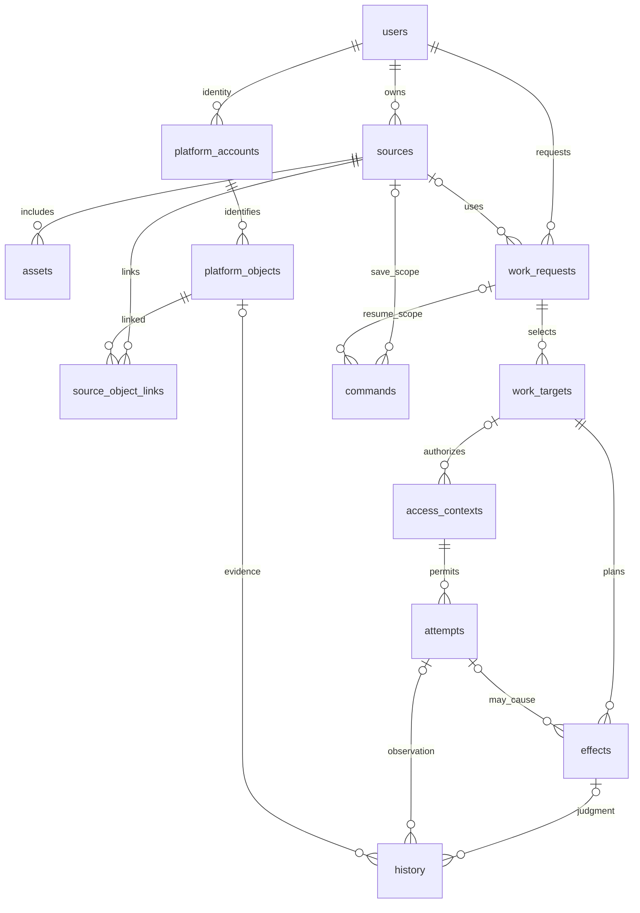

# 찾아you 최소 논리 DB V5 — 업무별 저장 필요성과 필드 전수 검토

<!-- Generated by tools/project_docs.py. Sources: docs/artifacts/planning/lesson-registration-20261126/integrated/db-minimal-v5.json -->
[원본](../../artifacts/planning/lesson-registration-20261126/integrated/db-minimal-v5.json)에서 생성한 프로젝션입니다. 변경은 원본에 반영한 뒤 `uv run --no-project python tools/project_docs.py`로 재생성합니다.

V3.1-R4 최신 R05 후속 반영본 및 R03 최종 의견을 DB 검증 입력으로 사용한 R01 검토 후보. 현재 스토리·기존 팀 자료·main은 변경하지 않는다. mock-only 및 실제 구현 보류 유지.

## 결론 및 비교
V4의 143개 기존 열을 전수 분류하고 36개 공통 업무의 읽기/쓰기/비저장 정보를 다시 연결했다. V5는 13개 테이블, 138개 후보 열(조건부 열 포함)이다. 9개 중복/불필요 열 제거·4개 누락 정보 추가, 2개 열 이름 변경. 필드 수 감소가 안전·최소성의 증명은 아니다. 현행 사용자 스토리·정책의 독립 책임을 유지하면서 상태/키 중복을 줄이는 후보.

| 대안 | 테이블 | 판단 |
| --- | --- | --- |
| 다형 JSON 통합형 | 8 | 시도/효과/관측·계정/객체/관계·파일 권리의 독립 식별/락/참조를 앱에서 다시 구성. 데이터 복잡성은 남고 검증 비용 상승. |
| source_object_links를 platform_objects.source_id로 통합 | 12 | 단일 원본 per 관리 객체 제약이 제품 결정되고 공유 profile은 parent 관계로 충분할 경우 가능. 동일 객체 복수 관리 관계, 정확 해제/재연결을 지원해야 할지 미확인. 현재 SW-18 충돌 덮어쓰기 금지. |
| 기존 143개 열 | 13 | 논리 경계 대체로 적합, 중복 상태/키/시각·승인 상태 대응·명령 영향 범위 불충분 |
| 동일 책임, 중복 열 제거 및 누락 보완 | 13 | 현재 기능의 독립 책임 유지; 선택/처분/요청 종료/검증 시각/관계 활성/scope는 정본 유도. 명령 guard와 인증 환경 추가. |
| V5 + proof_links 또는 policy_relations 또는 credential_bindings | 14 | 다중 근거 FK/삭제, 독립 동일 클래스 관계 관리/조회 또는 공식 장기 인증 grant 필요가 실제로 입증되는 경우 각각 별도 결정. 현재 기본에 추가 근거 없음. |
| 과거 원본 버전 및 별도 실행/가드 | 17 | 이전 전문 보존 기능 미채택, 호출 단위/효과 claim에서 중복 줄임. |

[기존 V4](https://github.com/ik-e/chaja-you/blob/e5b61124e7c6b19708dd18a2a9b319fbf931788c/docs/review/lesson-registration/DB-MINIMAL-V4.md) · [R05 후속 포함 R4](https://github.com/ik-e/chaja-you/blob/e5b61124e7c6b19708dd18a2a9b319fbf931788c/docs/artifacts/planning/lesson-registration-20261126/integrated/v3.1/user-stories.json) · [R03 최종 검토](https://github.com/ik-e/chaja-you/blob/14b3e5f380fbe4379a6eeb67dc8c991a4e38c912/docs/members/R03/workspace/2026-11-27_R03_USER-STORY-V3.1-R4_FINAL-REVIEW.md). R03 의견은 DB 검증 입력으로 반영했으며 스토리 수용/확정은 별도.

## 제거·유도 및 추가 정보
| 기존 열 | 제거/대체 근거 | 관련 업무 |
| --- | --- | --- |
| sources.created_at | 독립 생성 시각에 의존하는 기능 미확인; 최신 저장 시점은 updated_at, 정책상 필요 시 재채택 | SW-03, SW-36 |
| platform_accounts.verified_at | identity 근거 history의 적격 observed_at에서 유도; 근거 기록 보존·조회 필수 | SW-15, SW-17, SW-24 |
| platform_accounts.updated_at | 연결/해제 사건의 명시 기록 시각 유도; 상태 현재값과 별도 중복 열 없음 | SW-03, SW-34, SW-36 |
| platform_objects.verified_at | 적격 identity 관측의 observed_at 유도; 임의 최신 응답 사용 금지 | SW-17, SW-19, SW-24, SW-30 |
| source_object_links.state | linked iff ended_at is NULL; 별도 상태 저장 시 불일치 가능 | SW-03, SW-08, SW-18, SW-29 |
| work_targets.selection_key | 선택 생성 전에 부여한 안정 target.id + 준비 명령 동일 key로 대체; 정확 중복 의도 검사 별도 | SW-09, SW-21, SW-22 |
| work_targets.disposition | 수락 전 prep_state, 수락 후 frozen plan+prep_state=consumed 및 lifecycle; held/excluded 동결 유지, 별도 복제 상태 없음 | SW-21, SW-22, SW-29, SW-31 |
| attempts.attempt_key | 예약 전에 발급된 attempt.id를 일회 CAS 키로 사용; 다른 id로 재전송 금지 | SW-24, SW-28, SW-30 |
| history.scope_key | kind+정확 참조+typed 정책/기간/목적에서 정규 계산. 논리 scope는 유지, 독립 중복 컬럼만 제거 | SW-17, SW-24, SW-28, SW-30 |

| 추가 열 | 의미 | 근거 |
| --- | --- | --- |
| commands.source_id | 원본에 대한 명령의 정확 guard/복구 범위; 원본 저장은 필수, 원본 없는 업무는 NULL. | R03-R4-02: 동일 원본의 다른 준비에서도 미해소 저장을 찾지 못하면 승인 우회; 원본 초안 shell 확보 후 저장 예약. |
| commands.work_request_id | 인라인 W 저장/준비/수락의 정확 원 호출 업무 묶음; 독립 E 저장은 NULL. | 같은 저장 영수증과 원래 준비를 재연결, 일반 W 열기보다 불명 복구 우선. |
| commands.scope | 종류별 최소 base_revision·affected_fact_paths·편집 generation·정확 관계/권리 대상; request_digest에 pin. 비밀/과거 전문 없음. | 명령 digest만으로 영향 범위를 복원할 수 없음. 독립성 입증 전 관련 승인 보수적 차단. |
| access_contexts.environment | 인증 발급 시부터 mock/live 격리, target/계정 미확정에도 유효. | 계정/target 모두 NULL인 인증 문맥에서 환경 유도 불가. 혼합 실행/관측 차단. |

approval_state/management_state 재정의, commands의 예약 상태와 AX04·FE 응답 인지 분리. 요청 종료 및 대상별 처분은 정본으로 계산. 상태 수명과 참조 경계를 아래에 고정한다.

## 테이블 분리 필요성과 수명
| 테이블 | 역할 | 독립 책임 근거 | 수명 |
| --- | --- | --- | --- |
| users | 사용자별 레슨 및 외부 관리 정보 격리, 본인 재확인·권리 제한. 로그인 자체는 인증 서비스. | 소유권이 다른 모든 데이터의 기준. 없으면 본인 분리와 재접속 식별 불가. | 검증 가입→권리 제한/retire→참조·보존 근거 해소 후 폐기/익명화 |
| sources | 한 강사가 레슨 종류마다 독립 원본 ID를 갖고 최신 원문/정규 사실 및 필요 현재 draft를 저장. | 한 원본을 여러 플랫폼 업무가 사용; 사용자 행 또는 업무에 넣으면 여러 원본의 독립 수정·재사용이 불가. | 생성/편집→최신 저장→retire→필요 참조 해소 후 폐기; 과거 전문 없음 |
| assets | 파일 식별/digest, 저장 위치와 권리 상태. 파일 바이너리는 object storage 후보. | 파일과 텍스트 수정 주기가 다르고 승인 이후에도 동일 파일을 보호해야 한다. JSON 배열에만 넣으면 역참조 및 권리 검증 부담이 커진다. | 업로드→재사용/승인→권리 제한→참조 및 보존 근거 해소 후 폐기 |
| platform_accounts | 어떤 강사가 어떤 플랫폼의 확인된 계정을 관리하는지. 토큰·비밀번호·쿠키 아님. | 하나의 계정에 여러 등록물·업무가 있고 객체 없이도 계정 연결·해제가 존재. 한도·공유 프로필 효과의 계정 기준. | 정확 식별→업무 일시 사용 또는 명시 연결→해제→필요 근거 해소 후 폐기 |
| platform_objects | 확인된 상품·클래스·게시물·프로필·서비스 관계의 식별, 필요한 parent 관계. | 직접 등록된 글은 우리 업무 없이 존재; 같은 객체에 여러 작업·관측이 이어진다. URL/표시명은 정확 식별 대체 아님. | 정확 식별→관리/조회/수정→외부 상태 변화와 내부 보존 구분 |
| source_object_links | 정확 원본↔정확 외부 객체의 현재 연결/해제. | 원본과 외부 객체의 생명주기는 독립; 동일 공유 객체가 복수 원본과 연관될 수 있으나 실제 필요/허용은 미확인. 1:N 제품 제약을 채택할 경우만 통합 검토. | 내부 연결→해제→새 연결 ID; 필요한 관계 증거 만료 후 폐기 |
| work_requests | 최초 선택한 플랫폼 묶음, 원본 revision, 정확한 대상별 승인안 digest, 논리 내용/범위 승인 및 수락 시각. | 사용자가 한 번에 선택·승인하는 묶음과 실제 대상별 실행 상태는 별개. 원자 수락 및 보류/제외 표시. | 준비→제시/무효화→수락→대상 종료에서 종합 판정→필요 보존 후 폐기 |
| work_targets | 업무 유형·대상·입력안·오류·준비 상태·수락 이후 동결된 필요한 계획·개별 종료. | 플랫폼별 필수·가격·효과·실패 독립. 하나의 요청 JSON으로 합치면 동시 실행·잠금 및 대상별 FK/판정이 어려워진다. | 선택→준비/보류/제외→수락/동결→종료, 새 의도 새 ID |
| commands | 저장·연결·해제·수락·권리 요청 등 동일 명령 key/digest/결과. | 등록 업무가 없는 원본 저장과 연결도 응답 유실 복구 필요. history append-only와 현재 key의 원자적 일회 처리 책임이 다름. | 예약→확정 영수증/거절/봉쇄 확인→멱등·복구 기간 이후 폐기; 지연 커밋 가능 중 폐기 금지 |
| access_contexts | 정확 owner·플랫폼·기대/확인 계정·호출 문맥 generation·목적·권한·만료·폐기 의무. 비밀 없음. | 한 업무에서 여러 인증 가능, 한 인증 문맥에서 여러 허용 호출 가능. 화면 이탈과 폐기 확인 독립. | 발급→검증→차단→폐기 확인/불명→필요 최소 근거 만료 후 폐기 |
| attempts | 하나의 읽기 또는 쓰기 호출의 목적·정확 대상·순서·상태/시각. | 전송 성공과 외부 효과 성공은 다르다. 조회는 효과 생성 없이 존재하고 한 쓰기 호출이 여러 효과를 가질 수 있다. | 예약→시작→종료/조회 불가→효과·독립 관측 참조 해소 후 폐기 |
| effects | 개별 변경의 승인 의도·정확 scope·복수 경합 claim·미시도/예약/진행/확인/불명/분쟁. | 한 호출에서 상품 저장·이미지·심사 접수 등 결과가 다를 수 있다. 확인된 효과 재실행 및 unknown 재시도 차단. | 예정→예약→실행/불명/확인→분쟁/경합 해소 및 보존 후 폐기 |
| history | 독립 관측·결과·정확 정책/관계 근거·최소 오류/권리/폐기·품질 관측. | 외부 native 상태/업무 결과/모집 목표·조회 실패·뒤늦은 근거가 서로 다름. 과거 원본 전문 저장 금지. | 최소 사건 append→판정/근거 조회→법적/업무 참조 해소 후 삭제 또는 익명화 |

ERD: 기존 13개 테이블 관계 유지, commands→sources/work_requests 정확 범위 FK 추가. 상세 필드/제약 아래 및 정본 참조.

## 36개 시스템 업무 정보 사용
### SW-01 서비스 본인 식별

- 읽기: commands.principal_key, users.created_at, users.id, users.issuer, users.state, users.subject
- 기록/변경: commands.owner_id, commands.principal_key, users.created_at, users.id, users.issuer, users.state, users.subject
- DB 외부 또는 계산: 공식 인증 응답/세션 비밀·가입 화면 임시 입력; 인증 서비스가 세션 관리.
- 완료: 동일 owner 식별 확인 후에만 본인 영역 반환; 결과 불명 신규 생성 금지

### SW-02 대상 소유권 및 목적별 접근 검증

- 읽기: access_contexts.owner_id, assets.source_id, commands.owner_id, history.owner_id, platform_accounts.environment, platform_accounts.owner_id, platform_objects.account_id, source_object_links.source_id, sources.owner_id, users.id, users.retired_at, users.state, work_requests.owner_id, work_targets.request_id
- 기록/변경: 정본 변경 없음
- DB 외부 또는 계산: 요청 목적/권한 검증 중간값; 허용 관계는 정본 조인.
- 완료: 검증된 본인 및 허용 대상만 다음 업무에 전달; 실패이면 데이터/새 효과 없음

### SW-03 본인 원본·등록물·작업 통합 읽기

- 읽기: history.kind, history.object_id, history.owner_id, history.payload, history.recorded_at, history.target_id, platform_accounts.management_state, platform_accounts.owner_id, platform_objects.id, source_object_links.ended_at, source_object_links.id, source_object_links.linked_at, source_object_links.object_id, source_object_links.source_id, sources.content, sources.id, sources.owner_id, sources.state, sources.updated_at, users.id, work_requests.created_at, work_requests.id, work_requests.owner_id, work_requests.source_id, work_targets.ended_at, work_targets.request_id
- 기록/변경: 정본 변경 없음
- DB 외부 또는 계산: 목록/개수/최신 판정/화면 상태는 쿼리 계산, 미노출 원인 추정 금지.
- 완료: 본인 허용 데이터/저장 관측 시각만 표시; 외부 접근 0

### SW-04 원문·첨부·직접 입력 수신

- 읽기: assets.created_at, assets.media_type, assets.rights_detail, assets.rights_state, assets.size_bytes, assets.source_id, assets.storage_key, sources.draft
- 기록/변경: assets.created_at, assets.digest, assets.id, assets.media_type, assets.rights_detail, assets.rights_state, assets.size_bytes, assets.source_id, assets.storage_key, sources.draft, sources.id, sources.owner_id, sources.state, sources.updated_at
- DB 외부 또는 계산: 업로드 stream/검사 임시 버퍼; 파일은 외부 저장소, 메타만 DB.
- 완료: 허용 자료와 불충분/거절 자료 구분; 외부 전송 없음

### SW-05 원본 사실 추출 및 구조화

- 읽기: assets.digest, assets.id, assets.storage_key, sources.content, sources.draft, sources.revision
- 기록/변경: sources.draft
- DB 외부 또는 계산: AI 중간 추론/임시 추출 응답; 확인된 사실과 필요한 출처만 저장.
- 완료: 확인된 사실과 추정/불명 구분, 동일 revision 결과만 사용

### SW-06 사실·첨부 편집 및 원본 변경 영향 확인

- 읽기: sources.content, sources.draft, sources.revision, sources.updated_at, work_requests.source_revision, work_targets.plan, work_targets.prepared_source_revision
- 기록/변경: assets.rights_detail, sources.draft
- DB 외부 또는 계산: 차이 계산/영향 판정; 필요 편집/결과만 남기고 전체 과거 내용 미보존.
- 완료: 변경할 값과 적용 범위 명확; 확인 안 된 사실은 불명으로 유지

### SW-07 원본 저장 및 동일 요청 확인

- 읽기: assets.id, assets.source_id, commands.created_at, commands.id, commands.kind, commands.owner_id, commands.principal_key, commands.receipt, commands.request_digest, commands.request_key, commands.resolved_at, commands.scope, commands.source_id, commands.state, commands.work_request_id, history.command_id, sources.draft, sources.id, sources.owner_id, sources.revision, sources.state, sources.updated_at
- 기록/변경: commands.created_at, commands.id, commands.kind, commands.owner_id, commands.principal_key, commands.receipt, commands.request_digest, commands.request_key, commands.resolved_at, commands.scope, commands.source_id, commands.state, commands.work_request_id, history.command_id, history.id, history.kind, history.owner_id, history.payload, history.recorded_at, history.source_id, sources.content, sources.draft, sources.id, sources.owner_id, sources.revision, sources.state, sources.updated_at, work_requests.approval_state, work_requests.source_revision, work_targets.prep_state
- DB 외부 또는 계산: FE 응답 인지 unknown, CAS 비교 계산; 명령 영수증만 durable.
- 완료: 저장 성공 확인 전 성공으로 H/W 이동 및 재저장 금지. 안전 이탈은 허용하고 동일 명령 결과를 보존. 미커밋/거절 확정 후 현재 revision의 새 명시 요청만. 인라인 커밋 확인 전 승인/새 실행 금지, 확인 후 동일 W 복귀.

### SW-08 원본 내부 삭제·관리 연결 해제

- 읽기: assets.created_at, assets.rights_state, assets.source_id, commands.kind, commands.receipt, commands.scope, effects.disputed, effects.state, history.proof_ids, history.source_id, source_object_links.ended_at, source_object_links.id, source_object_links.linked_at, source_object_links.object_id, source_object_links.source_id, sources.owner_id, sources.state
- 기록/변경: assets.rights_state, commands.created_at, commands.id, commands.kind, commands.receipt, commands.request_digest, commands.request_key, commands.resolved_at, commands.scope, commands.source_id, commands.state, history.command_id, history.source_id, source_object_links.ended_at, sources.state
- DB 외부 또는 계산: 외부 삭제·원복 없음; 영향 집합은 현재 참조에서 계산.
- 완료: 정확 내부 효과만 확인; 진행/불명 효과·보존 의무 미해결은 제한; 외부 효과 없음

### SW-09 업무 의도·대상 묶음 확정 및 준비 요청 접수

- 읽기: commands.kind, sources.content, sources.id, sources.state, work_requests.created_at, work_requests.id, work_requests.owner_id, work_requests.selection_revision, work_requests.source_id, work_requests.source_revision, work_targets.id, work_targets.operation_key, work_targets.prep_state, work_targets.request_id
- 기록/변경: commands.created_at, commands.id, commands.kind, commands.owner_id, commands.principal_key, commands.receipt, commands.request_digest, commands.request_key, commands.resolved_at, commands.scope, commands.source_id, commands.state, commands.work_request_id, work_requests.approval_state, work_requests.created_at, work_requests.environment, work_requests.id, work_requests.owner_id, work_requests.selection_revision, work_requests.source_id, work_requests.source_revision, work_targets.id, work_targets.operation_key, work_targets.platform_key, work_targets.prep_generation, work_targets.prep_state, work_targets.prior_target_id, work_targets.request_id
- DB 외부 또는 계산: 화면 selection UI/임시 후보; 명시 준비 이후 안정 target 정본.
- 완료: 대상·업무·원본/준비 문맥 기록; 미선택 대상의 외부 접근/쓰기 없음

### SW-10 제품 지원·단계 허용 및 제약 판정

- 읽기: platform_accounts.environment, platform_accounts.platform_key, work_requests.environment, work_targets.operation_key, work_targets.plan, work_targets.platform_key, work_targets.profile_ref
- 기록/변경: 정본 변경 없음
- DB 외부 또는 계산: 정적 지원/정책 규칙과 출처 원본은 버전 관리 설정; 적용 판정만 plan.
- 완료: 범위·단계 허용·근거 없으면 새 외부 접근/쓰기 없음; 실제 실행 승인 아님

### SW-11 플랫폼별 입력안 변환

- 읽기: assets.id, assets.media_type, assets.size_bytes, assets.storage_key, sources.content, sources.revision, work_requests.source_id, work_targets.id, work_targets.plan, work_targets.platform_key, work_targets.prep_generation, work_targets.prep_state, work_targets.prepared_source_revision, work_targets.profile_ref
- 기록/변경: work_targets.plan, work_targets.prep_generation, work_targets.prep_state, work_targets.prepared_source_revision, work_targets.profile_ref
- DB 외부 또는 계산: 변환 중간값, 모델 응답, 정적 필드 목록 미보존; 필요한 최종안만.
- 완료: 현재 원본/준비 revision의 입력안만 반환; 미확인 값은 준비 미완료/제한

### SW-12 입력안·필수 사실·제약 검증

- 읽기: assets.digest, assets.id, assets.media_type, assets.rights_detail, assets.rights_state, assets.size_bytes, assets.source_id, effects.claims, sources.content, work_targets.plan, work_targets.platform_key, work_targets.prep_generation, work_targets.prep_state, work_targets.prepared_source_revision, work_targets.profile_ref
- 기록/변경: work_targets.plan, work_targets.prep_state
- DB 외부 또는 계산: 일시 검증 계산; 확인 근거와 문제/보류 상태만.
- 완료: 모든 필요한 검증의 확인 또는 구체 보완/제한; 미확인 외부 실행 없음

### SW-13 필요 정보 요청·제약 대안 반영

- 읽기: sources.content, sources.draft, work_targets.plan, work_targets.prep_generation
- 기록/변경: work_requests.selection_revision, work_targets.plan, work_targets.prep_generation, work_targets.prep_state, work_targets.prepared_source_revision
- DB 외부 또는 계산: UI 선택 임시값; 확정된 정정만 plan 또는 원본 draft.
- 완료: 필요 정보만 반영; 임의 사실 변경/다른 대상 재입력 없음; 현재 검증 재실행

### SW-14 필요 외부 인증 문맥 발급 및 직접 인증 연결

- 읽기: access_contexts.context_key, access_contexts.environment, access_contexts.expected_account_id, access_contexts.generation, access_contexts.id, access_contexts.owner_id, access_contexts.platform_key, access_contexts.purpose, access_contexts.scope, access_contexts.target_id, work_targets.platform_key
- 기록/변경: access_contexts.cleanup, access_contexts.context_key, access_contexts.environment, access_contexts.expected_account_id, access_contexts.expires_at, access_contexts.generation, access_contexts.id, access_contexts.owner_id, access_contexts.platform_key, access_contexts.purpose, access_contexts.scope, access_contexts.state, access_contexts.target_id
- DB 외부 또는 계산: 원격 브라우저 인증 secret·grant·쿠키는 휘발/승인된 별도 인증 서비스; DB 없음.
- 완료: 현재 호출 문맥에 한정; 실패/취소/불허 차단·정리; 동일 문맥 중복 연결 없음

### SW-15 외부 계정·권한 검증 및 관리 식별 관계

- 읽기: access_contexts.context_key, access_contexts.environment, access_contexts.expected_account_id, access_contexts.expires_at, access_contexts.generation, access_contexts.id, access_contexts.owner_id, access_contexts.platform_key, access_contexts.purpose, access_contexts.scope, access_contexts.state, access_contexts.target_id, access_contexts.verified_account_id, history.access_id, history.account_id, platform_accounts.environment, platform_accounts.id, platform_accounts.identity_namespace, platform_accounts.management_state, platform_accounts.native_account_key, platform_accounts.owner_id, platform_accounts.platform_key, platform_objects.account_id, work_targets.account_id
- 기록/변경: access_contexts.expires_at, access_contexts.scope, access_contexts.state, access_contexts.verified_account_id, history.access_id, history.account_id, history.id, history.kind, history.observed_at, history.owner_id, history.payload, history.proof_ids, history.recorded_at, platform_accounts.environment, platform_accounts.id, platform_accounts.identity_namespace, platform_accounts.management_state, platform_accounts.native_account_key, platform_accounts.owner_id, platform_accounts.platform_key, work_targets.account_id
- DB 외부 또는 계산: 인증 자격 비밀/원문은 미보존; 확인된 최소 계정 ID·scope/근거만.
- 완료: 현재 목적/범위/유효성 확인 후만 사용; 계정 자동 대체 금지

### SW-16 직접 선행 업무 확인

- 읽기: access_contexts.verified_account_id, history.payload, work_targets.plan
- 기록/변경: 정본 변경 없음
- DB 외부 또는 계산: 정산/약관/본인인증 직접 입력값 미보존; 확인 상태 및 최소 근거.
- 완료: 실제 선행 조건 검증 전 관련 외부 업무 차단

### SW-17 허용 읽기·정확 외부 객체 식별

- 읽기: access_contexts.environment, access_contexts.expires_at, access_contexts.id, access_contexts.platform_key, access_contexts.purpose, access_contexts.scope, access_contexts.state, access_contexts.verified_account_id, attempts.access_id, attempts.id, attempts.object_id, attempts.purpose_key, attempts.scope, attempts.target_id, history.account_id, history.attempt_id, history.id, history.kind, history.object_id, history.observed_at, history.payload, history.proof_ids, platform_accounts.id, platform_accounts.identity_namespace, platform_accounts.native_account_key, platform_accounts.platform_key, platform_objects.account_id, platform_objects.id, platform_objects.identity_namespace, platform_objects.kind, platform_objects.locator, platform_objects.native_object_key, platform_objects.parent_id, work_targets.account_id, work_targets.object_id
- 기록/변경: attempts.access_id, attempts.id, attempts.kind, attempts.object_id, attempts.purpose_key, attempts.requested_at, attempts.scope, attempts.sequence_no, attempts.state, attempts.target_id, history.account_id, history.attempt_id, history.id, history.kind, history.object_id, history.observed_at, history.owner_id, history.payload, history.proof_ids, history.recorded_at, history.related_object_id, platform_objects.account_id, platform_objects.id, platform_objects.identity_namespace, platform_objects.kind, platform_objects.locator, platform_objects.native_object_key, platform_objects.parent_id, work_targets.account_id, work_targets.object_id
- DB 외부 또는 계산: 관리 목록 원문/미확인 후보 전체 수집 미보존; 허용된 정확 객체 관측만.
- 완료: 정확 객체/관계/권한 확인 전 수정·갱신·연결·중복 생성 금지

### SW-18 기존 외부 등록물의 내부 관리 연결

- 읽기: commands.id, commands.kind, commands.owner_id, commands.principal_key, commands.receipt, commands.request_digest, commands.request_key, commands.resolved_at, commands.scope, commands.state, history.command_id, platform_accounts.id, platform_objects.id, platform_objects.native_object_key, source_object_links.ended_at, source_object_links.id, source_object_links.linked_at, source_object_links.object_id, source_object_links.source_id, sources.id
- 기록/변경: commands.created_at, commands.id, commands.kind, commands.owner_id, commands.principal_key, commands.receipt, commands.request_digest, commands.request_key, commands.resolved_at, commands.scope, commands.source_id, commands.state, history.command_id, history.id, history.kind, history.owner_id, history.payload, history.recorded_at, source_object_links.id, source_object_links.linked_at, source_object_links.object_id, source_object_links.source_id
- DB 외부 또는 계산: 외부 쓰기 없음; 동일 내부 명령 결과와 관계 확인.
- 완료: 정확 owner·원본·외부 객체 연결 확인; 불명은 같은 ID 확인

### SW-19 수정 전후 비교와 공유 효과 검토

- 읽기: history.object_id, history.observed_at, history.payload, history.related_object_id, platform_objects.account_id, platform_objects.id, platform_objects.kind, platform_objects.locator, platform_objects.native_object_key, platform_objects.parent_id, work_targets.object_id, work_targets.operation_key, work_targets.plan
- 기록/변경: history.related_object_id, work_targets.plan
- DB 외부 또는 계산: 전체 외부 페이지 원문 미보존; 실제 변경 범위 전후값·정확 관계만.
- 완료: 정확 기존 객체·허용된 변경·영향 확인 전 검토 완료 없음

### SW-20 동일 공고 갱신 조건 및 예정 효과 검토

- 읽기: effects.state, history.object_id, history.observed_at, history.payload, platform_objects.id, platform_objects.kind, platform_objects.native_object_key, work_targets.object_id, work_targets.operation_key, work_targets.plan
- 기록/변경: work_targets.plan
- DB 외부 또는 계산: 공식 정책·갱신 조건은 versioned config; 해당 승인/관측 근거만.
- 완료: 정확 기존 공고와 허용된 비유료 갱신 조건 확인 전 실행 불가

### SW-21 대상별 준비 판정 및 최종 승인안 제공

- 읽기: access_contexts.scope, assets.digest, assets.id, assets.rights_detail, commands.scope, commands.source_id, commands.work_request_id, effects.claims, effects.intent_digest, effects.required, effects.rule_key, history.id, history.payload, history.proof_ids, history.related_object_id, sources.revision, work_requests.approval, work_requests.approval_state, work_requests.id, work_requests.selection_revision, work_requests.source_revision, work_targets.account_id, work_targets.id, work_targets.object_id, work_targets.plan, work_targets.platform_key, work_targets.prep_generation, work_targets.prep_state, work_targets.prepared_source_revision, work_targets.profile_ref, work_targets.request_id
- 기록/변경: effects.id, history.proof_ids, work_requests.approval_state, work_requests.selection_revision, work_targets.account_id, work_targets.object_id, work_targets.plan, work_targets.prep_state, work_targets.profile_ref
- DB 외부 또는 계산: 현재 화면 미리보기 계산; 대상별 준비와 승인안의 필요한 정확 scope.
- 완료: 모든 선택 대상의 처분 명시; 정확 현재 내용·범위 검토 가능; 자동 제외·자동 승인 금지

### SW-22 내용·범위 승인 및 요청 수락

- 읽기: access_contexts.scope, assets.digest, commands.created_at, commands.id, commands.kind, commands.owner_id, commands.principal_key, commands.receipt, commands.request_digest, commands.request_key, commands.resolved_at, commands.scope, commands.source_id, commands.state, commands.work_request_id, effects.intent_digest, effects.required, history.command_id, sources.revision, work_requests.accepted_at, work_requests.approval, work_requests.approval_state, work_requests.environment, work_requests.id, work_requests.owner_id, work_requests.selection_revision, work_requests.source_id, work_requests.source_revision, work_targets.id, work_targets.lifecycle, work_targets.plan, work_targets.prep_state, work_targets.prepared_source_revision, work_targets.request_id
- 기록/변경: commands.created_at, commands.id, commands.kind, commands.owner_id, commands.principal_key, commands.receipt, commands.request_digest, commands.request_key, commands.resolved_at, commands.scope, commands.source_id, commands.state, commands.work_request_id, effects.claims, effects.id, effects.intent_digest, effects.logical_effect_key, effects.required, effects.root_key, effects.rule_key, effects.scope_path, effects.state, effects.target_id, history.command_id, history.id, history.kind, history.owner_id, history.payload, history.recorded_at, history.target_id, work_requests.accepted_at, work_requests.approval, work_requests.approval_state, work_targets.lifecycle, work_targets.plan, work_targets.prep_state
- DB 외부 또는 계산: FE 승인 버튼 상태/응답 인지; 서버 영수증과 양 논리 승인 정본.
- 완료: 수락 확인 이후에만 처리 후보; 수락 불명 동일 ID 조회, 더블클릭 새 업무 금지

### SW-23 수락 업무의 대상별 실행 조정

- 읽기: access_contexts.state, access_contexts.target_id, attempts.state, attempts.target_id, effects.id, effects.state, effects.target_id, history.target_id, work_requests.accepted_at, work_requests.approval, work_requests.id, work_targets.id, work_targets.lifecycle, work_targets.prior_target_id
- 기록/변경: work_targets.lifecycle
- DB 외부 또는 계산: 스케줄러 임시 queue/worker lease는 런타임 선택; durable target/effect 정본.
- 완료: 수락된 정확 대상의 지원 단계만 SW-24에 넘김; 독립 대상 영향 보존; 실제 외부 실행 0

### SW-24 외부 변이 전 효과 식별·실행 허용 확보

- 읽기: access_contexts.blocked_at, access_contexts.context_key, access_contexts.environment, access_contexts.expected_account_id, access_contexts.expires_at, access_contexts.generation, access_contexts.id, access_contexts.owner_id, access_contexts.platform_key, access_contexts.purpose, access_contexts.scope, access_contexts.state, access_contexts.target_id, access_contexts.verified_account_id, assets.digest, assets.id, assets.media_type, assets.rights_detail, assets.rights_state, assets.storage_key, attempts.access_id, attempts.id, attempts.kind, attempts.object_id, attempts.purpose_key, attempts.requested_at, attempts.scope, attempts.started_at, attempts.state, attempts.target_id, effects.attempt_id, effects.claims, effects.disputed, effects.id, effects.intent_digest, effects.logical_effect_key, effects.object_id, effects.prior_effect_id, effects.root_key, effects.rule_key, effects.scope_path, effects.state, effects.target_id, effects.updated_at, history.access_id, history.account_id, history.effect_id, history.id, history.kind, history.observed_at, history.payload, history.proof_ids, history.related_object_id, history.source_id, platform_accounts.environment, platform_accounts.id, platform_accounts.identity_namespace, platform_accounts.management_state, platform_accounts.native_account_key, platform_accounts.platform_key, platform_objects.account_id, platform_objects.id, platform_objects.identity_namespace, platform_objects.kind, platform_objects.native_object_key, platform_objects.parent_id, users.state, work_requests.approval, work_requests.environment, work_targets.account_id, work_targets.id, work_targets.lifecycle, work_targets.object_id, work_targets.operation_key, work_targets.plan, work_targets.prior_target_id, work_targets.profile_ref
- 기록/변경: attempts.access_id, attempts.id, attempts.kind, attempts.object_id, attempts.purpose_key, attempts.requested_at, attempts.scope, attempts.started_at, attempts.state, attempts.target_id, effects.attempt_id, effects.claims, effects.id, effects.intent_digest, effects.logical_effect_key, effects.prior_effect_id, effects.root_key, effects.rule_key, effects.scope_path, effects.state, effects.target_id, effects.updated_at
- DB 외부 또는 계산: 실행 전 규칙·락 계산; 접근 비밀/일회 자격 토큰 원문 미보존.
- 완료: 현재 승인·정확 대상·정책·권한·중복 조건 통과 및 선행 기록이 있을 때만 모의 실행; 응답 불명 새 효과 없음

### SW-25 신규·추가 등록 단계 처리

- 읽기: attempts.id, attempts.kind, attempts.started_at, attempts.state, effects.id, work_targets.plan
- 기록/변경: attempts.started_at, attempts.state
- DB 외부 또는 계산: 모의 UI DOM/전체 응답 원문 미보존; 적격 효과 증거 최소.
- 완료: 응답/버튼만으로 완료 아님; 독립 효과 확인 필요; 확인된 일부 저장 후 전체 CREATE 반복 금지

### SW-26 기존 정보 수정 단계 처리

- 읽기: attempts.id, attempts.started_at, effects.id, work_targets.object_id, work_targets.plan
- 기록/변경: attempts.started_at
- DB 외부 또는 계산: 기존 정확 객체와 변경 범위; 외부 전체 원문 미보존.
- 완료: 동일 객체의 승인 변경값/필요 접수 관측 전 성공 아님; 신규 글/삭제 대체 금지

### SW-27 동일 공고 갱신 단계 처리

- 읽기: attempts.id, attempts.started_at, effects.id, work_targets.object_id, work_targets.plan
- 기록/변경: attempts.started_at
- DB 외부 또는 계산: 자동 반복/새 게시 미지원; 허용된 동일 객체 갱신 증거만.
- 완료: 동일 객체 갱신 효과 독립 관측 전 완료 아님; 실제 목록 노출 별도

### SW-28 단계 효과 및 독립 관측 확인·기록

- 읽기: assets.digest, attempts.access_id, attempts.failure_reason, attempts.finished_at, attempts.id, attempts.kind, attempts.object_id, attempts.purpose_key, attempts.requested_at, attempts.scope, attempts.sequence_no, attempts.started_at, attempts.state, attempts.target_id, effects.attempt_id, effects.claims, effects.disputed, effects.id, effects.intent_digest, effects.logical_effect_key, effects.object_id, effects.prior_effect_id, effects.required, effects.root_key, effects.rule_key, effects.scope_path, effects.state, effects.target_id, effects.updated_at, history.attempt_id, history.effect_id, history.id, history.kind, history.object_id, history.observed_at, history.owner_id, history.payload, history.proof_ids, history.recorded_at, history.related_object_id, history.target_id, history.version_no, platform_accounts.environment, platform_accounts.native_account_key, platform_objects.id, platform_objects.identity_namespace, platform_objects.native_object_key, platform_objects.parent_id, work_requests.approval, work_requests.environment, work_targets.account_id, work_targets.id, work_targets.plan, work_targets.profile_ref
- 기록/변경: attempts.failure_reason, attempts.finished_at, attempts.state, effects.claims, effects.disputed, effects.object_id, effects.root_key, effects.state, effects.updated_at, history.account_id, history.attempt_id, history.effect_id, history.id, history.kind, history.object_id, history.observed_at, history.owner_id, history.payload, history.proof_ids, history.recorded_at, history.related_object_id, history.target_id, history.version_no, platform_objects.account_id, platform_objects.id, platform_objects.identity_namespace, platform_objects.kind, platform_objects.locator, platform_objects.native_object_key, platform_objects.parent_id
- DB 외부 또는 계산: 응답 수신≠독립 효과 확인; 불필요 raw evidence/민감자료 미보존.
- 완료: 정확 독립 증거 없이 확인 효과/완료 확정 금지. 조회 불가를 미발생으로 단정 금지. 기록 실패 시 불명/차단.

### SW-29 업무 결과 판정·기록 및 관리 관계 반영

- 읽기: attempts.failure_reason, attempts.finished_at, attempts.state, attempts.target_id, effects.attempt_id, effects.disputed, effects.id, effects.object_id, effects.required, effects.rule_key, effects.state, effects.target_id, effects.updated_at, history.effect_id, history.id, history.kind, history.owner_id, history.payload, history.proof_ids, history.recorded_at, history.target_id, history.version_no, source_object_links.ended_at, source_object_links.id, source_object_links.linked_at, source_object_links.object_id, source_object_links.source_id, work_requests.accepted_at, work_requests.id, work_targets.ended_at, work_targets.id, work_targets.lifecycle, work_targets.prep_state, work_targets.request_id
- 기록/변경: effects.object_id, history.effect_id, history.id, history.kind, history.owner_id, history.payload, history.proof_ids, history.recorded_at, history.target_id, history.version_no, platform_objects.id, source_object_links.id, source_object_links.linked_at, source_object_links.object_id, source_object_links.source_id, work_targets.ended_at, work_targets.lifecycle
- DB 외부 또는 계산: 총합/성공률/완료 수는 projection; 실제 판정·근거는 필요 보존.
- 완료: 업무 완료 근거·기존 효과 보존 확인; 외부 운영사 승인/모집 가능 보장 없음; 모의 결과와 실제 관측 구분

### SW-30 사용자 요청 최신 상태 조회 및 관측 갱신

- 읽기: access_contexts.environment, access_contexts.expires_at, access_contexts.id, access_contexts.purpose, access_contexts.scope, access_contexts.verified_account_id, attempts.access_id, attempts.failure_reason, attempts.finished_at, attempts.id, attempts.kind, attempts.object_id, attempts.purpose_key, attempts.requested_at, attempts.scope, attempts.sequence_no, attempts.state, attempts.target_id, effects.object_id, history.attempt_id, history.id, history.kind, history.object_id, history.observed_at, history.owner_id, history.payload, history.proof_ids, history.recorded_at, history.version_no, platform_accounts.id, platform_objects.id, platform_objects.locator, platform_objects.native_object_key, work_targets.lifecycle, work_targets.object_id
- 기록/변경: attempts.access_id, attempts.failure_reason, attempts.finished_at, attempts.id, attempts.kind, attempts.object_id, attempts.purpose_key, attempts.requested_at, attempts.scope, attempts.sequence_no, attempts.started_at, attempts.state, attempts.target_id, history.attempt_id, history.id, history.kind, history.object_id, history.observed_at, history.owner_id, history.payload, history.proof_ids, history.recorded_at, history.version_no, work_requests.accepted_at, work_targets.ended_at, work_targets.lifecycle
- DB 외부 또는 계산: 조회 실패는 마지막 적격 관측 대체 금지; 최신 보기 계산.
- 완료: 조회 요청 종료와 관측 성공 구분; 실패 시 마지막 관측 유지; 읽기 불허/불명 차단

### SW-31 반려·제한·실패 및 잔여 업무 안내

- 읽기: attempts.failure_reason, effects.id, effects.logical_effect_key, effects.prior_effect_id, effects.state, history.effect_id, history.id, history.kind, history.payload, history.target_id, history.version_no, work_targets.ended_at, work_targets.lifecycle, work_targets.operation_key, work_targets.prep_state, work_targets.prior_target_id
- 기록/변경: 정본 변경 없음
- DB 외부 또는 계산: 후속 안내 계산; 실제 새 의도/승인 때 새 target.
- 완료: 새 실행 자동 시작 없음; 실제 반려/원인 추정 금지; 후속 쓰기는 SW-09~24의 새 승인 경유

### SW-32 제한 대상의 내부 작성안 제공

- 읽기: history.payload, sources.content, work_targets.plan
- 기록/변경: work_requests.accepted_at, work_targets.ended_at, work_targets.lifecycle
- DB 외부 또는 계산: 허용 작성안 제공/내부 준비만 완료; 자동 복붙/사용자 외부 성공 보고 저장 기능 없음.
- 완료: 충분한 내부 준비만 제공; 외부 효과 없음; 서비스 대행 성공 표기 금지

### SW-33 승인 철회·업무 제한 및 접근 차단

- 읽기: access_contexts.blocked_at, access_contexts.cleanup, access_contexts.state, assets.rights_state, effects.claims, effects.disputed, effects.root_key, effects.scope_path, effects.state, history.payload, users.state, work_requests.approval_state, work_targets.lifecycle
- 기록/변경: access_contexts.blocked_at, access_contexts.cleanup, access_contexts.state, history.access_id, work_requests.approval_state, work_targets.ended_at, work_targets.lifecycle
- DB 외부 또는 계산: fence/영향 대상 계산; 기존 효과 보존, 권한 변경 근거 최소.
- 완료: 차단 이후 새 효과 시작 금지; 기발생 효과 원복 없음; 정확 처리 결과 구분

### SW-34 업무용 접근 종료·외부 계정 연결 해제 및 폐기 확인

- 읽기: access_contexts.blocked_at, access_contexts.cleanup, access_contexts.context_key, access_contexts.environment, access_contexts.expires_at, access_contexts.generation, access_contexts.id, access_contexts.owner_id, access_contexts.state, access_contexts.target_id, access_contexts.verified_account_id, attempts.access_id, attempts.finished_at, attempts.state, history.access_id, history.account_id, platform_accounts.id, platform_accounts.management_state, platform_accounts.native_account_key, platform_accounts.owner_id, platform_accounts.platform_key
- 기록/변경: access_contexts.blocked_at, access_contexts.cleanup, access_contexts.state, attempts.finished_at, history.access_id, history.account_id, history.id, history.kind, history.owner_id, history.payload, history.proof_ids, history.recorded_at, platform_accounts.management_state
- DB 외부 또는 계산: 브라우저 세션/비밀 폐기, 독립 cleanup 메타 유지; 사용자 UI 상태와 분리.
- 완료: 접근 차단과 실제 폐기 확인 독립; 불명은 차단 유지. 실제 외부 접근/철회 호출은 현행 금지.

### SW-35 이탈·저장 작업 복귀·요청 일관성 확인

- 읽기: access_contexts.cleanup, access_contexts.context_key, access_contexts.generation, access_contexts.state, commands.created_at, commands.id, commands.owner_id, commands.principal_key, commands.receipt, commands.request_digest, commands.request_key, commands.resolved_at, commands.scope, commands.source_id, commands.state, commands.work_request_id, history.command_id, source_object_links.id, sources.draft, sources.id, sources.owner_id, sources.revision, sources.updated_at, users.id, users.issuer, users.subject, work_requests.accepted_at, work_requests.approval_state, work_requests.created_at, work_requests.id, work_requests.owner_id, work_requests.selection_revision, work_requests.source_id, work_targets.id, work_targets.lifecycle
- 기록/변경: sources.draft
- DB 외부 또는 계산: 일반 UI 위치/탭은 임시, 정확 기존 편집/명령/업무 참조 복구.
- 완료: 정확 동일 문맥 확인 전 새 저장/요청/효과 없음; 권한 만료 시 제한

### SW-36 자체 계정 권리 요청·서비스 로그아웃

- 읽기: access_contexts.blocked_at, access_contexts.cleanup, access_contexts.owner_id, assets.created_at, assets.rights_detail, assets.rights_state, assets.source_id, assets.storage_key, attempts.requested_at, commands.created_at, commands.kind, commands.receipt, commands.resolved_at, commands.scope, effects.updated_at, history.access_id, history.account_id, history.command_id, history.id, history.kind, history.owner_id, history.payload, history.proof_ids, history.recorded_at, history.source_id, source_object_links.ended_at, sources.state, users.created_at, users.id, users.retired_at, users.state, work_requests.created_at, work_targets.ended_at
- 기록/변경: access_contexts.blocked_at, access_contexts.cleanup, access_contexts.state, assets.rights_detail, assets.rights_state, commands.created_at, commands.id, commands.kind, commands.owner_id, commands.principal_key, commands.receipt, commands.request_digest, commands.request_key, commands.resolved_at, commands.scope, commands.source_id, commands.state, history.access_id, history.command_id, history.id, history.kind, history.owner_id, history.payload, history.proof_ids, history.recorded_at, history.source_id, source_object_links.ended_at, sources.state, users.retired_at, users.state
- DB 외부 또는 계산: 서비스 인증 세션 비밀은 인증 제공자; 실제 권리 요청/처리 최소 근거 및 정책 보존.
- 완료: 정확 본인과 요청 확인, 권리 제한/불명 근거 표시; 로그아웃 후 본인 정보 노출 없음

## 143개 기존 필드 전수 필요성 원장
분류: 유지 118, 조건부 12, 제거/유도 9, 재정의 4. 조건부는 제품/기술 근거 미확정이며 기본 후보에 임시 포함한다. 모든 행의 삭제/보존 수명 및 참조는 구조화 원본에 기록. 실제 타입/nullable/기간·제약은 후속 물리 검증.

### users

| 필드 | 판정 | 조회 업무 | 생성/변경 업무 | 필요성 또는 대체 |
| --- | --- | --- | --- | --- |
| id | 유지 | SW-01, SW-02, SW-03, SW-35, SW-36 | SW-01 | 안정 owner와 모든 소유 FK; 삭제하면 격리 불가 |
| issuer | 조건부 | SW-01, SW-35 | SW-01 | 외부 인증 공급자 namespace; 단일 공급자 고정이면 설정으로 대체 |
| subject | 조건부 | SW-01, SW-35 | SW-01 | 공급자 검증 주체; 자체 인증 채택 시 해당 안정 주체 키로 대체 |
| state | 유지 | SW-01, SW-02, SW-24, SW-33, SW-36 | SW-01, SW-36 | 현재 권리 제한/retire 판정; 별도 인증 성공과 구분 |
| created_at | 조건부 | SW-01, SW-36 | SW-01 | 계정 발생 시각/보존 기산 후보; 구체 정책에 필요 없으면 제외 |
| retired_at | 유지 | SW-02, SW-36 | SW-36 | retire 이후 보존/폐기 기산 및 현재 제한 시점; 구체 기간은 정책 |

### sources

| 필드 | 판정 | 조회 업무 | 생성/변경 업무 | 필요성 또는 대체 |
| --- | --- | --- | --- | --- |
| id | 유지 | SW-03, SW-07, SW-09, SW-18, SW-35 | SW-04, SW-07 | 원본 독립 식별; 강사당 복수 원본과 업무/자료 연결 |
| owner_id | 유지 | SW-02, SW-03, SW-07, SW-08, SW-35 | SW-04, SW-07 | 원본 소유자; 타 강사 접근 금지 |
| content | 유지 | SW-03, SW-05, SW-06, SW-09, SW-11, SW-12, SW-32 | SW-07 | 최신 재사용 원문/확정 사실/자료 참조; 과거 전문 없음 |
| revision | 유지 | SW-06, SW-07, SW-11, SW-21, SW-22, SW-35 | SW-07 | CAS 및 낡은 준비/승인 차단; 값 동일 여부 해시 대안 가능 |
| draft | 조건부 | SW-04, SW-05, SW-06, SW-07, SW-35 | SW-04, SW-05, SW-06, SW-07, SW-35 | 현재 편집과 저장 불명 복귀; 서버 영속은 동일 owner 재접속 조건에서 필요, 브라우저 임시만으로 충족 여부 검증 |
| state | 유지 | SW-03, SW-07, SW-08, SW-09, SW-36 | SW-04, SW-07, SW-08, SW-36 | draft_only/managed/retired; 미저장 shell과 저장 목록 분리 |
| created_at | 제거/유도 | SW-03, SW-36 | SW-04 | 독립 생성 시각에 의존하는 기능 미확인; 최신 저장 시점은 updated_at, 정책상 필요 시 재채택 |
| updated_at | 유지 | SW-03, SW-06, SW-07, SW-35 | SW-04, SW-07 | 마지막 명시 저장 시각 및 정리 기준; draft 수정은 draft 내부 시각 |

### assets

| 필드 | 판정 | 조회 업무 | 생성/변경 업무 | 필요성 또는 대체 |
| --- | --- | --- | --- | --- |
| id | 유지 | SW-05, SW-07, SW-11, SW-12, SW-21, SW-24 | SW-04 | 불변 파일 ID; 승인과 현재 원본에서 같은 자료 정확 참조 |
| source_id | 유지 | SW-02, SW-04, SW-07, SW-08, SW-12, SW-36 | SW-04 | 원본 범위 소유 및 역참조; 별도 owner 중복 불필요 |
| storage_key | 유지 | SW-04, SW-05, SW-11, SW-24, SW-36 | SW-04 | 비공개 파일의 실제 위치; URL이나 인증 비밀 아님 |
| digest | 유지 | SW-05, SW-12, SW-21, SW-22, SW-24, SW-28 | SW-04 | 동일 승인 자료 무결성, 교체는 새 ID |
| media_type | 유지 | SW-04, SW-11, SW-12, SW-24 | SW-04 | 검증된 파일 유형/플랫폼 규격; 확장자 추정 금지 |
| size_bytes | 유지 | SW-04, SW-11, SW-12 | SW-04 | 업로드 규격 검증용 불변 메타; 저장소 신뢰/비용 검증 시 유도 가능 |
| rights_state | 유지 | SW-04, SW-08, SW-12, SW-24, SW-33, SW-36 | SW-04, SW-08, SW-36 | 허용/불명/철회; 새 사용 즉시 차단 |
| rights_detail | 유지 | SW-04, SW-12, SW-21, SW-24, SW-36 | SW-04, SW-06, SW-36 | 정확 허용 목적/공개 범위와 최소 근거 |
| created_at | 유지 | SW-04, SW-08, SW-36 | SW-04 | 미참조 업로드/권리·정리 기산; 기간 별도 |

### platform_accounts

| 필드 | 판정 | 조회 업무 | 생성/변경 업무 | 필요성 또는 대체 |
| --- | --- | --- | --- | --- |
| id | 유지 | SW-15, SW-17, SW-18, SW-24, SW-30, SW-34 | SW-15 | 내부 owner 범위 관리/정확 식별 참조 |
| owner_id | 유지 | SW-02, SW-03, SW-15, SW-34 | SW-15 | 본인 연결 구분; 전역 경합 키에는 포함하지 않음 |
| platform_key | 유지 | SW-10, SW-15, SW-17, SW-24, SW-34 | SW-15 | 플랫폼 identity namespace 및 정책 선택 |
| environment | 유지 | SW-02, SW-15, SW-24, SW-28 | SW-15 | mock/live 격리, 계정 단위 전역 잠금 구성 |
| identity_namespace | 조건부 | SW-15, SW-17, SW-24 | SW-15 | 실제 외부 계정 키의 유효 범위; 플랫폼별 단일 namespace 입증시 설정/정규 키로 통합 |
| native_account_key | 유지 | SW-15, SW-17, SW-24, SW-28, SW-34 | SW-15 | 검증된 실제 계정 정규 식별; 동일 계정 교차 owner 경합 공유 |
| state | 재정의 | SW-03, SW-15, SW-24, SW-34 | SW-15, SW-34 | management_state로 명확화: unlinked/linked/retired; 업무 identity 확인을 관리 연결 승인으로 오인하지 않음 |
| verified_at | 제거/유도 | SW-15, SW-17, SW-24 | SW-15 | identity 근거 history의 적격 observed_at에서 유도; 근거 기록 보존·조회 필수 |
| updated_at | 제거/유도 | SW-03, SW-34, SW-36 | SW-15, SW-34 | 연결/해제 사건의 명시 기록 시각 유도; 상태 현재값과 별도 중복 열 없음 |

### platform_objects

| 필드 | 판정 | 조회 업무 | 생성/변경 업무 | 필요성 또는 대체 |
| --- | --- | --- | --- | --- |
| id | 유지 | SW-03, SW-17, SW-18, SW-19, SW-20, SW-24, SW-28, SW-30 | SW-17, SW-28, SW-29 | 정확 외부 등록물의 지속 내부 참조; 업무 이력과 독립 |
| account_id | 유지 | SW-02, SW-15, SW-17, SW-19, SW-24 | SW-17, SW-28 | 정확 계정/owner/환경 및 정규 객체 키 구성 |
| parent_id | 조건부 | SW-17, SW-19, SW-24, SW-28 | SW-17, SW-28 | 공유 프로필/상위 상품 관계; 실증된 단일 부모만, 관계 불명 hold |
| kind | 유지 | SW-17, SW-19, SW-20, SW-24 | SW-17, SW-28 | 상품/클래스/프로필/서비스/게시물 등 identity 범위 |
| identity_namespace | 조건부 | SW-17, SW-24, SW-28 | SW-17, SW-28 | 동일 계정 내 native key 유효 영역; 단일 범위 실증시 설정으로 유도 |
| native_object_key | 유지 | SW-17, SW-18, SW-19, SW-20, SW-24, SW-28, SW-30 | SW-17, SW-28 | 정확 기존 객체 식별; URL/표시명으로 임의 추정 금지 |
| locator | 조건부 | SW-17, SW-19, SW-30 | SW-17, SW-28 | 정확 식별자로 위치 유도 불가한 플랫폼만 최소 관리 locator 보존 |
| verified_at | 제거/유도 | SW-17, SW-19, SW-24, SW-30 | SW-17, SW-28 | 적격 identity 관측의 observed_at 유도; 임의 최신 응답 사용 금지 |

### source_object_links

| 필드 | 판정 | 조회 업무 | 생성/변경 업무 | 필요성 또는 대체 |
| --- | --- | --- | --- | --- |
| id | 유지 | SW-03, SW-08, SW-18, SW-29, SW-35 | SW-18, SW-29 | 내부 관계 incarnation ID; 재연결·명령 영수증/해제 정확 식별 |
| source_id | 유지 | SW-02, SW-03, SW-08, SW-18, SW-29 | SW-18, SW-29 | 정확 레슨 원본 |
| object_id | 유지 | SW-03, SW-08, SW-18, SW-29 | SW-18, SW-29 | 정확 기존 외부 객체; 외부 객체 자체는 관계 해제 후에도 독립 |
| state | 제거/유도 | SW-03, SW-08, SW-18, SW-29 | SW-18, SW-08 | linked iff ended_at is NULL; 별도 상태 저장 시 불일치 가능 |
| linked_at | 유지 | SW-03, SW-08, SW-18, SW-29 | SW-18, SW-29 | 내부 관리 관계 시작·정확 연결 결과 시각 |
| ended_at | 유지 | SW-03, SW-08, SW-18, SW-29, SW-36 | SW-08, SW-36 | 해제 및 재연결/삭제 기산; active 판정 정본 |

### work_requests

| 필드 | 판정 | 조회 업무 | 생성/변경 업무 | 필요성 또는 대체 |
| --- | --- | --- | --- | --- |
| id | 유지 | SW-03, SW-09, SW-21, SW-22, SW-23, SW-29, SW-35 | SW-09 | 일괄 선택/수락 묶음과 복귀 ID |
| owner_id | 유지 | SW-02, SW-03, SW-09, SW-22, SW-35 | SW-09 | source 없는 관리/읽기 업무도 owner 유지 |
| source_id | 유지 | SW-03, SW-09, SW-11, SW-22, SW-35 | SW-09 | 원본이 필요한 요청의 직접 연결; 독립 조회/관리 NULL |
| source_revision | 유지 | SW-06, SW-09, SW-21, SW-22 | SW-09, SW-07 | 요청 현재 기준 원본 revision; target 계산 근거와 다름, 수락 후 고정 |
| environment | 유지 | SW-10, SW-22, SW-24, SW-28 | SW-09 | 준비 단계부터 mock/live 격리; 계정 미정에도 필요 |
| selection_revision | 유지 | SW-09, SW-21, SW-22, SW-35 | SW-09, SW-13, SW-21 | 선택/검토안 CAS와 승인 불일치 차단; digest 대안 가능 |
| review_state | 재정의 | SW-21, SW-22, SW-33, SW-35 | SW-09, SW-21, SW-22, SW-07, SW-33 | approval_state none/presented/invalidated/frozen; 종료는 대상 lifecycle에서 계산 |
| approval | 유지 | SW-21, SW-22, SW-23, SW-24, SW-28 | SW-22 | 양 논리 승인·정확 대상과 plan digest/읽기 범위 동결; 원본 전체 복제 금지 |
| created_at | 유지 | SW-03, SW-09, SW-35, SW-36 | SW-09 | 요청 접수 순서/미수락 준비 보존 기산 |
| accepted_at | 유지 | SW-22, SW-23, SW-29, SW-35 | SW-22, SW-30, SW-32 | 수락 사실/시각; 읽기·내부 업무는 쓰기 승인과 분리 |

### work_targets

| 필드 | 판정 | 조회 업무 | 생성/변경 업무 | 필요성 또는 대체 |
| --- | --- | --- | --- | --- |
| id | 유지 | SW-09, SW-11, SW-21, SW-22, SW-23, SW-24, SW-28, SW-29, SW-35 | SW-09 | 정확 선택/대상 업무 안정 ID; 선택 생성부터 재사용 |
| request_id | 유지 | SW-03, SW-09, SW-21, SW-22, SW-29 | SW-09 | 일괄 묶음 참조·선택/수락 집합 계산 |
| selection_key | 제거/유도 | SW-09, SW-21, SW-22 | SW-09 | 선택 생성 전에 부여한 안정 target.id + 준비 명령 동일 key로 대체; 정확 중복 의도 검사 별도 |
| platform_key | 유지 | SW-10, SW-11, SW-12, SW-14, SW-21 | SW-09 | 계정 미확정 상태에서도 플랫폼별 규칙/처분 결정 |
| operation_key | 유지 | SW-09, SW-10, SW-19, SW-20, SW-24, SW-31 | SW-09 | 등록/수정/갱신/조회 등 정확 업무 종류 |
| disposition | 제거/유도 | SW-21, SW-22, SW-29, SW-31 | SW-21, SW-22 | 수락 전 prep_state, 수락 후 frozen plan+prep_state=consumed 및 lifecycle; held/excluded 동결 유지, 별도 복제 상태 없음 |
| account_id | 유지 | SW-15, SW-17, SW-21, SW-24, SW-28 | SW-15, SW-17, SW-21 | 정확 계정 binding; 후보/불명은 plan에만, 확인 후 FK |
| object_id | 유지 | SW-17, SW-19, SW-20, SW-21, SW-24, SW-30 | SW-17, SW-21 | 기존 정확 대상; CREATE 결과는 effects.object_id 및 history |
| prior_target_id | 조건부 | SW-23, SW-24, SW-31 | SW-09 | 잔여/반려/후속의 원 업무 참조 필요시; 독립 새 추가 등록에는 NULL |
| prepared_source_revision | 유지 | SW-11, SW-12, SW-21, SW-22 | SW-11, SW-13 | 각 대상 입력 계산 revision; 영향 없음 증명 시 기존 값 보존과 기준 갱신 규칙 명시 |
| prep_generation | 유지 | SW-11, SW-12, SW-13, SW-21 | SW-09, SW-11, SW-13 | 같은 원본 revision에서 여러 준비/늦은 응답 구분 |
| prep_state | 유지 | SW-09, SW-11, SW-12, SW-21, SW-22, SW-29 | SW-09, SW-11, SW-12, SW-13, SW-21, SW-22, SW-07 | AX06 단일 현재 준비 상태; 수락 뒤 consumed, 보류/제외 유지 |
| profile_ref | 유지 | SW-10, SW-11, SW-12, SW-21, SW-24, SW-28 | SW-11, SW-21 | 사용한 규칙 버전 pin, 실제 값과 고정 설정 분리 |
| plan | 유지 | SW-11, SW-12, SW-13, SW-19, SW-20, SW-21, SW-22, SW-24, SW-28, SW-32 | SW-11, SW-12, SW-13, SW-19, SW-20, SW-21, SW-22 | 대상별 입력/검증/범위/필수 효과 및 읽기 계획, 수락 뒤 필요한 승인값 고정 |
| lifecycle | 유지 | SW-22, SW-23, SW-24, SW-29, SW-30, SW-31, SW-33, SW-35 | SW-22, SW-23, SW-29, SW-30, SW-32, SW-33 | AX09 수락·실행·fence·종료; 종료≠성공 |
| ended_at | 유지 | SW-03, SW-29, SW-31, SW-36 | SW-29, SW-30, SW-32, SW-33 | 개별 종료 시각/보존 기산 및 재개 금지 |

### commands

| 필드 | 판정 | 조회 업무 | 생성/변경 업무 | 필요성 또는 대체 |
| --- | --- | --- | --- | --- |
| id | 유지 | SW-07, SW-18, SW-22, SW-35 | SW-07, SW-08, SW-09, SW-18, SW-22, SW-36 | 서버 영수증/이력 내부 식별; 외부 client key와 책임 구분 |
| owner_id | 유지 | SW-02, SW-07, SW-18, SW-22, SW-35 | SW-01, SW-07, SW-09, SW-18, SW-22, SW-36 | 검증 소유권; 최초 가입 전 주체만 nullable |
| principal_key | 조건부 | SW-01, SW-07, SW-18, SW-22, SW-35 | SW-01, SW-07, SW-09, SW-18, SW-22, SW-36 | 가입 전 검증 주체 멱등 scope 필요시; 가입 후 owner 기반으로 유도 가능, 인증 방식 결정 필요 |
| kind | 유지 | SW-07, SW-08, SW-09, SW-18, SW-22, SW-36 | SW-07, SW-08, SW-09, SW-18, SW-22, SW-36 | 동일 key의 명령 종류/행동 분리 |
| request_key | 유지 | SW-07, SW-18, SW-22, SW-35 | SW-07, SW-08, SW-09, SW-18, SW-22, SW-36 | 호출자가 응답 유실에도 재사용하는 키; 서버 id와 별개 |
| request_digest | 유지 | SW-07, SW-18, SW-22, SW-35 | SW-07, SW-08, SW-09, SW-18, SW-22, SW-36 | 동일 키 다른 요청 거절; 정규 입력/범위 포함 |
| state | 재정의 | SW-07, SW-18, SW-22, SW-35 | SW-07, SW-08, SW-09, SW-18, SW-22, SW-36 | reserved 기술 상태 + committed/rejected/no_commit_proven; AX04에서 reserved는 미확정, FE unknown은 별도 |
| receipt | 유지 | SW-07, SW-08, SW-18, SW-22, SW-35, SW-36 | SW-07, SW-08, SW-09, SW-18, SW-22, SW-36 | 결과 ID/revision/거절 사유, 원자 영수증; 과거 전체 데이터 없음 |
| created_at | 유지 | SW-07, SW-22, SW-35, SW-36 | SW-07, SW-08, SW-09, SW-18, SW-22, SW-36 | 명령 예약/접수 기산; timeout만으로 미커밋 확정 금지 |
| resolved_at | 유지 | SW-07, SW-18, SW-22, SW-35, SW-36 | SW-07, SW-08, SW-09, SW-18, SW-22, SW-36 | 권위 있는 최종 명령 판정 시각 |

### access_contexts

| 필드 | 판정 | 조회 업무 | 생성/변경 업무 | 필요성 또는 대체 |
| --- | --- | --- | --- | --- |
| id | 유지 | SW-14, SW-15, SW-17, SW-24, SW-30, SW-34 | SW-14 | 새 인증마다 새 접근 ID, 정확 호출 시도 FK |
| owner_id | 유지 | SW-02, SW-14, SW-15, SW-24, SW-34, SW-36 | SW-14 | 서비스 owner와 외부 계정 분리 |
| target_id | 유지 | SW-14, SW-15, SW-23, SW-24, SW-34 | SW-14 | 대상 업무 접근 문맥; 계정 관리/독립 확인은 NULL |
| platform_key | 유지 | SW-14, SW-15, SW-17, SW-24 | SW-14 | 계정 미확인 시에도 플랫폼 제한 |
| expected_account_id | 유지 | SW-14, SW-15, SW-24 | SW-14 | 기대 계정, 최초 미확정은 NULL; 확인 계정과 독립 비교 |
| verified_account_id | 유지 | SW-15, SW-17, SW-24, SW-30, SW-34 | SW-15 | 현재 정확 확인된 계정; 일치 전 실행 금지 |
| purpose | 유지 | SW-14, SW-15, SW-17, SW-24, SW-30 | SW-14 | 인증/접근의 명시 목적, 읽기/쓰기 자격 분리 |
| state | 유지 | SW-15, SW-17, SW-24, SW-33, SW-34, SW-35 | SW-14, SW-15, SW-33, SW-34, SW-36 | AX14 human/verifying/verified/blocked; none은 미생성 |
| scope | 유지 | SW-14, SW-15, SW-17, SW-21, SW-22, SW-24, SW-30 | SW-14, SW-15 | 허용된 정확 접근·읽기/쓰기 범위·근거·호출 문맥; 비밀 금지 |
| expires_at | 유지 | SW-15, SW-17, SW-24, SW-30, SW-34 | SW-14, SW-15 | 권한 만료, 늦은 응답 차단 |
| blocked_at | 유지 | SW-24, SW-33, SW-34, SW-36 | SW-33, SW-34, SW-36 | 차단 시각, 이후 전송 금지; 폐기 성공과 별도 |
| cleanup | 유지 | SW-33, SW-34, SW-35, SW-36 | SW-14, SW-33, SW-34, SW-36 | 비밀 없는 자원 식별·폐기 의무/확인/불명, 차단과 독립 |
| context_key | 유지 | SW-14, SW-15, SW-24, SW-34, SW-35 | SW-14 | 동일 호출 문맥의 새 인증 그룹; 다른 target의 독립 접근 보호 |
| generation | 유지 | SW-14, SW-15, SW-24, SW-34, SW-35 | SW-14 | 동일 문맥의 최신 세대; ID만으로 최신성 판단 불가, unique/CAS |

### attempts

| 필드 | 판정 | 조회 업무 | 생성/변경 업무 | 필요성 또는 대체 |
| --- | --- | --- | --- | --- |
| id | 유지 | SW-17, SW-24, SW-25, SW-26, SW-27, SW-28, SW-30 | SW-17, SW-24, SW-30 | 호출 실행 전 안정 ID 발급; 시도와 증거 연결 |
| target_id | 유지 | SW-17, SW-23, SW-24, SW-28, SW-29, SW-30 | SW-17, SW-24, SW-30 | 관련 업무; 계정 확인 읽기만 NULL 허용 |
| access_id | 유지 | SW-17, SW-24, SW-28, SW-30, SW-34 | SW-17, SW-24, SW-30 | 정확 업무 접근 ID 및 폐기/권한 근거 |
| object_id | 유지 | SW-17, SW-24, SW-28, SW-30 | SW-17, SW-24, SW-30 | 정확 기존 조회/전송 객체; 신규 slot은 scope |
| kind | 유지 | SW-24, SW-25, SW-28, SW-30 | SW-17, SW-24, SW-30 | read/write 분리; 읽기 성공≠외부 효과 |
| purpose_key | 유지 | SW-17, SW-24, SW-28, SW-30 | SW-17, SW-24, SW-30 | 조회/독립 readback/정확 전송 목적 및 순서 scope |
| attempt_key | 제거/유도 | SW-24, SW-28, SW-30 | SW-24, SW-30 | 예약 전에 발급된 attempt.id를 일회 CAS 키로 사용; 다른 id로 재전송 금지 |
| scope | 유지 | SW-17, SW-24, SW-28, SW-30 | SW-17, SW-24, SW-30 | 정확 객체/slot/목적/읽기 범위/승인 근거, 변경 금지 |
| sequence_no | 유지 | SW-28, SW-30 | SW-17, SW-30 | 같은 읽기 대상·목적 요청 순서; 늦은 결과 비교, write NULL |
| state | 재정의 | SW-23, SW-24, SW-28, SW-29, SW-30, SW-34 | SW-17, SW-24, SW-25, SW-28, SW-30 | read pending/running/observed/unavailable (running은 AX11 pending); write reserved/started/sealed |
| requested_at | 유지 | SW-24, SW-28, SW-30, SW-36 | SW-17, SW-24, SW-30 | 접수/예약 시각 및 순서·보존 |
| started_at | 유지 | SW-24, SW-25, SW-26, SW-27, SW-28 | SW-24, SW-25, SW-26, SW-27, SW-30 | 일회 시작 및 fence 이후 개시 금지 |
| finished_at | 유지 | SW-28, SW-29, SW-30, SW-34 | SW-28, SW-30, SW-34 | 호출 종료≠외부 효과 확정 |
| failure_reason | 유지 | SW-28, SW-29, SW-30, SW-31 | SW-28, SW-30 | 조회/전송 실패 코드, 효과 불명과 분리 |

### effects

| 필드 | 판정 | 조회 업무 | 생성/변경 업무 | 필요성 또는 대체 |
| --- | --- | --- | --- | --- |
| id | 유지 | SW-23, SW-24, SW-25, SW-26, SW-27, SW-28, SW-29, SW-31 | SW-21, SW-22, SW-24 | 개별 승인 효과 시도 ID, 원장 연결 |
| target_id | 유지 | SW-23, SW-24, SW-28, SW-29 | SW-22, SW-24 | 승인 대상 업무 |
| attempt_id | 유지 | SW-24, SW-28, SW-29 | SW-24 | 해당 write 호출 FK, 미시도는 NULL; 여러 효과 한 호출 |
| prior_effect_id | 조건부 | SW-24, SW-28, SW-31 | SW-24 | 이전 미발생/잔여 효과에 대한 새 승인 lineage; 독립 신규는 NULL |
| rule_key | 유지 | SW-21, SW-24, SW-28, SW-29 | SW-22, SW-24 | 효과 계약 규칙 버전의 정확 항목 |
| logical_effect_key | 유지 | SW-24, SW-28, SW-31 | SW-22, SW-24 | 같은 의미 효과 식별 및 중복/잔여 검사 |
| intent_digest | 유지 | SW-21, SW-22, SW-24, SW-28 | SW-22, SW-24 | 정확 승인 의도 digest; 값 변경/범위 확대 차단 |
| root_key | 유지 | SW-24, SW-28, SW-33 | SW-22, SW-24, SW-28 | 정규 외부 root 또는 신규 slot; owner 내부 ID만으로 경합 금지 |
| scope_path | 유지 | SW-24, SW-28, SW-33 | SW-22, SW-24 | 겹치는 실제 변경 영역, 공유 프로필/하위 효과 |
| object_id | 유지 | SW-24, SW-28, SW-29, SW-30 | SW-28, SW-29 | slot→확인된 실제 객체, 후속 수정/연결 |
| required | 유지 | SW-21, SW-22, SW-28, SW-29 | SW-22 | 해당 승인안 완료의 필수 효과 여부; 규칙만으로 조건부 효과 확정 불가 |
| state | 유지 | SW-23, SW-24, SW-28, SW-29, SW-31, SW-33 | SW-22, SW-24, SW-28 | AX10 상태, 불명/미발생 독립; 성공 자동 재시도 금지 |
| disputed | 유지 | SW-24, SW-28, SW-29, SW-33 | SW-28 | AX17 분쟁 차단은 확인/미발생 과거 판정과 독립 |
| updated_at | 유지 | SW-24, SW-28, SW-29, SW-36 | SW-24, SW-28 | 현재 판정/장기 미해소 정리·조회 기산; 사건 이력과 시간 정합 |
| claims | 유지 | SW-12, SW-21, SW-24, SW-28, SW-33 | SW-22, SW-24, SW-28 | 정규 계정/한도 기간/공유 scope claim 및 반영 근거, 교차 owner 동일 경합 |

### history

| 필드 | 판정 | 조회 업무 | 생성/변경 업무 | 필요성 또는 대체 |
| --- | --- | --- | --- | --- |
| id | 유지 | SW-17, SW-21, SW-24, SW-28, SW-29, SW-30, SW-31, SW-36 | SW-07, SW-15, SW-17, SW-18, SW-22, SW-28, SW-29, SW-30, SW-34, SW-36 | 적격 증거/관측/결과의 안정 ID |
| owner_id | 유지 | SW-02, SW-03, SW-28, SW-29, SW-30, SW-36 | SW-07, SW-15, SW-17, SW-18, SW-22, SW-28, SW-29, SW-30, SW-34, SW-36 | 권한과 보존의 소유 범위, 다른 owner 정보 공개 금지 |
| kind | 유지 | SW-03, SW-17, SW-24, SW-28, SW-29, SW-30, SW-31, SW-36 | SW-07, SW-15, SW-17, SW-18, SW-22, SW-28, SW-29, SW-30, SW-34, SW-36 | response/observation/effect judgment/goal/rights 등 판정 종류 분리 |
| target_id | 유지 | SW-03, SW-23, SW-28, SW-29, SW-31 | SW-22, SW-28, SW-29 | 대상 결과/준비 관련 관측에 직접 연결; 다른 참조에서 안전 유도시 중복 기록 금지 |
| attempt_id | 유지 | SW-17, SW-28, SW-30 | SW-17, SW-28, SW-30 | 정확 호출 응답/독립 관측과 연결 |
| effect_id | 유지 | SW-24, SW-28, SW-29, SW-31 | SW-28, SW-29 | 정확 개별 효과 판정과 근거 |
| object_id | 유지 | SW-03, SW-17, SW-19, SW-20, SW-28, SW-30 | SW-17, SW-28, SW-30 | 정확 외부 객체 관측/관계, 호출 없이 존재하는 직접 확인 포함 |
| access_id | 유지 | SW-15, SW-24, SW-34, SW-36 | SW-15, SW-33, SW-34, SW-36 | 접근/폐기 사건의 정확 문맥, 시도에서 유도시 중복 없음 |
| command_id | 유지 | SW-07, SW-18, SW-22, SW-35, SW-36 | SW-07, SW-08, SW-18, SW-22, SW-36 | 영수증/권리·내부 효과의 증거 |
| version_no | 유지 | SW-28, SW-29, SW-30, SW-31 | SW-28, SW-29, SW-30 | 판정 종류·정확 범위별 단조 버전, 늦은 관측과 분쟁 처리 |
| observed_at | 유지 | SW-17, SW-19, SW-20, SW-24, SW-28, SW-30 | SW-15, SW-17, SW-28, SW-30 | 실제 관측 시각, 기록 도착 순서와 분리 |
| recorded_at | 유지 | SW-03, SW-28, SW-29, SW-30, SW-36 | SW-07, SW-15, SW-17, SW-18, SW-22, SW-28, SW-29, SW-30, SW-34, SW-36 | 원장 기록/수신 시각 및 보존 기산 |
| payload | 유지 | SW-03, SW-17, SW-19, SW-20, SW-21, SW-24, SW-28, SW-29, SW-30, SW-31, SW-36 | SW-07, SW-15, SW-17, SW-18, SW-22, SW-28, SW-29, SW-30, SW-34, SW-36 | 종류별 최소 typed 사실/값/판정/권리; 인증 비밀/원문 전문 금지 |
| proof_ids | 유지 | SW-17, SW-21, SW-24, SW-28, SW-29, SW-30, SW-36 | SW-15, SW-17, SW-21, SW-28, SW-29, SW-30, SW-34, SW-36 | 독립 근거 여러 건 연결; 검증된 ID와 범위/권리, 실제 FK 대안 시험 |
| source_id | 유지 | SW-08, SW-24, SW-36 | SW-07, SW-08, SW-36 | 업무/명령을 경유하지 않는 원본 권리/삭제 직접 참조; 유도 가능하면 중복 기록 금지 |
| account_id | 유지 | SW-15, SW-17, SW-24, SW-34, SW-36 | SW-15, SW-17, SW-28, SW-34 | 객체 없는 계정 한도/연결/권리 직접 근거; 정규 전역 키는 계정에서 유도 |
| related_object_id | 조건부 | SW-19, SW-21, SW-24, SW-28 | SW-17, SW-19, SW-28 | 확인된 동일 클래스 등 두 번째 객체 관계; 불명 추정 금지 |
| scope_key | 제거/유도 | SW-17, SW-24, SW-28, SW-30 | SW-17, SW-28, SW-30 | kind+정확 참조+typed 정책/기간/목적에서 정규 계산. 논리 scope는 유지, 독립 중복 컬럼만 제거 |

## JSON 내부 정보 경계
JSON이라고 자유 형식을 허용하지 않는다. 38개 의미 그룹의 저장 목적/타입 후보/업무/제약을 정의했다. 플랫폼별 38그룹 및 86 R02 후보는 V4 원본의 관찰/실제 검증 미확정 상태 유지. 모든 실제 서버 leaf/타입/필수성까지 확정한 것은 아니다.

| 정본 | 내부 경로 | 타입 후보 | 업무 | 저장 제한 |
| --- | --- | --- | --- | --- |
| sources.content | raw_text | text? | SW-04, SW-05, SW-07, SW-11 | 다른 정규 사실로 재사용 충분하면 원문 전체 중복 보존 금지 |
| sources.content | facts.title,description,subject,delivery,audience | typed fact map | SW-05, SW-06, SW-07, SW-11 | 확인 사실/미확인 구분 |
| sources.content | facts.price.amount,currency,unit,session_count,minutes_per_session,tax_state | typed numeric+enum | SW-05, SW-07, SW-11, SW-12, SW-19 | 같은 총액/시간 단위 계산; 환산 결과는 target plan에서 필요할 때만 |
| sources.content | facts.curriculum,prerequisites,materials,availability | typed arrays | SW-05, SW-07, SW-11 | 현재 실제 재사용 범위만, 플랫폼 고유값은 plan |
| sources.content | facts.location,contact,disclosure | optional typed public scope | SW-04, SW-07, SW-12, SW-21, SW-24 | 개인 연락처/정확 주소는 필요한 경우 권리·공개 범위 명시, 임의 공개 금지 |
| sources.content | facts.instructor_profile,experience,portfolio,links | optional typed facts | SW-04, SW-05, SW-07, SW-11 | 업무가 요구하고 사용자가 제공한 정보만; 별도 회원 프로필 테이블 없음 |
| sources.content | fact_status,provenance | enum+ref per fact | SW-05, SW-06, SW-07, SW-12 | 확정 사실과 추정 구분; 불필요 원문·비밀 없음 |
| sources.content | attachments[].asset_id,role,order | uuid ref array | SW-04, SW-07, SW-11, SW-12 | digest/권리는 assets에서 조회; 원본에는 참조만 |
| sources.draft | base_revision,generation,extract_request_id | typed integers/ID | SW-04, SW-05, SW-06, SW-07, SW-35 | 현재 미저장 1개 후보, 명시 폐기/저장 완료 정리 |
| sources.draft | changed_facts,attachments,issues,updated_at | typed delta | SW-04, SW-05, SW-06, SW-07, SW-35 | 전체 이전 원본 복사 없음; draft only 필요한 범위 |
| assets.rights_detail | allowed_purposes,public_scope,proof_refs | typed enum/ref | SW-04, SW-12, SW-21, SW-24, SW-36 | 상태는 rights_state 단일 정본; 세부 권리 증거만 |
| platform_objects.locator | verified_management_locator,public_locator | optional typed locator | SW-17, SW-19, SW-30 | 인증 URL/token 저장 금지 |
| work_requests.approval | content_confirmed_at,scope_confirmed_at,actor_ref,consent_refs | typed time/ref | SW-21, SW-22, SW-24 | 본인 직접 선행 동의 대행 금지 |
| work_requests.approval | selection_revision,accepted_target_ids,target_plan_digests | typed refs/hash | SW-21, SW-22, SW-23, SW-24 | frozen 이후 불변; 값 전문 재복제 없음 |
| work_targets.plan | binding.verdict,slot_key,candidate_refs | typed enum/ref | SW-09, SW-15, SW-17, SW-21, SW-24 | 확정 account/object는 FK, 후보는 최소 참조 |
| work_targets.plan | channel_values,common_fact_refs,transform_version | typed channel schema | SW-11, SW-12, SW-13, SW-21, SW-22 | 공통 fact의 수락 전 참조/수락 후 필요한 값 고정 |
| work_targets.plan | dependency_paths,validated_source_revision,validation_proof_refs | typed ref list | SW-06, SW-07, SW-12, SW-21, SW-22 | prepared_source_revision과 정합; 변경 무관 입증 때만 유지 |
| work_targets.plan | issues,hold_reason,prerequisite_status | typed code + minimal refs | SW-10, SW-12, SW-13, SW-16, SW-21, SW-32 | 정산 원문/인증 비밀/약관 대리 승인 없음 |
| work_targets.plan | before_after,public_scope,rights_refs | typed diff | SW-19, SW-21, SW-22, SW-24 | 외부 전체 데이터 전문 미보존 |
| work_targets.plan | asset_refs[].asset_id,digest,approved_use | typed refs | SW-12, SW-21, SW-22, SW-24 | 현재 파일 rights 재검증, 과거 전체 자료 미보존 |
| work_targets.plan | effect_specs,readback_specs,policy_evidence_refs | typed scope refs | SW-20, SW-21, SW-22, SW-24, SW-28 | 효과 현재 상태는 effects; plan은 승인된 의도 |
| commands.scope | base_revision,edit_generation,affected_fact_paths,relation_or_rights_refs | kind-specific typed | SW-07, SW-08, SW-18, SW-21, SW-22, SW-35, SW-36 | 예약 전 확인·digest 포함; source/request ID는 FK |
| commands.receipt | result_id,result_revision,rejection_code,proof_refs | kind-specific typed | SW-07, SW-18, SW-22, SW-35 | 원본 전문/중복 plan 저장 금지 |
| access_contexts.scope | read_scopes,write_scopes,permission_evidence_refs,call_context | typed scope/ref | SW-14, SW-15, SW-17, SW-24, SW-30 | 환경/대상/계정은 열과 대조, 비밀 저장 금지 |
| access_contexts.cleanup | resources[].opaque_nonsecret_id,obligation,state,proof_refs | typed array | SW-33, SW-34, SW-36 | AX15 pending/confirmed/unknown/not_required, 접근 state와 분리 |
| attempts.scope | approved_plan_ref,object_or_slot,read_purpose,field_scope,validity | typed scope | SW-17, SW-24, SW-28, SW-30 | 허용/목적/정확 대상 대조, 승인 값 전체 복제 없음 |
| effects.claims | claim_type,canonical_account_key,bucket,policy_ref,observation_ref,units,reconciliation | typed claim array | SW-12, SW-21, SW-24, SW-28 | 정규 실제 계정 교차 owner 공통; 총량과 일일 동시 원자 확보, 관측에 이미 반영 여부 확인 |
| history.payload | identity.namespace,identity_proof,verified_scope | kind=identity | SW-15, SW-17, SW-24 | observed_at가 검증 시각 정본; auth secret 없음 |
| history.payload | management_event,relationship_action,rights_result | kind=management/rights | SW-08, SW-15, SW-18, SW-34, SW-36 | 직접 source/account/object FK 또는 안전 유도 |
| history.payload | quota_type,period_key,observed_count,reconciled_claim_refs,policy_ref | kind=quota | SW-12, SW-24, SW-28 | 정규 계정 키와 시간/범위로 계산, 교차 owner 정보 노출 금지 |
| history.payload | relation_kind,relation_verdict,contract_ref,conditions | kind=relation | SW-17, SW-19, SW-21, SW-24 | 정확 양쪽 객체 또는 신규 target+기존 객체, 원본 같음 추정 금지 |
| history.payload | response_code,attempt_outcome | kind=response | SW-25, SW-26, SW-27, SW-28 | 응답을 실제 효과로 판정 금지 |
| history.payload | native_status,observed_values,method,eligibility | kind=observation | SW-17, SW-28, SW-30 | 마지막 적격 관측; 조회 실패와 분리 |
| history.payload | effect_verdict,dispute_reason,rule_ref | kind=effect_judgment | SW-24, SW-28, SW-29 | 과거 판정 유지, 현재 상태는 effects |
| history.payload | target_verdict,required_effect_refs,reason | kind=target_result | SW-29, SW-31 | AX16; lifecycle/목표와 분리 |
| history.payload | goal_kind,goal_verdict,criterion_ref | kind=goal | SW-29, SW-30 | 심사 접수와 구분 |
| history.payload | error_code,affected_scope,cleanup_verdict | kind=error/cleanup | SW-28, SW-33, SW-34 | 실패/불명과 폐기 확인 독립 |
| history.payload | metric_id,env,active_duration_or_count,sample_context | conditional kind=metric | SW-03, SW-29, SW-32, SW-34 | OB-01~03 직접 행동/활성시간은 기존 서버 시각만으로 증명 불가. 계측 승인·정확성/최소성 전 판정 불가, 관리자 제품 추가 없음 |

## 상태 정본 및 원자 경계
| 상위 상태 | 정본/유도 |
| --- | --- |
| AX01 | 외부 인증 서비스 + users; 세션 비밀 DB 미저장 |
| AX02 | sources.draft; 명시 저장은 sources.revision/commands |
| AX03 | sources.state 및 source_object_links.ended_at; linked iff NULL |
| AX04 | commands.state reserved=논리 미확정, 미기록은 행 없음, committed/rejected/no_commit_proven 확정 |
| AX05 | 호출자 응답 인지/복구; DB 상태 아님 |
| AX06 | work_targets.prep_state |
| AX07 | work_targets.plan.binding.verdict, account_id/object_id |
| AX08 | work_requests.approval_state none/presented/invalidated/frozen + immutable approval |
| AX09 | work_targets.lifecycle, ended_at; 요청 종료는 수락 대상에서 계산 |
| AX10 | effects.state, history.effect_judgment |
| AX11 | attempts read: 행 없음/not_requested, pending/running=논리 pending, observed/unavailable |
| AX12 | history observation의 적격 최신/분쟁 projection |
| AX13 | history goal의 버전 판정 |
| AX14 | access_contexts.state/environment/context_key/generation/scope; none은 미발급 |
| AX15 | access_contexts.cleanup (not_required/pending/confirmed/unknown) |
| AX16 | history target_result 버전; 수락/종료와 독립 |
| AX17 | effects.disputed 및 정규 root/scope/claims; history 근거, clear/disputed |

- commands 예약·source revision CAS·확정 영수증·영향 준비 stale/수락 guard 원자 경계
- 선택과 수락 snapshot/target 집합 pin, frozen 후 불변
- 정규 외부 계정·객체/slot 및 복수 quota claim 원자 예약, 동일 attempt.id 일회 시작
- 접근 차단·자원 폐기 의무 기록 및 독립 확인
- 응답과 독립 관측/결과·분쟁 판정, exact scope/version 및 evidence 보호

## 검증 결과와 남은 결정
- PASS — 143 V4 fields individually classified
- PASS — no missing candidate fields
- PASS — 36 work rows
- PASS — all field work refs
- PASS — FK targets exist
- PASS — all payload containers and refs
- PASS — 17 state mappings
- PASS — scope unchanged
- PASS — inherited V4 platform traces
- PASS — no source version or credential/admin table
- PASS — latest follow-up present
- PASS — R03 new review guard fields
- PASS — model scenarios

| 축약 사례 | 내용 | 결과 |
| --- | --- | --- |
| M01 | owner 격리와 복수 원본 | pass |
| M02 | 최신 원본/승인 값 분리 | pass |
| M03 | 같은 키 결과 및 다른 digest 거절 | pass |
| M04 | 같은 원본 영향 저장 예약 중 승인 금지, 독립 원본/검증된 무관 경로 유지 | pass |
| M05 | 최초 선택 5/수락 3/held·excluded 각 1, 독립 진행·종료 | pass |
| M06 | 링크 활성 상태 유도 및 내부 해제 | pass |
| M07 | 일시 식별≠관리 연결, 교차 owner 정규 account key 공유 | pass |
| M08 | 총량/일일 동시 claim 직렬 축약 검사 | pass |
| M09 | 개별 효과 불명/확인/미시도 판정 | pass |
| M10 | 조회 실패와 뒤늦은 관측 분리 | pass |
| M11 | 인증 문맥 세대와 정리 독립 | pass |
| M12 | 미선택 탈잉 가격 관계 불명·충돌에 영향 변경 보류 | pass |
| M13 | 보류된 신규 대상만 새 의도, 기존 처분/효과 불변 | pass |
| M14 | 읽기/쓰기 및 준비 종료와 결과 분리 | pass |
| M15 | 권리 제한 및 필요한 승인 자료 참조 | pass |
| M16 | 직접 작성안·운영 계측 불명 | pass |

이것은 데이터 구조/참조 검사 및 순차 추상 모델 예시 실행이며 PostgreSQL/실제 플랫폼 시험은 아니다. 기존 V4 16개 수용 사례와 R4·R03 후속 시험을 후속 DB 쿼리/경합/장애 시험으로 구현해야 한다.

| 게이트 | 근거 | 판단/잔여 |
| --- | --- | --- |
| 원본 저장 불명·동시 준비 | R03-R4-02, SW-07/21/22/35, AX04, R4-01 | commands.source_id/work_request_id/scope와 사전 durable intent를 후보로 추가. 예약 이전 유실/지연의 정확 API 프로토콜 및 영향 무관 판정·원자 lock 검증 필요; R03 스토리 수용 결정 아님. |
| 가격/계정 한도 후속 R05 및 R03 | R05-FU-02/03, R03-R4-01, POL-R05-01/03 | 정규 외부 계정 key(환경,플랫폼,namespace,native key) 동일 lock/총량·일일 claim 교차 owner 공유; 동일 클래스 영향 변경 준비/실행 모두 hold. platform-work 기존 문구 동기화 별도. |
| 원본-객체 관계 | SW-18, UJ-06/10, 숨고 공유 프로필 | 13개 기본 후보; 1 객체=1 원본이라는 제품 제한과 실제 공유 객체 모델이 입증되면 A12 재검토. 링크 상태는 ended_at 유도. |
| 정확 자료/근거 및 보존 | DR-03, R4-04/06, SW-28/36 | typed JSON/배열 FK/삭제 제약, 최소 보존 기간, proof relation 필요성, 개인정보 권리·익명화 별도. JSON schema는 의미 그룹 후보, 플랫폼별 실제 leaf/type/nullable 미확정. |
| 서비스·외부 인증 | SW-01/14/15/34, AX14/15 | 인증 공급자 미확정, issuer/subject/principal_key 조건부. 기본 장기 credential 저장 없음. environment 추가 및 관리 관계 unlinked 분리; 실제 최소 식별 저장 허용 확인 필요. |
| 실제 물리 DB/실행 및 사용자 가치 | R4 검토 경계/DR-02/05 | 모의 모델은 순차 축약 테스트; PostgreSQL DDL/트랜잭션/동시성/장애·공식 projection/CI·실제 플랫폼·시간 절감 미수행. 제품 승인과 물리/API 상세 설계 분리. |
