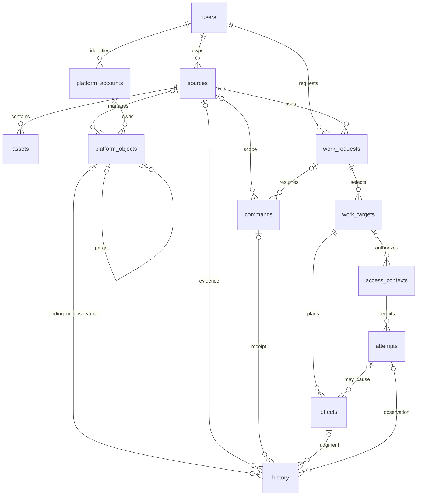

# 찾아you 최소 논리 DB V5.1 — 원본과 등록물 1:N 관계 확정 및 필드 필요성 검토

<!-- Generated by tools/project_docs.py. Sources: docs/artifacts/planning/lesson-registration-20261126/integrated/db-minimal-v5.json -->
[원본](../../artifacts/planning/lesson-registration-20261126/integrated/db-minimal-v5.json)에서 생성한 프로젝션입니다. 변경은 원본에 반영한 뒤 `uv run --no-project python tools/project_docs.py`로 재생성합니다.

R01의 원본–관리 등록물 1:N 결정 반영(V5.1). V3.1-R4 검토·mock-only 유지. DB 논리 후보이며 물리 DB/API/실제 외부 실행 승인 아님. R05 활성 연결 제한은 검토 권장 의견으로만 기록.

## 결론 및 승인 범위
[V5 이전 검토본](https://github.com/ik-e/chaja-you/blob/5a9e0065d592d77cba2690160d3165cfc46e55a1/docs/review/lesson-registration/DB-MINIMAL-V5.md) 13개/138개 → V5.1 12개/134개 후보 열(조건부 포함). `source_object_links`의 5개 열을 제거하고 `platform_objects.source_id` 1개 추가. R01 승인 범위는 원본–등록물 cardinality만이다.

- 한 차자유 사용자에게 복수 레슨 원본. 한 원본은 여러 외부 등록물에 연결 가능; 정확 외부 관리 등록물은 현재 원본 0 또는 1개에만 연결.
- platform_objects.source_id nullable FK sources가 현재 관리 연결의 단일 정본. 동일 owner 및 정확 객체/권한·환경 확인; 다른 원본에 이미 연결된 객체를 암묵적으로 덮어쓰기 금지.
- 공통 프로필·계정 단위 공유 객체는 원본에 직접 연결하지 않는다. 확인된 계정/상하위 객체 관계로 영향 범위를 판정한다. 개별 레슨 객체 정확 식별 불명은 해당 업무 hold; 동일 원본이 동일 클래스라는 추정 금지.
- 링크/해제/재연결은 내부 효과만. 정확 객체/원본/현재 연결 세대(최신 적격 binding event ID; 연결 이력 없는 최초 객체는 명시 최초 표지) 확인. 객체 잠금에서 동일 키 영수증 확인을 우선하고, source_id CAS + 최신 binding event append + command receipt를 원자 기록. 해제는 NULL; 객체/실제 글 삭제 없음.
- 해제·재연결 후 지연된 이전 명령은 새 연결 사건 ID와 불일치하면 거절. 동일 key/digest는 기존 영수증 반환; 현재 연결이 같아도 자동 재처리하지 않는다. 사건 ID는 독립 링크 행을 대체; 현재 guard에 필요한 최신 사건은 참조/보존 의무 해소 전 삭제 금지.
- 등록 완료 후 자동 연결은 정확 객체와 승인 원본이 확인되고 여전히 연결 가능한 상태이며 기존 연결/권리·보존·미해결 명령과 충돌하지 않을 때만; 늦은 결과가 명시 해제 또는 다른 연결을 덮어쓰지 않음. 미확정/충돌은 내부 연결 보류하고 외부 효과 증거는 유지.
- 원본 retire/삭제와 연결 해제를 구분하며 기존 승인·효과·자료 참조 및 보존 근거 보호. 실제 물리 삭제/익명화 전 정확 참조 확인. 과거 전체 원본 또는 인증 비밀 저장 없음.

DB 후보의 승인 결정 및 업무/필드/상태/스토리 매핑 동기화. 팀 검토 중인 고정 R4/상세 명세 원본은 편집하지 않으며 통합 시 물리 테이블 참조 및 SW-18 미결 표현 반영 필요.

## 대안 비교 및 관계 ERD
| 대안 | 테이블 | 판단 |
| --- | --- | --- |
| 다형 JSON 통합형 | 8 | 시도/효과/관측·계정/객체/관계·파일 권리의 독립 식별/락/참조를 앱에서 다시 구성. 데이터 복잡성은 남고 검증 비용 상승. |
| source_object_links를 platform_objects.source_id로 통합 | 12 | R01 승인으로 개별 관리 등록물의 원본 0..1을 채택. FK가 현재 관계 정본이고 command/history가 정확 연결·해제 근거를 유지. 공유 프로필은 계정/상위 객체; 정확 개별 객체 불명 hold. |
| 기존 143개 열 | 13 | 논리 경계 대체로 적합, 중복 상태/키/시각·승인 상태 대응·명령 영향 범위 불충분 |
| 동일 책임, 중복 열 제거 및 누락 보완 | 13 | 현재 기능의 독립 책임 유지; 선택/처분/요청 종료/검증 시각/관계 활성/scope는 정본 유도. 명령 guard와 인증 환경 추가.; 관계 결정 전 후보로 이력 보존. |
| V5.1 + 필요성이 증명된 독립 proof_links / policy_relations / credential_bindings | 13+ | 하나의 별도 테이블이 필요하면 13개, 복수 필요하면 그만큼 증가. 현행 기본에는 미채택. |
| 과거 원본 버전 및 별도 실행/가드 | 17 | 이전 전문 보존 기능 미채택, 호출 단위/효과 claim에서 중복 줄임. |
| V5.1 12개/134개 필드 후보 | 12 | source_object_links 5개 후보 열 제거, platform_objects.source_id 1개 추가. 관계 세대·증거는 기존 history/commands를 사용. 안전한 원자 처리와 실제 식별/제약 검증 필요. |

공통 프로필은 직접 source 연결 없음. ERD 주요 관계이며 상세 FK/제약은 필드 사전 참조.

## R05 DB 검토 회신안
| 항목 | 권장 답변 | 근거 및 승인 경계 |
| --- | --- | --- |
| 동일 외부 계정의 활성 연결을 초기 차자유 사용자 한 명에만 허용 | 동의(초기 범위 한정 및 제약 명시 권장) | 신규 제품 제약, R01 확정 전 기본 DB에는 강제하지 않음; 개별 강사 타깃; 공동 관리 기능 미채택. 동일 사용자 내 여러 원본/여러 외부 등록물은 허용. |
| 최신 원본 + 수락 업무 승인값/필요 근거만 보존 | 동의 | 기존 DR-03/R4-04 승인 방향; 과거 전체 원본 불필요; sources.content/revision, work_requests.approval, work_targets.plan의 필요한 동결 값·자료 참조와 commands/effects/history 최소 증거. 필요한 기간 및 권리·실제 폐기 정책 후속. |
| 정확 등록물 및 단계 독립 확인 후 외부 반영 확인 표시 | 동의 | 기존 SW-28/29, AX10/12/16/17, R4-03; 응답/전송 시도와 외부 효과 판정 구분; exact account/object/step, 승인값, 적격 독립 관측·근거 확인. 불명/부분 확인은 별도, 임의 재시도 금지; 심사/모집 목표 별도. |

활성 연결 제한을 승인하는 경우: 정규 key=(environment,platform_key,identity_namespace,native_account_key) 기준 활성 linked owner 최대 1, 동일 정규 key lock과 DB partial unique 후보. identity-only anchor와 업무 인증은 별개. 다른 owner의 연결 자동 이전/비노출; 충돌 시 제한 안내, 기존 연결/권한 정당 해제 및 재검증 후 신규 연결. 일시 인증을 제한 우회로 사용하지 않도록 쓰기 권한 조건 명시. 이전 owner 불명 효과·폐기 의무·계정 한도/전역 fence는 해제 후에도 유지; 내부 owner별 격리.

첨부 원문 미확인, 전달받은 세 문항 기준. 1번 신규 제약은 아직 반영하지 않음.

## 테이블별 책임과 필드 사전
| 테이블 | 역할 | 수명 |
| --- | --- | --- |
| users | 사용자별 레슨 및 외부 관리 정보 격리, 본인 재확인·권리 제한. 로그인 자체는 인증 서비스. | 검증 가입→권리 제한/retire→참조·보존 근거 해소 후 폐기/익명화 |
| sources | 한 강사가 레슨 종류마다 독립 원본 ID를 갖고 최신 원문/정규 사실 및 필요 현재 draft를 저장. | 생성/편집→최신 저장→retire→필요 참조 해소 후 폐기; 과거 전문 없음 |
| assets | 파일 식별/digest, 저장 위치와 권리 상태. 파일 바이너리는 object storage 후보. | 업로드→재사용/승인→권리 제한→참조 및 보존 근거 해소 후 폐기 |
| platform_accounts | 어떤 강사가 어떤 플랫폼의 확인된 계정을 관리하는지. 토큰·비밀번호·쿠키 아님. | 정확 식별→업무 일시 사용 또는 명시 연결→해제→필요 근거 해소 후 폐기 |
| platform_objects | 확인된 상품·클래스·게시물·프로필·서비스 관계의 식별, 필요한 parent 관계. 개별 관리 등록물의 현재 원본 연결을 nullable FK로 보유. | 정확 식별→관리/조회/수정→외부 상태 변화와 내부 보존 구분; 원본 연결/해제는 source_id 변경, 정확 binding 사건 기록. 외부 글 삭제 없음. |
| work_requests | 최초 선택한 플랫폼 묶음, 원본 revision, 정확한 대상별 승인안 digest, 논리 내용/범위 승인 및 수락 시각. | 준비→제시/무효화→수락→대상 종료에서 종합 판정→필요 보존 후 폐기 |
| work_targets | 업무 유형·대상·입력안·오류·준비 상태·수락 이후 동결된 필요한 계획·개별 종료. | 선택→준비/보류/제외→수락/동결→종료, 새 의도 새 ID |
| commands | 저장·연결·해제·수락·권리 요청 등 동일 명령 key/digest/결과. | 예약→확정 영수증/거절/봉쇄 확인→멱등·복구 기간 이후 폐기; 지연 커밋 가능 중 폐기 금지 |
| access_contexts | 정확 owner·플랫폼·기대/확인 계정·호출 문맥 generation·목적·권한·만료·폐기 의무. 비밀 없음. | 발급→검증→차단→폐기 확인/불명→필요 최소 근거 만료 후 폐기 |
| attempts | 하나의 읽기 또는 쓰기 호출의 목적·정확 대상·순서·상태/시각. | 예약→시작→종료/조회 불가→효과·독립 관측 참조 해소 후 폐기 |
| effects | 개별 변경의 승인 의도·정확 scope·복수 경합 claim·미시도/예약/진행/확인/불명/분쟁. | 예정→예약→실행/불명/확인→분쟁/경합 해소 및 보존 후 폐기 |
| history | 독립 관측·결과·정확 정책/관계 근거·최소 오류/권리/폐기·품질 관측. | 최소 사건 append→판정/근거 조회→법적/업무 참조 해소 후 삭제 또는 익명화 |

### users

| 필드 | 타입 후보 | 의미 | 필요성 |
| --- | --- | --- | --- |
| id | uuid PK | 내부 사용자 | 유지 |
| issuer | text | 서비스 인증 제공자 | 조건부 |
| subject | text | 검증된 제공자 사용자 ID | 조건부 |
| state | text | active/restricted/retired | 유지 |
| created_at | timestamptz | 생성 시점 | 조건부 |
| retired_at | timestamptz? | 접근 종료 시점 | 유지 |

무결성: UNIQUE(issuer,subject); 제공자가 검증한 식별자만 수락; 삭제/보존 정책은 미확정 / issuer/subject는 인증 공급자 결정 후 자체 안정 주체 키로 대체 가능. 사용자 ID와 인증 주체를 동일시하지 않음.

### sources

| 필드 | 타입 후보 | 의미 | 필요성 |
| --- | --- | --- | --- |
| id | uuid PK | 레슨 원본의 안정된 ID | 유지 |
| owner_id | uuid FK users | 강사 | 유지 |
| content | jsonb? | 해당 레슨의 최신 저장 원문(재사용이 필요한 사용자 원문만), 정규화된 사실·불명/출처·금액 단위·커리큘럼·권리/공개 범위·첨부 참조를 typed JSON으로 보존. 이전 전체 원본 없음. | 유지 |
| revision | integer | 최신 저장본 변경 번호. optimistic CAS와 준비 stale 판정만; 원본 버전 FK 아님. | 유지 |
| draft | jsonb? | 현재 미저장 편집 1건, 기준 revision·편집 generation·추출 요청 ID·입력/문제·자료 | 조건부 |
| state | text | draft_only/managed/retired | 유지 |
| updated_at | timestamptz | 마지막 명시 저장 시점(미저장 시 생성 시점) | 유지 |

무결성: 저장 시 owner·base revision·draft generation 검사/CAS 후 최신 content 교체 및 revision 증가, draft 정리와 command 영수증 원자 기록; 오래된 추출 응답은 무시; 신규 미저장 shell은 저장 원본 목록에 미표시; 한 원본당 서버 draft 하나(충돌 시 타 편집 덮어쓰기 금지) / 원본당 복수 platform_objects 허용. 현재 source_id 연결·수락/효과/필요 자료 참조 확인 후 retire/물리 폐기; CAS+binding 사건을 통해 명시 해제, 외부 삭제 없음.

### assets

| 필드 | 타입 후보 | 의미 | 필요성 |
| --- | --- | --- | --- |
| id | uuid PK | 불변 파일 ID | 유지 |
| source_id | uuid FK sources | 소유 원본(사용자는 원본에서 유도) | 유지 |
| storage_key | text | 비공개 저장소 키 | 유지 |
| digest | text | 파일 동일성·무결성 | 유지 |
| media_type | text | 파일 유형 | 유지 |
| size_bytes | bigint | 파일 크기 | 유지 |
| rights_state | text | 사용 허용/불명/철회 상태 | 유지 |
| rights_detail | jsonb | 공개/사용 허용 범위 및 근거 | 유지 |
| created_at | timestamptz | 업로드 시점 | 유지 |

무결성: 파일 변경은 새 ID; content/draft의 첨부 목록은 해당 source의 asset만 참조(역참조 검사 포함); 현재 사용 역할/순서는 content.attachments에만 기록; 승인 plan에는 필요한 asset ID·digest·사용 범위를 고정; 권리 철회 시 새 사용 제한; 현재 원본에서 제거해도 아직 필요한 승인/실행 참조를 임의 삭제하지 않음; 실제 보존/삭제 정책 별도

### platform_accounts

| 필드 | 타입 후보 | 의미 | 필요성 |
| --- | --- | --- | --- |
| id | uuid PK | 내부 계정 관리 ID | 유지 |
| owner_id | uuid FK users | 강사 | 유지 |
| platform_key | text | 플랫폼 | 유지 |
| environment | text | mock/live 구분 | 유지 |
| identity_namespace | text | 계정 ID의 유효 범위 | 조건부 |
| native_account_key | text | 정확하게 확인된 외부 계정 ID | 유지 |
| management_state | text | management_state로 명확화: unlinked/linked/retired; 업무 identity 확인을 관리 연결 승인으로 오인하지 않음 | 재정의 |

무결성: UNIQUE(owner_id,environment,platform_key,identity_namespace,native_account_key); 연결 해제 시 기존 접근 문맥 차단 및 폐기 의무 기록; 재연결로 옛 접근 문맥을 활성화하지 않음; 관리 연결≠실제 접근 권한; 쿠키/비밀번호/토큰 없음; owner별 관리 연결 고유성과 경합 범위는 별개. 전역 정규 계정 key=(environment,platform_key,identity_namespace,native_account_key); 동일 key의 여러 owner 연결은 같은 잠금/한도 claim을 공유하며 다른 owner 데이터 공개·권한 부여 아님. 정규 식별 불명은 실행 보류. / management_state=unlinked/linked/retired. 업무 인증 확인만으로 linked 변경 금지. 사용 허용·필요가 검증된 최소 식별 anchor와 proof만 기록; 관리 연결 목록은 linked만. owner별 연결 고유성 및 전역 정규 키 경합 분리. 실제 계정 식별 정보 저장 허용 불명 시 해당 외부 업무 hold.

### platform_objects

| 필드 | 타입 후보 | 의미 | 필요성 |
| --- | --- | --- | --- |
| id | uuid PK | 서비스 내부 객체 ID | 유지 |
| account_id | uuid FK platform_accounts | 정확 외부 계정 | 유지 |
| parent_id | uuid? FK platform_objects | 검증된 상위 프로필/상품 등 | 조건부 |
| kind | text | product/class/profile/service/post 등 | 유지 |
| identity_namespace | text | 객체 식별 범위 | 조건부 |
| native_object_key | text | 검증된 외부 객체 ID | 유지 |
| locator | jsonb? | 확인된 관리/공개 위치 | 조건부 |
| source_id | uuid? FK sources | 정확 관리 등록물의 현재 연결 원본(0..1). 공유 계정/프로필 객체 및 연결 해제된 등록물은 NULL. 사용자가 가진 여러 원본 각각은 여러 등록물과 연결 가능. | 추가 |

무결성: UNIQUE(account_id,kind,identity_namespace,native_object_key); 부모 동일 계정, cycle 금지; 확인 전 후보는 target.plan에만 보존; URL/표시명/순서만으로 정확 식별 가정 금지; 현재 외부 상태는 history 적격 관측에서 조회 / 계정·객체의 마지막 식별 검증 시각은 적격 identity history에서 계산. 검증 근거를 함께 원자 기록하며 필요 참조보다 먼저 폐기하지 않는다. / platform_objects.source_id nullable FK sources가 현재 관리 연결의 단일 정본. 동일 owner 및 정확 객체/권한·환경 확인; 다른 원본에 이미 연결된 객체를 암묵적으로 덮어쓰기 금지. / 공통 프로필·계정 단위 공유 객체는 원본에 직접 연결하지 않는다. 확인된 계정/상하위 객체 관계로 영향 범위를 판정한다. 개별 레슨 객체 정확 식별 불명은 해당 업무 hold; 동일 원본이 동일 클래스라는 추정 금지. / 링크/해제/재연결은 내부 효과만. 정확 객체/원본/현재 연결 세대(최신 적격 binding event ID; 연결 이력 없는 최초 객체는 명시 최초 표지) 확인. 객체 잠금에서 동일 키 영수증 확인을 우선하고, source_id CAS + 최신 binding event append + command receipt를 원자 기록. 해제는 NULL; 객체/실제 글 삭제 없음. / 해제·재연결 후 지연된 이전 명령은 새 연결 사건 ID와 불일치하면 거절. 동일 key/digest는 기존 영수증 반환; 현재 연결이 같아도 자동 재처리하지 않는다. 사건 ID는 독립 링크 행을 대체; 현재 guard에 필요한 최신 사건은 참조/보존 의무 해소 전 삭제 금지. / 등록 완료 후 자동 연결은 정확 객체와 승인 원본이 확인되고 여전히 연결 가능한 상태이며 기존 연결/권리·보존·미해결 명령과 충돌하지 않을 때만; 늦은 결과가 명시 해제 또는 다른 연결을 덮어쓰지 않음. 미확정/충돌은 내부 연결 보류하고 외부 효과 증거는 유지. / 원본 retire/삭제와 연결 해제를 구분하며 기존 승인·효과·자료 참조 및 보존 근거 보호. 실제 물리 삭제/익명화 전 정확 참조 확인. 과거 전체 원본 또는 인증 비밀 저장 없음.

### work_requests

| 필드 | 타입 후보 | 의미 | 필요성 |
| --- | --- | --- | --- |
| id | uuid PK | 업무 묶음 ID | 유지 |
| owner_id | uuid FK users | 요청자 | 유지 |
| source_id | uuid? FK sources | 선택한 원본(원본이 필요 없는 조회/관리 업무는 NULL) | 유지 |
| source_revision | integer? | 선택/승인 기준 원본 revision | 유지 |
| environment | text | mock/live | 유지 |
| selection_revision | integer | 선택·검토안 변경 번호 | 유지 |
| approval_state | text | approval_state none/presented/invalidated/frozen; 종료는 대상 lifecycle에서 계산 | 재정의 |
| approval | jsonb? | 내용/범위 논리 승인 증거와 시각, 직접 동의 확인 참조, 정확 실행 대상 집합 및 plan digest; 각 target의 전체 입력값은 중복 저장하지 않음. | 유지 |
| created_at | timestamptz | 요청 생성 | 유지 |
| accepted_at | timestamptz? | 쓰기 업무 수락 시점 | 유지 |

무결성: 전체 선택 대상의 처분과 plan은 work_targets가 정본; approval에 동일 입력값 반복 저장 안 함; 양 승인+정확한 target 집합/plan digest+command receipt를 원자 수락; 0 ready면 쓰기 수락 없음; 동결 후 선택/승인 변경 금지; 미수락 원본 변경은 revision 갱신 후 준비 재검증; 읽기/내부 업무는 쓰기 승인 요구하지 않음 / AX08 approval_state none/presented/invalidated/frozen. 승인 전 검토안 바뀌면 invalidated/새 선택 revision. 종료 여부는 수락 대상 lifecycle 전부 ended에서 유도; 수락 0인 경우 실행/실행종료로 표시하지 않는다. 읽기/내부 업무는 승인 없음과 수락/종료 구분.

### work_targets

| 필드 | 타입 후보 | 의미 | 필요성 |
| --- | --- | --- | --- |
| id | uuid PK | 대상 업무 ID | 유지 |
| request_id | uuid FK work_requests | 상위 묶음 | 유지 |
| platform_key | text | 대상 플랫폼 | 유지 |
| operation_key | text | CREATE/UPDATE/RENEW/READ/STATUS/LINK 등 정확 업무 | 유지 |
| account_id | uuid? FK platform_accounts | 확인된 대상 계정 | 유지 |
| object_id | uuid? FK platform_objects | 기존 정확 대상(신규는 NULL) | 유지 |
| prior_target_id | uuid? FK work_targets | 잔여/반려 수정 등 이전 업무 | 조건부 |
| prepared_source_revision | integer? | 입력안 계산에 사용한 원본 revision | 유지 |
| prep_generation | integer | 늦은 준비 응답 차단 | 유지 |
| prep_state | text | unprepared/preparing/issues/ready/held/excluded/stale/consumed | 유지 |
| profile_ref | text? | 재현 가능한 플랫폼 업무 규칙 버전 | 유지 |
| plan | jsonb | 준비 단계에 필요한 플랫폼 고유 값·정규 사실 참조·단위 변환·보완·검증 상태·현재 정책/객체·효과 계획. 수락 뒤에는 실제 업무에 필요한 승인값/자료/digest·정확 범위와 규칙 버전만 불변. 과거 전체 원본 복사 금지. | 유지 |
| lifecycle | text | not_accepted/accepted/running/fencing/ended | 유지 |
| ended_at | timestamptz? | 실행 종료(결과 성공과 별개) | 유지 |

무결성: 정확 target.id 및 선택 의도 중복 검사; source revision/계정/객체/owner/env 정합; 미확인 후보는 plan 안에만, 정확 binding 전 쓰기 금지; 승인 전 stale 조건 검사, 승인 후 필요한 입력/자료만 freeze; 새 변경/재심사/갱신은 새 대상/새 승인; 결과 객체는 effects.object_id와 history에서 유도 / 선택 시 안정 target.id를 발급하고 준비 command와 함께 중복 없는 정확 의도를 검증. 수락 전 표시 처분은 prep_state로 계산; 수락 target은 consumed+lifecycle!=not_accepted, 수락 안 된 선택은 held/excluded로 고정. frozen 후 selection 및 plan 변경 금지. 후속 신규 의도는 새 target/필요 승인; 기존 held를 실패로 변환하지 않음. / SW-29 등록 후 연결은 현재 원본/권한 및 객체 binding guard가 유효할 때만. 기존 명시 해제·다른 연결을 늦은 외부 결과로 덮어쓰지 않고, 충돌 시 연결 보류 및 확인 효과 보존.

### commands

| 필드 | 타입 후보 | 의미 | 필요성 |
| --- | --- | --- | --- |
| id | uuid PK | 명령 ID | 유지 |
| owner_id | uuid? FK users | 사용자(최초 가입 전 검증 주체만 NULL) | 유지 |
| principal_key | text | 검증된 서비스 주체 키 | 조건부 |
| kind | text | SAVE_SOURCE/LINK/UNLINK/ACCEPT/RIGHTS 등 | 유지 |
| request_key | text | 호출자가 재사용할 멱등 키 | 유지 |
| request_digest | text | 정규화된 요청 내용의 digest | 유지 |
| state | text | reserved 기술 상태 + committed/rejected/no_commit_proven; AX04에서 reserved는 미확정, FE unknown은 별도 | 재정의 |
| receipt | jsonb? | 정확 결과 ID/revision/거절 사유; 과거 원본 내용 보존하지 않음 | 유지 |
| created_at | timestamptz | 접수 시점 | 유지 |
| resolved_at | timestamptz? | 정본 결과 기록 시점 | 유지 |
| source_id | uuid? FK sources | 원본에 대한 명령의 정확 guard/복구 범위; 원본 저장은 필수, 원본 없는 업무는 NULL. | 추가 |
| work_request_id | uuid? FK work_requests | 인라인 W 저장/준비/수락의 정확 원 호출 업무 묶음; 독립 E 저장은 NULL. | 추가 |
| scope | jsonb | 종류별 최소 base_revision·affected_fact_paths·편집 generation·정확 관계/권리 대상; request_digest에 pin. 비밀/과거 전문 없음. | 추가 |

무결성: UNIQUE(principal_key,kind,request_key); 동일 digest만 기존 결과 확인, 다르면 거절; DB 행 잠금과 최종 상태 CAS로 업무와 영수증 동일 트랜잭션; no_commit_proven은 이전 지연 커밋을 봉쇄한 경우만; 서버 미기록이면 호출자의 owner-scoped 기존 키 보존 필요; pending 상태에서 무조건 재실행 금지 / DB technical reserved 상태는 AX04 미확정(unrecorded), 미기록과 예약을 구분; FE response unknown은 DB 상태가 아니다. 원본 저장 명령은 원본 shell/정확 source_id와 선택적 W request_id/base_revision/영향 scope를 durable reservation으로 기록한 뒤 변이 시작. reservation·원본 CAS·수락 시 source/request lock 경계, 관련 pending 미해소 중 승인·새 저장 차단. 네트워크가 예약 전 유실될 경우 서버가 모르는 의도는 판정 불가; 사전 durable intent 확보/실행 fence와 동일 키 복구 프로토콜 후속 검증. 명령 최종 결과/변이 원자 기록; 만료만으로 no_commit_proven 금지. / LINK/UNLINK는 정확 owner/source/object 및 기대 최신 binding event ID를 scope/request_digest에 pin. 동일 key/digest 확정 영수증 조회를 먼저 하고 object 잠금·현재 binding token 대조·source_id 변경·binding 사건·receipt를 동일 원자 트랜잭션으로 기록. 이전 세대 명령으로 새 관계 변경 금지.

### access_contexts

| 필드 | 타입 후보 | 의미 | 필요성 |
| --- | --- | --- | --- |
| id | uuid PK | 접근 문맥 ID(새 인증 시 새 ID) | 유지 |
| owner_id | uuid FK users | 요청자 | 유지 |
| target_id | uuid? FK work_targets | 목적 업무(계정 관리 등은 NULL) | 유지 |
| platform_key | text | 플랫폼 | 유지 |
| expected_account_id | uuid? FK platform_accounts | 기대 계정 | 유지 |
| verified_account_id | uuid? FK platform_accounts | 실제 확인된 계정 | 유지 |
| purpose | text | 준비/계정 확인/업무 실행/조회 | 유지 |
| state | text | human/verifying/verified/blocked | 유지 |
| scope | jsonb | 허용 읽기·쓰기 범위/근거/호출 문맥 | 유지 |
| expires_at | timestamptz | 만료 시점 | 유지 |
| blocked_at | timestamptz? | 차단 시점 | 유지 |
| cleanup | jsonb | 한 문맥의 자원별 폐기 의무 및 pending/confirmed/unknown | 유지 |
| context_key | text | 같은 owner·정확 호출/준비/조회 목적의 안정 문맥 키. 비밀이나 URL grant 아님. 다른 독립 대상의 인증을 차단하지 않도록 범위 분리. | 유지 |
| generation | integer | 같은 context_key 안에서 단조 증가하는 인증 세대; 접근 ID와 함께 실행·만료·복구의 현재성 검증. | 유지 |
| environment | text | 인증 발급 시부터 mock/live 격리, target/계정 미확정에도 유효. | 추가 |

무결성: 접근 ID 및 state로 이전 문맥 차단(재활성화 금지); 기대 계정·실제 계정 일치, 목적/범위/만료/권한 매번 검사; 차단과 폐기 의무 원자 기록; 이전 폐기 불명은 새 인증으로 해소되지 않음; 자원 식별자는 비밀 아닌 메타만; 인증 비밀 저장 금지 / UNIQUE(owner_id,context_key,generation); 새 문맥의 현재성은 해당 문맥 단위로 원자 확인. 동일 문맥의 이전 generation은 새 접근 불가. 별도 독립 문맥은 유지. blocked 및 cleanup 상태는 분리; ID·metadata 외 credential 금지. / environment 필수, target/기대·확인 계정과 일치 검사. 계정/대상이 아직 없어도 환경 확정. 새 context generation은 정규 문맥 단위 lock/CAS.

### attempts

| 필드 | 타입 후보 | 의미 | 필요성 |
| --- | --- | --- | --- |
| id | uuid PK | 개별 외부 호출 시도 ID | 유지 |
| target_id | uuid? FK work_targets | 관련 업무(계정 확인만 예외) | 유지 |
| access_id | uuid FK access_contexts | 정확 접근 문맥 | 유지 |
| object_id | uuid? FK platform_objects | 읽기/쓰기의 기존 대상 | 유지 |
| kind | text | read/write | 유지 |
| purpose_key | text | 상태조회/식별/독립 readback 또는 정확 전송 경계 | 유지 |
| scope | jsonb | 고정 계정/객체/slot/목적/범위와 승인된 실행 또는 읽기 계획 | 유지 |
| sequence_no | bigint? | 정확 조회 대상·목적 내 요청 순서(read) | 유지 |
| state | text | read pending/running/observed/unavailable (running은 AX11 pending); write reserved/started/sealed | 재정의 |
| requested_at | timestamptz | 요청·예약 시점 | 유지 |
| started_at | timestamptz? | 호출 시작 | 유지 |
| finished_at | timestamptz? | 호출 종료 | 유지 |
| failure_reason | text? | 호출 오류 코드 | 유지 |

무결성: PRIMARY KEY(id), 예약 전 안정 ID; kind별 CHECK 및 목적/owner/env/account/target 일치; write는 target 필수, 승인된 효과 전체를 reserve하고 시작 상태 CAS로 같은 시도 일회 시작; read는 정확 목적/범위/순번 및 권한 검증, effect 확인 목적은 scope의 적격 effect 참조로 제한; 관측 결과 history append; read/write 결과를 외부 효과 성공으로 해석하지 않음

### effects

| 필드 | 타입 후보 | 의미 | 필요성 |
| --- | --- | --- | --- |
| id | uuid PK | 개별 효과 시도 ID | 유지 |
| target_id | uuid FK work_targets | 승인 업무 | 유지 |
| attempt_id | uuid? FK attempts | 해당 쓰기 시도(미시도는 NULL) | 유지 |
| prior_effect_id | uuid? FK effects | 이전 효과 시도 | 조건부 |
| rule_key | text | 승인 계획의 효과 규칙 | 유지 |
| logical_effect_key | text | 정확 업무의 의미 효과 키 | 유지 |
| intent_digest | text | 승인 변경 내용/조건 digest | 유지 |
| root_key | text | 정규 대상 또는 신규 의도 slot | 유지 |
| scope_path | text | 겹침 판정을 위한 검증된 변경 범위 | 유지 |
| object_id | uuid? FK platform_objects | 정확 확인된 실제 효과 객체(slot→객체 연결) | 유지 |
| required | boolean | 완료에 필수 효과 | 유지 |
| state | text | not_attempted/reserved/in_flight/confirmed/none_confirmed/unknown | 유지 |
| disputed | boolean | 상충 근거에 따른 차단 | 유지 |
| updated_at | timestamptz | 현재 판정 변경 시점 | 유지 |
| claims | jsonb | 정규 scope 외에 동시에 획득해야 할 계정 한도/일자·공유 정책 claim 목록. typed key, rule version, observation ref, 반영/미반영 판정; 비어 있으면 추가 claim 없음. | 유지 |

무결성: 대상 내 동일 효과 후보 중복 금지; attempt는 같은 target의 write, 여러 effects가 같은 attempt에 연결 가능; 정규 외부 계정 키를 통한 전역 잠금 하 모든 활성/불명/분쟁 효과 및 slot→확인 객체 관계와 scope 겹침 검사·원자 reserve; unknown/disputed 지속 저장; 권한 차단 뒤 시작 금지; 종료 후 늦은 증거는 history로 판정 보완만; 확인/불명 동일 효과 반복 금지, 새 시도는 새 승인+안전한 미발생/미시도 또는 새 의도 및 미해결 경합 없음 / claims는 종류별 schema(정규 account/정확 quota/기간 및 관측·예약 식별) 검증; 한 효과의 모든 scope/claim을 정규 계정 잠금 경계에서 동시에 획득. 최신 적격 관측에 이미 반영됐다는 증거 전 내부 미반영/불명 예약 보수적 포함. 외부 경합/이중 계상 판단 불가 시 hold; 내부 잠금만으로 외부 서버 한도 보장하지 않음. 동일 정규 계정의 모든 owner별 연결·관련 effects를 대상으로 조회/잠금/예약하며 owner_id 또는 내부 account_id를 quota key에 넣지 않는다. 총량 한도와 일일 한도는 종류별 기간을 구분하고 해당 요청의 모든 claim을 원자 획득한다.

### history

| 필드 | 타입 후보 | 의미 | 필요성 |
| --- | --- | --- | --- |
| id | uuid PK | 기록 ID | 유지 |
| owner_id | uuid FK users | 소유 사용자 | 유지 |
| kind | text | response/observation/evidence/effect_judgment/target_result/goal/rights/audit 등 | 유지 |
| target_id | uuid? FK work_targets | 관련 업무 | 유지 |
| attempt_id | uuid? FK attempts | 관련 호출 | 유지 |
| effect_id | uuid? FK effects | 관련 효과 | 유지 |
| object_id | uuid? FK platform_objects | 정확 외부 대상 | 유지 |
| access_id | uuid? FK access_contexts | 관련 접근 문맥 | 유지 |
| command_id | uuid? FK commands | 관련 내부 명령 | 유지 |
| version_no | integer? | 해당 판정 종류·대상별 증가 버전 | 유지 |
| observed_at | timestamptz? | 실제 관측 시각 | 유지 |
| recorded_at | timestamptz | 수신/기록 시각 | 유지 |
| payload | jsonb | 종류별 검증된 최소 관측값·native 상태·결과/사유·권리 메타 | 유지 |
| proof_ids | uuid[] | 적격 불변 근거 ID | 유지 |
| source_id | uuid? FK sources | 원본 자체의 권리/삭제/정정 근거에 직접 연결. target 없이도 정확 원본을 찾고 보존/삭제 검토. | 유지 |
| account_id | uuid? FK platform_accounts | 계정 전체 관측·한도·권리 관련 기록의 정확 계정. object가 없더라도 저장. | 유지 |
| related_object_id | uuid? FK platform_objects | 동일 클래스 관계 등 두 번째 정확 객체 참조. 사용자 확인 또는 적격 근거 없이 임의 설정 금지. | 조건부 |

무결성: append-only; kind별 필수 FK/값 검증; 동일 owner·대상·목적의 참조와 proof_ids 존재/적격/불변 검증(DB trigger 또는 등가 강제 검증, 실제 정책 검토); effect/result 판정 버전 원자 증가; response와 독립 observation 별개; 최신 조회 실패가 마지막 정상 관측을 삭제하지 않음; 과거 원본 전체/인증 비밀/불필요 원문 저장 안 함 / kind별 typed FK 요구: source 권리 사건 source_id, quota 계정/범위와 시각, 관계 사건 양쪽 정확 object 또는 명시 신규 target+기존 object·정규 계산 scope·근거. 동일 owner/env/허용 범위 검증. 동일 원본/제목/가격만으로 동일 클래스 관계 생성 금지. 최신 관계 확인/철회/불명은 정확 scope 및 적격 증거로 판정; 관계 이벤트의 버전 증가/충돌 hold. / append-only는 업무 처리 중 임의 수정 금지이며 보존 기한 종료·권리 처리 시 합법적 삭제/익명화를 막는 요구 아님. JSON/배열 참조 검증 및 물리 삭제 계획은 실제 제약으로 후속 시험. / kind별 필요한 direct ref만 기록; target→request→source, attempt→access→account처럼 고정 경로로 안전 유도 가능한 동일 참조는 중복 저장하지 않음. 정규 scope는 kind + 검증된 typed 대상/관계/목적/정책 bucket 및 환경으로 계산; version 순번은 해당 scope 원자 증가. 표현식 인덱스/typed projection 검증. 조회 증거 경합/삭제와 proof_ids 무결성이 불충분하면 proof relation 별도 후보. / kind=management_binding: 정확 owner/source_id/object_id/command_id 또는 SW-29 승인 target/effect, action=link|unlink, 이전 binding event ref와 recorded_at. 한 object의 사건 순번/최신 적격 사건을 잠금에서 판정; 필요한 최신 guard/증거를 임의 폐기하지 않음. 해당 FK와 source_id의 상태 일치 검사. binding 사건으로만 현재 링크 식별하며 source_id가 현재 연결 정본.

## 36개 시스템 업무 정보 사용
### SW-01 서비스 본인 식별

- 읽기: commands.principal_key, users.created_at, users.id, users.issuer, users.state, users.subject
- 기록/변경: commands.owner_id, commands.principal_key, users.created_at, users.id, users.issuer, users.state, users.subject
- DB 외부/계산: 공식 인증 응답/세션 비밀·가입 화면 임시 입력; 인증 서비스가 세션 관리.
- 원자 경계: 업무별 정본 읽기/필요 결과 저장; 실행 범위 미확정은 hold
- 완료: 동일 owner 식별 확인 후에만 본인 영역 반환; 결과 불명 신규 생성 금지

### SW-02 대상 소유권 및 목적별 접근 검증

- 읽기: access_contexts.owner_id, assets.source_id, commands.owner_id, history.id, history.object_id, history.owner_id, history.payload, platform_accounts.environment, platform_accounts.owner_id, platform_objects.account_id, platform_objects.id, platform_objects.source_id, sources.owner_id, users.id, users.retired_at, users.state, work_requests.owner_id, work_targets.request_id
- 기록/변경: 정본 변경 없음
- DB 외부/계산: 요청 목적/권한 검증 중간값; 허용 관계는 정본 조인.
- 원자 경계: 업무별 정본 읽기/필요 결과 저장; 실행 범위 미확정은 hold
- 완료: 검증된 본인 및 허용 대상만 다음 업무에 전달; 실패이면 데이터/새 효과 없음

### SW-03 본인 원본·등록물·작업 통합 읽기

- 읽기: history.id, history.kind, history.object_id, history.owner_id, history.payload, history.recorded_at, history.target_id, platform_accounts.management_state, platform_accounts.owner_id, platform_objects.id, platform_objects.source_id, sources.content, sources.id, sources.owner_id, sources.state, sources.updated_at, users.id, work_requests.created_at, work_requests.id, work_requests.owner_id, work_requests.source_id, work_targets.ended_at, work_targets.request_id
- 기록/변경: 정본 변경 없음
- DB 외부/계산: 목록/개수/최신 판정/화면 상태는 쿼리 계산, 미노출 원인 추정 금지.
- 원자 경계: 업무별 정본 읽기/필요 결과 저장; 실행 범위 미확정은 hold
- 완료: 본인 허용 데이터/저장 관측 시각만 표시; 외부 접근 0

### SW-04 원문·첨부·직접 입력 수신

- 읽기: assets.created_at, assets.media_type, assets.rights_detail, assets.rights_state, assets.size_bytes, assets.source_id, assets.storage_key, sources.draft
- 기록/변경: assets.created_at, assets.digest, assets.id, assets.media_type, assets.rights_detail, assets.rights_state, assets.size_bytes, assets.source_id, assets.storage_key, sources.draft, sources.id, sources.owner_id, sources.state, sources.updated_at
- DB 외부/계산: 업로드 stream/검사 임시 버퍼; 파일은 외부 저장소, 메타만 DB.
- 원자 경계: 업무별 정본 읽기/필요 결과 저장; 실행 범위 미확정은 hold
- 완료: 허용 자료와 불충분/거절 자료 구분; 외부 전송 없음

### SW-05 원본 사실 추출 및 구조화

- 읽기: assets.digest, assets.id, assets.storage_key, sources.content, sources.draft, sources.revision
- 기록/변경: sources.draft
- DB 외부/계산: AI 중간 추론/임시 추출 응답; 확인된 사실과 필요한 출처만 저장.
- 원자 경계: 업무별 정본 읽기/필요 결과 저장; 실행 범위 미확정은 hold
- 완료: 확인된 사실과 추정/불명 구분, 동일 revision 결과만 사용

### SW-06 사실·첨부 편집 및 원본 변경 영향 확인

- 읽기: sources.content, sources.draft, sources.revision, sources.updated_at, work_requests.source_revision, work_targets.plan, work_targets.prepared_source_revision
- 기록/변경: assets.rights_detail, sources.draft
- DB 외부/계산: 차이 계산/영향 판정; 필요 편집/결과만 남기고 전체 과거 내용 미보존.
- 원자 경계: 업무별 정본 읽기/필요 결과 저장; 실행 범위 미확정은 hold
- 완료: 변경할 값과 적용 범위 명확; 확인 안 된 사실은 불명으로 유지

### SW-07 원본 저장 및 동일 요청 확인

- 읽기: assets.id, assets.source_id, commands.created_at, commands.id, commands.kind, commands.owner_id, commands.principal_key, commands.receipt, commands.request_digest, commands.request_key, commands.resolved_at, commands.scope, commands.source_id, commands.state, commands.work_request_id, history.command_id, sources.draft, sources.id, sources.owner_id, sources.revision, sources.state, sources.updated_at
- 기록/변경: commands.created_at, commands.id, commands.kind, commands.owner_id, commands.principal_key, commands.receipt, commands.request_digest, commands.request_key, commands.resolved_at, commands.scope, commands.source_id, commands.state, commands.work_request_id, history.command_id, history.id, history.kind, history.owner_id, history.payload, history.recorded_at, history.source_id, sources.content, sources.draft, sources.id, sources.owner_id, sources.revision, sources.state, sources.updated_at, work_requests.approval_state, work_requests.source_revision, work_targets.prep_state
- DB 외부/계산: FE 응답 인지 unknown, CAS 비교 계산; 명령 영수증만 durable.
- 원자 경계: 정확 owner/대상/현재 상태·영수증/효과 및 필요한 원자 경계; 상세 제약 및 실험 후속
- 완료: 저장 성공 확인 전 성공으로 H/W 이동 및 재저장 금지. 안전 이탈은 허용하고 동일 명령 결과를 보존. 미커밋/거절 확정 후 현재 revision의 새 명시 요청만. 인라인 커밋 확인 전 승인/새 실행 금지, 확인 후 동일 W 복귀.

### SW-08 원본 내부 삭제·관리 연결 해제

- 읽기: assets.created_at, assets.rights_state, assets.source_id, commands.kind, commands.receipt, commands.request_digest, commands.request_key, commands.scope, effects.disputed, effects.state, history.id, history.object_id, history.payload, history.proof_ids, history.recorded_at, history.source_id, platform_objects.id, platform_objects.source_id, sources.owner_id, sources.state
- 기록/변경: assets.rights_state, commands.created_at, commands.id, commands.kind, commands.receipt, commands.request_digest, commands.request_key, commands.resolved_at, commands.scope, commands.source_id, commands.state, history.command_id, history.id, history.object_id, history.payload, history.recorded_at, history.source_id, platform_objects.source_id, sources.state
- DB 외부/계산: 외부 삭제·원복 없음; 영향 집합은 현재 참조에서 계산.
- 원자 경계: 정확 object/source/current binding event 및 owner 확인; 동일 key receipt 우선, object lock + source_id CAS + binding event + command receipt 원자 기록. 외부 변경 없음.
- 완료: 정확 내부 효과만 확인; 진행/불명 효과·보존 의무 미해결은 제한; 외부 효과 없음

### SW-09 업무 의도·대상 묶음 확정 및 준비 요청 접수

- 읽기: commands.kind, sources.content, sources.id, sources.state, work_requests.created_at, work_requests.id, work_requests.owner_id, work_requests.selection_revision, work_requests.source_id, work_requests.source_revision, work_targets.id, work_targets.operation_key, work_targets.prep_state, work_targets.request_id
- 기록/변경: commands.created_at, commands.id, commands.kind, commands.owner_id, commands.principal_key, commands.receipt, commands.request_digest, commands.request_key, commands.resolved_at, commands.scope, commands.source_id, commands.state, commands.work_request_id, work_requests.approval_state, work_requests.created_at, work_requests.environment, work_requests.id, work_requests.owner_id, work_requests.selection_revision, work_requests.source_id, work_requests.source_revision, work_targets.id, work_targets.operation_key, work_targets.platform_key, work_targets.prep_generation, work_targets.prep_state, work_targets.prior_target_id, work_targets.request_id
- DB 외부/계산: 화면 selection UI/임시 후보; 명시 준비 이후 안정 target 정본.
- 원자 경계: 업무별 정본 읽기/필요 결과 저장; 실행 범위 미확정은 hold
- 완료: 대상·업무·원본/준비 문맥 기록; 미선택 대상의 외부 접근/쓰기 없음

### SW-10 제품 지원·단계 허용 및 제약 판정

- 읽기: platform_accounts.environment, platform_accounts.platform_key, work_requests.environment, work_targets.operation_key, work_targets.plan, work_targets.platform_key, work_targets.profile_ref
- 기록/변경: 정본 변경 없음
- DB 외부/계산: 정적 지원/정책 규칙과 출처 원본은 버전 관리 설정; 적용 판정만 plan.
- 원자 경계: 업무별 정본 읽기/필요 결과 저장; 실행 범위 미확정은 hold
- 완료: 범위·단계 허용·근거 없으면 새 외부 접근/쓰기 없음; 실제 실행 승인 아님

### SW-11 플랫폼별 입력안 변환

- 읽기: assets.id, assets.media_type, assets.size_bytes, assets.storage_key, sources.content, sources.revision, work_requests.source_id, work_targets.id, work_targets.plan, work_targets.platform_key, work_targets.prep_generation, work_targets.prep_state, work_targets.prepared_source_revision, work_targets.profile_ref
- 기록/변경: work_targets.plan, work_targets.prep_generation, work_targets.prep_state, work_targets.prepared_source_revision, work_targets.profile_ref
- DB 외부/계산: 변환 중간값, 모델 응답, 정적 필드 목록 미보존; 필요한 최종안만.
- 원자 경계: 업무별 정본 읽기/필요 결과 저장; 실행 범위 미확정은 hold
- 완료: 현재 원본/준비 revision의 입력안만 반환; 미확인 값은 준비 미완료/제한

### SW-12 입력안·필수 사실·제약 검증

- 읽기: assets.digest, assets.id, assets.media_type, assets.rights_detail, assets.rights_state, assets.size_bytes, assets.source_id, effects.claims, sources.content, work_targets.plan, work_targets.platform_key, work_targets.prep_generation, work_targets.prep_state, work_targets.prepared_source_revision, work_targets.profile_ref
- 기록/변경: work_targets.plan, work_targets.prep_state
- DB 외부/계산: 일시 검증 계산; 확인 근거와 문제/보류 상태만.
- 원자 경계: 업무별 정본 읽기/필요 결과 저장; 실행 범위 미확정은 hold
- 완료: 모든 필요한 검증의 확인 또는 구체 보완/제한; 미확인 외부 실행 없음

### SW-13 필요 정보 요청·제약 대안 반영

- 읽기: sources.content, sources.draft, work_targets.plan, work_targets.prep_generation
- 기록/변경: work_requests.selection_revision, work_targets.plan, work_targets.prep_generation, work_targets.prep_state, work_targets.prepared_source_revision
- DB 외부/계산: UI 선택 임시값; 확정된 정정만 plan 또는 원본 draft.
- 원자 경계: 업무별 정본 읽기/필요 결과 저장; 실행 범위 미확정은 hold
- 완료: 필요 정보만 반영; 임의 사실 변경/다른 대상 재입력 없음; 현재 검증 재실행

### SW-14 필요 외부 인증 문맥 발급 및 직접 인증 연결

- 읽기: access_contexts.context_key, access_contexts.environment, access_contexts.expected_account_id, access_contexts.generation, access_contexts.id, access_contexts.owner_id, access_contexts.platform_key, access_contexts.purpose, access_contexts.scope, access_contexts.target_id, work_targets.platform_key
- 기록/변경: access_contexts.cleanup, access_contexts.context_key, access_contexts.environment, access_contexts.expected_account_id, access_contexts.expires_at, access_contexts.generation, access_contexts.id, access_contexts.owner_id, access_contexts.platform_key, access_contexts.purpose, access_contexts.scope, access_contexts.state, access_contexts.target_id
- DB 외부/계산: 원격 브라우저 인증 secret·grant·쿠키는 휘발/승인된 별도 인증 서비스; DB 없음.
- 원자 경계: 업무별 정본 읽기/필요 결과 저장; 실행 범위 미확정은 hold
- 완료: 현재 호출 문맥에 한정; 실패/취소/불허 차단·정리; 동일 문맥 중복 연결 없음

### SW-15 외부 계정·권한 검증 및 관리 식별 관계

- 읽기: access_contexts.context_key, access_contexts.environment, access_contexts.expected_account_id, access_contexts.expires_at, access_contexts.generation, access_contexts.id, access_contexts.owner_id, access_contexts.platform_key, access_contexts.purpose, access_contexts.scope, access_contexts.state, access_contexts.target_id, access_contexts.verified_account_id, history.access_id, history.account_id, platform_accounts.environment, platform_accounts.id, platform_accounts.identity_namespace, platform_accounts.management_state, platform_accounts.native_account_key, platform_accounts.owner_id, platform_accounts.platform_key, platform_objects.account_id, work_targets.account_id
- 기록/변경: access_contexts.expires_at, access_contexts.scope, access_contexts.state, access_contexts.verified_account_id, history.access_id, history.account_id, history.id, history.kind, history.observed_at, history.owner_id, history.payload, history.proof_ids, history.recorded_at, platform_accounts.environment, platform_accounts.id, platform_accounts.identity_namespace, platform_accounts.management_state, platform_accounts.native_account_key, platform_accounts.owner_id, platform_accounts.platform_key, work_targets.account_id
- DB 외부/계산: 인증 자격 비밀/원문은 미보존; 확인된 최소 계정 ID·scope/근거만.
- 원자 경계: 업무별 정본 읽기/필요 결과 저장; 실행 범위 미확정은 hold
- 완료: 현재 목적/범위/유효성 확인 후만 사용; 계정 자동 대체 금지

### SW-16 직접 선행 업무 확인

- 읽기: access_contexts.verified_account_id, history.payload, work_targets.plan
- 기록/변경: 정본 변경 없음
- DB 외부/계산: 정산/약관/본인인증 직접 입력값 미보존; 확인 상태 및 최소 근거.
- 원자 경계: 업무별 정본 읽기/필요 결과 저장; 실행 범위 미확정은 hold
- 완료: 실제 선행 조건 검증 전 관련 외부 업무 차단

### SW-17 허용 읽기·정확 외부 객체 식별

- 읽기: access_contexts.environment, access_contexts.expires_at, access_contexts.id, access_contexts.platform_key, access_contexts.purpose, access_contexts.scope, access_contexts.state, access_contexts.verified_account_id, attempts.access_id, attempts.id, attempts.object_id, attempts.purpose_key, attempts.scope, attempts.target_id, history.account_id, history.attempt_id, history.id, history.kind, history.object_id, history.observed_at, history.payload, history.proof_ids, platform_accounts.id, platform_accounts.identity_namespace, platform_accounts.native_account_key, platform_accounts.platform_key, platform_objects.account_id, platform_objects.id, platform_objects.identity_namespace, platform_objects.kind, platform_objects.locator, platform_objects.native_object_key, platform_objects.parent_id, work_targets.account_id, work_targets.object_id
- 기록/변경: attempts.access_id, attempts.id, attempts.kind, attempts.object_id, attempts.purpose_key, attempts.requested_at, attempts.scope, attempts.sequence_no, attempts.state, attempts.target_id, history.account_id, history.attempt_id, history.id, history.kind, history.object_id, history.observed_at, history.owner_id, history.payload, history.proof_ids, history.recorded_at, history.related_object_id, platform_objects.account_id, platform_objects.id, platform_objects.identity_namespace, platform_objects.kind, platform_objects.locator, platform_objects.native_object_key, platform_objects.parent_id, work_targets.account_id, work_targets.object_id
- DB 외부/계산: 관리 목록 원문/미확인 후보 전체 수집 미보존; 허용된 정확 객체 관측만.
- 원자 경계: 업무별 정본 읽기/필요 결과 저장; 실행 범위 미확정은 hold
- 완료: 정확 객체/관계/권한 확인 전 수정·갱신·연결·중복 생성 금지

### SW-18 기존 외부 등록물의 내부 관리 연결

- 읽기: commands.id, commands.kind, commands.owner_id, commands.principal_key, commands.receipt, commands.request_digest, commands.request_key, commands.resolved_at, commands.scope, commands.state, history.command_id, history.id, history.object_id, history.payload, history.recorded_at, platform_accounts.id, platform_objects.id, platform_objects.native_object_key, platform_objects.source_id, sources.id
- 기록/변경: commands.created_at, commands.id, commands.kind, commands.owner_id, commands.principal_key, commands.receipt, commands.request_digest, commands.request_key, commands.resolved_at, commands.scope, commands.source_id, commands.state, history.command_id, history.id, history.kind, history.object_id, history.owner_id, history.payload, history.recorded_at, history.source_id, platform_objects.source_id
- DB 외부/계산: 외부 쓰기 없음; 동일 내부 명령 결과와 관계 확인.
- 원자 경계: 정확 object/source/current binding event 및 owner 확인; 동일 key receipt 우선, object lock + source_id CAS + binding event + command receipt 원자 기록. 외부 변경 없음.
- 완료: 정확 owner·원본·외부 객체 연결 확인; 불명은 같은 ID 확인

### SW-19 수정 전후 비교와 공유 효과 검토

- 읽기: history.object_id, history.observed_at, history.payload, history.related_object_id, platform_objects.account_id, platform_objects.id, platform_objects.kind, platform_objects.locator, platform_objects.native_object_key, platform_objects.parent_id, work_targets.object_id, work_targets.operation_key, work_targets.plan
- 기록/변경: history.related_object_id, work_targets.plan
- DB 외부/계산: 전체 외부 페이지 원문 미보존; 실제 변경 범위 전후값·정확 관계만.
- 원자 경계: 업무별 정본 읽기/필요 결과 저장; 실행 범위 미확정은 hold
- 완료: 정확 기존 객체·허용된 변경·영향 확인 전 검토 완료 없음

### SW-20 동일 공고 갱신 조건 및 예정 효과 검토

- 읽기: effects.state, history.object_id, history.observed_at, history.payload, platform_objects.id, platform_objects.kind, platform_objects.native_object_key, work_targets.object_id, work_targets.operation_key, work_targets.plan
- 기록/변경: work_targets.plan
- DB 외부/계산: 공식 정책·갱신 조건은 versioned config; 해당 승인/관측 근거만.
- 원자 경계: 업무별 정본 읽기/필요 결과 저장; 실행 범위 미확정은 hold
- 완료: 정확 기존 공고와 허용된 비유료 갱신 조건 확인 전 실행 불가

### SW-21 대상별 준비 판정 및 최종 승인안 제공

- 읽기: access_contexts.scope, assets.digest, assets.id, assets.rights_detail, commands.scope, commands.source_id, commands.work_request_id, effects.claims, effects.intent_digest, effects.required, effects.rule_key, history.id, history.payload, history.proof_ids, history.related_object_id, sources.revision, work_requests.approval, work_requests.approval_state, work_requests.id, work_requests.selection_revision, work_requests.source_revision, work_targets.account_id, work_targets.id, work_targets.object_id, work_targets.plan, work_targets.platform_key, work_targets.prep_generation, work_targets.prep_state, work_targets.prepared_source_revision, work_targets.profile_ref, work_targets.request_id
- 기록/변경: effects.id, history.proof_ids, work_requests.approval_state, work_requests.selection_revision, work_targets.account_id, work_targets.object_id, work_targets.plan, work_targets.prep_state, work_targets.profile_ref
- DB 외부/계산: 현재 화면 미리보기 계산; 대상별 준비와 승인안의 필요한 정확 scope.
- 원자 경계: 업무별 정본 읽기/필요 결과 저장; 실행 범위 미확정은 hold
- 완료: 모든 선택 대상의 처분 명시; 정확 현재 내용·범위 검토 가능; 자동 제외·자동 승인 금지

### SW-22 내용·범위 승인 및 요청 수락

- 읽기: access_contexts.scope, assets.digest, commands.created_at, commands.id, commands.kind, commands.owner_id, commands.principal_key, commands.receipt, commands.request_digest, commands.request_key, commands.resolved_at, commands.scope, commands.source_id, commands.state, commands.work_request_id, effects.intent_digest, effects.required, history.command_id, sources.revision, work_requests.accepted_at, work_requests.approval, work_requests.approval_state, work_requests.environment, work_requests.id, work_requests.owner_id, work_requests.selection_revision, work_requests.source_id, work_requests.source_revision, work_targets.id, work_targets.lifecycle, work_targets.plan, work_targets.prep_state, work_targets.prepared_source_revision, work_targets.request_id
- 기록/변경: commands.created_at, commands.id, commands.kind, commands.owner_id, commands.principal_key, commands.receipt, commands.request_digest, commands.request_key, commands.resolved_at, commands.scope, commands.source_id, commands.state, commands.work_request_id, effects.claims, effects.id, effects.intent_digest, effects.logical_effect_key, effects.required, effects.root_key, effects.rule_key, effects.scope_path, effects.state, effects.target_id, history.command_id, history.id, history.kind, history.owner_id, history.payload, history.recorded_at, history.target_id, work_requests.accepted_at, work_requests.approval, work_requests.approval_state, work_targets.lifecycle, work_targets.plan, work_targets.prep_state
- DB 외부/계산: FE 승인 버튼 상태/응답 인지; 서버 영수증과 양 논리 승인 정본.
- 원자 경계: 정확 owner/대상/현재 상태·영수증/효과 및 필요한 원자 경계; 상세 제약 및 실험 후속
- 완료: 수락 확인 이후에만 처리 후보; 수락 불명 동일 ID 조회, 더블클릭 새 업무 금지

### SW-23 수락 업무의 대상별 실행 조정

- 읽기: access_contexts.state, access_contexts.target_id, attempts.state, attempts.target_id, effects.id, effects.state, effects.target_id, history.target_id, work_requests.accepted_at, work_requests.approval, work_requests.id, work_targets.id, work_targets.lifecycle, work_targets.prior_target_id
- 기록/변경: work_targets.lifecycle
- DB 외부/계산: 스케줄러 임시 queue/worker lease는 런타임 선택; durable target/effect 정본.
- 원자 경계: 업무별 정본 읽기/필요 결과 저장; 실행 범위 미확정은 hold
- 완료: 수락된 정확 대상의 지원 단계만 SW-24에 넘김; 독립 대상 영향 보존; 실제 외부 실행 0

### SW-24 외부 변이 전 효과 식별·실행 허용 확보

- 읽기: access_contexts.blocked_at, access_contexts.context_key, access_contexts.environment, access_contexts.expected_account_id, access_contexts.expires_at, access_contexts.generation, access_contexts.id, access_contexts.owner_id, access_contexts.platform_key, access_contexts.purpose, access_contexts.scope, access_contexts.state, access_contexts.target_id, access_contexts.verified_account_id, assets.digest, assets.id, assets.media_type, assets.rights_detail, assets.rights_state, assets.storage_key, attempts.access_id, attempts.id, attempts.kind, attempts.object_id, attempts.purpose_key, attempts.requested_at, attempts.scope, attempts.started_at, attempts.state, attempts.target_id, effects.attempt_id, effects.claims, effects.disputed, effects.id, effects.intent_digest, effects.logical_effect_key, effects.object_id, effects.prior_effect_id, effects.root_key, effects.rule_key, effects.scope_path, effects.state, effects.target_id, effects.updated_at, history.access_id, history.account_id, history.effect_id, history.id, history.kind, history.observed_at, history.payload, history.proof_ids, history.related_object_id, history.source_id, platform_accounts.environment, platform_accounts.id, platform_accounts.identity_namespace, platform_accounts.management_state, platform_accounts.native_account_key, platform_accounts.platform_key, platform_objects.account_id, platform_objects.id, platform_objects.identity_namespace, platform_objects.kind, platform_objects.native_object_key, platform_objects.parent_id, users.state, work_requests.approval, work_requests.environment, work_targets.account_id, work_targets.id, work_targets.lifecycle, work_targets.object_id, work_targets.operation_key, work_targets.plan, work_targets.prior_target_id, work_targets.profile_ref
- 기록/변경: attempts.access_id, attempts.id, attempts.kind, attempts.object_id, attempts.purpose_key, attempts.requested_at, attempts.scope, attempts.started_at, attempts.state, attempts.target_id, effects.attempt_id, effects.claims, effects.id, effects.intent_digest, effects.logical_effect_key, effects.prior_effect_id, effects.root_key, effects.rule_key, effects.scope_path, effects.state, effects.target_id, effects.updated_at
- DB 외부/계산: 실행 전 규칙·락 계산; 접근 비밀/일회 자격 토큰 원문 미보존.
- 원자 경계: 정확 owner/대상/현재 상태·영수증/효과 및 필요한 원자 경계; 상세 제약 및 실험 후속
- 완료: 현재 승인·정확 대상·정책·권한·중복 조건 통과 및 선행 기록이 있을 때만 모의 실행; 응답 불명 새 효과 없음

### SW-25 신규·추가 등록 단계 처리

- 읽기: attempts.id, attempts.kind, attempts.started_at, attempts.state, effects.id, work_targets.plan
- 기록/변경: attempts.started_at, attempts.state
- DB 외부/계산: 모의 UI DOM/전체 응답 원문 미보존; 적격 효과 증거 최소.
- 원자 경계: 업무별 정본 읽기/필요 결과 저장; 실행 범위 미확정은 hold
- 완료: 응답/버튼만으로 완료 아님; 독립 효과 확인 필요; 확인된 일부 저장 후 전체 CREATE 반복 금지

### SW-26 기존 정보 수정 단계 처리

- 읽기: attempts.id, attempts.started_at, effects.id, work_targets.object_id, work_targets.plan
- 기록/변경: attempts.started_at
- DB 외부/계산: 기존 정확 객체와 변경 범위; 외부 전체 원문 미보존.
- 원자 경계: 업무별 정본 읽기/필요 결과 저장; 실행 범위 미확정은 hold
- 완료: 동일 객체의 승인 변경값/필요 접수 관측 전 성공 아님; 신규 글/삭제 대체 금지

### SW-27 동일 공고 갱신 단계 처리

- 읽기: attempts.id, attempts.started_at, effects.id, work_targets.object_id, work_targets.plan
- 기록/변경: attempts.started_at
- DB 외부/계산: 자동 반복/새 게시 미지원; 허용된 동일 객체 갱신 증거만.
- 원자 경계: 업무별 정본 읽기/필요 결과 저장; 실행 범위 미확정은 hold
- 완료: 동일 객체 갱신 효과 독립 관측 전 완료 아님; 실제 목록 노출 별도

### SW-28 단계 효과 및 독립 관측 확인·기록

- 읽기: assets.digest, attempts.access_id, attempts.failure_reason, attempts.finished_at, attempts.id, attempts.kind, attempts.object_id, attempts.purpose_key, attempts.requested_at, attempts.scope, attempts.sequence_no, attempts.started_at, attempts.state, attempts.target_id, effects.attempt_id, effects.claims, effects.disputed, effects.id, effects.intent_digest, effects.logical_effect_key, effects.object_id, effects.prior_effect_id, effects.required, effects.root_key, effects.rule_key, effects.scope_path, effects.state, effects.target_id, effects.updated_at, history.attempt_id, history.effect_id, history.id, history.kind, history.object_id, history.observed_at, history.owner_id, history.payload, history.proof_ids, history.recorded_at, history.related_object_id, history.target_id, history.version_no, platform_accounts.environment, platform_accounts.native_account_key, platform_objects.id, platform_objects.identity_namespace, platform_objects.native_object_key, platform_objects.parent_id, work_requests.approval, work_requests.environment, work_targets.account_id, work_targets.id, work_targets.plan, work_targets.profile_ref
- 기록/변경: attempts.failure_reason, attempts.finished_at, attempts.state, effects.claims, effects.disputed, effects.object_id, effects.root_key, effects.state, effects.updated_at, history.account_id, history.attempt_id, history.effect_id, history.id, history.kind, history.object_id, history.observed_at, history.owner_id, history.payload, history.proof_ids, history.recorded_at, history.related_object_id, history.target_id, history.version_no, platform_objects.account_id, platform_objects.id, platform_objects.identity_namespace, platform_objects.kind, platform_objects.locator, platform_objects.native_object_key, platform_objects.parent_id
- DB 외부/계산: 응답 수신≠독립 효과 확인; 불필요 raw evidence/민감자료 미보존.
- 원자 경계: 정확 owner/대상/현재 상태·영수증/효과 및 필요한 원자 경계; 상세 제약 및 실험 후속
- 완료: 정확 독립 증거 없이 확인 효과/완료 확정 금지. 조회 불가를 미발생으로 단정 금지. 기록 실패 시 불명/차단.

### SW-29 업무 결과 판정·기록 및 관리 관계 반영

- 읽기: attempts.failure_reason, attempts.finished_at, attempts.state, attempts.target_id, effects.attempt_id, effects.disputed, effects.id, effects.object_id, effects.required, effects.rule_key, effects.state, effects.target_id, effects.updated_at, history.effect_id, history.id, history.kind, history.object_id, history.owner_id, history.payload, history.proof_ids, history.recorded_at, history.target_id, history.version_no, platform_objects.id, platform_objects.source_id, work_requests.accepted_at, work_requests.id, work_targets.ended_at, work_targets.id, work_targets.lifecycle, work_targets.prep_state, work_targets.request_id
- 기록/변경: effects.object_id, history.effect_id, history.id, history.kind, history.object_id, history.owner_id, history.payload, history.proof_ids, history.recorded_at, history.source_id, history.target_id, history.version_no, platform_objects.id, platform_objects.source_id, work_targets.ended_at, work_targets.lifecycle
- DB 외부/계산: 총합/성공률/완료 수는 projection; 실제 판정·근거는 필요 보존.
- 원자 경계: 정확 owner/대상/현재 상태·영수증/효과 및 필요한 원자 경계; 상세 제약 및 실험 후속; 현재 권리/원본/객체 binding 검증, 늦은 효과가 해제·새 연결을 덮어쓰지 않도록 연결 여부와 외부 효과 확인 분리.
- 완료: 업무 완료 근거·기존 효과 보존 확인; 외부 운영사 승인/모집 가능 보장 없음; 모의 결과와 실제 관측 구분

### SW-30 사용자 요청 최신 상태 조회 및 관측 갱신

- 읽기: access_contexts.environment, access_contexts.expires_at, access_contexts.id, access_contexts.purpose, access_contexts.scope, access_contexts.verified_account_id, attempts.access_id, attempts.failure_reason, attempts.finished_at, attempts.id, attempts.kind, attempts.object_id, attempts.purpose_key, attempts.requested_at, attempts.scope, attempts.sequence_no, attempts.state, attempts.target_id, effects.object_id, history.attempt_id, history.id, history.kind, history.object_id, history.observed_at, history.owner_id, history.payload, history.proof_ids, history.recorded_at, history.version_no, platform_accounts.id, platform_objects.id, platform_objects.locator, platform_objects.native_object_key, work_targets.lifecycle, work_targets.object_id
- 기록/변경: attempts.access_id, attempts.failure_reason, attempts.finished_at, attempts.id, attempts.kind, attempts.object_id, attempts.purpose_key, attempts.requested_at, attempts.scope, attempts.sequence_no, attempts.started_at, attempts.state, attempts.target_id, history.attempt_id, history.id, history.kind, history.object_id, history.observed_at, history.owner_id, history.payload, history.proof_ids, history.recorded_at, history.version_no, work_requests.accepted_at, work_targets.ended_at, work_targets.lifecycle
- DB 외부/계산: 조회 실패는 마지막 적격 관측 대체 금지; 최신 보기 계산.
- 원자 경계: 업무별 정본 읽기/필요 결과 저장; 실행 범위 미확정은 hold
- 완료: 조회 요청 종료와 관측 성공 구분; 실패 시 마지막 관측 유지; 읽기 불허/불명 차단

### SW-31 반려·제한·실패 및 잔여 업무 안내

- 읽기: attempts.failure_reason, effects.id, effects.logical_effect_key, effects.prior_effect_id, effects.state, history.effect_id, history.id, history.kind, history.payload, history.target_id, history.version_no, work_targets.ended_at, work_targets.lifecycle, work_targets.operation_key, work_targets.prep_state, work_targets.prior_target_id
- 기록/변경: 정본 변경 없음
- DB 외부/계산: 후속 안내 계산; 실제 새 의도/승인 때 새 target.
- 원자 경계: 업무별 정본 읽기/필요 결과 저장; 실행 범위 미확정은 hold
- 완료: 새 실행 자동 시작 없음; 실제 반려/원인 추정 금지; 후속 쓰기는 SW-09~24의 새 승인 경유

### SW-32 제한 대상의 내부 작성안 제공

- 읽기: history.payload, sources.content, work_targets.plan
- 기록/변경: work_requests.accepted_at, work_targets.ended_at, work_targets.lifecycle
- DB 외부/계산: 허용 작성안 제공/내부 준비만 완료; 자동 복붙/사용자 외부 성공 보고 저장 기능 없음.
- 원자 경계: 업무별 정본 읽기/필요 결과 저장; 실행 범위 미확정은 hold
- 완료: 충분한 내부 준비만 제공; 외부 효과 없음; 서비스 대행 성공 표기 금지

### SW-33 승인 철회·업무 제한 및 접근 차단

- 읽기: access_contexts.blocked_at, access_contexts.cleanup, access_contexts.state, assets.rights_state, effects.claims, effects.disputed, effects.root_key, effects.scope_path, effects.state, history.payload, users.state, work_requests.approval_state, work_targets.lifecycle
- 기록/변경: access_contexts.blocked_at, access_contexts.cleanup, access_contexts.state, history.access_id, work_requests.approval_state, work_targets.ended_at, work_targets.lifecycle
- DB 외부/계산: fence/영향 대상 계산; 기존 효과 보존, 권한 변경 근거 최소.
- 원자 경계: 정확 owner/대상/현재 상태·영수증/효과 및 필요한 원자 경계; 상세 제약 및 실험 후속
- 완료: 차단 이후 새 효과 시작 금지; 기발생 효과 원복 없음; 정확 처리 결과 구분

### SW-34 업무용 접근 종료·외부 계정 연결 해제 및 폐기 확인

- 읽기: access_contexts.blocked_at, access_contexts.cleanup, access_contexts.context_key, access_contexts.environment, access_contexts.expires_at, access_contexts.generation, access_contexts.id, access_contexts.owner_id, access_contexts.state, access_contexts.target_id, access_contexts.verified_account_id, attempts.access_id, attempts.finished_at, attempts.state, history.access_id, history.account_id, platform_accounts.id, platform_accounts.management_state, platform_accounts.native_account_key, platform_accounts.owner_id, platform_accounts.platform_key
- 기록/변경: access_contexts.blocked_at, access_contexts.cleanup, access_contexts.state, attempts.finished_at, history.access_id, history.account_id, history.id, history.kind, history.owner_id, history.payload, history.proof_ids, history.recorded_at, platform_accounts.management_state
- DB 외부/계산: 브라우저 세션/비밀 폐기, 독립 cleanup 메타 유지; 사용자 UI 상태와 분리.
- 원자 경계: 정확 owner/대상/현재 상태·영수증/효과 및 필요한 원자 경계; 상세 제약 및 실험 후속
- 완료: 접근 차단과 실제 폐기 확인 독립; 불명은 차단 유지. 실제 외부 접근/철회 호출은 현행 금지.

### SW-35 이탈·저장 작업 복귀·요청 일관성 확인

- 읽기: access_contexts.cleanup, access_contexts.context_key, access_contexts.generation, access_contexts.state, commands.created_at, commands.id, commands.owner_id, commands.principal_key, commands.receipt, commands.request_digest, commands.request_key, commands.resolved_at, commands.scope, commands.source_id, commands.state, commands.work_request_id, history.command_id, history.id, history.object_id, history.payload, platform_objects.id, platform_objects.source_id, sources.draft, sources.id, sources.owner_id, sources.revision, sources.updated_at, users.id, users.issuer, users.subject, work_requests.accepted_at, work_requests.approval_state, work_requests.created_at, work_requests.id, work_requests.owner_id, work_requests.selection_revision, work_requests.source_id, work_targets.id, work_targets.lifecycle
- 기록/변경: sources.draft
- DB 외부/계산: 일반 UI 위치/탭은 임시, 정확 기존 편집/명령/업무 참조 복구.
- 원자 경계: 업무별 정본 읽기/필요 결과 저장; 실행 범위 미확정은 hold
- 완료: 정확 동일 문맥 확인 전 새 저장/요청/효과 없음; 권한 만료 시 제한

### SW-36 자체 계정 권리 요청·서비스 로그아웃

- 읽기: access_contexts.blocked_at, access_contexts.cleanup, access_contexts.owner_id, assets.created_at, assets.rights_detail, assets.rights_state, assets.source_id, assets.storage_key, attempts.requested_at, commands.created_at, commands.kind, commands.receipt, commands.resolved_at, commands.scope, effects.updated_at, history.access_id, history.account_id, history.command_id, history.id, history.kind, history.object_id, history.owner_id, history.payload, history.proof_ids, history.recorded_at, history.source_id, platform_objects.id, platform_objects.source_id, sources.state, users.created_at, users.id, users.retired_at, users.state, work_requests.created_at, work_targets.ended_at
- 기록/변경: access_contexts.blocked_at, access_contexts.cleanup, access_contexts.state, assets.rights_detail, assets.rights_state, commands.created_at, commands.id, commands.kind, commands.owner_id, commands.principal_key, commands.receipt, commands.request_digest, commands.request_key, commands.resolved_at, commands.scope, commands.source_id, commands.state, history.access_id, history.command_id, history.id, history.kind, history.object_id, history.owner_id, history.payload, history.proof_ids, history.recorded_at, history.source_id, platform_objects.source_id, sources.state, users.retired_at, users.state
- DB 외부/계산: 서비스 인증 세션 비밀은 인증 제공자; 실제 권리 요청/처리 최소 근거 및 정책 보존.
- 원자 경계: 정확 owner/대상/현재 상태·영수증/효과 및 필요한 원자 경계; 상세 제약 및 실험 후속
- 완료: 정확 본인과 요청 확인, 권리 제한/불명 근거 표시; 로그아웃 후 본인 정보 노출 없음

## 143개 V4 기존 필드 전수 필요성 원장
유지 113, 조건부 12, 제거/유도 14, 재정의 4; 신규 5개. 기존 관계 테이블 필드도 제거/대체 근거 보존.

### users

| 필드 | 판정 | 조회 업무 | 생성/변경 업무 | 필요성/대체 |
| --- | --- | --- | --- | --- |
| id | 유지 | SW-01, SW-02, SW-03, SW-35, SW-36 | SW-01 | 안정 owner와 모든 소유 FK; 삭제하면 격리 불가 |
| issuer | 조건부 | SW-01, SW-35 | SW-01 | 외부 인증 공급자 namespace; 단일 공급자 고정이면 설정으로 대체 |
| subject | 조건부 | SW-01, SW-35 | SW-01 | 공급자 검증 주체; 자체 인증 채택 시 해당 안정 주체 키로 대체 |
| state | 유지 | SW-01, SW-02, SW-24, SW-33, SW-36 | SW-01, SW-36 | 현재 권리 제한/retire 판정; 별도 인증 성공과 구분 |
| created_at | 조건부 | SW-01, SW-36 | SW-01 | 계정 발생 시각/보존 기산 후보; 구체 정책에 필요 없으면 제외 |
| retired_at | 유지 | SW-02, SW-36 | SW-36 | retire 이후 보존/폐기 기산 및 현재 제한 시점; 구체 기간은 정책 |

### sources

| 필드 | 판정 | 조회 업무 | 생성/변경 업무 | 필요성/대체 |
| --- | --- | --- | --- | --- |
| id | 유지 | SW-03, SW-07, SW-09, SW-18, SW-35 | SW-04, SW-07 | 원본 독립 식별; 강사당 복수 원본과 업무/자료 연결 |
| owner_id | 유지 | SW-02, SW-03, SW-07, SW-08, SW-35 | SW-04, SW-07 | 원본 소유자; 타 강사 접근 금지 |
| content | 유지 | SW-03, SW-05, SW-06, SW-09, SW-11, SW-12, SW-32 | SW-07 | 최신 재사용 원문/확정 사실/자료 참조; 과거 전문 없음 |
| revision | 유지 | SW-06, SW-07, SW-11, SW-21, SW-22, SW-35 | SW-07 | CAS 및 낡은 준비/승인 차단; 값 동일 여부 해시 대안 가능 |
| draft | 조건부 | SW-04, SW-05, SW-06, SW-07, SW-35 | SW-04, SW-05, SW-06, SW-07, SW-35 | 현재 편집과 저장 불명 복귀; 서버 영속은 동일 owner 재접속 조건에서 필요, 브라우저 임시만으로 충족 여부 검증 |
| state | 유지 | SW-03, SW-07, SW-08, SW-09, SW-36 | SW-04, SW-07, SW-08, SW-36 | draft_only/managed/retired; 미저장 shell과 저장 목록 분리 |
| created_at | 제거/유도 | SW-03, SW-36 | SW-04 | 독립 생성 시각에 의존하는 기능 미확인; 최신 저장 시점은 updated_at, 정책상 필요 시 재채택 |
| updated_at | 유지 | SW-03, SW-06, SW-07, SW-35 | SW-04, SW-07 | 마지막 명시 저장 시각 및 정리 기준; draft 수정은 draft 내부 시각 |

### assets

| 필드 | 판정 | 조회 업무 | 생성/변경 업무 | 필요성/대체 |
| --- | --- | --- | --- | --- |
| id | 유지 | SW-05, SW-07, SW-11, SW-12, SW-21, SW-24 | SW-04 | 불변 파일 ID; 승인과 현재 원본에서 같은 자료 정확 참조 |
| source_id | 유지 | SW-02, SW-04, SW-07, SW-08, SW-12, SW-36 | SW-04 | 원본 범위 소유 및 역참조; 별도 owner 중복 불필요 |
| storage_key | 유지 | SW-04, SW-05, SW-11, SW-24, SW-36 | SW-04 | 비공개 파일의 실제 위치; URL이나 인증 비밀 아님 |
| digest | 유지 | SW-05, SW-12, SW-21, SW-22, SW-24, SW-28 | SW-04 | 동일 승인 자료 무결성, 교체는 새 ID |
| media_type | 유지 | SW-04, SW-11, SW-12, SW-24 | SW-04 | 검증된 파일 유형/플랫폼 규격; 확장자 추정 금지 |
| size_bytes | 유지 | SW-04, SW-11, SW-12 | SW-04 | 업로드 규격 검증용 불변 메타; 저장소 신뢰/비용 검증 시 유도 가능 |
| rights_state | 유지 | SW-04, SW-08, SW-12, SW-24, SW-33, SW-36 | SW-04, SW-08, SW-36 | 허용/불명/철회; 새 사용 즉시 차단 |
| rights_detail | 유지 | SW-04, SW-12, SW-21, SW-24, SW-36 | SW-04, SW-06, SW-36 | 정확 허용 목적/공개 범위와 최소 근거 |
| created_at | 유지 | SW-04, SW-08, SW-36 | SW-04 | 미참조 업로드/권리·정리 기산; 기간 별도 |

### platform_accounts

| 필드 | 판정 | 조회 업무 | 생성/변경 업무 | 필요성/대체 |
| --- | --- | --- | --- | --- |
| id | 유지 | SW-15, SW-17, SW-18, SW-24, SW-30, SW-34 | SW-15 | 내부 owner 범위 관리/정확 식별 참조 |
| owner_id | 유지 | SW-02, SW-03, SW-15, SW-34 | SW-15 | 본인 연결 구분; 전역 경합 키에는 포함하지 않음 |
| platform_key | 유지 | SW-10, SW-15, SW-17, SW-24, SW-34 | SW-15 | 플랫폼 identity namespace 및 정책 선택 |
| environment | 유지 | SW-02, SW-15, SW-24, SW-28 | SW-15 | mock/live 격리, 계정 단위 전역 잠금 구성 |
| identity_namespace | 조건부 | SW-15, SW-17, SW-24 | SW-15 | 실제 외부 계정 키의 유효 범위; 플랫폼별 단일 namespace 입증시 설정/정규 키로 통합 |
| native_account_key | 유지 | SW-15, SW-17, SW-24, SW-28, SW-34 | SW-15 | 검증된 실제 계정 정규 식별; 동일 계정 교차 owner 경합 공유 |
| state | 재정의 | SW-03, SW-15, SW-24, SW-34 | SW-15, SW-34 | management_state로 명확화: unlinked/linked/retired; 업무 identity 확인을 관리 연결 승인으로 오인하지 않음 |
| verified_at | 제거/유도 | SW-15, SW-17, SW-24 | SW-15 | identity 근거 history의 적격 observed_at에서 유도; 근거 기록 보존·조회 필수 |
| updated_at | 제거/유도 | SW-03, SW-34, SW-36 | SW-15, SW-34 | 연결/해제 사건의 명시 기록 시각 유도; 상태 현재값과 별도 중복 열 없음 |

### platform_objects

| 필드 | 판정 | 조회 업무 | 생성/변경 업무 | 필요성/대체 |
| --- | --- | --- | --- | --- |
| id | 유지 | SW-03, SW-17, SW-18, SW-19, SW-20, SW-24, SW-28, SW-30 | SW-17, SW-28, SW-29 | 정확 외부 등록물의 지속 내부 참조; 업무 이력과 독립 |
| account_id | 유지 | SW-02, SW-15, SW-17, SW-19, SW-24 | SW-17, SW-28 | 정확 계정/owner/환경 및 정규 객체 키 구성 |
| parent_id | 조건부 | SW-17, SW-19, SW-24, SW-28 | SW-17, SW-28 | 공유 프로필/상위 상품 관계; 실증된 단일 부모만, 관계 불명 hold |
| kind | 유지 | SW-17, SW-19, SW-20, SW-24 | SW-17, SW-28 | 상품/클래스/프로필/서비스/게시물 등 identity 범위 |
| identity_namespace | 조건부 | SW-17, SW-24, SW-28 | SW-17, SW-28 | 동일 계정 내 native key 유효 영역; 단일 범위 실증시 설정으로 유도 |
| native_object_key | 유지 | SW-17, SW-18, SW-19, SW-20, SW-24, SW-28, SW-30 | SW-17, SW-28 | 정확 기존 객체 식별; URL/표시명으로 임의 추정 금지 |
| locator | 조건부 | SW-17, SW-19, SW-30 | SW-17, SW-28 | 정확 식별자로 위치 유도 불가한 플랫폼만 최소 관리 locator 보존 |
| verified_at | 제거/유도 | SW-17, SW-19, SW-24, SW-30 | SW-17, SW-28 | 적격 identity 관측의 observed_at 유도; 임의 최신 응답 사용 금지 |
| source_id | 추가 | SW-02, SW-03, SW-08, SW-18, SW-29, SW-35, SW-36 | SW-08, SW-18, SW-29, SW-36 | R01 승인 1:N 관계의 현재 연결 정본; 원본 재사용/정확 연결·해제에 필수. |

### source_object_links

| 필드 | 판정 | 조회 업무 | 생성/변경 업무 | 필요성/대체 |
| --- | --- | --- | --- | --- |
| id | 제거/유도 | SW-03, SW-08, SW-18, SW-29, SW-35 | SW-18, SW-29 | 별도 링크 행 ID 제거. 현재 연결 세대는 정확 object의 최신 management_binding 사건 ID(또는 명시 최초 표지)로 검증. command receipt와 scope에 pin. |
| source_id | 제거/유도 | SW-02, SW-03, SW-08, SW-18, SW-29 | SW-18, SW-29 | 현재 등록물의 단일 원본 FK인 platform_objects.source_id로 이동. 공유 객체/미연결 NULL. |
| object_id | 제거/유도 | SW-03, SW-08, SW-18, SW-29 | SW-18, SW-29 | platform_objects.id 자체로 식별. history.object_id와 commands.scope로 연결 근거. |
| state | 제거/유도 | SW-03, SW-08, SW-18, SW-29 | SW-18, SW-08 | source_id NULL이면 현재 미연결, non-NULL이면 연결; 과거 해제는 사건에서 구분. |
| linked_at | 제거/유도 | SW-03, SW-08, SW-18, SW-29 | SW-18, SW-29 | management_binding link 사건의 recorded_at으로 계산. |
| ended_at | 제거/유도 | SW-03, SW-08, SW-18, SW-29, SW-36 | SW-08, SW-36 | management_binding unlink 사건의 recorded_at으로 계산. 새 연결을 이전 명령으로 해제 금지. |

### work_requests

| 필드 | 판정 | 조회 업무 | 생성/변경 업무 | 필요성/대체 |
| --- | --- | --- | --- | --- |
| id | 유지 | SW-03, SW-09, SW-21, SW-22, SW-23, SW-29, SW-35 | SW-09 | 일괄 선택/수락 묶음과 복귀 ID |
| owner_id | 유지 | SW-02, SW-03, SW-09, SW-22, SW-35 | SW-09 | source 없는 관리/읽기 업무도 owner 유지 |
| source_id | 유지 | SW-03, SW-09, SW-11, SW-22, SW-35 | SW-09 | 원본이 필요한 요청의 직접 연결; 독립 조회/관리 NULL |
| source_revision | 유지 | SW-06, SW-09, SW-21, SW-22 | SW-09, SW-07 | 요청 현재 기준 원본 revision; target 계산 근거와 다름, 수락 후 고정 |
| environment | 유지 | SW-10, SW-22, SW-24, SW-28 | SW-09 | 준비 단계부터 mock/live 격리; 계정 미정에도 필요 |
| selection_revision | 유지 | SW-09, SW-21, SW-22, SW-35 | SW-09, SW-13, SW-21 | 선택/검토안 CAS와 승인 불일치 차단; digest 대안 가능 |
| review_state | 재정의 | SW-21, SW-22, SW-33, SW-35 | SW-09, SW-21, SW-22, SW-07, SW-33 | approval_state none/presented/invalidated/frozen; 종료는 대상 lifecycle에서 계산 |
| approval | 유지 | SW-21, SW-22, SW-23, SW-24, SW-28 | SW-22 | 양 논리 승인·정확 대상과 plan digest/읽기 범위 동결; 원본 전체 복제 금지 |
| created_at | 유지 | SW-03, SW-09, SW-35, SW-36 | SW-09 | 요청 접수 순서/미수락 준비 보존 기산 |
| accepted_at | 유지 | SW-22, SW-23, SW-29, SW-35 | SW-22, SW-30, SW-32 | 수락 사실/시각; 읽기·내부 업무는 쓰기 승인과 분리 |

### work_targets

| 필드 | 판정 | 조회 업무 | 생성/변경 업무 | 필요성/대체 |
| --- | --- | --- | --- | --- |
| id | 유지 | SW-09, SW-11, SW-21, SW-22, SW-23, SW-24, SW-28, SW-29, SW-35 | SW-09 | 정확 선택/대상 업무 안정 ID; 선택 생성부터 재사용 |
| request_id | 유지 | SW-03, SW-09, SW-21, SW-22, SW-29 | SW-09 | 일괄 묶음 참조·선택/수락 집합 계산 |
| selection_key | 제거/유도 | SW-09, SW-21, SW-22 | SW-09 | 선택 생성 전에 부여한 안정 target.id + 준비 명령 동일 key로 대체; 정확 중복 의도 검사 별도 |
| platform_key | 유지 | SW-10, SW-11, SW-12, SW-14, SW-21 | SW-09 | 계정 미확정 상태에서도 플랫폼별 규칙/처분 결정 |
| operation_key | 유지 | SW-09, SW-10, SW-19, SW-20, SW-24, SW-31 | SW-09 | 등록/수정/갱신/조회 등 정확 업무 종류 |
| disposition | 제거/유도 | SW-21, SW-22, SW-29, SW-31 | SW-21, SW-22 | 수락 전 prep_state, 수락 후 frozen plan+prep_state=consumed 및 lifecycle; held/excluded 동결 유지, 별도 복제 상태 없음 |
| account_id | 유지 | SW-15, SW-17, SW-21, SW-24, SW-28 | SW-15, SW-17, SW-21 | 정확 계정 binding; 후보/불명은 plan에만, 확인 후 FK |
| object_id | 유지 | SW-17, SW-19, SW-20, SW-21, SW-24, SW-30 | SW-17, SW-21 | 기존 정확 대상; CREATE 결과는 effects.object_id 및 history |
| prior_target_id | 조건부 | SW-23, SW-24, SW-31 | SW-09 | 잔여/반려/후속의 원 업무 참조 필요시; 독립 새 추가 등록에는 NULL |
| prepared_source_revision | 유지 | SW-11, SW-12, SW-21, SW-22 | SW-11, SW-13 | 각 대상 입력 계산 revision; 영향 없음 증명 시 기존 값 보존과 기준 갱신 규칙 명시 |
| prep_generation | 유지 | SW-11, SW-12, SW-13, SW-21 | SW-09, SW-11, SW-13 | 같은 원본 revision에서 여러 준비/늦은 응답 구분 |
| prep_state | 유지 | SW-09, SW-11, SW-12, SW-21, SW-22, SW-29 | SW-09, SW-11, SW-12, SW-13, SW-21, SW-22, SW-07 | AX06 단일 현재 준비 상태; 수락 뒤 consumed, 보류/제외 유지 |
| profile_ref | 유지 | SW-10, SW-11, SW-12, SW-21, SW-24, SW-28 | SW-11, SW-21 | 사용한 규칙 버전 pin, 실제 값과 고정 설정 분리 |
| plan | 유지 | SW-11, SW-12, SW-13, SW-19, SW-20, SW-21, SW-22, SW-24, SW-28, SW-32 | SW-11, SW-12, SW-13, SW-19, SW-20, SW-21, SW-22 | 대상별 입력/검증/범위/필수 효과 및 읽기 계획, 수락 뒤 필요한 승인값 고정 |
| lifecycle | 유지 | SW-22, SW-23, SW-24, SW-29, SW-30, SW-31, SW-33, SW-35 | SW-22, SW-23, SW-29, SW-30, SW-32, SW-33 | AX09 수락·실행·fence·종료; 종료≠성공 |
| ended_at | 유지 | SW-03, SW-29, SW-31, SW-36 | SW-29, SW-30, SW-32, SW-33 | 개별 종료 시각/보존 기산 및 재개 금지 |

### commands

| 필드 | 판정 | 조회 업무 | 생성/변경 업무 | 필요성/대체 |
| --- | --- | --- | --- | --- |
| id | 유지 | SW-07, SW-18, SW-22, SW-35 | SW-07, SW-08, SW-09, SW-18, SW-22, SW-36 | 서버 영수증/이력 내부 식별; 외부 client key와 책임 구분 |
| owner_id | 유지 | SW-02, SW-07, SW-18, SW-22, SW-35 | SW-01, SW-07, SW-09, SW-18, SW-22, SW-36 | 검증 소유권; 최초 가입 전 주체만 nullable |
| principal_key | 조건부 | SW-01, SW-07, SW-18, SW-22, SW-35 | SW-01, SW-07, SW-09, SW-18, SW-22, SW-36 | 가입 전 검증 주체 멱등 scope 필요시; 가입 후 owner 기반으로 유도 가능, 인증 방식 결정 필요 |
| kind | 유지 | SW-07, SW-08, SW-09, SW-18, SW-22, SW-36 | SW-07, SW-08, SW-09, SW-18, SW-22, SW-36 | 동일 key의 명령 종류/행동 분리 |
| request_key | 유지 | SW-07, SW-18, SW-22, SW-35 | SW-07, SW-08, SW-09, SW-18, SW-22, SW-36 | 호출자가 응답 유실에도 재사용하는 키; 서버 id와 별개 |
| request_digest | 유지 | SW-07, SW-18, SW-22, SW-35 | SW-07, SW-08, SW-09, SW-18, SW-22, SW-36 | 동일 키 다른 요청 거절; 정규 입력/범위 포함 |
| state | 재정의 | SW-07, SW-18, SW-22, SW-35 | SW-07, SW-08, SW-09, SW-18, SW-22, SW-36 | reserved 기술 상태 + committed/rejected/no_commit_proven; AX04에서 reserved는 미확정, FE unknown은 별도 |
| receipt | 유지 | SW-07, SW-08, SW-18, SW-22, SW-35, SW-36 | SW-07, SW-08, SW-09, SW-18, SW-22, SW-36 | 결과 ID/revision/거절 사유, 원자 영수증; 과거 전체 데이터 없음 |
| created_at | 유지 | SW-07, SW-22, SW-35, SW-36 | SW-07, SW-08, SW-09, SW-18, SW-22, SW-36 | 명령 예약/접수 기산; timeout만으로 미커밋 확정 금지 |
| resolved_at | 유지 | SW-07, SW-18, SW-22, SW-35, SW-36 | SW-07, SW-08, SW-09, SW-18, SW-22, SW-36 | 권위 있는 최종 명령 판정 시각 |
| source_id | 추가 | SW-07, SW-21, SW-22, SW-35 | SW-07, SW-08, SW-09, SW-18, SW-22, SW-36 | R03-R4-02: 동일 원본의 다른 준비에서도 미해소 저장을 찾지 못하면 승인 우회; 원본 초안 shell 확보 후 저장 예약. |
| work_request_id | 추가 | SW-07, SW-21, SW-22, SW-35 | SW-07, SW-09, SW-22 | 같은 저장 영수증과 원래 준비를 재연결, 일반 W 열기보다 불명 복구 우선. |
| scope | 추가 | SW-07, SW-08, SW-18, SW-21, SW-22, SW-35, SW-36 | SW-07, SW-08, SW-09, SW-18, SW-22, SW-36 | 명령 digest만으로 영향 범위를 복원할 수 없음. 독립성 입증 전 관련 승인 보수적 차단. |

### access_contexts

| 필드 | 판정 | 조회 업무 | 생성/변경 업무 | 필요성/대체 |
| --- | --- | --- | --- | --- |
| id | 유지 | SW-14, SW-15, SW-17, SW-24, SW-30, SW-34 | SW-14 | 새 인증마다 새 접근 ID, 정확 호출 시도 FK |
| owner_id | 유지 | SW-02, SW-14, SW-15, SW-24, SW-34, SW-36 | SW-14 | 서비스 owner와 외부 계정 분리 |
| target_id | 유지 | SW-14, SW-15, SW-23, SW-24, SW-34 | SW-14 | 대상 업무 접근 문맥; 계정 관리/독립 확인은 NULL |
| platform_key | 유지 | SW-14, SW-15, SW-17, SW-24 | SW-14 | 계정 미확인 시에도 플랫폼 제한 |
| expected_account_id | 유지 | SW-14, SW-15, SW-24 | SW-14 | 기대 계정, 최초 미확정은 NULL; 확인 계정과 독립 비교 |
| verified_account_id | 유지 | SW-15, SW-17, SW-24, SW-30, SW-34 | SW-15 | 현재 정확 확인된 계정; 일치 전 실행 금지 |
| purpose | 유지 | SW-14, SW-15, SW-17, SW-24, SW-30 | SW-14 | 인증/접근의 명시 목적, 읽기/쓰기 자격 분리 |
| state | 유지 | SW-15, SW-17, SW-24, SW-33, SW-34, SW-35 | SW-14, SW-15, SW-33, SW-34, SW-36 | AX14 human/verifying/verified/blocked; none은 미생성 |
| scope | 유지 | SW-14, SW-15, SW-17, SW-21, SW-22, SW-24, SW-30 | SW-14, SW-15 | 허용된 정확 접근·읽기/쓰기 범위·근거·호출 문맥; 비밀 금지 |
| expires_at | 유지 | SW-15, SW-17, SW-24, SW-30, SW-34 | SW-14, SW-15 | 권한 만료, 늦은 응답 차단 |
| blocked_at | 유지 | SW-24, SW-33, SW-34, SW-36 | SW-33, SW-34, SW-36 | 차단 시각, 이후 전송 금지; 폐기 성공과 별도 |
| cleanup | 유지 | SW-33, SW-34, SW-35, SW-36 | SW-14, SW-33, SW-34, SW-36 | 비밀 없는 자원 식별·폐기 의무/확인/불명, 차단과 독립 |
| context_key | 유지 | SW-14, SW-15, SW-24, SW-34, SW-35 | SW-14 | 동일 호출 문맥의 새 인증 그룹; 다른 target의 독립 접근 보호 |
| generation | 유지 | SW-14, SW-15, SW-24, SW-34, SW-35 | SW-14 | 동일 문맥의 최신 세대; ID만으로 최신성 판단 불가, unique/CAS |
| environment | 추가 | SW-14, SW-15, SW-17, SW-24, SW-30, SW-34 | SW-14 | 계정/target 모두 NULL인 인증 문맥에서 환경 유도 불가. 혼합 실행/관측 차단. |

### attempts

| 필드 | 판정 | 조회 업무 | 생성/변경 업무 | 필요성/대체 |
| --- | --- | --- | --- | --- |
| id | 유지 | SW-17, SW-24, SW-25, SW-26, SW-27, SW-28, SW-30 | SW-17, SW-24, SW-30 | 호출 실행 전 안정 ID 발급; 시도와 증거 연결 |
| target_id | 유지 | SW-17, SW-23, SW-24, SW-28, SW-29, SW-30 | SW-17, SW-24, SW-30 | 관련 업무; 계정 확인 읽기만 NULL 허용 |
| access_id | 유지 | SW-17, SW-24, SW-28, SW-30, SW-34 | SW-17, SW-24, SW-30 | 정확 업무 접근 ID 및 폐기/권한 근거 |
| object_id | 유지 | SW-17, SW-24, SW-28, SW-30 | SW-17, SW-24, SW-30 | 정확 기존 조회/전송 객체; 신규 slot은 scope |
| kind | 유지 | SW-24, SW-25, SW-28, SW-30 | SW-17, SW-24, SW-30 | read/write 분리; 읽기 성공≠외부 효과 |
| purpose_key | 유지 | SW-17, SW-24, SW-28, SW-30 | SW-17, SW-24, SW-30 | 조회/독립 readback/정확 전송 목적 및 순서 scope |
| attempt_key | 제거/유도 | SW-24, SW-28, SW-30 | SW-24, SW-30 | 예약 전에 발급된 attempt.id를 일회 CAS 키로 사용; 다른 id로 재전송 금지 |
| scope | 유지 | SW-17, SW-24, SW-28, SW-30 | SW-17, SW-24, SW-30 | 정확 객체/slot/목적/읽기 범위/승인 근거, 변경 금지 |
| sequence_no | 유지 | SW-28, SW-30 | SW-17, SW-30 | 같은 읽기 대상·목적 요청 순서; 늦은 결과 비교, write NULL |
| state | 재정의 | SW-23, SW-24, SW-28, SW-29, SW-30, SW-34 | SW-17, SW-24, SW-25, SW-28, SW-30 | read pending/running/observed/unavailable (running은 AX11 pending); write reserved/started/sealed |
| requested_at | 유지 | SW-24, SW-28, SW-30, SW-36 | SW-17, SW-24, SW-30 | 접수/예약 시각 및 순서·보존 |
| started_at | 유지 | SW-24, SW-25, SW-26, SW-27, SW-28 | SW-24, SW-25, SW-26, SW-27, SW-30 | 일회 시작 및 fence 이후 개시 금지 |
| finished_at | 유지 | SW-28, SW-29, SW-30, SW-34 | SW-28, SW-30, SW-34 | 호출 종료≠외부 효과 확정 |
| failure_reason | 유지 | SW-28, SW-29, SW-30, SW-31 | SW-28, SW-30 | 조회/전송 실패 코드, 효과 불명과 분리 |

### effects

| 필드 | 판정 | 조회 업무 | 생성/변경 업무 | 필요성/대체 |
| --- | --- | --- | --- | --- |
| id | 유지 | SW-23, SW-24, SW-25, SW-26, SW-27, SW-28, SW-29, SW-31 | SW-21, SW-22, SW-24 | 개별 승인 효과 시도 ID, 원장 연결 |
| target_id | 유지 | SW-23, SW-24, SW-28, SW-29 | SW-22, SW-24 | 승인 대상 업무 |
| attempt_id | 유지 | SW-24, SW-28, SW-29 | SW-24 | 해당 write 호출 FK, 미시도는 NULL; 여러 효과 한 호출 |
| prior_effect_id | 조건부 | SW-24, SW-28, SW-31 | SW-24 | 이전 미발생/잔여 효과에 대한 새 승인 lineage; 독립 신규는 NULL |
| rule_key | 유지 | SW-21, SW-24, SW-28, SW-29 | SW-22, SW-24 | 효과 계약 규칙 버전의 정확 항목 |
| logical_effect_key | 유지 | SW-24, SW-28, SW-31 | SW-22, SW-24 | 같은 의미 효과 식별 및 중복/잔여 검사 |
| intent_digest | 유지 | SW-21, SW-22, SW-24, SW-28 | SW-22, SW-24 | 정확 승인 의도 digest; 값 변경/범위 확대 차단 |
| root_key | 유지 | SW-24, SW-28, SW-33 | SW-22, SW-24, SW-28 | 정규 외부 root 또는 신규 slot; owner 내부 ID만으로 경합 금지 |
| scope_path | 유지 | SW-24, SW-28, SW-33 | SW-22, SW-24 | 겹치는 실제 변경 영역, 공유 프로필/하위 효과 |
| object_id | 유지 | SW-24, SW-28, SW-29, SW-30 | SW-28, SW-29 | slot→확인된 실제 객체, 후속 수정/연결 |
| required | 유지 | SW-21, SW-22, SW-28, SW-29 | SW-22 | 해당 승인안 완료의 필수 효과 여부; 규칙만으로 조건부 효과 확정 불가 |
| state | 유지 | SW-23, SW-24, SW-28, SW-29, SW-31, SW-33 | SW-22, SW-24, SW-28 | AX10 상태, 불명/미발생 독립; 성공 자동 재시도 금지 |
| disputed | 유지 | SW-24, SW-28, SW-29, SW-33 | SW-28 | AX17 분쟁 차단은 확인/미발생 과거 판정과 독립 |
| updated_at | 유지 | SW-24, SW-28, SW-29, SW-36 | SW-24, SW-28 | 현재 판정/장기 미해소 정리·조회 기산; 사건 이력과 시간 정합 |
| claims | 유지 | SW-12, SW-21, SW-24, SW-28, SW-33 | SW-22, SW-24, SW-28 | 정규 계정/한도 기간/공유 scope claim 및 반영 근거, 교차 owner 동일 경합 |

### history

| 필드 | 판정 | 조회 업무 | 생성/변경 업무 | 필요성/대체 |
| --- | --- | --- | --- | --- |
| id | 유지 | SW-17, SW-21, SW-24, SW-28, SW-29, SW-30, SW-31, SW-36 | SW-07, SW-15, SW-17, SW-18, SW-22, SW-28, SW-29, SW-30, SW-34, SW-36 | 적격 증거/관측/결과의 안정 ID |
| owner_id | 유지 | SW-02, SW-03, SW-28, SW-29, SW-30, SW-36 | SW-07, SW-15, SW-17, SW-18, SW-22, SW-28, SW-29, SW-30, SW-34, SW-36 | 권한과 보존의 소유 범위, 다른 owner 정보 공개 금지 |
| kind | 유지 | SW-03, SW-17, SW-24, SW-28, SW-29, SW-30, SW-31, SW-36 | SW-07, SW-15, SW-17, SW-18, SW-22, SW-28, SW-29, SW-30, SW-34, SW-36 | response/observation/effect judgment/goal/rights 등 판정 종류 분리 |
| target_id | 유지 | SW-03, SW-23, SW-28, SW-29, SW-31 | SW-22, SW-28, SW-29 | 대상 결과/준비 관련 관측에 직접 연결; 다른 참조에서 안전 유도시 중복 기록 금지 |
| attempt_id | 유지 | SW-17, SW-28, SW-30 | SW-17, SW-28, SW-30 | 정확 호출 응답/독립 관측과 연결 |
| effect_id | 유지 | SW-24, SW-28, SW-29, SW-31 | SW-28, SW-29 | 정확 개별 효과 판정과 근거 |
| object_id | 유지 | SW-03, SW-17, SW-19, SW-20, SW-28, SW-30 | SW-17, SW-28, SW-30 | 정확 외부 객체 관측/관계, 호출 없이 존재하는 직접 확인 포함 |
| access_id | 유지 | SW-15, SW-24, SW-34, SW-36 | SW-15, SW-33, SW-34, SW-36 | 접근/폐기 사건의 정확 문맥, 시도에서 유도시 중복 없음 |
| command_id | 유지 | SW-07, SW-18, SW-22, SW-35, SW-36 | SW-07, SW-08, SW-18, SW-22, SW-36 | 영수증/권리·내부 효과의 증거 |
| version_no | 유지 | SW-28, SW-29, SW-30, SW-31 | SW-28, SW-29, SW-30 | 판정 종류·정확 범위별 단조 버전, 늦은 관측과 분쟁 처리 |
| observed_at | 유지 | SW-17, SW-19, SW-20, SW-24, SW-28, SW-30 | SW-15, SW-17, SW-28, SW-30 | 실제 관측 시각, 기록 도착 순서와 분리 |
| recorded_at | 유지 | SW-03, SW-28, SW-29, SW-30, SW-36 | SW-07, SW-15, SW-17, SW-18, SW-22, SW-28, SW-29, SW-30, SW-34, SW-36 | 원장 기록/수신 시각 및 보존 기산 |
| payload | 유지 | SW-03, SW-17, SW-19, SW-20, SW-21, SW-24, SW-28, SW-29, SW-30, SW-31, SW-36 | SW-07, SW-15, SW-17, SW-18, SW-22, SW-28, SW-29, SW-30, SW-34, SW-36 | 종류별 최소 typed 사실/값/판정/권리; 인증 비밀/원문 전문 금지 |
| proof_ids | 유지 | SW-17, SW-21, SW-24, SW-28, SW-29, SW-30, SW-36 | SW-15, SW-17, SW-21, SW-28, SW-29, SW-30, SW-34, SW-36 | 독립 근거 여러 건 연결; 검증된 ID와 범위/권리, 실제 FK 대안 시험 |
| source_id | 유지 | SW-08, SW-24, SW-36 | SW-07, SW-08, SW-36 | 업무/명령을 경유하지 않는 원본 권리/삭제 직접 참조; 유도 가능하면 중복 기록 금지 |
| account_id | 유지 | SW-15, SW-17, SW-24, SW-34, SW-36 | SW-15, SW-17, SW-28, SW-34 | 객체 없는 계정 한도/연결/권리 직접 근거; 정규 전역 키는 계정에서 유도 |
| related_object_id | 조건부 | SW-19, SW-21, SW-24, SW-28 | SW-17, SW-19, SW-28 | 확인된 동일 클래스 등 두 번째 객체 관계; 불명 추정 금지 |
| scope_key | 제거/유도 | SW-17, SW-24, SW-28, SW-30 | SW-17, SW-28, SW-30 | kind+정확 참조+typed 정책/기간/목적에서 정규 계산. 논리 scope는 유지, 독립 중복 컬럼만 제거 |

## JSON 정보 경계 및 상태 매핑
| 정본 | 내부 경로 | 타입 후보 | 업무 | 제약 |
| --- | --- | --- | --- | --- |
| sources.content | raw_text | text? | SW-04, SW-05, SW-07, SW-11 | 다른 정규 사실로 재사용 충분하면 원문 전체 중복 보존 금지 |
| sources.content | facts.title,description,subject,delivery,audience | typed fact map | SW-05, SW-06, SW-07, SW-11 | 확인 사실/미확인 구분 |
| sources.content | facts.price.amount,currency,unit,session_count,minutes_per_session,tax_state | typed numeric+enum | SW-05, SW-07, SW-11, SW-12, SW-19 | 같은 총액/시간 단위 계산; 환산 결과는 target plan에서 필요할 때만 |
| sources.content | facts.curriculum,prerequisites,materials,availability | typed arrays | SW-05, SW-07, SW-11 | 현재 실제 재사용 범위만, 플랫폼 고유값은 plan |
| sources.content | facts.location,contact,disclosure | optional typed public scope | SW-04, SW-07, SW-12, SW-21, SW-24 | 개인 연락처/정확 주소는 필요한 경우 권리·공개 범위 명시, 임의 공개 금지 |
| sources.content | facts.instructor_profile,experience,portfolio,links | optional typed facts | SW-04, SW-05, SW-07, SW-11 | 업무가 요구하고 사용자가 제공한 정보만; 별도 회원 프로필 테이블 없음 |
| sources.content | fact_status,provenance | enum+ref per fact | SW-05, SW-06, SW-07, SW-12 | 확정 사실과 추정 구분; 불필요 원문·비밀 없음 |
| sources.content | attachments[].asset_id,role,order | uuid ref array | SW-04, SW-07, SW-11, SW-12 | digest/권리는 assets에서 조회; 원본에는 참조만 |
| sources.draft | base_revision,generation,extract_request_id | typed integers/ID | SW-04, SW-05, SW-06, SW-07, SW-35 | 현재 미저장 1개 후보, 명시 폐기/저장 완료 정리 |
| sources.draft | changed_facts,attachments,issues,updated_at | typed delta | SW-04, SW-05, SW-06, SW-07, SW-35 | 전체 이전 원본 복사 없음; draft only 필요한 범위 |
| assets.rights_detail | allowed_purposes,public_scope,proof_refs | typed enum/ref | SW-04, SW-12, SW-21, SW-24, SW-36 | 상태는 rights_state 단일 정본; 세부 권리 증거만 |
| platform_objects.locator | verified_management_locator,public_locator | optional typed locator | SW-17, SW-19, SW-30 | 인증 URL/token 저장 금지 |
| work_requests.approval | content_confirmed_at,scope_confirmed_at,actor_ref,consent_refs | typed time/ref | SW-21, SW-22, SW-24 | 본인 직접 선행 동의 대행 금지 |
| work_requests.approval | selection_revision,accepted_target_ids,target_plan_digests | typed refs/hash | SW-21, SW-22, SW-23, SW-24 | frozen 이후 불변; 값 전문 재복제 없음 |
| work_targets.plan | binding.verdict,slot_key,candidate_refs | typed enum/ref | SW-09, SW-15, SW-17, SW-21, SW-24 | 확정 account/object는 FK, 후보는 최소 참조 |
| work_targets.plan | channel_values,common_fact_refs,transform_version | typed channel schema | SW-11, SW-12, SW-13, SW-21, SW-22 | 공통 fact의 수락 전 참조/수락 후 필요한 값 고정 |
| work_targets.plan | dependency_paths,validated_source_revision,validation_proof_refs | typed ref list | SW-06, SW-07, SW-12, SW-21, SW-22 | prepared_source_revision과 정합; 변경 무관 입증 때만 유지 |
| work_targets.plan | issues,hold_reason,prerequisite_status | typed code + minimal refs | SW-10, SW-12, SW-13, SW-16, SW-21, SW-32 | 정산 원문/인증 비밀/약관 대리 승인 없음 |
| work_targets.plan | before_after,public_scope,rights_refs | typed diff | SW-19, SW-21, SW-22, SW-24 | 외부 전체 데이터 전문 미보존 |
| work_targets.plan | asset_refs[].asset_id,digest,approved_use | typed refs | SW-12, SW-21, SW-22, SW-24 | 현재 파일 rights 재검증, 과거 전체 자료 미보존 |
| work_targets.plan | effect_specs,readback_specs,policy_evidence_refs | typed scope refs | SW-20, SW-21, SW-22, SW-24, SW-28 | 효과 현재 상태는 effects; plan은 승인된 의도 |
| commands.scope | base_revision,edit_generation,affected_fact_paths,relation_or_rights_refs; binding.object_id,expected_source_id,expected_binding_event_id | kind-specific typed | SW-07, SW-08, SW-18, SW-21, SW-22, SW-35, SW-36 | 예약 전 확인·digest 포함; source/request ID는 FK; LINK/UNLINK는 현재 관계 세대와 정확 원본/객체를 digest에 pin, 최초는 명시 표지 |
| commands.receipt | result_id,result_revision,rejection_code,proof_refs; binding_event_id | kind-specific typed | SW-07, SW-18, SW-22, SW-35 | 원본 전문/중복 plan 저장 금지; 동일 키 복구 시 원래 연결/해제 사건 ID 반환 |
| access_contexts.scope | read_scopes,write_scopes,permission_evidence_refs,call_context | typed scope/ref | SW-14, SW-15, SW-17, SW-24, SW-30 | 환경/대상/계정은 열과 대조, 비밀 저장 금지 |
| access_contexts.cleanup | resources[].opaque_nonsecret_id,obligation,state,proof_refs | typed array | SW-33, SW-34, SW-36 | AX15 pending/confirmed/unknown/not_required, 접근 state와 분리 |
| attempts.scope | approved_plan_ref,object_or_slot,read_purpose,field_scope,validity | typed scope | SW-17, SW-24, SW-28, SW-30 | 허용/목적/정확 대상 대조, 승인 값 전체 복제 없음 |
| effects.claims | claim_type,canonical_account_key,bucket,policy_ref,observation_ref,units,reconciliation | typed claim array | SW-12, SW-21, SW-24, SW-28 | 정규 실제 계정 교차 owner 공통; 총량과 일일 동시 원자 확보, 관측에 이미 반영 여부 확인 |
| history.payload | identity.namespace,identity_proof,verified_scope | kind=identity | SW-15, SW-17, SW-24 | observed_at가 검증 시각 정본; auth secret 없음 |
| history.payload | management_event,relationship_action,rights_result; binding_action,previous_binding_event_id | kind=management/rights | SW-08, SW-15, SW-18, SW-34, SW-36 | 직접 source/account/object FK 또는 안전 유도; 관리 연결 사건은 history.source_id/object_id/command_id 또는 정확 승인 target/effect 및 recorded_at을 사용. source_id 변경과 함께 append, 최신 사건 ID로 현재 관계 세대 확인. |
| history.payload | quota_type,period_key,observed_count,reconciled_claim_refs,policy_ref | kind=quota | SW-12, SW-24, SW-28 | 정규 계정 키와 시간/범위로 계산, 교차 owner 정보 노출 금지 |
| history.payload | relation_kind,relation_verdict,contract_ref,conditions | kind=relation | SW-17, SW-19, SW-21, SW-24 | 정확 양쪽 객체 또는 신규 target+기존 객체, 원본 같음 추정 금지 |
| history.payload | response_code,attempt_outcome | kind=response | SW-25, SW-26, SW-27, SW-28 | 응답을 실제 효과로 판정 금지 |
| history.payload | native_status,observed_values,method,eligibility | kind=observation | SW-17, SW-28, SW-30 | 마지막 적격 관측; 조회 실패와 분리 |
| history.payload | effect_verdict,dispute_reason,rule_ref | kind=effect_judgment | SW-24, SW-28, SW-29 | 과거 판정 유지, 현재 상태는 effects |
| history.payload | target_verdict,required_effect_refs,reason | kind=target_result | SW-29, SW-31 | AX16; lifecycle/목표와 분리 |
| history.payload | goal_kind,goal_verdict,criterion_ref | kind=goal | SW-29, SW-30 | 심사 접수와 구분 |
| history.payload | error_code,affected_scope,cleanup_verdict | kind=error/cleanup | SW-28, SW-33, SW-34 | 실패/불명과 폐기 확인 독립 |
| history.payload | metric_id,env,active_duration_or_count,sample_context | conditional kind=metric | SW-03, SW-29, SW-32, SW-34 | OB-01~03 직접 행동/활성시간은 기존 서버 시각만으로 증명 불가. 계측 승인·정확성/최소성 전 판정 불가, 관리자 제품 추가 없음 |

| 상태축 | 정본/유도 |
| --- | --- |
| AX01 | 외부 인증 서비스 + users; 세션 비밀 DB 미저장 |
| AX02 | sources.draft; 명시 저장은 sources.revision/commands |
| AX03 | sources.state + platform_objects.source_id (현재 연결 0..1), history management_binding 사건으로 정확 연결 세대 및 과거 해제 판정. 원본 retire와 연결 해제·물리 삭제·외부 효과 구분. |
| AX04 | commands.state reserved=논리 미확정, 미기록은 행 없음, committed/rejected/no_commit_proven 확정 |
| AX05 | 호출자 응답 인지/복구; DB 상태 아님 |
| AX06 | work_targets.prep_state |
| AX07 | work_targets.plan.binding.verdict, account_id/object_id |
| AX08 | work_requests.approval_state none/presented/invalidated/frozen + immutable approval |
| AX09 | work_targets.lifecycle, ended_at; 요청 종료는 수락 대상에서 계산 |
| AX10 | effects.state, history.effect_judgment |
| AX11 | attempts read: 행 없음/not_requested, pending/running=논리 pending, observed/unavailable |
| AX12 | history observation의 적격 최신/분쟁 projection |
| AX13 | history goal의 버전 판정 |
| AX14 | access_contexts.state/environment/context_key/generation/scope; none은 미발급 |
| AX15 | access_contexts.cleanup (not_required/pending/confirmed/unknown) |
| AX16 | history target_result 버전; 수락/종료와 독립 |
| AX17 | effects.disputed 및 정규 root/scope/claims; history 근거, clear/disputed |

| R4 규칙 | 이전 저장 위치 | V5.1 저장 위치 |
| --- | --- | --- |
| R4-01 | sources, work_requests, work_targets, commands, history | commands, history, sources, work_requests, work_targets |
| R4-02 | platform_accounts, platform_objects, source_object_links, work_targets, attempts, effects, history | attempts, commands, effects, history, platform_accounts, platform_objects, work_targets |
| R4-03 | work_requests, work_targets, effects, attempts, history | attempts, effects, history, work_requests, work_targets |
| R4-04 | users, sources, assets, source_object_links, platform_accounts, work_requests, work_targets, commands, effects, history | assets, commands, effects, history, platform_accounts, platform_objects, sources, users, work_requests, work_targets |
| R4-05 | users, sources, commands, access_contexts, history | access_contexts, commands, history, sources, users |
| R4-06 | sources, work_targets, effects, history | effects, history, sources, work_targets |

## 검증과 남은 사항
- PASS — 12 candidate tables
- PASS — 134 unique candidate fields
- PASS — V4 143 prior fields classified once
- PASS — current audit exact candidate fields
- PASS — removed-link replacement references valid
- PASS — 36 work rows reference candidate fields
- PASS — FK destinations exist
- PASS — payload groups reference candidate fields
- PASS — R4 clause store remap
- PASS — coverage table references
- PASS — 17 logical state axes
- PASS — R05 first proposal pending explicit authority
- PASS — R4 scope fixed

| 축약 사례 | 조건 | 결과 |
| --- | --- | --- |
| B01 | 강사 원본 1개에 복수 등록물 | pass |
| B02 | 같은 객체에 다른 원본 암묵 덮어쓰기 금지 | pass |
| B03 | 공유 프로필 및 다른 owner 연결 금지 | pass |
| B04 | 내부 해제 후 객체 및 외부 효과 유지 | pass |
| B05 | 동일 키 응답 유실 복구, 다른 digest 거절 | pass |
| B06 | 해제 후 같은 원본 재연결 시 낡은 unlink 거절 | pass |
| B07 | 늦은 등록 결과가 명시 해제 덮어쓰지 않음 | pass |
| B08 | 원본 retire 이후 새 연결 차단 | pass |

이전 V5 12개 정적/16개 모형 결과는 이전 고정 커밋에 보존. 이번 것은 새 구조·참조 대조 및 순차 축약 모형이며 실제 PostgreSQL/동시성/외부 실행/공식 projection·CI 검증 아님.

| 잔여 사항 | 근거 | 결정/검증 |
| --- | --- | --- |
| 원본 저장 불명·동시 준비 | R03-R4-02, SW-07/21/22/35, AX04, R4-01 | commands.source_id/work_request_id/scope와 사전 durable intent를 후보로 추가. 예약 이전 유실/지연의 정확 API 프로토콜 및 영향 무관 판정·원자 lock 검증 필요; R03 스토리 수용 결정 아님. |
| 가격/계정 한도 후속 R05 및 R03 | R05-FU-02/03, R03-R4-01, POL-R05-01/03 | 정규 외부 계정 key(환경,플랫폼,namespace,native key) 동일 lock/총량·일일 claim 교차 owner 공유; 동일 클래스 영향 변경 준비/실행 모두 hold. platform-work 기존 문구 동기화 별도. |
| 원본-객체 관계 | SW-18, UJ-06/10, 숨고 공유 프로필 | R01 제품 cardinality 1:N 승인 반영. 12개 기본 후보, 등록물 source_id nullable, 공유 객체 직접 연결 안 함. 연결 세대 CAS·명령 영수증·최신 사건 보존·late SW-29와 실제 개별 객체 식별 시험 후 물리 확정. |
| 정확 자료/근거 및 보존 | DR-03, R4-04/06, SW-28/36 | typed JSON/배열 FK/삭제 제약, 최소 보존 기간, proof relation 필요성, 개인정보 권리·익명화 별도. JSON schema는 의미 그룹 후보, 플랫폼별 실제 leaf/type/nullable 미확정. |
| 서비스·외부 인증 | SW-01/14/15/34, AX14/15 | 인증 공급자 미확정, issuer/subject/principal_key 조건부. 기본 장기 credential 저장 없음. environment 추가 및 관리 관계 unlinked 분리; 실제 최소 식별 저장 허용 확인 필요. |
| 실제 물리 DB/실행 및 사용자 가치 | R4 검토 경계/DR-02/05 | 모의 모델은 순차 축약 테스트; PostgreSQL DDL/트랜잭션/동시성/장애·공식 projection/CI·실제 플랫폼·시간 절감 미수행. 제품 승인과 물리/API 상세 설계 분리. |
| 동일 외부 계정 활성 연결 제한 (R05 신규 제안) | R05-DB-01, R05-FU-03, SW-15/24/34 | 신규 제품 제약, R01 확정 전 기본 DB에는 강제하지 않음; 정규 key=(environment,platform_key,identity_namespace,native_account_key) 기준 활성 linked owner 최대 1, 동일 정규 key lock과 DB partial unique 후보. identity-only anchor와 업무 인증은 별개. 다른 owner의 연결 자동 이전/비노출; 충돌 시 제한 안내, 기존 연결/권한 정당 해제 및 재검증 후 신규 연결. 일시 인증을 제한 우회로 사용하지 않도록 쓰기 권한 조건 명시. 이전 owner 불명 효과·폐기 의무·계정 한도/전역 fence는 해제 후에도 유지; 내부 owner별 격리. |
