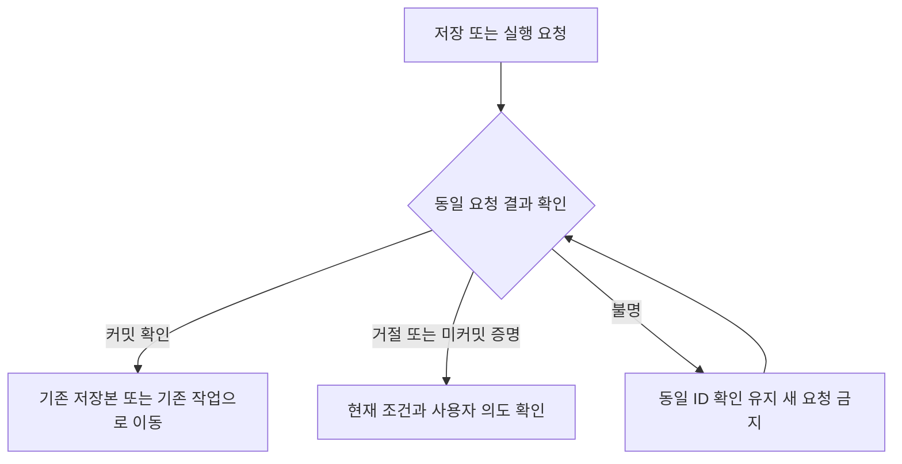
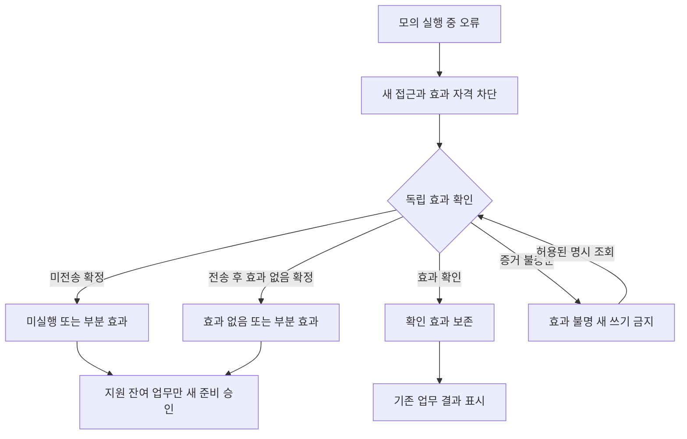
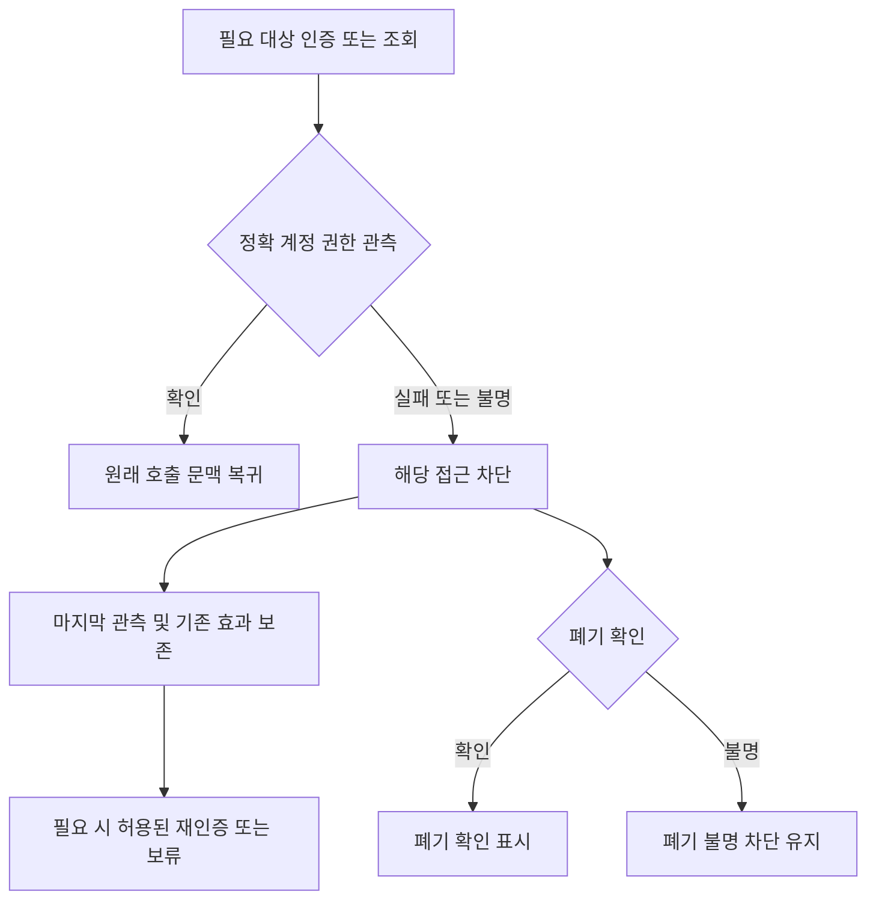

# 찾아you 오류 대응 명세 V1.0 — 원인·영향·보존·전이·복귀 및 재처리

<!-- Generated by tools/project_docs.py. Source: docs/artifacts/planning/lesson-registration-20261126/integrated/error-response-v1.0.json -->
[작업 원본](../../artifacts/planning/lesson-registration-20261126/integrated/error-response-v1.0.json) · [논리 상태](LOGICAL-STATE-V1.0.md) · [화면 설계](ABSTRACT-SCREENS-V1.0.md)

R01 검토 후보 · 승인 서비스 범위 V1.0 유지 · mock-only · R1 보완 · 2026-11-27

기존 32개 오류 유형과 36 공통 업무·44 플랫폼 업무/144 체크포인트·17 상태 축/73 전이·155 행동/693 분기의 연결을 보존하고, 업무별 오류의 영향 범위·보존 정보·상태 판정·화면 복귀·자동/직접 조치 및 재처리 자격을 분리한다.

제품 범위 V1.0 승인 유지. 오류 대응 R1 및 LT-70/AX17을 논리 상태 정본 후보에 반영. 실제 실행 mock-only, 팀원 원본·main 변경 없음.

## 공통 안전·복구 규칙

- **ERR-R01 정본과 표시 분리** — 오류 이벤트는 정본 상태를 근거 없이 변경하지 않는다. 같은 요청/준비/revision/generation/효과와 순서를 검증한다.
- **ERR-R02 단일 요청 일관성** — 내부 명령 결과 불명은 동일 요청 ID 확인. 조회 404/응답 유실만으로 미커밋이 아니다. 새 명령은 권위 있는 거절/미커밋 및 사용자 의도 확인 후.
- **ERR-R03 단계별 효과 일회성** — confirmed 또는 unknown 효과의 동일 논리 쓰기 금지. 미발생 확정, 이전 지연 실행 봉쇄, 현재 조건 및 새 승인된 정확 업무만 새 시도.
- **ERR-R04 안전 종료** — 수락 이후 오류/권리 행사에서 새 접근·효과 자격 차단, 진행 시도 독립 확인/불명 보존. 단순 화면 이탈은 취소 아님. 사용자 일반 중단·롤백 기능 미채택.
- **ERR-R05 부분 성공** — 다른 대상·단계 성공 보존. 미확인 효과가 하나라도 있으면 해당 대상 effect_unknown이며 확인 효과 수·잔여 범위 별도 표기.
- **ERR-R06 읽기와 목표 분리** — 조회 요청 종료, 최신 관측/마지막 관측, 업무 효과, native 상태, 모집 목표 및 폐기 상태를 독립 표기.
- **ERR-R07 허용 경계** — 실제 외부 접근/실행 전부 mock-only. hold/local/조건부는 외부 단계 실행 불가. 운영사 허용·실제 규격/증거 미확인.
- **ERR-R08 최소 사용자 행동** — 정확한 문제·근거·영향과 필요한 선택만 제공. 시스템이 동일 키 결과 확인·재검증·판정·정리를 자동 담당. 사용자 재입력·성공 확인 클릭 없음.
- **ERR-R09 정보 보호** — 사고 메타에는 owner 범위, 요청/효과/관측 ID, 이유, 시각·근거 수준만 필요한 범위 보존. 비밀/인증 원문 저장 금지. 접근과 폐기 확인 분리.
- **ERR-R10 다중 오류 우선순위** — owner/권리·접근 제한과 쓰기 fence 우선; 기존 effect unknown 및 수락/저장 불명 해소 우선; 그 후 준비·입력 보완. 원인 여러 개는 보존하되 사용자는 현재 가능한 조치만.

## 오류 흐름도

### 저장·요청 수락 불명

### 외부 실행 및 부분 효과

### 인증 및 조회 실패

## 32개 오류별 처리 계약

### ER-01 · 서비스 인증/동일 owner

- 발생 조건: 인증 실패·만료·가입 결과 불명·기존 owner 확인 실패
- 영향 단위: 서비스 인증 문맥 및 가입 명령 · 화면: V0
- 시스템 대응: 자료 반환/새 owner 생성 차단, 기존 인증 관계 및 생성 결과 확인
- 보존: 기존 owner·기존 저장본; 인증 비밀은 보존 대상 아님
- 상태 판정: 인증 실패/만료: LT-02. 가입 명령 불명: LT-15/17, 권위 있는 결과 LT-16. 같은 owner 확인 후 새 문맥 LT-01.
- 사용자 및 재처리: 공식 복구/재인증만 필요시 요청; 기존 명령 결과부터 확인.
- 완료 조건: 동일 owner 확인 전 접근 차단
- 금지: 불명에서 새 owner 생성/타인 데이터 반환
- 관련 참조: SW-01 · SW-02 · SW-35 · SW-36 / LT-01 · LT-02

### ER-02 · 소유권/접근 거절

- 발생 조건: owner 불일치·대상 권한/존재 불명
- 영향 단위: 요청 단위 접근 및 정확 owner · 화면: V0/H/호출 영역
- 시스템 대응: 타 owner의 존재·정보 반환 및 변경 금지, 본인 허용 목록만 표시
- 보존: 인증된 본인 문맥·기존 원본/업무; 거절 대상 정보 비노출
- 상태 판정: 해당 요청 거절 LT-13(내부 명령인 경우). 읽기 요청 진행 중 권한 상실 LT-46. 인증 자체 상실만 LT-02.
- 사용자 및 재처리: 본인 허용 목록에서 대상 선택; 필요시 새 인증.
- 완료 조건: 권한 확인된 대상만 반환
- 금지: 타 owner 접근 거절만으로 본인 세션 전체 종료 또는 객체 존재 공개
- 관련 참조: SW-01 · SW-02 · SW-03 · SW-04 · SW-07 · SW-08 · SW-09 · SW-15 · SW-18 · SW-22 · SW-29 · SW-30 · SW-34 · SW-35 · SW-36 / LT-01 · LT-02 · LT-09 · LT-10 · LT-11 · LT-12 · LT-13 · LT-33

### ER-03 · 원문/파일/권리

- 발생 조건: 수신 실패·필수 자료 부족·형식·첨부 권리 불명
- 영향 단위: 원본 편집 문맥/자료 revision · 화면: E
- 시스템 대응: 유효 입력 보존, 문제 항목/파일 및 근거 표시, 외부 전송 차단
- 보존: 정상 자료·확인 사실·기존 저장 revision
- 상태 판정: 추출 중 현재 자료 오류 LT-04; 문제 자료 변경 LT-06, 검증 완료 LT-05; 외부 준비 영향 시 LT-24.
- 사용자 및 재처리: 문제 자료만 수정/제거; 필요 권리 확인.
- 완료 조건: 필수 사실·첨부 권리 확인 또는 보류
- 금지: 불명 권리 자료 외부 제공, 정상 자료 재입력 요구
- 관련 참조: SW-04 · SW-05 · SW-06 · SW-11 · SW-12 · SW-32 / LT-03 · LT-04 · LT-05 · LT-06 · LT-19

### ER-04 · AI 추출/사실 불확실

- 발생 조건: 추출 실패·원문 근거 없음·사실 충돌
- 영향 단위: 현재 추출 요청과 편집 revision · 화면: E
- 시스템 대응: 추정값을 사실로 저장하지 않고 확인된 값·근거 보존
- 보존: 원문, 확인값, 근거, 현재 편집값
- 상태 판정: 현재 추출 실패 LT-04; 직접 정정/검증 LT-05; 재추출 LT-03. 낡은 응답은 적용하지 않음.
- 사용자 및 재처리: 필요 사실만 보완하거나 직접 입력.
- 완료 조건: 검토된 사실 확보 또는 미완료
- 금지: 추정값을 확인 사실로 저장
- 관련 참조: SW-05 · SW-06 · SW-11 · SW-12 · SW-13 / LT-03 · LT-04 · LT-05 · LT-06 · LT-19

### ER-05 · 원본 조회/동시 수정

- 발생 조건: 원본 조회 실패·기준 revision 충돌
- 영향 단위: 원본 lineage/revision과 조회·저장 요청 · 화면: E/H
- 시스템 대응: 현재 저장값 덮어쓰기 금지, 최신 저장본과 편집본 분리
- 보존: 기존 커밋·사용자 미저장 편집·차이
- 상태 판정: 읽기 불가이면 확인 불가 표시; 충돌 저장의 정확 거절 LT-13/16. 현재 입력 변경 LT-06, 관련 미수락 준비 LT-24.
- 사용자 및 재처리: 최신 허용 revision 조회 및 변경 병합 선택; 동일 저장 결과 불명은 ER-06.
- 완료 조건: 정확 기준 revision 확인
- 금지: 최신 원본 덮어쓰기/자동 병합
- 관련 참조: SW-03 · SW-04 · SW-05 · SW-06 · SW-07 · SW-35 / LT-05 · LT-06 · LT-07 · LT-08 · LT-09 · LT-10 · LT-12 · LT-13 · LT-24

### ER-06 · 저장 실패/응답 불명

- 발생 조건: 저장 거절·응답 유실·성공/실패 구분 불가
- 영향 단위: 동일 내부 저장 명령 · 화면: E
- 시스템 대응: 동일 저장 요청 ID와 owner·원본·revision으로 결과 확인; 확인 전 성공 이동/재저장 금지. 안전 화면 이탈 및 동일 요청 복귀 가능. W 인라인 원본 저장도 동일 키 확인, 커밋 확인 후 기존 미수락 준비 복귀; 불명 중 승인/새 실행 금지.
- 보존: owner·명령 ID·정규화 입력·편집본·기존 커밋
- 상태 판정: 응답 유실 LT-15, 불명 유지 LT-17. 커밋 확인 LT-12/16/07(신규/변경 LT-09/10); 거절 또는 미커밋 LT-13/14/16. 저장 불명에서 성공 이동/새 저장·폐기 금지; 화면 자체의 안전 이탈은 가능, 같은 명령 ID로 복귀.
- 사용자 및 재처리: 시스템 동일 키 조회; 미커밋/거절 확정 후 사용자 의도가 있는 현재 revision 새 저장.
- 완료 조건: 정확 저장 버전 또는 실패/불명 확인
- 금지: 불명 중 새 저장 ID/자동 이동/폐기
- 관련 참조: SW-07 · SW-18 · SW-35 / LT-07 · LT-08 · LT-09 · LT-10 · LT-12 · LT-13 · LT-14 · LT-15 · LT-16 · LT-17

### ER-07 · 업무/단계 미지원·정책 불명

- 발생 조건: 업무·접근·읽기/쓰기 단계 불허·불명
- 영향 단위: 대상·업무·단계별 지원 및 권한 · 화면: W/R/A
- 시스템 대응: 관련 외부 접근 차단, 제한 및 내부 작성 가능 여부 표시
- 보존: 원본·준비·이전 확인/불명 효과와 제한 근거
- 상태 판정: 미수락 LT-21; 수락 후 권한/정책 상실 LT-35/37 및 해당 효과에 따라 LT-40/41/42/43, LT-59~63; 읽기/안내 제한 LT-68. 필수 readback 지원/읽기 권한 불가 시 신규 쓰기 보류, 전송된 효과는 확인 또는 불명.
- 사용자 및 재처리: 내부 작성안 가능하면 W/D, 아니면 보류; 수락 효과는 R에서 구분.
- 완료 조건: 외부 효과 없음
- 금지: 허용 불명 외부 접근; 이미 발생한 효과 없음으로 판정
- 관련 참조: SW-09 · SW-10 · SW-11 · SW-12 · SW-14 · SW-15 · SW-16 · SW-17 · SW-20 · SW-21 · SW-22 · SW-23 · SW-24 · SW-25 · SW-26 · SW-27 · SW-28 · SW-30 · SW-31 · SW-32 · SW-33 · SW-34 / LT-13 · LT-18 · LT-20 · LT-21 · LT-23 · LT-24 · LT-30 · LT-32 · LT-33 · LT-34 · LT-35 · LT-38 · LT-39 · LT-44 · LT-46 · LT-52 · LT-54 · LT-55 · LT-60 · LT-67 · LT-68

### ER-08 · 입력안 준비 실패

- 발생 조건: 변환·검증 실패·필수값 불명
- 영향 단위: 대상별 준비 revision · 화면: W
- 시스템 대응: 해당 대상 입력 보존, 실패 상태 및 문제 항목 표시, 외부 요청 없음
- 보존: 원본, 정상 변환값, 다른 대상 준비
- 상태 판정: 현재 실패 LT-19; 보완/재준비 LT-18; 실제 검증 LT-20; 해결 불가 LT-21.
- 사용자 및 재처리: 필요 사실 또는 대안만 제시; 내부 재검증.
- 완료 조건: 유효 현재 준비 revision 또는 보류
- 금지: 다른 대상 초기화/외부 제출
- 관련 참조: SW-11 · SW-12 · SW-13 · SW-19 · SW-21 · SW-32 / LT-18 · LT-19

### ER-09 · 가격·시간·회차·규격

- 발생 조건: 단위/상한/세금/회차/제공 조건 불명 또는 충돌
- 영향 단위: 대상별 필드 의미·규칙 snapshot · 화면: W
- 시스템 대응: 임의 사실 변경 금지, 실제 제약과 근거 표시 실제 변경 효과·공유 범위에 R4 정책 적용: 원본 가격/단위/계약·활동명·공개 권리 불명은 영향 대상/효과만 보류.
- 보존: 확인 원본·단위·플랫폼별 파생값·근거
- 상태 판정: 현재 준비 LT-19 또는 LT-21; 정정 후 LT-18/20; 의미 변경 LT-24/31.
- 사용자 및 재처리: 정확 실제 사실 또는 허용 표현 대안 선택.
- 완료 조건: 의미·규격 확인 또는 해당 대상 보류
- 금지: 가격/시간/회차의 의미 임의 변경
- 관련 참조: SW-10 · SW-11 · SW-12 · SW-13 · SW-19 · SW-21 · SW-26 · SW-32 / LT-18 · LT-19 · LT-20 · LT-21 · LT-30

### ER-10 · 오래된 준비·늦은 응답

- 발생 조건: 원본·규칙·권한·외부 값 변경, 준비 revision 불일치
- 영향 단위: 요청·준비·검토 revision과 수락 전후 경계 · 화면: W
- 시스템 대응: 낡은 결과와 영향받은 승인 적용 금지, 현재 대상만 재검증
- 보존: 현재 값·이전 승인 이력·수락/효과 원장
- 상태 판정: 미수락 영향 LT-24/29/31; 같은 준비 LT-18; 수락 후 현재 실행 guard 상실 LT-35; 정확 옛 증거는 기존 효과에만 매칭.
- 사용자 및 재처리: 바뀐 대상만 재검토; 수락 불명은 ER-17, 효과 불명은 ER-19.
- 완료 조건: 현재 revision·조건 일치 또는 보류
- 금지: 낡은 승인 재사용 또는 동결된 대상 교체
- 관련 참조: SW-05 · SW-06 · SW-07 · SW-09 · SW-10 · SW-11 · SW-12 · SW-13 · SW-15 · SW-19 · SW-20 · SW-21 · SW-22 · SW-23 · SW-24 · SW-26 · SW-27 · SW-33 · SW-35 / LT-03 · LT-04 · LT-05 · LT-06 · LT-07 · LT-10 · LT-12 · LT-13 · LT-18 · LT-19 · LT-20 · LT-23 · LT-24 · LT-25 · LT-29 · LT-30 · LT-31 · LT-32 · LT-33 · LT-38

### ER-11 · 외부 인증 실패·만료·취소

- 발생 조건: 외부 로그인·추가 인증 실패·만료·취소 또는 결과 불명
- 영향 단위: 외부 업무 한정 인증 문맥/generation · 화면: X→호출 영역
- 시스템 대응: 새 접근 차단, 내부 준비 보존, 해당 인증 세션 정리
- 보존: 내부 준비·기존 효과·실패 이유; 비밀 자료 제외
- 상태 판정: 인증 LT-55; 자원 의무 LT-56/57/58. 준비 LT-19/21; 수락 업무가 실제 권한 상실 시 LT-35/37; 읽기 LT-46.
- 사용자 및 재처리: 원 호출 문맥으로 복귀, 허용된 필요한 대상만 새 인증 generation.
- 완료 조건: 정확 계정 권한 검증 또는 보류
- 금지: 단순 뷰어 이탈을 인증 실패/실행 취소로 간주; 오래된 인증 신호 수락
- 관련 참조: SW-14 · SW-15 · SW-16 · SW-17 · SW-28 · SW-30 · SW-33 · SW-34 / LT-19 · LT-35 · LT-44 · LT-46 · LT-52 · LT-53 · LT-54 · LT-55 · LT-56

### ER-12 · 외부 계정·권한 불일치

- 발생 조건: 실제 계정과 기대 계정 다름·권한 부족·소유권 불명
- 영향 단위: 기대 계정/권한/객체 binding · 화면: X/W/R/A
- 시스템 대응: 계정 자동 교체·쓰기 금지, 해당 대상/준비/승인 무효화
- 보존: 기존 계정 관계·검토/효과 이력
- 상태 판정: 불일치 LT-55, 필요 LT-56; 미수락 LT-28/24/31; 수락 후 LT-35/37. 정확 계정만 LT-54/27. 최초 계정은 identity-only 확인 후 명시 현재 사용 선택; 기존 기대 계정 불일치와 구분.
- 사용자 및 재처리: 명시 대상 재선택·새 준비 또는 보류.
- 완료 조건: 정확 계정·권한·대상 확인
- 금지: 외부 계정 자동 교체, 기존 고정 승인 재사용
- 관련 참조: SW-02 · SW-14 · SW-15 · SW-16 · SW-17 · SW-21 · SW-22 · SW-23 · SW-24 · SW-28 · SW-30 · SW-33 · SW-34 / LT-19 · LT-20 · LT-24 · LT-25 · LT-26 · LT-27 · LT-28 · LT-29 · LT-32 · LT-33 · LT-34 · LT-35 · LT-38 · LT-39 · LT-44 · LT-46 · LT-52 · LT-53 · LT-54 · LT-55 · LT-60

### ER-13 · 직접 선행 업무

- 발생 조건: 외부 가입·전문가 인증·약관 동의·정산 미완료 또는 불명
- 영향 단위: 직접 선행 업무·해당 대상 · 화면: X→호출 영역
- 시스템 대응: 비밀/민감 자료 수집 및 대리 수행 금지, 공식 직접 경로 안내
- 보존: 내부 준비·확인된 자격/단계 근거; 인증 민감자료 제외
- 상태 판정: 선행 미확인 LT-19/21; 필요한 공식 인증 흐름 LT-52~54; 제한 내부 LT-68.
- 사용자 및 재처리: 공식 경로에서 강사 직접 수행 후 허용 독립 확인.
- 완료 조건: 허용된 독립 확인 또는 미실행
- 금지: 대리 가입·약관 동의·정산/민감증빙 수집
- 관련 참조: SW-10 · SW-14 · SW-16 · SW-17 / LT-19 · LT-21 · LT-52 · LT-53 · LT-54 · LT-68

### ER-14 · 정확 객체/하위 객체 불명

- 발생 조건: 객체 없음·후보 충돌·오인 대상·내부 연결 불명
- 영향 단위: 정확 외부 객체/하위 객체 또는 신규 slot · 화면: W/R/H
- 시스템 대응: 쓰기 금지, 허용 후보/근거만 표시, 오인 대상/승인 제거
- 보존: 기존 관계, 식별 후보, 이전 효과/관측
- 상태 판정: 식별 불명 LT-28; 미수락 LT-19/21/24/31; 정확 근거 LT-26/27. 수락 대상 불일치 LT-35.
- 사용자 및 재처리: 필요한 정확 후보 선택은 보조 근거; 허용 읽기로 확인.
- 완료 조건: 정확 owner·계정·객체·원본 관계 확인
- 금지: 미조회=0건, 다른 객체를 기존 객체로 대체
- 관련 참조: SW-02 · SW-08 · SW-09 · SW-12 · SW-15 · SW-17 · SW-18 · SW-19 · SW-20 · SW-21 · SW-22 · SW-23 · SW-24 · SW-25 · SW-26 · SW-27 · SW-28 · SW-29 · SW-30 · SW-31 / LT-09 · LT-19 · LT-20 · LT-21 · LT-25 · LT-26 · LT-27 · LT-28 · LT-29 · LT-30 · LT-32 · LT-33 · LT-38 · LT-42 · LT-44 · LT-45 · LT-46 · LT-47 · LT-48 · LT-54 · LT-71

### ER-15 · 중복 후보·이전 효과 불명

- 발생 조건: 동일 요청/객체 존재 또는 이전 외부 효과 불명
- 영향 단위: 동일 논리 효과/요청 키 · 화면: W/R
- 시스템 대응: 새 쓰기 차단, 동일 요청·정확 기존 효과만 허용 읽기로 확인
- 보존: 기존 요청, 객체, 효과 ID/시도와 근거
- 상태 판정: 미수락 LT-28/21; 명령 불명 LT-15/17; 효과 unknown LT-41/63/69; 독립 확인 LT-42/43. 확인 효과는 보존. 정규 충돌 영역에 활성 claim·미확인·분쟁이 겹치면 새 쓰기 차단; effect ID 변경으로 우회 금지.
- 사용자 및 재처리: 정확 기존 효과의 명시 허용 조회; 필요한 경우 별도 지원 잔여 업무 준비.
- 완료 조건: 기존 효과 확인 또는 불명 유지
- 금지: 중복 클릭/타임아웃을 새 쓰기 자격으로 해석
- 관련 참조: SW-08 · SW-09 · SW-17 · SW-18 · SW-20 · SW-21 · SW-22 · SW-23 · SW-24 · SW-25 · SW-26 · SW-27 · SW-28 · SW-29 · SW-31 · SW-35 / LT-09 · LT-11 · LT-12 · LT-20 · LT-21 · LT-25 · LT-26 · LT-27 · LT-28 · LT-32 · LT-33 · LT-34 · LT-38 · LT-39 · LT-40 · LT-41 · LT-43 · LT-60 · LT-63 · LT-70 · LT-71 · LT-72 · LT-73

### ER-16 · 승인 거절·변경·철회

- 발생 조건: 내용/범위 거절·대상/조건/revision 변경·철회
- 영향 단위: 미수락 승인안 또는 수락된 업무 권리 제한 · 화면: W/R
- 시스템 대응: 수락 전 새 효과 차단, 영향 대상 재검토; 수락 후 기발생 효과 원복 금지
- 보존: 확인된 기존 준비·동결 승인·기발생 효과
- 상태 판정: 수락 전 LT-31/22/24; 수락 불명 ER-17; 수락 후 권리 제한 LT-35/37/55 및 결과 별도.
- 사용자 및 재처리: 수락 전 변경 대상만 재검토; 수락 후 권리 행사는 접근 차단이지 일반 중단/원복이 아님.
- 완료 조건: 현재 양 승인 또는 미실행/효과 확인
- 금지: 이미 수락된 승인 소급 삭제·자동 원복
- 관련 참조: SW-10 · SW-13 · SW-19 · SW-20 · SW-21 · SW-22 · SW-23 · SW-24 · SW-25 · SW-26 · SW-27 · SW-31 · SW-33 / LT-12 · LT-13 · LT-21 · LT-22 · LT-23 · LT-24 · LT-25 · LT-30 · LT-31 · LT-32 · LT-33 · LT-35 · LT-38 · LT-39 · LT-55

### ER-17 · 요청 수락 불명·중복 클릭

- 발생 조건: 요청 응답 유실·수락 여부 불명·중복 클릭
- 영향 단위: 동일 수락 명령 ID 및 정규화 입력 · 화면: W/R
- 시스템 대응: 동일 요청 ID 조회, 동일 대상 새 요청·실행 금지
- 보존: 준비 revision·양 승인 snapshot·동일 키·기존 수락 기록
- 상태 판정: LT-15/17; 동일 커밋 확인 LT-16이면 기존 AX09로 이동; 거절/미커밋 증명 LT-13/14/16 후에만 새 명시 요청.
- 사용자 및 재처리: 자동 동일 키 확인, W 또는 기존 R 표시.
- 완료 조건: 기존 수락 여부 확인 또는 불명
- 금지: 불명에서 새 수락 또는 기존 동결 승인 재사용
- 관련 참조: SW-09 · SW-22 · SW-23 · SW-24 · SW-35 / LT-12 · LT-13 · LT-14 · LT-15 · LT-16 · LT-17 · LT-25 · LT-32 · LT-33 · LT-34 · LT-38

### ER-18 · 실행 실패/미실행 확정

- 발생 조건: 단계 사전조건 실패 또는 효과 없음이 독립 확인됨
- 영향 단위: 수락 업무 및 정확 개별 효과 · 화면: R→W
- 시스템 대응: 실패 단계/대상 표시, 성공 대상 제외, 새 쓰기 자동 시작 금지
- 보존: 시도·미전송 증거·성공 대상·기존 효과
- 상태 판정: LT-35/37; 예약 미전송 LT-40, 시도 후 효과 없음 LT-43; 전부 미전송 LT-60, 시도 있으나 없음 LT-61; 일부 확인 LT-62, 불명 존재 LT-63. 예약/전송 개시와 실제 전송 증거 구분. 미전송 확정 LT-60/70, 전송 후 효과 없음 LT-61, 근거 부족 LT-63/69.
- 사용자 및 재처리: R에서 새 준비 가능한 정확 미발생/지원 잔여 범위만 선택.
- 완료 조건: 현재 새 준비 및 승인 전 재쓰기 없음
- 금지: 응답 실패만으로 미실행 확정; 전체 CREATE 반복
- 관련 참조: SW-23 · SW-24 · SW-25 · SW-26 · SW-27 · SW-28 · SW-29 · SW-31 / LT-34 · LT-35 · LT-37 · LT-39 · LT-40 · LT-41 · LT-43 · LT-60 · LT-61 · LT-62 · LT-70

### ER-19 · 외부 저장·제출·갱신 효과 불명

- 발생 조건: 외부 효과 단계 응답 유실·독립 확인 불가
- 영향 단위: 개별 효과 시도/업무 결과 · 화면: R
- 시스템 대응: 효과 미확인으로 기록, 실패/미실행 단정 금지, 새 쓰기 차단
- 보존: 승인 snapshot·정확 효과 ID·전송/조회 증거·확인 효과
- 상태 판정: LT-41→LT-63, 안전 종료 LT-35/37; 별도 허용 관측 LT-44~46, 효과 확인 LT-42/43, 결과 보완 LT-61/62/64/69 및 LT-70. 확정 근거 상충은 LT-71/73 분쟁 처리, 해소 LT-72; 과거 판정 보존. 승인 readback은 추가 클릭 없이 후보 처리.
- 사용자 및 재처리: R에서 기존 효과 확인 또는 불명 유지.
- 완료 조건: 효과 확인 또는 미확인 유지
- 금지: 시간초과/버튼 오류/조회 불가를 실패로 단정하거나 새 쓰기
- 관련 참조: SW-17 · SW-23 · SW-24 · SW-25 · SW-26 · SW-27 · SW-28 · SW-29 · SW-30 · SW-31 · SW-33 · SW-35 / LT-28 · LT-35 · LT-36 · LT-37 · LT-39 · LT-40 · LT-41 · LT-42 · LT-43 · LT-45 · LT-47 · LT-48 · LT-59 · LT-60 · LT-61 · LT-62 · LT-63 · LT-64 · LT-69 · LT-70 · LT-71 · LT-72 · LT-73

### ER-20 · 반려·심사·모집 후속

- 발생 조건: 반려·심사 중 수정 제한·사유 미제공·최초 모집 조건 불명
- 영향 단위: 외부 native 상태와 모집 목표·후속 업무 · 화면: R→W
- 시스템 대응: 관측 상태와 사유/불명 분리, 자동 재접수/모집 오픈 금지
- 보존: 기존 효과·심사 결과·실제 사유/미확인·시각
- 상태 판정: 정확 native LT-47/48, 목표 LT-49/50/51; RESPOND LT-67; 후속 쓰기는 새 준비 LT-18·승인 LT-32/33.
- 사용자 및 재처리: 사유·제약을 읽고 지원되는 후속 작업만 선택.
- 완료 조건: 업무별 새 승인 전 쓰기 없음
- 금지: 심사 접수=모집 성공, 자동 반려 수정/재접수
- 관련 참조: SW-29 · SW-31 / LT-36 · LT-47 · LT-49 · LT-50 · LT-51 · LT-59 · LT-67

### ER-21 · 복수 플랫폼 부분 성공

- 발생 조건: 성공·실패·미실행·미확인 대상 혼재; 단일 대상 내부 단계별 확인/미발생/불명 혼재 포함
- 영향 단위: 묶음 및 개별 대상/효과 · 화면: R→W
- 시스템 대응: 대상별 상태 독립 표시, 성공 대상 제외·불명 새 쓰기 금지; 단계별 효과 보존, 신규 객체 전체 재생성 금지 개별 fence/종료와 요청 전체 진행 독립; 독립 대상은 현재 자격 충족 시 계속. 모든 수락 대상 종료 시만 요청 종료.
- 보존: 각 대상의 승인·시도·확인·불명·미실행 및 결과 이력
- 상태 판정: 각 AX09/AX10 독립; LT-59~63 대상별 판정; 종료 후 LT-61/62/64/69/LT-70. 불명 하나라도 있으면 해당 대상 effect_unknown, 확인 효과 개별 표시. 잔여 효과는 독립 경로 검증·정확 기존 대상·미발생/지연 봉쇄·새 승인 전 보류.
- 사용자 및 재처리: 정확 미실행/효과 없음 대상 또는 지원 잔여 업무만 새 준비.
- 완료 조건: 대상별 상태와 효과 보존
- 금지: 묶음 전체 재시작, 성공 대상 반복, 부분 효과 원복
- 관련 참조: SW-23 · SW-25 · SW-26 · SW-27 · SW-28 · SW-29 · SW-31 / LT-36 · LT-37 · LT-41 · LT-42 · LT-43 · LT-59 · LT-60 · LT-61 · LT-62 · LT-63 · LT-64 · LT-70 · LT-71 · LT-72 · LT-73

### ER-22 · 상태 조회 실패/마지막 관측

- 발생 조건: 읽기 불허·만료·조회 실패·이전 관측 없음
- 영향 단위: 조회 요청/외부 관측·목표 · 화면: R/H
- 시스템 대응: 마지막 관측·시각 보존, 없음/불명 표시, 미노출 원인 추정 금지
- 보존: 마지막 확인값·시각·근거·요청 순번
- 상태 판정: 조회 LT-46; 수락 읽기 LT-66. 적합 후속 조회 LT-44/45/47; 현재 목표 증거 부족 LT-51; 기존 확인 기록 유지.
- 사용자 및 재처리: 필요시 허용된 조회/인증, 마지막 관측 확인.
- 완료 조건: 요청 종료와 최신 관측 성공/불가 분리, 마지막 관측 시각·근거 보존
- 금지: 조회 실패를 미등록/미노출/효과 없음으로 치환
- 관련 참조: SW-03 · SW-17 · SW-19 · SW-28 · SW-29 · SW-30 · SW-31 / LT-26 · LT-27 · LT-28 · LT-36 · LT-41 · LT-43 · LT-44 · LT-45 · LT-46 · LT-47 · LT-48 · LT-49 · LT-50 · LT-51 · LT-63 · LT-64 · LT-65 · LT-66 · LT-69

### ER-23 · 인증 세션 폐기·해제 불명

- 발생 조건: 폐기·해제·철회 결과 불명/실패
- 영향 단위: 업무 인증 generation 및 자원 폐기 · 화면: R/A/G
- 시스템 대응: 새 접근 차단 유지, 종료/폐기 확인 불명 별도 기록 및 운영 확인 W/X/A/G/R 모든 원 호출에서 자원 차단 후 폐기 의무 독립 실행, 폐기 불명 즉시 운영 기준선 전달; 알림이 차단/정리 전제 아님.
- 보존: 접근 차단 증거, 자원 식별 비밀 아닌 메타, 기존 업무 결과
- 상태 판정: LT-55/56/58; 정확 실제 폐기 증거 LT-57. 차단 상태 유지. AX16 결과와 별도.
- 사용자 및 재처리: 폐기 확인 경로 제공; 운영 정리 재시도는 폐기 작업만.
- 완료 조건: 접근 차단 및 폐기 확인 또는 제한
- 금지: 새 접근 자동 복원, 폐기 불명 숨기기
- 관련 참조: SW-14 · SW-15 · SW-16 · SW-24 · SW-29 · SW-30 · SW-33 · SW-34 · SW-35 · SW-36 / LT-02 · LT-35 · LT-36 · LT-37 · LT-55 · LT-56 · LT-57 · LT-58

### ER-24 · 직접 작성안/사용자 보고

- 발생 조건: 작성안 미완료·권리 불명·사용자 보고만 있음
- 영향 단위: 내부 작성안·현재 원본 및 규격 · 화면: W/D
- 시스템 대응: D 진입 전 보완, 사용자 보고와 독립 관측 분리, 대행 성공 표기 금지
- 보존: 검증된 사실·작성안·제한 근거
- 상태 판정: 내부 준비 불충분 LT-19/21; 내부 제공 LT-67, 제한 LT-68. 사용자 보고 기록 기능은 미채택.
- 사용자 및 재처리: 내부 보완 후 D 또는 보류; 강사 직접 이용.
- 완료 조건: 내부 준비 또는 사용자 보고/보류
- 금지: 사용자 직접 보고를 대행 효과/독립 증거로 처리
- 관련 참조: SW-31 · SW-32 / LT-67 · LT-68

### ER-25 · 삭제·연결 해제·권리 요청 제한

- 발생 조건: 진행 업무·미확인 효과·보존 의무·소유권 충돌
- 영향 단위: 정확 내부 원본/관리 관계/권리 명령 · 화면: H/A/G
- 시스템 대응: 영향·제한 설명, 외부 삭제/원복 금지, 허용 내부 요청만 처리 최신 원본/현재 편집과 필요한 동결 승인·최소 증거 참조 분리. 내부 retire와 물리 삭제/익명화 별도. 권리·필요 참조·보존 근거 해소 후 처리; 구체 기한 정책 후속.
- 보존: 기존 커밋·효과·보존 의무·권리 접수 증거
- 상태 판정: 정확 제한 LT-13/16; 허용 내부 처리 LT-12/11; 응답 불명 LT-15/17. 권리 제한시 LT-55/56, 수락 업무 LT-35.
- 사용자 및 재처리: 영향 설명 후 허용 내부 처리·문의 또는 결과 확인.
- 완료 조건: 내부 처리 확인 또는 제한
- 금지: 외부 삭제·원복, 불명 효과/보존 의무 무시
- 관련 참조: SW-02 · SW-08 · SW-18 · SW-34 · SW-36 / LT-09 · LT-10 · LT-11 · LT-12 · LT-13 · LT-56

### ER-26 · 이탈·재접속·로그아웃

- 발생 조건: 미저장 변경·수락/진행 중 이탈·세션 만료
- 영향 단위: 화면 이탈과 인증/수락 작업 · 화면: H/V0/W/R
- 시스템 대응: 저장/미저장·기존 수락 요청 분리, 이탈로 실행/취소/재실행 없음 W 인라인 저장 불명 포함 동일 명령/준비 문맥 보존. 명시 미저장 폐기만 LT-08, 일반 화면 이탈로 폐기하지 않음.
- 보존: 미저장 편집·저장 여부·수락 ID/효과·정확 owner
- 상태 판정: 단순 이탈 상태 변경 없음; 명시 폐기 LT-08; 로그아웃/만료 LT-02/55/56, 필요 LT-35/37; 같은 요청 확인 LT-16/17. 저장/수락 불명 이탈 가능. 서비스 인증 문맥 종료 시 모든 화면 V0, 동일 owner 검증 후 안전 원 호출 복귀; X 자동 재개 없음.
- 사용자 및 재처리: 필요시 저장/폐기 선택·동일 owner 재인증·기존 작업 열기.
- 완료 조건: 동일 작업 복귀 또는 제한
- 금지: 이탈로 실행·취소·새 요청·자동 재개
- 관련 참조: SW-01 · SW-02 · SW-07 · SW-08 · SW-09 · SW-14 · SW-33 · SW-34 · SW-35 · SW-36 / LT-02 · LT-08 · LT-15 · LT-35 · LT-52 · LT-55 · LT-56

### ER-27 · 조건부 모니터링

- 발생 조건: 별도 정책 미채택·기간/범위/권한 불명·조회/알림 실패
- 영향 단위: 미채택 자동 모니터링 · 화면: 미제공
- 시스템 대응: 기본 미제공, 채택 시 허용 읽기만, 오류 대상 차단 및 마지막 관측 유지
- 보존: 기존 제품 결정·명시 조회 기록
- 상태 판정: 전용 상태/전이 없음; 요청 자체 미제공. 일반 명시 조회에만 ER-22.
- 사용자 및 재처리: 지원 제한 안내; 필요하면 사용자 명시 조회.
- 완료 조건: 채택 전 미실행, 채택 후 확인 상태
- 금지: 자동 주기 읽기/알림, M 화면 도입
- 관련 참조:  / 

### ER-28 · 모니터링 종료·폐기

- 발생 조건: 철회·만료·종료/해제 불명
- 영향 단위: 미채택 모니터링 종료 · 화면: 미제공
- 시스템 대응: 새 조회 차단과 폐기 확인 분리, 자동 재개 금지
- 보존: 기존 제품 결정·일반 업무 종료 기록
- 상태 판정: 전용 상태/전이 없음. 일반 업무 인증 정리는 ER-23.
- 사용자 및 재처리: 자동 모니터링 종료 조작 제공 안 함.
- 완료 조건: 접근 차단 유지 및 폐기 확인 또는 불명
- 금지: 모니터링 권한/재개 기능 추가
- 관련 참조:  / 

### ER-29 · 플랫폼 고유 효과·부수 변화

- 발생 조건: 첫 모집 일정·대표 관계·같은 공고 갱신·공유 필드/비용/효과 불명
- 영향 단위: 플랫폼 고유 정확 객체·부수 효과 · 화면: W/R
- 시스템 대응: 독립 업무·정확 대상·예정 효과 분리, 허용 불명 실행 금지 크몽 계정 한도·탈잉 동일 클래스 교차 플랫폼 가격 조건·숨고 활동명 변경 등 실제 효과의 적용 조건 및 경합 확인. 무관한 독립 변경만 정확 승인·지원 확인 후 진행.
- 보존: 원본·예정 효과·공유 영향·비용 근거·이전 효과
- 상태 판정: 미수락 LT-19/21/24/31; 정확 효과 자격 LT-38/39, 불명 LT-41/63; native/목표 LT-47~51. 조건부 업무 미채택 LT-68(허용 내부 안내만). 자동저장·첨부·공유 효과 등 실제 영향 범위 미확정 시 보류, 물리 결합은 전체 효과 승인/기록 필요.
- 사용자 및 재처리: 승인 가능한 정확 업무와 영향만 검토; 뮬 갱신 후보도 허용 전 실행 없음.
- 완료 조건: 정확 관계·동일 객체 효과 또는 미실행/불명 확인
- 금지: 탈잉 최초 일정/숨고 대표 서비스 조건부 자동 실행, 유료 갱신, 대체 재게시
- 관련 참조: SW-10 · SW-11 · SW-12 · SW-13 · SW-19 · SW-20 · SW-21 · SW-22 · SW-23 · SW-24 · SW-25 · SW-26 · SW-27 · SW-28 · SW-29 · SW-31 / LT-20 · LT-21 · LT-24 · LT-28 · LT-38 · LT-39 · LT-41 · LT-42 · LT-47 · LT-48 · LT-49 · LT-50 · LT-51 · LT-59 · LT-62 · LT-67 · LT-68 · LT-71 · LT-72 · LT-73

### ER-30 · 새 글 재등록·게시 제한

- 발생 조건: 재등록 허용·간격·유사 글 제한·신규 객체 불명
- 영향 단위: 미채택 신규 재등록/게시 제한 · 화면: W
- 시스템 대응: 미채택/불허/불명 차단, 기존 글 삭제·중복·제한 회피·자동 주기 실행 금지
- 보존: 기존 정확 게시물 및 정책 근거
- 상태 판정: LT-21, 내부 작성/안내만 LT-67/68. 독립 재등록 상태·효과 없음.
- 사용자 및 재처리: 제한 안내 또는 충분한 내부 작성안.
- 완료 조건: 내부 준비 또는 정확 새 객체 효과 확인
- 금지: 기존 글 삭제 후 재게시·복제·주기 자동 실행·제한 회피
- 관련 참조: SW-10 · SW-20 · SW-27 · SW-31 · SW-32 / LT-21 · LT-67 · LT-68

### ER-31 · 증거/이력/링크 조회 불가

- 발생 조건: 근거 없음·접근 불가·링크/사유 불명
- 영향 단위: 증거·링크/이력·관측 요청 · 화면: R/H/D
- 시스템 대응: 확인된 정보·관측 수준만 표시, 원인/공개/제재 추정 금지
- 보존: 기존 정확 확인 증거·권한·관측 시각
- 상태 판정: 정확 조회 LT-46/66; native 충돌 LT-48; 목표 증거 부족 LT-51; 효과 불명 LT-41/63/69; 폐기 불명 LT-58. 이미 확인된 과거 증거는 삭제하지 않음. 상충 확정 근거는 AX17 분쟁 원장, 기존 판정 불변.
- 사용자 및 재처리: 허용된 근거 재확인 또는 보류.
- 완료 조건: 근거 수준과 조회 불가 표시
- 금지: 링크 없음=객체 없음, 근거 없는 사유/제재/성공 주장
- 관련 참조: SW-03 · SW-08 · SW-17 · SW-18 · SW-25 · SW-28 · SW-29 · SW-30 · SW-31 · SW-32 · SW-34 · SW-35 · SW-36 / LT-09 · LT-11 · LT-12 · LT-14 · LT-16 · LT-17 · LT-26 · LT-27 · LT-36 · LT-37 · LT-41 · LT-42 · LT-43 · LT-45 · LT-46 · LT-47 · LT-48 · LT-49 · LT-51 · LT-57 · LT-58 · LT-59 · LT-63 · LT-64 · LT-65 · LT-66 · LT-69 · LT-71 · LT-72 · LT-73

### ER-32 · 미분류 오류·안전 종료

- 발생 조건: 실제 원인 또는 정확 선행 조건 미확인
- 영향 단위: 분류 불가 발생의 최소 영향 문맥 · 화면: 호출 W/R
- 시스템 대응: 영향 대상 접근·쓰기 차단, 확인 가능한 근거/기존 효과 보존
- 보존: 확인 자료·이전 승인/효과·실패 관측 및 안전 메타
- 상태 판정: 미수락 LT-21; 수락 LT-35/37, 실제 미전송 증명 LT-40 또는 불명 LT-41; 업무 결과 LT-60~63; 권한 LT-55/56/58. 충돌/분쟁 해소 자체는 재실행 승인 아님.
- 사용자 및 재처리: 확인 가능한 최소 조치만 표시; 운영 조사 후 정확 분류.
- 완료 조건: 구체 조건 확인 전 새 효과 없음
- 금지: 안전 실패를 자동 재시도 또는 정상 완료로 분류
- 관련 참조: SW-10 · SW-23 · SW-24 · SW-28 · SW-29 · SW-31 · SW-33 / LT-34 · LT-35 · LT-37 · LT-38 · LT-40 · LT-41 · LT-55 · LT-58 · LT-63 · LT-68 · LT-70 · LT-71 · LT-72 · LT-73

## 논리 상태 정본에 반영된 보완 전이

- LT-70 AX16: effect_unknown → not_executed
  - 전제: 동일 수락 대상의 모든 예정 효과 미시도 또는 미전송 확인; 실제 전송/확인/미확인 효과 0; 지연 실행 가능성 봉쇄; 정확 증거·판정 revision
  - 결과: AX09 ended 유지; 이전 effect_unknown 결과/증거 보존, 새 결과 판정 버전 not_executed; 자동 재실행 없음

## 수용 시험 후보 (미실행)

- ET-01 저장 응답 유실 — 같은 ID의 커밋 확인 전 성공 이동 금지; 안전 이탈 가능; 새 원본/저장 생성 0 (LT-15/17 → LT-16/07)
- ET-02 승인 수락 응답 유실 및 중복 클릭 — 기존 수락 1건만; 새 실행 자격 0 (LT-15/17 → LT-16 또는 미커밋 확인)
- ET-03 외부 효과 요청 시간초과 후 조회 실패 — 효과 불명, 새 쓰기 0, 기확인 효과 보존 (LT-41/63/69)
- ET-04 외부 효과 불명 종료 후 미전송 증명 — 기존 종료 상태 및 결과 이력 보존, not_executed 새 판정, 자동 실행 0 (LT-70)
- ET-05 1차 효과 확인, 2차 효과 불명 — 전체 생성 반복 금지, 확인 효과 표시, 해당 대상 effect_unknown (LT-42/41/63)
- ET-06 모든 효과 미전송 확인 — not_executed; 사용자 의도 없으면 새 요청 0 (LT-40/60)
- ET-07 다른 계정 인증/늦은 인증 응답 — 정확 계정·generation 불일치 차단; 동결 승인 대상 교체 0 (LT-55/56/28/31)
- ET-08 외부 세션 폐기 실패 — 업무 결과와 별도로 폐기 불명 표시 및 새 접근 차단 (LT-55/56/58)
- ET-09 최신 상태 읽기 실패 — 기존 마지막 관측·시각 보존, 새 상태 추정 0 (LT-46/66)
- ET-10 다중 플랫폼 성공/불명/미실행 혼재 — 대상별 표시, 성공·불명 제외; 미실행 확정 대상 새 준비만 (LT-59/60/63)
- ET-11 뮬 갱신 경로 미허용/다른 플랫폼 갱신 — 실제 갱신 요청 0; 동일 객체 확인/제한 표시 (LT-21)
- ET-12 화면 닫기 후 재접속 — 정확 owner·기존 작업 복귀; 새 실행/자동 취소 0 (LT-16/17)
- ET-13 타 owner 대상 조회 — 존재/정보 비노출; 본인 인증 문맥은 무관하면 유지 (LT-13 또는 LT-46)
- ET-14 재등록·모니터링 요청 — 미채택 기능 차단; 자동 외부 접근 0 (전용 전이 없음)
- ET-15 자료/사실 보완 및 원본 revision 변경 — 정상 입력 보존, 영향받는 미수락 준비만 stale, 낡은 응답 미적용 (LT-06/24/31)
- ET-16 현재 정책 불명, 이미 일부 효과 확인 — 새 접근 차단; 이전 효과 유지, 업무 결과 no_effect 단정 금지 (LT-35/37/62 또는 63)
- ET-17 공유 프로필/하위 서비스 동시 변경 — 겹침 claim 또는 unknown/disputed 영역에서 두 번째 전송 0; 독립 영역만 가능 (LT-38/39/71)
- ET-18 미발생 확정과 상충 근거 — 이력 불변·AX17 disputed·새 쓰기 0; 해소 후 새 승인 (LT-71/73/72)
- ET-19 필수 검증 읽기 불허/만료 — 전송 전 hold; 전송 후 불명/차단. 승인 읽기 범위 내 추가 승인 없음 (LT-21/38/44/46/63)
- ET-20 크몽 상품 저장 확인 후 심사 실패 — 기존 상품 보존; 독립 제출 경로 미확인 시 잔여 버튼 미제공; 확인/승인 전 전송 0 (LT-62/70)
- ET-21 최초 계정 및 전역 인증 만료 — W 인증·정확 계정 사용 선택; V0 후 동일 owner 안전 복귀, 자동 외부 쓰기 0 (LT-01/02/52/54/55)
- ET-22 저장/수락 불명 이탈 및 재접속 — 안전 이탈 및 동일 명령 조회, 새 원본/실행 0 (LT-15/16/17)

## 검증 및 제한

- 참조 검사: pass_js_reference_checks; 오류 32, 공통 업무 36, 플랫폼 업무 44, 체크포인트 144, 행동 155, 분기 693.
- 개별 693분기의 의미 동등성 및 오류 다발·동시성/시간초과 수치 검증 미완료. 관련 참조 연결을 전이 자동 실행 규칙으로 해석하지 않는다.
- LT-70/AX17 논리 상태 후보 반영; 실제 전송 증거·공유 객체 경합 및 분쟁 해소의 구현 검증 후속. LT-64는 기존 효과의 새 적합 근거에 한정; 새 쓰기로 과거 완료 소급 변경 금지.
- 22 수용 사례는 기대 판정이며 실제 테스트 미실행. 공식 Python/CI, 외부 실행/권한/효과 검증 미실행.
- 사용자 일반 중단/롤백·자동 모니터링/재등록·장기 위임 미채택. 사용자 권리 행사와 안전 차단은 유지.

## R1 설계 보완 계약

R01 검토 후보 · 제품 범위 변경 없음 · 실제 실행 금지 · 기준 f99cef6

### ER-R1-01 · 정확 복구 자격

미발생/미전송 및 지연 실행 봉쇄, 정확 객체, 독립 지원/허용된 잔여 효과, 현재 조건 및 새 승인. 지원 불명은 보류, 전체 CREATE 반복 및 불명 자동 재시도 금지.

관련: ER-18 · ER-19 · ER-21

### ER-R1-02 · 분쟁과 충돌 차단

활성 공유 객체 claim·unknown·disputed 영역 겹침 쓰기 금지. AX17 분쟁과 이전 확정 증거/판정 이력을 분리; 해소 근거 없으면 차단 유지.

관련: ER-15 · ER-19 · ER-29 · ER-31 · LT-71 · LT-72 · LT-73

### ER-R1-03 · 저장·수락 불명 복귀

E/W 안전 이탈 가능. 성공 이동·명령 폐기·새 저장/실행 금지. 동일 owner 재인증 후 같은 명령 확인 및 안전 원 문맥.

관련: ER-06 · ER-17 · ER-26

### ER-R1-04 · 검증 읽기 실패

쓰기 전 readback 허용·계획 불가이면 hold. 쓰기 후 readback 실패는 불명 기록·차단·허용된 기존 효과 조회. 승인 scope 내 자동 readback 추가 사용자 조작 없음.

관련: ER-07 · ER-19 · ER-22

### ER-R4-01 · 정확 저장 불명과 편집 폐기

W/E 동일 저장 명령 확인; 안전 이탈/복귀와 커밋·미커밋·불명 구분. 명시 폐기만 LT-08; 커밋 불명 중 새 저장/폐기/승인/외부 쓰기 금지.

관련: R4-01 · R4-05 · ER-05 · ER-06 · ER-10 · ER-26

### ER-R4-02 · 영향 범위 안전 차단 및 운영

실제 효과의 정책/권한·공유/교차 영향 불명은 해당 범위 차단; 독립 대상은 계속. 수락 전체 종료와 개별 대상 종료 분리. 폐기 불명은 접근 차단 유지 및 DR-02 운영 전달; 관리자 승인 대기 없음. 권리 처리와 최소 증거 보존은 별도.

관련: R4-02 · R4-03 · R4-04 · R4-05 · R4-06 · ER-09 · ER-21 · ER-23 · ER-25 · ER-29 · DR-02
