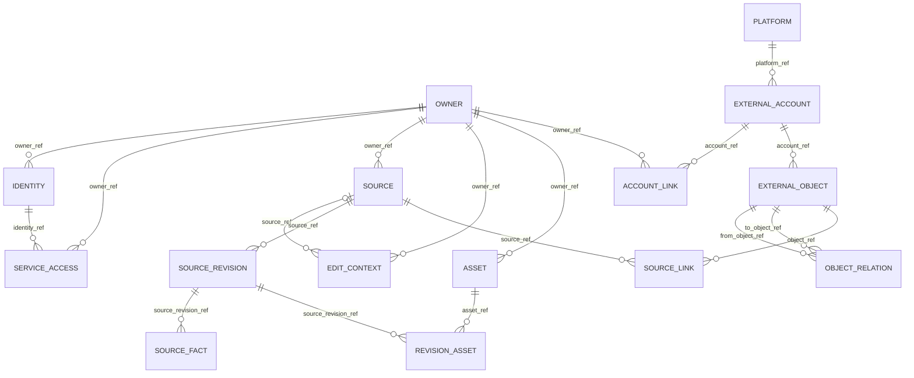
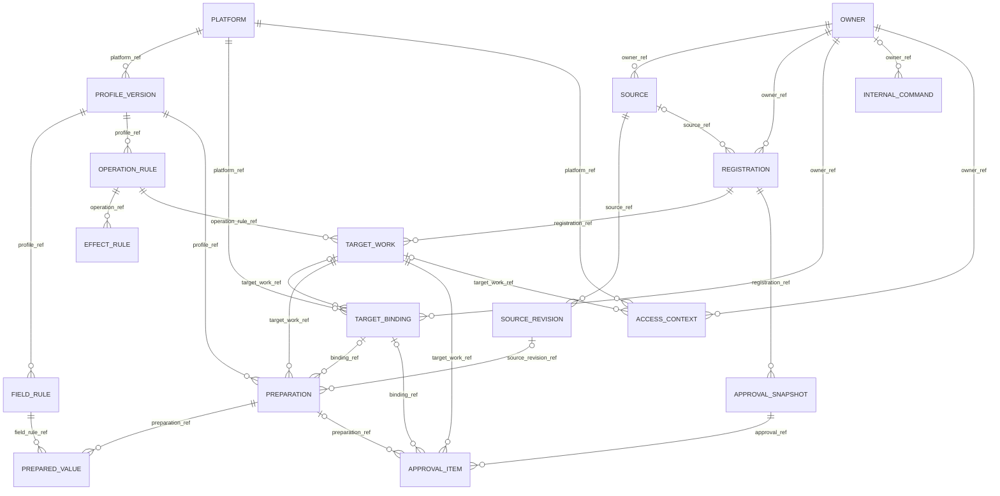
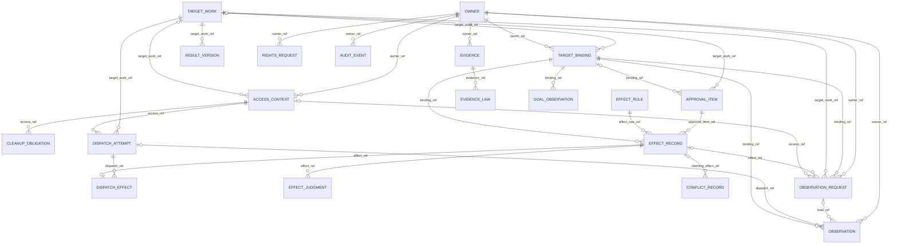

# 논리 DB ERD V1.0

<!-- Generated by tools/project_logical_db_v1.mjs from TASK-058-LOGICAL-DB-V1 and TASK-058-LOGICAL-DB-TRACE-V1 -->

기준 2026-11-27 · V3.1-R1 `70ae8e7169c284ba71c4dcbcc0cde4415929d079` / blob `d11f63353fd48bee4126d7fd916a6d870f55410f` · provisional_candidate_not_approved_for_physical_design

**논리 설계 후보** — 사용자 스토리 최종 승인, 물리 테이블/마이그레이션/API 및 실제 외부 실행 승인 아님. PostgreSQL 목표; 기존 SQLite 보존.

[작업 정본](../../artifacts/planning/lesson-registration-20261126/integrated/db-design.json) · [전체 설계](../../artifacts/planning/lesson-registration-20261126/integrated/DB-DESIGN.md) · [추적](LOGICAL-DB-TRACE-V1.0.md)

## 관계도 읽는 방법

논리 레코드와 값 객체를 묶어 표현한다. 실제 PostgreSQL 테이블·자료형·인덱스 확정 아님. 모든 관계의 owner 및 목적 제약은 데이터 사전과 불변조건 우선. 다중 외부 객체 관계/slot의 실제 cardinality는 검증 전 후보.

### 원본과 계정/외부 등록물

| 논리 ID | 한국어 의미 |
|---|---|
| OWNER | 사용자/소유 주체 |
| IDENTITY | 서비스 인증 주체 연결 |
| SERVICE_ACCESS | 서비스 접근 문맥 |
| SOURCE | 레슨 원본 식별 |
| SOURCE_REVISION | 원본 불변 버전 |
| SOURCE_FACT | 원본 사실 및 근거 |
| ASSET | 자료 식별 및 권리 |
| REVISION_ASSET | 버전별 자료 사용 관계 |
| EDIT_CONTEXT | 원본 편집·추출 문맥 |
| PLATFORM | 지원 플랫폼 식별 |
| EXTERNAL_ACCOUNT | 외부 계정 정규 식별 |
| ACCOUNT_LINK | owner 외부 계정 관리 관계 |
| EXTERNAL_OBJECT | 외부 등록물/하위 객체 |
| OBJECT_RELATION | 외부 객체 관계 |
| SOURCE_LINK | 원본–등록물 관리 관계 |

### 플랫폼 규칙과 작업 준비·승인

| 논리 ID | 한국어 의미 |
|---|---|
| PLATFORM | 지원 플랫폼 식별 |
| PROFILE_VERSION | 플랫폼 규칙 버전 |
| FIELD_RULE | 플랫폼 입력·관측 규칙 |
| OPERATION_RULE | 플랫폼별 업무 규칙 |
| EFFECT_RULE | 업무별 효과 규칙 |
| SOURCE | 레슨 원본 식별 |
| SOURCE_REVISION | 원본 불변 버전 |
| OWNER | 사용자/소유 주체 |
| REGISTRATION | 업무 의도 묶음 |
| TARGET_WORK | 선택 대상별 업무 |
| TARGET_BINDING | 계정·객체/신규 slot 판정 |
| PREPARATION | 대상별 준비 버전 |
| PREPARED_VALUE | 플랫폼별 입력값·근거 |
| APPROVAL_SNAPSHOT | 내용·범위 검토/고정 승인 |
| APPROVAL_ITEM | 승인 대상별 고정 범위 |
| INTERNAL_COMMAND | 내부 명령 수락·결과 원장 |
| ACCESS_CONTEXT | 업무 한정 외부 접근 문맥 |

### 실행·효과·관측·권리

| 논리 ID | 한국어 의미 |
|---|---|
| TARGET_WORK | 선택 대상별 업무 |
| APPROVAL_ITEM | 승인 대상별 고정 범위 |
| TARGET_BINDING | 계정·객체/신규 slot 판정 |
| EFFECT_RULE | 업무별 효과 규칙 |
| ACCESS_CONTEXT | 업무 한정 외부 접근 문맥 |
| CLEANUP_OBLIGATION | 접근 차단 후 폐기 확인 |
| EFFECT_RECORD | 정확 업무별 개별 효과 |
| DISPATCH_ATTEMPT | 물리 전송 시도 |
| DISPATCH_EFFECT | 전송–개별 효과 구성 |
| EFFECT_JUDGMENT | 효과 시도·확인 판정 버전 |
| CONFLICT_RECORD | 활성 충돌 claim·장기 차단 |
| OBSERVATION_REQUEST | 정확 읽기 요청 |
| OBSERVATION | 외부 관측 기록 |
| EVIDENCE | 최소 근거 레코드 |
| EVIDENCE_LINK | 근거–판단 연결 |
| RESULT_VERSION | 대상별 업무 결과 판정 |
| GOAL_OBSERVATION | 모집·판매 목표 판정 |
| RIGHTS_REQUEST | 계정·자료 권리 및 내부 관리 요청 |
| AUDIT_EVENT | 업무·권한 감사 이력 |
| OWNER | 사용자/소유 주체 |

## 데이터 사전

PK/FK는 논리 식별 및 관계를 의미한다. '?'는 조건부/선택 값이며, 실제 NULL 허용·물리 자료형은 후속. 상태 축 값은 상위 상태 명세의 후보를 유지.

### 서비스 본인·권한

#### OWNER · 사용자/소유 주체

독립적인 서비스 데이터 소유 기준. 실제 가입 방식과 계정 삭제 정책 미정.  
- 논리 식별: `owner_id` · 소유 범위: owner · 정본 책임: 공통 BE
- 제약: 새 owner는 검증된 최초 인증 주체에 대해서만 중복 없이 생성; 타 owner 정보 비노출.

| 속성 | 논리 타입 | 필수/조건 | 의미 |
|---|---|---|---|
| `owner_id` | opaque_id | 필수 | 안정적인 논리 식별자 |
| `account_state` | candidate_state | 필수 | 관리 접근/권리 제한만, 구체 lifecycle 미정 |
| `created_at` | instant | 필수 | 식별 관계 생성 |
| `retired_at` | instant | 조건부 | 관리 제한 시점 |
| `policy_ref` | version_ref | 조건부 | 권리·보존 정책 후보 |

#### IDENTITY · 서비스 인증 주체 연결

인증 제공자/주체와 owner의 검증된 관계. 가입/인증 기술 선택하지 않음.  
- 논리 식별: `identity_id` · 소유 범위: owner · 정본 책임: 공통 BE
- 제약: issuer+subject_ref의 유효 소유 관계 중복 금지; 최초 생성·복구는 같은 검증 주체의 명령 결과 확인.

| 속성 | 논리 타입 | 필수/조건 | 의미 |
|---|---|---|---|
| `identity_id` | opaque_id | 필수 | 안정적인 논리 식별자 |
| `issuer` | opaque_id | 필수 | 채택 제공자 namespace |
| `subject_ref` | opaque_id | 필수 | 검증된 비밀 아닌 주체 식별 |
| `verified_at` | instant | 필수 | 검증 시각 |
| `relation_state` | code | 필수 | 유효/해제 후보 |
| `owner_ref` | ref:OWNER | 필수 | 검증 주체의 소유 관계 |

#### SERVICE_ACCESS · 서비스 접근 문맥

서비스 본인 확인 문맥. 자격증명·세션 토큰 자체가 아닌 비밀 없는 상태.  
- 논리 식별: `service_context_id` · 소유 범위: owner · 정본 책임: 공통 BE
- 제약: 종료 문맥 재사용 금지, 실제 session cookie/token은 별도 보안 메커니즘. 업무용 외부 접근과 독립.

| 속성 | 논리 타입 | 필수/조건 | 의미 |
|---|---|---|---|
| `service_context_id` | opaque_id | 필수 | 안정적인 논리 식별자 |
| `generation` | ordinal | 필수 | 문맥 구분 |
| `state` | AX01 | 필수 | 검증/종료 |
| `verified_at` | instant | 조건부 | 본인 확인 |
| `closed_at` | instant | 조건부 | 종료 |
| `expires_at` | instant | 조건부 | 정책 결정 후 |
| `owner_ref` | ref:OWNER | 필수 | 검증 owner 접근 문맥 |
| `identity_ref` | ref:IDENTITY | 필수 | 검증 동일 owner/주체 |

### Source — 레슨 원본

#### SOURCE · 레슨 원본 식별

재사용되는 하나의 레슨 원본 lineage. 기존 Source API의 불변 source_id는 revision으로 대응할 수 있는 후보.  
- 논리 식별: `source_id` · 소유 범위: owner · 정본 책임: 공통 BE
- 제약: 정확 owner; 하나의 현재 revision. retired는 내부 관리 종료이지 물리 삭제/외부 삭제 아님.

| 속성 | 논리 타입 | 필수/조건 | 의미 |
|---|---|---|---|
| `source_id` | opaque_id | 필수 | 안정적인 논리 식별자 |
| `management_state` | AX03 | 필수 | absent는 아직 미생성 |
| `created_at` | instant | 필수 | 최초 커밋 |
| `current_revision_ref` | revision_ref | 필수 | 현재 검증 head, 같은 source의 committed revision |
| `owner_ref` | ref:OWNER | 필수 | 정확 owner |

#### EDIT_CONTEXT · 원본 편집·추출 문맥

미확정 자료·사실·추출 문제를 작업 중 보존하는 논리 문맥. 휘발/지속 여부 미결정.  
- 논리 식별: `edit_id` · 소유 범위: owner · 정본 책임: PREP→공통 BE
- 제약: 저장 정본 아님. 동일 edit revision의 추출만 적용; 불명 저장 ID 보존; 임의 삭제·자동 저장 금지.

| 속성 | 논리 타입 | 필수/조건 | 의미 |
|---|---|---|---|
| `edit_id` | opaque_id | 필수 | 안정적인 논리 식별자 |
| `edit_revision` | ordinal | 필수 | 변경 순번 |
| `base_revision_ref` | revision_ref | 조건부 | 기존 편집 기준 |
| `state` | AX02 | 필수 | 편집/추출/저장 인지 |
| `input_draft` | typed_document | 필수 | 권리 확인 입력 및 staging asset 참조 |
| `extraction_request_id` | opaque_id | 조건부 | 늦은 결과 구분 |
| `issues` | typed_list | 필수 | 보완 필요 |
| `retention_policy_ref` | version_ref | 조건부 | 미결정 |
| `owner_ref` | ref:OWNER | 필수 | 원본 미생성 문맥도 owner 필수 |
| `source_ref` | ref:SOURCE | 조건부 | 기존 편집이면 정확 source와 기준 revision; 신규는 없음 |

#### SOURCE_REVISION · 원본 불변 버전

명시 저장된 원문·직접 입력 및 사실의 재현 가능한 버전.  
- 논리 식별: `source_revision_id` · 소유 범위: owner · 정본 책임: 공통 BE
- 제약: 원문·확정 사실·첨부 관계 불변, 명시 수정은 새 버전. 내용 없는 원본 저장 허용 여부는 상세 UX 결정. 비밀/민감 정산/증빙 저장 금지.

| 속성 | 논리 타입 | 필수/조건 | 의미 |
|---|---|---|---|
| `source_revision_id` | opaque_id | 필수 | 안정적인 논리 식별자 |
| `revision_no` | ordinal | 필수 | source 내 증가 |
| `raw_text` | text | 조건부 | 원문 있는 경우 |
| `direct_input` | typed_document | 조건부 | 실제 직접 입력 |
| `content_digest` | digest | 필수 | 정규 내용/자료 고정 |
| `created_at` | instant | 필수 | 커밋 |
| `rights_summary` | typed_document | 필수 | 원본/자료 권리 확인 |
| `previous_revision_ref` | revision_ref | 조건부 | 동일 lineage 이전 |
| `source_ref` | ref:SOURCE | 필수 | 동일 lineage |

#### SOURCE_FACT · 원본 사실 및 근거

공통 의미가 있는 실제 레슨 사실의 versioned component. 독립 공개 API/테이블 강제 아님.  
- 논리 식별: `fact_id` · 소유 범위: owner · 정본 책임: PREP→공통 BE
- 제약: source_revision+fact_path+item_key 범위 식별(반복 항목 item_key는 path에 포함). 불확실을 확정값으로 변환 금지. package/회차/금액 관계 보존.

| 속성 | 논리 타입 | 필수/조건 | 의미 |
|---|---|---|---|
| `fact_id` | opaque_id | 필수 | 안정적인 논리 식별자 |
| `fact_path` | semantic_path | 필수 | 공통 의미 |
| `typed_value` | typed_value | 조건부 | 확정 전 불명 가능 |
| `value_type` | semantic_type | 필수 | 가격/시간/회차/지역 등 |
| `certainty` | code | 필수 | confirmed/uncertain/conflict 후보 |
| `origin` | typed_locator | 필수 | 원문 위치/직접 답변/자료 |
| `verified_by` | actor_ref | 조건부 | 강사 확인 |
| `value_digest` | digest | 필수 | 값 및 근거 |
| `source_revision_ref` | ref:SOURCE_REVISION | 필수 | 불변 버전의 사실 |

#### ASSET · 자료 식별 및 권리

사용자 제공 자료의 논리 identity. 바이너리 저장 방식/보존 미결정.  
- 논리 식별: `asset_id` · 소유 범위: owner · 정본 책임: 공통 BE
- 제약: owner-scoped 접근, digest 일치≠사용권. staging 자료의 보존/삭제 결정 별도; 민감 증빙/인증자료 저장 금지.

| 속성 | 논리 타입 | 필수/조건 | 의미 |
|---|---|---|---|
| `asset_id` | opaque_id | 필수 | 안정적인 논리 식별자 |
| `content_digest` | digest | 필수 | 정확 바이트 |
| `media_type` | code | 필수 | 규격 |
| `size_bytes` | nonnegative_integer | 필수 | 크기 |
| `dimensions` | typed_document | 조건부 | 해상도 등 |
| `storage_locator` | opaque_id | 조건부 | 서버 내부 비밀 아닌 참조 |
| `rights_state` | code | 필수 | 확인/불명/제한 |
| `rights_evidence_ref` | evidence_ref | 조건부 | 최소 권리 근거 |
| `created_at` | instant | 필수 | 수신 |
| `owner_ref` | ref:OWNER | 필수 | 동일 owner 자료 |

#### REVISION_ASSET · 버전별 자료 사용 관계

동일 자료를 원본 버전의 여러 역할에서 사용 가능.  
- 논리 식별: `revision_asset_id` · 소유 범위: owner · 정본 책임: 공통 BE
- 제약: 정확 revision/asset/역할/순서 중복 금지; 이전 승인 snapshot 참조 자료를 임의 삭제하지 않음.

| 속성 | 논리 타입 | 필수/조건 | 의미 |
|---|---|---|---|
| `revision_asset_id` | opaque_id | 필수 | 안정적인 논리 식별자 |
| `role` | code | 필수 | 공통 자료 역할 |
| `position` | ordinal | 필수 | 정렬 |
| `usage_rights_snapshot` | typed_document | 필수 | 해당 버전 사용권 |
| `display_scope` | typed_document | 필수 | 공개 범위 후보 |
| `source_revision_ref` | ref:SOURCE_REVISION | 필수 | 정확 버전 |
| `asset_ref` | ref:ASSET | 필수 | 동일 owner 및 권리·digest 검증 |

### Profile — 플랫폼 규칙

#### PLATFORM · 지원 플랫폼 식별

PL01~PL07 등 등록된 플랫폼 식별. 공통 계약 플랫폼 고정 enum 강제 금지.  
- 논리 식별: `platform_id` · 소유 범위: global_config · 정본 책임: KNOW
- 제약: 플랫폼 추가는 등록 규칙 및 검증 추가; 미등록 플랫폼 자동 실행 없음.

| 속성 | 논리 타입 | 필수/조건 | 의미 |
|---|---|---|---|
| `platform_id` | opaque_id | 필수 | 안정적인 논리 식별자 |
| `platform_key` | opaque_id | 필수 | 등록 키 |
| `name` | text | 필수 | 표시명 |
| `support_status` | code | 필수 | 지원 후보/중지 |

#### PROFILE_VERSION · 플랫폼 규칙 버전

환경·객체 종류·버전에 고정된 필드/업무/효과/완료 계약.  
- 논리 식별: `profile_version_id` · 소유 범위: global_config · 정본 책임: KNOW
- 제약: platform+object_kind+version+environment 유일. 변경은 새 버전, 이전 승인 계약 보존. 실제 접근 unknown/blocked 우선.

| 속성 | 논리 타입 | 필수/조건 | 의미 |
|---|---|---|---|
| `profile_version_id` | opaque_id | 필수 | 안정적인 논리 식별자 |
| `object_kind` | code | 필수 | 프로필/상품/클래스/게시물 등 |
| `version` | version_ref | 필수 | 불변 버전 |
| `environment` | code | 필수 | 현재 mock |
| `contract_digest` | digest | 필수 | 정규 계약 |
| `support` | typed_document | 필수 | 제품 포함/후순위/보류와 실제 허용 독립 |
| `policy_evidence` | typed_list | 필수 | 출처·시점·검증 수준 |
| `effective_at` | instant | 필수 | 규칙 기준 |
| `verified_level` | code | 필수 | 조사 후보/검증 여부 |
| `platform_ref` | ref:PLATFORM | 필수 | 플랫폼 규칙 등록 |

#### FIELD_RULE · 플랫폼 입력·관측 규칙

규칙 버전에 속한 의미 경로·규격·조건·방향의 논리 component. 조사 필드 자체가 확정 필수 규칙은 아님.  
- 논리 식별: `field_rule_id` · 소유 범위: global_config · 정본 책임: KNOW
- 제약: 프로필 버전에 pin. unknown이면 허용된 준비에서 확인, 필수라고 단정하지 않음. direct_only/금지 값은 PREPARED_VALUE에 저장·전송 금지.

| 속성 | 논리 타입 | 필수/조건 | 의미 |
|---|---|---|---|
| `field_rule_id` | opaque_id | 필수 | 안정적인 논리 식별자 |
| `field_path` | semantic_path | 필수 | 객체/하위 항목 path |
| `semantic_type` | semantic_type | 필수 | 값 타입/단위 |
| `direction` | code | 필수 | input/observed/direct_only 등 |
| `requirement` | code | 필수 | required/optional/conditional/unknown |
| `condition` | typed_rule | 조건부 | 필수 조건 |
| `value_schema` | typed_document | 조건부 | 검증 가능한 규격 |
| `source_claim_refs` | typed_list | 필수 | 근거 |
| `verification_level` | code | 필수 | 현재 후보/확정 여부 |
| `privacy_class` | code | 필수 | 공개/내부/금지 |
| `profile_ref` | ref:PROFILE_VERSION | 필수 | 버전별 검증 규칙 |

#### OPERATION_RULE · 플랫폼별 업무 규칙

현재 44개 업무 범위 후보의 versioned component. 체크포인트·완료 및 복구 기준.  
- 논리 식별: `operation_rule_id` · 소유 범위: global_config · 정본 책임: KNOW
- 제약: 실제 쓰기·읽기·내부 안내를 분리. 현재 실제 접근 mock-only. 조건부/hold는 외부 실행 금지.

| 속성 | 논리 타입 | 필수/조건 | 의미 |
|---|---|---|---|
| `operation_rule_id` | opaque_id | 필수 | 안정적인 논리 식별자 |
| `operation_ref` | opaque_id | 필수 | PS-PLxx-업무 |
| `kind` | code | 필수 | CREATE/READ/UPDATE/RENEW/STATUS/RESPOND/조건부 |
| `scope` | code | 필수 | V1.0 범위 |
| `checkpoints` | typed_list | 필수 | 업무 단계 및 선행 조건 |
| `completion_rule` | typed_rule | 필수 | 정확 독립 완료 |
| `goal_rule` | typed_rule | 조건부 | 모집 목표 |
| `permission_evidence` | typed_list | 필수 | 단계별 허용·미확인 |
| `recovery_rule` | typed_rule | 필수 | 정확 잔여 경로 |
| `profile_ref` | ref:PROFILE_VERSION | 필수 | 버전별 업무 |

#### EFFECT_RULE · 업무별 효과 규칙

45개 논리 효과 후보를 업무 규칙에 연결하는 versioned component.  
- 논리 식별: `effect_rule_id` · 소유 범위: global_config · 정본 책임: KNOW
- 제약: 효과 요구 여부와 실제 물리 전송 결합/순서는 검증 전 후보. 허용 미확인 전 실행 없음.

| 속성 | 논리 타입 | 필수/조건 | 의미 |
|---|---|---|---|
| `effect_rule_id` | opaque_id | 필수 | 안정적인 논리 식별자 |
| `effect_ref` | opaque_id | 필수 | PS-...-EFnn |
| `checkpoint_ref` | opaque_id | 필수 | 관련 단계 |
| `mutation` | typed_document | 필수 | 정확 의미/부수 효과 |
| `readback_rule` | typed_rule | 필수 | 독립 읽기 기준 |
| `conflict_scope_rule` | typed_rule | 필수 | root/하위 영역 |
| `dispatch_boundary` | typed_rule | 필수 | 물리 결합 후보 |
| `recovery_rule` | typed_rule | 필수 | 잔여 조건 |
| `verification_level` | code | 필수 | 현재 후보 |
| `operation_ref` | ref:OPERATION_RULE | 필수 | 해당 업무 효과 규칙 |

### 외부 계정·등록물 식별

#### EXTERNAL_ACCOUNT · 외부 계정 정규 식별

플랫폼의 정확 실제 계정 identity. owner 관리 관계와 별개. 공개 표시명은 식별자 아님.  
- 논리 식별: `external_account_id` · 소유 범위: restricted_global_identity · 정본 책임: 공통 BE / 플랫폼 증거
- 제약: 환경+플랫폼+정규 계정 식별 유일 후보. 공유/다른 owner 동일 계정 경합은 전역 안전 판단만, 타 owner 정보 노출 금지. 미확인 계정은 binding 후보에 유지.

| 속성 | 논리 타입 | 필수/조건 | 의미 |
|---|---|---|---|
| `external_account_id` | opaque_id | 필수 | 안정적인 논리 식별자 |
| `environment` | code | 필수 | mock/live 경계 |
| `identity_namespace` | code | 필수 | 검증된 식별 namespace |
| `native_account_ref` | opaque_id | 필수 | 비밀 아닌 정확 식별 |
| `identity_status` | code | 필수 | 확인/분쟁 |
| `verified_at` | instant | 필수 | 확인 시각 |
| `platform_ref` | ref:PLATFORM | 필수 | 정규 계정, 환경 일치 |

#### ACCOUNT_LINK · owner 외부 계정 관리 관계

사용자가 명시 연결한 내부 관리 식별 관계. 실제 접근 권한을 부여하지 않음.  
- 논리 식별: `account_link_id` · 소유 범위: owner · 정본 책임: 공통 BE
- 제약: owner+정확 계정의 활성 관계 중복 금지. 연결 없음이어도 업무 한정 명시 사용 가능; 장기 위임 미채택.

| 속성 | 논리 타입 | 필수/조건 | 의미 |
|---|---|---|---|
| `account_link_id` | opaque_id | 필수 | 안정적인 논리 식별자 |
| `management_state` | AX03 | 필수 | managed/retired |
| `linked_at` | instant | 필수 | 명시 연결 |
| `retired_at` | instant | 조건부 | 해제 |
| `authority_evidence` | typed_locator | 필수 | 확인 근거 |
| `owner_ref` | ref:OWNER | 필수 | owner 관리 관계 |
| `account_ref` | ref:EXTERNAL_ACCOUNT | 필수 | 정확 외부 계정, 관계≠권한 |

#### EXTERNAL_OBJECT · 외부 등록물/하위 객체

정확 계정·플랫폼의 상품, 클래스, 프로필, 서비스 관계, 글 또는 하위 객체 식별.  
- 논리 식별: `object_id` · 소유 범위: restricted_global_identity · 정본 책임: 공통 BE / 플랫폼 증거
- 제약: 정확 계정+namespace+kind+native ID 유일 후보; 목록번호·URL·표시명 자동 동일시 금지. 불명 후보는 TARGET_BINDING에만.

| 속성 | 논리 타입 | 필수/조건 | 의미 |
|---|---|---|---|
| `object_id` | opaque_id | 필수 | 안정적인 논리 식별자 |
| `object_kind` | code | 필수 | 플랫폼 규칙 |
| `identity_namespace` | code | 필수 | 정규 native 식별 범위 |
| `native_object_ref` | opaque_id | 필수 | 정확 검증 ID |
| `identity_status` | code | 필수 | 확인/분쟁 |
| `first_verified_at` | instant | 필수 | 최초 확인 |
| `account_ref` | ref:EXTERNAL_ACCOUNT | 필수 | 정확 계정; 공유 권한 미확정 |

#### OBJECT_RELATION · 외부 객체 관계

프로필–서비스/분야, 상품–옵션, 클래스–회차 등 외부 관측된 관계. 실제 소유 cardinality는 플랫폼 검증 필요.  
- 논리 식별: `object_relation_id` · 소유 범위: restricted_global_identity · 정본 책임: 공통 BE / 플랫폼 증거
- 제약: 같은 플랫폼·계정 또는 검증된 공유 관계만. 관계 자체가 외부 편집 권한 아님; 동일 root 공유 영향 계산에 사용.

| 속성 | 논리 타입 | 필수/조건 | 의미 |
|---|---|---|---|
| `object_relation_id` | opaque_id | 필수 | 안정적인 논리 식별자 |
| `relation_kind` | code | 필수 | 관계 의미 |
| `status` | code | 필수 | observed/unknown/disputed |
| `observed_at` | instant | 필수 | 근거 시점 |
| `proof_ref` | evidence_ref | 필수 | 관측 근거 |
| `from_object_ref` | ref:EXTERNAL_OBJECT | 필수 | 관계 출발 객체 |
| `to_object_ref` | ref:EXTERNAL_OBJECT | 필수 | 관계 대상 객체 |

#### SOURCE_LINK · 원본–등록물 관리 관계

레슨 원본과 정확 외부 객체의 내부 관리 연결. 현재 owner에게 실제 접근 권한이 있는지는 매 업무 검증.  
- 논리 식별: `source_link_id` · 소유 범위: owner · 정본 책임: 공통 BE
- 제약: 원본+정확 객체+role 활성 중복 금지, 동일 객체의 다중 원본/공유 root는 경합 검증 전 제약 미확정. 외부 삭제 없음.

| 속성 | 논리 타입 | 필수/조건 | 의미 |
|---|---|---|---|
| `source_link_id` | opaque_id | 필수 | 안정적인 논리 식별자 |
| `role` | code | 필수 | primary/shared/related 후보 |
| `management_state` | AX03 | 필수 | managed/retired |
| `created_at` | instant | 필수 | 연결 |
| `retired_at` | instant | 조건부 | 해제 |
| `proof_ref` | evidence_ref | 필수 | 정확 연결 근거 |
| `source_ref` | ref:SOURCE | 필수 | owner 상속, 내부 관계 |
| `object_ref` | ref:EXTERNAL_OBJECT | 필수 | 정확 객체·owner 관리권 검증 |

### Registration — 준비·승인·수락

#### REGISTRATION · 업무 의도 묶음

기존 Registration 논리 aggregate 확장. 동일 원본으로 여러 대상 선택·반복 업무 가능. 실제 lifecycle은 TARGET_WORK.  
- 논리 식별: `registration_id` · 소유 범위: owner · 정본 책임: 공통 BE
- 제약: 묶음 상태는 대상 상태 집계만; 새 의도마다 별도 ID. 기존 source revision은 준비/승인에서 pin. 쓰기 준비는 정확 source_revision 필수.

| 속성 | 논리 타입 | 필수/조건 | 의미 |
|---|---|---|---|
| `registration_id` | opaque_id | 필수 | 안정적인 논리 식별자 |
| `intent_kind` | code | 필수 | 신규/수정/갱신/읽기/내부 준비 |
| `intent_payload` | typed_document | 필수 | 정확 업무 의도 |
| `created_at` | instant | 필수 | 의도 생성 |
| `selection_revision` | ordinal | 필수 | 선택 묶음 버전 |
| `environment` | code | 필수 | mock |
| `owner_ref` | ref:OWNER | 필수 | 의도 묶음 owner |
| `source_ref` | ref:SOURCE | 조건부 | 원본 관련 업무는 정확 source 필수; 계정/읽기 등 목적별 예외 |

#### TARGET_WORK · 선택 대상별 업무

묶음 내 정확 플랫폼/업무별 독립 대상. 선택되었으나 보류/제외된 대상도 보존.  
- 논리 식별: `target_work_id` · 소유 범위: owner · 정본 책임: 공통 BE
- 제약: registration+selection_key 유일. 실제 수락 목록과 held/excluded 명시; 하나의 등록물에 복수 시점 업무. ended 불변; 새 작업은 새 ID.

| 속성 | 논리 타입 | 필수/조건 | 의미 |
|---|---|---|---|
| `target_work_id` | opaque_id | 필수 | 안정적인 논리 식별자 |
| `selection_key` | opaque_id | 필수 | 선택 내 대상 identity |
| `selection_disposition` | code | 필수 | ready/held/excluded/needs_resolution 후보 |
| `lifecycle` | AX09 | 필수 | 수락 대상 업무 |
| `accepted_at` | instant | 조건부 | 수락 |
| `ended_at` | instant | 조건부 | 종료 |
| `intent_kind` | code | 필수 | 업무 분류 |
| `prior_work_ref` | opaque_id | 조건부 | 후속 정확 기존 업무 |
| `registration_ref` | ref:REGISTRATION | 필수 | 묶음 내 여러 정확 대상 |
| `operation_rule_ref` | ref:OPERATION_RULE | 필수 | 선택한 업무 규칙 후보; 변경은 준비 재검토 |

#### TARGET_BINDING · 계정·객체/신규 slot 판정

정확 준비 또는 명시 조회에 대한 계정·대상 식별 snapshot. 신규 slot과 확인된 외부 객체 전환을 이력으로 유지.  
- 논리 식별: `binding_id` · 소유 범위: owner · 정본 책임: 공통 BE
- 제약: exact_existing은 정확 계정·객체 근거 필수; exact_new는 계정+검증 slot·이전 효과 없음 근거. slot alias 전환이 기존 충돌 차단 제거하지 않음. 승인된 binding 불변.

| 속성 | 논리 타입 | 필수/조건 | 의미 |
|---|---|---|---|
| `binding_id` | opaque_id | 필수 | 안정적인 논리 식별자 |
| `resolution` | AX07 | 필수 | unresolved/exact_new/exact_existing/ambiguous |
| `intent_slot_ref` | opaque_id | 조건부 | 검증된 신규 의도 slot |
| `selector_snapshot` | typed_document | 필수 | 정확 목적/후보 |
| `generation` | ordinal | 필수 | 판정 버전 |
| `proof_refs` | typed_list | 필수 | 계정/객체/중복/이전 효과 근거 |
| `slot_alias_ref` | opaque_id | 조건부 | 검증 slot→실제 ID 연결 |
| `created_at` | instant | 필수 | 판정 시각 |
| `target_work_ref` | ref:TARGET_WORK | 조건부 | 준비/업무의 대상 판정; 독립 명시 조회는 없음 가능 |
| `platform_ref` | ref:PLATFORM | 필수 | 정확 플랫폼/환경 |
| `owner_ref` | ref:OWNER | 필수 | 동일 owner 문맥 |
| `account_ref` | ref:EXTERNAL_ACCOUNT | 조건부 | 검증되면 필수; 미확인은 후보 |
| `object_ref` | ref:EXTERNAL_OBJECT | 조건부 | exact_existing 필수, exact_new slot 또는 미해결 없음 |
| `prior_binding_ref` | ref:TARGET_BINDING | 조건부 | 같은 문맥의 이전 판정 또는 slot→object 계보; cycle 금지 |

#### PREPARATION · 대상별 준비 버전

현재 원본/프로필/대상에 대한 변환·검증·제약·차이 결과. 여러 버전 가능.  
- 논리 식별: `preparation_id` · 소유 범위: owner · 정본 책임: PREP→공통 BE
- 제약: ready는 현재 검증·차단 없음에서 도출, 독립 임의 플래그 금지. 권한/규칙/값/revision 변경은 미수락 준비 stale. consumed snapshot 변경 금지.

| 속성 | 논리 타입 | 필수/조건 | 의미 |
|---|---|---|---|
| `preparation_id` | opaque_id | 필수 | 안정적인 논리 식별자 |
| `revision_no` | ordinal | 필수 | target 내 증가 |
| `input_digest` | digest | 필수 | 원본+규칙+답변+대상 |
| `status` | AX06 | 필수 | 준비 상태 |
| `issues` | typed_list | 필수 | 문제/차단/필요 사실/규격 |
| `precondition_results` | typed_document | 필수 | 현재 조건 근거 |
| `planned_effects` | typed_list | 필수 | 필수/선택/부수 효과 및 미적용 |
| `planned_reads` | typed_list | 필수 | 명시 목적/검증 범위 |
| `cost_and_diff` | typed_document | 필수 | 전후 및 비용 |
| `created_at` | instant | 필수 | 작성 |
| `target_work_ref` | ref:TARGET_WORK | 필수 | 준비 버전 여러 개 |
| `source_revision_ref` | ref:SOURCE_REVISION | 조건부 | 원본 기반 준비/쓰기 필수; 독립 내부/읽기 목적은 조건부 |
| `profile_ref` | ref:PROFILE_VERSION | 필수 | 정확 규칙 pin |
| `binding_ref` | ref:TARGET_BINDING | 조건부 | 정확 현재 판정; ready 쓰기는 필수 |

#### PREPARED_VALUE · 플랫폼별 입력값·근거

준비 버전의 정확 typed value와 의미·대상 path, 원본/강사 답변/자료 provenance.  
- 논리 식별: `prepared_value_id` · 소유 범위: owner · 정본 책임: PREP→공통 BE
- 제약: 같은 준비+field path+repeat item 식별. 미확인 필수는 차단, 직접 선행/민감값 저장 금지. 공통 사실 변경은 Source 새 revision.

| 속성 | 논리 타입 | 필수/조건 | 의미 |
|---|---|---|---|
| `prepared_value_id` | opaque_id | 필수 | 안정적인 논리 식별자 |
| `field_path` | semantic_path | 필수 | 해당 profile field |
| `typed_value` | typed_value | 조건부 | 검증된 값 또는 미확인 |
| `value_digest` | digest | 조건부 | 정확 canonical 값 |
| `origin_refs` | typed_list | 필수 | fact/답변/asset/변환 근거 |
| `validation` | typed_document | 필수 | 규격/조건/권리 |
| `answer_revision` | ordinal | 조건부 | 플랫폼 전용 응답 버전 |
| `preparation_ref` | ref:PREPARATION | 필수 | 변환값 및 근거 |
| `field_rule_ref` | ref:FIELD_RULE | 필수 | 같은 profile, 확정/미확인 분리 |

#### APPROVAL_SNAPSHOT · 내용·범위 검토/고정 승인

하나의 검토안 버전. 수락 시 선택 목록·양 승인 및 실행 조건이 함께 고정.  
- 논리 식별: `approval_id` · 소유 범위: owner · 정본 책임: 공통 BE
- 제약: 사용자 조작 1회 후보, 논리 승인 둘 다 필요. 수락 전 변경 invalidated; frozen 불변, 수락 이후 권리 제한은 별도 차단.

| 속성 | 논리 타입 | 필수/조건 | 의미 |
|---|---|---|---|
| `approval_id` | opaque_id | 필수 | 안정적인 논리 식별자 |
| `review_revision` | ordinal | 필수 | 검토 버전 |
| `state` | AX08 | 필수 | presented/invalidated/frozen |
| `selection_digest` | digest | 필수 | 전체 선택 및 처리 |
| `content_approval` | typed_document | 조건부 | 별도 논리 승인 주체·시점·digest |
| `scope_approval` | typed_document | 조건부 | 별도 논리 승인 범위·시점·digest |
| `direct_consent_refs` | typed_list | 필수 | 필수 직접 동의 확인만 |
| `snapshot_digest` | digest | 필수 | 고정 전체 |
| `frozen_at` | instant | 조건부 | 수락과 원자 커밋 |
| `registration_ref` | ref:REGISTRATION | 필수 | 검토안 버전 여러 개; frozen accepted 최대 하나 |

#### APPROVAL_ITEM · 승인 대상별 고정 범위

전체 선택 대상의 승인/보류/제외 및 이유와 준비·binding·규칙·값·효과·필수 읽기 pin.  
- 논리 식별: `approval_item_id` · 소유 범위: owner · 정본 책임: 공통 BE
- 제약: approval+target unique. approved만 정확 최신 준비/binding/양 승인/허용 조건; held/excluded에는 실행 자격 없음. 수락 순간 모두 원자 기록.

| 속성 | 논리 타입 | 필수/조건 | 의미 |
|---|---|---|---|
| `approval_item_id` | opaque_id | 필수 | 안정적인 논리 식별자 |
| `disposition` | code | 필수 | approved/held/excluded |
| `reason` | text | 조건부 | 보류/제외 근거 |
| `frozen_values_digest` | digest | 조건부 | 정확 전송값 |
| `effect_plan` | typed_list | 필수 | 정확 효과/부수 효과/미적용 |
| `read_plan` | typed_list | 필수 | 별도 허용 검증 범위 |
| `cost_scope` | typed_document | 필수 | 승인 비용 |
| `access_binding` | typed_document | 조건부 | 비밀 없는 문맥/generation/계정/권한 결합 |
| `approval_ref` | ref:APPROVAL_SNAPSHOT | 필수 | 전체 선택 목록 |
| `target_work_ref` | ref:TARGET_WORK | 필수 | 같은 registration |
| `preparation_ref` | ref:PREPARATION | 조건부 | approved 쓰기 필수, held/excluded 조건부 |
| `binding_ref` | ref:TARGET_BINDING | 조건부 | approved 정확 binding 필수; 준비와 일치 |

#### INTERNAL_COMMAND · 내부 명령 수락·결과 원장

저장/준비/연결/해제/승인수락/권리 등 동일 명령 결과 정본. 첫 owner 생성은 검증 주체 namespace 사용.  
- 논리 식별: `command_id` · 소유 범위: owner_or_verified_principal · 정본 책임: 공통 BE/논리 저장소
- 제약: principal_scope+kind+key 유일; 동일 hash 같은 결과, 다른 hash 충돌. AX05 응답 인지는 FE 투영이고 정본 상태 아님. not found/timeout은 no_commit_proven 아님.

| 속성 | 논리 타입 | 필수/조건 | 의미 |
|---|---|---|---|
| `command_id` | opaque_id | 필수 | 안정적인 논리 식별자 |
| `principal_scope` | opaque_id | 필수 | 검증 owner 또는 최초 검증 주체 |
| `command_kind` | code | 필수 | 명령 종류 |
| `request_key` | opaque_id | 필수 | 호출자 고정 키 |
| `request_digest` | digest | 필수 | 정규 입력 |
| `state` | AX04 | 필수 | unrecorded/committed/rejected/no_commit_proven |
| `result_ref` | typed_ref | 조건부 | 정확 결과 |
| `fence_proof` | typed_locator | 조건부 | 미커밋 및 지연 커밋 봉쇄 |
| `committed_at` | instant | 조건부 | 처리 시각 |
| `owner_ref` | ref:OWNER | 조건부 | 최초 검증 주체 owner 생성 전에는 principal_scope; 나머지는 owner 필수 |

### 업무용 접근·폐기

#### ACCESS_CONTEXT · 업무 한정 외부 접근 문맥

준비/직접 인증/조회/수락 업무 목적에 바인딩된 접근 상태. 인증 비밀과 연결 capability는 여기 저장하지 않음.  
- 논리 식별: `access_id` · 소유 범위: owner · 정본 책임: 공통 BE
- 제약: 인증 신호와 권한 독립. 새 generation, 기대 계정 불일치 차단. 최초 계정 명시 사용/관리 연결 구분. 장기 위임/비밀번호/cookie/token/원격 grant 저장 금지.

| 속성 | 논리 타입 | 필수/조건 | 의미 |
|---|---|---|---|
| `access_id` | opaque_id | 필수 | 안정적인 논리 식별자 |
| `purpose` | code | 필수 | prepare/readback/latest/execute/account_manage |
| `call_context` | typed_ref | 필수 | 정확 원 호출 |
| `generation` | ordinal | 필수 | 새 문맥 |
| `state` | AX14 | 필수 | human/verifying/verified/blocked |
| `expected_account_ref` | opaque_id | 조건부 | 검증 기대 계정 |
| `read_scope` | typed_document | 필수 | 읽기 허용 |
| `write_scope` | typed_document | 필수 | 변이 허용 |
| `permission_proofs` | typed_list | 필수 | 실제 검증 증거 |
| `expires_at` | instant | 조건부 | 채택 조건 |
| `blocked_at` | instant | 조건부 | 차단 |
| `owner_ref` | ref:OWNER | 필수 | 정확 업무 owner |
| `platform_ref` | ref:PLATFORM | 필수 | 목적 및 플랫폼 동일 |
| `verified_account_ref` | ref:EXTERNAL_ACCOUNT | 조건부 | 검증 완료일 때 정확 기대 계정과 일치 |
| `target_work_ref` | ref:TARGET_WORK | 조건부 | 업무/준비 목적에는 정확 대상; 계정관리 또는 독립 읽기 예외 |

#### CLEANUP_OBLIGATION · 접근 차단 후 폐기 확인

접근 차단과 실제 자원 폐기 확인을 독립 기록.  
- 논리 식별: `cleanup_id` · 소유 범위: owner · 정본 책임: 공통 BE
- 제약: 접근 차단 시 필요한 의무 원자 기록. 불명 지속 접근 금지; 새 인증이 기존 폐기 불명을 해소하지 않음.

| 속성 | 논리 타입 | 필수/조건 | 의미 |
|---|---|---|---|
| `cleanup_id` | opaque_id | 필수 | 안정적인 논리 식별자 |
| `resource_ref` | opaque_id | 필수 | 비밀 아닌 종료 대상 식별 |
| `state` | AX15 | 필수 | not_required/pending/confirmed/unknown |
| `blocked_at` | instant | 필수 | 새 접근 차단 |
| `checked_at` | instant | 조건부 | 확인 |
| `proof_ref` | evidence_ref | 조건부 | 폐기 근거 |
| `access_ref` | ref:ACCESS_CONTEXT | 필수 | 한 문맥에 복수 자원 폐기 의무 |

### 개별 효과·전송·충돌

#### EFFECT_RECORD · 정확 업무별 개별 효과

승인한 개별 효과 및 정확 semantic conflict identity. 실제 논리 효과 ID와 요청별 시도 ID 분리.  
- 논리 식별: `effect_id` · 소유 범위: owner · 정본 책임: 공통 BE
- 제약: 승인 item과 정확 binding 일치. 동일 효과 확인/불명 중 중복 금지. 별도 신규 의도는 실제 값/대상/조건 검증 및 새 승인, 임의 새 key 우회 금지.

| 속성 | 논리 타입 | 필수/조건 | 의미 |
|---|---|---|---|
| `effect_id` | opaque_id | 필수 | 안정적인 논리 식별자 |
| `logical_effect_key` | opaque_id | 필수 | 환경+계정+root/slot+정확 효과/의도 후보 |
| `required` | bool | 필수 | 승인 요구 효과 |
| `intent_digest` | digest | 필수 | 실제 변경/갱신 의도 |
| `prior_effect_ref` | opaque_id | 조건부 | 검증 잔여의 이전 효과 |
| `conflict_binding` | typed_document | 필수 | 겹침 범위 |
| `effect_rule_pin` | version_ref | 필수 | 고정 규칙 |
| `created_at` | instant | 필수 | 승인 후 준비 |
| `approval_item_ref` | ref:APPROVAL_ITEM | 필수 | approved frozen 대상만 |
| `effect_rule_ref` | ref:EFFECT_RULE | 필수 | 같은 고정 프로필/업무 규칙 |
| `binding_ref` | ref:TARGET_BINDING | 필수 | 동일 승인 정확 대상/slot |
| `previous_effect_ref` | ref:EFFECT_RECORD | 조건부 | 검증된 정확 잔여/이전 효과; 새 의도는 별도 intent |

#### DISPATCH_ATTEMPT · 물리 전송 시도

정확 승인 대상의 모의 물리 전송 묶음. 하나의 전송이 복수 개별 효과를 발생시킬 수 있음.  
- 논리 식별: `dispatch_id` · 소유 범위: owner · 정본 책임: 공통 BE
- 제약: 정확 1 target 안 승인 효과 모두 전송 전 명시 결합; 전송 단위 미확인/다중 대상 공유 경합은 차단. permit 일회, fence 이후 새 전송 금지; 분산 원자성 보장 아님.

| 속성 | 논리 타입 | 필수/조건 | 의미 |
|---|---|---|---|
| `dispatch_id` | opaque_id | 필수 | 안정적인 논리 식별자 |
| `dispatch_key` | opaque_id | 필수 | 서버 일회 시도 식별 |
| `binding_digest` | digest | 필수 | 대상/접근/generation/효과 묶음 |
| `permit_generation` | ordinal | 필수 | 서버 fence 세대 |
| `state` | code | 필수 | reserved/in_flight/sealed 후보 |
| `reserved_at` | instant | 필수 | 예약 |
| `started_at` | instant | 조건부 | 전송 개시 |
| `sealed_at` | instant | 조건부 | 추가 전송 불가 |
| `environment` | code | 필수 | mock |
| `target_work_ref` | ref:TARGET_WORK | 필수 | 정확 하나의 수락 대상 |
| `access_ref` | ref:ACCESS_CONTEXT | 필수 | 동일 현재 허용 문맥/generation |

#### DISPATCH_EFFECT · 전송–개별 효과 구성

전송 묶음에 포함된 각 논리 효과 관계. 동일 시도에서의 정확 효과 역할.  
- 논리 식별: `dispatch_effect_id` · 소유 범위: owner · 정본 책임: 공통 BE
- 제약: dispatch+effect 유일. 하나의 effect_record는 최대 한 물리 개시 시도; 새 안전 재처리는 새 업무/효과 레코드 및 이전 참조.

| 속성 | 논리 타입 | 필수/조건 | 의미 |
|---|---|---|---|
| `dispatch_effect_id` | opaque_id | 필수 | 안정적인 논리 식별자 |
| `effect_role` | code | 필수 | primary/side_effect |
| `membership_digest` | digest | 필수 | 정확 승인·대상 결합 |
| `dispatch_ref` | ref:DISPATCH_ATTEMPT | 필수 | 물리 전송 구성 |
| `effect_ref` | ref:EFFECT_RECORD | 필수 | 모든 포함 효과 pin; effect당 최대 한 개시 시도 |

#### EFFECT_JUDGMENT · 효과 시도·확인 판정 버전

AX10의 근거 있는 시점별 판정. 예약/진행 및 늦은 증거, 확인/미발생/불명을 유지.  
- 논리 식별: `judgment_id` · 소유 범위: owner · 정본 책임: 공통 BE / RESULT
- 제약: latest valid judgment만 현재 투영. 확인/미발생과 상충 근거는 분쟁 생성, 과거 판정 덮지 않음; response 성공만 확인 아님.

| 속성 | 논리 타입 | 필수/조건 | 의미 |
|---|---|---|---|
| `judgment_id` | opaque_id | 필수 | 안정적인 논리 식별자 |
| `version_no` | ordinal | 필수 | 효과 내 증가 |
| `state` | AX10 | 필수 | 효과 상태 |
| `reason_code` | code | 필수 | 미시도/미전송/전송 불명/독립 관측 등 |
| `assessed_at` | instant | 필수 | 판정 |
| `proof_refs` | typed_list | 필수 | 정확 독립 근거 |
| `fence_proof` | typed_locator | 조건부 | 지연 전송 봉쇄 |
| `effect_ref` | ref:EFFECT_RECORD | 필수 | 판정 버전 append |

#### CONFLICT_RECORD · 활성 충돌 claim·장기 차단

정규 외부 계정/root/slot/하위 경합 영역의 안전 정본. active claim과 unknown/dispute 차단 구분.  
- 논리 식별: `conflict_id` · 소유 범위: restricted_global_safety · 정본 책임: 공통 BE/논리 저장소
- 제약: owner 키만으로 외부 충돌 분리 금지. 겹침/slot alias를 원자 판정; claim 해제와 불명/분쟁 해소 독립. 해소 자체가 새 승인 아님.

| 속성 | 논리 타입 | 필수/조건 | 의미 |
|---|---|---|---|
| `conflict_id` | opaque_id | 필수 | 안정적인 논리 식별자 |
| `environment` | code | 필수 | 환경 |
| `normalized_scope` | typed_document | 필수 | 정확 계정/root/path/slot |
| `scope_digest` | digest | 필수 | 정규 범위 |
| `active_claim` | code | 필수 | active/released |
| `fence_generation` | ordinal | 필수 | 동시성 세대 |
| `unknown_block` | bool | 필수 | 불명 효과 차단 |
| `dispute_state` | AX17 | 필수 | clear/disputed |
| `reason` | typed_document | 필수 | 근거/영향 |
| `resolved_at` | instant | 조건부 | 확정 해소 |
| `account_ref` | ref:EXTERNAL_ACCOUNT | 필수 | 환경·정규 계정 교차 owner 안전 경합 |
| `claiming_effect_ref` | ref:EFFECT_RECORD | 조건부 | 현재 claim/불명 효과와 연결; 복수 겹침은 typed scope 및 증거 관계 |

### 읽기·근거·결과

#### OBSERVATION_REQUEST · 정확 읽기 요청

준비 식별, 효과 확인, 최신 상태의 명시/승인된 읽기 문맥. 별도 쓰기 승인 없이 가능.  
- 논리 식별: `read_id` · 소유 범위: owner · 정본 책임: 공통 BE
- 제약: 허용 읽기만. target_work/approval_item 등 목적별 문맥은 정확 조건부 관계; 외부 쓰기/새 효과 자격 없음. 늦은 응답이 더 새 관측 덮지 않음.

| 속성 | 논리 타입 | 필수/조건 | 의미 |
|---|---|---|---|
| `read_id` | opaque_id | 필수 | 안정적인 논리 식별자 |
| `purpose` | code | 필수 | prepare_identity/effect_verify/latest/prior_effect |
| `read_key` | opaque_id | 필수 | 정확 요청 키 |
| `scope_snapshot` | typed_document | 필수 | 대상·목적·권한·읽기 범위 |
| `sequence` | ordinal | 필수 | 정확 대상/목적의 요청 순서 |
| `state` | AX11 | 필수 | not_requested/pending/observed/unavailable |
| `requested_at` | instant | 필수 | 요청 시각 |
| `resolved_at` | instant | 조건부 | 결과 시각 |
| `failure_reason` | code | 조건부 | 조회 불가 |
| `owner_ref` | ref:OWNER | 필수 | 명시/승인된 정확 읽기 |
| `binding_ref` | ref:TARGET_BINDING | 필수 | 정확 읽기 selector/binding, 계정/목적 검증 |
| `target_work_ref` | ref:TARGET_WORK | 조건부 | 업무 관련 읽기면 연결; 명시 최신 조회는 독립 가능 |
| `effect_ref` | ref:EFFECT_RECORD | 조건부 | 효과 확인은 정확 effect 필수; 최신/준비는 해당 없음 |
| `access_ref` | ref:ACCESS_CONTEXT | 조건부 | 외부 업무 인증 필요시 같은 목적/generation |

#### OBSERVATION · 외부 관측 기록

정확 대상·방식·시점의 관측 결과. 응답과 독립 재조회 구분. 외부 native label/value 보존.  
- 논리 식별: `observation_id` · 소유 범위: owner · 정본 책임: 플랫폼 BE 관측→공통 BE 정본
- 제약: 읽기 결과와 전송 응답은 별개 출처. latest 성공 관측과 latest 시도 분리. unknown/상충은 이전 관측 보존; 독립성 검증.

| 속성 | 논리 타입 | 필수/조건 | 의미 |
|---|---|---|---|
| `observation_id` | opaque_id | 필수 | 안정적인 논리 식별자 |
| `method` | code | 필수 | response/independent_read/mock_fixture 등 |
| `native_state` | typed_document | 조건부 | 원래 label/value |
| `observed_values` | typed_document | 조건부 | 프로필 검증값 |
| `observed_at` | instant | 필수 | 발생/관측 시점 |
| `received_at` | instant | 필수 | 수신 |
| `observation_seq` | ordinal | 필수 | 해당 조회 순번 |
| `environment` | code | 필수 | mock/live |
| `quality` | code | 필수 | eligible/insufficient/conflicting |
| `proof_refs` | typed_list | 필수 | 정확 관측 근거 |
| `owner_ref` | ref:OWNER | 필수 | 정확 관측 owner |
| `read_ref` | ref:OBSERVATION_REQUEST | 조건부 | 독립 읽기에서 필수; 응답/다른 근거와 구분 |
| `dispatch_ref` | ref:DISPATCH_ATTEMPT | 조건부 | 전송 응답일 때만, 독립 읽기와 혼용 금지 |
| `binding_ref` | ref:TARGET_BINDING | 필수 | 정확 관측 대상 및 시각; 계정/객체 검증 |

#### EVIDENCE · 최소 근거 레코드

정확 관측/판정/권한/명령/폐기 판단의 비밀 없는 최소 근거. 원문/보존 정책 미결정.  
- 논리 식별: `evidence_id` · 소유 범위: owner · 정본 책임: 공통 BE / RESULT
- 제약: raw 비밀번호/코드/쿠키/계좌/민감증빙 금지. 링크 자체가 성공 증거 아님; 정확 대상/목적/관측/독립성 확인. 접근 owner 범위.

| 속성 | 논리 타입 | 필수/조건 | 의미 |
|---|---|---|---|
| `evidence_id` | opaque_id | 필수 | 안정적인 논리 식별자 |
| `kind` | code | 필수 | identity/permission/response/readback/cleanup/internal_commit 등 |
| `method` | code | 필수 | 수집/확인 방식 |
| `locator` | typed_locator | 필수 | 비식별 최소 근거 참조 |
| `digest` | digest | 조건부 | 무결성 |
| `observed_at` | instant | 필수 | 시각 |
| `received_at` | instant | 필수 | 수신 |
| `environment` | code | 필수 | mock/live |
| `redaction_class` | code | 필수 | 민감정보 제외 |
| `retention_policy_ref` | version_ref | 조건부 | 보존 미정 |
| `owner_ref` | ref:OWNER | 필수 | 최소 근거 owner |

#### EVIDENCE_LINK · 근거–판단 연결

하나의 근거가 여러 정확 판단에 사용될 수 있는 typed relation. 일반 JSON 임의 ID 참조 아님.  
- 논리 식별: `evidence_link_id` · 소유 범위: owner · 정본 책임: 공통 BE
- 제약: subject_kind별 정확 참조 및 동일 owner/목적/대상 검증. 물리 FK 구현은 후속(다형 참조 무결성 확보 필수).

| 속성 | 논리 타입 | 필수/조건 | 의미 |
|---|---|---|---|
| `evidence_link_id` | opaque_id | 필수 | 안정적인 논리 식별자 |
| `subject_kind` | code | 필수 | 허용 판단 종류 |
| `subject_ref` | typed_ref | 필수 | 정확 owner/대상/버전 |
| `role` | code | 필수 | identity/permission/confirmation/dispute/cleanup 등 |
| `eligibility` | code | 필수 | 검증 수준 |
| `evidence_ref` | ref:EVIDENCE | 필수 | typed 판단/문맥 참조, 같은 owner/권한 |

#### RESULT_VERSION · 대상별 업무 결과 판정

업무 완료/실패/부분/불명/조회/안내의 버전 판정. target ended와 독립.  
- 논리 식별: `result_version_id` · 소유 범위: owner · 정본 책임: RESULT→공통 BE
- 제약: 완료는 정확 필수 효과·독립 완료 근거. 확인+불명은 effect_unknown; 이전 판정 append, ended 불변; read/guidance 전용 verdict.

| 속성 | 논리 타입 | 필수/조건 | 의미 |
|---|---|---|---|
| `result_version_id` | opaque_id | 필수 | 안정적인 논리 식별자 |
| `version_no` | ordinal | 필수 | target 내 증가 |
| `verdict` | AX16 | 필수 | 정확 결과 |
| `effect_summary` | typed_document | 필수 | 필수/확인/미실행/미발생/불명 및 부수 효과 |
| `reason_code` | code | 필수 | 확정 이유 또는 불명 |
| `rule_digest` | digest | 필수 | 완료 기준 pin |
| `assessed_at` | instant | 필수 | 판정 |
| `prior_result_ref` | opaque_id | 조건부 | 이전 판정 |
| `target_work_ref` | ref:TARGET_WORK | 필수 | 대상별 결과 판정 버전 |

#### GOAL_OBSERVATION · 모집·판매 목표 판정

정확 객체/기준 버전·시점의 모집 가능/판매 가능 판정. 작업 접수 성공과 분리.  
- 논리 식별: `goal_observation_id` · 소유 범위: owner · 정본 책임: RESULT→공통 BE
- 제약: 접수/심사/공개/모집 별도. 시점별 판정, 학생 유입/판매 보장 없음.

| 속성 | 논리 타입 | 필수/조건 | 의미 |
|---|---|---|---|
| `goal_observation_id` | opaque_id | 필수 | 안정적인 논리 식별자 |
| `goal_rule_ref` | version_ref | 필수 | 정확 목표 기준 |
| `verdict` | AX13 | 필수 | unknown/not_reached/confirmed |
| `assessed_at` | instant | 필수 | 시점 |
| `observation_refs` | typed_list | 필수 | 정확 native 관측 |
| `reason` | typed_document | 필수 | 판정 근거 |
| `binding_ref` | ref:TARGET_BINDING | 필수 | 목표의 정확 외부 대상 |
| `profile_ref` | ref:PROFILE_VERSION | 필수 | 목표 기준 버전 |

### 내부 권리·감사

#### RIGHTS_REQUEST · 계정·자료 권리 및 내부 관리 요청

삭제/관계 해제/권리 요청의 정확 내부 대상·영향·보존 제약. 전용 관리자 업무 미채택.  
- 논리 식별: `rights_request_id` · 소유 범위: owner · 정본 책임: 공통 BE
- 제약: 실제 물리 삭제/보존/backup 정책 DR-03 전 보류. 원본 관리 해제와 외부 삭제 다름; 권리 행사를 일반 실행 취소로 해석 금지.

| 속성 | 논리 타입 | 필수/조건 | 의미 |
|---|---|---|---|
| `rights_request_id` | opaque_id | 필수 | 안정적인 논리 식별자 |
| `kind` | code | 필수 | source_retire/unlink/account_right/access_revoke |
| `target_ref` | typed_ref | 필수 | 정확 내부 대상 |
| `request_state` | code | 필수 | received/held/resolved 후보 |
| `impact_check` | typed_document | 필수 | 진행/불명/보존/권한 |
| `policy_ref` | version_ref | 조건부 | 정책 미결정 |
| `decision_ref` | typed_ref | 조건부 | 판정 근거 |
| `owner_ref` | ref:OWNER | 필수 | 권리 요청 owner |
| `command_ref` | ref:INTERNAL_COMMAND | 필수 | 정확 동일 명령 |

#### AUDIT_EVENT · 업무·권한 감사 이력

핵심 전이·권한 확인·명령/판정 변경의 최소 추적 기록. 이벤트 소싱을 강제하지 않음.  
- 논리 식별: `audit_event_id` · 소유 범위: owner · 정본 책임: 공통 BE
- 제약: 감사 로그가 별도 상태 정본 아님. 사용자/외부 비밀 및 불필요한 원문 배제. 보존·삭제/접근 정책 미결정.

| 속성 | 논리 타입 | 필수/조건 | 의미 |
|---|---|---|---|
| `audit_event_id` | opaque_id | 필수 | 안정적인 논리 식별자 |
| `event_kind` | code | 필수 | 정의된 사건 |
| `actor_ref` | typed_ref | 필수 | 사용자/시스템 책임 |
| `subject_ref` | typed_ref | 필수 | 정확 데이터/버전 |
| `from_to` | typed_document | 조건부 | 상태 전이 |
| `command_ref` | opaque_id | 조건부 | 동일 명령 |
| `at` | instant | 필수 | 시각 |
| `reason_code` | code | 필수 | 근거 및 제한 |
| `safe_evidence_refs` | typed_list | 필수 | 최소 근거 |
| `owner_ref` | ref:OWNER | 필수 | 기록 접근 owner |

## 모든 논리 관계

| 관계 | 상위 → 하위 | 하위의 상위 관계 | 상위의 하위 관계 | 제약 |
|---|---|---|---|---|
| REL-01 | OWNER → IDENTITY (owner_ref) | exactly_one | zero_or_many | 검증 주체의 소유 관계 |
| REL-02 | OWNER → SERVICE_ACCESS (owner_ref) | exactly_one | zero_or_many | 검증 owner 접근 문맥 |
| REL-03 | IDENTITY → SERVICE_ACCESS (identity_ref) | exactly_one | zero_or_many | 검증 동일 owner/주체 |
| REL-04 | OWNER → SOURCE (owner_ref) | exactly_one | zero_or_many | 정확 owner |
| REL-05 | OWNER → EDIT_CONTEXT (owner_ref) | exactly_one | zero_or_many | 원본 미생성 문맥도 owner 필수 |
| REL-06 | SOURCE → EDIT_CONTEXT (source_ref) | zero_or_one | zero_or_many | 기존 편집이면 정확 source와 기준 revision; 신규는 없음 |
| REL-07 | SOURCE → SOURCE_REVISION (source_ref) | exactly_one | zero_or_many | 동일 lineage |
| REL-08 | SOURCE_REVISION → SOURCE_FACT (source_revision_ref) | exactly_one | zero_or_many | 불변 버전의 사실 |
| REL-09 | OWNER → ASSET (owner_ref) | exactly_one | zero_or_many | 동일 owner 자료 |
| REL-10 | SOURCE_REVISION → REVISION_ASSET (source_revision_ref) | exactly_one | zero_or_many | 정확 버전 |
| REL-11 | ASSET → REVISION_ASSET (asset_ref) | exactly_one | zero_or_many | 동일 owner 및 권리·digest 검증 |
| REL-12 | PLATFORM → PROFILE_VERSION (platform_ref) | exactly_one | zero_or_many | 플랫폼 규칙 등록 |
| REL-13 | PROFILE_VERSION → FIELD_RULE (profile_ref) | exactly_one | zero_or_many | 버전별 검증 규칙 |
| REL-14 | PROFILE_VERSION → OPERATION_RULE (profile_ref) | exactly_one | zero_or_many | 버전별 업무 |
| REL-15 | OPERATION_RULE → EFFECT_RULE (operation_ref) | exactly_one | zero_or_many | 해당 업무 효과 규칙 |
| REL-16 | PLATFORM → EXTERNAL_ACCOUNT (platform_ref) | exactly_one | zero_or_many | 정규 계정, 환경 일치 |
| REL-17 | OWNER → ACCOUNT_LINK (owner_ref) | exactly_one | zero_or_many | owner 관리 관계 |
| REL-18 | EXTERNAL_ACCOUNT → ACCOUNT_LINK (account_ref) | exactly_one | zero_or_many | 정확 외부 계정, 관계≠권한 |
| REL-19 | EXTERNAL_ACCOUNT → EXTERNAL_OBJECT (account_ref) | exactly_one | zero_or_many | 정확 계정; 공유 권한 미확정 |
| REL-20 | EXTERNAL_OBJECT → OBJECT_RELATION (from_object_ref) | exactly_one | zero_or_many | 관계 출발 객체 |
| REL-21 | EXTERNAL_OBJECT → OBJECT_RELATION (to_object_ref) | exactly_one | zero_or_many | 관계 대상 객체 |
| REL-22 | SOURCE → SOURCE_LINK (source_ref) | exactly_one | zero_or_many | owner 상속, 내부 관계 |
| REL-23 | EXTERNAL_OBJECT → SOURCE_LINK (object_ref) | exactly_one | zero_or_many | 정확 객체·owner 관리권 검증 |
| REL-24 | OWNER → REGISTRATION (owner_ref) | exactly_one | zero_or_many | 의도 묶음 owner |
| REL-25 | SOURCE → REGISTRATION (source_ref) | zero_or_one | zero_or_many | 원본 관련 업무는 정확 source 필수; 계정/읽기 등 목적별 예외 |
| REL-26 | REGISTRATION → TARGET_WORK (registration_ref) | exactly_one | zero_or_many | 묶음 내 여러 정확 대상 |
| REL-27 | OPERATION_RULE → TARGET_WORK (operation_rule_ref) | exactly_one | zero_or_many | 선택한 업무 규칙 후보; 변경은 준비 재검토 |
| REL-28 | TARGET_WORK → TARGET_BINDING (target_work_ref) | zero_or_one | zero_or_many | 준비/업무의 대상 판정; 독립 명시 조회는 없음 가능 |
| REL-29 | PLATFORM → TARGET_BINDING (platform_ref) | exactly_one | zero_or_many | 정확 플랫폼/환경 |
| REL-30 | OWNER → TARGET_BINDING (owner_ref) | exactly_one | zero_or_many | 동일 owner 문맥 |
| REL-31 | EXTERNAL_ACCOUNT → TARGET_BINDING (account_ref) | zero_or_one | zero_or_many | 검증되면 필수; 미확인은 후보 |
| REL-32 | EXTERNAL_OBJECT → TARGET_BINDING (object_ref) | zero_or_one | zero_or_many | exact_existing 필수, exact_new slot 또는 미해결 없음 |
| REL-33 | TARGET_BINDING → TARGET_BINDING (prior_binding_ref) | zero_or_one | zero_or_many | 같은 문맥의 이전 판정 또는 slot→object 계보; cycle 금지 |
| REL-34 | TARGET_WORK → PREPARATION (target_work_ref) | exactly_one | zero_or_many | 준비 버전 여러 개 |
| REL-35 | SOURCE_REVISION → PREPARATION (source_revision_ref) | zero_or_one | zero_or_many | 원본 기반 준비/쓰기 필수; 독립 내부/읽기 목적은 조건부 |
| REL-36 | PROFILE_VERSION → PREPARATION (profile_ref) | exactly_one | zero_or_many | 정확 규칙 pin |
| REL-37 | TARGET_BINDING → PREPARATION (binding_ref) | zero_or_one | zero_or_many | 정확 현재 판정; ready 쓰기는 필수 |
| REL-38 | PREPARATION → PREPARED_VALUE (preparation_ref) | exactly_one | zero_or_many | 변환값 및 근거 |
| REL-39 | FIELD_RULE → PREPARED_VALUE (field_rule_ref) | exactly_one | zero_or_many | 같은 profile, 확정/미확인 분리 |
| REL-40 | REGISTRATION → APPROVAL_SNAPSHOT (registration_ref) | exactly_one | zero_or_many | 검토안 버전 여러 개; frozen accepted 최대 하나 |
| REL-41 | APPROVAL_SNAPSHOT → APPROVAL_ITEM (approval_ref) | exactly_one | zero_or_many | 전체 선택 목록 |
| REL-42 | TARGET_WORK → APPROVAL_ITEM (target_work_ref) | exactly_one | zero_or_many | 같은 registration |
| REL-43 | PREPARATION → APPROVAL_ITEM (preparation_ref) | zero_or_one | zero_or_many | approved 쓰기 필수, held/excluded 조건부 |
| REL-44 | TARGET_BINDING → APPROVAL_ITEM (binding_ref) | zero_or_one | zero_or_many | approved 정확 binding 필수; 준비와 일치 |
| REL-45 | OWNER → INTERNAL_COMMAND (owner_ref) | zero_or_one | zero_or_many | 최초 검증 주체 owner 생성 전에는 principal_scope; 나머지는 owner 필수 |
| REL-46 | OWNER → ACCESS_CONTEXT (owner_ref) | exactly_one | zero_or_many | 정확 업무 owner |
| REL-47 | PLATFORM → ACCESS_CONTEXT (platform_ref) | exactly_one | zero_or_many | 목적 및 플랫폼 동일 |
| REL-48 | EXTERNAL_ACCOUNT → ACCESS_CONTEXT (verified_account_ref) | zero_or_one | zero_or_many | 검증 완료일 때 정확 기대 계정과 일치 |
| REL-49 | TARGET_WORK → ACCESS_CONTEXT (target_work_ref) | zero_or_one | zero_or_many | 업무/준비 목적에는 정확 대상; 계정관리 또는 독립 읽기 예외 |
| REL-50 | ACCESS_CONTEXT → CLEANUP_OBLIGATION (access_ref) | exactly_one | zero_or_many | 한 문맥에 복수 자원 폐기 의무 |
| REL-51 | APPROVAL_ITEM → EFFECT_RECORD (approval_item_ref) | exactly_one | zero_or_many | approved frozen 대상만 |
| REL-52 | EFFECT_RULE → EFFECT_RECORD (effect_rule_ref) | exactly_one | zero_or_many | 같은 고정 프로필/업무 규칙 |
| REL-53 | TARGET_BINDING → EFFECT_RECORD (binding_ref) | exactly_one | zero_or_many | 동일 승인 정확 대상/slot |
| REL-54 | EFFECT_RECORD → EFFECT_RECORD (previous_effect_ref) | zero_or_one | zero_or_many | 검증된 정확 잔여/이전 효과; 새 의도는 별도 intent |
| REL-55 | TARGET_WORK → DISPATCH_ATTEMPT (target_work_ref) | exactly_one | zero_or_many | 정확 하나의 수락 대상 |
| REL-56 | ACCESS_CONTEXT → DISPATCH_ATTEMPT (access_ref) | exactly_one | zero_or_many | 동일 현재 허용 문맥/generation |
| REL-57 | DISPATCH_ATTEMPT → DISPATCH_EFFECT (dispatch_ref) | exactly_one | zero_or_many | 물리 전송 구성 |
| REL-58 | EFFECT_RECORD → DISPATCH_EFFECT (effect_ref) | exactly_one | zero_or_one | 모든 포함 효과 pin; effect당 최대 한 개시 시도 |
| REL-59 | EFFECT_RECORD → EFFECT_JUDGMENT (effect_ref) | exactly_one | zero_or_many | 판정 버전 append |
| REL-60 | EXTERNAL_ACCOUNT → CONFLICT_RECORD (account_ref) | exactly_one | zero_or_many | 환경·정규 계정 교차 owner 안전 경합 |
| REL-61 | EFFECT_RECORD → CONFLICT_RECORD (claiming_effect_ref) | zero_or_one | zero_or_many | 현재 claim/불명 효과와 연결; 복수 겹침은 typed scope 및 증거 관계 |
| REL-62 | OWNER → OBSERVATION_REQUEST (owner_ref) | exactly_one | zero_or_many | 명시/승인된 정확 읽기 |
| REL-63 | TARGET_BINDING → OBSERVATION_REQUEST (binding_ref) | exactly_one | zero_or_many | 정확 읽기 selector/binding, 계정/목적 검증 |
| REL-64 | TARGET_WORK → OBSERVATION_REQUEST (target_work_ref) | zero_or_one | zero_or_many | 업무 관련 읽기면 연결; 명시 최신 조회는 독립 가능 |
| REL-65 | EFFECT_RECORD → OBSERVATION_REQUEST (effect_ref) | zero_or_one | zero_or_many | 효과 확인은 정확 effect 필수; 최신/준비는 해당 없음 |
| REL-66 | ACCESS_CONTEXT → OBSERVATION_REQUEST (access_ref) | zero_or_one | zero_or_many | 외부 업무 인증 필요시 같은 목적/generation |
| REL-67 | OWNER → OBSERVATION (owner_ref) | exactly_one | zero_or_many | 정확 관측 owner |
| REL-68 | OBSERVATION_REQUEST → OBSERVATION (read_ref) | zero_or_one | zero_or_many | 독립 읽기에서 필수; 응답/다른 근거와 구분 |
| REL-69 | DISPATCH_ATTEMPT → OBSERVATION (dispatch_ref) | zero_or_one | zero_or_many | 전송 응답일 때만, 독립 읽기와 혼용 금지 |
| REL-70 | TARGET_BINDING → OBSERVATION (binding_ref) | exactly_one | zero_or_many | 정확 관측 대상 및 시각; 계정/객체 검증 |
| REL-71 | OWNER → EVIDENCE (owner_ref) | exactly_one | zero_or_many | 최소 근거 owner |
| REL-72 | EVIDENCE → EVIDENCE_LINK (evidence_ref) | exactly_one | zero_or_many | typed 판단/문맥 참조, 같은 owner/권한 |
| REL-73 | TARGET_WORK → RESULT_VERSION (target_work_ref) | exactly_one | zero_or_many | 대상별 결과 판정 버전 |
| REL-74 | TARGET_BINDING → GOAL_OBSERVATION (binding_ref) | exactly_one | zero_or_many | 목표의 정확 외부 대상 |
| REL-75 | PROFILE_VERSION → GOAL_OBSERVATION (profile_ref) | exactly_one | zero_or_many | 목표 기준 버전 |
| REL-76 | OWNER → RIGHTS_REQUEST (owner_ref) | exactly_one | zero_or_many | 권리 요청 owner |
| REL-77 | INTERNAL_COMMAND → RIGHTS_REQUEST (command_ref) | exactly_one | zero_or_many | 정확 동일 명령 |
| REL-78 | OWNER → AUDIT_EVENT (owner_ref) | exactly_one | zero_or_many | 기록 접근 owner |

자동 cascade 삭제 없음; 권리/보존 정책 확정 후 물리 DB에서 결정.
