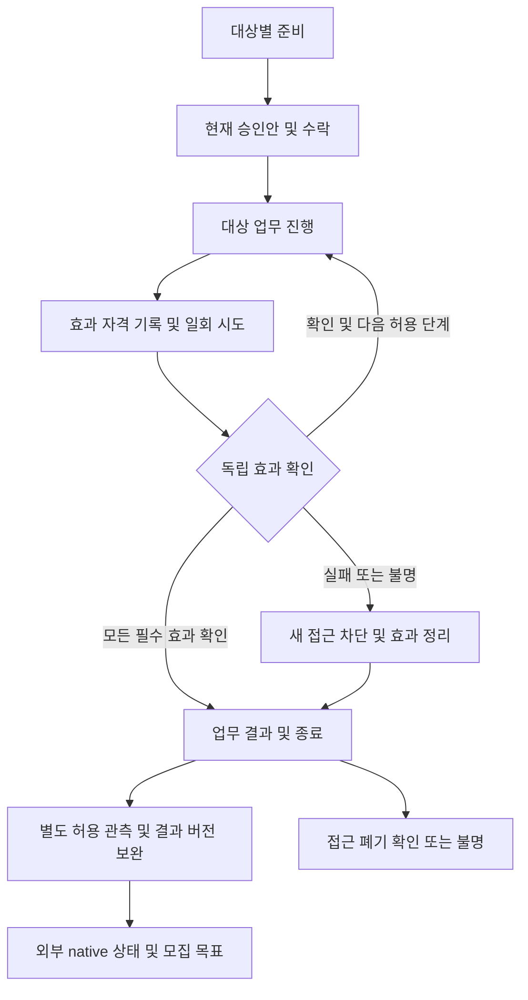

# 찾아you 논리 상태·전이 명세 V1.0 — 업무·효과·관측·권한 분리

<!-- Generated by tools/project_docs.py. Source: docs/artifacts/planning/lesson-registration-20261126/integrated/logical-state-v1.0.json -->
[작업 원본](../../artifacts/planning/lesson-registration-20261126/integrated/logical-state-v1.0.json) · [시스템 업무](SYSTEM-WORK-V1.0.md) · [플랫폼별 업무](PLATFORM-WORK-V1.0.md)

R01 검토 후보 · 제품 범위 V1.0 유지 · 실제 실행 미승인 · R1 보완 · 2026-11-27

공통 36 업무·7 플랫폼 44 업무·144 체크포인트를 원본/준비/승인/수락·효과/관측·결과·권한 수명주기의 독립 정본과 조건부 전이로 연결한다.

제품 범위 V1.0·mock-only 유지. 이전 11/24~25 설계는 참고·변경 영향 검토용. 상태·전이 V1.0은 검토 후보이며 오류 대응·통합 사용자 스토리 확정 및 DB/API 상세 설계/실제 실행·main 병합 전.

## 상태 분리 및 처리 개요

| 축 | 관리 단위 | 상태 후보 | 정본 책임 | 화면 |
| --- | --- | --- | --- | --- |
| AX01 서비스 인증 문맥 | owner에 바인딩된 서비스 접근 문맥(계정 자체의 생명주기 아님) | unverified · verified · closed | 공통 BE: 인증 주체 검증 | V0/G/H |
| AX02 원본 편집·추출 문맥 | 한 owner의 원본 편집 문맥과 기준 revision | editing · extracting · needs_facts · ready · saved · discarded | 공통 BE: 현재 입력/추출 결과; FE는 표시 | E |
| AX03 원본/관리 관계 | 원본 lineage 및 정확 외부 객체와의 관리 연결 각각; 원본과 링크는 서로 다른 인스턴스 종류 | absent · managed · retired | 공통 BE: 원본·관리 관계 권한 및 기록 | H/E/W |
| AX04 내부 명령 처리 정본 | owner+명령 종류+요청 ID+정규화 입력; 원본 저장, 연결/해제, 준비 접수, 수락, 권리 요청 등 | unrecorded · committed · rejected · no_commit_proven | 공통 BE/논리 저장소: 정확 동일 키의 정본 결과 | E/W/R/A/G |
| AX05 명령 응답 인지 | 호출자에게 보이는 동일 명령 결과의 확인 여부 | waiting · unknown · known | FE 표시; 공통 BE 정본 조회 | E/W/R |
| AX06 대상별 준비 | 업무 묶음의 선택 대상별 원본·준비 revision 및 검증/규칙 snapshot | unprepared · preparing · issues · ready · held · excluded · stale · consumed | 공통 BE: 준비 판정, 플랫폼 BE: 규칙/객체 관측 제공 | W |
| AX07 외부 대상 판정 | 준비 revision 및 읽기 목적에 연결한 정확 계정·객체/하위 객체·신규 slot | unresolved · exact_new · exact_existing · ambiguous | 공통 BE: 식별·중복 판정; 플랫폼 BE: 근거 | W/R/A |
| AX08 승인안·고정 승인 | 대상별 현재 내용·효과/범위와 준비 revision, 선택/제외 대상 목록을 묶은 검토안/수락 snapshot | none · presented · invalidated · frozen | 공통 BE: 현재 검토안, 양 논리 승인 및 수락 | W/R |
| AX09 수락 대상 업무 수명주기 | 수락 묶음에 포함된 각 독립 대상 업무; READ/STATUS/RESPOND 등 읽기/내부 업무는 종류에 맞게 적용 | not_accepted · accepted · running · fencing · ended | 공통 BE: 수락·처리 조정·종료 | W/R |
| AX10 개별 효과 시도·확인 | 정확 플랫폼/계정/객체 또는 신규 slot/논리 효과와 연결된 한 시도; 실제 업무 체크포인트 내부의 개별 변이 | not_attempted · reserved · in_flight · confirmed · none_confirmed · unknown | 공통 BE: 자격/시도·근거 판정; 플랫폼 BE: 허용된 관측 | R |
| AX11 조회 요청·관측 | 정확 대상/목적/요청 ID와 순서가 고정된 한 조회 시도 | not_requested · pending · observed · unavailable | 공통 BE: 관측 기록, 플랫폼 BE: 독립 읽기 근거 | H/W/R |
| AX12 외부 native 상태 관측 | 외부 객체/하위 관계에 대한 시점별 상태 관측과 그 최신 확인 투영 | unknown · observed · disputed | 공통 BE: 근거 있는 상태 투영; 플랫폼 BE: 실제 raw label/value | H/R |
| AX13 사용자 모집/판매 목표 | 정확 대상 및 목표 기준 버전의 시점별 판정 | unknown · not_reached · confirmed | 공통 BE: 플랫폼 완료/목표 근거 대조 | H/R |
| AX14 업무 한정 외부 접근 문맥 | owner·플랫폼·기대 계정·목적/권한 범위·호출 문맥·generation·만료에 바인딩 | none · human · verifying · verified · blocked | 공통 BE: 인증/권한·차단; 플랫폼 BE: 검증 근거 | W/R/A/X/G |
| AX15 접근 자원 폐기 확인 | AX14 문맥의 접근 자원/세션 종료·해제 의무 | not_required · pending · confirmed · unknown | 공통 BE: 자원 종료 확인 및 차단 유지 | R/A/X/G |
| AX16 대상 업무 결과 판정 | 수락 대상 업무와 연결된 버전 있는 판정; 종료 후 증거 추가 가능 | pending · complete · not_executed · no_effect · partial_confirmed · effect_unknown · read_observed · read_unavailable · guidance_delivered · restricted | 공통 BE: 독립 판정/정본 기록 | H/R/W |
| AX17 외부 효과 증거 분쟁 및 충돌 영역 차단 | 환경·플랫폼·검증된 실제 계정·정규 객체/하위 객체/신규 slot 및 겹치는 변경 영역의 분쟁 episode | clear · disputed | 공통 BE: 정확 충돌/분쟁 정본 및 fence; 플랫폼 BE: 독립 근거 | W/R |

## 상태 축별 전이

### AX01 · 서비스 인증 문맥

- 초기: unverified
- 종결: closed
- 원칙: 로그아웃·만료 이후 동일 인증 문맥 재개 없음; 새 문맥으로 같은 owner 검증. 외부 계정/인증과 분리.

| 전이 | 출발 → 도착 | 사건/주체 | 전제 조건 | 결과/보존 | 공통 업무·오류 |
| --- | --- | --- | --- | --- | --- |
| LT-01 | unverified → verified | 공식 서비스 인증/가입/복구 확인 / SYSTEM | 인증 주체와 정확 owner 관계 검증; 중복 가입 결과 확인 | 새 검증 문맥·허용 owner 반환 | SW-01 · SW-02 · ER-01 · ER-02 |
| LT-02 | unverified / verified → closed | 인증 실패/만료/로그아웃/권리 제한 / SYSTEM | 동일 인증 문맥 종료; 타 owner 접근 거절은 별도 요청 제한, 해당 세션 자동 종료 아님 | 본인 정보 비노출, 영향 외부 접근 차단/폐기 연계 | SW-01 · SW-02 · SW-33 · SW-34 · SW-36 · ER-01 · ER-02 · ER-23 · ER-26 |

### AX02 · 원본 편집·추출 문맥

- 초기: editing
- 종결: saved · discarded
- 원칙: 추출 결과는 자료/편집 revision과 요청 ID로 검증. saved는 확인된 저장 결과; 새 편집은 새 문맥. 유효 자료 보존.

| 전이 | 출발 → 도착 | 사건/주체 | 전제 조건 | 결과/보존 | 공통 업무·오류 |
| --- | --- | --- | --- | --- | --- |
| LT-03 | editing / needs_facts / ready → extracting | 자료 기반 추출 시작 / SYSTEM | 현재 자료 revision·권리·명시 추출 의도/필수 동의; 직접 입력 생략 가능 | 추출 요청 ID/기준 revision 고정, 기존 유효 입력 보존 | SW-04 · SW-05 · ER-03 · ER-04 · ER-10 |
| LT-04 | extracting → needs_facts | 현재 추출 실패/불확실·충돌 / SYSTEM | 동일 자료·추출 요청/revision; 늦은 응답 무효 | 문제 항목만 표시, 확인값 유지 | SW-05 · SW-06 · ER-03 · ER-04 · ER-10 |
| LT-05 | editing / extracting / needs_facts → ready | 사실 정정/직접 입력/추출 결과 검증 / SYSTEM | 현재 입력·권리·근거 검증 및 저장에 필요한 정보 충족; 낡은 응답 거절 | 저장 검토 후보; 플랫폼별 필수값 충족 의미 아님 | SW-04 · SW-05 · SW-06 · ER-03 · ER-04 · ER-05 · ER-10 |
| LT-06 | editing / extracting / needs_facts / ready → editing | 자료 변경/사실 편집 / USER_INTENT | 정확 owner·편집 문맥; 입력 revision 증가 | 오래된 추출 결과 무효; 기존 저장 revision 불변 | SW-04 · SW-06 · ER-03 · ER-04 · ER-05 · ER-10 |
| LT-07 | ready → saved | 저장 명령의 커밋 확인 / SYSTEM | AX04 동일 저장 명령 committed 및 정확 원본/revision 검증 | 저장 결과와 저장 후 이동 의도 반환; 저장 불명에서는 유지 | SW-07 · SW-35 · ER-05 · ER-06 · ER-10 |
| LT-08 | editing / extracting / needs_facts / ready → discarded | 명시 편집 폐기 또는 허용 종료 / USER_INTENT | 미저장 영향 확인, 저장 명령 불명 해소; 화면 이탈 자체로 폐기 금지 | 해당 편집 문맥만 종료, 기존 원본/효과 보존 | SW-06 · SW-07 · SW-35 · ER-05 · ER-06 · ER-26 |

### AX03 · 원본/관리 관계

- 초기: absent
- 종결: retired
- 원칙: 원본 저장 revision은 불변; managed의 새 revision은 명시 변경. retired는 관리상 해제/제한을 뜻할 뿐 물리 삭제·외부 삭제 아님. 보존 정책 및 재연결은 별도 검증/새 관계.

| 전이 | 출발 → 도착 | 사건/주체 | 전제 조건 | 결과/보존 | 공통 업무·오류 |
| --- | --- | --- | --- | --- | --- |
| LT-09 | absent → managed | 원본 최초 저장/정확 관리 연결 기록 / SYSTEM | AX04 커밋; owner·정확 대상/권한, 중복/충돌 및 관리 관계 검증 | 새 불변 revision 또는 관리 관계; 외부 변이 없음 | SW-07 · SW-18 · SW-29 · ER-02 · ER-05 · ER-06 · ER-14 · ER-15 · ER-25 · ER-31 |
| LT-10 | managed → managed | 원본 변경 저장/관계 메타 갱신 / SYSTEM | 정확 기존 revision·요청 및 변경 권한; 관계를 임의 다른 객체로 대체 금지 | 새 원본 revision/관계 기록, 이전 승인·결과 보존; 영향 준비 stale | SW-06 · SW-07 · SW-29 · ER-02 · ER-05 · ER-06 · ER-10 · ER-25 |
| LT-11 | managed → retired | 내부 삭제/연결 해제/권리 처리 확인 / SYSTEM | 정확 owner·대상·명령 커밋, 진행/불명 효과·보존 의무 검토; 정책 미결정은 보류 | 관리 표시 제거/제한 및 필요한 이력 보존; 실제 물리 삭제 별도, 외부 삭제 없음 | SW-08 · SW-36 · ER-02 · ER-15 · ER-25 · ER-31 |

### AX04 · 내부 명령 처리 정본

- 초기: unrecorded
- 종결: committed · rejected · no_commit_proven
- 원칙: 서버 결과와 FE가 응답을 수신했는지는 다름. no_commit_proven은 진행 중 수락/저장 가능성이 없음을 확인하고 해당 키를 봉쇄한 경우만; 단순 not found 아님.

| 전이 | 출발 → 도착 | 사건/주체 | 전제 조건 | 결과/보존 | 공통 업무·오류 |
| --- | --- | --- | --- | --- | --- |
| LT-12 | unrecorded → committed | 동일 명령의 허용 처리 커밋 / SYSTEM | 서버 owner/키/정규화 입력·현재 revision·권한/도메인 guard, 단일 논리 커밋 | 명령 결과/변경 대상/수락 snapshot·대상 업무 등 함께 기록 | SW-07 · SW-08 · SW-09 · SW-18 · SW-22 · SW-29 · SW-36 · ER-02 · ER-05 · ER-06 · ER-10 · ER-15 · ER-16 · ER-17 · ER-25 · ER-31 |
| LT-13 | unrecorded → rejected | 검증된 거절 / SYSTEM | 정확 명령의 거절 확정; 어떤 커밋/외부 효과도 없음 | 거절 사유, 새 입력 필요시 새 의도/키 | SW-07 · SW-09 · SW-18 · SW-22 · SW-36 · ER-02 · ER-05 · ER-06 · ER-07 · ER-10 · ER-16 · ER-17 · ER-25 |
| LT-14 | unrecorded → no_commit_proven | 권위 있는 미커밋 확정 및 키 봉쇄 / SYSTEM | 동일 키의 진행·지연 수락 가능성 제거 및 미커밋 증거; 조회 실패/404만으로 불가 | 이 명령의 추후 커밋 금지; 현재 조건에서 새 명시 요청 후보 | SW-07 · SW-22 · SW-35 · ER-06 · ER-17 · ER-31 |

### AX05 · 명령 응답 인지

- 초기: waiting
- 종결: known
- 원칙: unknown은 내부 처리/외부 효과의 상태가 아님. 같은 키/내용으로 상태 조회; 다른 명령 자동 발행 금지.

| 전이 | 출발 → 도착 | 사건/주체 | 전제 조건 | 결과/보존 | 공통 업무·오류 |
| --- | --- | --- | --- | --- | --- |
| LT-15 | waiting → unknown | 응답 유실/시간초과 / SYSTEM | 정확 명령의 권위 있는 결과 미수신 | 같은 키 조회 안내; 정본·효과 상태 변경 없음 | SW-07 · SW-22 · SW-35 · ER-06 · ER-17 · ER-26 |
| LT-16 | waiting / unknown → known | 동일 키 결과 확인 / SYSTEM | AX04의 committed/rejected/no_commit_proven 및 동일 입력 관계 확인 | 정본 결과 반환; 이미 수락된 업무 재생성 없음 | SW-07 · SW-22 · SW-35 · ER-06 · ER-17 · ER-31 |
| LT-17 | unknown → unknown | 동일 키 확인 불가 / SYSTEM | 정확 owner·키 확인 범위; 결과 미확정 | 불명 유지/보류; 새 저장/수락 자동 발행 없음 | SW-07 · SW-22 · SW-35 · ER-06 · ER-17 · ER-31 |

### AX06 · 대상별 준비

- 초기: unprepared
- 종결: consumed
- 원칙: ready는 현재 준비와 mock 환경의 검토 가능 후보. 실제 정책/대행 허용 아님. 모든 선택 대상의 처분 명시. consumed 이후 승인된 요청의 준비값 변경 없음.

| 전이 | 출발 → 도착 | 사건/주체 | 전제 조건 | 결과/보존 | 공통 업무·오류 |
| --- | --- | --- | --- | --- | --- |
| LT-18 | unprepared / stale / issues / held → preparing | 명시 준비/변경된 입력의 재검증 / SYSTEM | 현재 선택 대상·원본/준비 revision·목적·지원 분류. 기존 수락 업무가 아님 | 준비 revision/요청 ID; 해당 대상만 재검증 | SW-09 · SW-11 · SW-12 · SW-13 · SW-19 · SW-20 · ER-07 · ER-08 · ER-09 · ER-10 |
| LT-19 | preparing → issues | 입력 부족/변환·검증 실패/대상·인증 보완 / SYSTEM | 현재 준비 요청/revision; 확인된 구체 사유 | 유효 결과 유지, 필요한 보완/인증만 요청 | SW-12 · SW-13 · SW-14 · SW-17 · SW-21 · ER-03 · ER-04 · ER-08 · ER-09 · ER-10 · ER-11 · ER-12 · ER-13 · ER-14 |
| LT-20 | preparing / issues → ready | 현재 준비 검증 완료 / SYSTEM | 실제 업무 필수 사실·규칙·정확 대상·필요 선행/권한 조건을 현재 환경에서 충족; 실제 미승인 경계 유지 | 검토 가능 후보; 실제 외부 허용/효과 아님 | SW-10 · SW-12 · SW-15 · SW-16 · SW-17 · SW-19 · SW-20 · SW-21 · ER-07 · ER-09 · ER-10 · ER-12 · ER-14 · ER-15 · ER-29 |
| LT-21 | unprepared / preparing / issues / ready / stale → held | 미지원/허용 불명/필수 조건 해결 불가 / SYSTEM | 지원·근거·제약/이전 효과의 실제 불명 또는 명시 보류 | 이유와 내부 대안/후속 확인; 외부 실행 없음 | SW-10 · SW-12 · SW-13 · SW-21 · SW-31 · SW-32 · ER-07 · ER-09 · ER-13 · ER-14 · ER-15 · ER-16 · ER-29 · ER-30 |
| LT-22 | unprepared / preparing / issues / ready / held / stale → excluded | 사용자가 대상 제외 / USER_INTENT | 정확 선택 대상 및 제외 의도; 수락 전만 | 선택 묶음의 제외 이유/변경된 승인안 | SW-09 · SW-21 · SW-33 · ER-16 |
| LT-23 | excluded → preparing | 사용자 다시 포함/새 검토 / USER_INTENT | 정확 대상 명시 포함 및 현재 조건; 이전 승인 재사용 금지 | 새 준비 revision | SW-09 · SW-10 · SW-12 · SW-21 · ER-07 · ER-10 · ER-16 |
| LT-24 | preparing / issues / ready / held → stale | 의미 있는 입력·규칙·대상·권한 변경 / SYSTEM | 영향받는 미수락 준비 문맥 식별; 낡은 응답도 무효 | 영향 대상만 stale, 해당 미수락 승인안 무효; 다른 대상과 고정 승인 보존 | SW-07 · SW-12 · SW-13 · SW-15 · SW-19 · SW-20 · SW-21 · SW-33 · ER-05 · ER-07 · ER-10 · ER-12 · ER-16 · ER-29 |
| LT-25 | ready → consumed | 쓰기 승인·요청 수락 / SYSTEM | 현재 준비/revision·양 승인·정확 목록 및 AX04 커밋/AX08 frozen/AX09 accepted 동시 | 수락된 대상 준비 불변, 변경은 별도 업무 | SW-21 · SW-22 · ER-10 · ER-12 · ER-14 · ER-15 · ER-16 · ER-17 |

### AX07 · 외부 대상 판정

- 초기: unresolved
- 종결: 시점별/별도 판정
- 원칙: exact_new는 허용된 조회 범위/이전 효과로 신규 의도를 검증한 후보. exact_existing은 소유·관계·권한 확인이 필요한 업무에서 그 조건 포함. public 조회 관측만으로 관리권한 부여 금지.

| 전이 | 출발 → 도착 | 사건/주체 | 전제 조건 | 결과/보존 | 공통 업무·오류 |
| --- | --- | --- | --- | --- | --- |
| LT-26 | unresolved / ambiguous → exact_new | 신규 의도 및 정확 slot/부재 확인 / TRUSTED_OBSERVATION | 명시 허용 읽기/정확 계정과 범위, 기존 후보/이전 효과 확인. 미확인=0건 금지 | 신규 slot 근거; 실제 생성 아님 | SW-15 · SW-17 · SW-25 · ER-12 · ER-14 · ER-15 · ER-22 · ER-31 |
| LT-27 | unresolved / ambiguous → exact_existing | 정확 외부 객체/하위 객체 확인 / TRUSTED_OBSERVATION | 명시 허용 읽기 및 목적별 소유/권한·정확 관계 검증; 사용자 선택은 보조 | 객체 ID·관계·현재 값·시각 | SW-15 · SW-17 · SW-18 · SW-19 · SW-20 · SW-28 · ER-12 · ER-14 · ER-15 · ER-22 · ER-31 |
| LT-28 | unresolved / exact_new / exact_existing → ambiguous | 식별·소유/이전 효과·관계 근거 불충분 / SYSTEM | 현재 준비/조회 문맥에서 확정 근거 상실/후보 다수 | 관련 준비 보완/보류, 새 변이 금지 | SW-17 · SW-21 · SW-31 · ER-12 · ER-14 · ER-15 · ER-19 · ER-22 · ER-29 |
| LT-29 | exact_new / exact_existing / ambiguous → unresolved | 현재 대상/계정/규칙 문맥 변경 / SYSTEM | 미수락 문맥만 재식별; 고정 승인된 객체를 새 대상으로 바꾸지 않음 | 새 준비 문맥의 재검증; 과거 관측 보존 | SW-09 · SW-15 · SW-17 · SW-21 · ER-10 · ER-12 · ER-14 |

### AX08 · 승인안·고정 승인

- 초기: none
- 종결: invalidated · frozen
- 원칙: frozen은 수락과 함께 불변. 별도 필수 직접 동의 유지. 승인 철회는 수락 이후 새 접근 제한으로만 적용하며 원 승인·효과 이력 수정 안 함.

| 전이 | 출발 → 도착 | 사건/주체 | 전제 조건 | 결과/보존 | 공통 업무·오류 |
| --- | --- | --- | --- | --- | --- |
| LT-30 | none → presented | 최종 검토안 생성 / SYSTEM | 현재 대상 준비/정확 객체/규칙/예정 효과·제외/보류 전부 표시 | 검토 snapshot; 사용자 승인 아님 | SW-21 · ER-07 · ER-09 · ER-10 · ER-14 · ER-16 |
| LT-31 | presented → invalidated | 내용/범위 변경·거절·수락 전 철회 / SYSTEM | 현재 미수락 검토안·영향 대상 확인 | 이 검토안 재사용 금지; 새 검토안은 새 인스턴스 | SW-13 · SW-21 · SW-33 · ER-10 · ER-16 |
| LT-32 | presented → frozen | 명시 내용 및 범위 승인과 수락 커밋 / SYSTEM | 양 논리 승인·현재 정확 대상 목록/내용/효과/권한/revision·요청 키 일치; 수락 원자 경계; 승인 snapshot에 필수 검증 읽기 목적/대상 binding/범위/유효기간 별도 고정, 읽기·쓰기 허용 독립 확인 | 불변 승인·업무 대상 및 scope 고정; 별도 필수 직접 동의 유지 | SW-21 · SW-22 · ER-07 · ER-10 · ER-12 · ER-14 · ER-15 · ER-16 · ER-17 |

### AX09 · 수락 대상 업무 수명주기

- 초기: not_accepted
- 종결: ended
- 원칙: 종료는 성공이 아님. fencing은 시스템 오류/권한 상실/권리 행사 등 새 접근 차단이 필요한 경우. 화면 이동·일반 중단 버튼 없음. 종료된 대상 재개 금지.

| 전이 | 출발 → 도착 | 사건/주체 | 전제 조건 | 결과/보존 | 공통 업무·오류 |
| --- | --- | --- | --- | --- | --- |
| LT-33 | not_accepted → accepted | 명시 업무 수락 / SYSTEM | 쓰기: AX04 commit/AX06 ready→consumed/AX08 freeze 동시. 읽기/내부 안내: 명시 목적/범위의 허용 요청; 쓰기 승인 없음/효과 없음 | 각 승인·수락된 대상만 생성; 묶음 정확 대상 고정 | SW-22 · SW-30 · SW-31 · ER-02 · ER-07 · ER-10 · ER-12 · ER-14 · ER-15 · ER-16 · ER-17 |
| LT-34 | accepted → running | 현재 허용 업무 실행 조정 / SYSTEM | 정확 수락 대상·권한/규칙/효과·현재 실행 권한; 읽기/내부와 쓰기 구분; mock-only | 실행 문맥 확보; 실패/상실 시 fencing | SW-23 · SW-30 · SW-31 · ER-07 · ER-12 · ER-15 · ER-17 · ER-18 · ER-32 |
| LT-35 | accepted / running → fencing | 시스템 오류/조건 상실/권리 행사·접근 제한 / SYSTEM | 실제 오류/상실/권리·보안 차단; 화면 이탈/일반 실행 취소 아님 | 새 실행 자격 차단, 진행 중 효과/근거 보존; 관련 접근 AX14 blocked | SW-23 · SW-24 · SW-28 · SW-33 · SW-34 · ER-07 · ER-11 · ER-12 · ER-16 · ER-18 · ER-19 · ER-23 · ER-26 · ER-32 |
| LT-36 | running → ended | 업무 정상 처리 종료 / SYSTEM | 쓰기 완료 기준의 모든 필수 효과/증거 확인 또는 조회/내부 업무의 결과 기록; 미확정 필수 효과를 성공으로 처리 금지 | AX16 업무 종류별 결과 버전·접근 차단/폐기 의무; 사용자 결과 확인 클릭 불필요 | SW-28 · SW-29 · SW-30 · SW-31 · SW-34 · ER-19 · ER-20 · ER-21 · ER-22 · ER-23 · ER-31 |
| LT-37 | fencing → ended | 안전 종료 확정 / SYSTEM | 새 허용 봉쇄, 현재 진행 시도 정리/미확인 기록, 결과·기존 효과 보존; 폐기 결과 불명은 독립 | 부분/불명/미실행/실패 판정 및 이력. 종료 후 재개 금지 | SW-28 · SW-29 · SW-31 · SW-34 · ER-18 · ER-19 · ER-21 · ER-23 · ER-31 · ER-32 |

### AX10 · 개별 효과 시도·확인

- 초기: not_attempted
- 종결: confirmed · none_confirmed
- 원칙: reserved는 실행 전 기록; 전송 여부 불명은 unknown. confirmed/none_confirmed은 증거 기반 결론이며 자동 되돌림 없음. unknown의 후속 증거는 동일 시도 판정만 보완; 새로운 시도에는 별도 업무·승인/동일 논리 효과 중복 검증.

| 전이 | 출발 → 도착 | 사건/주체 | 전제 조건 | 결과/보존 | 공통 업무·오류 |
| --- | --- | --- | --- | --- | --- |
| LT-38 | not_attempted → reserved | 변이 전 자격/효과 기록 / SYSTEM | AX09 running, 정확 freeze/허용·권한/계정/객체/환경, 선행 효과 증거·동일 논리 효과 이전 confirmed/pending/unknown 없음; fence와 직렬화; 정규 충돌 영역에 겹치는 활성 claim·미확인·분쟁 없음 및 필수 readback 계획 검증; 상위/하위 영역 겹침 직렬화 | 안정 논리 효과 ID/일회 시도 기록; 전송/성공 아님 | SW-23 · SW-24 · ER-07 · ER-10 · ER-12 · ER-14 · ER-15 · ER-16 · ER-17 · ER-29 · ER-32 |
| LT-39 | reserved → in_flight | 일회 모의 변이 전송 개시 / SYSTEM | 동일 시도 권한/단계/승인/현재 fence 재검증, 전송 자격 단 1회 소모; mock-only; 정확 claim 및 fence·readback 권한 직전 재검증; 예약/전송 개시/실제 전송 증거를 독립 기록 | 전송 개시 기록(외부 실제 0), 이후 독립 관측 | SW-24 · SW-25 · SW-26 · SW-27 · ER-07 · ER-12 · ER-15 · ER-16 · ER-18 · ER-19 · ER-29 |
| LT-40 | reserved → none_confirmed | 변이 미전송이 확정된 차단 / SYSTEM | 자격 봉쇄와 전송 미발생을 신뢰할 수 있게 확인; 단순 시간초과 아님 | 시도 종료·미발생 근거 보존 | SW-24 · SW-28 · SW-33 · ER-15 · ER-18 · ER-19 · ER-32 |
| LT-41 | reserved / in_flight → unknown | 전송/효과 불명·응답 유실/관측 실패 / SYSTEM | 해당 시도에 전송 미발생/효과를 확정할 충분한 증거 없음 | 새 쓰기 금지, 기존 효과/근거 유지; 필요 fence | SW-24 · SW-28 · SW-29 · SW-31 · ER-15 · ER-18 · ER-19 · ER-21 · ER-22 · ER-29 · ER-31 · ER-32 |
| LT-42 | in_flight / unknown → confirmed | 정확 효과의 독립 확인 / TRUSTED_OBSERVATION | 동일 계정/객체/효과 ID/승인값 및 기준에 맞는 적합 근거·시각; 늦은 증거도 정확 매칭/권한 확인; 이미 확정된 판정과 상충하면 LT-71/73으로 처리하고 과거 판정을 덮어쓰지 않음 | 확인 증거 append; 종료된 업무 재개 없음, 판정 새 버전만 | SW-28 · SW-29 · ER-14 · ER-19 · ER-21 · ER-29 · ER-31 |
| LT-43 | in_flight / unknown → none_confirmed | 정확 효과 미발생 확인 / TRUSTED_OBSERVATION | 동일 시도의 미발생을 권위 있게 확인, 이전 늦은 실행 가능성 봉쇄; 조회 불가만으로 불가; 미전송 증거와 실제 전송 후 미발생 증거를 별도 기록; 상충 시 LT-71/73 | 미발생 근거 append; 새 쓰기는 새 명시 업무/승인/효과 검증 | SW-28 · SW-29 · SW-31 · ER-15 · ER-18 · ER-19 · ER-21 · ER-22 · ER-31 |

### AX11 · 조회 요청·관측

- 초기: not_requested
- 종결: observed · unavailable
- 원칙: unavailable은 조회 실패/불가, 외부 객체 상태를 뜻하지 않음. 별도 새 조회로만 최신 관측 갱신; 마지막 유효 관측/시각 보존.

| 전이 | 출발 → 도착 | 사건/주체 | 전제 조건 | 결과/보존 | 공통 업무·오류 |
| --- | --- | --- | --- | --- | --- |
| LT-44 | not_requested → pending | 명시 범위의 허용 조회 시작 / SYSTEM | 정확 owner/계정/객체·목적·요청 순번·단계 허용/권한. 내부 조회와 외부 조회 분리, mock-only; 명시 준비 읽기·사용자 요청 최신 상태 읽기·기존 효과 확인 읽기 또는 고정된 필수 검증 읽기 계획의 exact binding 내에서만; 범위 확대는 새 요청 | 조회 요청/기준 시각 기록; 외부 변이 없음 | SW-17 · SW-28 · SW-30 · ER-07 · ER-11 · ER-12 · ER-14 · ER-22 |
| LT-45 | pending → observed | 현재 요청의 독립 관측 성공 / TRUSTED_OBSERVATION | 정확 대상·목적/권한·관측 ID/시각/근거 및 요청 순서 검증 | 관측 append, 같은 목적의 최신 적합 관측 갱신; 늦은 응답 과거로 보존 | SW-17 · SW-28 · SW-30 · ER-14 · ER-19 · ER-22 · ER-31 |
| LT-46 | pending → unavailable | 조회 실패/권한 상실/응답 미확정 / SYSTEM | 정확 읽기 요청의 종료 불가 원인 기록; 외부 상태 미확정 | 최신 조회 불가 및 마지막 유효 관측 유지; 새 읽기는 별도 요청 | SW-17 · SW-28 · SW-30 · SW-31 · ER-07 · ER-11 · ER-12 · ER-14 · ER-22 · ER-31 |

### AX12 · 외부 native 상태 관측

- 초기: unknown
- 종결: 시점별/별도 판정
- 원칙: 플랫폼별 native 문자열·시각·출처를 보존. 공통 lifecycle으로 변환 금지. 새 적합 근거로 외부 상태가 바뀔 수 있음. 서로 충돌하는 근거는 disputed, 이전 관측 유지.

| 전이 | 출발 → 도착 | 사건/주체 | 전제 조건 | 결과/보존 | 공통 업무·오류 |
| --- | --- | --- | --- | --- | --- |
| LT-47 | unknown / observed / disputed → observed | 적합 native 관측 추가 / TRUSTED_OBSERVATION | AX11 적합 증거, 정확 객체/목적/관측 시각·근거; 최신성 비교/충돌 해결 | raw 상태·정확 의미·시각·근거 보존; 늦은 관측은 최신값 덮지 않음 | SW-17 · SW-28 · SW-29 · SW-30 · ER-14 · ER-19 · ER-20 · ER-22 · ER-29 · ER-31 |
| LT-48 | unknown / observed / disputed → disputed | 적합 근거 간 충돌/동일성 불일치 / SYSTEM | 상충 근거 또는 값 의미 불명 확인; 과거 확정 기록 보존 | 현재 상태 확인 불가/충돌 표시; 변이 차단 | SW-17 · SW-28 · SW-29 · SW-30 · ER-14 · ER-19 · ER-22 · ER-29 · ER-31 |

### AX13 · 사용자 모집/판매 목표

- 초기: unknown
- 종결: 시점별/별도 판정
- 원칙: 업무 접수/저장 완료와 별도. 현재 확인된 관측 시점의 목표 판정, 실제 고객 문의/판매 보장 아님. 이후 상태 변화로 바뀔 수 있음.

| 전이 | 출발 → 도착 | 사건/주체 | 전제 조건 | 결과/보존 | 공통 업무·오류 |
| --- | --- | --- | --- | --- | --- |
| LT-49 | unknown / not_reached / confirmed → confirmed | 현재 목표 기준 충족 관측 / SYSTEM | 정확 대상/시점·기준 버전의 충분한 적합 증거, native 표시만으로 목표 보장 금지 | 목표 확인 시점·근거 및 이전 판정 보존 | SW-28 · SW-29 · SW-30 · ER-20 · ER-22 · ER-29 · ER-31 |
| LT-50 | unknown / not_reached / confirmed → not_reached | 현재 목표 미충족이 확인됨 / SYSTEM | 예: 심사 중/일정 미등록 등 해당 목표 미충족의 확인된 근거; 단순 조회 불가 제외 | 목표 미달 근거·시각, 업무 완료 결과와 독립 | SW-28 · SW-29 · SW-30 · SW-31 · ER-20 · ER-22 · ER-29 |
| LT-51 | unknown / not_reached / confirmed → unknown | 현재 목표 판정 불충분/새 상태 충돌 / SYSTEM | 목표에 필요한 최신 증거 부족/충돌, 새 목표 기준/관측 범위; 이전 시점 확인값 보존 | 현재 목표 불명, 마지막 확인 시점 명시 | SW-28 · SW-29 · SW-30 · SW-31 · ER-20 · ER-22 · ER-29 · ER-31 |

### AX14 · 업무 한정 외부 접근 문맥

- 초기: none
- 종결: blocked
- 원칙: verified의 읽기/변이 허용 범위는 독립 필드. 직접 인증 후 검증, 잘못된 계정/낡은 generation 차단. 새 인증은 새 문맥; 장기 위임 미채택.

| 전이 | 출발 → 도착 | 사건/주체 | 전제 조건 | 결과/보존 | 공통 업무·오류 |
| --- | --- | --- | --- | --- | --- |
| LT-52 | none → human | 필요 대상 직접 인증 요청 / USER_INTENT | 정확 목적/계정/권한·호출 문맥과 단계 허용; 직접 인증 공식 경로, 실제 접근 금지 | 새 generation·만료, 인증 비밀 수집/저장 없음 | SW-14 · ER-07 · ER-11 · ER-12 · ER-13 · ER-26 |
| LT-53 | human → verifying | 직접 인증 완료 신호 / USER_INTENT | 현재 generation·호출 문맥; 완료 버튼은 권한 증거 아님 | 직접 입력 경로 봉쇄, 검증 단계 시작 | SW-14 · SW-15 · ER-11 · ER-12 · ER-13 |
| LT-54 | verifying → verified | 정확 외부 계정/권한/유효성 확인 / TRUSTED_OBSERVATION | 같은 generation·목적·계정·권한·만료·허용; 새 계정 자동 대체 금지 | 정확 업무 한정 권한; 관리 계정 식별/장기 인증과 분리 | SW-15 · SW-16 · ER-07 · ER-11 · ER-12 · ER-13 · ER-14 |
| LT-55 | none / human / verifying / verified → blocked | 인증 실패/취소/만료·권리/조건 상실·업무 종료 / SYSTEM | 정확 영향 문맥/범위. 기존 수락 업무 새 접근 차단, 필요 fencing; 단순 뷰어 detach 아님 | 이 generation 새 접근 금지, AX15 폐기 의무 기록; 기존 효과 보존 | SW-14 · SW-15 · SW-23 · SW-33 · SW-34 · SW-36 · ER-07 · ER-11 · ER-12 · ER-16 · ER-23 · ER-26 · ER-32 |

### AX15 · 접근 자원 폐기 확인

- 초기: not_required
- 종결: confirmed
- 원칙: 접근 차단과 실제 폐기 성공 구분. unknown은 운영 확인 대상. 재인증/새 문맥이 이전 폐기 미확인을 해소하지 않음.

| 전이 | 출발 → 도착 | 사건/주체 | 전제 조건 | 결과/보존 | 공통 업무·오류 |
| --- | --- | --- | --- | --- | --- |
| LT-56 | not_required → pending | 자원 보유 문맥의 차단·폐기 의무 발생 / SYSTEM | AX14 blocked, 실제 자원/연결 존재 또는 존재 불명; 자원 없음이 확정이면 not_required 유지 | 새 접근 차단 상태 유지; 폐기 시도/근거 기록 | SW-33 · SW-34 · SW-36 · ER-11 · ER-23 · ER-25 · ER-26 |
| LT-57 | pending / unknown → confirmed | 권한/자원 종료 확인 / TRUSTED_OBSERVATION | 정확 문맥/generation과 실제 폐기 근거, 무효화만으로 물리 폐기 단정 금지 | 폐기 확인 및 기존 관리 관계/이력 유지 | SW-34 · ER-23 · ER-31 |
| LT-58 | pending → unknown | 폐기 결과 불명/실패 / SYSTEM | 폐기 증거 미확정 | 차단 유지, 운영 확인; 새 인증으로 이전 폐기 완료 치환 금지 | SW-33 · SW-34 · ER-23 · ER-31 · ER-32 |

### AX16 · 대상 업무 결과 판정

- 초기: pending
- 종결: 시점별/별도 판정
- 원칙: 과거 판정 불변 보존, 최신 판정 버전 별도. 확인 효과+불명은 effect_unknown 및 확인 효과 수/부분 표시. read_observed와 업무 종료/모집 목표 분리.

| 전이 | 출발 → 도착 | 사건/주체 | 전제 조건 | 결과/보존 | 공통 업무·오류 |
| --- | --- | --- | --- | --- | --- |
| LT-59 | pending → complete | 쓰기 업무 완료 판정 / SYSTEM | 업무별 필수 효과와 승인된 값/정확 객체·완료 기준의 충분한 독립 증거; 실제/모의 분리 | 완료 기준/효과·근거 기록. 모집 가능 별도 | SW-28 · SW-29 · ER-19 · ER-20 · ER-21 · ER-29 · ER-31 |
| LT-60 | pending → not_executed | 수락 업무의 실행 미발생 확정 / SYSTEM | 모든 예정 효과 미시도/미전송 확인, 전송 불명 0; 업무 제한·권한 상실 등 사유; 예약만으로 전송 시도 아님. 모든 관련 효과 미전송/미시도 증명 및 지연 실행 봉쇄 | 미실행 결과 및 이유; 쓰기 성공 아님 | SW-23 · SW-28 · SW-29 · SW-31 · ER-07 · ER-12 · ER-15 · ER-18 · ER-19 · ER-21 |
| LT-61 | pending / effect_unknown → no_effect | 시도했으나 업무 효과 미발생 확인 / SYSTEM | 실제 시도 기록 있으며 모든 관련 효과 미발생 증거, confirmed/unknown 0; 하나 이상 실제 외부 전송 증거 필요. 예약·전송 개시만으로 실제 전송 단정 금지 | 실패·미발생 판정 버전; 새 실행은 별도 승인 | SW-28 · SW-29 · SW-31 · ER-18 · ER-19 · ER-21 |
| LT-62 | pending / effect_unknown → partial_confirmed | 일부 효과 확인·완료 기준 미충족 / SYSTEM | 확인 효과 있음, 필수 효과 미충족, 관련 미확인 효과 0; 남은 범위 명시 | 부분 효과 보존, 정확 기존 객체의 지원 잔여 업무만 새 승인 | SW-28 · SW-29 · SW-31 · ER-18 · ER-19 · ER-21 · ER-29 |
| LT-63 | pending → effect_unknown | 업무 종료 시 필수/관련 효과 불명 / SYSTEM | 어느 하나의 관련 효과가 unknown/근거 불충분; 확인 효과 수·미실행도 별도; 전송 여부 또는 필수 완료 기준 판정에 필요한 증거 부족도 포함; 분쟁 차단 별도 | 미확인 판정+확인 부분 효과 표시; 새 쓰기 금지 | SW-28 · SW-29 · SW-31 · ER-15 · ER-19 · ER-21 · ER-22 · ER-31 · ER-32 |
| LT-64 | effect_unknown / partial_confirmed → complete | 종료 후 기존 효과의 증거 보완 / SYSTEM | 동일 기존 효과의 허용 독립 관측으로 업무 완료 기준 충족, 새 효과 실행 없음; 원 판정/업무 종료 보존; 관련 분쟁 미해소 상태에서 완료 승격 금지 | 새 판정 버전만 append, 재개/재제출 없음 | SW-28 · SW-29 · SW-31 · ER-19 · ER-21 · ER-22 · ER-31 |
| LT-65 | pending → read_observed | 허용 READ/STATUS 관측 성공 / SYSTEM | AX11 observed 및 정확 범위의 필요한 관측 확보 | 조회 결과/시각, 쓰기 효과 없음 | SW-17 · SW-29 · SW-30 · ER-22 · ER-31 |
| LT-66 | pending → read_unavailable | READ/STATUS 관측 불가 / SYSTEM | AX11 unavailable 또는 완료에 필요한 정확 관측 불충분 | 조회 불가 및 마지막 관측 유지 | SW-29 · SW-30 · ER-22 · ER-31 |
| LT-67 | pending → guidance_delivered | RESPOND/내부 작성안 결과 제공 / SYSTEM | 확인된 근거와 허용 내부 안내/작성안 제공. 외부 조회는 별도 허용 요청; 쓰기 없음 | 내부 안내 완료, 대행 성공 아님 | SW-31 · SW-32 · ER-07 · ER-20 · ER-24 · ER-29 · ER-30 |
| LT-68 | pending → restricted | 수락된 읽기/내부 업무가 지원 제한으로 종료 / SYSTEM | 읽기/내부 업무의 현재 불허/불명·제한을 기록; 신규 외부 접근 없음. 쓰기 업무는 효과에 따라 별도 판정 | 제한 결과 및 근거/대안 | SW-10 · SW-29 · SW-31 · SW-32 · ER-07 · ER-13 · ER-24 · ER-29 · ER-30 · ER-32 |
| LT-69 | effect_unknown → effect_unknown | 종료 후 조회했으나 효과 여전히 불명 / SYSTEM | 정확 동일 효과 확인 요청/관측 실패 또는 근거 불충분; 효과뿐 아니라 전송·완료 판정 근거 부족 또는 관련 분쟁에도 불명 유지 | 관측/판정 이력 추가, 미확인 및 봉쇄 유지 | SW-28 · SW-29 · SW-31 · ER-19 · ER-22 · ER-31 |
| LT-70 | effect_unknown → not_executed | 종료 후 기존 시도 모두 미전송이 권위 있게 증명됨 / SYSTEM | 동일 수락 대상의 모든 예정 효과 미시도 또는 미전송 확인; 실제 전송/확인/미확인 효과 0; 지연 실행 가능성 봉쇄; 정확 증거·판정 revision | AX09 ended 유지; 이전 effect_unknown 결과/증거 보존, 새 결과 판정 버전 not_executed; 자동 재실행 없음 | SW-28 · SW-29 · SW-31 · ER-15 · ER-18 · ER-19 · ER-21 · ER-32 |

### AX17 · 외부 효과 증거 분쟁 및 충돌 영역 차단

- 초기: clear
- 종결: 시점별/별도 판정
- 원칙: 활성 쓰기 claim과 미확인 효과의 장기 차단 별도. 기존 확정/미발생 및 업무 결과는 불변 이력; 신뢰 근거 충돌 또는 객체 binding 상충은 영역 disputed, 관련 새 쓰기/자동 재개 금지. 운영 해소 및 정확 독립 근거 없이는 clear 불가.

| 전이 | 출발 → 도착 | 사건/주체 | 전제 조건 | 결과/보존 | 공통 업무·오류 |
| --- | --- | --- | --- | --- | --- |
| LT-71 | clear → disputed | 정확 기존 효과의 신뢰 근거 상충 또는 객체/충돌 영역 분쟁 확인 / SYSTEM | 동일 실제 계정·효과 또는 겹치는 영역에 관련된 상충 증거/대상 binding 검증; owner 검증 | 분쟁 원장 append·새 영역 쓰기 차단·진행 대상 필요시 LT-35; 과거 판정 불변 | SW-02 · SW-23 · SW-24 · SW-28 · SW-29 · SW-31 · SW-33 · ER-14 · ER-15 · ER-19 · ER-21 · ER-29 · ER-31 · ER-32 |
| LT-72 | disputed → clear | 운영 검토 후 분쟁 해소 근거 확인 / SYSTEM | 정확 영역/분쟁 revision, 충분한 독립 근거, 영향 범위 및 권한 검증; 진행/불명/충돌 조건은 개별 검증 | 해소 근거·새 판정 표시 append; 해소 자체는 재쓰기 자격 아님; 기존 성공/과거 판정 유지 | SW-02 · SW-23 · SW-24 · SW-28 · SW-29 · SW-31 · SW-33 · ER-15 · ER-19 · ER-21 · ER-29 · ER-31 · ER-32 |
| LT-73 | disputed → disputed | 추가 상충 근거 또는 해소 근거 불충분 / SYSTEM | 정확 분쟁·영역·근거 검증 | 분쟁 및 새 쓰기 차단 유지; 과거 판정 불변 | SW-02 · SW-23 · SW-24 · SW-28 · SW-29 · SW-31 · SW-33 · ER-15 · ER-19 · ER-21 · ER-29 · ER-31 · ER-32 |

## 원자적 일관성 경계 (논리)

| ID | 경계 | 조건 |
| --- | --- | --- |
| AT-01 내부 원본 저장 | AX04 명령 처리·AX03 원본 및 revision·AX02 편집 문맥 | 정확 owner/키/hash 및 현재 revision 검증→원본 새 불변 revision과 명령 결과 함께 커밋. 편집 표시 saved는 확인 후. 실패/응답 유실의 정본/인지 분리. 원본 변경은 영향 미수락 준비 LT-24/31만. |
| AT-02 쓰기 수락 | AX04 명령·AX06 대상 준비·AX08 승인 snapshot·AX09 대상 업무 | 정확 선택 목록과 실행할 ready 대상/제외·보류 사유 확인. 양 논리 승인 및 현재 조건 전부 검증. 승인한 실행 대상 목록의 수락을 하나의 논리 경계로 기록(부분 몰래 제외 없음). 결과 유실 같은 ID 확인. 불충족이면 미수락/거절·재검토. |
| AT-03 읽기/내부 업무 접수 | AX04 명령·AX09 요청·AX11 읽기 또는 AX16 안내 | 명시 목적/범위와 현재 권한·지원 검증; 쓰기 승인·AX10 자격 생성 없음. 준비용/효과 확인용 읽기는 별도 허용 읽기 문맥으로 연결하고 쓰기 업무 신규 수락을 강제하지 않음. |
| AT-04 실행 자격 및 fence | AX09 수명주기·AX10 시도·AX14 접근 | 자격 기록·일회 전송 개시·fence는 경쟁 제어 가능한 단일 논리 권한 경계. fence 이후 새 전송 금지, 이미 개시된 시도는 독립 확인/불명. 실제 외부 전송과 내부 저장의 분산 원자성을 보장한다고 주장하지 않음. |
| AT-05 효과/관측 기록 및 종료 | AX10 시도·AX11 관측·AX12 native·AX13 목표·AX09 종료·AX16 결과 | 실제 모의 응답/독립 근거의 정확 연결, 결과와 종료 일관성. 완료 증거가 충분하지 않으면 완료 금지. 원장 실패면 성공 표시/추가 효과 금지; 결과 정리 전 안전 봉쇄. 늦은 근거는 별도 기록/판정 버전, ended 불변. |
| AT-06 접근 차단과 폐기 | AX14 접근·AX15 폐기·AX09 영향 대상 | 영향 범위 새 접근 먼저 차단, 자원 존재/불명 시 폐기 의무를 함께 기록. 진행 시도는 효과 기록 보존. 차단과 폐기 성공 분리; 로그아웃/권리 영향의 세부 정책 별도. |
| AT-07 동일 명령 조회·늦은 증거 | AX04 정본·AX05 인지·AX10/11/16 근거/판정 | 키/hash 확인은 stale 검증 전에 동일 기존 결과 반환 가능하나 owner 검증 선행. 새로운 명령/효과를 만들지 않음. 늦은 관측은 시각/순번/정확 대상 검증 후 append, 종료 재개/새 승인 아님. |
| AT-08 공유 객체 충돌·분쟁 fence | AX07 정확 대상·AX09 업무·AX10 효과/claim·AX17 분쟁 | 정규화된 겹침 범위 claim/fence를 원자 판정. 객체/하위 객체/공유 root 및 신규 slot→실제 ID 전환의 중복 차단 유지. 활성 claim 종료 후에도 unknown/disputed 영역 차단 유지; 해소는 새 승인/재실행 아님. |

## 공통 상태 규칙

| ID | 주제 | 규칙 |
| --- | --- | --- |
| LR-01 | 업무 묶음/대상 식별 | 한 원본의 묶음 ID 및 각 대상 업무 ID; 같은 플랫폼 복수 객체도 정확 계정·객체/하위 객체·업무로 구분. 기존 0..1 등록 job 금지. 묶음 lifecycle은 대상 수락/진행/종료를 집계, 독립 실행 정본 아님. |
| LR-02 | 정본과 표시 | 공통 BE가 정본. FE는 동일 owner/대상/문맥/응답 revision의 투영. unknown 응답 인지는 정본 unknown 아님. 홈 진입은 저장 데이터 읽기만. |
| LR-03 | 안정 효과 식별 | 환경·플랫폼·외부 계정·객체/하위 객체 또는 검증된 신규 slot·논리 효과 종류·정확 의도(갱신 회차/변경 의도)로 충돌 판정. 요청·worker·revision 변경으로 이전 동일 효과 회피 금지. 실제 키 구성/slot 관계는 플랫폼 검증 후. |
| LR-04 | 다회 수정/갱신 | 정확 동일 객체의 별도 시간/변경·갱신 의도는 새 업무/승인/효과 후보. 단순 키 변경으로 새 의도 간주 금지. 이전 동일/경합 효과 confirmed/pending/unknown, 갱신 간격·비용 불명은 차단. 미발생 증명 후 새 승인. |
| LR-05 | 다단계와 부분 효과 | 업무 체크포인트가 하나의 효과임을 가정하지 않음. 저장/첨부/자동저장/제출/공유 설정 등 실질 변이를 별도 기록. 전 단계 필수 효과 확인 후 다음 허용 단계, 실패/불명은 현재 대상 봉쇄. 다른 대상 독립 조건에 따라 진행. |
| LR-06 | 결과 판정 | 쓰기 완료=정확 업무의 필수 효과와 독립 완료 기준 충족. 미확인 우선(effect_unknown, 확인 부분 수 유지), 확인 일부+나머지 미실행/미발생=partial_confirmed, 전부 미시도/미전송=not_executed, 시도했으나 모두 미발생=no_effect. 완료 근거의 불명은 완료 불가. 관련 부수 효과 불명도 보존. 조회/안내는 전용 결과. |
| LR-07 | 늦은 증거와 재처리 | 종료된 업무 lifecycle 불변. 동일 기존 효과에 대한 허용 읽기/신뢰할 근거로 판정 새 버전만 추가. 이미 확인/미발생 결론과 상충하는 새 근거는 별도 분쟁/운영 검토로 격리; 자동 강등·덮어쓰기·재실행 금지. 새 업무 승인 전 불확실 차단. |
| LR-08 | 관측 정렬 | 조회 요청 순번과 관측 발생 시각·수신 시각·근거를 분리. 조회 불가가 최신 시도라면 이전 관측을 최신 성공으로 표시하지 않음. 늦은 정확 근거는 과거 이력/효과 확인에 활용하되 더 새 관측을 덮지 않음. |
| LR-09 | 원본/준비/승인 격리 | 원본 revision 불변, 공통 사실 변경은 새 revision. 플랫폼별 답변/표현은 해당 준비만. 현재 관련 준비의 revision/규칙/계정/대상/권한 변경 시 미수락 승인안 무효, 고정 승인/효과 이력 변경 없음. |
| LR-10 | 인증 및 제한 | 계정 관리 관계/서비스 인증/외부 접근 문맥/폐기 독립. 인증 완료 신호=권한 아님. 읽기/변이 각각 목적·권한·허용. hold/local/조건부/정책 불명 실제 외부 접근 없음. 모의 허용과 실제 권한 구분. |
| LR-11 | 종료·권리 경계 | 접근 제한/철회·오류는 영향 대상의 새 효과 차단; 이미 발생/불명 효과 보존. 화면 이탈/뷰어 닫기 자동 중단·취소·재개 아님. 수락 후 실행 중 일반 취소/원복 및 자동 재개 없음. 로그아웃 후 새 접근 금지, 기존 수락 업무의 처리/보존 정책 세부는 후속. |
| LR-12 | 비밀·증거·데이터 수명 | 인증 비밀/코드·민감 정산/증빙 저장 안 함. 정확 관측·효과·원본/승인 기록의 보존/삭제/backup/권리 정책 후속. 폐기 불명 또는 증거 부재를 성공으로 표시하지 않음. |

## 플랫폼별 native 상태와 효과 판정

| 플랫폼 | 관측 및 구분 | 미확인 |
| --- | --- | --- |
| 크몽 | 승인 전 목록은 임시저장을 포함. 접수·승인·판매 가능 별도. | 단일 패키지·기간/수정 의미·주소 공개·관리 ID와 공개 링크·접수 증거·심사 중 노출·대행 허용 |
| 탈잉 | 임시 저장·운영 중지·심사 진행 중 관측/보고. 승인·오픈·일정·실제 신청 가능 분리. | 90분 표현, 실제 필수/가격/회차 서버 검증·변경 가능 범위, ID·접수·일정/공개 및 대행 허용 |
| 숨고 | 서비스 목록·항목 미설정·로그인 미리보기 관측. 비로그인 공개/검색·요청 수신 별도. | 최초 필수 조건, 서비스 ID/질문/저장 조건, 공유 효과, 실제 공개/수신·대행 허용 |
| 프람피 | 즉시 공개/요청 수신은 사용자 경험; 최초 완료와 공개·모집 독립 미관측. | 최초 경력 이후 경로·필수/저장·ID, 분야/커리큘럼 관계/상한·가격 검증·공개/수신 및 대행 허용 |
| 뮬 | 기존 목록·상세·작성/수정일/통계 관측; 갱신 전후 ID/시각/노출 효과 미실증. | 회원 자격·가격 단위/공개·미디어 규격·갱신 간격/횟수/비용/전후 효과 및 대행 허용 |
| 힙합플레이야 | 기존 공개 목록/상세 관측, 즉시 공개 사용자 경험. 작성 폼·버튼은 게시 증거 아님. | 가입 대기/작성 자격·필수/첨부 규격·옵션/자동저장/실제 등록, 수정·갱신·대행 허용 |
| 힙합LE | 기존 목록/상세 가격 표시와 작성 옵션 관찰. 게시·수정/갱신 결과 미실증. | 현행 간격/기산/집행, 가격 단위·필수/형식·첨부/실제 저장/공개/수정·갱신 및 대행 허용 |

## 묶음 및 결과 표시

묶음은 승인/수락 대상의 업무 lifecycle 및 결과를 읽어 파생. 선택 수, 보류/제외 수, 수락 수, 진행 수, 종료 수 및 결과 종류/효과 확인·불명 수를 독립 표시. 수락 0이면 전체 성공 아님.

수락 업무 종류와 필수 효과, 결과 revision에 따라 판정; 업무 종료와 모집 목표·접근 폐기 독립.

- 크몽 상품 저장 confirmed + 심사 요청 unknown: ended/effect_unknown, 상품 저장 확인·접수 불명, 모집 unknown. 기존 상품/효과 확인 전 새 상품 생성 없음.
- 크몽 접수 complete + 탈잉 보류 + 뮬 갱신 효과 unknown: 수락 2, 종료 2, 완료 1, 불명 1, 보류 1; 전체 성공 아님.
- 최신 조회 실패: read_unavailable, 마지막 관측의 상태와 시각 유지. 외부 삭제/미등록으로 단정 금지.

## 이전 설계 전이 대응

| 이전 V5 규칙 | 관련 새 전이 | 처리 |
| --- | --- | --- |
| source_select | LT-03 · LT-06 · LT-07 · LT-09 | 이전 원칙을 현재 범위로 연결; 기존 코드/스키마 자동 채택 아님. |
| select_supported | LT-18 · LT-20 | 이전 원칙을 현재 범위로 연결; 기존 코드/스키마 자동 채택 아님. |
| select_unsupported | LT-21 | 이전 원칙을 현재 범위로 연결; 기존 코드/스키마 자동 채택 아님. |
| select_blocked | LT-21 | 이전 원칙을 현재 범위로 연결; 기존 코드/스키마 자동 채택 아님. |
| prepare_issues | LT-19 | 이전 원칙을 현재 범위로 연결; 기존 코드/스키마 자동 채택 아님. |
| prepare_ready | LT-20 | 이전 원칙을 현재 범위로 연결; 기존 코드/스키마 자동 채택 아님. |
| answer_or_edit | LT-18 · LT-24 · LT-31 | 이전 원칙을 현재 범위로 연결; 기존 코드/스키마 자동 채택 아님. |
| auth_open | LT-52 | 준비/조회/계정 목적별 필요한 시점, ready 선행만 강제하지 않음. |
| auth_finish | LT-53 | 이전 원칙을 현재 범위로 연결; 기존 코드/스키마 자동 채택 아님. |
| auth_close | LT-55 · LT-56 | 이전 원칙을 현재 범위로 연결; 기존 코드/스키마 자동 채택 아님. |
| auth_invalid | LT-55 · LT-35 | 이전 원칙을 현재 범위로 연결; 기존 코드/스키마 자동 채택 아님. |
| target_new | LT-26 | 이전 원칙을 현재 범위로 연결; 기존 코드/스키마 자동 채택 아님. |
| target_existing | LT-27 | 수정/갱신/조회/연결에서 정확 기존 대상 정상 경로. |
| target_ambiguous | LT-28 | 이전 원칙을 현재 범위로 연결; 기존 코드/스키마 자동 채택 아님. |
| make_review | LT-30 | 이전 원칙을 현재 범위로 연결; 기존 코드/스키마 자동 채택 아님. |
| accept | LT-12 · LT-25 · LT-32 · LT-33 | 여러 대상 및 쓰기/읽기/내부 업무 구별. |
| worker | LT-34 | 이전 원칙을 현재 범위로 연결; 기존 코드/스키마 자동 채택 아님. |
| admit | LT-38 · LT-39 | 이전 원칙을 현재 범위로 연결; 기존 코드/스키마 자동 채택 아님. |
| operation_proven | LT-42 | 단계 순번 하나가 아니라 개별 효과 원장. |
| goal_proven | LT-36 · LT-59 · LT-49 | 업무 완료와 강사 목표 독립. |
| error_effect_absent | LT-43 · LT-35 | 이전 원칙을 현재 범위로 연결; 기존 코드/스키마 자동 채택 아님. |
| error_detected | LT-35 | 이전 원칙을 현재 범위로 연결; 기존 코드/스키마 자동 채택 아님. |
| finish_stop_pending | LT-41 · LT-37 · LT-63 | 이전 원칙을 현재 범위로 연결; 기존 코드/스키마 자동 채택 아님. |
| finish_stop_other | LT-37 · LT-60 · LT-61 · LT-62 | 이전 원칙을 현재 범위로 연결; 기존 코드/스키마 자동 채택 아님. |

## 검토 결정

| ID | 결정 후보 | 내용 |
| --- | --- | --- |
| LSD-01 | 정본/파생값 | 16 상태 축은 논리 책임의 분리이며 16개 DB 테이블/API를 뜻하지 않음. 묶음 상태 및 FE 표시는 파생; 동일 상태를 복수 정본에 독립 저장하지 않음. |
| LSD-02 | 명령 불명 | 수락/저장 응답 유실은 AX05 unknown, 서버 AX04 정본과 독립. 같은 키 결과 확인; 권위 있는 미커밋 확정/봉쇄 후 새 명시 명령만. |
| LSD-03 | 다중 대상 수락 | 한 원본의 여러 대상 중 명시 승인된 정확 ready 목록만 수락. 수락 경계에서는 해당 목록 전체 일관 커밋 또는 미수락 후보. 대상 실행은 독립; 사용자가 제외한 대상/보류 표시 유지. |
| LSD-04 | 업무별 수명주기·단계 효과 | accepted/running/fencing/ended와 각 효과 예약/시도/증거를 분리. 이전 single registration 0..1 job 자동 채택 안 함. |
| LSD-05 | 효과/결과/관측 | 단일 플랫폼 부분 효과 및 다중 플랫폼 결과 집계. 종료 후 늦은 근거로 판정 버전 추가 가능, 업무 재개 없음. 기존 확정 근거의 충돌 처리/검증은 오류 명세에서 보완. |
| LSD-06 | 권한·폐기 및 시각 | 외부 계정 식별/업무용 접근·폐기 별도, 장기 위임 미채택. 각 조회 순번/관측 시각/근거 보존. TTL, timeout, retry budget, 보존/권리 상세 및 물리 트랜잭션 미결정. |

## 검증 및 제한

- 17 상태 축 · 73 전이 · 8 논리 일관성 경계 · 36 공통 업무 · 44 플랫폼 업무/144 체크포인트 · 44 화면 전이 · 24 이전 규칙 · 32 오류 · 8 피드백 관련 참조.
- 축약 모형: 314 상태 / 1026 전이 간선, 불변조건 위반 0. 한 대상·2개 효과에 한정.
- 검증기: [validate_logical_state_v1.mjs](../../../tools/validate_logical_state_v1.mjs). 구조: pass_connector_js.

- 각 전이의 업무별 정확 guard/타임아웃/실패·재처리, 단계별 원자 효과 분해 및 실제 native 전이/권한은 오류 명세와 후속 검증에서 확정. 전체 155 행동/693 분기 의미 완전성 미검증.
- 기존 0..1 job·기존 H1~H9/I1~I5·SQLite 스키마 자동 재채택 금지. 원자 경계는 논리 일관성 요구이며 외부 시스템과의 분산 트랜잭션 보장 아님.
- 유한 검증은 신뢰 이벤트를 전제로 한 한 대상·2개 순서 효과의 축약 모델. 다중 대상 경합·실제 permission/identity·DB/API·오류 전체 전이·공식 Python/CI 미실행. 기존 V5 검증 결과는 과거 설계의 증거이며 현재 검증으로 승격하지 않음.
- 장기 위임·자동 모니터링·실행 중 일반 취소/원복·직접 결과 보고·탈잉 최초 일정·숨고 대표 서비스·타 6개 갱신 등 미채택/보류 유지. 저장/이탈/보존·로그아웃 상세, 동의 UX, 정확 effect key·native 기준·수치 정책 별도 결정.

## R1 설계 보완 계약

R01 검토 후보 · 제품 범위 변경 없음 · 실제 실행 금지 · 기준 f99cef6

### LS-R1-01 · 전송 근거와 판정

효과 시도와 전송 증거(미전송 확정/실제 전송 확인/불명)를 독립 관리. 예약·전송 개시와 실제 도달을 구분. LT-60/61 상호 배타; 판정 근거 불충분 LT-63/69. 종료 후 미전송 확정 LT-70으로 새 판정 버전만 추가.

관련: AX10 · AX16 · LT-60 · LT-61 · LT-63 · LT-69 · LT-70

### LS-R1-02 · 영역 충돌

정규 resource key는 환경·플랫폼·실제 계정·객체/하위 객체 또는 신규 slot·변경 범위. 논리 효과 ID와 동시 변경 claim은 별개. 경로 prefix 겹침, 공유 root, 신규 slot binding, 범위 불명 wildcard는 충돌. 계정 동일성 미확인 쓰기 금지.

관련: AX17 · AT-04 · AT-08 · LT-38 · LT-39

### LS-R1-03 · 분쟁 해소

상충 증거 AX17 disputed, 이전 확정/미발생/업무 판정 불변 이력, 최신 표시 분쟁. unknown/disputed 영역 새 쓰기 차단. 정확 해소 근거 및 운영 검토로 LT-72, 이후에도 기존 성공/현재 권한·새 승인·중복 검증.

관련: LT-71 · LT-72 · LT-73 · LR-07

### LS-R1-04 · 검증 읽기

승인 snapshot에 정확 readback 대상/목적/범위·기간을 포함, 쓰기와 읽기 허용 독립 검사. 필수 읽기 불가이면 신규 쓰기 보류, 전송 후 확인 실패 불명. 읽기용 인증은 기존 효과 조회만, 종료 업무 재개 없음.

관련: AT-02 · AT-03 · LT-32 · LT-38 · LT-44

### LS-V3-01 · 명시 상태 조회와 효과 확인 목적

서비스 범위에 이미 채택된 사용자 요청 최신 상태 조회 및 기존 효과 확인 읽기를 LT-44의 허용 목적에 포함. 각각 정확 계정·대상·명시 범위·권한·정책 검사, 실제 접근 mock-only, 새 쓰기 없음. 승인된 검증 읽기와 별도 요청의 구분 유지.

관련: SF-06 · SW-28 · SW-30 · LT-44 · LT-45 · LT-46
