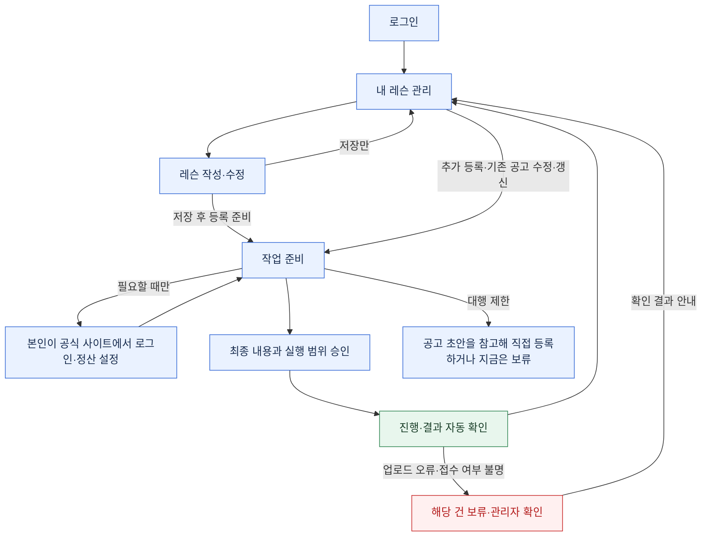
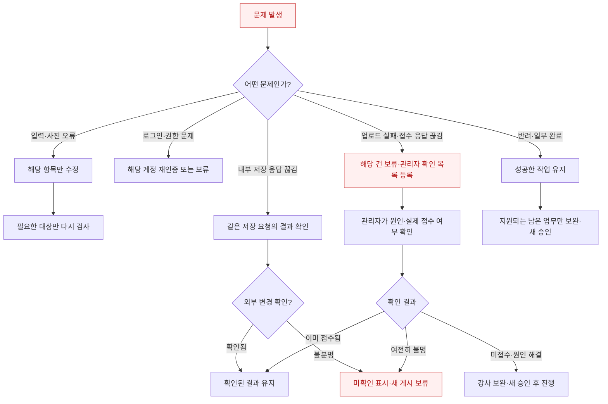

# 음악 레슨 등록·관리 사용자 흐름과 7개 플랫폼 입력 정보

<!-- Generated by tools/project_docs.py. Sources: docs/artifacts/planning/lesson-registration-20261126/R02/user-stories-20261127.json -->
[원본](../../artifacts/planning/lesson-registration-20261126/R02/user-stories-20261127.json)에서 생성한 프로젝션입니다. 변경은 원본에 반영한 뒤 `uv run --no-project python tools/project_docs.py`로 재생성합니다.

R02의 사용자 확인 및 제출 검토 원본. 관리자 확인 흐름과 7개 사이트 동등 구현 목표는 현재 대화에서 추가된 지시다. 기존 지정 커밋의 기준선에 대한 후속 변경 제안으로 검토하며 실제 실행 승인을 뜻하지 않는다.
## 사용자 흐름
개인 음악 레슨 강사가 우리 사이트에서 레슨 정보를 한 번 작성하고, 여러 채널의 등록·수정·갱신을 준비하는 사용자 흐름입니다.

<b>파란 흐름은 사용자의 선택, 자동 처리는 서비스의 역할입니다. 빨간 문구는 문제와 해결 방법입니다.</b> 7개 사이트를 모두 구현 대상으로 하며, 업로드 오류는 보류 후 관리자 확인으로 처리합니다. 연결된 서비스 범위 V1.0은 기존 기준 문서이며 이후 사용자 지시를 이 페이지에 반영했습니다. 현재 외부 업무는 모의 환경에서 검증하며, 실제 플랫폼 실행 허용은 별도 확인이 필요합니다.

## 전체 흐름 그림

## 받을 정보 한눈에 보기

<b>필수 정보는 선택한 채널에 따라 달라집니다.</b> 아래 필수표는 7개 채널 중 하나 이상에서 필수인 항목을 합친 목록입니다. 강사가 선택한 채널에서 필요한 값만 필수로 표시합니다. 같은 사실은 한 번 입력받고 채널별 양식에 맞는 표현을 미리보기에서 검토합니다.

### 필수 정보

| 받을 정보 | 한 번 입력받을 내용 | 필수인 채널 |
| --- | --- | --- |
| 강사·활동명 | 활동명·전문가명·튜터명을 한 번 입력 | 숨고·프람피·탈잉 |
| 제목 | 기본 제목을 한 번 입력하고 채널별 제목·프로필 제목을 검토 | 크몽·탈잉·프람피·뮬·힙합플레이야·힙합LE |
| 분야·카테고리 | 레슨 분야를 선택하고 채널 분류와 연결 | 크몽·탈잉·뮬·힙합플레이야 |
| 한 줄 소개 | 프로필에 표시할 짧은 소개 | 숨고 |
| 강사 소개 | 강사의 소개·전문 분야를 작성 | 탈잉·프람피 |
| 수업 상세 설명 | 레슨 소개·서비스 설명·게시글 본문으로 재사용 | 7개 채널 |
| 지역·주소·수업 장소 | 공통 위치를 입력하고 채널별 상세 주소·공개 범위를 확인 | 크몽·탈잉·프람피·뮬 |
| 진행 방식 | 온라인·방문 등 수업 진행 방식 | 프람피 |
| 모집 형태·인원 | 개인·그룹 등 형태와 참여 인원 | 크몽·탈잉 |
| 대상 수강생 | 수업을 들을 사람과 추천 대상 | 탈잉 |
| 가격과 단위 | 비용·수강료·패키지 가격을 입력하고 1회·시간당·전체 금액을 구분 | 크몽·탈잉·프람피·뮬·힙합LE |
| 수업 시간·회차 | 1회 수업 시간과 총 레슨 횟수 | 크몽·탈잉 |
| 커리큘럼 | 회차별 내용과 분야별 수업 계획 | 탈잉·프람피 |
| 진행 절차 | 서비스가 진행되는 순서 | 크몽 |
| 수강생 준비사항 | 수업 전 준비할 내용 | 크몽 |
| 작업 기간·수정 횟수 | 수업 시간·회차와 별도인 크몽 입력값 | 크몽 |
| 대표 이미지·썸네일 | 공고를 대표할 이미지를 등록 | 크몽·탈잉 |
| 프로필 사진 | 강사 프로필용 사진을 등록 | 탈잉·프람피 |
| 전화번호 | 연락용 전화번호와 공개 방식을 확인 | 뮬 |
| 약관 동의 | 해당 약관을 읽고 동의 여부 선택 | 뮬 신규 작성 |

### 선택 정보

선택한 채널에서 필수인 정보는 위 필수표를 우선합니다. 예를 들어 크몽 커리큘럼은 선택이지만 탈잉·프람피를 선택하면 필수입니다. 사진도 프로필 사진·대표 이미지·상세 이미지의 용도를 구분합니다.

| 정보 묶음 | 선택으로 받을 내용 |
| --- | --- |
| 추가 미디어 | 상세·본문 이미지, 선택 채널의 프로필·대표 사진, 동영상·유튜브·외부 링크, 음원·사운드클라우드, 포트폴리오·영상 설명 |
| 추가 소개 | 학력·경력·이력과 증빙, 제공 서비스 선택, 레슨 목적·대상 연령·성별·진행 방식 |
| 질문답변·요청 | FAQ·질문답변, 작업 전 요청사항 |
| 검색·홍보 | 검색 키워드·태그, 홈페이지·외부 링크 |
| 운영 정보 | 수업 가능일·연락 가능 시간, 직원 수·팩스 |
| 부가 안내 | 클래스 요약·승인 메시지·공지사항, 기본 포함 항목·추가 서비스 내용·선택 대상자·준비물 |

<b>탈잉 정산 설정</b> 은행·계좌·예금주 등은 탈잉에서 본인이 직접 입력합니다. 우리 사이트에서는 입력 완료 여부를 확인하는 단계로 안내합니다.

## 화면과 이동 순서

이하 화면 이름은 지정된 추상화면 설계의 논리 영역입니다. 화면 설계 V1.0은 검토 후보이며 외부 실행 검증은 현재 모의 환경 기준입니다. 기존 원고 없이 우리 사이트에서 직접 작성한다는 사용자 조건을 적용했습니다.

| 화면 | 강사가 여기서 하는 일 |
| --- | --- |
| V0 본인 확인 | 로그인·신규 인증·계정 복구 |
| H 내 레슨 관리 | 레슨과 연결 공고, 마지막 확인 시각, 진행 업무 보기 |
| E 레슨 작성·수정 | 공통 사실 입력·수정·저장 |
| W 작업 준비·실행 | 채널·업무 선택, 보완, 최종 비교와 승인 |
| R 진행·결과 | 처리 상태·근거 확인, 필요한 재조회와 후속 업무 |
| X 직접 인증 | 필요할 때 공식 플랫폼 인증·약관·정산 처리 |
| D 직접 작성안 | 대행이 제한된 채널의 내부 작성안 참고 |
| G·A 설정·계정 관리 | 개인정보 권리 요청, 로그아웃, 외부 계정 연결 해제 |

## 화면별 사용자 흐름

### 1. 처음 방문해 본인 확인하기

<b>이동</b> 본인 확인 → 내 레슨 관리

<table header-row="true">
<tr>
<td>
사용자가 하는 일
</td>
<td>
서비스가 자동으로 하는 일
</td>
</tr>
<tr>
<td>
  • 강사는 서비스와 실제 지원 업무를 확인한다.   • 강사는 공식 로그인·필요한 신규 동의를 진행한다. 계정을 찾지 못하면 복구를 선택한다.
</td>
<td>
  • 로그인한 본인의 자료만 불러온다.
</td>
</tr>
</table>

- <b>확인할 결과</b> 본인의 레슨 관리 화면을 연다.
- <b>문제가 생기면</b> 인증 실패·만료·가입 결과 불명 시 복구를 안내한다. 다른 계정의 자료를 표시하지 않는다.

### 2. 새 레슨 작성하고 저장하기

<b>이동</b> 내 레슨 관리 → 레슨 작성 → 내 레슨 관리 또는 작업 준비

<table header-row="true">
<tr>
<td>
사용자가 하는 일
</td>
<td>
서비스가 자동으로 하는 일
</td>
</tr>
<tr>
<td>
  • 강사는 ‘새 레슨’을 누르고 기존 자료 없이 공통 정보를 작성한다.   • 가격 단위·수업 시간·회차를 구분하고 프로필 사진과 공고 사진을 용도별로 추가한다.   • 강사는 ‘저장’ 또는 ‘저장 후 등록 준비’를 선택한다. 선택 채널별 부족한 값은 W에서 보완한다.
</td>
<td>
  • 입력값·사진을 검사하고 저장 결과를 확인한다. 저장된 레슨의 버전을 관리한다.
</td>
</tr>
</table>

- <b>확인할 결과</b> 저장 확인 뒤 홈 또는 작업 준비로 이동한다. 같은 사실을 다시 입력하지 않는다.
- <b>문제가 생기면</b> 필수값·파일·권리·가격 충돌은 해당 항목에서 수정한다. 저장 응답이 끊기면 같은 저장 요청 결과부터 확인한다. 다른 저장본과 충돌하면 비교하고 선택한다.

### 3. 신규 채널 등록 준비하기

<b>이동</b> 레슨 작성 또는 내 레슨 관리 → 작업 준비

<table header-row="true">
<tr>
<td>
사용자가 하는 일
</td>
<td>
서비스가 자동으로 하는 일
</td>
</tr>
<tr>
<td>
  • 강사는 원본 하나와 신규 등록할 채널을 선택하고 ‘준비’를 요청한다.   • 강사는 채널별 보완할 사실과 고유값만 작성한다. 크몽 가격·작업 기간·수정 횟수·1회 시간·회차도 확인한다.   • 강사는 서비스가 채널별로 정리한 최종안을 보고 내용 차이를 확인한다.   • 실행할 수 없는 대상은 명시적으로 제외·보류하거나 D 작성안을 선택한다.
</td>
<td>
  • 같은 사실을 채널 양식에 맞춰 정리하고 부족한 정보만 요청한다. 모든 선택 채널의 준비 상태를 표시한다.
</td>
</tr>
</table>

- <b>확인할 결과</b> 선택한 모든 채널의 준비·보완·제외·보류 상태가 보인다.
- <b>문제가 생기면</b> 규격·가격·원본·권한·외부 값이 바뀌면 영향받은 대상만 재검증한다. 이전 승인으로 실행하지 않는다.

### 4. 필요한 인증과 정산 진행하기

<b>이동</b> 작업 준비 또는 진행·결과 또는 외부 계정 관리 → 직접 인증 → 원래 화면

<table header-row="true">
<tr>
<td>
사용자가 하는 일
</td>
<td>
서비스가 자동으로 하는 일
</td>
</tr>
<tr>
<td>
  • 인증이 필요한 대상에서 강사는 직접 인증을 요청한다.   • 최초 계정은 확인된 계정을 이번 업무에 사용할지 선택한다.   • 가입·자격 확인·필수 약관·탈잉 정산은 공식 플랫폼에서 본인이 직접 처리한다.   • 강사는 인증을 취소하거나 다른 계정임을 확인하면 해당 대상을 보류한다.
</td>
<td>
  • 계정과 권한을 확인하고 원래 작업 화면으로 돌아간다. 업무에 필요한 인증만 사용한다.
</td>
</tr>
</table>

- <b>확인할 결과</b> 같은 업무 문맥으로 돌아와 필요한 준비를 계속한다. 유효한 업무 인증이 있으면 불필요하게 반복하지 않는다.
- <b>문제가 생기면</b> 인증 실패·계정 불일치·권한 부족·선행 업무 미완료 시 해당 대상만 제한한다. 늦게 도착한 인증 결과로 다른 업무를 재개하지 않는다.

### 5. 최종 비교하고 실행 승인하기

<b>이동</b> 작업 준비 → 진행·결과

<table header-row="true">
<tr>
<td>
사용자가 하는 일
</td>
<td>
서비스가 자동으로 하는 일
</td>
</tr>
<tr>
<td>
  • 강사는 최종 내용·계정·대상·변경 효과·비용·제약·제외 대상을 함께 확인한다.   • 결과 검증에 필요한 외부 조회 범위와 목적도 확인한다.   • 강사는 내용과 실행 범위에 동의하고 실행을 요청한다. 단일 실행 조작은 설계 후보이며 필수 약관 동의는 별도로 수행한다.
</td>
<td>
  • 최종 내용과 실행 범위의 승인을 각각 기록한다. 요청을 접수하면 진행 화면으로 이동한다.
</td>
</tr>
</table>

- <b>확인할 결과</b> 요청이 수락되면 결과 화면으로 자동 이동한다. 내용·범위 승인을 각각 기록한다.
- <b>문제가 생기면</b> 거절·철회·내용 변경 시 수락 전 새 효과를 차단한다. 더블클릭·수락 응답 유실 시 같은 요청을 조회하고 새 요청을 만들지 않는다.

### 6. 결과와 부분 완료 확인하기

<b>이동</b> 진행·결과 → 내 레슨 관리 또는 작업 준비

<table header-row="true">
<tr>
<td>
사용자가 하는 일
</td>
<td>
서비스가 자동으로 하는 일
</td>
</tr>
<tr>
<td>
  • 강사는 화면에서 대상별 진행·확인 시각·근거를 확인하고 필요한 상세만 연다.   • 강사는 표시된 반려 사유·미실행·결과 미확인·일부 완료 상태를 읽고 필요한 후속 조치를 선택한다.   • 강사는 보류 사유와 관리자 확인 상태를 보고, 보완 요청이 오면 해당 항목을 고친다.
</td>
<td>
  • 승인된 업무의 결과를 따로 확인하고 홈과 이력에 반영한다. 업로드 실패·접수 여부 불명은 해당 건을 보류하고 관리자 확인 목록에 등록한다. 작업용 접근을 종료한다.
</td>
</tr>
</table>

- <b>확인할 결과</b> 시스템이 독립 확인·기록·홈 반영·접근 종료를 처리한다. 성공 확인 버튼이나 별도 플랫폼별 결과 방문은 요구하지 않는다.
- <b>문제가 생기면</b> 요청 종료를 성공으로 표시하지 않는다. 응답 유실·효과 불명·상충 근거는 새 쓰기를 막고 허용 조회 또는 보류한다. 이미 성공한 단계와 불명 단계는 다시 실행하지 않는다. 업로드 오류는 관리자 확인 전 재업로드를 막는다.

### 7. 저장한 레슨으로 채널 추가하기

<b>이동</b> 내 레슨 관리 → 작업 준비 → 진행·결과

<table header-row="true">
<tr>
<td>
사용자가 하는 일
</td>
<td>
서비스가 자동으로 하는 일
</td>
</tr>
<tr>
<td>
  • 강사는 원본 행에서 ‘추가 등록’을 선택한다.   • 새 채널만 고르고 부족한 값만 채운 뒤 검토·승인한다.
</td>
<td>
  • 저장한 사실을 재사용하고 새 채널의 부족한 정보만 찾는다.
</td>
</tr>
</table>

- <b>확인할 결과</b> 저장된 레슨 정보가 충분하면 레슨 작성 화면을 다시 방문하거나 같은 값을 재입력할 필요가 없다.
- <b>문제가 생기면</b> 기존 게시 채널을 다시 등록하지 않는다. 과거 승인과 오래된 인증을 새 업무에 재사용하지 않는다.

### 8. 기존 공고 수정하기

<b>이동</b> 내 레슨 관리 → 작업 준비 → 진행·결과

<table header-row="true">
<tr>
<td>
사용자가 하는 일
</td>
<td>
서비스가 자동으로 하는 일
</td>
</tr>
<tr>
<td>
  • 강사는 정확한 공고 행에서 ‘수정 준비’를 선택한다.   • 허용된 현재 값 조회 범위를 확인하고 변경값을 입력한다.   • 강사는 변경 전후와 공유 프로필에 미칠 영향을 검토한다. 원본도 바꿀지는 별도로 선택한다.
</td>
<td>
  • 허용된 범위에서 현재 값을 확인하고 변경 전후 및 공유 정보에 미치는 영향을 표시한다.
</td>
</tr>
</table>

- <b>확인할 결과</b> 같은 대상에서 승인한 변경의 반영을 확인한다.
- <b>문제가 생기면</b> 객체 충돌·소유권 불명·외부 선행 변경이면 보류한다. 심사 중 편집 제한과 재심사 필요 여부를 표시한다. 힙합플레이야·힙합LE 수정은 설계상 보류다.

### 9. 같은 공고 갱신하기

<b>이동</b> 내 레슨 관리 → 작업 준비 → 진행·결과

<table header-row="true">
<tr>
<td>
사용자가 하는 일
</td>
<td>
서비스가 자동으로 하는 일
</td>
</tr>
<tr>
<td>
  • 강사는 지원되는 기존 공고의 ‘갱신 준비’를 누른다.   • 갱신 방식·주기·효과와 무료 여부를 확인하고 승인한다.
</td>
<td>
  • 같은 공고인지, 허용된 무료 갱신 방식인지 확인하고 처리 결과를 확인한다. 유료 갱신은 실행 대상에서 제외한다.
</td>
</tr>
</table>

- <b>확인할 결과</b> 같은 공고에 의도한 효과가 관측됐을 때 완료로 표시한다.
- <b>문제가 생기면</b> 뮬 갱신도 실제 허용·조건 확인이 필요하다. 새 글 재등록으로 대체하지 않는다. 힙합플레이야·힙합LE 재등록·갱신은 현재 설계에서 제공 보류다.

### 10. 상태 조회와 기존 공고 연결하기

<b>이동</b> 내 레슨 관리 → 진행·결과 또는 작업 준비

<table header-row="true">
<tr>
<td>
사용자가 하는 일
</td>
<td>
서비스가 자동으로 하는 일
</td>
</tr>
<tr>
<td>
  • 강사는 홈에서 저장된 마지막 상태와 시각을 본다.   • 최신 상태가 필요하면 정확한 행에서 ‘최신 조회’를 요청한다.   • 기존 외부 공고를 관리하려면 ‘기존 글 연결’을 선택하고 정확한 계정·게시물과 레슨 관계를 확인한다.
</td>
<td>
  • 홈에는 마지막으로 확인한 상태·시각을 표시한다. 최신 조회를 요청한 경우에만 외부 상태를 다시 확인한다.   • 기존 공고 연결 요청에서는 계정·게시물·관리 권한을 검사하고 내부 연결 결과를 기록한다.
</td>
</tr>
</table>

- <b>확인할 결과</b> 홈 진입만으로 외부 조회하지 않는다. 읽기 요청은 게시물을 변경하지 않는다.
- <b>문제가 생기면</b> 조회 실패와 이전 기록 없음은 구분한다. 대상 후보가 여러 개면 정확히 고르거나 보류한다. 내부 연결을 외부 등록 성공으로 표시하지 않는다.

### 11. 제한된 채널의 작성안 활용하기

<b>이동</b> 작업 준비 → 직접 작성안 → 작업 준비

<table header-row="true">
<tr>
<td>
사용자가 하는 일
</td>
<td>
서비스가 자동으로 하는 일
</td>
</tr>
<tr>
<td>
  • 강사는 제한 사유를 보고 확인된 내부 작성안을 연다.   • 강사는 작성안을 참고해 공식 플랫폼에서 직접 업무를 진행하거나 돌아간다.
</td>
<td>
  • 확인된 내부 작성안을 표시한다. 외부 작업을 완료했다고 처리하지 않는다.
</td>
</tr>
</table>

- <b>확인할 결과</b> 내부 작성 완료와 외부 처리 상태를 구분한다.
- <b>문제가 생기면</b> 사실·규격·권리가 부족하면 작성안을 보류한다. 사용자 직접 처리 보고만으로 서비스의 대행 성공을 판정하지 않는다.

### 12. 이탈·복귀와 개인정보 관리하기

<b>이동</b> 레슨 작성/작업 준비/진행·결과 ↔ 내 레슨 관리, 설정 → 외부 계정 관리 또는 본인 확인

<table header-row="true">
<tr>
<td>
사용자가 하는 일
</td>
<td>
서비스가 자동으로 하는 일
</td>
</tr>
<tr>
<td>
  • 강사는 저장하지 않은 상태에서 나갈 때 내용을 보존할지 버릴지 선택한다.   • 강사는 필요하면 원본을 삭제하거나 외부 공고와의 관리 연결을 해제한다. 외부 게시물 자체는 삭제되지 않는다는 영향을 확인한다.   • 다시 방문하면 같은 저장·준비·수락 업무 기록을 연다.   • 설정에서 본인 정보 열람·정정·삭제 요청 경로를 이용한다. 필요한 외부 계정 연결을 해제하거나 로그아웃한다.
</td>
<td>
  • 이전 저장·진행 상태를 보존한다. 로그아웃·해제 후 새 접근을 차단하고 인증 정리 결과를 표시한다.   • 삭제·연결 해제 시 진행 중 작업과 보존 의무를 확인하고 접수·처리 완료·미확인을 구분한다.
</td>
</tr>
</table>

- <b>확인할 결과</b> 이탈만으로 실행·취소·재개하지 않는다. 새 인증 후 동일 사용자와 업무를 확인해 안전 복귀한다.
- <b>문제가 생기면</b> 진행·효과 불명 상태에서는 삭제·해제 영향을 안내한다. 접근 차단과 인증 폐기 완료 여부를 구분한다. 다른 계정으로 로그인하면 이전 작업을 자동 재개하지 않는다.

## 문제가 생겼을 때의 흐름 그림

## 부록 채널별 필수·선택 참고표

아래 분류는 R02 화면 조사와 사용자 확인을 연결한 것입니다. 필수 여부와 플랫폼 자동 게시 허용 여부는 각각 검증합니다.

<table header-row="true">
<tr>
<td>
채널
</td>
<td>
필수입력사항
</td>
<td>
선택입력사항
</td>
</tr>
<tr>
<td>
<b>크몽</b>
</td>
<td>
  • 제목 10\~30자   • 카테고리   • 서비스 설명 100\~20,000자   • 모집 형태   • 메인 이미지 1\~4장   • 서비스 제공 절차   • 의뢰인 준비사항   • 지역   • 판매 패키지 가격   • 작업 기간   • 수정 횟수   • 1회 레슨 시간   • 레슨 횟수
</td>
<td>
  • 상세 이미지·동영상   • 검색 키워드   • 자주 묻는 질문   • 작업 전 요청사항   • 대상자·서비스 내용·준비물   • 커리큘럼   • 수업 가능일 사용자 확인 — 2026년 11월 27일
</td>
</tr>
<tr>
<td>
<b>탈잉</b>
</td>
<td>
  • 카테고리   • 클래스명 10\~30자   • 대표 썸네일 1\~10장   • 클래스 대상 50\~500자   • 상세 소개   • 회차와 회차별 커리큘럼 50\~500자   • 참여 인원   • 수강료   • 튜터명   • 튜터 소개   • 프로필 사진   • 수업 장소·상세 주소   • 정산 정보 — 탈잉에서 본인 직접 입력  사용자 확인 — 2026년 11월 27일
</td>
<td>
  • 클래스 요약   • 승인 메시지   • 태그   • 유튜브 영상   • 클래스 공지사항   • 이력  사용자 확인 — 2026년 11월 27일
</td>
</tr>
<tr>
<td>
<b>숨고</b>
</td>
<td>
  • 활동명   • 한 줄 소개   • 서비스 상세 설명
</td>
<td>
  • 질문답변 5개   • 제공 서비스 선택   • 레슨 목적·대상 연령·성별·진행 방식   • 사진·유튜브 영상   • 연락 가능 시간·직원 수·외부 링크  사용자 확인 — 2026년 11월 27일
</td>
</tr>
<tr>
<td>
<b>프람피</b>
</td>
<td>
  • 프로필 제목 최대 30자   • 전문가 활동명 최대 20자   • 프로필 사진   • 주소   • 진행 방식   • 전문가 소개   • 분야별 소개   • 커리큘럼   • 비용
</td>
<td>
  • 학력   • 경력   • 포트폴리오   • FAQ   • 포트폴리오 영상 설명  사용자 확인 — 2026년 11월 27일
</td>
</tr>
<tr>
<td>
<b>뮬</b>
</td>
<td>
  • 레슨 구분   • 제목   • 지역·주소   • 수강료   • 본문   • 전화번호   • 새 글 작성 시 약관 동의
</td>
<td>
  • 팩스   • 메인 사진   • 본문 이미지·동영상   • 홈페이지   • 사운드클라우드 링크  사용자 확인 — 2026년 11월 27일
</td>
</tr>
<tr>
<td>
<b>힙합플레이야</b>
</td>
<td>
  • 제목   • 본문   • 카테고리
</td>
<td>
  • 사진   • 동영상   • 오디오 첨부  사용자 확인 — 2026년 11월 27일
</td>
</tr>
<tr>
<td>
<b>힙합LE</b>
</td>
<td>
  • 제목   • 가격   • 본문
</td>
<td>
  • 레슨 분류   • 썸네일·사진   • 동영상·외부 링크  사용자 확인 — 2026년 11월 27일
</td>
</tr>
</table>

## 검토와 근거

- 크몽 작업 기간·수정 횟수·패키지 가격·1회 시간·레슨 횟수는 사용자 확인에 따라 필수다.
- 탈잉 정산 설정은 필수지만 탈잉에서 직접 입력한다.
- 사용자 사실을 한 번 입력받되 가격 단위·사진 용도·소개 대상이 다른 항목은 의미를 구분한다.
- FE·BE·D/ML 담당 표시는 세부 업무 배정 후 연결한다. 사용자에게 시스템 자동 처리를 확인하는 불필요한 버튼을 추가하지 않는다.
- 플랫폼 규칙·입력 규격·실행 허용과 실제 접수 성공은 별도 확인한다. 시간 절감은 입력·인증·승인·오류 대응을 포함해 측정한다.

음악 레슨 등록·관리 지원 · 기획안 V1.2 및 멘토 피드백 (11/26)（팀 Notion 참고 자료） · User Story （팀 Notion 참고 자료）

[R02 조사 원본](https://github.com/ik-e/chaja-you/tree/868719f/docs/artifacts/planning/lesson-registration-20261126/R02) · [기존 스토리 ID와 기능 연결](https://github.com/ik-e/chaja-you/blob/868719f/docs/artifacts/planning/lesson-registration-20261126/integrated/user-stories.json)

## 이번 검토에서 보완한 내용

- 예시의 사용자 행동·조건 분기·오류 표시를 12개 이용 흐름에 적용했다.
- 누락됐던 기존 공고 수정·갱신·최신 조회·내부 연결·제한 작성안·권리 행사·저장 및 수락 불명·안전 이탈을 보완했다.
- 7개 플랫폼 참고표의 모든 필수·선택 항목을 공통 정보 묶음과 대조했다. 선택 진행 방식·사진 용도·대상자·준비물도 명시했다.
- 탈잉 첫 모집 일정과 숨고 대표서비스 지정은 추상화면 설계에서 조건부 미채택이다. 공고 등록을 실제 모집 가능과 구별한다.
- 서비스 범위 V1.0과 화면 설계 후보를 구분하며 외부 실행은 mock-only다. 사용자 확정 입력 분류는 본 페이지에 유지했다.

[대조한 추상화면 설계 — 지정 커밋](https://github.com/ik-e/chaja-you/blob/dfe793daa212402a4dd1f754d1f5bb886737faff/docs/review/lesson-registration/ABSTRACT-SCREENS-V1.0.md)

[승인 서비스 범위 V1.0](https://github.com/ik-e/chaja-you/blob/dfe793daa212402a4dd1f754d1f5bb886737faff/docs/review/lesson-registration/SERVICE-SCOPE-V1.0.md)

## 재방문과 일부 실패 시 추가 행동

| 상황 | 사용자가 하는 일 | 서비스가 자동으로 하는 일 |
| --- | --- | --- |
| 작성 중 다시 방문 | 저장한 레슨을 선택하고 필요한 부분만 이어 쓴다. | 마지막 저장값과 저장 상태를 복원한다. 저장되지 않은 내용을 복원했다고 표시하지 않는다. |
| 계정 연결 해제 | 설정에서 정확한 외부 계정을 선택하고 해제 영향을 확인한다. | 새 접근을 차단하고 인증 정리 완료 여부를 확인한다. 기존 외부 게시물을 삭제하지 않는다. |
| 업로드 오류를 관리자가 확인함 | 강사는 관리자 확인 결과를 읽고, 필요한 정보 보완과 새 내용·실행 승인을 진행한다. | 실패 원인과 접수 여부를 확인한 뒤 안전하게 진행 가능한 건만 새 준비를 허용한다. 자동 재업로드하지 않는다. |

- 연결 해제·인증 정리에 실패하면 새 접근 차단을 유지하고 정리 상태가 미확인임을 표시한다.
- 조회 근거나 링크가 없으면 추측한 성공 원인이나 반려 사유를 표시하지 않는다. 기존 확인 기록과 필요한 조치만 안내한다.

## 공고 업로드 오류와 관리자 확인

업로드 실패는 공고를 외부 사이트에 보내는 도중 오류가 나거나, 응답이 끊겨 실제 접수 여부를 모르는 경우를 포함한다. 우리 사이트에서 작성 중인 입력값 오류는 해당 입력란에서 보완한다.

| 단계 | 강사가 하는 일 | 서비스가 자동으로 하는 일 | 관리자가 하는 일 |
| --- | --- | --- | --- |
| 오류 발생 | ‘업로드 보류·관리자 확인 대기’ 상태와 사유를 확인한다. | 해당 요청·채널만 보류하고 관리자 확인 목록에 올린다. 다른 채널의 성공 결과와 입력값은 보존한다. | 보류 목록에서 확인할 건을 선택한다. |
| 원인 확인 | 필요한 경우 사실·사진·계정 정보를 보완한다. | 오류 시각·단계·대상 채널·계정 식별·요청 식별값·확인 근거를 표시한다. 인증 비밀은 기록하지 않는다. | 오류 단계와 실제 접수 여부를 허용된 경로에서 확인하고, 원인·필요 조치·확인 결과를 기록한다. |
| 이미 접수됨 | 확인된 접수 결과를 읽는다. | 근거가 확보되면 접수 상태를 갱신하고 중복 업로드를 차단한다. | 접수 근거를 기록한다. |
| 미접수 확인·원인 해결 | 수정된 내용과 대상을 검토하고 필요한 새 승인을 한다. | 안전하게 다시 준비할 수 있는 건만 허용한다. | 재준비 가능 여부와 보완 사항을 안내한다. |
| 접수 여부 계속 불명 | 보류 상태와 안내를 확인한다. | 새 업로드를 차단하고 기존 기록을 유지한다. | 확인을 계속하거나 해결 불가 사유를 남긴다. |

- 관리자도 강사의 인증을 대신하거나 새로운 내용·대상에 대한 승인을 생략해 업로드하지 않는다.
- 관리자가 확인했다는 사실만으로 게시 완료로 표시하지 않는다. 실제 접수 근거가 있어야 상태를 바꾼다.

이 관리자 확인 흐름은 2026년 11월 27일 사용자 지시로 추가했다. 기존 GitHub 기준 문서에 반영할 후속 변경이다.
