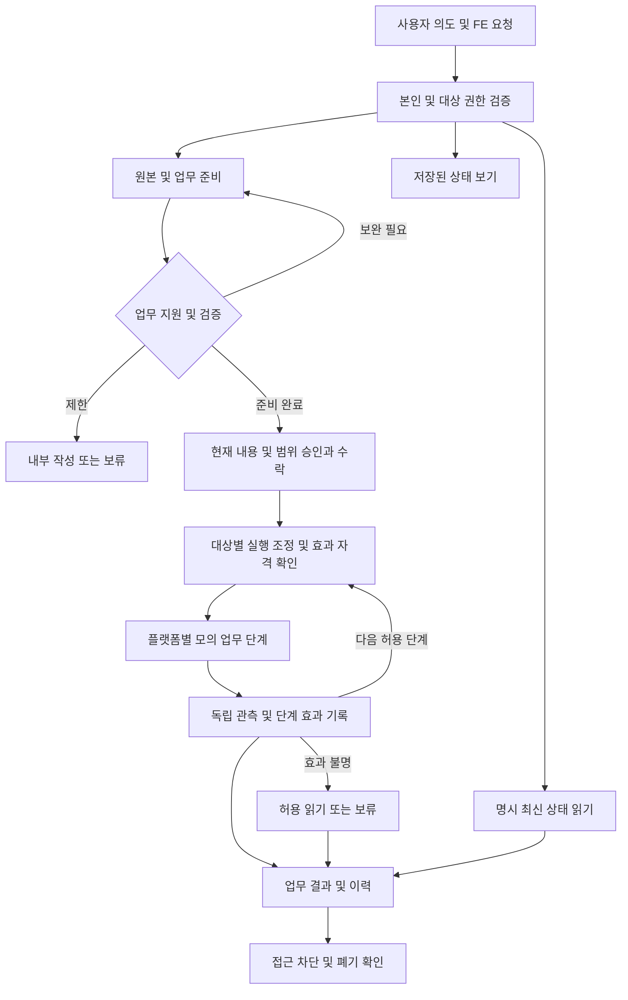

# 찾아you 시스템 업무 명세 V1.0 — 공통 업무 및 책임 경계

<!-- Generated by tools/project_docs.py. Source: docs/artifacts/planning/lesson-registration-20261126/integrated/system-work-v1.0.json -->
[작업 원본](../../artifacts/planning/lesson-registration-20261126/integrated/system-work-v1.0.json) · [승인 서비스 범위](SERVICE-SCOPE-V1.0.md) · [추상 화면 후보](ABSTRACT-SCREENS-V1.0.md)

R01 검토 후보 · 승인 제품 범위 V1.0 준수 · 업무/화면 상세 승인 전 · R1 보완 · 2026-11-27

개인 음악 레슨 강사의 사용자 업무 의도를 공통 시스템 업무 단위로 분해하고, 각 업무의 시작·입력·처리·출력·완료·사용자/FE/공통 BE/플랫폼별 BE/논리 저장소 책임 및 오류 경계를 명세한다. 사용자에게 36개 조작을 요구하는 구조가 아니다.

서비스 범위 V1.0 승인 유지(공고 갱신 포함). 추상 화면 V1.0 및 시스템 업무 V1.0은 검토 후보. 7개 플랫폼/44 업무 분류 유지, 조건부 미채택 및 실제 접근/실행 mock-only. DB/API/물리 구현·main 병합·새 범위 승인 아님.

## 시스템 업무 구조

- 업무는 하나의 구분되는 관측 가능한 책임/결과에 따라 나눈 논리 단위. 서비스/API/클래스/스레드/DB 테이블 수와 동일하지 않음.
- related_prerequisites는 문맥상 선행 책임 후보이며 모든 호출이 항상 순차·동일 횟수라는 뜻이 아님. 권한 재검증은 반복할 수 있고 변이는 정확 효과 ID로 제한.
- 실행 조정(SW-23), 효과 자격 및 시도 기록(SW-24), 플랫폼별 변이(SW-25/26/27), 독립 관측(SW-28), 업무 판정/기록(SW-29)을 분리. 외부 응답·저장된 시도만으로 성공 아님.
- 상태/전이·오류 세부 원자성·retry/timeout·DB 관계/카디널리티·API 엔드포인트 및 실제 DOM 단계는 후속 명세에서 결정. 실제 외부 결과나 사용성 실증 없음.

| 업무군 | 목적 | 업무 ID |
| --- | --- | --- |
| WG-01 본인·접근 및 내부 관리 | 소유권과 기존 자료/작업의 일관성 확보 | SW-01 · SW-02 · SW-03 · SW-08 |
| WG-02 원본 확보 및 저장 | 동일 레슨의 정보 반복 입력 제거 | SW-04 · SW-05 · SW-06 · SW-07 |
| WG-03 업무 선택·정보 준비·대상 식별 | 플랫폼별 입력과 선행 조건 검증 | SW-09 · SW-10 · SW-11 · SW-12 · SW-13 · SW-14 · SW-15 · SW-16 · SW-17 · SW-18 · SW-19 · SW-20 |
| WG-04 승인·업무 수락 | 현재 대상·내용·범위·이전 효과 고정 | SW-21 · SW-22 |
| WG-05 플랫폼 업무 실행·효과 확인 | 허용된 단계 및 정확 객체별 효과 확인 | SW-23 · SW-24 · SW-25 · SW-26 · SW-27 · SW-28 |
| WG-06 결과·상태·후속 대응 | 통합 조회·결과/이력·복구 및 제한 | SW-29 · SW-30 · SW-31 · SW-32 |
| WG-07 접근 종료·권리·복귀 | 추가 접근 차단 및 데이터 수명주기 일관성 | SW-33 · SW-34 · SW-35 · SW-36 |

## 업무별 명세

### WG-01 · 본인·접근 및 내부 관리

#### SW-01 · 서비스 본인 식별

- 처리 구분: internal_identity
- 화면 영역: V0.ident
- 시작: 최초 진입/재인증/가입 완료 요청
- 입력: 채택된 공식 인증 결과, 최소 가입정보·필수 동의
- 공통 BE 처리: 검증된 인증 주체와 기존 owner 관계를 확인; 존재 시 재사용, 신규인 경우만 중복 없이 생성. 인증 만료/복구도 동일 식별 기준.
- 출력: 검증 owner 또는 인증/가입 불명·거절 결과
- 완료/제한: 동일 owner 식별 확인 후에만 본인 영역 반환; 결과 불명 신규 생성 금지
- 사용자: 필요시 직접 인증·필수 가입 동의/복구
- FE: 인증 결과/필요 행동·오류 표시; owner 주장만으로 권한 부여하지 않음
- 플랫폼별 BE: 없음
- 논리 저장소: 정확 owner·대상·요청·revision·관측/효과 등 해당 결과의 일관된 기록/조회 및 중복 방지; 구체 DB 설계 후속
- 선행 책임 후보: 없음/진입
- 관련 오류: ER-01 · ER-02 · ER-26

#### SW-02 · 대상 소유권 및 목적별 접근 검증

- 처리 구분: internal_guard
- 화면 영역: V0.ident · H.overview · E.save · W.selection · R.result · A.accounts · G.rights
- 시작: 본인 영역의 모든 내부 조회·변경·요청 수락 및 외부 접근 직전
- 입력: 검증된 owner, 요청 목적·대상 ID/관계·요청 주체·현재 권한
- 공통 BE 처리: 서버 검증 identity 기준으로 대상 소유/허용 관계와 목적을 확인. 타 owner 존재/정보 노출 금지; FE 선택값은 신뢰 근거 아님. 외부 권한 확인은 SW-14/15/17/24 별도.
- 출력: 허용된 정확 대상/범위 또는 비노출 거절
- 완료/제한: 검증된 본인 및 허용 대상만 다음 업무에 전달; 실패이면 데이터/새 효과 없음
- 사용자: 권한 불명 시 필요한 본인/대상 확인만
- FE: 허용된 범위·오류만 표시
- 플랫폼별 BE: 없음
- 논리 저장소: 필요 입력/현재 근거/업무 문맥 조회; 변이 및 기록은 명시 저장 책임 경유
- 선행 책임 후보: SW-01
- 관련 오류: ER-01 · ER-02 · ER-12 · ER-14 · ER-25 · ER-26

#### SW-03 · 본인 원본·등록물·작업 통합 읽기

- 처리 구분: internal_read
- 화면 영역: H.overview · H.resume · H.work · R.result · A.accounts
- 시작: 본인 홈 열기/원본 선택/이력·결과 상세 요청
- 입력: owner, 원본/관계/업무 요청 식별자, 저장 revision·결과·마지막 관측
- 공통 BE 처리: 본인 저장 원본과 연결 외부 등록물, 업무 상태, 확인 시각/근거 및 지원 정보 조회. 저장 자료를 최신 외부 상태로 바꾸지 않음. 결과/상태 투영은 원장 기준.
- 출력: 본인 원본/등록물/작업 요약·상세 또는 조회 불가
- 완료/제한: 본인 허용 데이터/저장 관측 시각만 표시; 외부 접근 0
- 사용자: 필요할 때만 선택·상세 확인
- FE: 원본 중심 목록·결과·제한 표시
- 플랫폼별 BE: 없음
- 논리 저장소: 필요 입력/현재 근거/업무 문맥 조회; 변이 및 기록은 명시 저장 책임 경유
- 선행 책임 후보: SW-02
- 관련 오류: ER-02 · ER-05 · ER-22 · ER-31

#### SW-08 · 원본 내부 삭제·관리 연결 해제

- 처리 구분: internal_write
- 화면 영역: H.manage
- 시작: 정확 원본 삭제 또는 외부 등록물 관리 관계 해제 요청
- 입력: owner, 정확 원본/관계 ID, 요청 ID, 영향 대상·진행/불명 효과·보존/권리 조건
- 공통 BE 처리: 내부 삭제와 외부 객체 관리 연결 해제를 구분하고 권한/보존·경합 영향 확인. 허용 내부 처리만 기록; 외부 글/계정 삭제·원복 없음. 동일 요청 결과 불명은 먼저 확인. 최신 원본/현재 편집과 승인·효과에 필요한 자료/증거의 참조 확인. 내부 retire와 물리 삭제·익명화 구분, 보존 근거/필요 참조 해소 후 처리. 무기한 보존 정당화 금지.
- 출력: 내부 처리 확인/제한/불명 및 남은 관계
- 완료/제한: 정확 내부 효과만 확인; 진행/불명 효과·보존 의무 미해결은 제한; 외부 효과 없음
- 사용자: 대상·영향 확인 후 내부 삭제/해제 요청 또는 취소
- FE: 영향/제한·내부 결과 표시
- 플랫폼별 BE: 없음
- 논리 저장소: 정확 owner·대상·요청·revision·관측/효과 등 해당 결과의 일관된 기록/조회 및 중복 방지; 구체 DB 설계 후속
- 선행 책임 후보: SW-02
- 관련 오류: ER-02 · ER-14 · ER-15 · ER-25 · ER-26 · ER-31

### WG-02 · 원본 확보 및 저장

#### SW-04 · 원문·첨부·직접 입력 수신

- 처리 구분: internal_write
- 화면 영역: E.input · E.facts
- 시작: 새 원본/기존 원본 자료 제공·첨부 변경
- 입력: owner, 입력 의도, 원문·파일/직접 입력, 자료 권리·공개 범위, 기준 편집 문맥
- 공통 BE 처리: 수신/형식/권리·자료 유형 검사, 원문과 직접 입력/첨부의 출처 유지. 오류 파일/항목만 분리, 확인된 유효 자료 보존. 인증 비밀/민감 증빙 수집 금지.
- 출력: 유효 입력 집합·문제 항목·권리 상태
- 완료/제한: 허용 자료와 불충분/거절 자료 구분; 외부 전송 없음
- 사용자: 자료 제공·필요 권리 확인·오류 자료 정정
- FE: 입력 영역·수신 결과·문제 항목 표시
- 플랫폼별 BE: 없음
- 논리 저장소: 정확 owner·대상·요청·revision·관측/효과 등 해당 결과의 일관된 기록/조회 및 중복 방지; 구체 DB 설계 후속
- 선행 책임 후보: SW-02
- 관련 오류: ER-02 · ER-03 · ER-05

#### SW-05 · 원본 사실 추출 및 구조화

- 처리 구분: internal_compute
- 화면 영역: E.input · E.facts
- 시작: 추출 의도와 권리가 확인된 수신 자료; 직접 구조화 입력이면 생략
- 입력: 현재 자료 revision, 원문/첨부·직접 사실·근거, 추출 목적
- 공통 BE 처리: 출처와 연결된 사실·불확실/충돌 항목 생성. 가격·단위·회차·시간 등 사실 임의 생성 금지; 늦은 응답 현재 revision 적용 금지. 자동 추출은 화면 후보, 필수 별도 동의 유지.
- 출력: 구조화 사실·출처·불확실/충돌·추출 실패
- 완료/제한: 확인된 사실과 추정/불명 구분, 동일 revision 결과만 사용
- 사용자: 필요한 사실 확인/정정 또는 명시 추출 의도(필요시)
- FE: 같은 화면 사실/근거·문제만 강조
- 플랫폼별 BE: 없음
- 논리 저장소: 필요 입력/현재 근거/업무 문맥 조회; 변이 및 기록은 명시 저장 책임 경유
- 선행 책임 후보: SW-04
- 관련 오류: ER-03 · ER-04 · ER-05 · ER-10

#### SW-06 · 사실·첨부 편집 및 원본 변경 영향 확인

- 처리 구분: internal_compute
- 화면 영역: E.facts · E.save · W.prepare
- 시작: 직접 입력/정정 또는 기존 원본 수정 요청
- 입력: 기준 원본 revision·유효 자료/사실·변경값·권리
- 공통 BE 처리: 변경값의 의미/권리·충돌 확인, 원본과 플랫폼 전용 조건 분리. 현재 원본/미수락 준비 영향 표시; 과거 실행/외부 객체는 변경하지 않음. W 인라인 공통 사실 보완에도 같은 검증; 플랫폼 전용 표현은 원본 저장 없음. 영향 대상과 공개 정보 권리/범위 표시.
- 출력: 검토 사실·변경 차이·영향받는 준비 후보
- 완료/제한: 변경할 값과 적용 범위 명확; 확인 안 된 사실은 불명으로 유지
- 사용자: 정정할 정보만 제공·권리 확인·변경 범위 결정
- FE: 기존 값·차이·필요 확인 표시
- 플랫폼별 BE: 없음
- 논리 저장소: 필요 입력/현재 근거/업무 문맥 조회; 변이 및 기록은 명시 저장 책임 경유
- 선행 책임 후보: SW-02
- 관련 오류: ER-03 · ER-04 · ER-05 · ER-10

#### SW-07 · 원본 저장 및 동일 요청 확인

- 처리 구분: internal_write
- 화면 영역: E.save · H.overview · W.prepare
- 시작: 저장/저장 후 등록 준비 또는 동일 저장 결과 확인
- 입력: owner, 원본 식별자(신규 후보 포함), 기준 revision, 사실·첨부/권리, 저장 요청 ID
- 공통 BE 처리: 동일 요청의 저장 결과를 확인하고 현재 기준 revision 검증 후 원본/자료 관계를 일관되게 저장. 새 revision에 영향받는 미수락 준비를 재검토 대상으로 표시; 과거 승인/실행 보존. W 인라인 명시 저장도 동일 요청 계약; 최신 원본 content 교체 및 revision 증가, 필요한 승인·효과 근거만 별도 보존. 동일 준비 ID·선택 유지 및 변경 의존 대상 모두 재검증. 불명 동일 키. 저장 및 수락은 동일 owner/source의 경쟁 제어 경계에서 현재 revision·관련 저장 명령 상태·양 승인/plan digest·영향 관계를 원자 검증한다. 서버가 관측한 미해결 관련 저장 명령은 영향받는 수락을 보류한다. 서버 미도달은 조회 없음만으로 미커밋 확정하지 않고 기존 키의 지연 커밋 봉쇄 후에만 새 저장 허용; 서버에 알려지지 않은 요청을 탐지한다고 가정하지 않는다. 수락이 먼저 확정되면 그 snapshot/효과 보존; 저장이 먼저 확정되면 영향 미수락 준비 stale 및 재검증. 영향 독립성 불명은 같은 원본의 해당 범위 보류, 다른 원본은 차단하지 않는다.
- 출력: 확인된 원본 ID/revision 또는 충돌·저장 실패/불명; 후속 의도
- 완료/제한: 저장 성공 확인 전 성공으로 H/W 이동 및 재저장 금지. 안전 이탈은 허용하고 동일 명령 결과를 보존. 미커밋/거절 확정 후 현재 revision의 새 명시 요청만. 인라인 커밋 확인 전 승인/새 실행 금지, 확인 후 동일 W 복귀.
- 사용자: 저장 의도 1회; 충돌/미저장 확정 때만 정정/새 저장
- FE: 저장·충돌·불명 표시 및 확인된 결과로 이동
- 플랫폼별 BE: 없음
- 논리 저장소: 정확 owner·대상·요청·revision·관측/효과 등 해당 결과의 일관된 기록/조회 및 중복 방지; 구체 DB 설계 후속
- 선행 책임 후보: SW-02 · SW-04 · SW-06
- 관련 오류: ER-02 · ER-05 · ER-06 · ER-10 · ER-26

### WG-03 · 업무 선택·정보 준비·대상 식별

#### SW-09 · 업무 의도·대상 묶음 확정 및 준비 요청 접수

- 처리 구분: internal_write
- 화면 영역: H.work · W.selection · H.resume
- 시작: 새 플랫폼 선택 후 준비 요청/기존 행 명시 준비/기존 작업 열기
- 입력: owner, 원본/revision, 업무 종류, 선택 대상·계정/객체 후보, 명시 읽기 목적/범위, 준비 요청 ID
- 공통 BE 처리: 한 원본 기준 대상별 준비 문맥을 구분 생성/복원. 신규/수정/갱신/기존 글 연결/조회 의도 분리. 같은 범위로 이미 명시 요청했다면 중복 조작/준비 생성 금지. 후보는 검증 대상이지 권한 아님.
- 출력: 대상별 준비 식별자·현재 입력/읽기 범위·제한
- 완료/제한: 대상·업무·원본/준비 문맥 기록; 미선택 대상의 외부 접근/쓰기 없음
- 사용자: 대상 및 업무 선택·필요한 명시 준비 요청 1회
- FE: 선택 가능한 업무·범위·동일 문맥 표시
- 플랫폼별 BE: 업무별 지원 가능 규칙의 근거 제공
- 논리 저장소: 정확 owner·대상·요청·revision·관측/효과 등 해당 결과의 일관된 기록/조회 및 중복 방지; 구체 DB 설계 후속
- 선행 책임 후보: SW-02 · SW-03
- 관련 오류: ER-02 · ER-07 · ER-10 · ER-14 · ER-15 · ER-17 · ER-26

#### SW-10 · 제품 지원·단계 허용 및 제약 판정

- 처리 구분: internal_guard
- 화면 영역: H.work · W.selection · W.limited · W.prepare · R.next
- 시작: 업무 선택/준비/외부 읽기·효과 직전/정책 변경
- 입력: V1.0 업무 범위, 플랫폼 규칙/근거 버전, 수행 주체·목적·단계·접근 방식·데이터·권한 조건
- 공통 BE 처리: 제품 포함과 실제 지원/권한/단계 허용을 분리. hold/local/미채택 조건부 및 불허·불명 단계 차단; 가능한 내부 작성/안내 판정. 각 새 외부 접근/쓰기 전에 재확인; 현행 mock-only 최우선. 7개 구현 목표와 실제 지원/구현 순서 구분; 정책은 업무 이름 아닌 실제 변경 필드/효과·계정/정확 관계에 적용.
- 출력: 지원 분류·허용/불허/불명 및 근거·필요 조건/제한
- 완료/제한: 범위·단계 허용·근거 없으면 새 외부 접근/쓰기 없음; 실제 실행 승인 아님
- 사용자: 지원 제한 시 필요한 보류/내부 작성 선택
- FE: 지원 상태·이유·제한과 허용 대안 표시
- 플랫폼별 BE: 플랫폼별 지원 객체/단계·필수 조건/제약과 관측 근거 제공; 권한 결정을 대신하지 않음
- 논리 저장소: 필요 입력/현재 근거/업무 문맥 조회; 변이 및 기록은 명시 저장 책임 경유
- 선행 책임 후보: SW-02
- 관련 오류: ER-07 · ER-09 · ER-10 · ER-13 · ER-16 · ER-29 · ER-30 · ER-32

#### SW-11 · 플랫폼별 입력안 변환

- 처리 구분: internal_compute
- 화면 영역: W.prepare · W.limited
- 시작: 허용 내부 준비 요청, 저장 원본/선택 플랫폼 확인
- 입력: 원본 revision·확인 사실·자료 권리, 플랫폼별 검증된 규격/설정, 정확 업무·준비 revision
- 공통 BE 처리: 확인된 사실을 플랫폼 표현/단위/필드에 대응. 기존 설정은 현재 규칙/권리/범위 재검증; 사실 변경 금지. 원본·사용자 확인 전용 값·변환값·근거를 구분. 내부 변환만으로 외부 읽기/쓰기 승인 아님.
- 출력: 플랫폼별 입력안·필드/출처·누락·충돌·미확인 규칙
- 완료/제한: 현재 원본/준비 revision의 입력안만 반환; 미확인 값은 준비 미완료/제한
- 사용자: 필요 정보가 부족할 때만 정정
- FE: 변환 결과·보완 항목 표시
- 플랫폼별 BE: 필드 의미·단위·변환 규칙·필수 여부 및 제약의 근거 제공
- 논리 저장소: 필요 입력/현재 근거/업무 문맥 조회; 변이 및 기록은 명시 저장 책임 경유
- 선행 책임 후보: SW-09 · SW-10
- 관련 오류: ER-03 · ER-04 · ER-07 · ER-08 · ER-09 · ER-10 · ER-29

#### SW-12 · 입력안·필수 사실·제약 검증

- 처리 구분: internal_compute
- 화면 영역: W.prepare · W.review · E.facts
- 시작: 입력안 생성/변경/새 관측/규칙·권한 변경
- 입력: 현재 원본/준비 revision, 입력안/권리, 플랫폼 규칙, 현재 관측·객체 조건(해당시)
- 공통 BE 처리: 필수값/형식/의미·가격 단위·회차·시간·공개/권리·정확 대상·규칙과 충돌 검사. 늦은 응답·낡은 준비 거절; 영향 대상만 재검증. 추정 값/불명 제약을 통과 처리하지 않음. R02 86개 입력 후보의 사용자 확인/공식 규칙/실제 검증/현재 충족/실행 허용 분리. 실제 효과별 R4 정책 및 공개 범위·필요·권리·승인 확인. W 준비·승인 전 영향받는 변경은 ready/승인 가능 후보에 포함하지 않고 제한 사유를 먼저 표시한다. 독립 변경만 별도 지원·정확 승인 확인 후 계속하고 결합 불명은 결합 범위를 보류한다. 승인 이후에는 실행 직전 현재 조건을 재검증한다. 같은 owner/source의 관련 저장 불명(서버 pending 또는 호출 문맥에서 확인 불가)이 있으면 기존 명령 키 확인이 우선하며 영향받는 미수락 준비는 승인/수락 금지. 독립성이 입증된 준비 및 다른 원본은 유지.
- 출력: 대상별 검증 결과·문제 항목·근거·준비 가능/보류
- 완료/제한: 모든 필요한 검증의 확인 또는 구체 보완/제한; 미확인 외부 실행 없음
- 사용자: 필요할 때만 사실·대안 확인
- FE: 검증/보완 필요와 정확 사유 표시
- 플랫폼별 BE: 업무별 제약 검증 기준과 실제 관측이 필요한 조건 제공
- 논리 저장소: 필요 입력/현재 근거/업무 문맥 조회; 변이 및 기록은 명시 저장 책임 경유
- 선행 책임 후보: SW-11
- 관련 오류: ER-03 · ER-04 · ER-07 · ER-08 · ER-09 · ER-10 · ER-14 · ER-29

#### SW-13 · 필요 정보 요청·제약 대안 반영

- 처리 구분: internal_compute
- 화면 영역: W.prepare · E.facts
- 시작: 누락/충돌/불확실/규격 오류 확인
- 입력: 문제 항목·원문 근거·유효 대안/제약, 강사 확인 사실·선택·적용 범위, 준비 revision
- 공통 BE 처리: 실제 사실 확인과 표현 대안을 구분하고 유효 선택지만 제시. 공통 원본 보완 vs 플랫폼 전용 값을 명시; 원본 변경 시 SW-07 저장 경유. 해결 대상만 재검증, 거절/대안 없음은 해당 대상 보류.
- 출력: 확인된 변경값/적용 범위 또는 보류, 갱신 준비 revision
- 완료/제한: 필요 정보만 반영; 임의 사실 변경/다른 대상 재입력 없음; 현재 검증 재실행
- 사용자: 필요한 사실 정정·유효 대안 선택/거절
- FE: 문제 항목·대안·적용 범위 표시 및 입력 전달
- 플랫폼별 BE: 플랫폼별 유효 표현/불가 조건 및 근거 제공
- 논리 저장소: 필요 입력/현재 근거/업무 문맥 조회; 변이 및 기록은 명시 저장 책임 경유
- 선행 책임 후보: SW-12
- 관련 오류: ER-04 · ER-08 · ER-09 · ER-10 · ER-16 · ER-29

#### SW-14 · 필요 외부 인증 문맥 발급 및 직접 인증 연결

- 처리 구분: external_auth_candidate
- 화면 영역: W.prepare · R.read · A.accounts · X.auth
- 시작: 사용자가 필요 대상의 인증을 명시 요청, 해당 단계 허용 확인
- 입력: owner, 호출 목적/준비 또는 조회 ID, 기대 계정, 플랫폼·권한 범위, 인증 generation/만료
- 공통 BE 처리: 업무 한정 인증 문맥을 준비하고 공식 직접 인증 경로 제공. 실제 외부 접근은 mock-only 차단. 비밀번호·코드·민감 증빙을 수집/기록/AI 전달하지 않음. 유효한 업무 인증이 있으면 불필요한 재인증 요구 없음. 최초 계정 확인은 identity-only 단계와 현재 업무 권한 검증을 분리; 정확 계정 선택 전 객체 목록/변이 접근 없음.
- 출력: 인증 요청 문맥·필요 직접 조작/제한·인증 결과 후보
- 완료/제한: 현재 호출 문맥에 한정; 실패/취소/불허 차단·정리; 동일 문맥 중복 연결 없음
- 사용자: 필요한 경우 공식 화면 직접 인증/취소
- FE: 인증 이유·대상·호출/복귀 표시, 공식 직접 인증 지원
- 플랫폼별 BE: 허용된 인증 경로·권한/만료 조건 확인; 비밀 입력 대행 없음
- 논리 저장소: 필요 입력/현재 근거/업무 문맥 조회; 변이 및 기록은 명시 저장 책임 경유
- 선행 책임 후보: SW-02 · SW-10
- 관련 오류: ER-07 · ER-11 · ER-12 · ER-13 · ER-23 · ER-26

#### SW-15 · 외부 계정·권한 검증 및 관리 식별 관계

- 처리 구분: external_read_candidate
- 화면 영역: X.auth · A.accounts · W.prepare · R.read
- 시작: 인증 응답/허용 계정 확인/기존 업무용 권한 사용 검증
- 입력: owner, 실제/기대 외부 계정·권한·generation·만료·호출 목적·허용 근거
- 공통 BE 처리: 정확 계정·권한·호출 문맥을 대조, 불일치/만료/늦은 응답 차단. 승인된 관리 연결 요청일 때만 계정 식별 관계 기록. 계정 식별 저장과 업무 인증 보유 구분; 장기 위임 미채택. 원래 문맥 복귀 결과 제공. 최초 계정은 허용 identity-only 근거와 명시 업무 사용 의도로 현재 문맥에 바인딩. 지속 관리 관계는 별도 명시 승인 때만 기록.
- 출력: 검증된 외부 계정/권한·업무 인증 참조 또는 불일치/제한; 계정 관리 관계(해당시)
- 완료/제한: 현재 목적/범위/유효성 확인 후만 사용; 계정 자동 대체 금지
- 사용자: 정확 계정이 다를 때만 재선택/재인증 또는 취소
- FE: 일치/권한·필요 조치 및 같은 호출 문맥 복귀
- 플랫폼별 BE: 실제 계정/권한의 확인 가능한 관측 제공(허용 시)
- 논리 저장소: 정확 owner·대상·요청·revision·관측/효과 등 해당 결과의 일관된 기록/조회 및 중복 방지; 구체 DB 설계 후속
- 선행 책임 후보: SW-14
- 관련 오류: ER-02 · ER-07 · ER-10 · ER-11 · ER-12 · ER-14 · ER-23

#### SW-16 · 직접 선행 업무 확인

- 처리 구분: external_read_candidate
- 화면 영역: X.prereq · W.prepare · R.read · A.accounts
- 시작: 가입·전문가 인증·약관 동의·정산 설정의 필요성이 확인됨
- 입력: 정확 계정/목적·플랫폼 선행 조건과 공식 경로·허용 관측
- 공통 BE 처리: 필요한 직접 업무만 안내; 강사가 운영사 공식 경로에서 수행. 이후 허용된 독립 읽기로 선행 조건 충족 검증. 사용자 보고만으로 독립 확인하지 않음; 비밀/민감 증빙/정산 대행 없음.
- 출력: 선행 조건 확인/미확인·필요 직접 조치·보류
- 완료/제한: 실제 선행 조건 검증 전 관련 외부 업무 차단
- 사용자: 필수 직접 업무 수행/거절
- FE: 공식 경로·필요 조치·복귀/보류 표시
- 플랫폼별 BE: 선행 조건/공식 경로·실제 확인 근거 제공
- 논리 저장소: 필요 입력/현재 근거/업무 문맥 조회; 변이 및 기록은 명시 저장 책임 경유
- 선행 책임 후보: SW-10 · SW-15
- 관련 오류: ER-07 · ER-11 · ER-12 · ER-13 · ER-23

#### SW-17 · 허용 읽기·정확 외부 객체 식별

- 처리 구분: external_read_candidate
- 화면 영역: W.selection · W.prepare · W.link · R.read
- 시작: 명시 준비/기존 글 찾기에서 허용 읽기 요청
- 입력: owner, 명시 읽기 범위, 검증된 계정·권한, 후보 객체/하위 객체, 이전 관측·효과
- 공통 BE 처리: 단계 허용·권한·정확 범위 확인 후 관리 목록/상세의 관측 후보를 얻음. 실제 외부 접근 차단(모의). 후보 복수/소유·이전 효과 불명은 사용자 확인 또는 보류; 명시 읽기만, 외부 쓰기 없음.
- 출력: 정확 계정·객체/하위 객체와 현재 값·관측 시각/근거 또는 후보/조회 불가
- 완료/제한: 정확 객체/관계/권한 확인 전 수정·갱신·연결·중복 생성 금지
- 사용자: 후보 복수/소유 불명 때만 정확 대상 확인
- FE: 후보/근거·조회 결과·필요 인증 표시
- 플랫폼별 BE: 플랫폼별 정확 객체/관계 식별과 읽기 규칙·관측 제공
- 논리 저장소: 필요 입력/현재 근거/업무 문맥 조회; 변이 및 기록은 명시 저장 책임 경유
- 선행 책임 후보: SW-02 · SW-10 · SW-15
- 관련 오류: ER-07 · ER-11 · ER-12 · ER-13 · ER-14 · ER-15 · ER-19 · ER-22 · ER-31

#### SW-18 · 기존 외부 등록물의 내부 관리 연결

- 처리 구분: internal_write
- 화면 영역: W.link · H.overview
- 시작: 강사가 확인된 기존 객체와 원본 연결 요청
- 입력: owner, 정확 원본 ID/revision, 검증 계정/객체/관계, 내부 연결 요청 ID·이전 결과
- 공통 BE 처리: 같은 관리 관계/요청을 확인 후 허용 내부 연결만 기록. 관계 중복/충돌·소유 불명 차단; 카디널리티 정책 미결정이면 충돌 관계를 임의 덮어쓰지 않음. 외부 글 변경 없음.
- 출력: 확인된 내부 관리 관계 또는 연결 실패/불명/충돌
- 완료/제한: 정확 owner·원본·외부 객체 연결 확인; 불명은 같은 ID 확인
- 사용자: 정확 대상 연결 의도 1회
- FE: 연결 결과와 이후 지원 업무 표시
- 플랫폼별 BE: 외부 쓰기 없음; 식별 결과만 사용
- 논리 저장소: 정확 owner·대상·요청·revision·관측/효과 등 해당 결과의 일관된 기록/조회 및 중복 방지; 구체 DB 설계 후속
- 선행 책임 후보: SW-02 · SW-17
- 관련 오류: ER-02 · ER-06 · ER-14 · ER-15 · ER-25 · ER-31

#### SW-19 · 수정 전후 비교와 공유 효과 검토

- 처리 구분: internal_compute
- 화면 영역: W.prepare · W.review
- 시작: 수정 의도와 정확 기존 객체·현재 값 확인
- 입력: 현재 관측/시각·정확 객체, 변경 예정 값/원본·준비 revision, 수정 가능 범위·공유 필드 영향
- 공통 BE 처리: 변경할 필드만 비교, 변경 불가/심사/공개·다른 서비스 영향 검토. 변경값이 원본에 미치는 영향과 외부 업무를 분리; 현재 관측/규칙이 바뀌면 해당 준비 재검증. 타 플랫폼 가격/구성 변화가 동일 탈잉 클래스 조건에 영향을 주는지 확인(탈잉 미선택도 포함). 동일성/계약 불명 해당 영향 변경 보류, 자동 타 플랫폼 조회/가격 변경 없음. W 준비·승인 전 영향받는 변경은 ready/승인 가능 후보에 포함하지 않고 제한 사유를 먼저 표시한다. 독립 변경만 별도 지원·정확 승인 확인 후 계속하고 결합 불명은 결합 범위를 보류한다. 승인 이후에는 실행 직전 현재 조건을 재검증한다.
- 출력: 승인용 변경안·전후 차이·예정 효과/제약·보완 항목
- 완료/제한: 정확 기존 객체·허용된 변경·영향 확인 전 검토 완료 없음
- 사용자: 미정 변경값/영향 범위만 결정
- FE: 변경값·전후·공유 영향/제한 표시
- 플랫폼별 BE: 업무별 수정 가능 항목·공유 영향·재심사 및 관측 조건 제공
- 논리 저장소: 필요 입력/현재 근거/업무 문맥 조회; 변이 및 기록은 명시 저장 책임 경유
- 선행 책임 후보: SW-12 · SW-17
- 관련 오류: ER-08 · ER-09 · ER-10 · ER-14 · ER-16 · ER-22 · ER-29

#### SW-20 · 동일 공고 갱신 조건 및 예정 효과 검토

- 처리 구분: internal_compute
- 화면 영역: W.prepare · W.review
- 시작: 갱신 의도·정확 기존 공고 확인
- 입력: 정확 계정/동일 공고, 갱신 지원·허용 방식·간격/횟수·비용·이전 효과·기존 글 유지 조건
- 공통 BE 처리: 지원된 동일 공고 갱신 의미만 검토. 뮬 후순위 후보, 나머지 6개 독립 갱신 미확인 보류. 정보 수정·재등록·유료·정기 자동 갱신과 구분. 이전 효과 불명/비용·규칙 불명 차단.
- 출력: 갱신 예정 효과·조건·근거/제한 또는 보류
- 완료/제한: 정확 기존 공고와 허용된 비유료 갱신 조건 확인 전 실행 불가
- 사용자: 갱신 대상/조건 검토; 별도 값 재입력 없음
- FE: 갱신 방식·예정 효과·간격/제한 표시
- 플랫폼별 BE: 동일 공고 갱신의 지원 방식/정책·효과 관측 조건 제공
- 논리 저장소: 필요 입력/현재 근거/업무 문맥 조회; 변이 및 기록은 명시 저장 책임 경유
- 선행 책임 후보: SW-10 · SW-17
- 관련 오류: ER-07 · ER-10 · ER-14 · ER-15 · ER-16 · ER-29 · ER-30

### WG-04 · 승인·업무 수락

#### SW-21 · 대상별 준비 판정 및 최종 승인안 제공

- 처리 구분: internal_compute
- 화면 영역: W.review · W.prepare
- 시작: 선택 대상별 검증·대상/권한/제약 처리 결과 도착
- 입력: 원본/준비 revision, 대상별 입력/변경/갱신안·계정/객체·예정 효과/비용·권리/제한, 검증 결과
- 공통 BE 처리: 각 선택 대상을 검토 가능·보완·제외/보류·제한으로 명시; 실행 후보 목록과 제외/보류 이유를 함께 표시. 최종 내용과 실행 범위를 구별하되 함께 검토 가능. 변경 시 관련 기존 미수락 승인 무효. 최종안에 후보 효과와 필수 검증 읽기 계획(정확 계정/객체 또는 신규 slot binding/목적/범위/유효기간)을 분리 표시. 필수 readback 불가/불명은 held.
- 출력: 현재 최종 검토 snapshot 후보·실행/보류/제외 목록·필요 확인
- 완료/제한: 모든 선택 대상의 처분 명시; 정확 현재 내용·범위 검토 가능; 자동 제외·자동 승인 금지
- 사용자: 내용·범위 검토 및 필요한 대상만 정정/제외/보류
- FE: 최종안·정확 대상·예정 효과/비용·제약·선택 상태 표시
- 플랫폼별 BE: 각 대상의 처리/완료 기준 및 지원 경계 제공
- 논리 저장소: 필요 입력/현재 근거/업무 문맥 조회; 변이 및 기록은 명시 저장 책임 경유
- 선행 책임 후보: SW-12
- 관련 오류: ER-07 · ER-08 · ER-09 · ER-10 · ER-12 · ER-14 · ER-15 · ER-16 · ER-29

#### SW-22 · 내용·범위 승인 및 요청 수락

- 처리 구분: internal_write
- 화면 영역: W.review · R.progress
- 시작: 사용자의 현재 내용/범위 명시 승인 및 실행 요청 또는 동일 수락 확인
- 입력: owner, 고정 대상 목록·계정/객체·업무·준비 revision·내용/범위 승인 증거·예정 효과, 요청 ID, 현재 조건/이전 효과
- 공통 BE 처리: 서버에서 두 논리 승인과 현재 권한·허용·revision·대상·이전 효과를 검증. 같은 요청의 수락 여부 확인. 승인 snapshot 및 대상별 업무 요청 수락을 논리적으로 일관되게 확정; 요청 수락 전 외부 효과 없음. 단일 조작 UX는 후보, 필수 별도 동의 유지. 양 승인과 필수 검증 읽기 의도 snapshot 고정, 읽기/쓰기 허용 및 권한 독립 검증. 범위 확대는 새 명시 요청. 저장 및 수락은 동일 owner/source의 경쟁 제어 경계에서 현재 revision·관련 저장 명령 상태·양 승인/plan digest·영향 관계를 원자 검증한다. 서버가 관측한 미해결 관련 저장 명령은 영향받는 수락을 보류한다. 서버 미도달은 조회 없음만으로 미커밋 확정하지 않고 기존 키의 지연 커밋 봉쇄 후에만 새 저장 허용; 서버에 알려지지 않은 요청을 탐지한다고 가정하지 않는다. 수락이 먼저 확정되면 그 snapshot/효과 보존; 저장이 먼저 확정되면 영향 미수락 준비 stale 및 재검증. 영향 독립성 불명은 같은 원본의 해당 범위 보류, 다른 원본은 차단하지 않는다.
- 출력: 확인된 수락 ID·대상 업무/승인 snapshot 또는 거절/수락 불명·보완
- 완료/제한: 수락 확인 이후에만 처리 후보; 수락 불명 동일 ID 조회, 더블클릭 새 업무 금지
- 사용자: 정확 현재 내용·범위 명시 승인/요청, 필수 별도 동의(필요시)
- FE: 승인 대상/내용/범위 명시·수락 결과에 따라 R/W 이동
- 플랫폼별 BE: 플랫폼별 실제 단계 허용/권한/효과 조건 검증 입력 제공
- 논리 저장소: 정확 owner·대상·요청·revision·관측/효과 등 해당 결과의 일관된 기록/조회 및 중복 방지; 구체 DB 설계 후속
- 선행 책임 후보: SW-02 · SW-10 · SW-21
- 관련 오류: ER-02 · ER-07 · ER-10 · ER-12 · ER-14 · ER-15 · ER-16 · ER-17 · ER-29

### WG-05 · 플랫폼 업무 실행·효과 확인

#### SW-23 · 수락 업무의 대상별 실행 조정

- 처리 구분: internal_orchestration
- 화면 영역: R.progress
- 시작: 수락 확인된 업무 처리 요청 또는 동일 요청 복원
- 입력: 수락 ID·대상별 업무·고정 snapshot, 단계/효과 원장·권한·정책·철회 상태
- 공통 BE 처리: 대상별 업무 분리, 플랫폼 계약에 따른 허용된 체크포인트만 진행 후보로 선택. 현재 조건/철회·이전 효과 및 정확 대상을 매 단계 재확인. hold/local/conditional·미승인·불명 차단. 현행 모의 실행만. 이탈/재접속을 새 실행으로 해석하지 않음. 효과 계약의 선행 근거·적용 조건·변경 영역·필수 읽기 계획 확인. 실제 효과 경계 미확정이면 실행 차단. 대상별 lifecycle 및 독립 스케줄링; 영향 fence만 차단, 공통 계정/권리/공유 영향은 관련 범위. UI 진입/개별 대상 종료와 무관.
- 출력: 대상별 다음 허용 단계 또는 처리 제한·미실행/불명/종료 후보
- 완료/제한: 수락된 정확 대상의 지원 단계만 SW-24에 넘김; 독립 대상 영향 보존; 실제 외부 실행 0
- 사용자: 기본 처리 중 추가 감독/조작 없음; 필요 조건 발생 시 해당 대상만 안내
- FE: 진행/차단 및 필요한 사용자 행동 표시
- 플랫폼별 BE: 플랫폼별 업무 계획·선행조건·단계 효과 경계 제공
- 논리 저장소: 필요 입력/현재 근거/업무 문맥 조회; 변이 및 기록은 명시 저장 책임 경유
- 선행 책임 후보: SW-22
- 관련 오류: ER-07 · ER-10 · ER-12 · ER-14 · ER-15 · ER-16 · ER-17 · ER-18 · ER-19 · ER-21 · ER-29 · ER-32

#### SW-24 · 외부 변이 전 효과 식별·실행 허용 확보

- 처리 구분: internal_guard_write
- 화면 영역: R.progress
- 시작: SW-23이 실제 변이 후보(자동 저장·첨부·제출·설정 포함)를 제안
- 입력: 정확 요청/대상·업무·단계·효과 ID, 승인 snapshot, 현재 권한·허용, 이전 시도/효과·철회 상태
- 공통 BE 처리: 해당 단계가 아직 시도되지 않았거나 허용된 새 업무임을 확인. 효과 ID·예정 효과/시도 기록과 실행 자격을 논리적으로 일관되게 확보하고 동시 중복/철회 검사. 이전 효과 성공/불명/진행 중에는 새 쓰기 금지. 기록/예약 자체는 성공 증거 아님. 현행 외부 실행 차단. 정규 외부 계정·객체/하위 객체·신규 slot·변경 영역 겹침 claim과 fence를 원자 확인. 공유 root, 활성/불명/분쟁 영역 충돌 차단. 필수 readback 직전 재검증. 크몽 한도 종류/정규 실제 계정/일자 기준 현재 관측 및 미반영 예약·불명 시도 원자 자격 확인. 중복 계상 불명·외부 경합 미해결은 보류.
- 출력: 효과 ID와 모의 실행 자격 또는 기존 효과 조회/보류·차단
- 완료/제한: 현재 승인·정확 대상·정책·권한·중복 조건 통과 및 선행 기록이 있을 때만 모의 실행; 응답 불명 새 효과 없음
- 사용자: 기본 추가 클릭 없음; 새 범위/잔여 업무는 새 승인 경유
- FE: 단계의 차단/진행/기존 효과 표시
- 플랫폼별 BE: 실제 변이 후보 및 부수 효과/독립 확인 방법 제공
- 논리 저장소: 정확 owner·대상·요청·revision·관측/효과 등 해당 결과의 일관된 기록/조회 및 중복 방지; 구체 DB 설계 후속
- 선행 책임 후보: SW-23
- 관련 오류: ER-07 · ER-10 · ER-12 · ER-14 · ER-15 · ER-16 · ER-17 · ER-18 · ER-19 · ER-23 · ER-29 · ER-32

#### SW-25 · 신규·추가 등록 단계 처리

- 처리 구분: external_effect_candidate
- 화면 영역: R.progress
- 시작: 지원 CREATE 수락 및 SW-24의 현재 단계 모의 실행 자격
- 입력: 정확 계정·신규 객체 의도·승인값·필요 하위 객체, 단계 효과 ID·플랫폼 계약
- 공통 BE 처리: 플랫폼별 신규 상품/클래스/서비스 관계/프로필·분야/공고의 승인된 저장·연결·제출 등 변이 후보를 모의 처리. 단계 결과를 SW-28에 전달; 신규 객체 중복 생성 금지; 다음 단계는 SW-23/24 재검증.
- 출력: 모의 단계 응답·효과 후보·정확 객체 식별 근거/불명
- 완료/제한: 응답/버튼만으로 완료 아님; 독립 효과 확인 필요; 확인된 일부 저장 후 전체 CREATE 반복 금지
- 사용자: 없음(새 필수 직접 업무는 준비로 분리)
- FE: 대상별 처리/필요 조치 표시
- 플랫폼별 BE: 플랫폼별 정확 신규 업무의 허용 입력·변이 단계와 결과 증거 후보 제공
- 논리 저장소: 필요 입력/현재 근거/업무 문맥 조회; 변이 및 기록은 명시 저장 책임 경유
- 선행 책임 후보: SW-24
- 관련 오류: ER-07 · ER-14 · ER-15 · ER-16 · ER-18 · ER-19 · ER-21 · ER-29 · ER-31

#### SW-26 · 기존 정보 수정 단계 처리

- 처리 구분: external_effect_candidate
- 화면 영역: R.progress
- 시작: 지원 UPDATE 수락 및 현재 단계 모의 실행 자격
- 입력: 정확 기존 객체/하위 객체·승인 변경값·공유 영향·필요 재심사 효과, 단계 효과 ID
- 공통 BE 처리: 승인된 동일 기존 대상 변경만 모의 처리. 플랫폼별 공통/고유 필드 영향과 필요한 재심사 별개 효과. 변경 불가/불명·동시 조건 변경 차단. SW-28에 결과 전달.
- 출력: 모의 변경 단계 응답·효과 후보/불명
- 완료/제한: 동일 객체의 승인 변경값/필요 접수 관측 전 성공 아님; 신규 글/삭제 대체 금지
- 사용자: 없음; 범위 변경 필요시 새 준비·승인
- FE: 변경 처리·영향/제한 표시
- 플랫폼별 BE: 업무별 수정 가능 단계·공유 효과·재심사/관측 계약 제공
- 논리 저장소: 필요 입력/현재 근거/업무 문맥 조회; 변이 및 기록은 명시 저장 책임 경유
- 선행 책임 후보: SW-24
- 관련 오류: ER-07 · ER-09 · ER-10 · ER-14 · ER-15 · ER-16 · ER-18 · ER-19 · ER-21 · ER-29

#### SW-27 · 동일 공고 갱신 단계 처리

- 처리 구분: external_effect_candidate
- 화면 영역: R.progress
- 시작: 지원 RENEW 수락 및 현재 단계 모의 실행 자격
- 입력: 정확 동일 공고·승인 갱신 방식/조건·이전 효과·단계 효과 ID
- 공통 BE 처리: 갱신의 의도된 동일 공고 효과만 모의 처리. 뮬 후보 외 미확인 보류; 유료 갱신/정기 실행/삭제 재게시 없음. 기존 갱신 효과 불명은 재실행 금지; 결과 SW-28.
- 출력: 모의 갱신 응답·효과 후보/불명
- 완료/제한: 동일 객체 갱신 효과 독립 관측 전 완료 아님; 실제 목록 노출 별도
- 사용자: 없음; 새 범위 필요시 새 승인
- FE: 갱신 진행/효과 확인 표시
- 플랫폼별 BE: 동일 공고의 갱신 조건·처리 단계 및 관측 계약 제공
- 논리 저장소: 필요 입력/현재 근거/업무 문맥 조회; 변이 및 기록은 명시 저장 책임 경유
- 선행 책임 후보: SW-24
- 관련 오류: ER-07 · ER-10 · ER-14 · ER-15 · ER-16 · ER-18 · ER-19 · ER-21 · ER-29 · ER-30

#### SW-28 · 단계 효과 및 독립 관측 확인·기록

- 처리 구분: external_read_candidate
- 화면 영역: R.progress · R.read · R.result
- 시작: 모의 단계 결과 도착/명시 기존 효과 확인 요청
- 입력: 정확 요청·단계/효과 ID·객체·승인값, 이전 시도/결과, 허용 읽기 범위/권한·관측 근거/시각
- 공통 BE 처리: 수행 응답과 독립 관측을 분리. 효과 미시도/미발생 확정/확인/불명 기록; 외부 쓰기 허용과 읽기 허용 별도. 정확 객체/효과·값을 업무 완료 기준에 대조. 확인된 일부 효과·근거 보존; 미확인 시 새 쓰기 차단. 승인된 필수 readback은 추가 클릭 없이 수행 후보; 권한/허용 상실은 차단. 확정 결론과 상충 근거는 AX17 분쟁 기록, 과거 판정 불변.
- 출력: 단계 효과 판정·관측/증거·정확 객체 식별/불명
- 완료/제한: 정확 독립 증거 없이 확인 효과/완료 확정 금지. 조회 불가를 미발생으로 단정 금지. 기록 실패 시 불명/차단.
- 사용자: 필요시 허용 효과 확인 요청/인증; 성공 확인 클릭 없음
- FE: 확인/불명 단계·근거·시각 표시
- 플랫폼별 BE: 업무별 독립 readback/효과의 판단 기준·관측 자료 제공
- 논리 저장소: 정확 owner·대상·요청·revision·관측/효과 등 해당 결과의 일관된 기록/조회 및 중복 방지; 구체 DB 설계 후속
- 선행 책임 후보: SW-02 · SW-10
- 관련 오류: ER-07 · ER-11 · ER-12 · ER-14 · ER-15 · ER-18 · ER-19 · ER-21 · ER-22 · ER-29 · ER-31 · ER-32

### WG-06 · 결과·상태·후속 대응

#### SW-29 · 업무 결과 판정·기록 및 관리 관계 반영

- 처리 구분: internal_write
- 화면 영역: R.progress · R.result · H.overview
- 시작: 단계 효과/관측 결과 및 업무 처리 종료/보류 판단 입력
- 입력: 요청·대상·승인 snapshot·단계 효과/관측·증거/시각, 플랫폼 완료 기준·native 상태/목표
- 공통 BE 처리: 정확 대상별 업무 효과를 기준으로 완료/실패/부분 효과/미실행/불명을 판정. 요청 처리 종료·최신 관측·native 상태·모집 가능·폐기 결과 독립 유지. 확인된 신규 객체와 원본/계정 관리 관계를 중복 없이 기록. 판정/증거/업무 이력의 일관성 확보; 실패 시 성공 표시 금지. 예약/전송개시와 실제 전송 증거 분리. 모든 미전송 확정→not_executed, 실제 전송 및 모든 효과 없음→no_effect, 판정 근거 불충분→effect_unknown. 분쟁은 별도. 요청 종료는 모든 수락 대상 ended; 수락 0은 실행 없음. 선택·held/excluded·수락·대기/진행/종료·개별 판정 수 분리. 크몽 수정 저장/필요 접수 및 항목별 공개/검토 관측 독립.
- 출력: 대상별 결과·근거/이력·정확 관리 관계·후속 조치 입력; 통합 요약 데이터
- 완료/제한: 업무 완료 근거·기존 효과 보존 확인; 외부 운영사 승인/모집 가능 보장 없음; 모의 결과와 실제 관측 구분
- 사용자: 결과 수신에 추가 조작 없음
- FE: 대상별 결과·근거/이력·홈 요약 표시
- 플랫폼별 BE: 플랫폼별 완료 기준·native 상태/목표의 의미 제공
- 논리 저장소: 정확 owner·대상·요청·revision·관측/효과 등 해당 결과의 일관된 기록/조회 및 중복 방지; 구체 DB 설계 후속
- 선행 책임 후보: SW-28
- 관련 오류: ER-02 · ER-14 · ER-15 · ER-18 · ER-19 · ER-20 · ER-21 · ER-22 · ER-23 · ER-29 · ER-31 · ER-32

#### SW-30 · 사용자 요청 최신 상태 조회 및 관측 갱신

- 처리 구분: external_read_candidate
- 화면 영역: H.work · R.read · R.result
- 시작: 강사의 명시 최신 조회 요청 또는 허용된 결과 확인 목적(정확 범위 별도)
- 입력: owner, 정확 대상·읽기 요청 ID/목적, 권한·단계 허용, 마지막 관측/시각
- 공통 BE 처리: 지원·권한·정확 대상 검증 후 명시된 범위의 최신 읽기를 모의 처리. 현재 관측 성공/불가·마지막 관측을 분리 저장; 현재 관측과 원본/미수락 준비 영향 안내. 외부 쓰기/내용 승인 없음. 조회용 인증 종료 SW-34.
- 출력: 최신 관측 성공/불가·값/근거/시각 및 마지막 관측; 영향 후보
- 완료/제한: 조회 요청 종료와 관측 성공 구분; 실패 시 마지막 관측 유지; 읽기 불허/불명 차단
- 사용자: 최신 조회 의도 및 필요한 인증만
- FE: 저장된 상태와 최신 관측 결과·시각·제한 표시
- 플랫폼별 BE: 플랫폼별 실제 상태 읽기/관측 조건과 native 값의 의미 제공
- 논리 저장소: 정확 owner·대상·요청·revision·관측/효과 등 해당 결과의 일관된 기록/조회 및 중복 방지; 구체 DB 설계 후속
- 선행 책임 후보: SW-02 · SW-10 · SW-15
- 관련 오류: ER-02 · ER-07 · ER-11 · ER-12 · ER-14 · ER-19 · ER-22 · ER-23 · ER-31

#### SW-31 · 반려·제한·실패 및 잔여 업무 안내

- 처리 구분: internal_compute
- 화면 영역: R.next · R.result · W.limited
- 시작: 확인된 오류·반려·부분 효과·미확인/제한 상태
- 입력: 업무/단계 효과·관측·사유/근거·현재 지원 및 허용 조건, 이전 요청·정확 객체
- 공통 BE 처리: 확인된 사유와 불명 구분, 가능한 조치만 산출. 효과 없음 확정 또는 정확 기존 객체의 별도 지원 잔여 업무는 새 준비 후보. 불명은 허용 읽기/보류, 성공/불명 재쓰기 금지. core RESPOND 추가 읽기는 별도 명시 허용 요청일 때만 SW-30/28; local은 내부 안내만. 잔여 효과는 검증된 독립 경로·정확 객체·미발생/지연 봉쇄·현재 조건·새 명시 승인 전 보류. 전체 CREATE/UPDATE 반복 금지.
- 출력: 근거 있는 조치/불명/제한·새 업무 준비 후보 또는 보류
- 완료/제한: 새 실행 자동 시작 없음; 실제 반려/원인 추정 금지; 후속 쓰기는 SW-09~24의 새 승인 경유
- 사용자: 필요 후속 업무/조회/보류 선택
- FE: 문제 대상·실패 지점·근거 및 가능한 버튼 표시
- 플랫폼별 BE: 플랫폼별 사유/지원 잔여 업무·실제 제약 근거 제공
- 논리 저장소: 필요 입력/현재 근거/업무 문맥 조회; 변이 및 기록은 명시 저장 책임 경유
- 선행 책임 후보: SW-10
- 관련 오류: ER-07 · ER-14 · ER-15 · ER-16 · ER-18 · ER-19 · ER-20 · ER-21 · ER-22 · ER-24 · ER-29 · ER-30 · ER-31 · ER-32

#### SW-32 · 제한 대상의 내부 작성안 제공

- 처리 구분: internal_compute
- 화면 영역: W.limited · D.guide
- 시작: 제한 대상의 내부 작성안 선택, 내부 준비 허용 확인
- 입력: 원본/확인 사실·자료 권리·확인 규격/미확인 제한·준비 revision
- 공통 BE 처리: 외부 접근 없이 확인된 규격/사실로 내부 작성안 준비, 필요한 사실만 요청. 내부 준비 완료한 경우만 D. 사용자의 공식 직접 이용과 대행/독립 확인 구분. 직접 결과 보고/증빙 수집은 미채택.
- 출력: 확인된 내부 작성안·제한/권리·필요 직접 확인 또는 보류
- 완료/제한: 충분한 내부 준비만 제공; 외부 효과 없음; 서비스 대행 성공 표기 금지
- 사용자: 내부 작성안 선택·필요 보완/직접 참고 또는 보류
- FE: 제한·입력안·공식 직접 안내 표시
- 플랫폼별 BE: 외부 접근 없음; 확인된 규칙만 사용
- 논리 저장소: 필요 입력/현재 근거/업무 문맥 조회; 변이 및 기록은 명시 저장 책임 경유
- 선행 책임 후보: SW-10 · SW-11 · SW-12
- 관련 오류: ER-03 · ER-07 · ER-08 · ER-09 · ER-24 · ER-30 · ER-31

### WG-07 · 접근 종료·권리·복귀

#### SW-33 · 승인 철회·업무 제한 및 접근 차단

- 처리 구분: internal_guard_write
- 화면 영역: W.review · R.next · A.accounts · G.rights · X.auth
- 시작: 수락 전 거절/보류·권리 행사/철회/권한 만료·불허·변경 확인
- 입력: owner·대상·업무/승인·접근/효과 상태, 철회/제한 근거·현재 시각
- 공통 BE 처리: 영향 범위의 새 접근/새 효과 자격 차단; 수락 전 승인을 무효화하고 이미 발생/불명 효과 보존. 화면 이탈만으로 승인 철회/실행 취소 아님. 실행 중 일반 중단·외부 취소/원복 미제공. 진행 중 효과의 관측은 허용된 별도 읽기만.
- 출력: 접근 차단/보류·영향 대상·기존 효과·폐기 요청
- 완료/제한: 차단 이후 새 효과 시작 금지; 기발생 효과 원복 없음; 정확 처리 결과 구분
- 사용자: 권리 행사/거절/보류/철회 선택(필요시); 시스템 제한은 버튼 불필요
- FE: 제한/영향·기존 결과·후속 조치 표시
- 플랫폼별 BE: 접근 가능 여부 변경·해제 조건의 근거 제공
- 논리 저장소: 정확 owner·대상·요청·revision·관측/효과 등 해당 결과의 일관된 기록/조회 및 중복 방지; 구체 DB 설계 후속
- 선행 책임 후보: SW-02
- 관련 오류: ER-07 · ER-10 · ER-11 · ER-12 · ER-16 · ER-19 · ER-23 · ER-26 · ER-32

#### SW-34 · 업무용 접근 종료·외부 계정 연결 해제 및 폐기 확인

- 처리 구분: internal_guard_write
- 화면 영역: R.progress · X.auth · A.accounts · G.rights
- 시작: 업무/조회/인증 종료·실패·철회·만료·연결 해제·로그아웃
- 입력: owner, 업무 인증/접근 식별·관리 계정 관계, 종료 목적·차단 상태·폐기 결과
- 공통 BE 처리: 새 접근 차단을 선행/유지하고 업무 한정 인증 상태 폐기 및 허용된 권한 해제 결과 확인. 인증 비밀 저장 금지; 계정 식별/등록물/업무 이력은 삭제 요청과 구분. 관리 계정 연결 해제 시 해당 관계/권한만 처리. 폐기 불명 별도 기록·운영 확인, 자동 재개 없음. W/X/A/G/R 어느 원 호출에서도 실패/종료/철회/만료의 자원 차단·폐기 의무 자동 실행. 화면 이동/다른 대상 종료/알림 전달은 정리 전제 아님. 폐기 불명 운영 기준선 전달.
- 출력: 접근 차단·폐기 확인/불명 및 관리 연결 해제 결과; 이력 보존
- 완료/제한: 접근 차단과 실제 폐기 확인 독립; 불명은 차단 유지. 실제 외부 접근/철회 호출은 현행 금지.
- 사용자: 연결 해제/로그아웃 의도(필요시); 업무 종료 시 확인 클릭 불필요
- FE: 차단/폐기·연결 해제 상태·제한 표시
- 플랫폼별 BE: 실제 권한 해제/세션 종료의 허용 경로·결과 후보; 현재 mock-only
- 논리 저장소: 정확 owner·대상·요청·revision·관측/효과 등 해당 결과의 일관된 기록/조회 및 중복 방지; 구체 DB 설계 후속
- 선행 책임 후보: SW-02
- 관련 오류: ER-02 · ER-07 · ER-11 · ER-12 · ER-23 · ER-25 · ER-26 · ER-31

#### SW-35 · 이탈·저장 작업 복귀·요청 일관성 확인

- 처리 구분: internal_read
- 화면 영역: H.resume · E.save · W.review · R.result · V0.ident
- 시작: 화면 이동/뒤로/재접속/동일 요청 응답 불명
- 입력: owner, 원본/준비 revision·저장 요청/업무 수락 ID·기존 효과/관측, 호출 문맥
- 공통 BE 처리: 미저장 편집·저장된 준비·수락 업무·결과를 분리. 동일 저장/수락 요청 결과 확인하고 현재 조건 검증; 낡은 응답/다른 owner 적용 금지. 사용자 화면 이탈로 자동 실행/취소/재개 없음. 현재 미저장 편집과 미수락 준비 문맥은 필요시 유지; 명시 폐기만 LT-08. 로그아웃/만료는 새 접근 차단 및 기존 효과 보존; 보존 기한은 후속 확정. 저장/수락 불명 중 안전 이탈 가능; 동일 owner 재인증 후 기존 요청 ID 및 안전 원 호출 확인. 새 실행/수락 자동 생성 없음. W 인라인 저장 불명도 동일 키/owner/준비 복귀. 관련 저장 불명 없음 또는 기존 키로 권위 있게 해소 확인된 문맥만 일반 PREP 진입. 같은 기록의 저장 불명은 VE-111 우선(시스템 자동 확인, 새 사용자 조작 강제 없음). 기존 수락 불명 VE-097 및 확인된 수락 VE-007의 정본 기록과 구분. 미수락 보류·제외 대상은 실패/잔여 효과가 아니다. R에서 이유와 조건부 후속 안내 제공; 사용자가 새 업무를 명시 선택하면 H에서 저장 원본으로 해당 신규 대상만 UJ-02, 정확 기존 객체 수정 UJ-03 또는 허용 갱신 UJ-04를 준비하고 현재 지원·권한·중복/경합·revision 검증 및 새 승인. 이전 묶음·처분·수락/성공/불명 기록 불변; 실제 지원/허용 불명은 계속 보류, 자동 재등록/실행 없음.
- 출력: 정확 기존 편집/준비/요청/결과 문맥 또는 불명/재인증/제한
- 완료/제한: 정확 동일 문맥 확인 전 새 저장/요청/효과 없음; 권한 만료 시 제한
- 사용자: 필요시 기존 작업 선택/본인 확인/미저장 영향 선택
- FE: 현재 저장/수락/결과 상태·복귀 경로 표시
- 플랫폼별 BE: 없음
- 논리 저장소: 정확 owner·대상·요청·revision·관측/효과 등 해당 결과의 일관된 기록/조회 및 중복 방지; 구체 DB 설계 후속
- 선행 책임 후보: SW-02
- 관련 오류: ER-01 · ER-02 · ER-05 · ER-06 · ER-10 · ER-15 · ER-17 · ER-19 · ER-23 · ER-26 · ER-31

#### SW-36 · 자체 계정 권리 요청·서비스 로그아웃

- 처리 구분: internal_write
- 화면 영역: G.rights · V0.ident
- 시작: 열람/정정/삭제 권리 요청 또는 자체 서비스 로그아웃
- 입력: 검증 owner, 권리/종료 요청 ID·대상·보존 조건/영향·인증 세션
- 공통 BE 처리: 권리 행사 공식 경로 및 실제 접수/처리 결과 제공; 별도 회원탈퇴 UI 미채택이 권리 제외 아님. 로그아웃 시 서비스 세션 종료·새 외부 접근 차단과 SW-34 폐기 처리; 기발생/불명 효과 기록 유지. 보존 정책 상세 후속. 계정 권리 요청·로그아웃·외부 연결 해제 분리. 안정 owner와 인증 주체 검증; 보존 근거·필요 참조 확인 후 삭제/익명화, 구체 기한/인증 공급자 후속.
- 출력: 접수/처리/제한 또는 로그아웃 확인; 새 접근 차단·폐기 확인 상태
- 완료/제한: 정확 본인과 요청 확인, 권리 제한/불명 근거 표시; 로그아웃 후 본인 정보 노출 없음
- 사용자: 권리 행사/로그아웃 및 실제 필요한 영향 확인
- FE: 권리 처리 경로·결과·로그아웃/재인증 표시
- 플랫폼별 BE: 없음
- 논리 저장소: 정확 owner·대상·요청·revision·관측/효과 등 해당 결과의 일관된 기록/조회 및 중복 방지; 구체 DB 설계 후속
- 선행 책임 후보: SW-02
- 관련 오류: ER-01 · ER-02 · ER-23 · ER-25 · ER-26 · ER-31

## 논리 책임 간 전달 정보

| ID | 경계 | 목적 | 전달 정보 | 규칙 |
| --- | --- | --- | --- | --- |
| HB-01 | FE → 공통 BE | 사용자 의도와 현재 문맥 | actor 인증 문맥, 원본/대상 ID, 현재 revision, 업무/읽기 목적·범위, 변경값/필요 동의·승인 및 요청 ID | 서버 검증 owner/권한·현재 revision, FE는 권한/성공 결정 아님 |
| HB-02 | 공통 BE ↔ 플랫폼별 BE | 규칙·준비·정확 대상 | 플랫폼/업무 ID, 원본 사실·전용 값·규칙 버전, 정확 계정/객체/하위 객체 및 허용 목적/범위 | 고유 규칙·필드·검증/읽기 계획·관측/근거를 반환. 불명은 명시. 준비 결과는 승인 아님. |
| HB-03 | 공통 BE ↔ 플랫폼별 BE | 실행 후보·단계·독립 관측 | 수락 요청/대상/업무·고정 승인 snapshot, 정확 객체·단계 효과 ID·현재 허용/권한·이전 효과 | 플랫폼별 효과 후보 응답, 정확 객체·독립 관측/근거·시각 또는 불명 반환; 변이 후보 전 공통 게이트. mock-only. |
| HB-04 | 공통 BE ↔ 논리 저장소 | 업무 원장·정확 관계·결과 | 검증 owner, 요청 ID·revision·관계·승인 snapshot·시도/효과·관측/근거·상태·폐기 기록 | 논리 일관성·중복/경쟁 제약·수명주기. 구체 DB/API/transaction 기술은 후속. |
| HB-05 | 공통 BE → FE | 준비/진행/결과 및 필요한 조치 | 현재 대상별 준비 결과·문제/근거·확인된 최종 내용/범위·요청/단계 효과·최신/마지막 관측·native 상태/목표·폐기·지원 후속 | 서버 정본을 표시; FE의 클릭/실행 요청 응답만으로 성공/권한/외부 효과 판정하지 않음. |

## 관리할 정보의 의미 (DB 상세 아님)

| ID | 정보 | 의미 | 제약 |
| --- | --- | --- | --- |
| D-01 | 서비스 owner·자체 인증 | 검증된 사용자를 모든 원본/관리 관계/업무의 권한 기준으로 사용 | 외부 계정과 분리. 가입 방식·세션 기술 미결정. |
| D-02 | 원본 레슨·revision·자료/권리·사실/출처 | 최신 저장 원본·현재 미저장 편집·revision 및 권리 근거; 전체 과거 원본 미보존. 필요한 수락 승인값/자료 참조는 D-07에서 별도 보존. | 파일·직접 입력·추출·확인 사실 구분. 보존 기간·물리 저장 미결정. |
| D-03 | 플랫폼 규칙·지원/정책 근거·설정 | 필드 의미/조건·단계별 접근/효과의 실제 확인 수준 | 규칙 버전·근거/확인 시점, 미확인 조건 차단. |
| D-04 | 외부 계정 식별·업무 인증·권한/접근 상태 | 관리 관계·실제 인증 권한 및 폐기 상태 분리 | 비밀 수집/기록 금지; 장기 위임 미채택. |
| D-05 | 외부 객체/하위 객체·원본 관리 연결 | 상품/옵션·클래스·프로필/서비스·게시물 등 정확 관계 | 하위 객체/공유 필드 영향·연결 충돌 검증. 카디널리티 별도. |
| D-06 | 업무 의도·대상별 준비/revision | 한 원본의 선택 대상별 변환·검증·문제·예정 효과·제한 | 원본과 전용 설정/입력안·미수락 승인 후보 분리. |
| D-07 | 내용 승인·범위 승인·수락된 요청 | 현재 대상·내용·범위·효과의 고정 snapshot 및 수락 식별 | 과거 승인 재사용 금지; 1 원본/외부 객체에 복수 시점 업무 가능. |
| D-08 | 단계·효과·실행 시도 식별 | 실행 후보·시도/미발생/확인/불명과 원래 승인·대상 연결 | 단계 기록/예약 ≠ 실제 효과; 정확 이전 효과로 중복 방지. |
| D-09 | 관측·근거·시각·native 상태·사용자 목표 | 응답, 독립 관측·현재/마지막 관측 및 모집 목표 분리 | 실제/모의 근거 구분; 사용자 보고 기능 미채택. |
| D-10 | 업무 판정·이력·통합 표시 | 요청 종료와 완료 효과 및 관측/목표·폐기 독립 표시 | 공통 BE 정본 결과 기반 표시; FE 별도 성공 판정 없음. |
| D-11 | 내부 권리·삭제/해제·접근 차단/폐기 요청 | 정확 내부 효과와 외부 접근 종료, 근거 및 영향 | 권리/보존 정책 상세 및 외부 철회 실제 결과 미확인. |

## 공통 불변조건

| ID | 조건 | 관련 업무 |
| --- | --- | --- |
| INV-01 | 모든 업무는 검증된 owner/목적/대상 권한 범위 안에서만. 타 owner의 존재·내용 노출 금지. | SW-01 · SW-02 · SW-03 · SW-22 · SW-24 · SW-36 |
| INV-02 | 제품 포함·플랫폼별 실제 지원·정책 허용·사용자 승인·인증 권한·현재 실행 가능은 독립 조건. 현행 mock-only는 최상위 차단. | SW-10 · SW-14 · SW-15 · SW-17 · SW-22 · SW-23 · SW-24 · SW-28 · SW-30 |
| INV-03 | 원본 사실과 플랫폼 표현/전용 설정·현재 승인/외부 관측을 분리. 원본 변경으로 외부 객체나 과거 승인/결과 자동 변경 없음. | SW-05 · SW-06 · SW-07 · SW-11 · SW-12 · SW-13 · SW-19 · SW-21 |
| INV-04 | 같은 저장/수락 요청의 응답 불명은 동일 ID 확인. 중복 요청/동시성/늦은 응답으로 새 효과 또는 stale 변경 없음. | SW-07 · SW-09 · SW-18 · SW-22 · SW-24 · SW-35 |
| INV-05 | 명시 읽기 범위·실제 허용이 있어야 외부 읽기 후보. 쓰기 승인·계정 연결만으로 읽기 허용 추정 금지. 읽기는 외부 쓰기를 발생시키지 않음. | SW-10 · SW-15 · SW-17 · SW-28 · SW-30 |
| INV-06 | 외부 변이 직전 정확 대상/권한/단계 허용/승인 snapshot·철회·이전 효과 확인, 단계 효과 ID/시도 기록. 확인/불명 효과 반복 금지. | SW-22 · SW-23 · SW-24 · SW-25 · SW-26 · SW-27 · SW-28 · SW-33 |
| INV-07 | 요청 종료, 단계 효과, 최신 관측, native 상태, 사용자 목표, 접근 차단/폐기는 각각 독립. 단일/복수 대상 부분 성공의 기존 효과 보존. | SW-28 · SW-29 · SW-30 · SW-31 · SW-34 |
| INV-08 | 새 지원 잔여 업무는 정확 기존 객체와 현재 조건을 검토·새 승인; 이전 전체 CREATE/UPDATE/RENEW 자동 재실행 금지. 미확인 효과는 읽기/보류. | SW-23 · SW-24 · SW-28 · SW-29 · SW-31 |
| INV-09 | 계정 관리 식별과 인증 권한 보유를 구분; 작업 종료/만료/철회 시 새 접근 차단과 폐기 결과 확인. 인증 비밀·민감 증빙·장기 위임 금지/미채택. | SW-14 · SW-15 · SW-16 · SW-33 · SW-34 · SW-36 |
| INV-10 | 화면 전환/이탈/재접속으로 자동 취소·실행·재개 금지. 사용자 성공 확인 클릭이 완료/폐기의 전제 아님. | SW-29 · SW-34 · SW-35 |
| INV-11 | 내부 작성안, 독립 관측, 실제 플랫폼 완료를 구분. 제한 회피·직접 결과 보고를 통한 성공 판정 금지. | SW-10 · SW-28 · SW-29 · SW-32 |
| INV-12 | 갱신은 동일 기존 공고의 허용 효과만. 새 글 생성·삭제 재게시·유료/정기 갱신 및 제한 회피 제외. | SW-20 · SW-24 · SW-27 · SW-28 · SW-31 |

## 화면 여정과 시스템 업무 연결

관련 업무 경로이며 조건부 단계는 필요한 경우에만 수행한다. 사용자가 각 업무를 따로 요청하는 구조가 아니다.

| ID | 여정 | 업무 경로 후보 | 조건/제한 |
| --- | --- | --- | --- |
| WC-01 최초 등록 | UJ-01 | SW-01 → SW-02 → SW-04 → SW-05 → SW-06 → SW-07 → SW-09 → SW-10 → SW-11 → SW-12 → SW-13 → SW-14 → SW-15 → SW-16 → SW-17 → SW-21 → SW-22 → SW-23 → SW-24 → SW-25 → SW-28 → SW-29 → SW-34 → SW-03 | 추출·보완·인증·직접 선행·기존 객체 읽기는 필요 조건에서만; 현재 권한 검증·허용 없으면 보류. 단계별 23/24/25/28 반복은 명세된 다음 효과에 한함, 같은 불명/성공 효과 반복 아님. |
| WC-02 저장 원본 추가 등록 | UJ-02 | SW-02 → SW-03 → SW-09 → SW-10 → SW-11 → SW-12 → SW-13 → SW-14 → SW-15 → SW-16 → SW-17 → SW-21 → SW-22 → SW-23 → SW-24 → SW-25 → SW-28 → SW-29 → SW-34 | 원본 충분하면 04~07 생략. 현재 조건을 검증하고 필요한 대상만 보완/인증. |
| WC-03 기존 정보 수정 | UJ-03 | SW-02 → SW-03 → SW-09 → SW-10 → SW-14 → SW-15 → SW-16 → SW-17 → SW-11 → SW-19 → SW-12 → SW-13 → SW-21 → SW-22 → SW-23 → SW-24 → SW-26 → SW-28 → SW-29 → SW-34 | 정확 기존 객체와 현재 값·공유 영향 확인. 변경값 충분하면 재입력 없음. 필요한 재심사는 별도 효과. |
| WC-04 공고 갱신 | UJ-04 | SW-02 → SW-03 → SW-09 → SW-10 → SW-14 → SW-15 → SW-16 → SW-17 → SW-20 → SW-12 → SW-21 → SW-22 → SW-23 → SW-24 → SW-27 → SW-28 → SW-29 → SW-34 | 정확 동일 공고·허용 방식·간격/횟수/비용/이전 효과 검증. 신규/수정 처리 호출하지 않음; 뮬 후보, 다른 6개 보류. |
| WC-05 저장 상태 확인/최신 조회 | UJ-05 | SW-02 → SW-03 → SW-10 → SW-14 → SW-15 → SW-30 → SW-34 | 홈은 02/03만. 사용자가 최신 조회를 명시한 대상에만 10/30, 인증 필요시 14/15. 쓰기 승인/변이 없음. |
| WC-06 기존 등록물 내부 연결 | UJ-06 | SW-02 → SW-03 → SW-09 → SW-10 → SW-14 → SW-15 → SW-17 → SW-18 → SW-34 → SW-03 | 정확 대상 확인 후 내부 연결 요청; 후보 복수/권한 불명은 확인/보류; 외부 쓰기 없음. |
| WC-07 보완·인증 | UJ-07 | SW-10 → SW-11 → SW-12 → SW-13 → SW-14 → SW-15 → SW-16 → SW-17 → SW-19 → SW-20 → SW-21 | 관련 대상·현재 문맥만 처리. 13→12 및 필요 인증→같은 목적 복귀; 다른 대상의 유효 준비 보존. |
| WC-08 부분 성공·실패·효과 불명 | UJ-08 | SW-28 → SW-29 → SW-31 → SW-10 → SW-14 → SW-15 → SW-28 → SW-09 → SW-21 → SW-22 → SW-23 → SW-24 → SW-34 | 불명은 허용 읽기/보류만. 미발생 확인 또는 지원 잔여 업무 새 준비·검증·승인; 새 25/26/27은 업무 종류에 따라 별도, 성공/불명 효과 재쓰기 없음. |
| WC-09 내부 작성안 | UJ-09 | SW-02 → SW-09 → SW-10 → SW-11 → SW-12 → SW-13 → SW-32 | 충분한 내부 준비 완료 시 D. 외부 인증/읽기/쓰기·직접 결과 보고 없음. |
| WC-10 원본 편집·삭제·연결 해제 | UJ-10 | SW-02 → SW-03 → SW-04 → SW-06 → SW-07 → SW-08 → SW-35 | 편집 저장과 내부 삭제/해제는 별개 분기. 진행/불명 효과·보존/권리 미확인 시 제한; 외부 글 변이 없음. |
| WC-11 계정 관리·권리·종료 | UJ-11 | SW-01 → SW-02 → SW-10 → SW-14 → SW-15 → SW-16 → SW-33 → SW-34 → SW-36 | 필요 업무만 선택. 계정 식별 연결과 인증 보유 구분. 해제/로그아웃/철회는 차단·폐기 결과 독립. |
| WC-12 재방문·기존 작업 복귀 | UJ-12 | SW-01 → SW-02 → SW-03 → SW-35 | 동일 owner·정확 기존 요청/효과 확인. 화면 진입·복귀로 외부 실행/취소/자동 재개 없음. |

## 플랫폼별 업무와 공통 책임

| 업무 ID | 플랫폼 | 범위 | 주 책임 | 실행 경계 |
| --- | --- | --- | --- | --- |
| PS-PL01-CREATE | 크몽 | included_priority | SW-25 | effect_candidate_mock_only |
| PS-PL01-READ | 크몽 | included_priority | SW-17 | read_candidate |
| PS-PL01-UPDATE | 크몽 | included_priority | SW-26 | effect_candidate_mock_only |
| PS-PL01-RENEW | 크몽 | hold_unverified_or_unsupported | SW-10 | hold_restriction_only |
| PS-PL01-STATUS | 크몽 | included_priority | SW-30 | read_candidate |
| PS-PL01-RESPOND | 크몽 | included_priority | SW-31 | guidance_optional_explicit_read |
| PS-PL02-CREATE | 탈잉 | included_priority | SW-25 | effect_candidate_mock_only |
| PS-PL02-READ | 탈잉 | included_priority | SW-17 | read_candidate |
| PS-PL02-UPDATE | 탈잉 | included_priority | SW-26 | effect_candidate_mock_only |
| PS-PL02-RENEW | 탈잉 | hold_unverified_or_unsupported | SW-10 | hold_restriction_only |
| PS-PL02-STATUS | 탈잉 | included_priority | SW-30 | read_candidate |
| PS-PL02-RESPOND | 탈잉 | included_priority | SW-31 | guidance_optional_explicit_read |
| PS-PL03-CREATE | 숨고 | included_priority | SW-25 | effect_candidate_mock_only |
| PS-PL03-READ | 숨고 | included_priority | SW-17 | read_candidate |
| PS-PL03-UPDATE | 숨고 | included_priority | SW-26 | effect_candidate_mock_only |
| PS-PL03-RENEW | 숨고 | hold_unverified_or_unsupported | SW-10 | hold_restriction_only |
| PS-PL03-STATUS | 숨고 | included_priority | SW-30 | read_candidate |
| PS-PL03-RESPOND | 숨고 | included_priority | SW-31 | guidance_optional_explicit_read |
| PS-PL04-CREATE | 프람피 | included_later | SW-25 | effect_candidate_mock_only |
| PS-PL04-READ | 프람피 | included_later | SW-17 | read_candidate |
| PS-PL04-UPDATE | 프람피 | included_later | SW-26 | effect_candidate_mock_only |
| PS-PL04-RENEW | 프람피 | hold_unverified_or_unsupported | SW-10 | hold_restriction_only |
| PS-PL04-STATUS | 프람피 | included_later | SW-30 | read_candidate |
| PS-PL04-RESPOND | 프람피 | included_internal_only | SW-31 | internal_guidance_only |
| PS-PL05-CREATE | 뮬 | included_later | SW-25 | effect_candidate_mock_only |
| PS-PL05-READ | 뮬 | included_later | SW-17 | read_candidate |
| PS-PL05-UPDATE | 뮬 | included_later | SW-26 | effect_candidate_mock_only |
| PS-PL05-RENEW | 뮬 | included_later | SW-27 | effect_candidate_mock_only |
| PS-PL05-STATUS | 뮬 | included_later | SW-30 | read_candidate |
| PS-PL05-RESPOND | 뮬 | included_internal_only | SW-31 | internal_guidance_only |
| PS-PL06-CREATE | 힙합플레이야 | included_later | SW-25 | effect_candidate_mock_only |
| PS-PL06-READ | 힙합플레이야 | included_later | SW-17 | read_candidate |
| PS-PL06-UPDATE | 힙합플레이야 | hold_unverified_or_unsupported | SW-10 | hold_restriction_only |
| PS-PL06-RENEW | 힙합플레이야 | hold_unverified_or_unsupported | SW-10 | hold_restriction_only |
| PS-PL06-STATUS | 힙합플레이야 | included_later | SW-30 | read_candidate |
| PS-PL06-RESPOND | 힙합플레이야 | included_internal_only | SW-31 | internal_guidance_only |
| PS-PL07-CREATE | 힙합LE | included_later | SW-25 | effect_candidate_mock_only |
| PS-PL07-READ | 힙합LE | included_later | SW-17 | read_candidate |
| PS-PL07-UPDATE | 힙합LE | hold_unverified_or_unsupported | SW-10 | hold_restriction_only |
| PS-PL07-RENEW | 힙합LE | hold_unverified_or_unsupported | SW-10 | hold_restriction_only |
| PS-PL07-STATUS | 힙합LE | included_later | SW-30 | read_candidate |
| PS-PL07-RESPOND | 힙합LE | included_internal_only | SW-31 | internal_guidance_only |
| PS-PL02-FIRST-OPEN-SCHEDULE | 탈잉 | conditional_not_adopted | SW-10 | not_adopted_restriction_only |
| PS-PL03-REPRESENTATIVE-SERVICE | 숨고 | conditional_not_adopted | SW-10 | not_adopted_restriction_only |

## 기존 오류와 공통 업무

| 오류 ID | 유형 | 관련 업무 | 범위 |
| --- | --- | --- | --- |
| ER-01 | 서비스 인증/동일 owner | SW-01 · SW-02 · SW-35 · SW-36 | linked_candidate |
| ER-02 | 소유권/접근 거절 | SW-01 · SW-02 · SW-03 · SW-04 · SW-07 · SW-08 · SW-09 · SW-15 · SW-18 · SW-22 · SW-29 · SW-30 · SW-34 · SW-35 · SW-36 | linked_candidate |
| ER-03 | 원문/파일/권리 | SW-04 · SW-05 · SW-06 · SW-11 · SW-12 · SW-32 | linked_candidate |
| ER-04 | AI 추출/사실 불확실 | SW-05 · SW-06 · SW-11 · SW-12 · SW-13 | linked_candidate |
| ER-05 | 원본 조회/동시 수정 | SW-03 · SW-04 · SW-05 · SW-06 · SW-07 · SW-35 | linked_candidate |
| ER-06 | 저장 실패/응답 불명 | SW-07 · SW-18 · SW-35 | linked_candidate |
| ER-07 | 업무/단계 미지원·정책 불명 | SW-09 · SW-10 · SW-11 · SW-12 · SW-14 · SW-15 · SW-16 · SW-17 · SW-20 · SW-21 · SW-22 · SW-23 · SW-24 · SW-25 · SW-26 · SW-27 · SW-28 · SW-30 · SW-31 · SW-32 · SW-33 · SW-34 | linked_candidate |
| ER-08 | 입력안 준비 실패 | SW-11 · SW-12 · SW-13 · SW-19 · SW-21 · SW-32 | linked_candidate |
| ER-09 | 가격·시간·회차·규격 | SW-10 · SW-11 · SW-12 · SW-13 · SW-19 · SW-21 · SW-26 · SW-32 | linked_candidate |
| ER-10 | 오래된 준비·늦은 응답 | SW-05 · SW-06 · SW-07 · SW-09 · SW-10 · SW-11 · SW-12 · SW-13 · SW-15 · SW-19 · SW-20 · SW-21 · SW-22 · SW-23 · SW-24 · SW-26 · SW-27 · SW-33 · SW-35 | linked_candidate |
| ER-11 | 외부 인증 실패·만료·취소 | SW-14 · SW-15 · SW-16 · SW-17 · SW-28 · SW-30 · SW-33 · SW-34 | linked_candidate |
| ER-12 | 외부 계정·권한 불일치 | SW-02 · SW-14 · SW-15 · SW-16 · SW-17 · SW-21 · SW-22 · SW-23 · SW-24 · SW-28 · SW-30 · SW-33 · SW-34 | linked_candidate |
| ER-13 | 직접 선행 업무 | SW-10 · SW-14 · SW-16 · SW-17 | linked_candidate |
| ER-14 | 정확 객체/하위 객체 불명 | SW-02 · SW-08 · SW-09 · SW-12 · SW-15 · SW-17 · SW-18 · SW-19 · SW-20 · SW-21 · SW-22 · SW-23 · SW-24 · SW-25 · SW-26 · SW-27 · SW-28 · SW-29 · SW-30 · SW-31 | linked_candidate |
| ER-15 | 중복 후보·이전 효과 불명 | SW-08 · SW-09 · SW-17 · SW-18 · SW-20 · SW-21 · SW-22 · SW-23 · SW-24 · SW-25 · SW-26 · SW-27 · SW-28 · SW-29 · SW-31 · SW-35 | linked_candidate |
| ER-16 | 승인 거절·변경·철회 | SW-10 · SW-13 · SW-19 · SW-20 · SW-21 · SW-22 · SW-23 · SW-24 · SW-25 · SW-26 · SW-27 · SW-31 · SW-33 | linked_candidate |
| ER-17 | 요청 수락 불명·중복 클릭 | SW-09 · SW-22 · SW-23 · SW-24 · SW-35 | linked_candidate |
| ER-18 | 실행 실패/미실행 확정 | SW-23 · SW-24 · SW-25 · SW-26 · SW-27 · SW-28 · SW-29 · SW-31 | linked_candidate |
| ER-19 | 외부 저장·제출·갱신 효과 불명 | SW-17 · SW-23 · SW-24 · SW-25 · SW-26 · SW-27 · SW-28 · SW-29 · SW-30 · SW-31 · SW-33 · SW-35 | linked_candidate |
| ER-20 | 반려·심사·모집 후속 | SW-29 · SW-31 | linked_candidate |
| ER-21 | 복수 플랫폼 부분 성공 | SW-23 · SW-25 · SW-26 · SW-27 · SW-28 · SW-29 · SW-31 | linked_candidate |
| ER-22 | 상태 조회 실패/마지막 관측 | SW-03 · SW-17 · SW-19 · SW-28 · SW-29 · SW-30 · SW-31 | linked_candidate |
| ER-23 | 인증 세션 폐기·해제 불명 | SW-14 · SW-15 · SW-16 · SW-24 · SW-29 · SW-30 · SW-33 · SW-34 · SW-35 · SW-36 | linked_candidate |
| ER-24 | 직접 작성안/사용자 보고 | SW-31 · SW-32 | linked_candidate |
| ER-25 | 삭제·연결 해제·권리 요청 제한 | SW-02 · SW-08 · SW-18 · SW-34 · SW-36 | linked_candidate |
| ER-26 | 이탈·재접속·로그아웃 | SW-01 · SW-02 · SW-07 · SW-08 · SW-09 · SW-14 · SW-33 · SW-34 · SW-35 · SW-36 | linked_candidate |
| ER-27 | 조건부 모니터링 | 미제공 | not_adopted_monitoring |
| ER-28 | 모니터링 종료·폐기 | 미제공 | not_adopted_monitoring |
| ER-29 | 플랫폼 고유 효과·부수 변화 | SW-10 · SW-11 · SW-12 · SW-13 · SW-19 · SW-20 · SW-21 · SW-22 · SW-23 · SW-24 · SW-25 · SW-26 · SW-27 · SW-28 · SW-29 · SW-31 | linked_candidate |
| ER-30 | 새 글 재등록·게시 제한 | SW-10 · SW-20 · SW-27 · SW-31 · SW-32 | linked_candidate |
| ER-31 | 증거/이력/링크 조회 불가 | SW-03 · SW-08 · SW-17 · SW-18 · SW-25 · SW-28 · SW-29 · SW-30 · SW-31 · SW-32 · SW-34 · SW-35 · SW-36 | linked_candidate |
| ER-32 | 미분류 오류·안전 종료 | SW-10 · SW-23 · SW-24 · SW-28 · SW-29 · SW-31 · SW-33 | linked_candidate |

## 검토 결정 및 검증 계획

| ID | 결정 후보 | 내용 |
| --- | --- | --- |
| SWD-01 | 업무 책임 분리 | 36개 논리 업무를 후보로 채택: 업무별 하나의 관측 가능한 결과/처리 책임을 중심으로 구분. 업무 개수와 API/서비스/화면 수를 동일시하지 않는다. |
| SWD-02 | 준비·승인 및 효과 실행 경계 | 준비용 읽기와 외부 쓰기 승인 구분; 수락 요청과 개별 효과 자격/확인 분리. 논리 일관성 요구만 정의, 구체 동시성·API 기술은 후속. |
| SWD-03 | 플랫폼 확장 책임 | 공통 BE는 소유권/의도/승인/권한/업무/효과/판정 책임. 플랫폼별 BE는 업무의 고유 객체/필드/단계/증거 계약 제공. 신규 플랫폼은 기존 공통 업무 사용·새 규칙/효과는 별도 검토. |
| SWD-04 | 최소 사용자 행동 | 추상 화면 V1.0의 자동 추출 및 통합 승인 UX 후보를 전제로 연결하되 해당 화면 후보/실제 조작 방식 승인 아님. 별도 필수 동의 유지. |
| SWD-05 | 이탈·저장·보존 및 조건부 기능 | 원본/준비/수락 업무·효과를 구분; 이탈/로그아웃/권리와 데이터 보존 세부, 인증 유지·모니터링·직접 결과 보고 등은 후속 결정. |
| SWD-06 | 플랫폼별 업무 상세화 게이트 | 44업무/150 체크포인트의 공통 책임 위치 연결. 실제 필드/제약·변이·허용/효과 증거는 플랫폼별 독립 명세에서 구체화. 이후 상태·오류 명세와 사용자 스토리 확정. |

| ID | 검증 과제 | 판정 기준 |
| --- | --- | --- |
| WVT-01 | 본인 접근 및 원본 저장 | 다른 owner 정보/효과 0, 응답 유실·revision 충돌 후 같은 요청 확인; 유효 자료 보존. |
| WVT-02 | 동일 원본 복수 대상 준비 및 보완 | 정보 재입력/별도 확인 요구 최소화, 규격/권리/사실 불명 차단, 관련 대상만 재검증, 늦은 결과 무효. |
| WVT-03 | 외부 인증·대상 연결 | 필요 인증만, 정확 계정/객체/권한/호출 generation 검증; 기존 계정 자동 변경 및 외부 쓰기 0; 불명/취소 차단. |
| WVT-04 | 최종 승인·요청 수락 및 동시 실행 | 현재 대상/내용/범위/효과 이외 실행 0; 수락 응답 유실·중복 클릭·동시 처리·철회 경합에서 새 효과 중복 0. |
| WVT-05 | 등록/수정/갱신의 업무별 효과 | 정확 객체와 승인 값·지원 조건에 대응한 완료; 갱신=동일 공고, 수정/신규 대체 0, hold/미채택/실제 접근 차단. |
| WVT-06 | 단일/복수 대상 부분 효과·효과 불명 | 단계 효과/시도·독립 관측·결과 분리, 성공/불명 재쓰기 0, 잔여 업무 새 승인, 조회 불가를 미실행 단정 0. |
| WVT-07 | 최신 조회와 통합 관리 | 홈 진입 외부 읽기 0; 명시 조회 성공/불가 및 마지막 관측·시각 보존; 외부 쓰기 0; native 상태/목표 분리. |
| WVT-08 | 종료/권리/직접 작성 및 복귀 | 접근 차단과 폐기 확인 구분, 로그아웃/해제/보류·이탈로 자동 재개 0, 외부 삭제/원복 0, 직접 작성 성공 승격 0. |
| WVT-09 | 사용자 부담·가치 | 동일 자료·완료 수준의 직접/범용/전용 업무 비교; 입력/선택/인증·보완·승인·감독/예외 직접 시간과 재작업 기록. 설계 목표이며 실측 전. |

## 추적 및 제한

- 7 업무군 · 36 공통 업무 · 11 논리 정보 개념 · 12 불변조건.
- 7 기능/29 피처, 42 이전 책임, 155 행동, 44 플랫폼 업무/150 체크포인트, 12 여정/44 전이, 32 오류, 8 피드백. 구조: pass_connector_js.

- 7개 제품 기능/29 기획 피처·155 기존 행동·42 시스템 책임·44 플랫폼 업무/150 체크포인트·12 여정/44 전이·32 오류 및 8 강사 피드백의 관련 ID/분류 검증은 통과. 각 기존 행동/분기/시나리오의 의미 동등성·상태 전이 및 실제 처리 검증은 별도.
- 공통 시스템 업무는 승인 제품 범위에 기반한 설계 후보. 자동 추출·단일 조작 승인·화면/이탈/보존 세부 미승인; 조건부 기능 미채택 유지.
- 현행 mock-only. 최신 팀원 독립 조사·플랫폼별 실제 규격/단계별 허용·효과/완료 근거 및 사용성/가치 미실증.
- 공식 Python 생성기/CI 미실행. JS 참조/분류 정적 검사 및 생성기 미러로 작성. 후속 플랫폼별 업무 → 상태·전이 → 오류 명세 → 통합 사용자 스토리 검토 후 DB/API.

## R1 설계 보완 계약

R01 검토 후보 · 제품 범위 변경 없음 · 실제 실행 금지 · 기준 f99cef6

### SW-R1-01 · 검증 읽기 계획

수락 입력 write_effect_set 및 verification_read_plan(목적·대상 binding·허용 필드/경로·기간·규칙/근거). 준비 읽기는 별도 명시 범위. 승인된 필수 readback은 재클릭 없이 진행, 권한/허용 상실 차단. 읽기만 승인해도 쓰기 생성 불가.

관련: SW-10 · SW-21 · SW-22 · SW-28 · SW-30 · AT-02 · AT-03

### SW-R1-02 · 충돌 범위와 claim

실제 외부 계정 정규 식별자는 owner 내부 기록과 구분. 같은 실제 계정/객체의 중복·공유 변경·상위 wildcard·신규 slot 경합 직렬화. 전송 전 claim 및 fence 원자 검증. 활성 claim 종료와 unknown/disputed 장기 차단 분리. 타 owner 정보 비노출.

관련: SW-02 · SW-24 · SW-28 · SW-33 · AT-04 · AT-08 · AX17

### SW-R1-03 · 잔여 업무 계약

기존 채택 CREATE/UPDATE/RENEW의 residual plan으로 한정. 정확 기존 객체·이전 효과·독립 지원/허용 경로·필수 선행·미발생/봉쇄·현재 조건·새 승인 검증. 경로 미확인 시 보류; 새로운 제품 업무 추가 아님.

관련: SW-09 · SW-23 · SW-24 · SW-31 · ER-18 · ER-21

### SW-R1-04 · 물리 전송 경계

실제 UI 호출이 복수 논리 효과를 함께 발생시키면 전체 승인·영향 범위·효과 ID·필수 독립 읽기를 전송 전 결합 기록하고 효과별 확인. 물리 분리 불명은 실행 금지.

관련: SW-23 · SW-24 · SW-28 · AX10

### SW-R1-05 · 복귀와 보존

인증 만료·저장/수락 불명과 화면 이탈을 독립 처리. 명시 폐기 외 자동 삭제 없음. 원 문맥 권한 검증, 새 승인 없는 재시작 금지.

관련: SW-01 · SW-07 · SW-35

### SW-R4-01 · 공통 원본 인라인 저장과 최소 데이터

SW-06/07 W 인라인·명시 저장/커밋 확인·동일 준비 복귀, 영향 대상 재검증. 최신 원본만 유지, 필요한 승인·효과 증거 별도. 명시 편집 폐기 LT-08; 안전 이탈/불명 동일 키. 저장 및 수락은 동일 owner/source의 경쟁 제어 경계에서 현재 revision·관련 저장 명령 상태·양 승인/plan digest·영향 관계를 원자 검증한다. 서버가 관측한 미해결 관련 저장 명령은 영향받는 수락을 보류한다. 서버 미도달은 조회 없음만으로 미커밋 확정하지 않고 기존 키의 지연 커밋 봉쇄 후에만 새 저장 허용; 서버에 알려지지 않은 요청을 탐지한다고 가정하지 않는다. 수락이 먼저 확정되면 그 snapshot/효과 보존; 저장이 먼저 확정되면 영향 미수락 준비 stale 및 재검증. 영향 독립성 불명은 같은 원본의 해당 범위 보류, 다른 원본은 차단하지 않는다. 관련 저장 불명 없음 또는 기존 키로 권위 있게 해소 확인된 문맥만 일반 PREP 진입. 같은 기록의 저장 불명은 VE-111 우선(시스템 자동 확인, 새 사용자 조작 강제 없음). 기존 수락 불명 VE-097 및 확인된 수락 VE-007의 정본 기록과 구분.

관련: R4-01 · R4-04 · R4-05 · SW-06 · SW-07 · SW-35 · AX03

### SW-R4-02 · 효과 기준 정책 및 독립 처리

실제 변경 필드/효과·교차 플랫폼 연관에 정책 적용, 현재 계정 한도 자격 검사. 독립 수락 대상 계속, 요청 전체 종료는 모든 수락 대상 종료. 접근 자원 폐기 및 운영 알림은 UI·업무 종료와 독립. W 준비·승인 전 영향받는 변경은 ready/승인 가능 후보에 포함하지 않고 제한 사유를 먼저 표시한다. 독립 변경만 별도 지원·정확 승인 확인 후 계속하고 결합 불명은 결합 범위를 보류한다. 승인 이후에는 실행 직전 현재 조건을 재검증한다. 미수락 보류·제외 대상은 실패/잔여 효과가 아니다. R에서 이유와 조건부 후속 안내 제공; 사용자가 새 업무를 명시 선택하면 H에서 저장 원본으로 해당 신규 대상만 UJ-02, 정확 기존 객체 수정 UJ-03 또는 허용 갱신 UJ-04를 준비하고 현재 지원·권한·중복/경합·revision 검증 및 새 승인. 이전 묶음·처분·수락/성공/불명 기록 불변; 실제 지원/허용 불명은 계속 보류, 자동 재등록/실행 없음.

관련: R4-02 · R4-03 · R4-06 · SW-10 · SW-12 · SW-19 · SW-23 · SW-24 · SW-29 · SW-34 · DR-02
