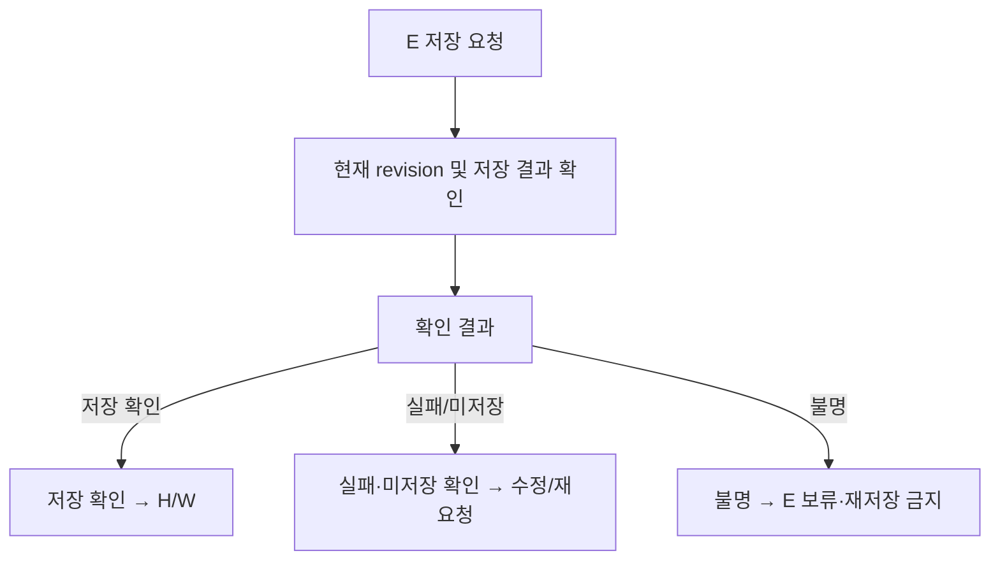
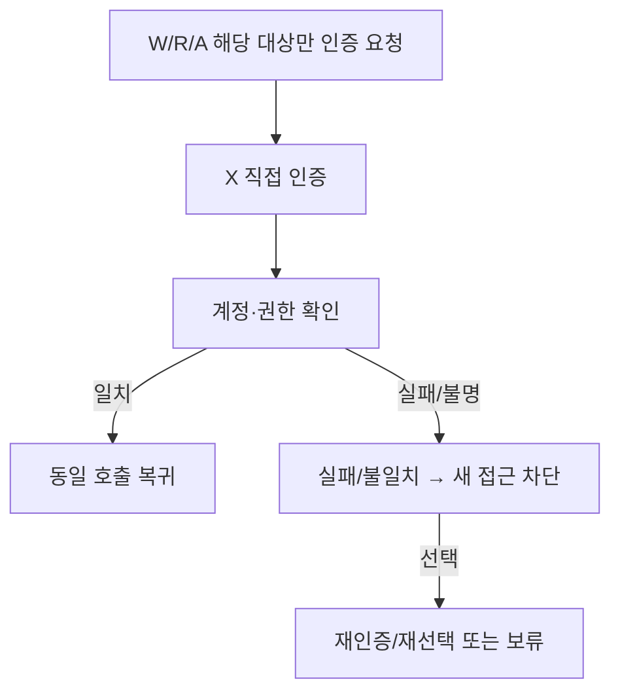
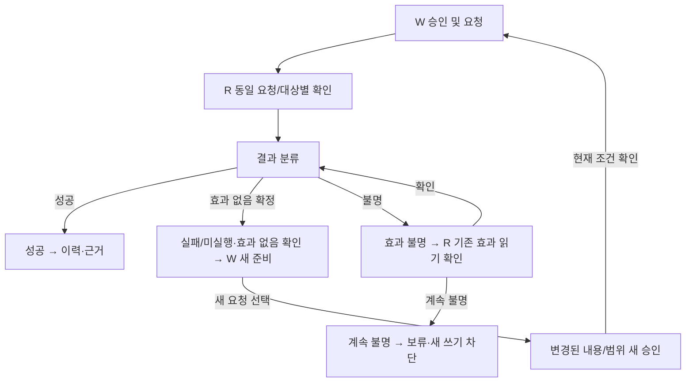
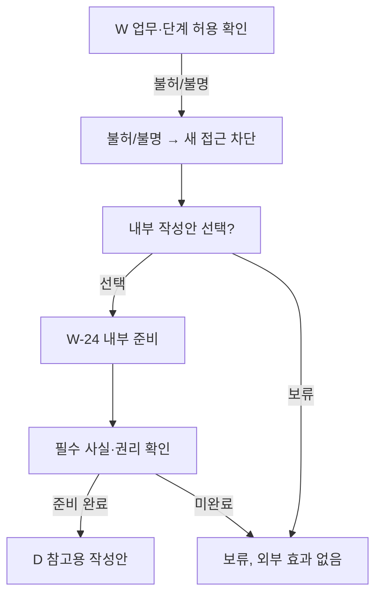

# 찾아you — V2.3 오류·예외 및 검토 결정

<!-- Generated by tools/project_docs.py. Sources: docs/artifacts/planning/lesson-registration-20261126/integrated/v2.3/user-stories.json, docs/artifacts/planning/lesson-registration-20261126/integrated/v2.3/review.json, docs/artifacts/planning/lesson-registration-20261126/integrated/scope-decisions.json -->
[원본](../../artifacts/planning/lesson-registration-20261126/integrated/v2.3/user-stories.json) · [원본](../../artifacts/planning/lesson-registration-20261126/integrated/v2.3/review.json) · [원본](../../artifacts/planning/lesson-registration-20261126/integrated/scope-decisions.json)에서 생성한 프로젝션입니다. 변경은 원본에 반영한 뒤 `uv run --no-project python tools/project_docs.py`로 재생성합니다.

[화면별 사용자 스토리](USER-STORY-V2.3.md) · [정상 흐름도](USER-STORY-FLOWS-V2.3.md)

**검토 후보 · 범위 미승인 · mock-only.** 오류 대응을 정의하고 참조를 확인했으나 실제 상태 전이·사용성·외부 효과의 의미 완전성은 미확정이다.

## 1. 전수 검토 범위

| 항목 | 결과 |
| --- | --- |
| 기존 화면 행동 보존 | 147 |
| 현재 화면 행동 / 오류 대응 연결 | 155 / 155 |
| 기존 단계 ID | 536 |
| 정상 흐름도 / 오류 흐름도 | 8 / 4 |
| 정상 수정 필요 행동 / 경로 보완 | 8 / 6 |
| 오류·예외 대응 유형 | 32 |
| 기존 분기 원문 및 후속 ID | 693 |
| 일반 조건 / 구체화 후보 / 제외 유지 | 195 / 191 / 4 |
| 이월 오류 행동 | 14 |
| 이전 오류·반복 검토 | 37 |
| 시스템 책임 / 대표 시나리오 | 42 / 30 |
| 팀원 원본 행동 / 플랫폼 업무 | 248 / 44 |
| 개별 범위 승인 / 실제 외부 허용 / 실제 완료 확인 | 0 / 0 / 0 |
| V2.2 기존 두 프로젝션 재구성 | 일치 (JS) |
| 전체 공식 Python/CI | 미실행 (컨테이너 DNS 제한) |

## 2. 이전 정상 검토의 보완과 미확정

| ID | 검토 사항 | 처리 후보 | 판정 |
| --- | --- | --- | --- |
| NV-01 | 인증 호출·재인증 중복 | 한 요청으로 X 자동 진입 및 동일 인증 동작 재사용 | candidate_revision_applied |
| NV-02 | 원본 제공·추출의 필수 분류 | 원문/파일/직접 입력 및 조건부 추출, 저장 확인 | candidate_revision_applied |
| NV-03 | 직접 작성 지원 선행 상태 | 내부 준비 완료 후 D, 쓰기 승인 전 내부 작성 지원 | candidate_revision_applied |
| NV-04 | 수정/갱신의 사용자 행동 혼합 | 수정 값 편집과 갱신 효과 표시 분리 | candidate_revision_applied |
| NV-05 | 전이 인덱스와 실제 가드 | owner/호출/대상/revision/요청·효과 구분 및 컨텍스트 가드 | candidate_revision_applied |
| NV-06 | 외부 직접 선행 업무 및 복귀 | 직접 가입·전문가 인증·약관·정산 분리 및 결과 확인 | candidate_revision_applied |
| NV-07 | 원본·준비본 저장 및 재접속 | 원본/준비/수락 요청 분리, 낡은 응답 차단 | candidate_revision_applied |
| NV-08 | 계정 연결 재사용 및 종료 | 업무용 기본, 장기 연결은 별도 정책/실제 허용 검토 | decision_pending |
| NV-09 | 통합 검토·승인 최소 조작 | 단일 조작 추천·두 논리 승인 기록, 별도 동의 유지 | decision_pending |
| NV-10 | 플랫폼 세부 규격·객체·완료 효과 | 44 업무 근거·완료·오류 경계 보존, 실제 규격/허용/효과 미확인 | evidence_pending |
| NV-11 | 관리 연결 없는 기존 등록물 진입 | 미연결 등록물 찾기/읽기/정확 대상 연결 경로 | candidate_revision_applied |
| NV-12 | 플랫폼별 실제 페인포인트 차이 | 실제 가치와 허용 미확인, 재등록 미채택 | evidence_pending |
| NV-13 | R04 제안 화면의 별도 기능 | 추가 페이지·알림 등 개별 범위 결정 전 미확정 | decision_pending |
| NV-14 | AI 원자적 행동과 시스템 전이 분리 | 고위험 복합 동작 분리, 원자 상태 전이 검증 미완료 | semantic_pending |
| NV-15 | 공식 생성기 실행 미확인 | 컨테이너 git ls-remote DNS 실패 재현, 공식 전체 Python 검사 미실행 | execution_blocked |

## 3. 오류 발생 후 사용자·서비스 흐름

### EJ01 · 저장 결과 불명과 원본 수정 충돌

오류 연결: ER-05, ER-06

### EJ02 · 외부 인증 실패·계정 불일치

오류 연결: ER-11, ER-12, ER-13, ER-23

### EJ03 · 실행 요청의 결과 분류와 재처리

오류 연결: ER-15, ER-16, ER-17, ER-18, ER-19, ER-21

### EJ04 · 단계 허용 미확인/직접 작성

오류 연결: ER-07, ER-08, ER-09, ER-24, ER-30

## 4. 화면별 오류·예외 대응 상세

### ER-01 · 서비스 인증/동일 owner

- 발생 조건: 인증 실패·만료·가입 결과 불명·기존 owner 확인 실패
- 서비스 자동 처리: 자료 반환/새 owner 생성 차단, 기존 인증 관계 및 생성 결과 확인
- 필요한 사용자 행동: 필요한 경우 공식 복구/재인증 또는 종료
- 복귀/종료: V0/H
- 완료 조건: 동일 owner 확인 전 접근 차단
- 효과·재시도 제한: none / 현재 owner·대상·권한·revision·이전 결과 확인 후 필요한 사용자 요청만. 자동 반복 금지.
- 관련 행동: V0-02, V0-03, V0-04, V0-05, H-01 · C01

### ER-02 · 소유권/접근 거절

- 발생 조건: owner 불일치·대상 권한/존재 불명
- 서비스 자동 처리: 타 owner의 존재·정보 반환 및 변경 금지, 본인 허용 목록만 표시
- 필요한 사용자 행동: 본인 재확인 또는 허용 대상 선택/종료
- 복귀/종료: V0/H/호출 화면
- 완료 조건: 권한 확인된 대상만 반환
- 효과·재시도 제한: none / 현재 owner·대상·권한·revision·이전 결과 확인 후 필요한 사용자 요청만. 자동 반복 금지.
- 관련 행동: H-01, H-02, H-03, H-06, E-07, H-07, H-08, H-09, R-07, G-01 · C01

### ER-03 · 원문/파일/권리

- 발생 조건: 수신 실패·필수 자료 부족·형식·첨부 권리 불명
- 서비스 자동 처리: 유효 입력 보존, 문제 항목/파일 및 근거 표시, 외부 전송 차단
- 필요한 사용자 행동: 문제 항목만 정정/교체/제거 또는 보류
- 복귀/종료: E
- 완료 조건: 필수 사실·첨부 권리 확인 또는 보류
- 효과·재시도 제한: none / 현재 owner·대상·권한·revision·이전 결과 확인 후 필요한 사용자 요청만. 자동 반복 금지.
- 관련 행동: E-01, E-02, E-05, E-08 · C02

### ER-04 · AI 추출/사실 불확실

- 발생 조건: 추출 실패·원문 근거 없음·사실 충돌
- 서비스 자동 처리: 추정값을 사실로 저장하지 않고 확인된 값·근거 보존
- 필요한 사용자 행동: 필요 사실만 직접 입력·정정 또는 추출 재요청
- 복귀/종료: E
- 완료 조건: 검토된 사실 확보 또는 미완료
- 효과·재시도 제한: none / 현재 owner·대상·권한·revision·이전 결과 확인 후 필요한 사용자 요청만. 자동 반복 금지.
- 관련 행동: E-03, E-04, E-05 · C02

### ER-05 · 원본 조회/동시 수정

- 발생 조건: 원본 조회 실패·기준 revision 충돌
- 서비스 자동 처리: 현재 저장값 덮어쓰기 금지, 최신 저장본과 편집본 분리
- 필요한 사용자 행동: 허용 최신 원본 확인·변경 차이 선택 또는 보류
- 복귀/종료: E/H
- 완료 조건: 정확 기준 revision 확인
- 효과·재시도 제한: none / 현재 owner·대상·권한·revision·이전 결과 확인 후 필요한 사용자 요청만. 자동 반복 금지.
- 관련 행동: H-05, H-06, H-07, E-07, E-09, H-02 · C02

### ER-06 · 저장 실패/응답 불명

- 발생 조건: 저장 거절·응답 유실·성공/실패 구분 불가
- 서비스 자동 처리: 동일 저장 요청 ID와 owner·원본·revision으로 결과 확인, 확인 전 이동/재저장 금지
- 필요한 사용자 행동: 미저장 확정 시 현재 revision 저장 요청 또는 보류
- 복귀/종료: E, 확인 후 H/W
- 완료 조건: 정확 저장 버전 또는 실패/불명 확인
- 효과·재시도 제한: internal_unknown / 기존 요청/효과 먼저 확인. 성공 또는 효과 불명 대상의 새 쓰기 금지.
- 관련 행동: E-06, E-09 · C02

### ER-07 · 업무/단계 미지원·정책 불명

- 발생 조건: 업무·접근·읽기/쓰기 단계 불허·불명
- 서비스 자동 처리: 관련 외부 접근 차단, 제한 및 내부 작성 가능 여부 표시
- 필요한 사용자 행동: 제외·보류 또는 허용 내부 작성안 선택
- 복귀/종료: W/D(준비 완료)
- 완료 조건: 외부 효과 없음
- 효과·재시도 제한: none / 현재 owner·대상·권한·revision·이전 결과 확인 후 필요한 사용자 요청만. 자동 반복 금지.
- 관련 행동: W-01, W-02, W-03, W-04, W-05, W-06, W-24, P01-CREATE-FLOW, P01-READ-FLOW, P01-UPDATE-FLOW, P01-RENEW-FLOW, P01-STATUS-FLOW, P01-RESPOND-FLOW, P02-CREATE-FLOW, P02-READ-FLOW, P02-UPDATE-FLOW, P02-RENEW-FLOW, P02-STATUS-FLOW, P02-RESPOND-FLOW, P03-CREATE-FLOW, P03-READ-FLOW, P03-UPDATE-FLOW, P03-RENEW-FLOW, P03-STATUS-FLOW, P03-RESPOND-FLOW, P04-CREATE-FLOW, P04-READ-FLOW, P04-UPDATE-FLOW, P04-RENEW-FLOW, P04-STATUS-FLOW, P04-RESPOND-FLOW, P05-CREATE-FLOW, P05-READ-FLOW, P05-UPDATE-FLOW, P05-RENEW-FLOW, P05-STATUS-FLOW, P05-RESPOND-FLOW, P06-CREATE-FLOW, P06-READ-FLOW, P06-UPDATE-FLOW, P06-RENEW-FLOW, P06-STATUS-FLOW, P06-RESPOND-FLOW, P07-CREATE-FLOW, P07-READ-FLOW, P07-UPDATE-FLOW, P07-RENEW-FLOW, P07-STATUS-FLOW, P07-RESPOND-FLOW, P02-FIRST-OPEN-SCHEDULE-FLOW, P03-REPRESENTATIVE-SERVICE-FLOW · C03

### ER-08 · 입력안 준비 실패

- 발생 조건: 변환·검증 실패·필수값 불명
- 서비스 자동 처리: 해당 대상 입력 보존, 실패 상태 및 문제 항목 표시, 외부 요청 없음
- 필요한 사용자 행동: 필요 사실 정정·대안·재준비 또는 보류
- 복귀/종료: W
- 완료 조건: 유효 현재 준비 revision 또는 보류
- 효과·재시도 제한: none / 현재 owner·대상·권한·revision·이전 결과 확인 후 필요한 사용자 요청만. 자동 반복 금지.
- 관련 행동: W-07, W-13, W-14, W-15, W-16, W-24, P01-CREATE-FLOW, P01-UPDATE-FLOW, P01-RENEW-FLOW, P02-CREATE-FLOW, P02-UPDATE-FLOW, P02-RENEW-FLOW, P03-CREATE-FLOW, P03-UPDATE-FLOW, P03-RENEW-FLOW, P04-CREATE-FLOW, P04-UPDATE-FLOW, P04-RENEW-FLOW, P05-CREATE-FLOW, P05-UPDATE-FLOW, P05-RENEW-FLOW, P06-CREATE-FLOW, P06-UPDATE-FLOW, P06-RENEW-FLOW, P07-CREATE-FLOW, P07-UPDATE-FLOW, P07-RENEW-FLOW, P02-FIRST-OPEN-SCHEDULE-FLOW, P03-REPRESENTATIVE-SERVICE-FLOW, P01-FIELDS, P02-FIELDS, P03-FIELDS, P04-FIELDS, P05-FIELDS, P06-FIELDS, P07-FIELDS · C03

### ER-09 · 가격·시간·회차·규격

- 발생 조건: 단위/상한/세금/회차/제공 조건 불명 또는 충돌
- 서비스 자동 처리: 임의 사실 변경 금지, 실제 제약과 근거 표시
- 필요한 사용자 행동: 실제 사실 정정·유효 대안 선택/거절
- 복귀/종료: W
- 완료 조건: 의미·규격 확인 또는 해당 대상 보류
- 효과·재시도 제한: none / 현재 owner·대상·권한·revision·이전 결과 확인 후 필요한 사용자 요청만. 자동 반복 금지.
- 관련 행동: W-13, W-14, W-15, W-16, W-17, P01-CREATE-FLOW, P01-UPDATE-FLOW, P01-RENEW-FLOW, P02-CREATE-FLOW, P02-UPDATE-FLOW, P02-RENEW-FLOW, P03-CREATE-FLOW, P03-UPDATE-FLOW, P03-RENEW-FLOW, P04-CREATE-FLOW, P04-UPDATE-FLOW, P04-RENEW-FLOW, P05-CREATE-FLOW, P05-UPDATE-FLOW, P05-RENEW-FLOW, P06-CREATE-FLOW, P06-UPDATE-FLOW, P06-RENEW-FLOW, P07-CREATE-FLOW, P07-UPDATE-FLOW, P07-RENEW-FLOW, P02-FIRST-OPEN-SCHEDULE-FLOW, P03-REPRESENTATIVE-SERVICE-FLOW, P01-FIELDS, P02-FIELDS, P03-FIELDS, P04-FIELDS, P05-FIELDS, P06-FIELDS, P07-FIELDS · C03

### ER-10 · 오래된 준비·늦은 응답

- 발생 조건: 원본·규칙·권한·외부 값 변경, 준비 revision 불일치
- 서비스 자동 처리: 낡은 결과와 영향받은 승인 적용 금지, 현재 대상만 재검증
- 필요한 사용자 행동: 변경된 내용/대상/범위만 다시 검토
- 복귀/종료: W
- 완료 조건: 현재 revision·조건 일치 또는 보류
- 효과·재시도 제한: none / 현재 owner·대상·권한·revision·이전 결과 확인 후 필요한 사용자 요청만. 자동 반복 금지.
- 관련 행동: W-07, W-16, W-18, W-20, W-21, H-02, E-09 · C03

### ER-11 · 외부 인증 실패·만료·취소

- 발생 조건: 외부 로그인·추가 인증 실패·만료·취소 또는 결과 불명
- 서비스 자동 처리: 새 접근 차단, 내부 준비 보존, 해당 인증 세션 정리
- 필요한 사용자 행동: 필요시 같은 공식 인증 흐름 재호출 또는 해당 대상 보류
- 복귀/종료: X/동일 W/R/A/M
- 완료 조건: 정확 계정 권한 검증 또는 보류
- 효과·재시도 제한: none / 현재 owner·대상·권한·revision·이전 결과 확인 후 필요한 사용자 요청만. 자동 반복 금지.
- 관련 행동: W-09, R-10, A-01, X-01, X-02, X-03, X-04, X-07, X-08, P01-CREATE-FLOW, P01-READ-FLOW, P01-UPDATE-FLOW, P01-RENEW-FLOW, P01-STATUS-FLOW, P02-CREATE-FLOW, P02-READ-FLOW, P02-UPDATE-FLOW, P02-RENEW-FLOW, P02-STATUS-FLOW, P03-CREATE-FLOW, P03-READ-FLOW, P03-UPDATE-FLOW, P03-RENEW-FLOW, P03-STATUS-FLOW, P04-CREATE-FLOW, P04-READ-FLOW, P04-UPDATE-FLOW, P04-RENEW-FLOW, P04-STATUS-FLOW, P05-CREATE-FLOW, P05-READ-FLOW, P05-UPDATE-FLOW, P05-RENEW-FLOW, P05-STATUS-FLOW, P06-CREATE-FLOW, P06-READ-FLOW, P06-UPDATE-FLOW, P06-RENEW-FLOW, P06-STATUS-FLOW, P07-CREATE-FLOW, P07-READ-FLOW, P07-UPDATE-FLOW, P07-RENEW-FLOW, P07-STATUS-FLOW, P02-FIRST-OPEN-SCHEDULE-FLOW, P03-REPRESENTATIVE-SERVICE-FLOW · C04

### ER-12 · 외부 계정·권한 불일치

- 발생 조건: 실제 계정과 기대 계정 다름·권한 부족·소유권 불명
- 서비스 자동 처리: 계정 자동 교체·쓰기 금지, 해당 대상/준비/승인 무효화
- 필요한 사용자 행동: 정확 계정 재인증/명시적 재선택 또는 보류
- 복귀/종료: X/동일 W/R/A/M
- 완료 조건: 정확 계정·권한·대상 확인
- 효과·재시도 제한: none / 현재 owner·대상·권한·revision·이전 결과 확인 후 필요한 사용자 요청만. 자동 반복 금지.
- 관련 행동: X-03, X-04, X-05, W-08, W-10, W-11, R-09, P01-CREATE-FLOW, P01-READ-FLOW, P01-UPDATE-FLOW, P01-RENEW-FLOW, P01-STATUS-FLOW, P02-CREATE-FLOW, P02-READ-FLOW, P02-UPDATE-FLOW, P02-RENEW-FLOW, P02-STATUS-FLOW, P03-CREATE-FLOW, P03-READ-FLOW, P03-UPDATE-FLOW, P03-RENEW-FLOW, P03-STATUS-FLOW, P04-CREATE-FLOW, P04-READ-FLOW, P04-UPDATE-FLOW, P04-RENEW-FLOW, P04-STATUS-FLOW, P05-CREATE-FLOW, P05-READ-FLOW, P05-UPDATE-FLOW, P05-RENEW-FLOW, P05-STATUS-FLOW, P06-CREATE-FLOW, P06-READ-FLOW, P06-UPDATE-FLOW, P06-RENEW-FLOW, P06-STATUS-FLOW, P07-CREATE-FLOW, P07-READ-FLOW, P07-UPDATE-FLOW, P07-RENEW-FLOW, P07-STATUS-FLOW, P02-FIRST-OPEN-SCHEDULE-FLOW, P03-REPRESENTATIVE-SERVICE-FLOW · C04

### ER-13 · 직접 선행 업무

- 발생 조건: 외부 가입·전문가 인증·약관 동의·정산 미완료 또는 불명
- 서비스 자동 처리: 비밀/민감 자료 수집 및 대리 수행 금지, 공식 직접 경로 안내
- 필요한 사용자 행동: 필요 직접 선행 업무 수행/거절 또는 보류
- 복귀/종료: X/동일 W/R/A/M
- 완료 조건: 허용된 독립 확인 또는 미실행
- 효과·재시도 제한: none / 현재 owner·대상·권한·revision·이전 결과 확인 후 필요한 사용자 요청만. 자동 반복 금지.
- 관련 행동: X-09, X-10, X-11, X-12, X-13, X-03, P01-CREATE-FLOW, P01-UPDATE-FLOW, P01-RENEW-FLOW, P02-CREATE-FLOW, P02-UPDATE-FLOW, P02-RENEW-FLOW, P03-CREATE-FLOW, P03-UPDATE-FLOW, P03-RENEW-FLOW, P04-CREATE-FLOW, P04-UPDATE-FLOW, P04-RENEW-FLOW, P05-CREATE-FLOW, P05-UPDATE-FLOW, P05-RENEW-FLOW, P06-CREATE-FLOW, P06-UPDATE-FLOW, P06-RENEW-FLOW, P07-CREATE-FLOW, P07-UPDATE-FLOW, P07-RENEW-FLOW, P02-FIRST-OPEN-SCHEDULE-FLOW, P03-REPRESENTATIVE-SERVICE-FLOW · C04

### ER-14 · 정확 객체/하위 객체 불명

- 발생 조건: 객체 없음·후보 충돌·오인 대상·내부 연결 불명
- 서비스 자동 처리: 쓰기 금지, 허용 후보/근거만 표시, 오인 대상/승인 제거
- 필요한 사용자 행동: 필요한 경우 정확 대상 선택/거절 또는 보류
- 복귀/종료: W/H
- 완료 조건: 정확 owner·계정·객체·원본 관계 확인
- 효과·재시도 제한: none / 현재 owner·대상·권한·revision·이전 결과 확인 후 필요한 사용자 요청만. 자동 반복 금지.
- 관련 행동: H-10, H-13, W-03, W-04, W-08, W-10, W-11, W-12, W-23, P01-CREATE-FLOW, P01-READ-FLOW, P01-UPDATE-FLOW, P01-RENEW-FLOW, P01-STATUS-FLOW, P02-CREATE-FLOW, P02-READ-FLOW, P02-UPDATE-FLOW, P02-RENEW-FLOW, P02-STATUS-FLOW, P03-CREATE-FLOW, P03-READ-FLOW, P03-UPDATE-FLOW, P03-RENEW-FLOW, P03-STATUS-FLOW, P04-CREATE-FLOW, P04-READ-FLOW, P04-UPDATE-FLOW, P04-RENEW-FLOW, P04-STATUS-FLOW, P05-CREATE-FLOW, P05-READ-FLOW, P05-UPDATE-FLOW, P05-RENEW-FLOW, P05-STATUS-FLOW, P06-CREATE-FLOW, P06-READ-FLOW, P06-UPDATE-FLOW, P06-RENEW-FLOW, P06-STATUS-FLOW, P07-CREATE-FLOW, P07-READ-FLOW, P07-UPDATE-FLOW, P07-RENEW-FLOW, P07-STATUS-FLOW, P02-FIRST-OPEN-SCHEDULE-FLOW, P03-REPRESENTATIVE-SERVICE-FLOW · C03

### ER-15 · 중복 후보·이전 효과 불명

- 발생 조건: 동일 요청/객체 존재 또는 이전 외부 효과 불명
- 서비스 자동 처리: 새 쓰기 차단, 동일 요청·정확 기존 효과만 허용 읽기로 확인
- 필요한 사용자 행동: 미확인 효과 확인 또는 보류
- 복귀/종료: W/R
- 완료 조건: 기존 효과 확인 또는 불명 유지
- 효과·재시도 제한: unknown / 기존 요청/효과 먼저 확인. 성공 또는 효과 불명 대상의 새 쓰기 금지.
- 관련 행동: W-02, W-08, W-16, W-21, R-01, R-04, R-16, P01-CREATE-FLOW, P01-UPDATE-FLOW, P01-RENEW-FLOW, P02-CREATE-FLOW, P02-UPDATE-FLOW, P02-RENEW-FLOW, P03-CREATE-FLOW, P03-UPDATE-FLOW, P03-RENEW-FLOW, P04-CREATE-FLOW, P04-UPDATE-FLOW, P04-RENEW-FLOW, P05-CREATE-FLOW, P05-UPDATE-FLOW, P05-RENEW-FLOW, P06-CREATE-FLOW, P06-UPDATE-FLOW, P06-RENEW-FLOW, P07-CREATE-FLOW, P07-UPDATE-FLOW, P07-RENEW-FLOW, P02-FIRST-OPEN-SCHEDULE-FLOW, P03-REPRESENTATIVE-SERVICE-FLOW · C06

### ER-16 · 승인 거절·변경·철회

- 발생 조건: 내용/범위 거절·대상/조건/revision 변경·철회
- 서비스 자동 처리: 수락 전 새 효과 차단, 영향 대상 재검토; 수락 후 기발생 효과 원복 금지
- 필요한 사용자 행동: 현재 내용/범위 재검토·명시 승인 또는 제외/보류
- 복귀/종료: W/R/H
- 완료 조건: 현재 양 승인 또는 미실행/효과 확인
- 효과·재시도 제한: unknown_if_accepted / 기존 요청/효과 먼저 확인. 성공 또는 효과 불명 대상의 새 쓰기 금지.
- 관련 행동: W-17, W-18, W-19, W-20, W-21, W-22, R-03, P01-CREATE-FLOW, P01-UPDATE-FLOW, P01-RENEW-FLOW, P02-CREATE-FLOW, P02-UPDATE-FLOW, P02-RENEW-FLOW, P03-CREATE-FLOW, P03-UPDATE-FLOW, P03-RENEW-FLOW, P04-CREATE-FLOW, P04-UPDATE-FLOW, P04-RENEW-FLOW, P05-CREATE-FLOW, P05-UPDATE-FLOW, P05-RENEW-FLOW, P06-CREATE-FLOW, P06-UPDATE-FLOW, P06-RENEW-FLOW, P07-CREATE-FLOW, P07-UPDATE-FLOW, P07-RENEW-FLOW, P02-FIRST-OPEN-SCHEDULE-FLOW, P03-REPRESENTATIVE-SERVICE-FLOW · C05

### ER-17 · 요청 수락 불명·중복 클릭

- 발생 조건: 요청 응답 유실·수락 여부 불명·중복 클릭
- 서비스 자동 처리: 동일 요청 ID 조회, 동일 대상 새 요청·실행 금지
- 필요한 사용자 행동: 진행/결과 조회 또는 보류
- 복귀/종료: W/R
- 완료 조건: 기존 수락 여부 확인 또는 불명
- 효과·재시도 제한: unknown / 기존 요청/효과 먼저 확인. 성공 또는 효과 불명 대상의 새 쓰기 금지.
- 관련 행동: W-21, R-01, R-02, P01-CREATE-FLOW, P01-UPDATE-FLOW, P01-RENEW-FLOW, P02-CREATE-FLOW, P02-UPDATE-FLOW, P02-RENEW-FLOW, P03-CREATE-FLOW, P03-UPDATE-FLOW, P03-RENEW-FLOW, P04-CREATE-FLOW, P04-UPDATE-FLOW, P04-RENEW-FLOW, P05-CREATE-FLOW, P05-UPDATE-FLOW, P05-RENEW-FLOW, P06-CREATE-FLOW, P06-UPDATE-FLOW, P06-RENEW-FLOW, P07-CREATE-FLOW, P07-UPDATE-FLOW, P07-RENEW-FLOW, P02-FIRST-OPEN-SCHEDULE-FLOW, P03-REPRESENTATIVE-SERVICE-FLOW · C06

### ER-18 · 실행 실패/미실행 확정

- 발생 조건: 단계 사전조건 실패 또는 효과 없음이 독립 확인됨
- 서비스 자동 처리: 실패 단계/대상 표시, 성공 대상 제외, 새 쓰기 자동 시작 금지
- 필요한 사용자 행동: 미실행/효과 없음이 확인된 대상만 새 준비 또는 보류
- 복귀/종료: R/W
- 완료 조건: 현재 새 준비 및 승인 전 재쓰기 없음
- 효과·재시도 제한: none_confirmed / 현재 owner·대상·권한·revision·이전 결과 확인 후 필요한 사용자 요청만. 자동 반복 금지.
- 관련 행동: R-01, R-04, R-06, R-15, R-17, P01-CREATE-FLOW, P01-UPDATE-FLOW, P01-RENEW-FLOW, P02-CREATE-FLOW, P02-UPDATE-FLOW, P02-RENEW-FLOW, P03-CREATE-FLOW, P03-UPDATE-FLOW, P03-RENEW-FLOW, P04-CREATE-FLOW, P04-UPDATE-FLOW, P04-RENEW-FLOW, P05-CREATE-FLOW, P05-UPDATE-FLOW, P05-RENEW-FLOW, P06-CREATE-FLOW, P06-UPDATE-FLOW, P06-RENEW-FLOW, P07-CREATE-FLOW, P07-UPDATE-FLOW, P07-RENEW-FLOW, P02-FIRST-OPEN-SCHEDULE-FLOW, P03-REPRESENTATIVE-SERVICE-FLOW · C06

### ER-19 · 외부 저장·제출·갱신 효과 불명

- 발생 조건: 외부 효과 단계 응답 유실·독립 확인 불가
- 서비스 자동 처리: 효과 미확인으로 기록, 실패/미실행 단정 금지, 새 쓰기 차단
- 필요한 사용자 행동: 기존 효과를 허용된 읽기로 확인 또는 보류
- 복귀/종료: R
- 완료 조건: 효과 확인 또는 미확인 유지
- 효과·재시도 제한: unknown / 기존 요청/효과 먼저 확인. 성공 또는 효과 불명 대상의 새 쓰기 금지.
- 관련 행동: R-01, R-04, R-06, R-15, R-16, R-17, P01-CREATE-FLOW, P01-UPDATE-FLOW, P01-RENEW-FLOW, P02-CREATE-FLOW, P02-UPDATE-FLOW, P02-RENEW-FLOW, P03-CREATE-FLOW, P03-UPDATE-FLOW, P03-RENEW-FLOW, P04-CREATE-FLOW, P04-UPDATE-FLOW, P04-RENEW-FLOW, P05-CREATE-FLOW, P05-UPDATE-FLOW, P05-RENEW-FLOW, P06-CREATE-FLOW, P06-UPDATE-FLOW, P06-RENEW-FLOW, P07-CREATE-FLOW, P07-UPDATE-FLOW, P07-RENEW-FLOW, P02-FIRST-OPEN-SCHEDULE-FLOW, P03-REPRESENTATIVE-SERVICE-FLOW · C06

### ER-20 · 반려·심사·모집 후속

- 발생 조건: 반려·심사 중 수정 제한·사유 미제공·최초 모집 조건 불명
- 서비스 자동 처리: 관측 상태와 사유/불명 분리, 자동 재접수/모집 오픈 금지
- 필요한 사용자 행동: 확인된 보완/후속 업무 새 준비 또는 보류
- 복귀/종료: R/W
- 완료 조건: 업무별 새 승인 전 쓰기 없음
- 효과·재시도 제한: observed_or_unknown / 기존 요청/효과 먼저 확인. 성공 또는 효과 불명 대상의 새 쓰기 금지.
- 관련 행동: R-06, R-11, R-12, R-13, R-14, R-17, P01-RESPOND-FLOW, P02-RESPOND-FLOW, P03-RESPOND-FLOW, P04-RESPOND-FLOW, P05-RESPOND-FLOW, P06-RESPOND-FLOW, P07-RESPOND-FLOW · C06

### ER-21 · 복수 플랫폼 부분 성공

- 발생 조건: 성공·실패·미실행·미확인 대상 혼재
- 서비스 자동 처리: 대상별 상태 독립 표시, 성공 대상 제외·불명 새 쓰기 금지
- 필요한 사용자 행동: 미실행/실패 효과 없음 확인 대상만 새 준비
- 복귀/종료: R/W
- 완료 조건: 대상별 상태와 효과 보존
- 효과·재시도 제한: mixed / 기존 요청/효과 먼저 확인. 성공 또는 효과 불명 대상의 새 쓰기 금지.
- 관련 행동: R-02, R-04, R-06, R-15, R-16, R-17, P01-CREATE-FLOW, P01-UPDATE-FLOW, P01-RENEW-FLOW, P02-CREATE-FLOW, P02-UPDATE-FLOW, P02-RENEW-FLOW, P03-CREATE-FLOW, P03-UPDATE-FLOW, P03-RENEW-FLOW, P04-CREATE-FLOW, P04-UPDATE-FLOW, P04-RENEW-FLOW, P05-CREATE-FLOW, P05-UPDATE-FLOW, P05-RENEW-FLOW, P06-CREATE-FLOW, P06-UPDATE-FLOW, P06-RENEW-FLOW, P07-CREATE-FLOW, P07-UPDATE-FLOW, P07-RENEW-FLOW, P02-FIRST-OPEN-SCHEDULE-FLOW, P03-REPRESENTATIVE-SERVICE-FLOW · C06

### ER-22 · 상태 조회 실패/마지막 관측

- 발생 조건: 읽기 불허·만료·조회 실패·이전 관측 없음
- 서비스 자동 처리: 마지막 관측·시각 보존, 없음/불명 표시, 미노출 원인 추정 금지
- 필요한 사용자 행동: 허용된 해당 대상 재인증·조회 또는 보류
- 복귀/종료: R/H/X
- 완료 조건: 현재 관측 또는 조회 불가
- 효과·재시도 제한: read_only / 현재 owner·대상·권한·revision·이전 결과 확인 후 필요한 사용자 요청만. 자동 반복 금지.
- 관련 행동: H-11, H-12, R-09, R-10, R-11, R-16, P01-READ-FLOW, P01-STATUS-FLOW, P01-RESPOND-FLOW, P02-READ-FLOW, P02-STATUS-FLOW, P02-RESPOND-FLOW, P03-READ-FLOW, P03-STATUS-FLOW, P03-RESPOND-FLOW, P04-READ-FLOW, P04-STATUS-FLOW, P04-RESPOND-FLOW, P05-READ-FLOW, P05-STATUS-FLOW, P05-RESPOND-FLOW, P06-READ-FLOW, P06-STATUS-FLOW, P06-RESPOND-FLOW, P07-READ-FLOW, P07-STATUS-FLOW, P07-RESPOND-FLOW · C07

### ER-23 · 인증 세션 폐기·해제 불명

- 발생 조건: 폐기·해제·철회 결과 불명/실패
- 서비스 자동 처리: 새 접근 차단 유지, 종료/폐기 확인 불명 별도 기록 및 운영 확인
- 필요한 사용자 행동: 결과 확인 경로 이용, 자동 복구 없음
- 복귀/종료: R/A/V0/M
- 완료 조건: 접근 차단 및 폐기 확인 또는 제한
- 효과·재시도 제한: access_blocked / 현재 owner·대상·권한·revision·이전 결과 확인 후 필요한 사용자 요청만. 자동 반복 금지.
- 관련 행동: R-05, R-06, A-02, X-06, X-08, G-03, M-08, P01-CREATE-FLOW, P01-UPDATE-FLOW, P01-RENEW-FLOW, P02-CREATE-FLOW, P02-UPDATE-FLOW, P02-RENEW-FLOW, P03-CREATE-FLOW, P03-UPDATE-FLOW, P03-RENEW-FLOW, P04-CREATE-FLOW, P04-UPDATE-FLOW, P04-RENEW-FLOW, P05-CREATE-FLOW, P05-UPDATE-FLOW, P05-RENEW-FLOW, P06-CREATE-FLOW, P06-UPDATE-FLOW, P06-RENEW-FLOW, P07-CREATE-FLOW, P07-UPDATE-FLOW, P07-RENEW-FLOW, P02-FIRST-OPEN-SCHEDULE-FLOW, P03-REPRESENTATIVE-SERVICE-FLOW · C08

### ER-24 · 직접 작성안/사용자 보고

- 발생 조건: 작성안 미완료·권리 불명·사용자 보고만 있음
- 서비스 자동 처리: D 진입 전 보완, 사용자 보고와 독립 관측 분리, 대행 성공 표기 금지
- 필요한 사용자 행동: 필요 항목 보완·직접 처리/보고 선택 또는 보류
- 복귀/종료: W/D/호출 R
- 완료 조건: 내부 준비 또는 사용자 보고/보류
- 효과·재시도 제한: none_or_user_report / 현재 owner·대상·권한·revision·이전 결과 확인 후 필요한 사용자 요청만. 자동 반복 금지.
- 관련 행동: W-05, W-24, D-01, D-02, D-03, D-04, D-05, REPOST-02 · C03

### ER-25 · 삭제·연결 해제·권리 요청 제한

- 발생 조건: 진행 업무·미확인 효과·보존 의무·소유권 충돌
- 서비스 자동 처리: 영향·제한 설명, 외부 삭제/원복 금지, 허용 내부 요청만 처리
- 필요한 사용자 행동: 현재 영향 확인 후 허용 요청/취소 또는 문의
- 복귀/종료: H/G/A
- 완료 조건: 내부 처리 확인 또는 제한
- 효과·재시도 제한: internal_only / 현재 owner·대상·권한·revision·이전 결과 확인 후 필요한 사용자 요청만. 자동 반복 금지.
- 관련 행동: H-08, H-09, G-01, A-02 · C01

### ER-26 · 이탈·재접속·로그아웃

- 발생 조건: 미저장 변경·수락/진행 중 이탈·세션 만료
- 서비스 자동 처리: 저장/미저장·기존 수락 요청 분리, 이탈로 실행/취소/재실행 없음
- 필요한 사용자 행동: 필요 저장/보류 선택, 동일 owner 재인증 후 기존 상태 확인
- 복귀/종료: H/V0/W/R
- 완료 조건: 동일 작업 복귀 또는 제한
- 효과·재시도 제한: preserve / 현재 owner·대상·권한·revision·이전 결과 확인 후 필요한 사용자 요청만. 자동 반복 금지.
- 관련 행동: H-02, H-04, G-02, G-03, W-22, R-02, R-08, D-05, A-03 · C08

### ER-27 · 조건부 모니터링

- 발생 조건: 별도 정책 미채택·기간/범위/권한 불명·조회/알림 실패
- 서비스 자동 처리: 기본 미제공, 채택 시 허용 읽기만, 오류 대상 차단 및 마지막 관측 유지
- 필요한 사용자 행동: 지원 제한 확인·필요한 새 승인/조회 설정 또는 보류
- 복귀/종료: M/H/R
- 완료 조건: 채택 전 미실행, 채택 후 확인 상태
- 효과·재시도 제한: read_only_conditional / 현재 owner·대상·권한·revision·이전 결과 확인 후 필요한 사용자 요청만. 자동 반복 금지.
- 관련 행동: M-01, M-02, M-03, M-04, M-05, M-06, M-09 · C07

### ER-28 · 모니터링 종료·폐기

- 발생 조건: 철회·만료·종료/해제 불명
- 서비스 자동 처리: 새 조회 차단과 폐기 확인 분리, 자동 재개 금지
- 필요한 사용자 행동: 종료 제한 확인, 새 시작은 별도 승인
- 복귀/종료: M/H/R
- 완료 조건: 접근 차단 유지 및 폐기 확인 또는 불명
- 효과·재시도 제한: access_blocked / 현재 owner·대상·권한·revision·이전 결과 확인 후 필요한 사용자 요청만. 자동 반복 금지.
- 관련 행동: M-07, M-08, M-09 · C08

### ER-29 · 플랫폼 고유 효과·부수 변화

- 발생 조건: 첫 모집 일정·대표 관계·같은 공고 갱신·공유 필드/비용/효과 불명
- 서비스 자동 처리: 독립 업무·정확 대상·예정 효과 분리, 허용 불명 실행 금지
- 필요한 사용자 행동: 확인된 변경값/효과 검토 및 별도 승인 후보 또는 보류
- 복귀/종료: W/R
- 완료 조건: 정확 관계·동일 객체 효과 또는 미실행/불명 확인
- 효과·재시도 제한: unknown_if_accepted / 기존 요청/효과 먼저 확인. 성공 또는 효과 불명 대상의 새 쓰기 금지.
- 관련 행동: P02-FIRST-OPEN-SCHEDULE-FLOW, P03-REPRESENTATIVE-SERVICE-FLOW, P05-RENEW-FLOW, W-12, W-23, R-04, P01-RENEW-FLOW, P02-RENEW-FLOW, P03-RENEW-FLOW, P04-RENEW-FLOW, P06-RENEW-FLOW, P07-RENEW-FLOW · C05

### ER-30 · 새 글 재등록·게시 제한

- 발생 조건: 재등록 허용·간격·유사 글 제한·신규 객체 불명
- 서비스 자동 처리: 미채택/불허/불명 차단, 기존 글 삭제·중복·제한 회피·자동 주기 실행 금지
- 필요한 사용자 행동: 내부 작성안 또는 보류, 별도 채택·허용 후 효과 검토
- 복귀/종료: W/D, 별도 승인 후 R 후보
- 완료 조건: 내부 준비 또는 정확 새 객체 효과 확인
- 효과·재시도 제한: unknown_if_accepted / 기존 요청/효과 먼저 확인. 성공 또는 효과 불명 대상의 새 쓰기 금지.
- 관련 행동: REPOST-01, REPOST-02, REPOST-03, P06-CREATE-FLOW, P07-CREATE-FLOW, P06-RENEW-FLOW, P07-RENEW-FLOW · C06

### ER-31 · 증거/이력/링크 조회 불가

- 발생 조건: 근거 없음·접근 불가·링크/사유 불명
- 서비스 자동 처리: 확인된 정보·관측 수준만 표시, 원인/공개/제재 추정 금지
- 필요한 사용자 행동: 허용 확인 경로 또는 보류
- 복귀/종료: R/H/D
- 완료 조건: 근거 수준과 조회 불가 표시
- 효과·재시도 제한: read_only / 현재 owner·대상·권한·revision·이전 결과 확인 후 필요한 사용자 요청만. 자동 반복 금지.
- 관련 행동: R-06, R-07, R-11, R-13, D-03, D-04, P01-READ-FLOW, P01-STATUS-FLOW, P01-RESPOND-FLOW, P02-READ-FLOW, P02-STATUS-FLOW, P02-RESPOND-FLOW, P03-READ-FLOW, P03-STATUS-FLOW, P03-RESPOND-FLOW, P04-READ-FLOW, P04-STATUS-FLOW, P04-RESPOND-FLOW, P05-READ-FLOW, P05-STATUS-FLOW, P05-RESPOND-FLOW, P06-READ-FLOW, P06-STATUS-FLOW, P06-RESPOND-FLOW, P07-READ-FLOW, P07-STATUS-FLOW, P07-RESPOND-FLOW, P01-FIELDS, P02-FIELDS, P03-FIELDS, P04-FIELDS, P05-FIELDS, P06-FIELDS, P07-FIELDS · C07

### ER-32 · 미분류 오류·안전 종료

- 발생 조건: 실제 원인 또는 정확 선행 조건 미확인
- 서비스 자동 처리: 영향 대상 접근·쓰기 차단, 확인 가능한 근거/기존 효과 보존
- 필요한 사용자 행동: 확인 가능한 최소 조치 또는 보류
- 복귀/종료: 호출 W/R
- 완료 조건: 구체 조건 확인 전 새 효과 없음
- 효과·재시도 제한: unknown_if_accepted / 기존 요청/효과 먼저 확인. 성공 또는 효과 불명 대상의 새 쓰기 금지.
- 관련 행동: W-05, W-16, W-21, R-01, R-06, V0-01 · C03

## 5. 업무 간 유지되는 식별·상태 가드

| ID | 컨텍스트 | 식별/유지 정보 | 제한 |
| --- | --- | --- | --- |
| C01 | 사용자 | 검증된 인증 주체·owner·대상 권한 | 타인 자료·존재 반환/변경 금지 |
| C02 | 원본 | owner·원본 ID·기준/현재 revision·저장 요청 ID | 동시 수정 덮어쓰기·불명 저장 재요청 금지 |
| C03 | 준비/직접 작성 | owner·작업 그룹·대상·플랫폼·외부 계정/객체·업무·원본/준비 revision·호출 목적 | 영향 대상만 재검증·낡은 응답 무효 |
| C04 | 인증 | 호출 화면·작업/대상·기대 계정·generation·권한·만료·목적 | 불일치/불허 시 해당 대상 보류 |
| C05 | 승인 | owner·대상 목록·현재 내용·범위/예정 효과·준비 revision·양 승인·시각 | 변경 영향 승인 재검토, 수락 후 목록 변경 금지 |
| C06 | 실행/효과 | 요청 ID·대상별 작업 ID·승인 snapshot·단계 효과·관측 시각/출처 | 수락 불명은 동일 ID 확인, 효과 불명/성공 대상 재쓰기 금지 |
| C07 | 조회 | owner·정확 계정/객체·읽기 목적/권한·요청 ID·마지막 관측 | 조회 실패를 외부 상태/부재로 변환하지 않음 |
| C08 | 종료 | 접근 차단·업무용 세션 폐기 확인·기발생/불명 효과·별도 장기 연결 | 차단/폐기 확인 구분, 원복/자동 재개 없음 |

## 6. 플랫폼별 완료 및 오류 경계

| 업무 | 정확 대상 | 완료 기준 후보 | 오류 대응 | 실제 검증 |
| --- | --- | --- | --- | --- |
| PS-PL01-CREATE 크몽 | 레슨 서비스 상품 및 해당 상품의 가격 옵션 | 동일 계정의 신규 상품 식별과 심사 접수/심사 진행 상태, 승인 입력안과 일치하는 저장값 확인 | ER-07, ER-08, ER-09, ER-11, ER-12, ER-13, ER-14, ER-15, ER-16, ER-17, ER-18, ER-19, ER-21, ER-23 | 허용/효과 미확인 |
| PS-PL01-READ 크몽 | 레슨 서비스 상품 | 정확 계정·상품 식별 근거, 관측값·시각 확보; 링크 불명 별도 | ER-07, ER-11, ER-12, ER-14, ER-22, ER-31 | 허용/효과 미확인 |
| PS-PL01-UPDATE 크몽 | 동일 레슨 서비스 상품 | 동일 상품의 승인 변경값 저장 확인 및 필요한 경우 재심사 접수 확인 | ER-07, ER-08, ER-09, ER-11, ER-12, ER-13, ER-14, ER-15, ER-16, ER-17, ER-18, ER-19, ER-21, ER-23 | 허용/효과 미확인 |
| PS-PL01-RENEW 크몽 | 동일 상품의 독립 갱신 업무 | 미제공; 완료 판정 없음 | ER-07, ER-08, ER-09, ER-11, ER-12, ER-13, ER-14, ER-15, ER-16, ER-17, ER-18, ER-19, ER-21, ER-23, ER-29 | 허용/효과 미확인 |
| PS-PL01-STATUS 크몽 | 등록 상품 및 심사·판매 상태 | 정확 상품의 최신 관측 또는 조회 불가·마지막 관측 반환; 조회 불가는 성공 상태 아님 | ER-07, ER-11, ER-12, ER-14, ER-22, ER-31 | 허용/효과 미확인 |
| PS-PL01-RESPOND 크몽 | 심사·변경·등록 결과 | 근거 있는 안내와 선택 가능한 조치 제공; 사유 미확인 구분 | ER-07, ER-20, ER-22, ER-31 | 허용/효과 미확인 |
| PS-PL02-CREATE 탈잉 | 오프라인 음악 레슨 클래스(튜터 프로필 공유 관계) | 동일 계정 신규 클래스 식별, 저장값 및 심사 접수/진행 확인 | ER-07, ER-08, ER-09, ER-11, ER-12, ER-13, ER-14, ER-15, ER-16, ER-17, ER-18, ER-19, ER-21, ER-23 | 허용/효과 미확인 |
| PS-PL02-READ 탈잉 | 튜터 프로필과 연결된 오프라인 클래스 | 계정·클래스 식별 근거 및 현재 관측값·시각 확보 | ER-07, ER-11, ER-12, ER-14, ER-22, ER-31 | 허용/효과 미확인 |
| PS-PL02-UPDATE 탈잉 | 동일 오프라인 클래스 | 동일 클래스 승인 변경값 저장 및 필요 시 재심사 접수 확인 | ER-07, ER-08, ER-09, ER-11, ER-12, ER-13, ER-14, ER-15, ER-16, ER-17, ER-18, ER-19, ER-21, ER-23 | 허용/효과 미확인 |
| PS-PL02-RENEW 탈잉 | 독립 공고 갱신 업무 | 미제공; 완료 판정 없음 | ER-07, ER-08, ER-09, ER-11, ER-12, ER-13, ER-14, ER-15, ER-16, ER-17, ER-18, ER-19, ER-21, ER-23, ER-29 | 허용/효과 미확인 |
| PS-PL02-STATUS 탈잉 | 오프라인 클래스의 심사·운영·오픈 상태 | 최신 실제 상태 또는 조회 불가 및 마지막 관측 반환 | ER-07, ER-11, ER-12, ER-14, ER-22, ER-31 | 허용/효과 미확인 |
| PS-PL02-RESPOND 탈잉 | 오프라인 클래스 반려/오류 | 실제 사유 또는 미확인과 가능한 조치 반환 | ER-07, ER-20, ER-22, ER-31 | 허용/효과 미확인 |
| PS-PL03-CREATE 숨고 | 기존 고수 프로필에 연결된 제공 서비스 및 모집 관련 세부 항목 | 정확 프로필에 서비스가 새로 연결되고 승인된 모집 항목이 재조회에서 확인 | ER-07, ER-08, ER-09, ER-11, ER-12, ER-13, ER-14, ER-15, ER-16, ER-17, ER-18, ER-19, ER-21, ER-23 | 허용/효과 미확인 |
| PS-PL03-READ 숨고 | 고수 프로필 및 연결 제공 서비스 | 정확 프로필과 서비스의 식별 근거·현재 설정·시각 확보 | ER-07, ER-11, ER-12, ER-14, ER-22, ER-31 | 허용/효과 미확인 |
| PS-PL03-UPDATE 숨고 | 동일 프로필의 모집 정보 및 선택 제공 서비스 설정 | 정확 프로필/서비스의 승인 변경값 저장·반영 확인; 공유 필드 영향 명시 | ER-07, ER-08, ER-09, ER-11, ER-12, ER-13, ER-14, ER-15, ER-16, ER-17, ER-18, ER-19, ER-21, ER-23 | 허용/효과 미확인 |
| PS-PL03-RENEW 숨고 | 독립 공고 갱신 업무 | 미제공; 완료 판정 없음 | ER-07, ER-08, ER-09, ER-11, ER-12, ER-13, ER-14, ER-15, ER-16, ER-17, ER-18, ER-19, ER-21, ER-23, ER-29 | 허용/효과 미확인 |
| PS-PL03-STATUS 숨고 | 고수 프로필 및 해당 제공 서비스 상태 | 선택 서비스의 등록/설정/공개 관측과 시각 또는 조회 불가 반환 | ER-07, ER-11, ER-12, ER-14, ER-22, ER-31 | 허용/효과 미확인 |
| PS-PL03-RESPOND 숨고 | 프로필·제공 서비스 설정 실패 | 확인 근거와 해결 가능 조치 또는 불명 안내 | ER-07, ER-20, ER-22, ER-31 | 허용/효과 미확인 |
| PS-PL04-CREATE 프람피 | 전문가 프로필 및 레슨 분야 | 프로필 식별 및 실제 저장/분야 연결 재조회 증거 확보 시만 | ER-07, ER-08, ER-09, ER-11, ER-12, ER-13, ER-14, ER-15, ER-16, ER-17, ER-18, ER-19, ER-21, ER-23 | 허용/효과 미확인 |
| PS-PL04-READ 프람피 | 전문가 프로필·레슨 분야·소개·커리큘럼 등 하위 항목 | 정확 계정·프로필·하위 객체 식별 근거와 현재 내용·관측 시각 확인. 식별/조회 실패는 미확인. | ER-07, ER-11, ER-12, ER-14, ER-22, ER-31 | 허용/효과 미확인 |
| PS-PL04-UPDATE 프람피 | 전문가 프로필 기본 정보·분야별 소개·커리큘럼·하위 항목 | 정확 프로필 및 선택한 하위 객체의 승인 변경값 저장 및 관측 확인; 공개 반영 별도. | ER-07, ER-08, ER-09, ER-11, ER-12, ER-13, ER-14, ER-15, ER-16, ER-17, ER-18, ER-19, ER-21, ER-23 | 허용/효과 미확인 |
| PS-PL04-RENEW 프람피 | 공고 갱신 | 미제공; 완료 판정 없음 | ER-07, ER-08, ER-09, ER-11, ER-12, ER-13, ER-14, ER-15, ER-16, ER-17, ER-18, ER-19, ER-21, ER-23, ER-29 | 허용/효과 미확인 |
| PS-PL04-STATUS 프람피 | 프로필 및 분야 등록/공개 상태 | 정확 대상의 최신 관측 상태 및 시각 반환, 또는 조회 불가와 마지막 관측 반환. 공개/모집 가능은 별도 확인. | ER-07, ER-11, ER-12, ER-14, ER-22, ER-31 | 허용/효과 미확인 |
| PS-PL04-RESPOND 프람피 | 등록 제한 및 준비 오류 | 내부 제한 사유 및 허용 다음 선택 제공 | ER-07, ER-20, ER-22, ER-31 | 허용/효과 미확인 |
| PS-PL05-CREATE 뮬 | 개인레슨 게시판의 레슨 공고 | 신규 게시물 정확 식별 및 승인 내용·게시 상태 재조회 확인 | ER-07, ER-08, ER-09, ER-11, ER-12, ER-13, ER-14, ER-15, ER-16, ER-17, ER-18, ER-19, ER-21, ER-23 | 허용/효과 미확인 |
| PS-PL05-READ 뮬 | 개인레슨 게시물 | 게시물 식별 근거·내용·시각 및 확인된 링크 확보 | ER-07, ER-11, ER-12, ER-14, ER-22, ER-31 | 허용/효과 미확인 |
| PS-PL05-UPDATE 뮬 | 동일 기존 개인레슨 게시물 | 같은 게시물 식별 및 승인 변경값의 저장 확인, 공개 노출 별도; 새 글 생성으로 대체하지 않음. | ER-07, ER-08, ER-09, ER-11, ER-12, ER-13, ER-14, ER-15, ER-16, ER-17, ER-18, ER-19, ER-21, ER-23 | 허용/효과 미확인 |
| PS-PL05-RENEW 뮬 | 동일 기존 개인레슨 공고의 최신글 올리기 | 허용 갱신으로 대상 공고의 의도된 효과가 관측될 때만 완료 | ER-07, ER-08, ER-09, ER-11, ER-12, ER-13, ER-14, ER-15, ER-16, ER-17, ER-18, ER-19, ER-21, ER-23, ER-29 | 허용/효과 미확인 |
| PS-PL05-STATUS 뮬 | 기존 레슨 공고 게시 상태 | 최신 관측 및 시각 또는 조회 불가 반환 | ER-07, ER-11, ER-12, ER-14, ER-22, ER-31 | 허용/효과 미확인 |
| PS-PL05-RESPOND 뮬 | 공고 등록/갱신 제한 | 확인된 사유와 보류/대안 반환 | ER-07, ER-20, ER-22, ER-31 | 허용/효과 미확인 |
| PS-PL06-CREATE 힙합플레이야 | 홍보 게시판 레슨 게시물 | 정확 신규 게시물 식별 및 승인 내용·저장/게시 상태 확인 | ER-07, ER-08, ER-09, ER-11, ER-12, ER-13, ER-14, ER-15, ER-16, ER-17, ER-18, ER-19, ER-21, ER-23, ER-30 | 허용/효과 미확인 |
| PS-PL06-READ 힙합플레이야 | 홍보 게시물 | 정확 글 식별 근거·내용·시각 확보 | ER-07, ER-11, ER-12, ER-14, ER-22, ER-31 | 허용/효과 미확인 |
| PS-PL06-UPDATE 힙합플레이야 | 기존 홍보 게시물 | 미제공; 완료 판정 없음 | ER-07, ER-08, ER-09, ER-11, ER-12, ER-13, ER-14, ER-15, ER-16, ER-17, ER-18, ER-19, ER-21, ER-23 | 허용/효과 미확인 |
| PS-PL06-RENEW 힙합플레이야 | 독립 공고 갱신 | 미제공; 완료 판정 없음 | ER-07, ER-08, ER-09, ER-11, ER-12, ER-13, ER-14, ER-15, ER-16, ER-17, ER-18, ER-19, ER-21, ER-23, ER-29, ER-30 | 허용/효과 미확인 |
| PS-PL06-STATUS 힙합플레이야 | 홍보 게시물의 공개 상태 | 최신 공개 관측 또는 조회 불가와 마지막 관측 반환 | ER-07, ER-11, ER-12, ER-14, ER-22, ER-31 | 허용/효과 미확인 |
| PS-PL06-RESPOND 힙합플레이야 | 게시 제한 및 준비 오류 | 근거 있는 안내 또는 불명 표시 | ER-07, ER-20, ER-22, ER-31 | 허용/효과 미확인 |
| PS-PL07-CREATE 힙합LE | 레슨 장터 게시물 | 정확 게시물 식별 및 승인 내용·게시 상태 확인 | ER-07, ER-08, ER-09, ER-11, ER-12, ER-13, ER-14, ER-15, ER-16, ER-17, ER-18, ER-19, ER-21, ER-23, ER-30 | 허용/효과 미확인 |
| PS-PL07-READ 힙합LE | 레슨 장터 게시물 | 정확 게시물 식별 근거·내용·시각 및 확인된 링크 확보 | ER-07, ER-11, ER-12, ER-14, ER-22, ER-31 | 허용/효과 미확인 |
| PS-PL07-UPDATE 힙합LE | 기존 레슨 장터 게시물 | 미제공; 완료 판정 없음 | ER-07, ER-08, ER-09, ER-11, ER-12, ER-13, ER-14, ER-15, ER-16, ER-17, ER-18, ER-19, ER-21, ER-23 | 허용/효과 미확인 |
| PS-PL07-RENEW 힙합LE | 독립 공고 갱신 | 미제공; 완료 판정 없음 | ER-07, ER-08, ER-09, ER-11, ER-12, ER-13, ER-14, ER-15, ER-16, ER-17, ER-18, ER-19, ER-21, ER-23, ER-29, ER-30 | 허용/효과 미확인 |
| PS-PL07-STATUS 힙합LE | 레슨 장터 게시물 공개 상태 | 최신 관측 또는 조회 불가와 마지막 관측 반환 | ER-07, ER-11, ER-12, ER-14, ER-22, ER-31 | 허용/효과 미확인 |
| PS-PL07-RESPOND 힙합LE | 게시 제한 및 준비 오류 | 확인 근거와 다음 선택 또는 불명 표시 | ER-07, ER-20, ER-22, ER-31 | 허용/효과 미확인 |
| PS-PL02-FIRST-OPEN-SCHEDULE 탈잉 | 심사 승인된 오프라인 클래스의 최초 모집 일정·장소 | 해당 클래스의 승인된 최초 일정·장소 저장 및 실제 신청 가능 확인(조건별 구분) | ER-07, ER-08, ER-09, ER-11, ER-12, ER-13, ER-14, ER-15, ER-16, ER-17, ER-18, ER-19, ER-21, ER-23, ER-29 | 허용/효과 미확인 |
| PS-PL03-REPRESENTATIVE-SERVICE 숨고 | 고수 프로필에 연결된 기존 제공 서비스의 대표 서비스 관계 | 정확 프로필의 대표 서비스 관계가 승인된 대상으로 반영됨을 독립 확인 | ER-07, ER-08, ER-09, ER-11, ER-12, ER-13, ER-14, ER-15, ER-16, ER-17, ER-18, ER-19, ER-21, ER-23, ER-29 | 허용/효과 미확인 |

## 7. 이월 오류 행동 대응

| 기존 ID | 행동 | 연결된 대응 |
| --- | --- | --- |
| IS-052 | 강사가 서비스 계정 인증 실패를 확인한다. | ER-01 |
| IS-057 | 강사가 준비 실패 후 새로운 준비를 요청한다. | ER-10, ER-08 |
| IS-077 | 강사가 가격 검증 오류를 확인한다. | ER-09 |
| IS-078 | 강사가 인증에 실패한 플랫폼 작업을 건너뛴다. | ER-11, ER-19 |
| IS-079 | 강사가 실패한 외부 플랫폼 인증을 재시도한다. | ER-11, ER-23 |
| IS-099 | 강사가 본인 권한 밖의 접근 거절을 확인한다. | ER-02 |
| IS-100 | 강사가 정보 준비 작업의 실패를 확인한다. | ER-10, ER-08 |
| IS-101 | 강사가 오래된 준비 결과의 적용 제한을 확인한다. | ER-10, ER-22 |
| IS-102 | 강사가 원본 불러오기 실패를 확인한다. | ER-22, ER-05 |
| IS-103 | 강사가 원본 저장 결과의 불확실성을 확인한다. | ER-06, ER-10 |
| IS-116 | 강사가 잘못 식별된 작업 대상을 거절한다. | ER-14, ER-19 |
| IS-120 | 강사가 실패한 원본 저장을 재요청한다. | ER-06, ER-10 |
| IS-135 | 강사가 자동 조회 실패 사유를 확인한다. | ER-27 |
| IS-140 | 강사가 자동 모니터링 종료 처리의 제한 사유를 확인한다. | ER-23, ER-28 |

## 8. R01이 확인할 범위 및 정책 후보

아래 14개 결정은 기존 범위 원장에서 가져온 미승인 후보이다. V2.3의 단일 명시 승인 동작 등 구체화는 새 범위 승인이 아니다. 범위 결정·외부 정책/권한·가치 검증 전 DB/API 확정 금지.

| ID | 결정 주제 | 기존 추천안 |
| --- | --- | --- |
| SD-01 | 초기 사용자 가치와 MVP 시나리오 | 설계 대상은 7개 플랫폼 모두(R01 사용자 지시). 단일 크몽 mock 및 최소 2개 제품 MVP는 순차 구현·검증 추천일 뿐 설계 범위 제한 아님. 실제 순서/일정과 44개 업무별 지원·완료 근거는 별도 결정. |
| SD-02 | 자체 서비스 계정·소유권 및 진입 | 최초 owner 식별 관계 생성, 재방문/만료 후 동일 owner 인증, 접근 거절·종료 기본. 별도 가입 UI·인증 방식·workspace/독립 계정 삭제 화면 미확정; 개인정보 권리 의무 유지. |
| SD-03 | 중단·재개·승인 거절/철회와 외부 효과 | 정책/접근 방식 변경·금지·불명·철회 시 해당 추가 외부 접근/쓰기 차단, 기존 효과 보존 및 재검증. 원복·취소·우회 금지. |
| SD-04 | 내부 저장 및 외부 플랫폼 임시저장/재조회 | 내부 원본/revision 및 준비 초안 보존, 신규/수정/저장 재시도 구분. 동시 수정 충돌 시 덮어쓰기 금지, 재조회·재수정. 외부 임시저장/조회 제외. |
| SD-05 | 가격·시간·옵션 표현과 사실 보존 | 실제 제공 조건·가격·회차·세금 포함 여부 보존. 플랫폼마다 표현만 바꾸고 사실 변경은 사용자 선택 및 새 승인. 탈잉 90분→60분 등 임의 환산 금지. |
| SD-06 | 외부 관리 객체·대표 서비스·서비스별 질문 | 7개 설계 포함 유지. 프람피 실제 프로필·분야·커리큘럼 조회/편집·상태, 뮬 기존 게시물 수정의 사용자 경로 근거 보완; 대행 허용 미확인, 후순위 업무 후보로 추천. |
| SD-07 | 심사 반려·재접수와 탈잉 모집 오픈 | 확인된 반려 사유 안내·보완·허용 재심사 새 요청 기본. 탈잉 심사 접수/승인/모집 가능 분리, 최초 모집 일정 조건부, 외부 접수 취소 제외. |
| SD-08 | 대행 허용 미확인 시 직접 작성 지원 | IS-143 수행 방식/제한 확인 기본 후보. 외부 대행 미확인/불허 시 외부 접근 없는 내부 입력안 직접 참고 기본. 직접 수행 결과 및 비민감 자료 기록 IS-144/145는 별도 조건부 후보. 자동 입력·원격 접속·자동 제출·조회 단계별 허용 확인; 사용자 직접 최종 클릭으로 앞선 행위 허용 추정 금지. |
| SD-09 | 연락 수단·공개 자료 및 첨부 권리 | 내부 입력안·직접 결과 자료 포함 처리 목적/근거·최소 수집·권리·보존·파기·위탁/국외이전 검토. 인증 비밀·민감 증빙·타인 정보 기록 제외. |
| SD-10 | 사용자 요청 상태 조회와 자동 모니터링 | 사용자 요청 외부 조회도 개별 접근/읽기 허용 필요. 자동 모니터링은 지속 접근/세션 유지 별도 채택·허용·매 접근 재검증. |
| SD-11 | 원본 삭제·연결 해제·이력 및 보존 | 원본 내부 삭제 및 관리 연결 해제 기본. 진행/미확인 업무는 보류·효과/보존 검토 후 처리. 외부 게시 삭제/원복/독립 계정 삭제 UI 제외, 개인정보 권리 유지. |
| SD-12 | 공고 갱신·기존 정보 수정의 우선순위와 중복 제한 | 뮬 최신글 올리기 사용자 경로 보완. 갱신 정책·간격·비용·효과 및 자동화 권한 확인 전 실행 금지; 정기 실행 및 유료 옵션 제외. |
| SD-13 | 상태·결과·근거의 구분과 준비 실패 | 내부 준비, 직접 수행 보고, 사용자 제공 자료, 독립 관측과 외부 native 상태/모집 가능을 구분. 직접 결과·비민감 자료 기록은 조건부. 허용 불명 조회는 차단하고 결과 미확인 유지. |
| SD-14 | 통합 행동의 의미 완전성·최종 범위 및 DB 진입 | 144개 SVO 후보(기본110/조건부29/제외5), 7개 설계 플랫폼 44 업무, 위험 8개·단계12개·수행 방식6개·설계 요구7개 및 검증 기대 사례16개 연결. 개별 범위 승인 0, DB 상세 진입 보류. |

## 9. 남은 확인과 원본 추적

- 일반 조건 191개 구체화는 후보이며 관측 불명·원자 전이·실제 외부 정책 및 효과의 의미 충분성은 미확정.
- 원본 248개 및 시스템 책임 42개 관련 연결은 의미 동등성 보장 아님.
- 14개 SD 결정, 장기 인증·단일 승인·직접 결과 보고 등 개별 범위 미승인. mock-only.
- 공식 전체 Python 생성기/CI·실제 UI/사용성·외부 허용/완료·비용/가치 실증 미수행. DB/API 확정·main 병합 없음.
- 정상 표기 분기라도 실제 결과가 실패·부분 성공·효과 불명일 수 있어 결과 분류를 별도 적용. 기존 원문은 보존하며 분기별 관련 대응 선택은 최종 의미 승인 전 후보.
- 기존 693개 분기의 원문, 후속 ID, 행동별 구체 조건·가드·대응 후보는 작업 원본 review.json에서 확인한다. 관련 대응 연결을 실제 분기의 의미 동등성 통과로 취급하지 않는다.
- 팀원 조사 기준 main: `868719ff379a5977c78475ee58748d463ed9ba51`. 별도 브랜치의 최신 미병합 변경은 이 검토 기준에 포함된 것으로 단정하지 않는다.
