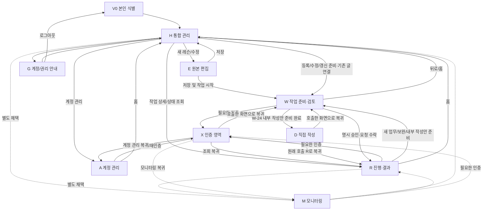
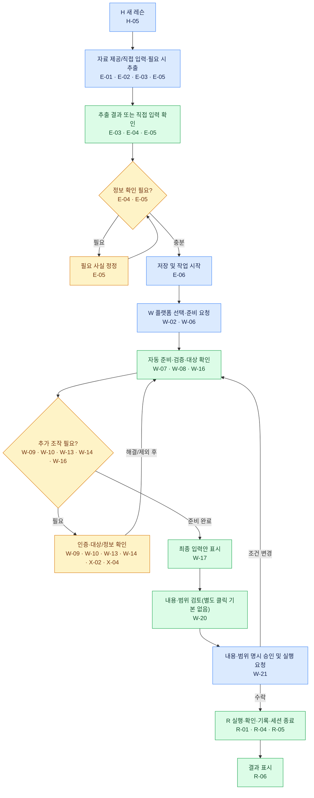
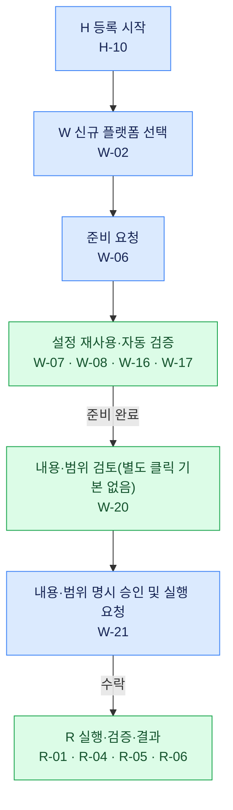
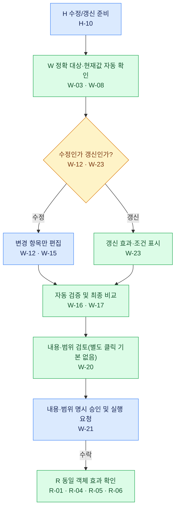
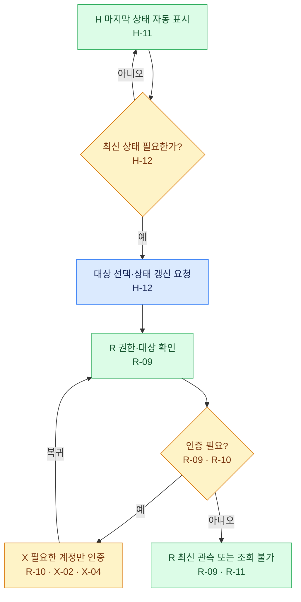
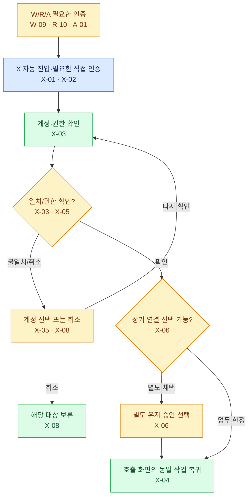
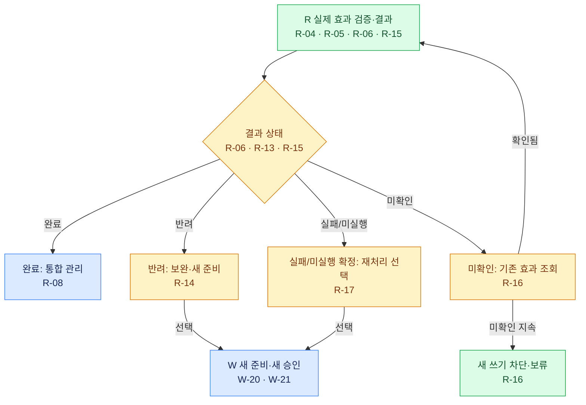
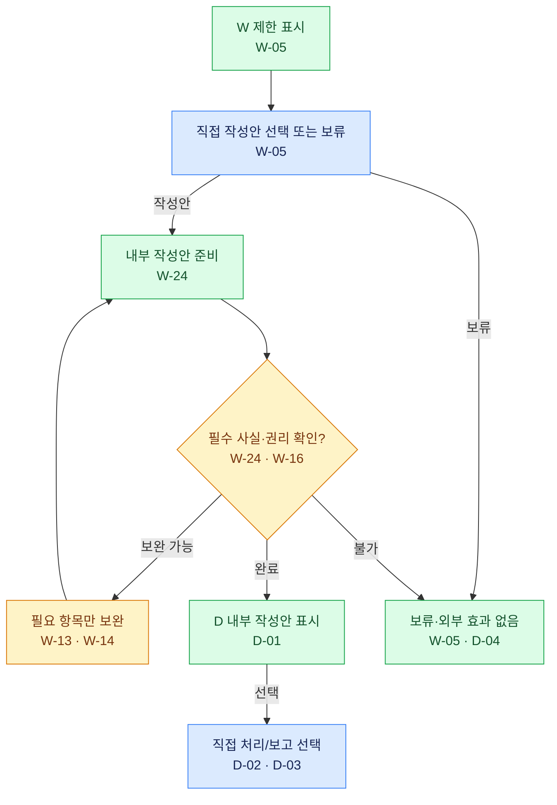
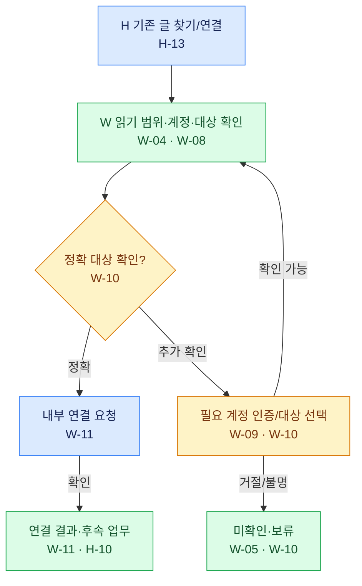

# 찾아you — 화면 연결 및 사용자 흐름 V2.3

<!-- Generated by tools/project_docs.py. Source: docs/artifacts/planning/lesson-registration-20261126/integrated/v2.3/user-stories.json -->
[작업 원본 JSON](../../artifacts/planning/lesson-registration-20261126/integrated/v2.3/user-stories.json) · 기준 migration blob `db0ee3150452cf67aab573537c725495a81ad24b` · R01 검토 후보(미승인). 변경은 JSON 원본에 반영 후 기존 생성기로 재생성한다.

[전체 사용자 스토리](USER-STORY-V2.3.md)

[오류·예외 흐름 및 검토](USER-STORY-ERROR-REVIEW-V2.3.md)

정상 이용의 대표 경로를 보여주는 검토용 시각화. 모든 예외와 상태 전이의 완전성 또는 실제 플랫폼 허용을 입증하지 않는다. 각 노드의 행동 ID는 정본의 action을 지칭한다. 인증 재사용은 별도 채택 전 후보, 외부 접근/실행은 mock-only.

## 전체 화면 연결

## 화면별 제공 정보

| 화면 | 제공 목적 | 진입 | 종료/이동 |
| --- | --- | --- | --- |
| V0 메인·서비스 로그인 | 최초 이용, 본인 식별 | 비로그인 방문/재인증 | H 또는 복구 안내, 기존 인증이면 생략 |
| H 통합 관리 | 내 레슨·등록 상태·진행 작업 | 인증 성공/공통 홈 | E, W, R, A, G, 필요시 M |
| E 원본 작성·편집 | 원문/자료 또는 직접 입력 → 필요 시 AI 추출 → 사실 확인·저장 | H의 새 레슨/원본 편집 | H 또는 W(저장 및 작업 시작) |
| W 작업 준비·검토 | 플랫폼/대상 선택 → 변환·검증 → 최종 승인/실행 | H 또는 E, R의 후속 작업 | 같은 W에서 보완/대상 선택, X, D, R, H |
| R 업무 진행·결과 | 진행·실제 결과·근거·이력 | W의 실행 요청, H의 작업/등록 상세 | H, W(새 요청), X(필요한 조회 인증) |
| A 외부 계정 관리 | 연결·재연결·해제·권한 상태 | H의 계정 관리 | X, H |
| X 외부 인증 (하위 영역) | 사용자 직접 인증·계정 확인 | W/R/A에서 해당 대상 인증 필요 시, 별도 채택된 M에서만 추가 | 호출한 화면의 같은 작업/선택 상태, 취소 시 해당 대상 보류 |
| D 직접 작성 안내 (W 하위 영역) | 내부 입력안 제공 | W-24 내부 작성안 준비 완료 후만; R에서도 W 준비를 경유 | W 또는 원래 호출 R (새 외부 실행 없음) |
| G 서비스 계정·개인정보 안내 (설정 영역) | 권리 행사 경로, 서비스 로그아웃 | H 공통 메뉴 | H 또는 V0 |
| M 자동 모니터링 (조건부) | 설정·상태·알림·종료 | 별도 채택 시 H/R | H/R, X(필요한 경우) |

## 업무별 사용자 흐름

### J01 · 신규 레슨 최초 등록

본인 식별 이후. 인증/보완은 필요한 경우만.

### J02 · 저장 원본 추가 등록

유효한 연결과 설정, 충분한 사실 전제. E와 X 생략.

### J03 · 기존 등록물 수정·갱신

이미 선택한 대상 및 읽기 범위의 준비 요청 재사용.

### J04 · 상태 조회

저장된 마지막 상태는 H에서 바로 본다. 최신 조회는 명시적인 읽기 요청.

### J05 · 외부 계정 인증 및 복귀

장기 연결 재사용은 별도 정책 후보. 업무 한정 인증 기본.

### J06 · 결과 후속 업무

완료 대상 재실행 금지. 미확인 외부 효과에 새 쓰기 금지.

### J07 · 대행 제한과 내부 직접 작성

외부 쓰기 승인 없이 내부 작성안을 제공하는 후보.

### J08 · 미연결 기존 등록물 관리 연결

허용 읽기와 정확 계정·대상 확인 후 내부 연결만 수행.

## 검토 기준

- 파란색: 사용자 행동. 초록색: 서비스 자동 처리·표시. 노란색: 조건 판단 또는 조건부 행동.
- 모든 실제 버튼/필드의 원자적 분해나 오류/예외 분기는 아직 확정되지 않았다. 이 그림만으로 구현·DB 상세·외부 실행을 시작하지 않는다.
- 통합 승인에 표시된 대상과 실제 실행 대상이 다르면 새 확인이 필요하다. 미확인 외부 효과는 재실행하지 않는다.
