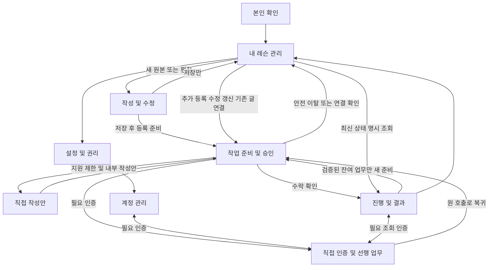
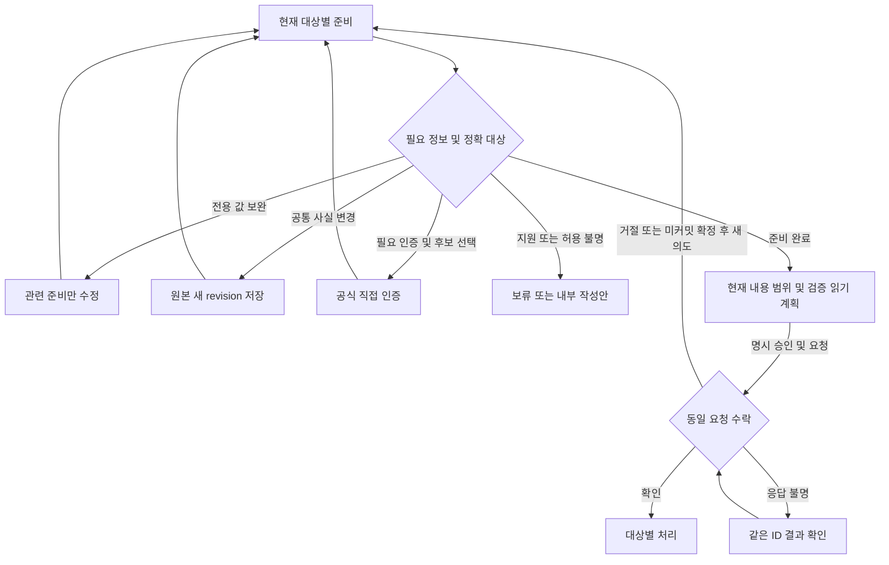
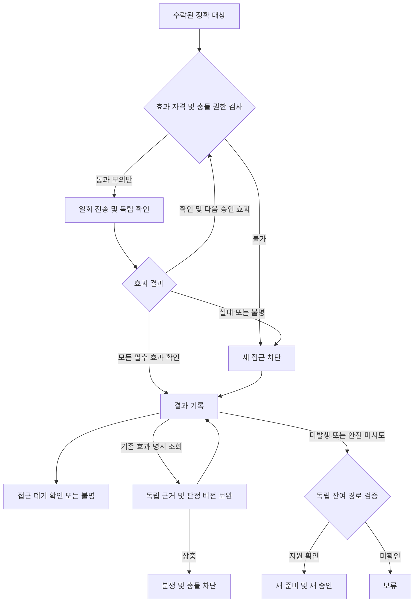
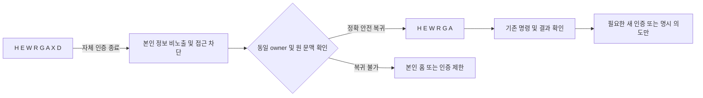

# 찾아you 사용자 스토리 V3.0 — 화면 및 업무 흐름

<!-- Generated by tools/project_docs.py. Source: docs/artifacts/planning/lesson-registration-20261126/integrated/v3.0/user-stories.json -->
[작업 원본](../../artifacts/planning/lesson-registration-20261126/integrated/v3.0/user-stories.json)

[통합 사용자 스토리](USER-STORY-V3.0.md) · [추적 검토](USER-STORY-TRACE-V3.0.md)

R01 통합 검토 후보 · 승인된 서비스 범위 V1.0 유지 · 실제 외부 접근/쓰기 mock-only

## 주요 흐름도

### 전체 화면 및 정상 이용

### 준비 및 명시 승인

### 개별 효과 및 오류 대응

### 서비스 인증 만료 및 안전 복귀

## 12개 참조 여정

모의 조건이 만족된 예시 경로이다. 모든 이용자가 모든 노드를 거치지는 않는다. 상세 조건은 노드·연결 계약과 오류별 대응을 따른다.

| 여정 | 정상 또는 대표 경로 | 조건부 분기 |
| --- | --- | --- |
| UJ-01 최초 등록 | HOME → EDIT → FACT → SAVE → SAVEACK → SELECT → PREP → IDENT → PREP → PREVIEW → APPROVE → ACCEPT → START → RESERVE → DISPATCH → VERIFY → RESULT | EDITFIX · XAUTH · CHOOSE · FIX · COMMONFACT · LIMIT · ACCEPTUNKNOWN · FENCE |
| UJ-02 저장 원본 추가 등록 | HOME → SELECT → PREP → IDENT → PREP → PREVIEW → APPROVE → ACCEPT → START → RESERVE → DISPATCH → VERIFY → RESULT | FIX · COMMONFACT · XAUTH · LIMIT |
| UJ-03 기존 등록물 수정 | HOME → PREP → IDENT → PREP → PREVIEW → APPROVE → ACCEPT → START → RESERVE → DISPATCH → VERIFY → RESULT | FIX · COMMONFACT · CHOOSE · XAUTH · FENCE |
| UJ-04 공고 갱신 | HOME → PREP → IDENT → PREP → PREVIEW → APPROVE → ACCEPT → START → RESERVE → DISPATCH → VERIFY → RESULT | LIMIT · XAUTH · FENCE |
| UJ-05 저장 상태 확인 및 최신 조회 | HOME → READ → READEND → RESULT | XAUTH · DISPUTE |
| UJ-06 기존 글 관리 연결 | HOME → PREP → IDENT → LINK → LINKACK → HOME | XAUTH · CHOOSE · LIMIT |
| UJ-07 정보·규격 오류 및 인증 | HOME → SELECT → PREP → FIX → PREP → IDENT → XAUTH → XCHECK → IDENT → PREP | EDITFIX · COMMONFACT · XCHOOSE · LIMIT |
| UJ-08 부분 성공·실패·효과 불명 | RESULT → NEXT → READ → READEND → RESULT | FENCE · DISPUTE · PREP · CLEANUP |
| UJ-09 대행 제한·내부 작성안 | PREP → LIMIT → HOLDCHOICE → GUIDE → LIMIT | HOME · RESULT |
| UJ-10 원본 수정·삭제·연결 해제 | HOME → EDIT → FACT → SAVE → SAVEACK → HOME → MANAGE → HOME | SAVEUNKNOWN · EDITFIX |
| UJ-11 외부 계정·권리 | HOME → SETTINGS → ACCOUNTS → XAUTH → XCHECK → ACCOUNTS → SETTINGS → HOME | XCHOOSE · AUTH |
| UJ-12 이탈·재접속·복귀 | AUTH → HOME → PREP → PREVIEW → APPROVE → ACCEPT → ACCEPTUNKNOWN → HOME → PREP | SAVEUNKNOWN · RESULT · AUTH · HOME |

## 노드별 guard 및 정본 책임

| 노드 | 화면 | 선행조건/제한 | 공통 업무 및 관련 전이 |
| --- | --- | --- | --- |
| AUTH | V0 | owner 검증 전 본인 이외 데이터 비노출; 자체 계정 수단·가입 세부 미정 | SW-01 · SW-02 · SW-35 · SW-36 · LT-01 · LT-02 |
| HOME | H | 홈 진입으로 외부 조회/쓰기 없음; owner 필터 | SW-02 · SW-03 · SW-10 · SW-35 |
| EDIT | E | 선택한 본인 원본/새 문맥; 자료 최소 수집·권리 확인 | SW-04 · SW-06 · LT-03 · LT-06 |
| FACT | E | 직접 입력 충분하면 추출 생략; 확인 안 된 추정값을 확정하지 않음 | SW-05 · SW-06 · SW-12 · LT-03 · LT-04 · LT-05 |
| EDITFIX | E | 정상 사실 보존, 수정된 현재 revision만 적용 | SW-04 · SW-06 · SW-13 · LT-05 · LT-06 |
| SAVE | E | 정확 owner·기준 revision·사실/권리; 같은 요청 재생성 금지 | SW-02 · SW-07 · LT-12 · LT-13 · LT-14 |
| SAVEACK | E | 실제 커밋 확인 전 성공 이동 금지 | SW-07 · SW-35 · LT-07 · LT-09 · LT-10 · LT-15 · LT-16 · LT-17 |
| SAVEUNKNOWN | E | 새 원본/새 저장 ID 생성 금지; 커밋/미커밋 확인만 | SW-07 · SW-35 · LT-15 · LT-16 · LT-17 |
| SELECT | W | H에서 정확 수정/갱신/연결/저장 준비를 이미 요청했다면 동일 선택·요청 생략 | SW-09 · SW-10 · LT-18 · LT-22 · LT-23 |
| PREP | W | 외부 접근 전 실제 허용·명시 읽기 범위 필요; 현재 mock-only | SW-09 · SW-10 · SW-11 · SW-12 · SW-19 · SW-20 · SW-21 · LT-18 · LT-19 · LT-20 · LT-21 · LT-24 · LT-29 |
| FIX | W | 공통 원본 사실 변경은 COMMONFACT; 플랫폼 표현이 실제 사실을 바꾸면 안 됨 | SW-12 · SW-13 · SW-19 · SW-20 · LT-18 · LT-19 · LT-22 · LT-24 · LT-31 |
| COMMONFACT | W | R1의 SW-06/07 W 인라인 저장 계약은 추가 검토; 현재 확정 가능한 경로 H→E에서 명시 저장 후 기존 준비 재검토. 미저장/불명 상태 실행 금지 | SW-06 · SW-07 · SW-13 · SW-35 · LT-24 · LT-31 |
| IDENT | W | 명시 읽기·허용·현재 권한 검증; identity-only 후 정확 계정 선택; 미확인 외부 접근 없음 | SW-02 · SW-10 · SW-15 · SW-16 · SW-17 · SW-19 · SW-20 · LT-26 · LT-27 · LT-28 · LT-29 · LT-44 · LT-45 · LT-46 |
| CHOOSE | W | 사용자 선택만으로 소유권/객체 확인 성립하지 않음; 불명에서 신규 등록 금지 | SW-02 · SW-09 · SW-17 · LT-26 · LT-27 · LT-28 · LT-29 |
| LIMIT | W | 선택 대상 몰래 제외 금지; 쓰기·자동 재시도 없음 | SW-10 · SW-21 · SW-31 · SW-32 · LT-21 · LT-22 · LT-68 |
| HOLDCHOICE | W | 수락 불명과 수락 후 일반 중단·원복은 별도; 성공/불명 대상 제외 | SW-09 · SW-21 · SW-31 · SW-32 · SW-33 · LT-21 · LT-22 · LT-31 |
| PREVIEW | W | 정확 계정·객체/slot·선행조건·필수 readback·충돌/권한 확인; 실제 외부 실행 미승인 | SW-12 · SW-19 · SW-20 · SW-21 · LT-20 · LT-30 · LT-31 |
| APPROVE | W | 한 조작 후보, 양 논리 승인 기록 분리; 필수 직접 동의 별도; 미승인 대상 없음 | SW-21 · SW-22 · LT-32 |
| ACCEPT | W | 선택 목록 모두 일관 커밋 또는 거절; 현재 조건/충돌 재검증; 수락 전 외부 쓰기 없음 | SW-22 · SW-35 · LT-12 · LT-13 · LT-14 · LT-15 · LT-16 · LT-17 · LT-25 · LT-32 · LT-33 |
| ACCEPTUNKNOWN | W | 새 요청·중복 승인/실행 없음; UI 이탈 허용. 서버 수락 업무는 UI ack와 독립 | SW-22 · SW-35 · LT-15 · LT-16 · LT-17 |
| LINK | W | 정확 소유/관리 권한 및 동일 관계 중복 확인; 외부 변경·쓰기 승인 없음 | SW-02 · SW-17 · SW-18 · LT-09 · LT-12 · LT-13 · LT-14 |
| LINKACK | W | 정확 동일 관계만; 외부 객체 변화 없음; 불명은 동일 키만 | SW-18 · SW-35 · LT-09 · LT-10 · LT-12 · LT-13 · LT-14 · LT-15 · LT-16 · LT-17 |
| XAUTH | X | 공식 허용 경로 및 현재 목적/generation; 비밀·민감 자료 수집/AI 전달 금지 | SW-14 · SW-16 · SW-33 · LT-52 · LT-53 · LT-55 |
| XCHECK | X | 최초 계정은 명시 사용 선택 필요; 기존 기대 계정 자동 교체 금지; 실패는 차단/정리 | SW-15 · SW-16 · SW-34 · LT-54 · LT-55 · LT-56 · LT-57 · LT-58 |
| XCHOOSE | X | identity-only 확인 후, 승인된 목적만; 다른 계정이면 새 인증 문맥 | SW-15 · SW-16 · LT-54 · LT-55 |
| START | R | 현행 실제 외부 접근/변이 금지, 모의만; 서버 수락 정본 기준, 화면 확인 불필요 | SW-23 · SW-24 · LT-34 · LT-35 |
| RESERVE | R | 동결 snapshot·독립 readback 계획·현재 권한·선행 효과·겹치는 활성/불명/분쟁 없음 | SW-23 · SW-24 · LT-38 · LT-40 · LT-41 · LT-71 |
| DISPATCH | R | 현재 claim/fence·권한·검증 읽기 재검증, 모든 부수 효과 사전 승인; 실제 실행 0 | SW-24 · SW-25 · SW-26 · SW-27 · LT-39 · LT-40 · LT-41 |
| VERIFY | R | 권한/허용 및 정확 계정·객체/slot binding·승인값·시각; 응답만으로 성공 금지 | SW-28 · SW-29 · LT-42 · LT-43 · LT-44 · LT-45 · LT-46 · LT-47 · LT-48 · LT-49 · LT-50 · LT-51 · LT-71 · LT-73 |
| FENCE | R | 새 쓰기 차단·기존 효과 보존; 다른 독립 대상은 해당 조건에서만 진행 | SW-23 · SW-28 · SW-29 · SW-33 · SW-34 · LT-35 · LT-37 · LT-40 · LT-41 · LT-55 · LT-56 · LT-60 · LT-61 · LT-62 · LT-63 |
| RESULT | R | 정확 업무 완료 근거, 결과 판정 이력·외부 관계 보존; 사용자의 확인 클릭 불필요 | SW-03 · SW-28 · SW-29 · SW-31 · LT-36 · LT-37 · LT-59 · LT-60 · LT-61 · LT-62 · LT-63 · LT-64 · LT-65 · LT-66 · LT-67 · LT-68 · LT-69 · LT-70 |
| CLEANUP | R | 업무 결과와 독립; 폐기 불명에서 접근 복원 없음 | SW-33 · SW-34 · LT-55 · LT-56 · LT-57 · LT-58 |
| READ | R | 정확 목적/범위·계정·객체·조회 순번·권한/허용; read-only, mock-only; 현재 인증 부족하면 X | SW-02 · SW-10 · SW-17 · SW-28 · SW-30 · LT-33 · LT-34 · LT-44 · LT-45 · LT-46 · LT-47 · LT-48 · LT-49 · LT-50 · LT-51 · LT-65 · LT-66 |
| READEND | R | 읽기 실패를 외부 미발생으로 단정 금지; 종료 업무 재개 금지 | SW-28 · SW-29 · SW-30 · SW-31 · LT-36 · LT-37 · LT-42 · LT-43 · LT-64 · LT-65 · LT-66 · LT-69 · LT-70 |
| DISPUTE | R | 해소는 새 실행 자격 아님; 권한·독립 근거·운영 검토 필요 | SW-02 · SW-24 · SW-28 · SW-29 · SW-31 · SW-33 · LT-48 · LT-71 · LT-72 · LT-73 |
| NEXT | R | 미발생 확정/안전 미시도·지연 봉쇄·독립 경로 검증·새 승인 필요; 불명/분쟁은 읽기/보류 | SW-09 · SW-28 · SW-30 · SW-31 · LT-18 · LT-44 · LT-69 |
| GUIDE | D | 실제 외부 접근·자동 복붙·제출 및 직접 결과 보고 없음 | SW-31 · SW-32 · LT-67 · LT-68 |
| MANAGE | H | 외부 글 삭제/원복 아님; 불명 효과/법적 보존 정책이 미확정이면 실제 삭제 보류; 동일 명령 | SW-02 · SW-08 · SW-35 · LT-11 · LT-12 · LT-13 · LT-14 · LT-15 · LT-16 · LT-17 |
| SETTINGS | G | 자체 삭제 정책 미정; 새 접근 차단 및 기존 기록/권리 보존; 일반 취소 아님 | SW-01 · SW-02 · SW-33 · SW-34 · SW-36 · LT-02 · LT-11 · LT-12 · LT-13 · LT-15 · LT-16 · LT-17 · LT-55 · LT-56 · LT-57 · LT-58 |
| ACCOUNTS | A | 관리 관계와 인증 권한 분리; 목적·정확 계정·명시 동의, 장기 위임 없음 | SW-02 · SW-03 · SW-14 · SW-15 · SW-33 · SW-34 · LT-52 · LT-54 · LT-55 · LT-56 · LT-57 · LT-58 |

## 조건부 연결

각 연결의 조건/의도가 성립할 때만 이동한다. 화면 이동은 외부 실행 자격을 생성하지 않는다.

| ID | 출발 → 도착 | 주체 | 조건 | 화면 전이 |
| --- | --- | --- | --- | --- |
| VE-001 | AUTH → HOME | system | 현재 owner 인증 성공, 검증된 복귀 문맥 없음 | T01 |
| VE-002 | AUTH → AUTH | user | 인증 실패/불명; 새로운 인증/복구 의도가 있을 때만 | T30 |
| VE-003 | HOME → EDIT | user | 새 레슨 또는 정확 기존 원본 편집 선택 | T02 |
| VE-004 | HOME → SELECT | user | 저장 원본 추가 등록 선택; 신규 대상만 선택 예정 | T05 |
| VE-005 | HOME → PREP | user | 정확 기존 등록물 수정·갱신·기존 글 연결 준비를 이미 요청함; 선택 반복 없음 | T05 |
| VE-006 | HOME → PREP | user | 검증된 미수락 기존 준비 열기; 현재 revision 확인 | T06 |
| VE-007 | HOME → RESULT | user | 기존 수락/결과 열기; 서버 정본만 표시 | T07 |
| VE-008 | HOME → READ | user | 정확 행/범위 최신 읽기 요청 | T07 |
| VE-009 | HOME → MANAGE | user | 정확 원본 또는 관계 관리 요청 | 같은 영역 |
| VE-010 | HOME → SETTINGS | user | 권리·설정 선택 | T15 |
| VE-011 | EDIT → FACT | system | 자료 수신 또는 직접 입력, 사용 권리 확인 | 같은 영역 |
| VE-012 | FACT → EDITFIX | user | 확인 필요·오류 항목 존재 | T29 |
| VE-013 | EDITFIX → FACT | system | 필요 사실·자료 정정 후 현재 검증 | T29 |
| VE-014 | FACT → SAVE | user | 저장에 필요한 사실/권리 충족, 명시 저장 의도 | 같은 영역 |
| VE-015 | SAVE → SAVEACK | system | 동일 내부 명령 처리 | 같은 영역 |
| VE-016 | SAVEACK → SAVEUNKNOWN | system | 응답 유실 또는 확인 불가 | 같은 영역 |
| VE-017 | SAVEACK → EDITFIX | user | 거절/충돌 확정, 편집 유지; 필요 수정 | T29 |
| VE-018 | SAVEACK → HOME | system | 저장만 의도 및 커밋 확인 | T03 |
| VE-019 | SAVEACK → SELECT | system | 저장 후 등록 준비 의도 및 커밋 확인 | T04 |
| VE-020 | SAVEUNKNOWN → SAVEACK | system | 동일 키 결과 확인; 새 저장 아님 | 같은 영역 |
| VE-021 | SAVEUNKNOWN → HOME | user | 안전 이탈, 기존 명령 보존 | T44 |
| VE-022 | EDIT → HOME | user | 미저장 보존/명시 폐기 조건 확인 후 이탈 | T44 |
| VE-023 | SELECT → PREP | system | 정확 신규 대상 선택 완료, 명시 준비 | 같은 영역 |
| VE-024 | PREP → FIX | user | 전용 값·제약·필요 보완 존재 | T08 |
| VE-025 | PREP → COMMONFACT | user | 공통 레슨 사실의 변경이 필요한 경우; 명시 원본 변경 의도 | T08 |
| VE-026 | COMMONFACT → HOME | user | 현행 안전 경로: 미수락 준비/필요 문맥 보존, H→E 저장 뒤 현재 준비 열기 | T11 |
| VE-027 | FIX → PREP | system | 관련 대상만 현재 준비 revision 재검증 | T08 |
| VE-028 | PREP → IDENT | system | 정확 대상/필수 준비 읽기 필요, 허용·권한 검사 | T08 |
| VE-029 | PREP → LIMIT | system | 현재 제한·미채택·지원 불명 또는 독립 효과 경로 미확인 | T08 |
| VE-030 | IDENT → XAUTH | user | 필요 인증/직접 선행 요청, 단계 허용 확인 | T20 |
| VE-031 | IDENT → CHOOSE | user | 여러 후보/정확 대상 사용 선택 필요 | T08 |
| VE-032 | CHOOSE → IDENT | system | 정확 후보의 근거 검증; 거절이면 재식별 | T08 |
| VE-033 | IDENT → LINK | user | 정확 기존 객체 확인 및 기존 글 관리 연결 의도 | 같은 영역 |
| VE-034 | LINK → LINKACK | system | 동일 내부 연결 명령 처리 | 같은 영역 |
| VE-035 | LINKACK → HOME | system | 내부 연결 커밋 확인 | T11 |
| VE-036 | LINKACK → LINKACK | system | 불명은 동일 요청 조회, 새 연결 없음 | 같은 영역 |
| VE-037 | LINKACK → PREP | user | 거절 또는 변경 확인; 재준비는 사용자 의도가 있을 때만 | T08 |
| VE-038 | IDENT → PREP | system | 정확 대상/권한/선행 증거 또는 부족/불명 결과 반영 | T08 |
| VE-039 | PREP → PREVIEW | system | 선택된 모든 대상에 처분 명시, 정확 ready 실행 후보 및 양 승인용 최신 검토안 존재 | T08 |
| VE-040 | PREVIEW → APPROVE | user | 강사의 현재 내용/범위/검증 읽기 승인 및 실행 의도 | 같은 영역 |
| VE-041 | PREVIEW → FIX | user | 전용 값·범위 거절/변경, 기존 승인안 무효 | T08 |
| VE-042 | PREVIEW → COMMONFACT | user | 공통 원본 사실 수정 요구 | T08 |
| VE-043 | PREVIEW → HOLDCHOICE | user | 보류/제외/수락 전 철회 | T08 |
| VE-044 | PREVIEW → PREP | system | 승인 전 의미 변경, 현재 검증안 재생성 | T08 |
| VE-045 | APPROVE → ACCEPT | system | 정확 snapshot/동일 수락 명령 확인 | 같은 영역 |
| VE-046 | ACCEPT → START | system | 서버 커밋 및 수락 확인; UI R 이동은 정본 확인 후 | T09 |
| VE-047 | ACCEPT → ACCEPTUNKNOWN | system | 응답 유실/수락 불명, 동일 키 유지 | 같은 영역 |
| VE-048 | ACCEPT → PREP | user | 검증 거절 또는 권위 있는 미커밋/봉쇄 확인 후 새 의도/재준비 | T08 |
| VE-049 | ACCEPTUNKNOWN → START | system | 동일 요청의 기존 수락 확인; 기존 업무 열기, 새 실행 없음 | T10 |
| VE-050 | ACCEPTUNKNOWN → ACCEPTUNKNOWN | system | 동일 키 여전히 불명 | 같은 영역 |
| VE-051 | ACCEPTUNKNOWN → PREP | user | 거절/미커밋 확정 후만 사용자 새 의도 | T08 |
| VE-052 | ACCEPTUNKNOWN → HOME | user | 안전 이탈, 서버 수락/효과 이력 보존 | T11 |
| VE-053 | LIMIT → HOLDCHOICE | user | 허용 대안 또는 제한 확인 후 선택 | 같은 영역 |
| VE-054 | HOLDCHOICE → PREP | user | 다른 대상 포함/제외 반영 및 현재 재검토 | T08 |
| VE-055 | HOLDCHOICE → GUIDE | system | 허용 내부 작성안 선택 및 충분한 자료 확인 | T26 |
| VE-056 | HOLDCHOICE → HOME | user | 보류·이탈 | T11 |
| VE-057 | GUIDE → LIMIT | user | 내부 작성안 닫기 | T27 |
| VE-058 | GUIDE → RESULT | user | 원래 R에서 W를 거친 안내 문맥으로 복귀 | T28 |
| VE-059 | XAUTH → XCHECK | system | 직접 인증 결과/취소 신호 | 같은 영역 |
| VE-060 | XCHECK → XCHOOSE | user | 최초 정확 계정 확인 및 사용 의도 필요 | 같은 영역 |
| VE-061 | XCHOOSE → XCHECK | system | 명시 사용/관리 연결 의도 확인; 동일 generation 검증 | 같은 영역 |
| VE-062 | XAUTH → XAUTH | user | 실패 후 새 명시 인증 요청·새 generation·허용 조건 | 같은 영역 |
| VE-063 | XCHECK → IDENT | system | W 호출의 현재 권한/선행 확인 또는 실패·취소; 문제 대상만 | T23 |
| VE-064 | XCHECK → READ | system | R의 명시 읽기 인증 확인; 실패/취소는 READEND로 | T24 |
| VE-065 | XCHECK → READEND | system | R 호출 실패/취소; 최신 조회 불가 및 정리 | T24 |
| VE-066 | XCHECK → ACCOUNTS | system | A 호출 결과, 명시 관리 의도만 연결 | T25 |
| VE-067 | START → RESERVE | system | 수락 대상 현재 실행 자격 및 후보 효과 계획 존재, 모의 환경 | 같은 영역 |
| VE-068 | START → FENCE | system | 조건 상실·권한/지원 불명·업무 오류 | 같은 영역 |
| VE-069 | RESERVE → DISPATCH | system | 정확 claim·승인된 모든 부수 효과·fence/권한/readback 계획 통과 | 같은 영역 |
| VE-070 | RESERVE → FENCE | system | 겹침 claim/분쟁·권한/조건 상실·미전송/불명 | 같은 영역 |
| VE-071 | DISPATCH → VERIFY | system | 시도 증거 기록 및 해당 범위 독립 readback 후보 | 같은 영역 |
| VE-072 | DISPATCH → FENCE | system | 전송/효과 불명·실행 오류·조건 상실 | 같은 영역 |
| VE-073 | VERIFY → RESERVE | system | 이전 필수 효과 확인, 다음 승인 효과 남음 및 현재 가드 통과 | 같은 영역 |
| VE-074 | VERIFY → RESULT | system | 모든 필수 효과/완료 기준 독립 확인 | 같은 영역 |
| VE-075 | VERIFY → FENCE | system | 미발생·불명·필수 확인 실패; 이후 새 쓰기 없음 | 같은 영역 |
| VE-076 | VERIFY → DISPUTE | system | 정확 상충 증거 발견 | 같은 영역 |
| VE-077 | DISPUTE → FENCE | system | 진행 중 영향 대상 fence 필요 | 같은 영역 |
| VE-078 | DISPUTE → RESULT | system | 종료 업무: 분쟁 표시와 기록, 이전 판정 불변 | 같은 영역 |
| VE-079 | FENCE → RESULT | system | 진행 시도 정리/불명 기록 및 결과 판정 | 같은 영역 |
| VE-080 | RESULT → CLEANUP | system | 접근 자원 종료 의무 존재; 결과 확정·표시와 독립 | 같은 영역 |
| VE-081 | CLEANUP → RESULT | system | 폐기 확인/불명 기록; 새 접근 차단 유지 | 같은 영역 |
| VE-082 | RESULT → NEXT | user | 필요 후속 조치 또는 기존 효과 확인 선택 | T12 |
| VE-083 | NEXT → READ | user | 정확 기존 효과에 대한 명시 허용 읽기 요청 | T12 |
| VE-084 | NEXT → PREP | user | 검증된 독립 잔여 경로/별도 지원 업무·미발생/안전 미시도·지연 봉쇄·새 준비 의도 | T13 |
| VE-085 | NEXT → RESULT | system | 경로 미확인·불명·분쟁, 보류/안내; 새 쓰기 없음 | 같은 영역 |
| VE-086 | RESULT → HOME | user | 홈/뒤로, 처리 상태와 독립 | T14 |
| VE-087 | READ → XAUTH | user | 읽기 목적 인증 필요 및 해당 단계 허용 | T21 |
| VE-088 | READ → READEND | system | 허용 읽기 성공·불가/제한·응답 유실 구분 | 같은 영역 |
| VE-089 | READEND → DISPUTE | system | 확정 근거와 상충하는 정확 증거 | 같은 영역 |
| VE-090 | READEND → RESULT | system | 조회 결과/마지막 관측 및 적합 기존 효과 판정 새 버전, 외부 쓰기 없음 | 같은 영역 |
| VE-091 | MANAGE → HOME | system | 동일 내부 명령 처리 결과 또는 불명/제한 표시 | 같은 영역 |
| VE-092 | SETTINGS → ACCOUNTS | user | 외부 계정 관리 선택 | T16 |
| VE-093 | ACCOUNTS → XAUTH | user | 허용 명시 계정 연결/재인증 요청 | T22 |
| VE-094 | ACCOUNTS → SETTINGS | user | 관리 패널 닫기 | T17 |
| VE-095 | SETTINGS → HOME | user | 홈 또는 닫기 | T18 |
| VE-096 | SETTINGS → AUTH | user | 명시 로그아웃/자체 인증 종료 | T19 |

## 전역 인증/복귀 계약

| 화면 전이 | 경로 | 조건 | 문맥 |
| --- | --- | --- | --- |
| T31 | H → V0 | 자체 서비스 인증 문맥 종료 확인(만료 또는 해당 owner의 서비스 권리 제한); 본인 정보 표시 및 새 접근 차단 | owner 검증 전 내용 비노출; 기존 저장/수락 ID와 안전 복귀 의도만 참조 |
| T32 | E → V0 | 자체 서비스 인증 문맥 종료 확인(만료 또는 해당 owner의 서비스 권리 제한); 본인 정보 표시 및 새 접근 차단 | owner 검증 전 내용 비노출; 기존 저장/수락 ID와 안전 복귀 의도만 참조 |
| T33 | W → V0 | 자체 서비스 인증 문맥 종료 확인(만료 또는 해당 owner의 서비스 권리 제한); 본인 정보 표시 및 새 접근 차단 | owner 검증 전 내용 비노출; 기존 저장/수락 ID와 안전 복귀 의도만 참조 |
| T34 | R → V0 | 자체 서비스 인증 문맥 종료 확인(만료 또는 해당 owner의 서비스 권리 제한); 본인 정보 표시 및 새 접근 차단 | owner 검증 전 내용 비노출; 기존 저장/수락 ID와 안전 복귀 의도만 참조 |
| T35 | G → V0 | 자체 서비스 인증 문맥 종료 확인(만료 또는 해당 owner의 서비스 권리 제한); 본인 정보 표시 및 새 접근 차단 | owner 검증 전 내용 비노출; 기존 저장/수락 ID와 안전 복귀 의도만 참조 |
| T36 | A → V0 | 자체 서비스 인증 문맥 종료 확인(만료 또는 해당 owner의 서비스 권리 제한); 본인 정보 표시 및 새 접근 차단 | owner 검증 전 내용 비노출; 기존 저장/수락 ID와 안전 복귀 의도만 참조 |
| T37 | X → V0 | 자체 서비스 인증 문맥 종료 확인(만료 또는 해당 owner의 서비스 권리 제한); 본인 정보 표시 및 새 접근 차단 | 정확 원 호출 W/R/A만 복귀 후보; 외부 인증 generation 무효 |
| T38 | D → V0 | 자체 서비스 인증 문맥 종료 확인(만료 또는 해당 owner의 서비스 권리 제한); 본인 정보 표시 및 새 접근 차단 | 원 호출 W/R과 준비 ID만 복귀 후보 |
| T39 | V0 → E | 동일 owner의 새 자체 인증 성공 및 기존 안전 복귀 의도/권한 확인 | 현재 revision·동일 명령 결과 확인; 외부 실행/인증 자동 재개 없음. 문맥 없거나 다른 owner면 H |
| T40 | V0 → W | 동일 owner의 새 자체 인증 성공 및 기존 안전 복귀 의도/권한 확인 | 현재 revision·동일 명령 결과 확인; 외부 실행/인증 자동 재개 없음. 문맥 없거나 다른 owner면 H |
| T41 | V0 → R | 동일 owner의 새 자체 인증 성공 및 기존 안전 복귀 의도/권한 확인 | 현재 revision·동일 명령 결과 확인; 외부 실행/인증 자동 재개 없음. 문맥 없거나 다른 owner면 H |
| T42 | V0 → G | 동일 owner의 새 자체 인증 성공 및 기존 안전 복귀 의도/권한 확인 | 현재 revision·동일 명령 결과 확인; 외부 실행/인증 자동 재개 없음. 문맥 없거나 다른 owner면 H |
| T43 | V0 → A | 동일 owner의 새 자체 인증 성공 및 기존 안전 복귀 의도/권한 확인 | 현재 revision·동일 명령 결과 확인; 외부 실행/인증 자동 재개 없음. 문맥 없거나 다른 owner면 H |
| T44 | E → H | 화면 이탈; 저장 불명 또는 미저장 편집 보존 정책에 따른 안전 이탈 | 기존 명령 ID 확인 가능; 성공 이동 아님; 명시 폐기 없이 정본 삭제 금지 |

## 32개 오류의 위치와 복구

아래 노드들은 관련 분기 후보이며 나열 순서는 실행 순서가 아니다.

| 오류 | 관련 노드 | 대응 및 재처리 제한 |
| --- | --- | --- |
| ER-01 서비스 인증/동일 owner | AUTH · AUTH | 공식 복구/재인증만 필요시 요청; 기존 명령 결과부터 확인. / 불명에서 새 owner 생성/타인 데이터 반환 |
| ER-02 소유권/접근 거절 | AUTH · HOME · LIMIT · FENCE | 본인 허용 목록에서 대상 선택; 필요시 새 인증. / 타 owner 접근 거절만으로 본인 세션 전체 종료 또는 객체 존재 공개 |
| ER-03 원문/파일/권리 | FACT · EDITFIX | 문제 자료만 수정/제거; 필요 권리 확인. / 불명 권리 자료 외부 제공, 정상 자료 재입력 요구 |
| ER-04 AI 추출/사실 불확실 | FACT · EDITFIX | 필요 사실만 보완하거나 직접 입력. / 추정값을 확인 사실로 저장 |
| ER-05 원본 조회/동시 수정 | EDITFIX · SAVEACK · HOME | 최신 허용 revision 조회 및 변경 병합 선택; 동일 저장 결과 불명은 ER-06. / 최신 원본 덮어쓰기/자동 병합 |
| ER-06 저장 실패/응답 불명 | SAVEACK · SAVEUNKNOWN | 시스템 동일 키 조회; 미커밋/거절 확정 후 사용자 의도가 있는 현재 revision 새 저장. / 불명 중 새 저장 ID/자동 이동/폐기 |
| ER-07 업무/단계 미지원·정책 불명 | PREP · LIMIT · FENCE · READEND | 내부 작성안 가능하면 W/D, 아니면 보류; 수락 효과는 R에서 구분. / 허용 불명 외부 접근; 이미 발생한 효과 없음으로 판정 |
| ER-08 입력안 준비 실패 | PREP · FIX | 필요 사실 또는 대안만 제시; 내부 재검증. / 다른 대상 초기화/외부 제출 |
| ER-09 가격·시간·회차·규격 | PREP · FIX · COMMONFACT | 정확 실제 사실 또는 허용 표현 대안 선택. / 가격/시간/회차의 의미 임의 변경 |
| ER-10 오래된 준비·늦은 응답 | PREVIEW · PREP | 바뀐 대상만 재검토; 수락 불명은 ER-17, 효과 불명은 ER-19. / 낡은 승인 재사용 또는 동결된 대상 교체 |
| ER-11 외부 인증 실패·만료·취소 | XAUTH · XCHECK · IDENT · READEND | 원 호출 문맥으로 복귀, 허용된 필요한 대상만 새 인증 generation. / 단순 뷰어 이탈을 인증 실패/실행 취소로 간주; 오래된 인증 신호 수락 |
| ER-12 외부 계정·권한 불일치 | XCHECK · XCHOOSE · IDENT · FENCE | 명시 대상 재선택·새 준비 또는 보류. / 외부 계정 자동 교체, 기존 고정 승인 재사용 |
| ER-13 직접 선행 업무 | XAUTH · XCHECK · LIMIT | 공식 경로에서 강사 직접 수행 후 허용 독립 확인. / 대리 가입·약관 동의·정산/민감증빙 수집 |
| ER-14 정확 객체/하위 객체 불명 | IDENT · CHOOSE · FENCE · READEND | 필요한 정확 후보 선택은 보조 근거; 허용 읽기로 확인. / 미조회=0건, 다른 객체를 기존 객체로 대체 |
| ER-15 중복 후보·이전 효과 불명 | IDENT · RESERVE · FENCE · DISPUTE | 정확 기존 효과의 명시 허용 조회; 필요한 경우 별도 지원 잔여 업무 준비. / 중복 클릭/타임아웃을 새 쓰기 자격으로 해석 |
| ER-16 승인 거절·변경·철회 | PREVIEW · HOLDCHOICE · FENCE | 수락 전 변경 대상만 재검토; 수락 후 권리 행사는 접근 차단이지 일반 중단/원복이 아님. / 이미 수락된 승인 소급 삭제·자동 원복 |
| ER-17 요청 수락 불명·중복 클릭 | ACCEPT · ACCEPTUNKNOWN | 자동 동일 키 확인, W 또는 기존 R 표시. / 불명에서 새 수락 또는 기존 동결 승인 재사용 |
| ER-18 실행 실패/미실행 확정 | FENCE · RESULT · NEXT | R에서 새 준비 가능한 정확 미발생/지원 잔여 범위만 선택. / 응답 실패만으로 미실행 확정; 전체 CREATE 반복 |
| ER-19 외부 저장·제출·갱신 효과 불명 | VERIFY · FENCE · RESULT · READEND · DISPUTE | R에서 기존 효과 확인 또는 불명 유지. / 시간초과/버튼 오류/조회 불가를 실패로 단정하거나 새 쓰기 |
| ER-20 반려·심사·모집 후속 | RESULT · NEXT · PREP | 사유·제약을 읽고 지원되는 후속 작업만 선택. / 심사 접수=모집 성공, 자동 반려 수정/재접수 |
| ER-21 복수 플랫폼 부분 성공 | RESULT · NEXT · PREP | 정확 미실행/효과 없음 대상 또는 지원 잔여 업무만 새 준비. / 묶음 전체 재시작, 성공 대상 반복, 부분 효과 원복 |
| ER-22 상태 조회 실패/마지막 관측 | READ · READEND · RESULT | 필요시 허용된 조회/인증, 마지막 관측 확인. / 조회 실패를 미등록/미노출/효과 없음으로 치환 |
| ER-23 인증 세션 폐기·해제 불명 | CLEANUP · RESULT | 폐기 확인 경로 제공; 운영 정리 재시도는 폐기 작업만. / 새 접근 자동 복원, 폐기 불명 숨기기 |
| ER-24 직접 작성안/사용자 보고 | LIMIT · HOLDCHOICE · GUIDE | 내부 보완 후 D 또는 보류; 강사 직접 이용. / 사용자 직접 보고를 대행 효과/독립 증거로 처리 |
| ER-25 삭제·연결 해제·권리 요청 제한 | MANAGE · SETTINGS · ACCOUNTS | 영향 설명 후 허용 내부 처리·문의 또는 결과 확인. / 외부 삭제·원복, 불명 효과/보존 의무 무시 |
| ER-26 이탈·재접속·로그아웃 | AUTH · HOME · SAVEUNKNOWN · ACCEPTUNKNOWN · RESULT | 필요시 저장/폐기 선택·동일 owner 재인증·기존 작업 열기. / 이탈로 실행·취소·새 요청·자동 재개 |
| ER-27 조건부 모니터링 | 미제공 | 지원 제한 안내; 필요하면 사용자 명시 조회. / 자동 주기 읽기/알림, M 화면 도입 |
| ER-28 모니터링 종료·폐기 | 미제공 | 자동 모니터링 종료 조작 제공 안 함. / 모니터링 권한/재개 기능 추가 |
| ER-29 플랫폼 고유 효과·부수 변화 | PREP · LIMIT · RESERVE · FENCE · DISPUTE | 승인 가능한 정확 업무와 영향만 검토; 뮬 갱신 후보도 허용 전 실행 없음. / 탈잉 최초 일정/숨고 대표 서비스 조건부 자동 실행, 유료 갱신, 대체 재게시 |
| ER-30 새 글 재등록·게시 제한 | LIMIT · HOLDCHOICE | 제한 안내 또는 충분한 내부 작성안. / 기존 글 삭제 후 재게시·복제·주기 자동 실행·제한 회피 |
| ER-31 증거/이력/링크 조회 불가 | RESULT · READEND · DISPUTE | 허용된 근거 재확인 또는 보류. / 링크 없음=객체 없음, 근거 없는 사유/제재/성공 주장 |
| ER-32 미분류 오류·안전 종료 | LIMIT · FENCE · RESULT | 확인 가능한 최소 조치만 표시; 운영 조사 후 정확 분류. / 안전 실패를 자동 재시도 또는 정상 완료로 분류 |

## 28개 참조 시나리오 (실제 수용시험 미실행)

### SC-01 · 최초 크몽 등록(모의 성공)

- 참조 경로: AUTH → HOME → EDIT → FACT → SAVE → SAVEACK → SELECT → PREP → IDENT → PREP → PREVIEW → APPROVE → ACCEPT → START → RESERVE → DISPATCH → VERIFY → RESERVE → DISPATCH → VERIFY → RESULT → CLEANUP → RESULT
- 조건: 자료 충분·허용 모의 계정/slot·실제 앱 미연결; 상품 및 심사 제출 등 승인 필수 효과 검증
- 기대 결과: 정확 필수 효과와 모의 접수 확인, 실제 모집 가능 별도; 사용자 확인 클릭 없음
- 관련 R1 수용 후보: 정상 참조
- 축약 모형: M01

### SC-02 · 기존 원본 추가 등록

- 참조 경로: HOME → SELECT → PREP → IDENT → PREP → PREVIEW → APPROVE → ACCEPT → START → RESERVE → DISPATCH → VERIFY → RESULT
- 조건: 저장 revision 및 모의 권한 유효, 선택한 효과만
- 기대 결과: 원본 재입력 없음; 기존 결과 보존 및 새 대상 결과
- 관련 R1 수용 후보: 정상 참조
- 축약 모형: M01

### SC-03 · 기존 등록물 수정

- 참조 경로: HOME → PREP → IDENT → PREP → PREVIEW → APPROVE → ACCEPT → START → RESERVE → DISPATCH → VERIFY → RESULT
- 조건: 정확 기존 객체와 변경 범위, 선행·모의 readback 확인
- 기대 결과: 동일 객체에 승인 변경 효과, 신규 객체 생성 0
- 관련 R1 수용 후보: 정상 참조
- 축약 모형: M01

### SC-04 · 뮬 동일 글 갱신 후보

- 참조 경로: HOME → PREP → IDENT → PREP → PREVIEW → APPROVE → ACCEPT → START → RESERVE → DISPATCH → VERIFY → RESULT
- 조건: 정확 기존 공고, 무료/간격/횟수 및 갱신 효과가 모의로 확인된 경우만
- 기대 결과: 같은 글 갱신의 모의 근거, 신규 글·유료 결제 0; 실제 경로 미검증
- 관련 R1 수용 후보: 정상 참조
- 축약 모형: M01

### SC-05 · 보류 플랫폼 갱신

- 참조 경로: HOME → PREP → LIMIT → HOLDCHOICE → HOME
- 조건: 지원/허용 또는 실제 경로 불명
- 기대 결과: 실행·예약 없음, 이유 표시
- 관련 R1 수용 후보: ET-11
- 축약 모형: M05

### SC-06 · 최신 상태 조회

- 참조 경로: HOME → READ → READEND → RESULT
- 조건: 정확 대상·명시 읽기 및 mock permission
- 기대 결과: 최신/마지막 관측 분리, 쓰기 0
- 관련 R1 수용 후보: 정상 참조
- 축약 모형: M04

### SC-07 · 기존 게시물 내부 연결

- 참조 경로: HOME → PREP → IDENT → CHOOSE → IDENT → LINK → LINKACK → HOME
- 조건: 정확 기존 객체, 동일 내부 관계 키 확인
- 기대 결과: 내부 연결 1회, 외부 변경 0
- 관련 R1 수용 후보: 정상 참조
- 축약 모형: M03

### SC-08 · 가격·자료·공통 원본 변경

- 참조 경로: HOME → SELECT → PREP → FIX → PREP → COMMONFACT → HOME → EDIT → FACT → SAVE → SAVEACK → HOME → PREP
- 조건: 전용 표현 보완 후 공통 사실 변경 의도 및 동일 원본 revision 저장
- 기대 결과: 관련 준비만 stale 및 재검토; 기존 승인/효과 불변; 인라인 저장은 후속
- 관련 R1 수용 후보: ET-15
- 축약 모형: M06

### SC-09 · 최초 계정 선택 및 인증 실패

- 참조 경로: HOME → SELECT → PREP → IDENT → XAUTH → XCHECK → XCHOOSE → XCHECK → IDENT → PREP → LIMIT
- 조건: 최초 identity-only 확인 후 사용 선택, 권한 불명 또는 불일치
- 기대 결과: 실제 권한 미확정 시 hold; 자동 계정 교체 없음
- 관련 R1 수용 후보: ET-07 · ET-21
- 축약 모형: M07

### SC-10 · 저장 응답 유실·재방문

- 참조 경로: HOME → EDIT → FACT → SAVE → SAVEACK → SAVEUNKNOWN → HOME
- 조건: 저장 불명 및 안전 이탈; 동일 명령 ID는 보존하여 재접속 후 확인(새 저장은 미커밋/거절 확정 및 사용자 의도 이후 별도)
- 기대 결과: 같은 저장 키 조회·안전 이탈; 권위 있는 확인 전 새 원본/새 저장 0
- 관련 R1 수용 후보: ET-01 · ET-22
- 축약 모형: M03

### SC-11 · 수락 응답 유실·중복 클릭

- 참조 경로: HOME → SELECT → PREP → IDENT → PREP → PREVIEW → APPROVE → ACCEPT → ACCEPTUNKNOWN → ACCEPTUNKNOWN → START → RESERVE → DISPATCH → VERIFY → RESULT
- 조건: 서버가 동일 요청을 수락했으나 UI ack 유실; 같은 키 확인
- 기대 결과: 기존 수락 업무 1개, 새 효과 자격 중복 생성 0
- 관련 R1 수용 후보: ET-02 · ET-22
- 축약 모형: M03

### SC-12 · 쓰기 응답/관측 불명

- 참조 경로: START → RESERVE → DISPATCH → VERIFY → FENCE → RESULT → NEXT → READ → READEND → RESULT
- 조건: 쓰기 전송 불명 또는 독립 관측 실패, 이후 허용 읽기에도 불충분
- 기대 결과: effect_unknown 및 차단, 확인 효과/이력 보존; 재쓰기 0
- 관련 R1 수용 후보: ET-03
- 축약 모형: M02

### SC-13 · 종료 후 미전송 확정

- 참조 경로: START → RESERVE → FENCE → RESULT → NEXT → READ → READEND → RESULT
- 조건: 종료 시 전송 불명; 뒤늦은 권위 있는 미전송 및 지연 봉쇄 증거
- 기대 결과: LT-70 결과 판정 새 버전 not_executed, 종료 재개 없음
- 관련 R1 수용 후보: ET-04 · ET-06
- 축약 모형: M08

### SC-14 · 한 대상의 부분 효과 및 잔여 경로 제한

- 참조 경로: START → RESERVE → DISPATCH → VERIFY → RESERVE → DISPATCH → VERIFY → FENCE → RESULT → NEXT → RESULT
- 조건: 상품 저장 확인, 심사 효과 미발생 또는 불명; 독립 제출 경로 미검증
- 기대 결과: 확인된 상품 보존, 미확인/부분 결과 구분, 전체 CREATE 반복 금지
- 관련 R1 수용 후보: ET-05 · ET-20
- 축약 모형: M09

### SC-15 · 검증된 잔여 효과만 새 요청(모의 조건)

- 참조 경로: RESULT → NEXT → PREP → IDENT → PREP → PREVIEW → APPROVE → ACCEPT → START → RESERVE → DISPATCH → VERIFY → RESULT
- 조건: 미발생 또는 미시도 및 지연 봉쇄·독립 경로/현재 조건이 모의로 검증됨
- 기대 결과: 새 승인된 잔여 효과만; 이전 성공 효과 재실행 0
- 관련 R1 수용 후보: 정상 참조
- 축약 모형: M09

### SC-16 · 세션 폐기 실패

- 참조 경로: RESULT → CLEANUP → RESULT
- 조건: 업무 종료 후 폐기 결과 불명
- 기대 결과: 기존 업무 결과 보존, 폐기 불명 별도 표시, 접근 차단 유지
- 관련 R1 수용 후보: ET-08
- 축약 모형: M10

### SC-17 · 최신 조회 실패 및 기존 효과 확인

- 참조 경로: HOME → READ → READEND → RESULT
- 조건: 권한 상실 또는 읽기 실패, 이전 관측 존재
- 기대 결과: 마지막 관측 값/시각 보존; 효과 없음 추정 금지
- 관련 R1 수용 후보: ET-09
- 축약 모형: M04

### SC-18 · 다중 대상의 혼합 결과

- 참조 경로: START → RESERVE → DISPATCH → VERIFY → RESULT
- 조건: 대상 A 성공, 대상 B 불명, 대상 C 미실행; 각 경로 별도 평가
- 기대 결과: 각 대상의 확인/불명/미실행 분리, 묶음 전체 성공 아님
- 관련 R1 수용 후보: ET-10
- 축약 모형: M11

### SC-19 · 인증 만료 후 안전 복귀

- 참조 경로: RESULT → AUTH → RESULT
- 조건: R→V0 T34 및 동일 owner/정확 복귀 T41; X 인증 자동 재개 없음
- 기대 결과: 기존 결과·요청만 표시, 새로운 실행/수락 없음
- 관련 R1 수용 후보: ET-12 · ET-21
- 축약 모형: M07

### SC-20 · 타 owner 접근 거절

- 참조 경로: AUTH → AUTH
- 조건: owner 인증 실패 또는 요청 대상의 권한 없음; 해당 범위 차단
- 기대 결과: 타 owner 존재/내용 비노출; 무관한 본인 문맥의 처리 별도
- 관련 R1 수용 후보: ET-13
- 축약 모형: M07

### SC-21 · 미채택 재등록·모니터링

- 참조 경로: PREP → LIMIT → HOLDCHOICE → HOME
- 조건: 신규 재등록/자동 모니터링·유료 갱신 등 미채택 요청
- 기대 결과: 안내만, 외부 접근/쓰기 0
- 관련 R1 수용 후보: ET-14
- 축약 모형: M05

### SC-22 · 정책 상실 및 기존 일부 효과

- 참조 경로: START → RESERVE → DISPATCH → VERIFY → RESERVE → FENCE → RESULT
- 조건: 앞선 효과 확인 후 정책/권한/충돌 조건 상실
- 기대 결과: 새 전송 0, 기존 효과·불명 보존
- 관련 R1 수용 후보: ET-16
- 축약 모형: M09

### SC-23 · 공유 프로필 경합

- 참조 경로: START → RESERVE → FENCE → RESULT
- 조건: 다른 승인 업무가 겹치는 프로필 root/하위 서비스 claim 보유 또는 불명/분쟁
- 기대 결과: 두 번째 전송 0; 독립 영역만 현재 조건에서 진행
- 관련 R1 수용 후보: ET-17
- 축약 모형: M12

### SC-24 · 확정 근거와 상충하는 늦은 증거

- 참조 경로: RESULT → NEXT → READ → READEND → DISPUTE → RESULT
- 조건: 정확 기존 결론과 상충하는 독립 근거
- 기대 결과: AX17 disputed, 과거 판정 불변 및 신규 쓰기 차단; 해소는 실행 자격 아님
- 관련 R1 수용 후보: ET-18
- 축약 모형: M13

### SC-25 · 필수 검증 읽기 불허

- 참조 경로: HOME → PREP → LIMIT → HOLDCHOICE → HOME
- 조건: 쓰기 전 예정 readback 경로/권한 불가; 전송 후 상실의 경우 SC-12
- 기대 결과: 전송 전 held, 이후 불명은 새 쓰기 차단
- 관련 R1 수용 후보: ET-19
- 축약 모형: M05 · M02

### SC-26 · 내부 작성안

- 참조 경로: PREP → LIMIT → HOLDCHOICE → GUIDE → LIMIT
- 조건: 허용된 내부 준비와 명시 선택, 외부 대행 제한
- 기대 결과: 작성안 제공, 직접 결과 보고/자동 복붙 0
- 관련 R1 수용 후보: 정상 참조
- 축약 모형: M05

### SC-27 · 내부 삭제·관리 해제 및 계정 권리

- 참조 경로: HOME → MANAGE → HOME → SETTINGS → ACCOUNTS → SETTINGS → HOME
- 조건: 정확 내부 대상, 보존 및 진행 업무 영향 확인
- 기대 결과: 외부 객체 삭제/원복 없음; 실제 데이터 삭제 정책 별도
- 관련 R1 수용 후보: 정상 참조
- 축약 모형: M06

### SC-28 · 서비스 인증 만료 중 외부 인증

- 참조 경로: HOME → PREP → IDENT → XAUTH → AUTH → PREP
- 조건: X→V0 T37 및 동일 owner/안전한 원 호출 W 복귀 T40, 기존 generation 차단
- 기대 결과: 새 X 자동 재개·외부 접근 없음, 필요한 새 인증 명시
- 관련 R1 수용 후보: ET-21
- 축약 모형: M07

## 축약 모형 검사 결과

| ID | 검사 | 판정 |
| --- | --- | --- |
| M01 | 승인·필수 읽기·정확 범위의 일회 모의 전송 및 독립 확인 | pass |
| M02 | 외부 효과 불명 이후 신규 쓰기 차단 | pass |
| M03 | 동일 명령 키 및 hash/owner 확인 | pass |
| M04 | 조회 실패·늦은 응답은 마지막 관측 보존, 쓰기 없음 | pass |
| M05 | 허용·readback·승인·지원 중 하나라도 불가하면 예약 금지 | pass |
| M06 | 원본 revision 변경 및 미수락 검토안 무효, 과거 승인 불변 | pass |
| M07 | owner와 인증 generation 변경·정확 권한 확인 | pass |
| M08 | 종료 후 미전송 근거와 불명 판정 보완 | pass |
| M09 | 부분 효과·복구 독립 경로 및 새 승인 | pass |
| M10 | 폐기 불명과 업무 판정 분리 | pass |
| M11 | 다중 대상 독립 결과 집계 | pass |
| M12 | 상위/하위 충돌과 독립 객체 | pass |
| M13 | 상충 근거는 과거 결과 불변·분쟁 차단 | pass |

- mock reference fixtures only; no actual application/DB/platform/authorization or full concurrency model

- 실제 수용시험/권한/동시성·DB/CI 미실행.
