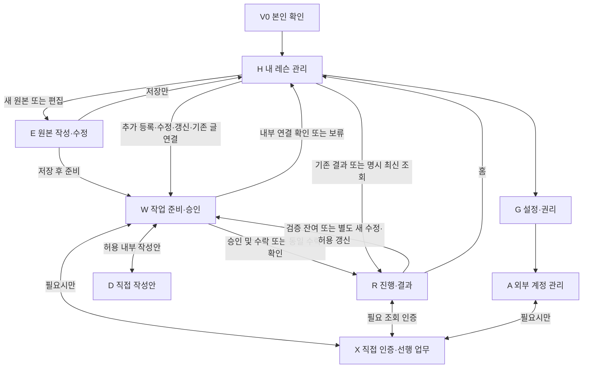
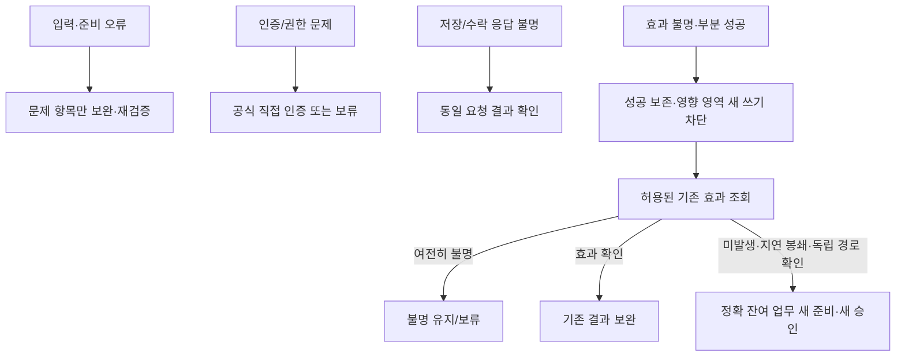

# 화면 중심 사용자 흐름 V3.1
<!-- Generated by tools/project_user_story_v31.mjs from V3.1 user-stories.json and integration-review.json -->

R01 검토 후보 · 의미 검토 R1 반영 · 서비스 범위 V1.0 유지 · 실제 외부 접근/쓰기 mock-only

[기준 V3.0](https://github.com/ik-e/chaja-you/blob/7a3fa4323e953ccacd877d9cfdbfd0de92c5456a/docs/artifacts/planning/lesson-registration-20261126/integrated/v3.0/user-stories.json) · [작업 정본](../../artifacts/planning/lesson-registration-20261126/integrated/v3.1/user-stories.json) · [비교 원장](../../artifacts/planning/lesson-registration-20261126/integrated/v3.1/integration-review.json)

**실제 외부 접근/읽기/쓰기 금지(mock-only).** 제품 범위 변경·신규 관리자 기능·실제 구현 승인 아님.

[의미 검토 R1](USER-STORY-SEMANTIC-REVIEW-V3.1.md) · 기존 요청 확인, 잔여 재처리와 별도 새 의도, 권리 제한/일반 중단 구분. 
## 전체 화면 지도

모든 화면 자체 인증 만료는 V0로 이동, 동일 owner 검증 후 안전 복귀. X 인증 자동 재개 없음. UI/메뉴 분할 확정 아님.

## 각 화면 제공 정보와 행동

| 화면 | 제공 정보 | 직접 행동 |
|---|---|---|
| V0 | 본인 확인/복구 | 필요 공식 인증 |
| H | 원본·연결 등록물·결과·마지막 관측 | 정확 대상·업무 선택 |
| E | 원본 자료·직접 입력·사실/근거·저장 상태 | 입력·필요 보완·저장 |
| W | 선택 채널·필수 후보·제약·전후 비교·계정·효과/비용/읽기 범위 | 필요 선택·보완·인증·최종 승인 |
| R | 진행·효과·접수/심사/공개/모집·관측·폐기 | 필요 상세·명시 조회·안전 잔여 준비 |
| X | 공식 인증/선행 절차 | 필요 직접 인증·동의·정산 |
| D | 내부 작성안·외부 미수행 | 참고 또는 보류 |
| G/A | 권리·계정 관계·접근/폐기 | 필요 권리·연결/해제·로그아웃 |

## 이용 상황별 화면 이동

### UJ-01 · 최초 등록

**참조 정상 경로:** H → E → W → R. 아래는 대체·예외도 포함하며 전부 필수 클릭이 아니다.

| 화면 | 강사가 하는 일 | 시스템 제공/자동 처리 | 조건 및 다음 흐름 |
|---|---|---|---|
| V0 본인 확인 | 필요시 본인 인증·복구 | 동일 owner 검증 | 유효 인증이면 생략; 실패 시 복구 |
| H 내 레슨 관리 | 새 레슨 선택 | 본인 원본·기존 기록·저장/수락 불명 구분, 0건 확인과 조회 실패 구분. | 보존된 불명 기록 동일 ID 확인, 새로운 동일 원본/업무 금지. |
| E 원본 작성·수정 | 자료 제공 또는 직접 작성, 필요한 정정, 저장/등록 준비 | 사실·근거·불확실, 직접 입력 충분 시 추출 생략, 저장 확인 | 저장만 H; 저장 확인 후 W; 불명 동일 ID |
| W 작업 준비·승인 | 선택·준비, 필요 보완·인증, 최종 승인·실행 | 채널별 필수 후보·정확 대상·효과·비용·검증 범위 | 필요 UJ-07/09; 모든 선택 대상의 준비/보류/제외 명시. 실행 후보 없으면 승인 강제 없음. 수락 불명 동일 ID. |
| R 진행·결과 | 필요 상세/홈 | 일회 모의 처리·독립 확인·자동 결과/이력, 폐기 별도 | 모집 가능 별도; 부분/불명 UJ-08; 확인 클릭 불필요 |

### UJ-02 · 저장 원본 추가 등록

**참조 정상 경로:** H → W → R. 아래는 대체·예외도 포함하며 전부 필수 클릭이 아니다.

| 화면 | 강사가 하는 일 | 시스템 제공/자동 처리 | 조건 및 다음 흐름 |
|---|---|---|---|
| H 내 레슨 관리 | 저장 원본 행 추가 등록 | 원본 버전·기존 결과 | 저장 원본 재입력 없음. 기존 수락 불명 기록은 새 추가 등록 아님. |
| W 작업 준비·승인 | 신규 대상만 선택·보완·승인 | 원본 재사용·정확 대상/권한/중복 검증 | 기존 등록/불명 신규 차단, 필요 UJ-07/09; 수락 불명 동일 요청 확인. |
| R 진행·결과 | 필요 결과 확인 | 새 대상 모의 처리·독립 확인 | 기존 성공 보존; 부분/불명 UJ-08 |

### UJ-03 · 기존 등록물 수정

**참조 정상 경로:** H → W → R. 아래는 대체·예외도 포함하며 전부 필수 클릭이 아니다.

| 화면 | 강사가 하는 일 | 시스템 제공/자동 처리 | 조건 및 다음 흐름 |
|---|---|---|---|
| H 내 레슨 관리 | 정확 등록물 수정 선택 | 저장 연결 관계·마지막 관측; 현재 외부 대상 확인은 W 허용 읽기/권한 검증. | H의 저장 관계는 현재 외부 객체 근거 아님. 정확 대상 불명 쓰기 차단. |
| W 작업 준비·승인 | 변경 항목 입력·전후 비교·승인 | 동일 계정/객체, 변경값·공유 영향 | 전용 표현만 또는 공통 사실 H→E 명시 저장; 외부값/공유 영향 불명 보류. 수락 불명 동일 키 확인. |
| R 진행·결과 | 필요 결과 확인 | 동일 객체 승인 변경·재심사 접수 후보 확인 | 반려 시 지원 새 수정, 불명 UJ-08 |

### UJ-04 · 공고 갱신

**참조 정상 경로:** H → W → R. 아래는 대체·예외도 포함하며 전부 필수 클릭이 아니다.

| 화면 | 강사가 하는 일 | 시스템 제공/자동 처리 | 조건 및 다음 흐름 |
|---|---|---|---|
| H 내 레슨 관리 | 정확 기존 공고 갱신 선택 | 정확 기존 공고와 저장 지원/제한 표시; 현재 조건 W에서 검증. | 동일 공고 갱신만 |
| W 작업 준비·승인 | 모의 조건 충족 시 방식·간격·횟수·무료·효과 검토 승인 | 뮬 후보, 타 6개 보류, 확인된 다음 가능 시점 | 뮬 실제 경로도 미검증, 모의 조건 충족 시만. 불명/유료/재게시 금지. 수락 불명 동일 키. |
| R 진행·결과 | 필요 결과 확인 | 같은 공고의 의도 효과 독립 확인 | 공개/모집 별도, 불명 새 쓰기 차단 |

### UJ-05 · 저장 상태 확인 및 최신 조회

**참조 정상 경로:** H → R. 아래는 대체·예외도 포함하며 전부 필수 클릭이 아니다.

| 화면 | 강사가 하는 일 | 시스템 제공/자동 처리 | 조건 및 다음 흐름 |
|---|---|---|---|
| H 내 레슨 관리 | 최신 필요시 정확 행 조회 요청 | 마지막 관측·시각 자동 표시 | 저장값 충분하면 외부 조회 없음; 정확 내부 관측 조회 실패 시 이전 확인값이 있는 경우만 표시. |
| R 진행·결과 | 필요 조회 인증·상세 | 허용된 읽기만, 현재 실패와 이전 관측 분리 | 실패 ≠ 미등록, 상충 분쟁, 쓰기 없음 |

### UJ-06 · 기존 글 관리 연결

**참조 정상 경로:** H → W → H. 아래는 대체·예외도 포함하며 전부 필수 클릭이 아니다.

| 화면 | 강사가 하는 일 | 시스템 제공/자동 처리 | 조건 및 다음 흐름 |
|---|---|---|---|
| H 내 레슨 관리 | 기존 글 연결 선택 | 정확 원본/관계 | 외부 변경 아님 |
| W 작업 준비·승인 | 필요 직접 인증·후보 선택, 내부 연결 요청 | 정확 권한/객체·같은 관계 중복 확인 | 후보 선택만 소유권 근거 아님. 내부 연결 불명 동일 내부 키 확인; 외부 승인·쓰기 없음. |
| H 내 레슨 관리 | 필요 결과 확인 | 확인 관계 표시 | 커밋 확인된 관계만 표시. 불명에서 관계 확정·새 외부 등록 없음. |

### UJ-07 · 정보·규격 오류 및 인증

**참조 정상 경로:** H → W → X → W. 아래는 대체·예외도 포함하며 전부 필수 클릭이 아니다.

| 화면 | 강사가 하는 일 | 시스템 제공/자동 처리 | 조건 및 다음 흐름 |
|---|---|---|---|
| W 작업 준비·승인 | 필요 항목·제약 대안·정확 후보 선택 | 채널 필수/선택 후보, 사진 용도·권리·가격/시간/회차, 원본 변경 영향 | 플랫폼 표현 같은 준비; 공통 사실 H→E 저장. 내부 준비만 실패하고 수정할 사실 없으면 정확 미수락 문맥에서 명시 재준비; 불명/미지원 보류. |
| X 직접 인증·선행 업무 | 필요 공식 인증·직접 선행/정산·최초 계정 선택 | 정확 계정/권한 검증, 정산/인증 비밀 미수집 | 검증된 기대 계정은 불필요 선택 없음. 최초 계정 명시 사용 선택 후 재검증. 취소·불일치·만료·불명은 대상 차단/폐기 의무 및 원 호출 제한 복귀. |
| W 작업 준비·승인 | 필요 최종 검토 | 현재 대상 재검증·원 호출 복귀 | 충족 승인; 제한 UJ-09 |

### UJ-08 · 부분 성공·실패·효과 불명

**참조 정상 경로:** R. 아래는 대체·예외도 포함하며 전부 필수 클릭이 아니다.

| 화면 | 강사가 하는 일 | 시스템 제공/자동 처리 | 조건 및 다음 흐름 |
|---|---|---|---|
| R 진행·결과 | 필요 상세·근거 확인 | 확인·미전송·미발생·부분·불명, 접수/심사/공개/모집, 폐기 분리 | 성공 보존; 관리자 전용 확인 DR-02 후보 |
| R 진행·결과 | 필요 기존 효과 조회 또는 안전한 후속 업무 준비 선택 | 허용 읽기·새/이전 관측·분쟁 | 불명/분쟁은 허용 읽기·보류. 미발생/안전 미시도 입증된 잔여 또는 성공 기존 객체의 별도 새 수정·허용 갱신 의도만 W. |
| W 작업 준비·승인 | 정확 잔여 업무 또는 별도 새 수정·허용 갱신 준비 및 새 승인 | 잔여: 미발생/미시도·지연 봉쇄·독립 경로. 새 의도: 정확 기존 객체·실제 새 조건·경합 없음. 각각 현재 권한 확인. | 동일 확인 효과 반복 금지; 불명/경로 미검증 보류; 새 승인 및 수락 불명 동일 키. |

### UJ-09 · 대행 제한·내부 작성안

**참조 정상 경로:** W → D → W. 아래는 대체·예외도 포함하며 전부 필수 클릭이 아니다.

| 화면 | 강사가 하는 일 | 시스템 제공/자동 처리 | 조건 및 다음 흐름 |
|---|---|---|---|
| W 작업 준비·승인 | 제한 보류·제외 또는 허용 작성안 선택 | 근거 및 정확 대상 표시 | 보류/제외/작성안 선택은 강사 의도. 모든 대상 제한이면 승인·실행 없음. |
| D 직접 작성안 | 필요 내부 작성안 참고 | 충분한 내부 자료·외부 미수행 | 충분한 내부 자료만 참고; W 또는 원 호출 R 복귀. 부족 시 W 보완/보류; 자동 복붙·직접 보고 없음. |

### UJ-10 · 원본 수정·삭제·연결 해제

**참조 정상 경로:** H → E → H. 아래는 대체·예외도 포함하며 전부 필수 클릭이 아니다.

| 화면 | 강사가 하는 일 | 시스템 제공/자동 처리 | 조건 및 다음 흐름 |
|---|---|---|---|
| H 내 레슨 관리 | 원본 편집·내부 삭제/연결 해제 선택 | 정확 대상·진행/불명·보존 영향 | 독립 선택: 편집은 E, 삭제/해제는 H 내부 관리. 진행/불명·보존 정책 미해결 보류; 외부 삭제 없음. |
| E 원본 작성·수정 | 필요 변경·명시 저장 | 새 revision 및 관련 미수락 영향 | 동시 수정 비교·동일 요청 확인; 미커밋 후 새 저장 |
| H 내 레슨 관리 | 필요 결과 확인 | 확인된 내부 처리만 표시 | 외부 자동 변경 없음 |

### UJ-11 · 외부 계정·권리

**참조 정상 경로:** H → G → A → G → H. 아래는 대체·예외도 포함하며 전부 필수 클릭이 아니다.

| 화면 | 강사가 하는 일 | 시스템 제공/자동 처리 | 조건 및 다음 흐름 |
|---|---|---|---|
| H 내 레슨 관리 | 필요한 경우만 설정 선택 | 본인 원본/업무 | 권리·계정 관리 또는 로그아웃 의도에서만 G |
| G 설정·권리 | 필요 권리 요청·로그아웃 | 접수/처리/로그아웃 상태 | 삭제·보존 상세 미정, 일반 실행 취소 아님 |
| A 외부 계정 관리 | 정확 계정 연결·해제·권리 철회 | 관리 관계·업무 인증/폐기 구분 | 새 접근 차단, 장기 위임 미채택 |
| X 직접 인증·선행 업무 | 필요 직접 인증·사용/관리 연결 선택 | 정확 계정 검증 및 A 복귀 | 기대 계정 자동 교체 없음 |
| A/G/H | 필요 관리 후 복귀 | 관계 변경/폐기 확인 또는 불명 | X는 필요할 때만. 계정 해제는 외부 글 삭제 아님. |

### UJ-12 · 이탈·재접속·복귀

**참조 정상 경로:** V0 → H → W → H → W. 아래는 대체·예외도 포함하며 전부 필수 클릭이 아니다.

| 화면 | 강사가 하는 일 | 시스템 제공/자동 처리 | 조건 및 다음 흐름 |
|---|---|---|---|
| E/W/R/X/D/G/A | 필요 이탈/기존 기록 다시 열기 | 저장·수락·효과 보존 및 미저장 영향 | 이탈만으로 취소/재실행 없음. 보존된 명령 ID, 원본/준비/수락 상태 구분. |
| V0 본인 확인 | 필요 동일 본인 인증 | 안전 복귀 문맥 확인 | 다른 owner 비노출; X 자동 재개 없음 |
| H 또는 안전한 기존 화면 | 정확 기존 저장/수락/결과 기록 열기 | 같은 저장·수락 ID 확인 및 현재 상태·관측, 기존 수락 기록 R 표시 | 불명 중 새 동일 요청 금지. 거절/미커밋·지연 봉쇄 후 새 의도. 기존 수락 업무 열어도 START 없음. |

## 오류 및 예외

관리자 전용 확인은 DR-02 미결정. 조회 실패를 효과 없음으로 바꾸지 않는다. 관리자/사용자 보고만으로 성공 판정하지 않는다.

## 독립적인 대체 정상 경로 및 안전 복귀

아래 경로는 하나의 필수 클릭 순서가 아니다.

### UJ-10 원본 수정·삭제·연결 해제
- **원본 삭제 또는 내부 연결 해제(편집 없이 별개 요청)**: H · 정확 owner/대상과 내부 의도, 보존·진행/불명·경합 확인. 실제 삭제 정책 미정이면 보류, 외부 쓰기 없음.

### UJ-11 외부 계정·권리
- **필요한 외부 계정 연결·재인증**: H → G → A → X → A → G → H · 공식 허용 단계, 최초 계정 명시 관리/업무 사용 선택. 기존 계정 확인이면 XCHOOSE 생략; 실패 시 새 관계 없음.
- **자체 로그아웃**: H → G → V0 · 새 접근 차단·기발생/불명 효과 보존. 권리 요청은 G 별도 처리, 삭제 정책 미정.

### UJ-12 이탈·재접속·복귀
- **저장 불명 안전 이탈 및 같은 저장 키 확인**: H → E → H · 동일 owner와 동일 저장 명령 ID, 지속 불명 중 새 원본/저장 금지.
- **수락 불명에서 기존 수락 확인**: H → W → R · 기존 동일 키 수락 확인, 기존 대기/진행/종료 표시, 새 START 없음.
- **확정 거절/미커밋 및 지연 수락 봉쇄**: H → W · 권위 거절 또는 미커밋·봉쇄 후 사용자 새 의도와 현재 조건.

