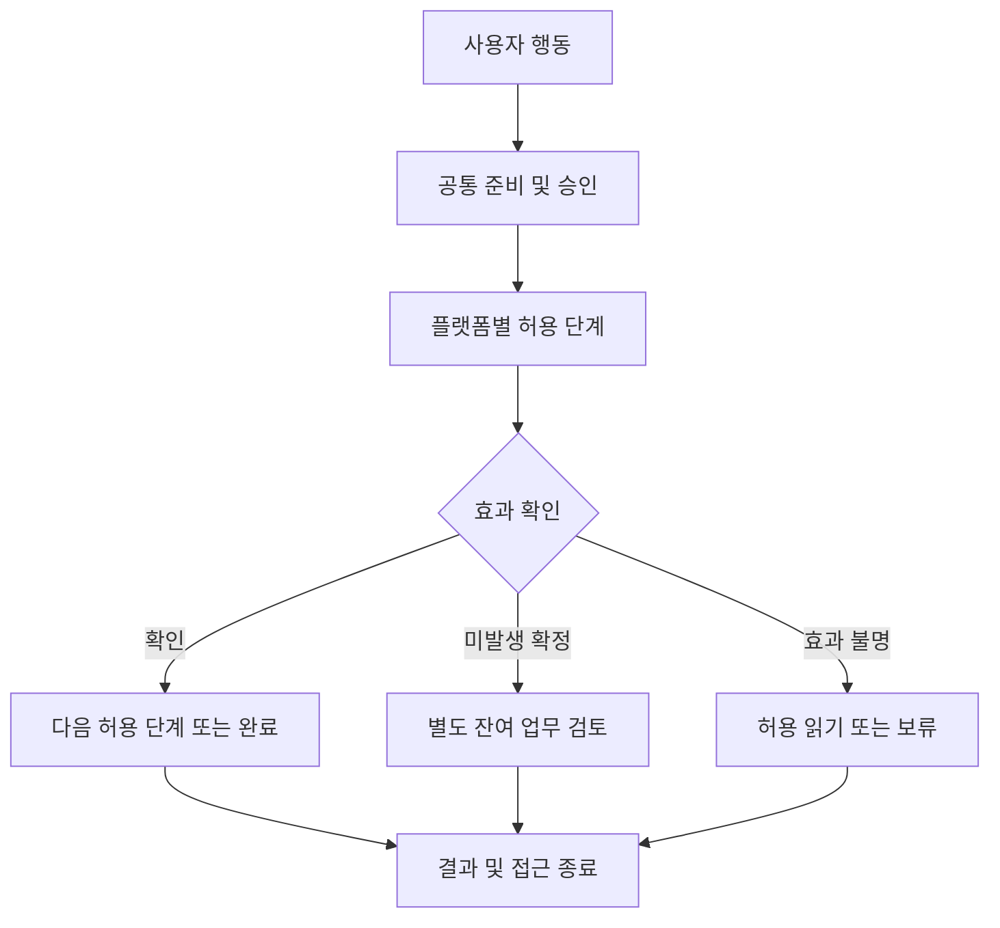

# 찾아you — 사용자 스토리 V2.4 정상·오류 및 플랫폼별 BE 업무 계약 검토

<!-- Generated by tools/project_docs.py. Source: docs/artifacts/planning/lesson-registration-20261126/integrated/v2.4/semantic-flow.json -->
[작업 원본](../../artifacts/planning/lesson-registration-20261126/integrated/v2.4/semantic-flow.json) · [V2.3 사용자 스토리](USER-STORY-V2.3.md) · [V2.3 오류 검토](USER-STORY-ERROR-REVIEW-V2.3.md)

R01 검토 후보 · V2.3 의미 보완 overlay · 범위 미승인

V2.3 원본 행동·화면·흐름을 보존하고 이 원장의 수정 후보와 업무 계약 및 오류/반복 규칙을 함께 검토한다. 상세 DB/API/DOM/실제 실행 계약 확정 아님.

7개 플랫폼 설계 포함 유지; 44 업무 개별 승인 0; mock-only; 장기 위임·통합 승인·모니터링·재등록은 별도 결정. 실제 외부 실행, main 병합, 상세 DB/API 확정 없음.

## 공통 정상·오류 흐름

## 보완 사항

| ID | 항목 | 변경 후보 | 남은 결정/근거 |
| --- | --- | --- | --- |
| S24-01 | AI 추출 시작 | 자료 제공 시 권리·추출 의도가 명확하면 내부 추출 자동 시작 후보. 의도 불명/별도 동의 필요 시만 추출 요청; 직접 입력은 생략. 오류 시 기존 자료/확인값 유지. | 자동 추출 UX/동의 미승인 |
| S24-02 | 계정과 인증 구분 | 외부 계정 식별/관리 연결, 업무 한정 인증, 별도 장기 위임을 분리. 연결 보존만으로 인증 재사용 금지. 폐기 후 식별 관계/이력 유지; 필요 시 재인증. | 장기 위임 미채택 |
| S24-03 | 단일 플랫폼 내부의 부분 효과 | 각 변이 후보의 효과 ID·허용·승인 확인. 일부 저장/생성/제출 성공 후 실패 시 확인된 효과 보존; 정확 기존 객체의 별도 지원 잔여 업무만 새 준비·승인. 효과 불명은 읽기/보류; 전체 CREATE 반복 금지. | 잔여 업무 지원/실제 변이 미확인 |
| S24-04 | 조회 종료와 관측 성공 분리 | 조회 요청 종료, 최신 관측 성공/불가, 외부 native 상태, 모집 목표를 독립 반환. 마지막 관측·시각 보존; 조회 불가를 미등록/비공개로 단정 금지. | native 상태 매핑 미확인 |
| S24-05 | 읽기와 쓰기 승인 | 준비용 명시 읽기와 외부 쓰기 승인 구분. 수락 시 현재 대상 목록·revision·양 논리 승인 고정. 변경된 미수락 대상만 이전 승인 무효; 단일 조작 후보, 별도 필수 동의 유지. | 통합 승인 UX 미승인 |
| S24-06 | 화면 이탈과 철회 | 화면 이탈/재접속으로 자동 실행·취소·재개 없음. 권리 행사/접근 철회 후 새 효과 차단, 기발생/불명 효과 보존. 일반 실행 중단·원복 기능으로 확대 금지. | 로그아웃/수락 후 이탈 및 보존 정책 미정 |
| S24-07 | 직접 작성 경계 | 미지원/단계 허용 불명 시 외부 접근 차단. 확인된 규격·사실·권리로 내부 작성안만 제공; 사용자 보고와 대행/독립 확인 분리. 직접 제출이 앞선 자동화 허용 아님. | 직접 보고 범위 미승인 |
| S24-08 | 플랫폼별 BE 책임 | 44업무별 객체·입력/관계·처리 체크포인트·단계 효과·실패/복구·관측·반환을 연결. hold/local 외부 실행 없음; conditional 별도 채택 전 차단. | 개별 업무 범위·실행 미승인 |

## 이용 상황별 정상 및 오류

| 흐름 | 정상 | 오류·복귀/종료 | 오류 ID |
| --- | --- | --- | --- |
| F24-01 본인 식별·원본 작성/저장 | 자료 제공 → 권리/추출 의도 확인 → 추출 또는 직접 입력 → 사실 확인 → 저장 확인 → H/W | 입력/추출 오류는 E의 유효 자료 보존·필요 정정; owner 불명은 제한; revision 충돌은 차이 확인; 저장 불명은 동일 ID 확인 전 재저장/이동 금지 | ER-01 · ER-02 · ER-03 · ER-04 · ER-05 · ER-06 |
| F24-02 최초·추가 등록 준비 | 대상 선택 → 변환·명시 읽기 → 필요한 인증/보완 → 최종안 → 양 승인/수락 | 필요 사실/제약/대상만 보완; 제한은 명시 제외·보류·내부 작성; 낡은 준비 재검증; 수락 불명 같은 ID 조회 | ER-07 · ER-08 · ER-09 · ER-10 · ER-11 · ER-12 · ER-14 · ER-15 · ER-16 · ER-17 |
| F24-03 수정·갱신·기존 글 연결 | 정확 객체 읽기/연결 → 변경값 또는 동일 객체 갱신 효과 검토 → 필요한 승인/수락 | 대상/권한 불명 쓰기 차단; 공유 필드/고유 효과 불명 보류; 내부 연결 불명은 동일 내부 요청 확인 | ER-07 · ER-12 · ER-14 · ER-15 · ER-16 · ER-17 · ER-29 · ER-30 |
| F24-04 인증 및 직접 선행 업무 | 필요 대상 공식 직접 인증/선행 업무 → 계정·권한·generation 확인 → 동일 작업 복귀 | 실패/취소 해당 대상 보류; 계정 자동 교체 금지; 허용 인증만 재호출; 장기 위임 미채택 | ER-07 · ER-11 · ER-12 · ER-13 · ER-23 |
| F24-05 실행·부분 효과·결과 | 수락 snapshot → 단계 허용·효과 기록 → 독립 확인 → 결과 및 접근 종료 | 미실행 확정만 새 준비; 한 대상 내부 일부 효과 성공 시 정확 기존 객체의 별도 지원 잔여 업무만 새 승인; 효과 불명 읽기/보류; 성공 대상 제외 | ER-15 · ER-17 · ER-18 · ER-19 · ER-21 · ER-23 · ER-29 · ER-31 · ER-32 |
| F24-06 상태 조회·반려 | 마지막 관측 → 명시 조회 → 필요 인증 → 최신 관측 여부/시각 → 후속 선택 | 조회 실패는 마지막 관측 유지·불명 표시; 반려 사유 추정 금지; 수정/재접수 별도 준비·승인 | ER-07 · ER-11 · ER-12 · ER-20 · ER-22 · ER-31 |
| F24-07 대행 제한·직접 작성 | 제한 확인 → 내부 준비 → 사실/권리 확인 → D 작성안 → 직접 이용/선택 보고 | 미완료 작성안 D 진입 금지; 외부 접근/쓰기 없음; 사용자 보고는 별도 근거 | ER-07 · ER-08 · ER-09 · ER-24 · ER-30 · ER-31 |
| F24-08 이탈·권리·종료·모니터링 | 저장/수락/효과 구분 → 내부 관리/철회/로그아웃 → 접근 차단·폐기 확인 | 이탈로 자동 실행/취소/재개 금지; 폐기 불명은 차단 유지; 보존 영향 검토; 모니터링 미채택 차단 | ER-02 · ER-16 · ER-23 · ER-25 · ER-26 · ER-27 · ER-28 |

## 결과 판정의 독립 축

| 축 | 후보 값 | 의미 |
| --- | --- | --- |
| 요청 처리 | not_accepted / accepted / running / ended / acceptance_unknown | 내부 요청 처리의 수명주기 |
| 단계 효과 | not_attempted / none_confirmed / confirmed / unknown | 각 외부 생성·저장·첨부·제출·설정 효과. 부분 성공은 단계별 조합 |
| 최신 관측 | not_requested / observed / unavailable | 조회 실패와 외부 상태 구분; 마지막 관측/시각 보존 |
| 외부 native 상태 | 실제 관측값 + 시각 + 근거 / unknown | 접수·승인·게시·연결 등 실제 상태 |
| 강사 목표 | confirmed / not_reached / unknown | 실제 판매·모집 가능 여부 |
| 접근 종료 | blocked / cleanup confirmed / cleanup unknown | 새 접근 차단과 폐기 확인은 분리 |

## 플랫폼별 BE 업무 계약 후보

공통 BE는 사용자·원본·권한·승인·업무·단계 효과·결과를 관리한다. 플랫폼별 BE는 업무·객체·규격·단계·독립 관측을 담당한다. 아래 체크포인트는 실제 외부 실행 허가나 세부 구현 계약이 아니다.

### 크몽

#### PS-PL01-CREATE · core

- 관리 객체: 레슨 서비스 상품 및 해당 상품의 가격 옵션
- 입력: P01-FIELDS · 현재 원본/준비 revision, 정확 계정·객체/하위 객체, 승인값·단위·규격·근거, 예정 효과·비용·범위, 권한·이전 효과
- 실행 경계: mock-only; 개별 범위/단계 허용·권한/실제 효과 미확인
- 완료: 동일 계정의 신규 상품 식별과 심사 접수/심사 진행 상태, 승인 입력안과 일치하는 저장값 확인
- 강사 목표: 심사 승인 및 실제 판매 가능 상태 별도 확인
- 제공 제외: 전문가 가입·인증·약관 동의·정산 설정 직접 수행; 심사 승인 대행·판매 보장·임시저장만으로 성공 금지
- 미확인: 기존 보컬 편집의 필수 표시·카운터 관찰. 단일 STANDARD 적용·실제 저장 및 최종 결제액, 작업 기간·수정 횟수의 공식 의미, 상세주소 공개/협의 조건, 접수 ID·공개 URL 대응 미확인
- 복구: 상품/옵션 또는 첨부가 저장되고 접수 실패 시 기존 상품 식별. 전체 신규 생성 반복 금지; 별도 접수/수정이 지원되고 승인된 경우만 잔여 처리. 미발생 확정이라도 현재 권한·정확 객체·별도 지원 잔여 업무·새 승인 확인; 자동 재개 없음.

| 단계 | 구분 | 기대 결과 | 실패 대응 | 오류 |
| --- | --- | --- | --- | --- |
| S01 모집 형태·제공 방식·카테고리·가격 옵션·회당 시간/회차/총액·작업기간·수정횟수·장소·첨부 확인 | prepare_and_permitted_read | 정확 대상·검증된 규칙·입력 준비 | 필요 보완/인증; 불허/불명 보류 | ER-07 · ER-08 · ER-09 · ER-10 · ER-13 · ER-14 · ER-16 · ER-11 · ER-12 · ER-22 · ER-31 |
| S02 현재 대상/준비 revision·양 승인·요청 ID·단계 허용 확인 후 수락 | internal | 고정 승인 snapshot | 동일 요청 수락 여부 확인; 새 쓰기 금지 | ER-10 · ER-15 · ER-16 · ER-17 |
| S03 상품·가격 옵션 승인값 입력/첨부 | effect_candidate | 실제 변이별 효과 ID 및 단계 관측; 입력/첨부 자동저장 가능성 포함 | 해당 단계 효과 없음/확인/불명 분리; 성공/불명 반복 금지 | ER-07 · ER-10 · ER-12 · ER-14 · ER-15 · ER-16 · ER-17 · ER-18 · ER-19 · ER-23 · ER-29 · ER-32 |
| S04 허용 심사 접수 | effect_candidate | 실제 변이별 효과 ID 및 단계 관측; 입력/첨부 자동저장 가능성 포함 | 해당 단계 효과 없음/확인/불명 분리; 성공/불명 반복 금지 | ER-07 · ER-10 · ER-12 · ER-14 · ER-15 · ER-16 · ER-17 · ER-18 · ER-19 · ER-23 · ER-29 · ER-32 |
| S05 동일 상품 저장값·접수 상태 확인 | read_candidate | 독립 관측·정확 객체·값·시각·근거 | 확인 불가 시 효과 불명; 새 쓰기 차단 | ER-07 · ER-11 · ER-12 · ER-14 · ER-22 · ER-31 · ER-19 · ER-29 |
| S06 업무 완료 판정·결과 기록·접근 종료 | internal | 요청·단계 효과·관측·native 상태·목표·폐기 분리 | 부분 효과 보존·접근 차단 유지 | ER-19 · ER-21 · ER-23 · ER-31 |

#### PS-PL01-READ · core

- 관리 객체: 레슨 서비스 상품
- 입력: P01-FIELDS · 현재 owner·정확 대상·업무 목적·지원 근거 및 명시 읽기 범위(해당 시)
- 실행 경계: mock-only; 개별 범위/단계 허용·권한/실제 효과 미확인
- 완료: 정확 계정·상품 식별 근거, 관측값·시각 확보; 링크 불명 별도
- 강사 목표: 해당 없음(읽기)
- 제공 제외: 제3자 상품 소유 추정·외부 변경 금지
- 미확인: 관리번호와 공개 URL 번호 매핑 미확인
- 복구: 허용된 동일 대상의 재인증/재조회만. 내부 연결은 W-11 별도 요청.

| 단계 | 구분 | 기대 결과 | 실패 대응 | 오류 |
| --- | --- | --- | --- | --- |
| S01 명시 읽기 목적·허용·정확 계정/객체 확인 | internal | 읽기 대상 검증 | 불허/불명 접근 차단 | ER-07 · ER-11 · ER-12 · ER-14 · ER-22 · ER-31 |
| S02 본인 계정 관리 목록에서 식별 후 선택한 상품의 관리 상세·현재 값·공개 링크(확인된 경우) 조회; 관리 연결은 내부 기록 | read_candidate | 정확 관측값·시각·근거 | 조회 불가 및 마지막 관측 보존 | ER-07 · ER-11 · ER-12 · ER-14 · ER-22 · ER-31 |
| S03 요청 종료/관측 성공/마지막 상태/목표 분리 | internal | 결과 및 관측 시각 | 조회 실패를 외부 상태로 단정 금지 | ER-22 · ER-31 |

#### PS-PL01-UPDATE · core

- 관리 객체: 동일 레슨 서비스 상품
- 입력: P01-FIELDS · 현재 원본/준비 revision, 정확 계정·객체/하위 객체, 승인값·단위·규격·근거, 예정 효과·비용·범위, 권한·이전 효과
- 실행 경계: mock-only; 개별 범위/단계 허용·권한/실제 효과 미확인
- 완료: 동일 상품의 승인 변경값 저장 확인 및 필요한 경우 재심사 접수 확인
- 강사 목표: 심사 승인 후 실제 판매 상세 변경 별도
- 제공 제외: 심사 중 편집 우회·삭제 재등록·미허용 필드 변경 금지
- 미확인: 판매 중 변경 가능 범위·재심사 반영/공개 미확인
- 복구: 상품/옵션 또는 첨부가 저장되고 접수 실패 시 기존 상품 식별. 전체 신규 생성 반복 금지; 별도 접수/수정이 지원되고 승인된 경우만 잔여 처리. 미발생 확정이라도 현재 권한·정확 객체·별도 지원 잔여 업무·새 승인 확인; 자동 재개 없음.

| 단계 | 구분 | 기대 결과 | 실패 대응 | 오류 |
| --- | --- | --- | --- | --- |
| S01 동일 상품/옵션·수정 가능 항목·심사 제한·현재값 확인 | prepare_and_permitted_read | 정확 대상·검증된 규칙·입력 준비 | 필요 보완/인증; 불허/불명 보류 | ER-07 · ER-08 · ER-09 · ER-10 · ER-13 · ER-14 · ER-16 · ER-11 · ER-12 · ER-22 · ER-31 |
| S02 현재 대상/준비 revision·양 승인·요청 ID·단계 허용 확인 후 수락 | internal | 고정 승인 snapshot | 동일 요청 수락 여부 확인; 새 쓰기 금지 | ER-10 · ER-15 · ER-16 · ER-17 |
| S03 승인 변경값 저장 | effect_candidate | 실제 변이별 효과 ID 및 단계 관측; 입력/첨부 자동저장 가능성 포함 | 해당 단계 효과 없음/확인/불명 분리; 성공/불명 반복 금지 | ER-07 · ER-10 · ER-12 · ER-14 · ER-15 · ER-16 · ER-17 · ER-18 · ER-19 · ER-23 · ER-29 · ER-32 |
| S04 필요 재심사 접수 | effect_candidate | 실제 변이별 효과 ID 및 단계 관측; 입력/첨부 자동저장 가능성 포함 | 해당 단계 효과 없음/확인/불명 분리; 성공/불명 반복 금지 | ER-07 · ER-10 · ER-12 · ER-14 · ER-15 · ER-16 · ER-17 · ER-18 · ER-19 · ER-23 · ER-29 · ER-32 |
| S05 동일 상품 변경값·접수 상태 확인 | read_candidate | 독립 관측·정확 객체·값·시각·근거 | 확인 불가 시 효과 불명; 새 쓰기 차단 | ER-07 · ER-11 · ER-12 · ER-14 · ER-22 · ER-31 · ER-19 · ER-29 |
| S06 업무 완료 판정·결과 기록·접근 종료 | internal | 요청·단계 효과·관측·native 상태·목표·폐기 분리 | 부분 효과 보존·접근 차단 유지 | ER-19 · ER-21 · ER-23 · ER-31 |

#### PS-PL01-RENEW · hold

- 관리 객체: 동일 상품의 독립 갱신 업무
- 입력: P01-FIELDS · 현재 owner·정확 대상·업무 목적·지원 근거 및 명시 읽기 범위(해당 시)
- 실행 경계: 외부 실행 없음
- 완료: 미제공; 완료 판정 없음
- 강사 목표: 해당 없음
- 제공 제외: 수정·삭제·재등록을 갱신으로 대체 금지
- 미확인: 독립 갱신 기능·조건 미확인
- 복구: 지원 근거·채택 변경 전 외부 실행 없음.

| 단계 | 구분 | 기대 결과 | 실패 대응 | 오류 |
| --- | --- | --- | --- | --- |
| S01 지원/허용 미확인 제한 및 내부 작성 가능 여부 안내 | internal | 외부 접근/효과 없음 | 보류 또는 내부 작성안 | ER-07 · ER-24 · ER-30 |

#### PS-PL01-STATUS · core

- 관리 객체: 등록 상품 및 심사·판매 상태
- 입력: P01-FIELDS · 현재 owner·정확 대상·업무 목적·지원 근거 및 명시 읽기 범위(해당 시)
- 실행 경계: mock-only; 개별 범위/단계 허용·권한/실제 효과 미확인
- 완료: 정확 상품의 최신 관측 또는 조회 불가·마지막 관측 반환; 조회 불가는 성공 상태 아님
- 강사 목표: 판매 가능 여부는 직접 관측된 상태에 한함
- 제공 제외: 자동 모니터링·상태 변경 금지
- 미확인: 심사 접수→승인→공개 전이 미확인
- 복구: 허용된 동일 대상의 재인증/재조회만. 내부 연결은 W-11 별도 요청.

| 단계 | 구분 | 기대 결과 | 실패 대응 | 오류 |
| --- | --- | --- | --- | --- |
| S01 명시 읽기 목적·허용·정확 계정/객체 확인 | internal | 읽기 대상 검증 | 불허/불명 접근 차단 | ER-07 · ER-11 · ER-12 · ER-14 · ER-22 · ER-31 |
| S02 허용된 관리 목록·상세에서 임시저장/심사/승인/비승인/판매 중지 등 실제 표시와 관측시각 조회, 확인된 공개 링크 별도 | read_candidate | 정확 관측값·시각·근거 | 조회 불가 및 마지막 관측 보존 | ER-07 · ER-11 · ER-12 · ER-14 · ER-22 · ER-31 |
| S03 요청 종료/관측 성공/마지막 상태/목표 분리 | internal | 결과 및 관측 시각 | 조회 실패를 외부 상태로 단정 금지 | ER-22 · ER-31 |

#### PS-PL01-RESPOND · core

- 관리 객체: 심사·변경·등록 결과
- 입력: P01-FIELDS · 현재 owner·정확 대상·업무 목적·지원 근거 및 명시 읽기 범위(해당 시)
- 실행 경계: mock-only; 개별 범위/단계 허용·권한/실제 효과 미확인
- 완료: 근거 있는 안내와 선택 가능한 조치 제공; 사유 미확인 구분
- 강사 목표: 재심사 성공은 UPDATE에서 판정
- 제공 제외: 반려 원인 추정·자동 재제출·외부 취소 금지
- 미확인: 실제 반려 상세·재접수 ID/결과 미확인
- 복구: 후속 변경은 별도 지원·허용·새 승인 필요; 현재 RESPOND에는 쓰기 없음.

| 단계 | 구분 | 기대 결과 | 실패 대응 | 오류 |
| --- | --- | --- | --- | --- |
| S01 확인된 오류·반려/제한 근거 및 사유 불명 구분 | internal | 근거 있는 안내 | 미확인 원인 추정 금지 | ER-20 · ER-24 · ER-31 |
| S02 별도 명시 허용 읽기가 필요할 경우 정확 대상의 관측 근거 확인 | read_candidate | 관측 성공 또는 조회 불가 | 마지막 관측 보존; 쓰기 없음 | ER-07 · ER-11 · ER-12 · ER-14 · ER-22 · ER-31 |
| S03 가능한 후속 업무 제시·선택 시 새 준비 | internal | 안내 제공 | 자동 재접수·수정 금지 | ER-20 · ER-16 · ER-24 |

### 탈잉

#### PS-PL02-CREATE · core

- 관리 객체: 오프라인 음악 레슨 클래스(튜터 프로필 공유 관계)
- 입력: P02-FIELDS · 현재 원본/준비 revision, 정확 계정·객체/하위 객체, 승인값·단위·규격·근거, 예정 효과·비용·범위, 권한·이전 효과
- 실행 경계: mock-only; 개별 범위/단계 허용·권한/실제 효과 미확인
- 완료: 동일 계정 신규 클래스 식별, 저장값 및 심사 접수/진행 확인
- 강사 목표: 심사 승인과 최초 일정/장소 등록 후 실제 신청 가능 별도 확인; 최초 오픈 일정 조건부
- 제공 제외: 온라인 클래스 동작 미확인으로 최초 지원 대상 아님; 정산·증빙·약관 대행 금지; 임의 시간 환산 금지
- 미확인: 120분×6회·시간당 12,500원=150,000원은 기존 편집 화면 표시 사례. 실제 접수 ID·모집 오픈과 일정 등록 선후 관계·장소 노출 및 개별 대행 허용 미확인
- 복구: 클래스 저장 후 접수 실패 시 기존 클래스만 확인. 승인 후 일정 없음은 별도 최초 일정 후보; 일정 중복 생성 금지. 미발생 확정이라도 현재 권한·정확 객체·별도 지원 잔여 업무·새 승인 확인; 자동 재개 없음.

| 단계 | 구분 | 기대 결과 | 실패 대응 | 오류 |
| --- | --- | --- | --- | --- |
| S01 오프라인 클래스·튜터·시간/회차/총액·커리큘럼·인원·장소·가격 환산 의미 확인 | prepare_and_permitted_read | 정확 대상·검증된 규칙·입력 준비 | 필요 보완/인증; 불허/불명 보류 | ER-07 · ER-08 · ER-09 · ER-10 · ER-13 · ER-14 · ER-16 · ER-11 · ER-12 · ER-22 · ER-31 |
| S02 현재 대상/준비 revision·양 승인·요청 ID·단계 허용 확인 후 수락 | internal | 고정 승인 snapshot | 동일 요청 수락 여부 확인; 새 쓰기 금지 | ER-10 · ER-15 · ER-16 · ER-17 |
| S03 승인 클래스·회차·가격·썸네일 입력/저장 | effect_candidate | 실제 변이별 효과 ID 및 단계 관측; 입력/첨부 자동저장 가능성 포함 | 해당 단계 효과 없음/확인/불명 분리; 성공/불명 반복 금지 | ER-07 · ER-10 · ER-12 · ER-14 · ER-15 · ER-16 · ER-17 · ER-18 · ER-19 · ER-23 · ER-29 · ER-32 |
| S04 허용 심사 접수 | effect_candidate | 실제 변이별 효과 ID 및 단계 관측; 입력/첨부 자동저장 가능성 포함 | 해당 단계 효과 없음/확인/불명 분리; 성공/불명 반복 금지 | ER-07 · ER-10 · ER-12 · ER-14 · ER-15 · ER-16 · ER-17 · ER-18 · ER-19 · ER-23 · ER-29 · ER-32 |
| S05 동일 클래스 저장값·접수 확인; 최초 일정/신청 가능 별도 | read_candidate | 독립 관측·정확 객체·값·시각·근거 | 확인 불가 시 효과 불명; 새 쓰기 차단 | ER-07 · ER-11 · ER-12 · ER-14 · ER-22 · ER-31 · ER-19 · ER-29 |
| S06 업무 완료 판정·결과 기록·접근 종료 | internal | 요청·단계 효과·관측·native 상태·목표·폐기 분리 | 부분 효과 보존·접근 차단 유지 | ER-19 · ER-21 · ER-23 · ER-31 |

#### PS-PL02-READ · core

- 관리 객체: 튜터 프로필과 연결된 오프라인 클래스
- 입력: P02-FIELDS · 현재 owner·정확 대상·업무 목적·지원 근거 및 명시 읽기 범위(해당 시)
- 실행 경계: mock-only; 개별 범위/단계 허용·권한/실제 효과 미확인
- 완료: 계정·클래스 식별 근거 및 현재 관측값·시각 확보
- 강사 목표: 해당 없음(읽기)
- 제공 제외: 튜터 프로필 수정·다른 클래스 변경 금지
- 미확인: 목록 클래스 번호 미표시, 식별 범위 미확인
- 복구: 허용된 동일 대상의 재인증/재조회만. 내부 연결은 W-11 별도 요청.

| 단계 | 구분 | 기대 결과 | 실패 대응 | 오류 |
| --- | --- | --- | --- | --- |
| S01 명시 읽기 목적·허용·정확 계정/객체 확인 | internal | 읽기 대상 검증 | 불허/불명 접근 차단 | ER-07 · ER-11 · ER-12 · ER-14 · ER-22 · ER-31 |
| S02 운영 중/모든 클래스 목록에서 정확 클래스 확인 및 편집 상세 조회; 공유 튜터 프로필을 독립 객체로 취급 | read_candidate | 정확 관측값·시각·근거 | 조회 불가 및 마지막 관측 보존 | ER-07 · ER-11 · ER-12 · ER-14 · ER-22 · ER-31 |
| S03 요청 종료/관측 성공/마지막 상태/목표 분리 | internal | 결과 및 관측 시각 | 조회 실패를 외부 상태로 단정 금지 | ER-22 · ER-31 |

#### PS-PL02-UPDATE · core

- 관리 객체: 동일 오프라인 클래스
- 입력: P02-FIELDS · 현재 원본/준비 revision, 정확 계정·객체/하위 객체, 승인값·단위·규격·근거, 예정 효과·비용·범위, 권한·이전 효과
- 실행 경계: mock-only; 개별 범위/단계 허용·권한/실제 효과 미확인
- 완료: 동일 클래스 승인 변경값 저장 및 필요 시 재심사 접수 확인
- 강사 목표: 재승인 후 실제 오픈·신청 가능 별도
- 제공 제외: 불변 시간/회차 등의 강제 변경·공유 프로필 자동 변경·재등록 금지
- 미확인: 심사 완료 클래스 회당 시간 비활성 관찰; 회차/참여 인원 변경 제한 및 재심사 중 기존 글 숨김 진술, 실제 결과 미실증
- 복구: 클래스 저장 후 접수 실패 시 기존 클래스만 확인. 승인 후 일정 없음은 별도 최초 일정 후보; 일정 중복 생성 금지. 미발생 확정이라도 현재 권한·정확 객체·별도 지원 잔여 업무·새 승인 확인; 자동 재개 없음.

| 단계 | 구분 | 기대 결과 | 실패 대응 | 오류 |
| --- | --- | --- | --- | --- |
| S01 동일 클래스/회차·공유 프로필·불변 항목·재심사 영향 확인 | prepare_and_permitted_read | 정확 대상·검증된 규칙·입력 준비 | 필요 보완/인증; 불허/불명 보류 | ER-07 · ER-08 · ER-09 · ER-10 · ER-13 · ER-14 · ER-16 · ER-11 · ER-12 · ER-22 · ER-31 |
| S02 현재 대상/준비 revision·양 승인·요청 ID·단계 허용 확인 후 수락 | internal | 고정 승인 snapshot | 동일 요청 수락 여부 확인; 새 쓰기 금지 | ER-10 · ER-15 · ER-16 · ER-17 |
| S03 승인 변경값 저장 | effect_candidate | 실제 변이별 효과 ID 및 단계 관측; 입력/첨부 자동저장 가능성 포함 | 해당 단계 효과 없음/확인/불명 분리; 성공/불명 반복 금지 | ER-07 · ER-10 · ER-12 · ER-14 · ER-15 · ER-16 · ER-17 · ER-18 · ER-19 · ER-23 · ER-29 · ER-32 |
| S04 필요 재심사 접수 | effect_candidate | 실제 변이별 효과 ID 및 단계 관측; 입력/첨부 자동저장 가능성 포함 | 해당 단계 효과 없음/확인/불명 분리; 성공/불명 반복 금지 | ER-07 · ER-10 · ER-12 · ER-14 · ER-15 · ER-16 · ER-17 · ER-18 · ER-19 · ER-23 · ER-29 · ER-32 |
| S05 동일 클래스 변경값·접수/공개 상태 관측 | read_candidate | 독립 관측·정확 객체·값·시각·근거 | 확인 불가 시 효과 불명; 새 쓰기 차단 | ER-07 · ER-11 · ER-12 · ER-14 · ER-22 · ER-31 · ER-19 · ER-29 |
| S06 업무 완료 판정·결과 기록·접근 종료 | internal | 요청·단계 효과·관측·native 상태·목표·폐기 분리 | 부분 효과 보존·접근 차단 유지 | ER-19 · ER-21 · ER-23 · ER-31 |

#### PS-PL02-RENEW · hold

- 관리 객체: 독립 공고 갱신 업무
- 입력: P02-FIELDS · 현재 owner·정확 대상·업무 목적·지원 근거 및 명시 읽기 범위(해당 시)
- 실행 경계: 외부 실행 없음
- 완료: 미제공; 완료 판정 없음
- 강사 목표: 해당 없음
- 제공 제외: 유료 끌어올리기·일정 등록을 갱신으로 대체 금지
- 미확인: 기능·정책·효과 미확인
- 복구: 지원 근거·채택 변경 전 외부 실행 없음.

| 단계 | 구분 | 기대 결과 | 실패 대응 | 오류 |
| --- | --- | --- | --- | --- |
| S01 지원/허용 미확인 제한 및 내부 작성 가능 여부 안내 | internal | 외부 접근/효과 없음 | 보류 또는 내부 작성안 | ER-07 · ER-24 · ER-30 |

#### PS-PL02-STATUS · core

- 관리 객체: 오프라인 클래스의 심사·운영·오픈 상태
- 입력: P02-FIELDS · 현재 owner·정확 대상·업무 목적·지원 근거 및 명시 읽기 범위(해당 시)
- 실행 경계: mock-only; 개별 범위/단계 허용·권한/실제 효과 미확인
- 완료: 최신 실제 상태 또는 조회 불가 및 마지막 관측 반환
- 강사 목표: 일정·신청 가능 여부 직접 관측된 경우만
- 제공 제외: 심사 승인=신청 가능으로 단정 금지, 일정 자동 생성 금지
- 미확인: 승인 후 일정·장소 입력 결과 및 실제 신청 가능 전이 미확인
- 복구: 허용된 동일 대상의 재인증/재조회만. 내부 연결은 W-11 별도 요청.

| 단계 | 구분 | 기대 결과 | 실패 대응 | 오류 |
| --- | --- | --- | --- | --- |
| S01 명시 읽기 목적·허용·정확 계정/객체 확인 | internal | 읽기 대상 검증 | 불허/불명 접근 차단 | ER-07 · ER-11 · ER-12 · ER-14 · ER-22 · ER-31 |
| S02 정확 클래스 관리 목록·상세에서 심사 진행/운영 중지/오픈 등 실제 표시와 관측시각 조회; 필요한 일정 상태 별도 | read_candidate | 정확 관측값·시각·근거 | 조회 불가 및 마지막 관측 보존 | ER-07 · ER-11 · ER-12 · ER-14 · ER-22 · ER-31 |
| S03 요청 종료/관측 성공/마지막 상태/목표 분리 | internal | 결과 및 관측 시각 | 조회 실패를 외부 상태로 단정 금지 | ER-22 · ER-31 |

#### PS-PL02-RESPOND · core

- 관리 객체: 오프라인 클래스 반려/오류
- 입력: P02-FIELDS · 현재 owner·정확 대상·업무 목적·지원 근거 및 명시 읽기 범위(해당 시)
- 실행 경계: mock-only; 개별 범위/단계 허용·권한/실제 효과 미확인
- 완료: 실제 사유 또는 미확인과 가능한 조치 반환
- 강사 목표: 재심사 후 오픈은 별도
- 제공 제외: 자동 재심사·심사 제출 취소·삭제·반려 추정 금지
- 미확인: 반려 사유 확인 경로 일부 공식·경험 근거; 실제 재접수 결과 미검증
- 복구: 후속 변경은 별도 지원·허용·새 승인 필요; 현재 RESPOND에는 쓰기 없음.

| 단계 | 구분 | 기대 결과 | 실패 대응 | 오류 |
| --- | --- | --- | --- | --- |
| S01 확인된 오류·반려/제한 근거 및 사유 불명 구분 | internal | 근거 있는 안내 | 미확인 원인 추정 금지 | ER-20 · ER-24 · ER-31 |
| S02 별도 명시 허용 읽기가 필요할 경우 정확 대상의 관측 근거 확인 | read_candidate | 관측 성공 또는 조회 불가 | 마지막 관측 보존; 쓰기 없음 | ER-07 · ER-11 · ER-12 · ER-14 · ER-22 · ER-31 |
| S03 가능한 후속 업무 제시·선택 시 새 준비 | internal | 안내 제공 | 자동 재접수·수정 금지 | ER-20 · ER-16 · ER-24 |

#### PS-PL02-FIRST-OPEN-SCHEDULE · conditional

- 관리 객체: 심사 승인된 오프라인 클래스의 최초 모집 일정·장소
- 입력: P02-FIELDS · 현재 원본/준비 revision, 정확 계정·객체/하위 객체, 승인값·단위·규격·근거, 예정 효과·비용·범위, 권한·이전 효과
- 실행 경계: 별도 채택 및 실제 허용 전 차단
- 완료: 해당 클래스의 승인된 최초 일정·장소 저장 및 실제 신청 가능 확인(조건별 구분)
- 강사 목표: 수강생 신청 가능
- 제공 제외: 지속 일정 운영·예약·출결·수업 관리·수강생 있는 일정 변경/삭제 제외
- 미확인: 승인 후 일정/장소 입력·저장 실제 화면 미확인
- 복구: 클래스 저장 후 접수 실패 시 기존 클래스만 확인. 승인 후 일정 없음은 별도 최초 일정 후보; 일정 중복 생성 금지. 미발생 확정이라도 현재 권한·정확 객체·별도 지원 잔여 업무·새 승인 확인; 자동 재개 없음.

| 단계 | 구분 | 기대 결과 | 실패 대응 | 오류 |
| --- | --- | --- | --- | --- |
| S01 심사 승인·정확 클래스·실제 일정/장소·모집 조건 확인 | prepare_and_permitted_read | 정확 대상·검증된 규칙·입력 준비 | 필요 보완/인증; 불허/불명 보류 | ER-07 · ER-08 · ER-09 · ER-10 · ER-13 · ER-14 · ER-16 · ER-11 · ER-12 · ER-22 · ER-31 |
| S02 현재 대상/준비 revision·양 승인·요청 ID·단계 허용 확인 후 수락 | internal | 고정 승인 snapshot | 동일 요청 수락 여부 확인; 새 쓰기 금지 | ER-10 · ER-15 · ER-16 · ER-17 |
| S03 별도 승인 일정/장소 저장 | effect_candidate | 실제 변이별 효과 ID 및 단계 관측; 입력/첨부 자동저장 가능성 포함 | 해당 단계 효과 없음/확인/불명 분리; 성공/불명 반복 금지 | ER-07 · ER-10 · ER-12 · ER-14 · ER-15 · ER-16 · ER-17 · ER-18 · ER-19 · ER-23 · ER-29 · ER-32 |
| S04 동일 클래스 일정 및 신청 가능 별도 확인 | read_candidate | 독립 관측·정확 객체·값·시각·근거 | 확인 불가 시 효과 불명; 새 쓰기 차단 | ER-07 · ER-11 · ER-12 · ER-14 · ER-22 · ER-31 · ER-19 · ER-29 |
| S05 업무 완료 판정·결과 기록·접근 종료 | internal | 요청·단계 효과·관측·native 상태·목표·폐기 분리 | 부분 효과 보존·접근 차단 유지 | ER-19 · ER-21 · ER-23 · ER-31 |

### 숨고

#### PS-PL03-CREATE · core

- 관리 객체: 기존 고수 프로필에 연결된 제공 서비스 및 모집 관련 세부 항목
- 입력: P03-FIELDS · 현재 원본/준비 revision, 정확 계정·객체/하위 객체, 승인값·단위·규격·근거, 예정 효과·비용·범위, 권한·이전 효과
- 실행 경계: mock-only; 개별 범위/단계 허용·권한/실제 효과 미확인
- 완료: 정확 프로필에 서비스가 새로 연결되고 승인된 모집 항목이 재조회에서 확인
- 강사 목표: 공개 프로필에 서비스 노출 및 모집 가능 별도 관측; 관련 요청 수신 사용자 회상은 참고, 수신 보장 없음
- 제공 제외: 고수 계정 가입/자격·유료 견적/채팅·요청 수신 처리·대표 서비스 지정 자동 포함 금지
- 미확인: 최초 필수 조건·실제 저장/수신 및 대행 허용 미실증; 고객별 견적/채팅 제외
- 복구: 서비스 관계만 추가되고 설정 저장 실패 시 관계 재추가 금지. 기존 연결의 지원되는 설정 수정만 새 승인. 공유 필드 영향 불명이면 차단. 미발생 확정이라도 현재 권한·정확 객체·별도 지원 잔여 업무·새 승인 확인; 자동 재개 없음.

| 단계 | 구분 | 기대 결과 | 실패 대응 | 오류 |
| --- | --- | --- | --- | --- |
| S01 정확 고수 프로필·제공 서비스·선택 분야·서비스별 질문/매칭·공통 필드 영향 확인 | prepare_and_permitted_read | 정확 대상·검증된 규칙·입력 준비 | 필요 보완/인증; 불허/불명 보류 | ER-07 · ER-08 · ER-09 · ER-10 · ER-13 · ER-14 · ER-16 · ER-11 · ER-12 · ER-22 · ER-31 |
| S02 현재 대상/준비 revision·양 승인·요청 ID·단계 허용 확인 후 수락 | internal | 고정 승인 snapshot | 동일 요청 수락 여부 확인; 새 쓰기 금지 | ER-10 · ER-15 · ER-16 · ER-17 |
| S03 승인 서비스 관계 추가 | effect_candidate | 실제 변이별 효과 ID 및 단계 관측; 입력/첨부 자동저장 가능성 포함 | 해당 단계 효과 없음/확인/불명 분리; 성공/불명 반복 금지 | ER-07 · ER-10 · ER-12 · ER-14 · ER-15 · ER-16 · ER-17 · ER-18 · ER-19 · ER-23 · ER-29 · ER-32 |
| S04 승인 서비스별 매칭 설정/공통 프로필 값 저장(별개 효과) | effect_candidate | 실제 변이별 효과 ID 및 단계 관측; 입력/첨부 자동저장 가능성 포함 | 해당 단계 효과 없음/확인/불명 분리; 성공/불명 반복 금지 | ER-07 · ER-10 · ER-12 · ER-14 · ER-15 · ER-16 · ER-17 · ER-18 · ER-19 · ER-23 · ER-29 · ER-32 |
| S05 정확 프로필·서비스 관계/값 재조회; 공개/요청 수신 별도 | read_candidate | 독립 관측·정확 객체·값·시각·근거 | 확인 불가 시 효과 불명; 새 쓰기 차단 | ER-07 · ER-11 · ER-12 · ER-14 · ER-22 · ER-31 · ER-19 · ER-29 |
| S06 업무 완료 판정·결과 기록·접근 종료 | internal | 요청·단계 효과·관측·native 상태·목표·폐기 분리 | 부분 효과 보존·접근 차단 유지 | ER-19 · ER-21 · ER-23 · ER-31 |

#### PS-PL03-READ · core

- 관리 객체: 고수 프로필 및 연결 제공 서비스
- 입력: P03-FIELDS · 현재 owner·정확 대상·업무 목적·지원 근거 및 명시 읽기 범위(해당 시)
- 실행 경계: mock-only; 개별 범위/단계 허용·권한/실제 효과 미확인
- 완료: 정확 프로필과 서비스의 식별 근거·현재 설정·시각 확보
- 강사 목표: 해당 없음(읽기)
- 제공 제외: 타 고수 데이터 소유 추정·견적/수강생 요청 읽기 금지
- 미확인: 안정적 서비스 식별자와 공개 조회 경로 미확인
- 복구: 허용된 동일 대상의 재인증/재조회만. 내부 연결은 W-11 별도 요청.

| 단계 | 구분 | 기대 결과 | 실패 대응 | 오류 |
| --- | --- | --- | --- | --- |
| S01 명시 읽기 목적·허용·정확 계정/객체 확인 | internal | 읽기 대상 검증 | 불허/불명 접근 차단 | ER-07 · ER-11 · ER-12 · ER-14 · ER-22 · ER-31 |
| S02 본인 프로필·제공 서비스 목록 및 선택 서비스의 질문/세부 설정 조회; 프로필·서비스 관계 식별 | read_candidate | 정확 관측값·시각·근거 | 조회 불가 및 마지막 관측 보존 | ER-07 · ER-11 · ER-12 · ER-14 · ER-22 · ER-31 |
| S03 요청 종료/관측 성공/마지막 상태/목표 분리 | internal | 결과 및 관측 시각 | 조회 실패를 외부 상태로 단정 금지 | ER-22 · ER-31 |

#### PS-PL03-UPDATE · core

- 관리 객체: 동일 프로필의 모집 정보 및 선택 제공 서비스 설정
- 입력: P03-FIELDS · 현재 원본/준비 revision, 정확 계정·객체/하위 객체, 승인값·단위·규격·근거, 예정 효과·비용·범위, 권한·이전 효과
- 실행 경계: mock-only; 개별 범위/단계 허용·권한/실제 효과 미확인
- 완료: 정확 프로필/서비스의 승인 변경값 저장·반영 확인; 공유 필드 영향 명시
- 강사 목표: 공개 프로필 변경 및 요청 수신 영향 별도
- 제공 제외: 대표 서비스 변경은 별도 조건부; 유료 견적·수강생 상담/정보·정산·다른 서비스 자동 변경 제외
- 미확인: 활동명 30자/한 줄 소개 80자, 고정 질문 5개 답변 각 최대 500자 관찰; 서버 검증·실제 저장/공개 효과 미실증
- 복구: 서비스 관계만 추가되고 설정 저장 실패 시 관계 재추가 금지. 기존 연결의 지원되는 설정 수정만 새 승인. 공유 필드 영향 불명이면 차단. 미발생 확정이라도 현재 권한·정확 객체·별도 지원 잔여 업무·새 승인 확인; 자동 재개 없음.

| 단계 | 구분 | 기대 결과 | 실패 대응 | 오류 |
| --- | --- | --- | --- | --- |
| S01 정확 프로필/서비스·공유 필드와 개별 설정·타 서비스 영향 확인 | prepare_and_permitted_read | 정확 대상·검증된 규칙·입력 준비 | 필요 보완/인증; 불허/불명 보류 | ER-07 · ER-08 · ER-09 · ER-10 · ER-13 · ER-14 · ER-16 · ER-11 · ER-12 · ER-22 · ER-31 |
| S02 현재 대상/준비 revision·양 승인·요청 ID·단계 허용 확인 후 수락 | internal | 고정 승인 snapshot | 동일 요청 수락 여부 확인; 새 쓰기 금지 | ER-10 · ER-15 · ER-16 · ER-17 |
| S03 승인 서비스별 설정/공통 필드 저장 | effect_candidate | 실제 변이별 효과 ID 및 단계 관측; 입력/첨부 자동저장 가능성 포함 | 해당 단계 효과 없음/확인/불명 분리; 성공/불명 반복 금지 | ER-07 · ER-10 · ER-12 · ER-14 · ER-15 · ER-16 · ER-17 · ER-18 · ER-19 · ER-23 · ER-29 · ER-32 |
| S04 정확 프로필·서비스 변경값/공개 반영 관측 | read_candidate | 독립 관측·정확 객체·값·시각·근거 | 확인 불가 시 효과 불명; 새 쓰기 차단 | ER-07 · ER-11 · ER-12 · ER-14 · ER-22 · ER-31 · ER-19 · ER-29 |
| S05 업무 완료 판정·결과 기록·접근 종료 | internal | 요청·단계 효과·관측·native 상태·목표·폐기 분리 | 부분 효과 보존·접근 차단 유지 | ER-19 · ER-21 · ER-23 · ER-31 |

#### PS-PL03-RENEW · hold

- 관리 객체: 독립 공고 갱신 업무
- 입력: P03-FIELDS · 현재 owner·정확 대상·업무 목적·지원 근거 및 명시 읽기 범위(해당 시)
- 실행 경계: 외부 실행 없음
- 완료: 미제공; 완료 판정 없음
- 강사 목표: 해당 없음
- 제공 제외: 프로필 수정·서비스 삭제 재추가를 갱신으로 대체 금지
- 미확인: 독립 갱신 기능 미확인
- 복구: 지원 근거·채택 변경 전 외부 실행 없음.

| 단계 | 구분 | 기대 결과 | 실패 대응 | 오류 |
| --- | --- | --- | --- | --- |
| S01 지원/허용 미확인 제한 및 내부 작성 가능 여부 안내 | internal | 외부 접근/효과 없음 | 보류 또는 내부 작성안 | ER-07 · ER-24 · ER-30 |

#### PS-PL03-STATUS · core

- 관리 객체: 고수 프로필 및 해당 제공 서비스 상태
- 입력: P03-FIELDS · 현재 owner·정확 대상·업무 목적·지원 근거 및 명시 읽기 범위(해당 시)
- 실행 경계: mock-only; 개별 범위/단계 허용·권한/실제 효과 미확인
- 완료: 선택 서비스의 등록/설정/공개 관측과 시각 또는 조회 불가 반환
- 강사 목표: 관련 요청 수신 가능은 검증된 관측에 한함
- 제공 제외: 미리보기만으로 공개·요청 수신 성공 판정 금지
- 미확인: 실제 검색/공개/요청 수신 상태 미확인
- 복구: 허용된 동일 대상의 재인증/재조회만. 내부 연결은 W-11 별도 요청.

| 단계 | 구분 | 기대 결과 | 실패 대응 | 오류 |
| --- | --- | --- | --- | --- |
| S01 명시 읽기 목적·허용·정확 계정/객체 확인 | internal | 읽기 대상 검증 | 불허/불명 접근 차단 | ER-07 · ER-11 · ER-12 · ER-14 · ER-22 · ER-31 |
| S02 본인 프로필 제공 서비스·항목 설정 여부 및 허용 공개 프로필을 조회; 미리보기·실제 공개 구분 | read_candidate | 정확 관측값·시각·근거 | 조회 불가 및 마지막 관측 보존 | ER-07 · ER-11 · ER-12 · ER-14 · ER-22 · ER-31 |
| S03 요청 종료/관측 성공/마지막 상태/목표 분리 | internal | 결과 및 관측 시각 | 조회 실패를 외부 상태로 단정 금지 | ER-22 · ER-31 |

#### PS-PL03-RESPOND · core

- 관리 객체: 프로필·제공 서비스 설정 실패
- 입력: P03-FIELDS · 현재 owner·정확 대상·업무 목적·지원 근거 및 명시 읽기 범위(해당 시)
- 실행 경계: mock-only; 개별 범위/단계 허용·권한/실제 효과 미확인
- 완료: 확인 근거와 해결 가능 조치 또는 불명 안내
- 강사 목표: 해당 없음
- 제공 제외: 숨고의 반려/제재 절차 자동 대행·다른 카테고리 정책 일반화 금지
- 미확인: 음악 레슨의 반려·제재 복구 경로 미확인
- 복구: 후속 변경은 별도 지원·허용·새 승인 필요; 현재 RESPOND에는 쓰기 없음.

| 단계 | 구분 | 기대 결과 | 실패 대응 | 오류 |
| --- | --- | --- | --- | --- |
| S01 확인된 오류·반려/제한 근거 및 사유 불명 구분 | internal | 근거 있는 안내 | 미확인 원인 추정 금지 | ER-20 · ER-24 · ER-31 |
| S02 별도 명시 허용 읽기가 필요할 경우 정확 대상의 관측 근거 확인 | read_candidate | 관측 성공 또는 조회 불가 | 마지막 관측 보존; 쓰기 없음 | ER-07 · ER-11 · ER-12 · ER-14 · ER-22 · ER-31 |
| S03 가능한 후속 업무 제시·선택 시 새 준비 | internal | 안내 제공 | 자동 재접수·수정 금지 | ER-20 · ER-16 · ER-24 |

#### PS-PL03-REPRESENTATIVE-SERVICE · conditional

- 관리 객체: 고수 프로필에 연결된 기존 제공 서비스의 대표 서비스 관계
- 입력: P03-FIELDS · 현재 원본/준비 revision, 정확 계정·객체/하위 객체, 승인값·단위·규격·근거, 예정 효과·비용·범위, 권한·이전 효과
- 실행 경계: 별도 채택 및 실제 허용 전 차단
- 완료: 정확 프로필의 대표 서비스 관계가 승인된 대상으로 반영됨을 독립 확인
- 강사 목표: 의도한 모집 분야의 대표 표시 확인
- 제공 제외: 등록·일반 프로필 수정에 대표 설정 자동 포함 금지
- 미확인: 대표 설정의 실제 저장 및 공개·요청 수신 효과 미확인
- 복구: 서비스 관계만 추가되고 설정 저장 실패 시 관계 재추가 금지. 기존 연결의 지원되는 설정 수정만 새 승인. 공유 필드 영향 불명이면 차단. 미발생 확정이라도 현재 권한·정확 객체·별도 지원 잔여 업무·새 승인 확인; 자동 재개 없음.

| 단계 | 구분 | 기대 결과 | 실패 대응 | 오류 |
| --- | --- | --- | --- | --- |
| S01 정확 프로필·연결 서비스·현재 대표 관계 및 영향 확인 | prepare_and_permitted_read | 정확 대상·검증된 규칙·입력 준비 | 필요 보완/인증; 불허/불명 보류 | ER-07 · ER-08 · ER-09 · ER-10 · ER-13 · ER-14 · ER-16 · ER-11 · ER-12 · ER-22 · ER-31 |
| S02 현재 대상/준비 revision·양 승인·요청 ID·단계 허용 확인 후 수락 | internal | 고정 승인 snapshot | 동일 요청 수락 여부 확인; 새 쓰기 금지 | ER-10 · ER-15 · ER-16 · ER-17 |
| S03 별도 승인 대표 서비스 관계 저장 | effect_candidate | 실제 변이별 효과 ID 및 단계 관측; 입력/첨부 자동저장 가능성 포함 | 해당 단계 효과 없음/확인/불명 분리; 성공/불명 반복 금지 | ER-07 · ER-10 · ER-12 · ER-14 · ER-15 · ER-16 · ER-17 · ER-18 · ER-19 · ER-23 · ER-29 · ER-32 |
| S04 동일 프로필의 정확 대표 관계 확인 | read_candidate | 독립 관측·정확 객체·값·시각·근거 | 확인 불가 시 효과 불명; 새 쓰기 차단 | ER-07 · ER-11 · ER-12 · ER-14 · ER-22 · ER-31 · ER-19 · ER-29 |
| S05 업무 완료 판정·결과 기록·접근 종료 | internal | 요청·단계 효과·관측·native 상태·목표·폐기 분리 | 부분 효과 보존·접근 차단 유지 | ER-19 · ER-21 · ER-23 · ER-31 |

### 프람피

#### PS-PL04-CREATE · extension

- 관리 객체: 전문가 프로필 및 레슨 분야
- 입력: P04-FIELDS · 현재 원본/준비 revision, 정확 계정·객체/하위 객체, 승인값·단위·규격·근거, 예정 효과·비용·범위, 권한·이전 효과
- 실행 경계: mock-only; 개별 범위/단계 허용·권한/실제 효과 미확인
- 완료: 프로필 식별 및 실제 저장/분야 연결 재조회 증거 확보 시만
- 강사 목표: 실제 공개·모집 가능 별도
- 제공 제외: 최종 경로/권한 미확인으로 현재 미제공; 유료 제안/고객 요청 제외
- 미확인: 최초 등록 전체 조건·저장·공개·객체 ID·서버 제약·대행 허용 미확인. 기존 분야 추가·저장 UI 확인, 즉시 반영은 사용자 회상.
- 복구: 프로필 저장과 분야 연결을 별개 효과로 기록. 이미 확인된 프로필/관계 재생성 금지; 하위 객체/잔여 경로 불명이면 보류. 미발생 확정이라도 현재 권한·정확 객체·별도 지원 잔여 업무·새 승인 확인; 자동 재개 없음.

| 단계 | 구분 | 기대 결과 | 실패 대응 | 오류 |
| --- | --- | --- | --- | --- |
| S01 직접 전문가 선행 업무 및 정확 프로필·분야/지역/소개/커리큘럼 관계 확인 | prepare_and_permitted_read | 정확 대상·검증된 규칙·입력 준비 | 필요 보완/인증; 불허/불명 보류 | ER-07 · ER-08 · ER-09 · ER-10 · ER-13 · ER-14 · ER-16 · ER-11 · ER-12 · ER-22 · ER-31 |
| S02 현재 대상/준비 revision·양 승인·요청 ID·단계 허용 확인 후 수락 | internal | 고정 승인 snapshot | 동일 요청 수락 여부 확인; 새 쓰기 금지 | ER-10 · ER-15 · ER-16 · ER-17 |
| S03 허용 프로필/분야 입력·저장(신규 전체 경로 미확인) | effect_candidate | 실제 변이별 효과 ID 및 단계 관측; 입력/첨부 자동저장 가능성 포함 | 해당 단계 효과 없음/확인/불명 분리; 성공/불명 반복 금지 | ER-07 · ER-10 · ER-12 · ER-14 · ER-15 · ER-16 · ER-17 · ER-18 · ER-19 · ER-23 · ER-29 · ER-32 |
| S04 동일 프로필·분야 연결/저장값 확인; 공개 별도 | read_candidate | 독립 관측·정확 객체·값·시각·근거 | 확인 불가 시 효과 불명; 새 쓰기 차단 | ER-07 · ER-11 · ER-12 · ER-14 · ER-22 · ER-31 · ER-19 · ER-29 |
| S05 업무 완료 판정·결과 기록·접근 종료 | internal | 요청·단계 효과·관측·native 상태·목표·폐기 분리 | 부분 효과 보존·접근 차단 유지 | ER-19 · ER-21 · ER-23 · ER-31 |

#### PS-PL04-READ · extension

- 관리 객체: 전문가 프로필·레슨 분야·소개·커리큘럼 등 하위 항목
- 입력: P04-FIELDS · 현재 owner·정확 대상·업무 목적·지원 근거 및 명시 읽기 범위(해당 시)
- 실행 경계: mock-only; 개별 범위/단계 허용·권한/실제 효과 미확인
- 완료: 정확 계정·프로필·하위 객체 식별 근거와 현재 내용·관측 시각 확인. 식별/조회 실패는 미확인.
- 강사 목표: 해당 없음
- 제공 제외: 정책/권한·정확 대상·실제 효과 확인 전 외부 실행 없음; 임의 삭제·재등록·결제·견적/상담 제외.
- 미확인: 관리 화면 열람은 R02 관찰; 안정된 ID/URL·공개/관리값 대응, 자동 조회 권한 미확인.
- 복구: 허용된 동일 대상의 재인증/재조회만. 내부 연결은 W-11 별도 요청.

| 단계 | 구분 | 기대 결과 | 실패 대응 | 오류 |
| --- | --- | --- | --- | --- |
| S01 명시 읽기 목적·허용·정확 계정/객체 확인 | internal | 읽기 대상 검증 | 불허/불명 접근 차단 | ER-07 · ER-11 · ER-12 · ER-14 · ER-22 · ER-31 |
| S02 본인 전문가 프로필 보기 및 현재 항목 확인 경로가 관찰됨. 허용된 조회/정확 프로필·하위 객체 식별 및 소유 확인 후 정보 조회 후보. | read_candidate | 정확 관측값·시각·근거 | 조회 불가 및 마지막 관측 보존 | ER-07 · ER-11 · ER-12 · ER-14 · ER-22 · ER-31 |
| S03 요청 종료/관측 성공/마지막 상태/목표 분리 | internal | 결과 및 관측 시각 | 조회 실패를 외부 상태로 단정 금지 | ER-22 · ER-31 |

#### PS-PL04-UPDATE · extension

- 관리 객체: 전문가 프로필 기본 정보·분야별 소개·커리큘럼·하위 항목
- 입력: P04-FIELDS · 현재 원본/준비 revision, 정확 계정·객체/하위 객체, 승인값·단위·규격·근거, 예정 효과·비용·범위, 권한·이전 효과
- 실행 경계: mock-only; 개별 범위/단계 허용·권한/실제 효과 미확인
- 완료: 정확 프로필 및 선택한 하위 객체의 승인 변경값 저장 및 관측 확인; 공개 반영 별도.
- 강사 목표: 해당 없음
- 제공 제외: 정책/권한·정확 대상·실제 효과 확인 전 외부 실행 없음; 임의 삭제·재등록·결제·견적/상담 제외.
- 미확인: 편집·저장 UI 관찰, 즉시 반영은 사용자 회상. 실제 저장·공개·서버 제약 및 대행 권한 미검증.
- 복구: 프로필 저장과 분야 연결을 별개 효과로 기록. 이미 확인된 프로필/관계 재생성 금지; 하위 객체/잔여 경로 불명이면 보류. 미발생 확정이라도 현재 권한·정확 객체·별도 지원 잔여 업무·새 승인 확인; 자동 재개 없음.

| 단계 | 구분 | 기대 결과 | 실패 대응 | 오류 |
| --- | --- | --- | --- | --- |
| S01 정확 프로필·하위 항목·공유 필드 영향 확인 | prepare_and_permitted_read | 정확 대상·검증된 규칙·입력 준비 | 필요 보완/인증; 불허/불명 보류 | ER-07 · ER-08 · ER-09 · ER-10 · ER-13 · ER-14 · ER-16 · ER-11 · ER-12 · ER-22 · ER-31 |
| S02 현재 대상/준비 revision·양 승인·요청 ID·단계 허용 확인 후 수락 | internal | 고정 승인 snapshot | 동일 요청 수락 여부 확인; 새 쓰기 금지 | ER-10 · ER-15 · ER-16 · ER-17 |
| S03 승인 정보 입력/저장 | effect_candidate | 실제 변이별 효과 ID 및 단계 관측; 입력/첨부 자동저장 가능성 포함 | 해당 단계 효과 없음/확인/불명 분리; 성공/불명 반복 금지 | ER-07 · ER-10 · ER-12 · ER-14 · ER-15 · ER-16 · ER-17 · ER-18 · ER-19 · ER-23 · ER-29 · ER-32 |
| S04 동일 하위 객체 변경값·공개 반영 별도 확인 | read_candidate | 독립 관측·정확 객체·값·시각·근거 | 확인 불가 시 효과 불명; 새 쓰기 차단 | ER-07 · ER-11 · ER-12 · ER-14 · ER-22 · ER-31 · ER-19 · ER-29 |
| S05 업무 완료 판정·결과 기록·접근 종료 | internal | 요청·단계 효과·관측·native 상태·목표·폐기 분리 | 부분 효과 보존·접근 차단 유지 | ER-19 · ER-21 · ER-23 · ER-31 |

#### PS-PL04-RENEW · hold

- 관리 객체: 공고 갱신
- 입력: P04-FIELDS · 현재 owner·정확 대상·업무 목적·지원 근거 및 명시 읽기 범위(해당 시)
- 실행 경계: 외부 실행 없음
- 완료: 미제공; 완료 판정 없음
- 강사 목표: 해당 없음
- 제공 제외: 유료 제안·요청 수신으로 대체 금지
- 미확인: 독립 갱신 기능 미확인
- 복구: 지원 근거·채택 변경 전 외부 실행 없음.

| 단계 | 구분 | 기대 결과 | 실패 대응 | 오류 |
| --- | --- | --- | --- | --- |
| S01 지원/허용 미확인 제한 및 내부 작성 가능 여부 안내 | internal | 외부 접근/효과 없음 | 보류 또는 내부 작성안 | ER-07 · ER-24 · ER-30 |

#### PS-PL04-STATUS · extension

- 관리 객체: 프로필 및 분야 등록/공개 상태
- 입력: P04-FIELDS · 현재 owner·정확 대상·업무 목적·지원 근거 및 명시 읽기 범위(해당 시)
- 실행 경계: mock-only; 개별 범위/단계 허용·권한/실제 효과 미확인
- 완료: 정확 대상의 최신 관측 상태 및 시각 반환, 또는 조회 불가와 마지막 관측 반환. 공개/모집 가능은 별도 확인.
- 강사 목표: 해당 없음
- 제공 제외: 정책/권한·정확 대상·실제 효과 확인 전 외부 실행 없음; 임의 삭제·재등록·결제·견적/상담 제외.
- 미확인: 내 프로필 보기 관찰 및 즉시 공개 사용자 회상. 실제 등록/공개·식별자·요청 수신 및 대행 미실증.
- 복구: 허용된 동일 대상의 재인증/재조회만. 내부 연결은 W-11 별도 요청.

| 단계 | 구분 | 기대 결과 | 실패 대응 | 오류 |
| --- | --- | --- | --- | --- |
| S01 명시 읽기 목적·허용·정확 계정/객체 확인 | internal | 읽기 대상 검증 | 불허/불명 접근 차단 | ER-07 · ER-11 · ER-12 · ER-14 · ER-22 · ER-31 |
| S02 정확 프로필 및 레슨 분야의 관리 화면 관측과 공개 정보 관측을 분리; 현재 확인값·시각 표시. | read_candidate | 정확 관측값·시각·근거 | 조회 불가 및 마지막 관측 보존 | ER-07 · ER-11 · ER-12 · ER-14 · ER-22 · ER-31 |
| S03 요청 종료/관측 성공/마지막 상태/목표 분리 | internal | 결과 및 관측 시각 | 조회 실패를 외부 상태로 단정 금지 | ER-22 · ER-31 |

#### PS-PL04-RESPOND · local

- 관리 객체: 등록 제한 및 준비 오류
- 입력: P04-FIELDS · 현재 owner·정확 대상·업무 목적·지원 근거 및 명시 읽기 범위(해당 시)
- 실행 경계: 외부 실행 없음
- 완료: 내부 제한 사유 및 허용 다음 선택 제공
- 강사 목표: 해당 없음
- 제공 제외: 외부 반려 조회/재접수 자동 대행 없음
- 미확인: 외부 반려 기준/결과 미확인
- 복구: 후속 변경은 별도 지원·허용·새 승인 필요; 현재 RESPOND에는 쓰기 없음.

| 단계 | 구분 | 기대 결과 | 실패 대응 | 오류 |
| --- | --- | --- | --- | --- |
| S01 확인된 오류·반려/제한 근거 및 사유 불명 구분 | internal | 근거 있는 안내 | 미확인 원인 추정 금지 | ER-20 · ER-24 · ER-31 |
| S02 가능한 후속 업무 제시·선택 시 새 준비 | internal | 안내 제공 | 자동 재접수·수정 금지 | ER-20 · ER-16 · ER-24 |

### 뮬

#### PS-PL05-CREATE · extension

- 관리 객체: 개인레슨 게시판의 레슨 공고
- 입력: P05-FIELDS · 현재 원본/준비 revision, 정확 계정·객체/하위 객체, 승인값·단위·규격·근거, 예정 효과·비용·범위, 권한·이전 효과
- 실행 경계: mock-only; 개별 범위/단계 허용·권한/실제 효과 미확인
- 완료: 신규 게시물 정확 식별 및 승인 내용·게시 상태 재조회 확인
- 강사 목표: 실제 공개 목록/상세 노출 별도
- 제공 제외: 가입·약관 동의·중복 게시·삭제 재등록 금지
- 미확인: 구분·제목·약관 동의 필수 표시, 별도 원 단위 수강료/사진 경로 관찰. 별도 수강료 회당/총액 기준·노출, 사진·주소 공개, 작성 자격 및 실제 저장/게시·번호 매핑 미확인
- 복구: 게시 응답 유실 시 정확 글 존재 확인 전 재게시 금지. 수정은 같은 글만. 갱신 효과 불명은 기존 효과 조회/보류; 재갱신·재등록 금지. 미발생 확정이라도 현재 권한·정확 객체·별도 지원 잔여 업무·새 승인 확인; 자동 재개 없음.

| 단계 | 구분 | 기대 결과 | 실패 대응 | 오류 |
| --- | --- | --- | --- | --- |
| S01 게시 자격·규정·분류·제목/본문·총액/수강료 의미·장소 공개·사진 역할 확인 | prepare_and_permitted_read | 정확 대상·검증된 규칙·입력 준비 | 필요 보완/인증; 불허/불명 보류 | ER-07 · ER-08 · ER-09 · ER-10 · ER-13 · ER-14 · ER-16 · ER-11 · ER-12 · ER-22 · ER-31 |
| S02 현재 대상/준비 revision·양 승인·요청 ID·단계 허용 확인 후 수락 | internal | 고정 승인 snapshot | 동일 요청 수락 여부 확인; 새 쓰기 금지 | ER-10 · ER-15 · ER-16 · ER-17 |
| S03 승인 정보 입력/첨부 | effect_candidate | 실제 변이별 효과 ID 및 단계 관측; 입력/첨부 자동저장 가능성 포함 | 해당 단계 효과 없음/확인/불명 분리; 성공/불명 반복 금지 | ER-07 · ER-10 · ER-12 · ER-14 · ER-15 · ER-16 · ER-17 · ER-18 · ER-19 · ER-23 · ER-29 · ER-32 |
| S04 허용 게시 | effect_candidate | 실제 변이별 효과 ID 및 단계 관측; 입력/첨부 자동저장 가능성 포함 | 해당 단계 효과 없음/확인/불명 분리; 성공/불명 반복 금지 | ER-07 · ER-10 · ER-12 · ER-14 · ER-15 · ER-16 · ER-17 · ER-18 · ER-19 · ER-23 · ER-29 · ER-32 |
| S05 동일 신규 글 식별·저장값·게시 상태 확인 | read_candidate | 독립 관측·정확 객체·값·시각·근거 | 확인 불가 시 효과 불명; 새 쓰기 차단 | ER-07 · ER-11 · ER-12 · ER-14 · ER-22 · ER-31 · ER-19 · ER-29 |
| S06 업무 완료 판정·결과 기록·접근 종료 | internal | 요청·단계 효과·관측·native 상태·목표·폐기 분리 | 부분 효과 보존·접근 차단 유지 | ER-19 · ER-21 · ER-23 · ER-31 |

#### PS-PL05-READ · extension

- 관리 객체: 개인레슨 게시물
- 입력: P05-FIELDS · 현재 owner·정확 대상·업무 목적·지원 근거 및 명시 읽기 범위(해당 시)
- 실행 경계: mock-only; 개별 범위/단계 허용·권한/실제 효과 미확인
- 완료: 게시물 식별 근거·내용·시각 및 확인된 링크 확보
- 강사 목표: 해당 없음(읽기)
- 제공 제외: 공개 글만으로 본인 소유/관리 권한 추정 금지
- 미확인: 목록 번호/상세 URL 매핑 및 공개 조건 미확인
- 복구: 허용된 동일 대상의 재인증/재조회만. 내부 연결은 W-11 별도 요청.

| 단계 | 구분 | 기대 결과 | 실패 대응 | 오류 |
| --- | --- | --- | --- | --- |
| S01 명시 읽기 목적·허용·정확 계정/객체 확인 | internal | 읽기 대상 검증 | 불허/불명 접근 차단 | ER-07 · ER-11 · ER-12 · ER-14 · ER-22 · ER-31 |
| S02 정확 게시물 상세·목록 관측, 작성자/소유 확인 후 내부 연결 | read_candidate | 정확 관측값·시각·근거 | 조회 불가 및 마지막 관측 보존 | ER-07 · ER-11 · ER-12 · ER-14 · ER-22 · ER-31 |
| S03 요청 종료/관측 성공/마지막 상태/목표 분리 | internal | 결과 및 관측 시각 | 조회 실패를 외부 상태로 단정 금지 | ER-22 · ER-31 |

#### PS-PL05-UPDATE · extension

- 관리 객체: 동일 기존 개인레슨 게시물
- 입력: P05-FIELDS · 현재 원본/준비 revision, 정확 계정·객체/하위 객체, 승인값·단위·규격·근거, 예정 효과·비용·범위, 권한·이전 효과
- 실행 경계: mock-only; 개별 범위/단계 허용·권한/실제 효과 미확인
- 완료: 같은 게시물 식별 및 승인 변경값의 저장 확인, 공개 노출 별도; 새 글 생성으로 대체하지 않음.
- 강사 목표: 해당 없음
- 제공 제외: 정책/권한·정확 대상·실제 효과 확인 전 외부 실행 없음; 임의 삭제·재등록·결제·견적/상담 제외.
- 미확인: 수정 UI 관찰, 즉시 공개 사용자 회상. 실제 저장·노출·ID 유지·수정 범위 및 대행 허용 미검증.
- 복구: 게시 응답 유실 시 정확 글 존재 확인 전 재게시 금지. 수정은 같은 글만. 갱신 효과 불명은 기존 효과 조회/보류; 재갱신·재등록 금지. 미발생 확정이라도 현재 권한·정확 객체·별도 지원 잔여 업무·새 승인 확인; 자동 재개 없음.

| 단계 | 구분 | 기대 결과 | 실패 대응 | 오류 |
| --- | --- | --- | --- | --- |
| S01 정확 자기 글·수정 범위·게시 규정·변경 전후 확인 | prepare_and_permitted_read | 정확 대상·검증된 규칙·입력 준비 | 필요 보완/인증; 불허/불명 보류 | ER-07 · ER-08 · ER-09 · ER-10 · ER-13 · ER-14 · ER-16 · ER-11 · ER-12 · ER-22 · ER-31 |
| S02 현재 대상/준비 revision·양 승인·요청 ID·단계 허용 확인 후 수락 | internal | 고정 승인 snapshot | 동일 요청 수락 여부 확인; 새 쓰기 금지 | ER-10 · ER-15 · ER-16 · ER-17 |
| S03 승인 변경값 저장 | effect_candidate | 실제 변이별 효과 ID 및 단계 관측; 입력/첨부 자동저장 가능성 포함 | 해당 단계 효과 없음/확인/불명 분리; 성공/불명 반복 금지 | ER-07 · ER-10 · ER-12 · ER-14 · ER-15 · ER-16 · ER-17 · ER-18 · ER-19 · ER-23 · ER-29 · ER-32 |
| S04 같은 글 변경값/게시 상태 확인; 공개 별도 | read_candidate | 독립 관측·정확 객체·값·시각·근거 | 확인 불가 시 효과 불명; 새 쓰기 차단 | ER-07 · ER-11 · ER-12 · ER-14 · ER-22 · ER-31 · ER-19 · ER-29 |
| S05 업무 완료 판정·결과 기록·접근 종료 | internal | 요청·단계 효과·관측·native 상태·목표·폐기 분리 | 부분 효과 보존·접근 차단 유지 | ER-19 · ER-21 · ER-23 · ER-31 |

#### PS-PL05-RENEW · extension

- 관리 객체: 동일 기존 개인레슨 공고의 최신글 올리기
- 입력: P05-FIELDS · 현재 원본/준비 revision, 정확 계정·객체/하위 객체, 승인값·단위·규격·근거, 예정 효과·비용·범위, 권한·이전 효과
- 실행 경계: mock-only; 개별 범위/단계 허용·권한/실제 효과 미확인
- 완료: 허용 갱신으로 대상 공고의 의도된 효과가 관측될 때만 완료
- 강사 목표: 갱신 후 실제 목록 노출 별도
- 제공 제외: 복제·삭제 재게시·제한 회피·중복 갱신 금지
- 미확인: 버튼 경로 및 매일 이용 경험 확인; 실제 갱신 미시험, 간격·횟수·비용·전후 식별자/작성일·조회수 유지·실제 노출 미확인. 별도 프리미엄 결제/정기 갱신 미제공.
- 복구: 게시 응답 유실 시 정확 글 존재 확인 전 재게시 금지. 수정은 같은 글만. 갱신 효과 불명은 기존 효과 조회/보류; 재갱신·재등록 금지. 미발생 확정이라도 현재 권한·정확 객체·별도 지원 잔여 업무·새 승인 확인; 자동 재개 없음.

| 단계 | 구분 | 기대 결과 | 실패 대응 | 오류 |
| --- | --- | --- | --- | --- |
| S01 동일 자기 글·갱신 방식/허용·간격·횟수·비용·이전 효과 확인 | prepare_and_permitted_read | 정확 대상·검증된 규칙·입력 준비 | 필요 보완/인증; 불허/불명 보류 | ER-07 · ER-08 · ER-09 · ER-10 · ER-13 · ER-14 · ER-16 · ER-11 · ER-12 · ER-22 · ER-31 |
| S02 현재 대상/준비 revision·양 승인·요청 ID·단계 허용 확인 후 수락 | internal | 고정 승인 snapshot | 동일 요청 수락 여부 확인; 새 쓰기 금지 | ER-10 · ER-15 · ER-16 · ER-17 |
| S03 동일 글 갱신(새 글 아님) | effect_candidate | 실제 변이별 효과 ID 및 단계 관측; 입력/첨부 자동저장 가능성 포함 | 해당 단계 효과 없음/확인/불명 분리; 성공/불명 반복 금지 | ER-07 · ER-10 · ER-12 · ER-14 · ER-15 · ER-16 · ER-17 · ER-18 · ER-19 · ER-23 · ER-29 · ER-32 |
| S04 동일 글 의도된 갱신 효과 독립 확인 | read_candidate | 독립 관측·정확 객체·값·시각·근거 | 확인 불가 시 효과 불명; 새 쓰기 차단 | ER-07 · ER-11 · ER-12 · ER-14 · ER-22 · ER-31 · ER-19 · ER-29 |
| S05 업무 완료 판정·결과 기록·접근 종료 | internal | 요청·단계 효과·관측·native 상태·목표·폐기 분리 | 부분 효과 보존·접근 차단 유지 | ER-19 · ER-21 · ER-23 · ER-31 |

#### PS-PL05-STATUS · extension

- 관리 객체: 기존 레슨 공고 게시 상태
- 입력: P05-FIELDS · 현재 owner·정확 대상·업무 목적·지원 근거 및 명시 읽기 범위(해당 시)
- 실행 경계: mock-only; 개별 범위/단계 허용·권한/실제 효과 미확인
- 완료: 최신 관측 및 시각 또는 조회 불가 반환
- 강사 목표: 실제 공개 관측 범위 한정
- 제공 제외: 미노출 원인/제재/삭제 추정 금지
- 미확인: 갱신 시각 및 관리 상태 미확인
- 복구: 허용된 동일 대상의 재인증/재조회만. 내부 연결은 W-11 별도 요청.

| 단계 | 구분 | 기대 결과 | 실패 대응 | 오류 |
| --- | --- | --- | --- | --- |
| S01 명시 읽기 목적·허용·정확 계정/객체 확인 | internal | 읽기 대상 검증 | 불허/불명 접근 차단 | ER-07 · ER-11 · ER-12 · ER-14 · ER-22 · ER-31 |
| S02 정확 공고의 허용 목록/상세·게시 시점 확인; 실제 갱신 시각은 확인 시만 표시 | read_candidate | 정확 관측값·시각·근거 | 조회 불가 및 마지막 관측 보존 | ER-07 · ER-11 · ER-12 · ER-14 · ER-22 · ER-31 |
| S03 요청 종료/관측 성공/마지막 상태/목표 분리 | internal | 결과 및 관측 시각 | 조회 실패를 외부 상태로 단정 금지 | ER-22 · ER-31 |

#### PS-PL05-RESPOND · local

- 관리 객체: 공고 등록/갱신 제한
- 입력: P05-FIELDS · 현재 owner·정확 대상·업무 목적·지원 근거 및 명시 읽기 범위(해당 시)
- 실행 경계: 외부 실행 없음
- 완료: 확인된 사유와 보류/대안 반환
- 강사 목표: 해당 없음
- 제공 제외: 제재 해제·삭제·자동 재게시 금지
- 미확인: 실제 제재 및 후속 절차 미확인
- 복구: 후속 변경은 별도 지원·허용·새 승인 필요; 현재 RESPOND에는 쓰기 없음.

| 단계 | 구분 | 기대 결과 | 실패 대응 | 오류 |
| --- | --- | --- | --- | --- |
| S01 확인된 오류·반려/제한 근거 및 사유 불명 구분 | internal | 근거 있는 안내 | 미확인 원인 추정 금지 | ER-20 · ER-24 · ER-31 |
| S02 가능한 후속 업무 제시·선택 시 새 준비 | internal | 안내 제공 | 자동 재접수·수정 금지 | ER-20 · ER-16 · ER-24 |

### 힙합플레이야

#### PS-PL06-CREATE · extension

- 관리 객체: 홍보 게시판 레슨 게시물
- 입력: P06-FIELDS · 현재 원본/준비 revision, 정확 계정·객체/하위 객체, 승인값·단위·규격·근거, 예정 효과·비용·범위, 권한·이전 효과
- 실행 경계: mock-only; 개별 범위/단계 허용·권한/실제 효과 미확인
- 완료: 정확 신규 게시물 식별 및 승인 내용·저장/게시 상태 확인
- 강사 목표: 실제 공개 목록/상세 노출 별도
- 제공 제외: 가입 대기/게시 제한 회피·무단 옵션 적용·중복 등록 금지
- 미확인: 작성 폼 확인, 저장·게시 응답·가입 대기/한도 미확인
- 복구: 게시/옵션 효과 불명 시 글 존재 확인 전 새 글 금지. 수정·갱신 보류를 재등록으로 우회 금지. 미발생 확정이라도 현재 권한·정확 객체·별도 지원 잔여 업무·새 승인 확인; 자동 재개 없음.

| 단계 | 구분 | 기대 결과 | 실패 대응 | 오류 |
| --- | --- | --- | --- | --- |
| S01 게시 자격·한도·분류·제목/본문·옵션·첨부 규격 확인 | prepare_and_permitted_read | 정확 대상·검증된 규칙·입력 준비 | 필요 보완/인증; 불허/불명 보류 | ER-07 · ER-08 · ER-09 · ER-10 · ER-13 · ER-14 · ER-16 · ER-11 · ER-12 · ER-22 · ER-31 |
| S02 현재 대상/준비 revision·양 승인·요청 ID·단계 허용 확인 후 수락 | internal | 고정 승인 snapshot | 동일 요청 수락 여부 확인; 새 쓰기 금지 | ER-10 · ER-15 · ER-16 · ER-17 |
| S03 승인 정보/자료 입력 | effect_candidate | 실제 변이별 효과 ID 및 단계 관측; 입력/첨부 자동저장 가능성 포함 | 해당 단계 효과 없음/확인/불명 분리; 성공/불명 반복 금지 | ER-07 · ER-10 · ER-12 · ER-14 · ER-15 · ER-16 · ER-17 · ER-18 · ER-19 · ER-23 · ER-29 · ER-32 |
| S04 허용 게시 | effect_candidate | 실제 변이별 효과 ID 및 단계 관측; 입력/첨부 자동저장 가능성 포함 | 해당 단계 효과 없음/확인/불명 분리; 성공/불명 반복 금지 | ER-07 · ER-10 · ER-12 · ER-14 · ER-15 · ER-16 · ER-17 · ER-18 · ER-19 · ER-23 · ER-29 · ER-32 |
| S05 신규 글 식별·저장/게시 상태 확인 | read_candidate | 독립 관측·정확 객체·값·시각·근거 | 확인 불가 시 효과 불명; 새 쓰기 차단 | ER-07 · ER-11 · ER-12 · ER-14 · ER-22 · ER-31 · ER-19 · ER-29 |
| S06 업무 완료 판정·결과 기록·접근 종료 | internal | 요청·단계 효과·관측·native 상태·목표·폐기 분리 | 부분 효과 보존·접근 차단 유지 | ER-19 · ER-21 · ER-23 · ER-31 |

#### PS-PL06-READ · extension

- 관리 객체: 홍보 게시물
- 입력: P06-FIELDS · 현재 owner·정확 대상·업무 목적·지원 근거 및 명시 읽기 범위(해당 시)
- 실행 경계: mock-only; 개별 범위/단계 허용·권한/실제 효과 미확인
- 완료: 정확 글 식별 근거·내용·시각 확보
- 강사 목표: 해당 없음(읽기)
- 제공 제외: 공개 글의 소유권 추정 금지
- 미확인: URL 식별자 안정성 미확인
- 복구: 허용된 동일 대상의 재인증/재조회만. 내부 연결은 W-11 별도 요청.

| 단계 | 구분 | 기대 결과 | 실패 대응 | 오류 |
| --- | --- | --- | --- | --- |
| S01 명시 읽기 목적·허용·정확 계정/객체 확인 | internal | 읽기 대상 검증 | 불허/불명 접근 차단 | ER-07 · ER-11 · ER-12 · ER-14 · ER-22 · ER-31 |
| S02 허용 목록/상세 조회 및 본인 게시물 확인→내부 연결 | read_candidate | 정확 관측값·시각·근거 | 조회 불가 및 마지막 관측 보존 | ER-07 · ER-11 · ER-12 · ER-14 · ER-22 · ER-31 |
| S03 요청 종료/관측 성공/마지막 상태/목표 분리 | internal | 결과 및 관측 시각 | 조회 실패를 외부 상태로 단정 금지 | ER-22 · ER-31 |

#### PS-PL06-UPDATE · hold

- 관리 객체: 기존 홍보 게시물
- 입력: P06-FIELDS · 현재 owner·정확 대상·업무 목적·지원 근거 및 명시 읽기 범위(해당 시)
- 실행 경계: 외부 실행 없음
- 완료: 미제공; 완료 판정 없음
- 강사 목표: 해당 없음
- 제공 제외: 삭제 재등록 금지
- 미확인: 수정 권한·반영 미확인
- 복구: 지원 근거·채택 변경 전 외부 실행 없음.

| 단계 | 구분 | 기대 결과 | 실패 대응 | 오류 |
| --- | --- | --- | --- | --- |
| S01 지원/허용 미확인 제한 및 내부 작성 가능 여부 안내 | internal | 외부 접근/효과 없음 | 보류 또는 내부 작성안 | ER-07 · ER-24 · ER-30 |

#### PS-PL06-RENEW · hold

- 관리 객체: 독립 공고 갱신
- 입력: P06-FIELDS · 현재 owner·정확 대상·업무 목적·지원 근거 및 명시 읽기 범위(해당 시)
- 실행 경계: 외부 실행 없음
- 완료: 미제공; 완료 판정 없음
- 강사 목표: 해당 없음
- 제공 제외: 과거 안내를 현행 규칙으로 단정·재게시 금지
- 미확인: 현행 게시 제한 및 갱신 결과 미확인
- 복구: 지원 근거·채택 변경 전 외부 실행 없음.

| 단계 | 구분 | 기대 결과 | 실패 대응 | 오류 |
| --- | --- | --- | --- | --- |
| S01 지원/허용 미확인 제한 및 내부 작성 가능 여부 안내 | internal | 외부 접근/효과 없음 | 보류 또는 내부 작성안 | ER-07 · ER-24 · ER-30 |

#### PS-PL06-STATUS · extension

- 관리 객체: 홍보 게시물의 공개 상태
- 입력: P06-FIELDS · 현재 owner·정확 대상·업무 목적·지원 근거 및 명시 읽기 범위(해당 시)
- 실행 경계: mock-only; 개별 범위/단계 허용·권한/실제 효과 미확인
- 완료: 최신 공개 관측 또는 조회 불가와 마지막 관측 반환
- 강사 목표: 검색 노출·옵션 효과 별도 미확인
- 제공 제외: 숨김/심사 상태 추정 금지
- 미확인: 실제 검색·숨김·심사/옵션 효과 미확인
- 복구: 허용된 동일 대상의 재인증/재조회만. 내부 연결은 W-11 별도 요청.

| 단계 | 구분 | 기대 결과 | 실패 대응 | 오류 |
| --- | --- | --- | --- | --- |
| S01 명시 읽기 목적·허용·정확 계정/객체 확인 | internal | 읽기 대상 검증 | 불허/불명 접근 차단 | ER-07 · ER-11 · ER-12 · ER-14 · ER-22 · ER-31 |
| S02 허용 목록/상세에서 정확 게시물 노출 및 확인시각 조회 | read_candidate | 정확 관측값·시각·근거 | 조회 불가 및 마지막 관측 보존 | ER-07 · ER-11 · ER-12 · ER-14 · ER-22 · ER-31 |
| S03 요청 종료/관측 성공/마지막 상태/목표 분리 | internal | 결과 및 관측 시각 | 조회 실패를 외부 상태로 단정 금지 | ER-22 · ER-31 |

#### PS-PL06-RESPOND · local

- 관리 객체: 게시 제한 및 준비 오류
- 입력: P06-FIELDS · 현재 owner·정확 대상·업무 목적·지원 근거 및 명시 읽기 범위(해당 시)
- 실행 경계: 외부 실행 없음
- 완료: 근거 있는 안내 또는 불명 표시
- 강사 목표: 해당 없음
- 제공 제외: 외부 거부 처리·계정 제한 해제 대행 없음
- 미확인: 거부 조건/실제 대응 미확인
- 복구: 후속 변경은 별도 지원·허용·새 승인 필요; 현재 RESPOND에는 쓰기 없음.

| 단계 | 구분 | 기대 결과 | 실패 대응 | 오류 |
| --- | --- | --- | --- | --- |
| S01 확인된 오류·반려/제한 근거 및 사유 불명 구분 | internal | 근거 있는 안내 | 미확인 원인 추정 금지 | ER-20 · ER-24 · ER-31 |
| S02 가능한 후속 업무 제시·선택 시 새 준비 | internal | 안내 제공 | 자동 재접수·수정 금지 | ER-20 · ER-16 · ER-24 |

### 힙합LE

#### PS-PL07-CREATE · extension

- 관리 객체: 레슨 장터 게시물
- 입력: P07-FIELDS · 현재 원본/준비 revision, 정확 계정·객체/하위 객체, 승인값·단위·규격·근거, 예정 효과·비용·범위, 권한·이전 효과
- 실행 경계: mock-only; 개별 범위/단계 허용·권한/실제 효과 미확인
- 완료: 정확 게시물 식별 및 승인 내용·게시 상태 확인
- 강사 목표: 실제 공개 목록/상세 별도
- 제공 제외: 게시 제한 회피·동일 유사 글 중복·가격 임의 단위 변경 금지
- 미확인: 공식 2일 제한 근거 존재, 기산점/집행·저장·가격 검증 미확인
- 복구: 게시 응답 불명·게시 제한 시 새 글 재생성/시간 규칙 우회 금지. 수정·갱신 보류 유지. 미발생 확정이라도 현재 권한·정확 객체·별도 지원 잔여 업무·새 승인 확인; 자동 재개 없음.

| 단계 | 구분 | 기대 결과 | 실패 대응 | 오류 |
| --- | --- | --- | --- | --- |
| S01 작성 자격·게시 간격·유사 글 제한·제목/본문·분류·가격/자료 확인 | prepare_and_permitted_read | 정확 대상·검증된 규칙·입력 준비 | 필요 보완/인증; 불허/불명 보류 | ER-07 · ER-08 · ER-09 · ER-10 · ER-13 · ER-14 · ER-16 · ER-11 · ER-12 · ER-22 · ER-31 |
| S02 현재 대상/준비 revision·양 승인·요청 ID·단계 허용 확인 후 수락 | internal | 고정 승인 snapshot | 동일 요청 수락 여부 확인; 새 쓰기 금지 | ER-10 · ER-15 · ER-16 · ER-17 |
| S03 승인 정보 입력 | effect_candidate | 실제 변이별 효과 ID 및 단계 관측; 입력/첨부 자동저장 가능성 포함 | 해당 단계 효과 없음/확인/불명 분리; 성공/불명 반복 금지 | ER-07 · ER-10 · ER-12 · ER-14 · ER-15 · ER-16 · ER-17 · ER-18 · ER-19 · ER-23 · ER-29 · ER-32 |
| S04 허용 게시 | effect_candidate | 실제 변이별 효과 ID 및 단계 관측; 입력/첨부 자동저장 가능성 포함 | 해당 단계 효과 없음/확인/불명 분리; 성공/불명 반복 금지 | ER-07 · ER-10 · ER-12 · ER-14 · ER-15 · ER-16 · ER-17 · ER-18 · ER-19 · ER-23 · ER-29 · ER-32 |
| S05 동일 신규 글 식별·저장/게시 상태 확인 | read_candidate | 독립 관측·정확 객체·값·시각·근거 | 확인 불가 시 효과 불명; 새 쓰기 차단 | ER-07 · ER-11 · ER-12 · ER-14 · ER-22 · ER-31 · ER-19 · ER-29 |
| S06 업무 완료 판정·결과 기록·접근 종료 | internal | 요청·단계 효과·관측·native 상태·목표·폐기 분리 | 부분 효과 보존·접근 차단 유지 | ER-19 · ER-21 · ER-23 · ER-31 |

#### PS-PL07-READ · extension

- 관리 객체: 레슨 장터 게시물
- 입력: P07-FIELDS · 현재 owner·정확 대상·업무 목적·지원 근거 및 명시 읽기 범위(해당 시)
- 실행 경계: mock-only; 개별 범위/단계 허용·권한/실제 효과 미확인
- 완료: 정확 게시물 식별 근거·내용·시각 및 확인된 링크 확보
- 강사 목표: 해당 없음(읽기)
- 제공 제외: 가격 미표시를 0원/무료로 추정·타인 글 연결 금지
- 미확인: URL ID 안정성·가격 미표시 원인 미확인
- 복구: 허용된 동일 대상의 재인증/재조회만. 내부 연결은 W-11 별도 요청.

| 단계 | 구분 | 기대 결과 | 실패 대응 | 오류 |
| --- | --- | --- | --- | --- |
| S01 명시 읽기 목적·허용·정확 계정/객체 확인 | internal | 읽기 대상 검증 | 불허/불명 접근 차단 | ER-07 · ER-11 · ER-12 · ER-14 · ER-22 · ER-31 |
| S02 허용 목록/상세의 게시물·가격 표시를 확인하고 소유 확인 후 내부 연결 | read_candidate | 정확 관측값·시각·근거 | 조회 불가 및 마지막 관측 보존 | ER-07 · ER-11 · ER-12 · ER-14 · ER-22 · ER-31 |
| S03 요청 종료/관측 성공/마지막 상태/목표 분리 | internal | 결과 및 관측 시각 | 조회 실패를 외부 상태로 단정 금지 | ER-22 · ER-31 |

#### PS-PL07-UPDATE · hold

- 관리 객체: 기존 레슨 장터 게시물
- 입력: P07-FIELDS · 현재 owner·정확 대상·업무 목적·지원 근거 및 명시 읽기 범위(해당 시)
- 실행 경계: 외부 실행 없음
- 완료: 미제공; 완료 판정 없음
- 강사 목표: 해당 없음
- 제공 제외: 삭제 재등록 금지
- 미확인: 수정 가능 범위·저장 결과 미확인
- 복구: 지원 근거·채택 변경 전 외부 실행 없음.

| 단계 | 구분 | 기대 결과 | 실패 대응 | 오류 |
| --- | --- | --- | --- | --- |
| S01 지원/허용 미확인 제한 및 내부 작성 가능 여부 안내 | internal | 외부 접근/효과 없음 | 보류 또는 내부 작성안 | ER-07 · ER-24 · ER-30 |

#### PS-PL07-RENEW · hold

- 관리 객체: 독립 공고 갱신
- 입력: P07-FIELDS · 현재 owner·정확 대상·업무 목적·지원 근거 및 명시 읽기 범위(해당 시)
- 실행 경계: 외부 실행 없음
- 완료: 미제공; 완료 판정 없음
- 강사 목표: 해당 없음
- 제공 제외: 2일 규칙을 자동 재게시 일정으로 사용 금지
- 미확인: 갱신 기능·간격 실제 집행 미확인
- 복구: 지원 근거·채택 변경 전 외부 실행 없음.

| 단계 | 구분 | 기대 결과 | 실패 대응 | 오류 |
| --- | --- | --- | --- | --- |
| S01 지원/허용 미확인 제한 및 내부 작성 가능 여부 안내 | internal | 외부 접근/효과 없음 | 보류 또는 내부 작성안 | ER-07 · ER-24 · ER-30 |

#### PS-PL07-STATUS · extension

- 관리 객체: 레슨 장터 게시물 공개 상태
- 입력: P07-FIELDS · 현재 owner·정확 대상·업무 목적·지원 근거 및 명시 읽기 범위(해당 시)
- 실행 경계: mock-only; 개별 범위/단계 허용·권한/실제 효과 미확인
- 완료: 최신 관측 또는 조회 불가와 마지막 관측 반환
- 강사 목표: 실제 공개된 범위 한정
- 제공 제외: 숨김·심사 상태·공개 설정 효과 추정 금지
- 미확인: 신규 공개 결과·숨김/심사 상태 미확인
- 복구: 허용된 동일 대상의 재인증/재조회만. 내부 연결은 W-11 별도 요청.

| 단계 | 구분 | 기대 결과 | 실패 대응 | 오류 |
| --- | --- | --- | --- | --- |
| S01 명시 읽기 목적·허용·정확 계정/객체 확인 | internal | 읽기 대상 검증 | 불허/불명 접근 차단 | ER-07 · ER-11 · ER-12 · ER-14 · ER-22 · ER-31 |
| S02 정확 게시물의 허용 목록/상세·가격/공개 표시 및 관측시각 조회 | read_candidate | 정확 관측값·시각·근거 | 조회 불가 및 마지막 관측 보존 | ER-07 · ER-11 · ER-12 · ER-14 · ER-22 · ER-31 |
| S03 요청 종료/관측 성공/마지막 상태/목표 분리 | internal | 결과 및 관측 시각 | 조회 실패를 외부 상태로 단정 금지 | ER-22 · ER-31 |

#### PS-PL07-RESPOND · local

- 관리 객체: 게시 제한 및 준비 오류
- 입력: P07-FIELDS · 현재 owner·정확 대상·업무 목적·지원 근거 및 명시 읽기 범위(해당 시)
- 실행 경계: 외부 실행 없음
- 완료: 확인 근거와 다음 선택 또는 불명 표시
- 강사 목표: 해당 없음
- 제공 제외: 제한 회피·재등록·계정 차단 해제 대행 없음
- 미확인: 차단 조건·후속 처리 미확인
- 복구: 후속 변경은 별도 지원·허용·새 승인 필요; 현재 RESPOND에는 쓰기 없음.

| 단계 | 구분 | 기대 결과 | 실패 대응 | 오류 |
| --- | --- | --- | --- | --- |
| S01 확인된 오류·반려/제한 근거 및 사유 불명 구분 | internal | 근거 있는 안내 | 미확인 원인 추정 금지 | ER-20 · ER-24 · ER-31 |
| S02 가능한 후속 업무 제시·선택 시 새 준비 | internal | 안내 제공 | 자동 재접수·수정 금지 | ER-20 · ER-16 · ER-24 |

## 오류별 의미 및 재처리

| 오류 | 발생 조건 | 시스템 대응 | 사용자 선택 | 복귀/종료 | 재처리 |
| --- | --- | --- | --- | --- | --- |
| ER-01 서비스 인증/동일 owner | 인증 실패·만료·가입 결과 불명·기존 owner 확인 실패 | 자료 반환/새 owner 생성 차단, 기존 인증 관계 및 생성 결과 확인 | 필요한 경우 공식 복구/재인증 또는 종료 | V0/H · 동일 owner 확인 전 접근 차단 | 공식 재인증/복구; 중복 계정 생성 금지 |
| ER-02 소유권/접근 거절 | owner 불일치·대상 권한/존재 불명 | 타 owner의 존재·정보 반환 및 변경 금지, 본인 허용 목록만 표시 | 본인 재확인 또는 허용 대상 선택/종료 | V0/H/호출 화면 · 권한 확인된 대상만 반환 | 내부 표시 재시도; 외부 실행·쓰기 승인 불필요 |
| ER-03 원문/파일/권리 | 수신 실패·필수 자료 부족·형식·첨부 권리 불명 | 유효 입력 보존, 문제 항목/파일 및 근거 표시, 외부 전송 차단 | 문제 항목만 정정/교체/제거 또는 보류 | E · 필수 사실·첨부 권리 확인 또는 보류 | 유효 입력 유지 및 문제 항목 정정; 외부 효과 확인 불필요 |
| ER-04 AI 추출/사실 불확실 | 추출 실패·원문 근거 없음·사실 충돌 | 추정값을 사실로 저장하지 않고 확인된 값·근거 보존 | 필요 사실만 직접 입력·정정 또는 추출 재요청 | E · 검토된 사실 확보 또는 미완료 | 같은 자료 추출 재요청 또는 직접 정정; 외부 쓰기 없음 |
| ER-05 원본 조회/동시 수정 | 원본 조회 실패·기준 revision 충돌 | 현재 저장값 덮어쓰기 금지, 최신 저장본과 편집본 분리 | 허용 최신 원본 확인·변경 차이 선택 또는 보류 | E/H · 정확 기준 revision 확인 | 불명은 동일 요청 확인; 미저장 확정 후 현재 revision 저장 |
| ER-06 저장 실패/응답 불명 | 저장 거절·응답 유실·성공/실패 구분 불가 | 동일 저장 요청 ID와 owner·원본·revision으로 결과 확인, 확인 전 이동/재저장 금지 | 미저장 확정 시 현재 revision 저장 요청 또는 보류 | E, 확인 후 H/W · 정확 저장 버전 또는 실패/불명 확인 | 불명은 동일 요청 확인; 미저장 확정 후 현재 revision 저장 |
| ER-07 업무/단계 미지원·정책 불명 | 업무·접근·읽기/쓰기 단계 불허·불명 | 관련 외부 접근 차단, 제한 및 내부 작성 가능 여부 표시 | 제외·보류 또는 허용 내부 작성안 선택 | W/D(준비 완료) · 외부 효과 없음 | 외부 접근/쓰기 없음; 내부 안내 또는 보류 |
| ER-08 입력안 준비 실패 | 변환·검증 실패·필수값 불명 | 해당 대상 입력 보존, 실패 상태 및 문제 항목 표시, 외부 요청 없음 | 필요 사실 정정·대안·재준비 또는 보류 | W · 유효 현재 준비 revision 또는 보류 | 변경 대상만 재준비; 내부 준비는 외부 쓰기 승인 아님 |
| ER-09 가격·시간·회차·규격 | 단위/상한/세금/회차/제공 조건 불명 또는 충돌 | 임의 사실 변경 금지, 실제 제약과 근거 표시 | 실제 사실 정정·유효 대안 선택/거절 | W · 의미·규격 확인 또는 해당 대상 보류 | 변경 대상만 재준비; 내부 준비는 외부 쓰기 승인 아님 |
| ER-10 오래된 준비·늦은 응답 | 원본·규칙·권한·외부 값 변경, 준비 revision 불일치 | 낡은 결과와 영향받은 승인 적용 금지, 현재 대상만 재검증 | 변경된 내용/대상/범위만 다시 검토 | W · 현재 revision·조건 일치 또는 보류 | 변경 대상만 재준비; 내부 준비는 외부 쓰기 승인 아님 |
| ER-11 외부 인증 실패·만료·취소 | 외부 로그인·추가 인증 실패·만료·취소 또는 결과 불명 | 새 접근 차단, 내부 준비 보존, 해당 인증 세션 정리 | 필요시 같은 공식 인증 흐름 재호출 또는 해당 대상 보류 | X/동일 W/R/A/M · 정확 계정 권한 검증 또는 보류 | 허용 인증만 재호출; 실패 대상 보류; 불명 접근 차단 |
| ER-12 외부 계정·권한 불일치 | 실제 계정과 기대 계정 다름·권한 부족·소유권 불명 | 계정 자동 교체·쓰기 금지, 해당 대상/준비/승인 무효화 | 정확 계정 재인증/명시적 재선택 또는 보류 | X/동일 W/R/A/M · 정확 계정·권한·대상 확인 | 허용 인증만 재호출; 실패 대상 보류; 불명 접근 차단 |
| ER-13 직접 선행 업무 | 외부 가입·전문가 인증·약관 동의·정산 미완료 또는 불명 | 비밀/민감 자료 수집 및 대리 수행 금지, 공식 직접 경로 안내 | 필요 직접 선행 업무 수행/거절 또는 보류 | X/동일 W/R/A/M · 허용된 독립 확인 또는 미실행 | 허용 인증만 재호출; 실패 대상 보류; 불명 접근 차단 |
| ER-14 정확 객체/하위 객체 불명 | 객체 없음·후보 충돌·오인 대상·내부 연결 불명 | 쓰기 금지, 허용 후보/근거만 표시, 오인 대상/승인 제거 | 필요한 경우 정확 대상 선택/거절 또는 보류 | W/H · 정확 owner·계정·객체·원본 관계 확인 | 허용 읽기로 정확 대상 확인; 내부 연결 불명 동일 내부 요청 확인; 외부 쓰기는 별도 승인. |
| ER-15 중복 후보·이전 효과 불명 | 동일 요청/객체 존재 또는 이전 외부 효과 불명 | 새 쓰기 차단, 동일 요청·정확 기존 효과만 허용 읽기로 확인 | 미확인 효과 확인 또는 보류 | W/R · 기존 효과 확인 또는 불명 유지 | 미발생 확정 또는 별도 지원 잔여 업무만 새 준비/승인; 성공/불명 재쓰기 금지 |
| ER-16 승인 거절·변경·철회 | 내용/범위 거절·대상/조건/revision 변경·철회 | 수락 전 새 효과 차단, 영향 대상 재검토; 수락 후 기발생 효과 원복 금지 | 현재 내용/범위 재검토·명시 승인 또는 제외/보류 | W/R/H · 현재 양 승인 또는 미실행/효과 확인 | 수락 불명 동일 ID 확인; 변경 대상만 새 승인; 성공/불명 효과 재쓰기 금지 |
| ER-17 요청 수락 불명·중복 클릭 | 요청 응답 유실·수락 여부 불명·중복 클릭 | 동일 요청 ID 조회, 동일 대상 새 요청·실행 금지 | 진행/결과 조회 또는 보류 | W/R · 기존 수락 여부 확인 또는 불명 | 수락 불명 동일 ID 확인; 변경 대상만 새 승인; 성공/불명 효과 재쓰기 금지 |
| ER-18 실행 실패/미실행 확정 | 단계 사전조건 실패 또는 효과 없음이 독립 확인됨 | 실패 단계/대상 표시, 성공 대상 제외, 새 쓰기 자동 시작 금지 | 미실행/효과 없음이 확인된 대상만 새 준비 또는 보류 | R/W · 현재 새 준비 및 승인 전 재쓰기 없음 | 해당 단계 미발생 확정 및 이전 확인 효과 구분; 전체 CREATE 반복 금지. 정확 기존 객체에서 별도 지원 잔여 업무의 새 준비·승인. |
| ER-19 외부 저장·제출·갱신 효과 불명 | 외부 효과 단계 응답 유실·독립 확인 불가 | 효과 미확인으로 기록, 실패/미실행 단정 금지, 새 쓰기 차단 | 기존 효과를 허용된 읽기로 확인 또는 보류 | R · 효과 확인 또는 미확인 유지 | 미발생 확정 또는 별도 지원 잔여 업무만 새 준비/승인; 성공/불명 재쓰기 금지 |
| ER-20 반려·심사·모집 후속 | 반려·심사 중 수정 제한·사유 미제공·최초 모집 조건 불명 | 관측 상태와 사유/불명 분리, 자동 재접수/모집 오픈 금지 | 확인된 보완/후속 업무 새 준비 또는 보류 | R/W · 업무별 새 승인 전 쓰기 없음 | 기존 효과/상태 확인만; 후속 쓰기는 별도 새 업무 |
| ER-21 복수 플랫폼 부분 성공 | 성공·실패·미실행·미확인 대상 혼재; 단일 대상 내부 단계별 확인/미발생/불명 혼재 포함 | 대상별 상태 독립 표시, 성공 대상 제외·불명 새 쓰기 금지; 단계별 효과 보존, 신규 객체 전체 재생성 금지 | 미실행/실패 효과 없음 확인 대상만 새 준비 | R/W · 대상별 상태와 효과 보존 | 미발생 확정 단계 또는 별도 지원 잔여 업무만 정확 기존 객체에 새 준비·승인. 성공/불명 효과 반복 금지. |
| ER-22 상태 조회 실패/마지막 관측 | 읽기 불허·만료·조회 실패·이전 관측 없음 | 마지막 관측·시각 보존, 없음/불명 표시, 미노출 원인 추정 금지 | 허용된 해당 대상 재인증·조회 또는 보류 | R/H/X · 요청 종료와 최신 관측 성공/불가 분리, 마지막 관측 시각·근거 보존 | 허용 읽기만 재요청; 마지막 관측 보존; 쓰기 승인 없음 |
| ER-23 인증 세션 폐기·해제 불명 | 폐기·해제·철회 결과 불명/실패 | 새 접근 차단 유지, 종료/폐기 확인 불명 별도 기록 및 운영 확인 | 결과 확인 경로 이용, 자동 복구 없음 | R/A/V0/M · 접근 차단 및 폐기 확인 또는 제한 | 차단 유지 및 운영 확인; 자동 복구/재개·외부 원복 없음 |
| ER-24 직접 작성안/사용자 보고 | 작성안 미완료·권리 불명·사용자 보고만 있음 | D 진입 전 보완, 사용자 보고와 독립 관측 분리, 대행 성공 표기 금지 | 필요 항목 보완·직접 처리/보고 선택 또는 보류 | W/D/호출 R · 내부 준비 또는 사용자 보고/보류 | 필요 항목 보완/직접 이용; 대행 성공으로 승격 금지 |
| ER-25 삭제·연결 해제·권리 요청 제한 | 진행 업무·미확인 효과·보존 의무·소유권 충돌 | 영향·제한 설명, 외부 삭제/원복 금지, 허용 내부 요청만 처리 | 현재 영향 확인 후 허용 요청/취소 또는 문의 | H/G/A · 내부 처리 확인 또는 제한 | 허용 내부 처리만; 외부 삭제·원복 없음; 불명 요청 확인 |
| ER-26 이탈·재접속·로그아웃 | 미저장 변경·수락/진행 중 이탈·세션 만료 | 저장/미저장·기존 수락 요청 분리, 이탈로 실행/취소/재실행 없음 | 필요 저장/보류 선택, 동일 owner 재인증 후 기존 상태 확인 | H/V0/W/R · 동일 작업 복귀 또는 제한 | 같은 화면/작업 복귀; 이동으로 실행·취소·재실행 없음 |
| ER-27 조건부 모니터링 | 별도 정책 미채택·기간/범위/권한 불명·조회/알림 실패 | 기본 미제공, 채택 시 허용 읽기만, 오류 대상 차단 및 마지막 관측 유지 | 지원 제한 확인·필요한 새 승인/조회 설정 또는 보류 | M/H/R · 채택 전 미실행, 채택 후 확인 상태 | 미채택/불명 차단; 새 승인 전 재개 없음 |
| ER-28 모니터링 종료·폐기 | 철회·만료·종료/해제 불명 | 새 조회 차단과 폐기 확인 분리, 자동 재개 금지 | 종료 제한 확인, 새 시작은 별도 승인 | M/H/R · 접근 차단 유지 및 폐기 확인 또는 불명 | 차단 유지 및 운영 확인; 자동 복구/재개·외부 원복 없음 |
| ER-29 플랫폼 고유 효과·부수 변화 | 첫 모집 일정·대표 관계·같은 공고 갱신·공유 필드/비용/효과 불명 | 독립 업무·정확 대상·예정 효과 분리, 허용 불명 실행 금지 | 확인된 변경값/효과 검토 및 별도 승인 후보 또는 보류 | W/R · 정확 관계·동일 객체 효과 또는 미실행/불명 확인 | 미발생 확정 또는 별도 지원 잔여 업무만 새 준비/승인; 성공/불명 재쓰기 금지 |
| ER-30 새 글 재등록·게시 제한 | 재등록 허용·간격·유사 글 제한·신규 객체 불명 | 미채택/불허/불명 차단, 기존 글 삭제·중복·제한 회피·자동 주기 실행 금지 | 내부 작성안 또는 보류, 별도 채택·허용 후 효과 검토 | W/D, 별도 승인 후 R 후보 · 내부 준비 또는 정확 새 객체 효과 확인 | 외부 접근/쓰기 없음; 내부 안내 또는 보류 |
| ER-31 증거/이력/링크 조회 불가 | 근거 없음·접근 불가·링크/사유 불명 | 확인된 정보·관측 수준만 표시, 원인/공개/제재 추정 금지 | 허용 확인 경로 또는 보류 | R/H/D · 근거 수준과 조회 불가 표시 | 기존 효과/상태 확인만; 후속 쓰기는 별도 새 업무 |
| ER-32 미분류 오류·안전 종료 | 실제 원인 또는 정확 선행 조건 미확인 | 영향 대상 접근·쓰기 차단, 확인 가능한 근거/기존 효과 보존 | 확인 가능한 최소 조치 또는 보류 | 호출 W/R · 구체 조건 확인 전 새 효과 없음 | 외부 접근/쓰기 없음; 내부 안내 또는 보류 |

## 검토 추적과 한계

- 행동 155개, 기존 분기 693개, 오류 32개, 플랫폼 7개, 업무 44개, 업무 체크포인트 150개, 흐름 8개.
- 구조: pass_connector_js; 의미: candidate_not_exhaustively_confirmed; 실행: not_run.

- 693개 분기 조건/후속 ID 보존 및 도메인별 대응 후보는 규칙 기반 1차 검토이며 개별 의미 동등성·전이·예외 완전성 미확정.
- 체크포인트는 업무 의미 후보이지 실제 DOM/API 순서, 자동저장/첨부 효과, 필드 규격 또는 운영사 허용 증거가 아님.
- V2.3 기준 스냅샷에 대한 보완. 최신 팀원 독립 조사 변경은 별도 교차 검토 필요.
- 공식 전체 Python 생성기/CI·실제 UI/외부 실행 미검증. JS 정적 검사 및 생성기 미러 프로젝션만 수행.
