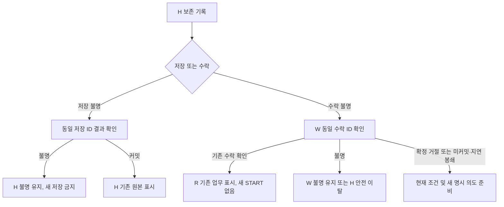
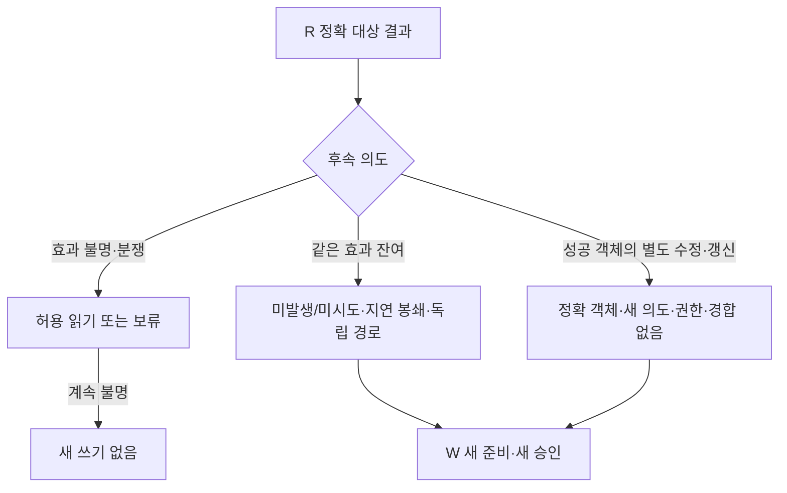

# V3.1 사용자 스토리 의미 검토 R1

<!-- Generated by tools/project_user_story_v31.mjs; docs/artifacts/planning/lesson-registration-20261126/integrated/v3.1/semantic-review.json -->

의미상 설계 모순 교정 후보 · 승인/실행 검증 전

기준 커밋: [fd182084643a](https://github.com/ik-e/chaja-you/commit/fd182084643aac57ed2233c37ae8345f69513856) · [의미 검토 JSON](../../artifacts/planning/lesson-registration-20261126/integrated/v3.1/semantic-review.json) · [화면 흐름](USER-STORY-SCREEN-FLOWS-V3.1.md) · [멘토 형식](USER-STORY-MENTOR-V3.1.md)

## 검토 방법

현재 12 여정의 목적/정상·오류·예외·반복/직접 행동·자동 처리와 상위 업무·상태·화면·범위 계약 대조. 과거 144 스토리 693 분기의 원래 조건·관련 다음 ID를 읽고, 명시 업무별 의미 영역/구체 가드·범위 판정 및 위험 분기 개별 사유를 보존. 각 과거 연결의 완전성 형식 증명 아님. 44 업무 범위·완료/복구 및 32 오류 금지 경계 검토.

## 발견 및 보완

| ID | 중요도 | 발견 | 처리 |
|---|---|---|---|
| SEM-01 | high | 수락 불명 상태에서 일반 준비로 돌아가는 경로 | corrected_candidate |
| SEM-02 | high | 저장 불명 이후 재방문과 재저장 | corrected_candidate |
| SEM-03 | high | 기존 성공 게시물의 새 수정과 실패 재처리 혼동 | corrected_candidate |
| SEM-04 | high | 외부 인증 실패 후 대상 확인 복귀 | corrected_candidate |
| SEM-05 | medium | 내부 연결 불명과 외부 업무 수락 불명 혼용 | corrected_candidate |
| SEM-06 | medium | 독립 행동을 정상 필수 순서로 표현 | corrected_candidate |
| SEM-07 | medium | 내부 준비 실패에도 사용자 수정 요구 | corrected_candidate |
| SEM-08 | medium | 기능명세의 빈 의미 참조 | corrected_candidate |
| SEM-09 | medium | 모니터링 종료와 일반 세션 정리 혼동 | corrected_candidate |
| SEM-10 | high | 관리자 확인 범위와 완료 판정 | decision_pending |
| SEM-11 | medium | 플랫폼 필수 입력과 실제 완료 검증 | decision_pending |
| SEM-12 | medium | 오류 발생 위치 및 화면 의미 | corrected_candidate |

### SEM-01 수락 불명 상태에서 일반 준비로 돌아가는 경로

- 발견: UJ-12의 ACCEPTUNKNOWN→HOME→PREP 및 VE-006/051이 기존 수락 불명과 실제 미수락 준비·지연 커밋 봉쇄를 충분히 구분하지 않았다.
- 기준: SW-22 · SW-35 · LT-13 · LT-14 · LT-16 · LT-18 · T06 · T10 · ER-17
- 처리: 동일 키 확인 전 새 준비 금지. 기존 수락 확인은 기존 R 기록 열기, START/새 실행 없음. 확정 거절 또는 권위 있는 미커밋·지연 커밋 봉쇄 이후 새 의도만.
- 대상: VE-006 · VE-046 · VE-049 · VE-051 · VE-097 · UJ-12 · SC-11

### SEM-02 저장 불명 이후 재방문과 재저장

- 발견: SC-10은 안전 이탈까지만 경로를 제시해 재방문 후 동일 저장 명령 확인을 표현하지 않았다.
- 기준: SW-07 · SW-35 · LT-12 · LT-14 · LT-16 · T44 · ER-06
- 처리: H에서 정확 보존 저장 ID의 내부 결과 확인. 지속 불명은 새 저장/원본 금지. 확정 거절 또는 권위 미커밋·지연 봉쇄 후 현재 revision에서 새 명시 저장.
- 대상: HOME · SAVEUNKNOWN · VE-098 · SC-10 · UJ-12

### SEM-03 기존 성공 게시물의 새 수정과 실패 재처리 혼동

- 발견: NEXT/VE-084의 미발생·미시도 조건이 별도 새 수정·갱신 의도에도 걸려 이미 성공한 기존 객체의 정상 업무를 막을 수 있다.
- 기준: LR-03 · LR-04 · LR-07 · SW-24 · SW-31 · T13 · ER-18 · ER-21
- 처리: 동일 효과 잔여는 독립 미발생/미시도·지연 봉쇄·독립 경로·새 승인. 별도 새 수정/갱신은 정확 기존 객체·실제 새 의도·권한·경합 효과 미해결 없음·새 승인. 동일 확인 효과 반복 금지.
- 대상: NEXT · VE-084 · VE-099 · UJ-08

### SEM-04 외부 인증 실패 후 대상 확인 복귀

- 발견: VE-063이 W 인증 성공/실패/취소 모두 IDENT로 복귀. 최초 계정 사용 선택과 실제 권한 검증도 분리할 필요.
- 기준: SW-14 · SW-15 · SW-16 · LT-55 · LT-56 · T23 · T24 · T25 · ER-11 · ER-12 · ER-13
- 처리: 성공·계정/권한·선행조건 및 필요한 최초 명시 사용 선택 확인 후만 IDENT/READ. 실패/취소/불명은 원 호출 제한/조회 불가 및 해당 접근 차단·폐기 의무.
- 대상: VE-063 · VE-064 · VE-065 · VE-066 · VE-100 · XCHECK · UJ-07 · UJ-11

### SEM-05 내부 연결 불명과 외부 업무 수락 불명 혼용

- 발견: UJ-06 ER-17은 내부 연결 불명과 외부 실행 수락을 혼동시킬 수 있다. VE-037 새 준비 조건도 구체화 필요.
- 기준: SW-18 · LT-12 · LT-14 · LT-16 · ER-14 · ER-15
- 처리: 동일 내부 명령/관계 키 확인. 외부 쓰기/승인 없음. 확정 거절/권위 미커밋·지연 봉쇄 또는 검증된 관계 변경 이후 별개 의도.
- 대상: LINKACK · VE-037 · UJ-06

### SEM-06 독립 행동을 정상 필수 순서로 표현

- 발견: UJ-10은 원본 저장 뒤 삭제/해제까지 순서처럼 표시, UJ-11은 외부 인증이 모든 관리 작업에 필요한 것처럼 읽힐 수 있다.
- 기준: UX-02 · UX-05 · SW-08 · SW-15 · SW-36 · T16 · T17 · T18
- 처리: 편집/삭제/해제를 대체 경로로 분리. 권리 요청·계정 연결/해제와 직접 인증은 별도 선택. 인증 필요할 때만 최초 선택과 확인.
- 대상: UJ-07 · UJ-10 · UJ-11

### SEM-07 내부 준비 실패에도 사용자 수정 요구

- 발견: 내부 변환 실패에서 사용자가 변경할 사실이 없을 수 있다.
- 기준: R03-US-110 · SW-09 · SW-11 · SW-12 · ER-08 · ER-10 · T08
- 처리: 정확 미수락 준비·현재 revision·이전 요청/효과 불명 없음에서 필요한 명시 재준비. 입력 오류만 FIX; 정상 입력 유지.
- 대상: VE-101 · UJ-07 · ER-08

### SEM-08 기능명세의 빈 의미 참조

- 발견: F01~F29/E01~E05와 SF-01~SF-07의 문자 비교 때문에 R04 기능 34개의 journey_refs가 모두 비어 있다.
- 기준: service-scope-v1.0.json:features · R04FUNC · R04IA
- 처리: F01~F29를 개별 의도·노드·여정에 명시 연결. E01~E05는 미채택 사유와 LIMIT만, 실행 여정 없음.
- 대상: integration-review.json:R04FUNC

### SEM-09 모니터링 종료와 일반 세션 정리 혼동

- 발견: R03-US-097/R04-US-035/R05-SE-7의 모니터링 종료/조건부 세션 맥락과 일반 업무 폐기가 혼재.
- 기준: SC-08 · ER-27 · ER-28 · SW-34 · LR-10 · LR-12
- 처리: 장기 모니터링/유지 기능 held, 일반 업무 접근 차단·폐기 상태 표시만 별도의 안전 의무.
- 대상: R03-US-097 · R04-US-035 · R05-SE-7

### SEM-10 관리자 확인 범위와 완료 판정

- 발견: R02 관리자 확인 요구는 전용 운영 기능 미채택과 충돌. 관리자 확인 자체는 효과 증거나 새 실행 권한이 아님.
- 기준: DR-02 · LR-06 · LR-07 · INV-06 · ER-19 · ER-32
- 처리: 현행 차단·독립 관측·제한 안내·운영 조사 유지. 전용 대기열/관리자 권한은 승인 및 개인정보·증거 계약 전 미채택.
- 대상: DR-02 · UJ-08

### SEM-11 플랫폼 필수 입력과 실제 완료 검증

- 발견: 86개 입력 후보는 실제 규격/권한/효과를 입증하지 않는다.
- 기준: SC-03 · SC-05 · SC-06 · DR-01 · DR-05 · INV-02 · INV-05
- 처리: 선택 업무별 조사 후보로 표시. 미검증 필수 규칙·효과는 미확인. 44개 업무 범위와 mock-only 유지.
- 대상: DR-01 · DR-05 · PREP · PREVIEW

### SEM-12 오류 발생 위치 및 화면 의미

- 발견: 일부 오류 참조는 해당 화면에서 직접 발생하지 않고 이후 대상 확인의 조건이다. UJ-08 W 단계에 R의 NEXT가 들어 있다.
- 기준: ER-02 · ER-14 · ER-31 · T12 · T13 · UX-02 · UX-07
- 처리: 현재 화면의 오류와 이후 조건 분리. R에서 후속 의도를 선택한 뒤 W 진입. 멘토 형식에 시스템 대응/금지 조건과 조건부 오류 표시.
- 대상: UJ-03 · UJ-04 · UJ-05 · UJ-06 · UJ-07 · UJ-08 · UJ-11 · UJ-12 · mentor

## 12개 사용자 여정 의미 판단

| 여정 | 판정 | 검토 |
|---|---|---|
| UJ-01 | qualified | 보유 자료/직접 입력 대체, 명시 저장·선택·승인, 필요한 보완/인증만, 독립 효과 확인. 성공 확인 클릭 없음. |
| UJ-02 | qualified | 저장 원본 재사용·새 대상만. 기존 성공/불명 반복 없음; 불명 수락 동일 키. |
| UJ-03 | qualified | 정확 기존 객체·전후/공유 영향, 공통 사실과 표현 분리, 새 수정 의도와 재처리 구분. |
| UJ-04 | scope_guarded | 동일 공고 갱신. 뮬 후순위 후보·실제 무료/간격/횟수·허용/효과 미검증, 타 6개 제한. |
| UJ-05 | qualified | 저장 관측 자동 표시, 명시 최신 읽기 및 실패/시각 분리. 자동 모니터링 없음. |
| UJ-06 | corrected | 후보 선택과 실제 권한 증거 구분, 내부 연결 동일 키 및 외부 승인/쓰기 없음. |
| UJ-07 | corrected | 실제 입력 문제만 보완; 내부 실패는 명시 재준비, 최초 계정 명시 선택 검증, 인증 실패 제한/폐기. |
| UJ-08 | corrected | 효과 상태/분쟁 분리, 잔여 재처리 vs 별도 새 수정/갱신; 전용 관리자 미확정. |
| UJ-09 | qualified | 충분하고 허용된 내부 자료, 강사 직접 이용. 외부 효과 없음. |
| UJ-10 | corrected | 원본 수정·저장과 삭제/연결 해제 대체 선택, 보존 정책 미확정 보류. |
| UJ-11 | corrected | 권리·계정 연결/해제·필요 인증만, 설정 강제 없음; 접근 차단/폐기 독립. |
| UJ-12 | corrected | 동일 owner·저장/수락 ID, 미커밋·지연 봉쇄 전 새 명령 없음; 기존 수락 열기 START 아님. |

## 저장/수락 불명 복귀

## 재처리와 별도 신규 의도

## 과거 분기 검토

| 분류 | 항목 |
|---|---:|
| consistent_intent | 179 |
| guarded_reinterpretation | 284 |
| decision_pending | 21 |
| scope_excluded | 172 |
| scope_split | 37 |

693개 분기의 원래 조건·다음 ID·업무 가드·판정은 JSON 원장에 보존. 41개 위험 분기에 개별 사유 추가. consistent_intent는 현재 의도와 대응; guarded_reinterpretation은 강화된 가드 적용; scope_split/excluded는 미채택·조건부 분리; decision_pending은 세부 판단 필요. 연결의 실행 검증 아님.

## 44개 플랫폼 업무

| 업무 | 범위 | 논리 판정 |
|---|---|---|
| PS-PL01-CREATE | included_priority | mock_candidate — 정확 신규 객체/관계와 승인 필수 효과 독립 확인; 중복/불명 차단, 접수/공개/모집 구분. |
| PS-PL01-READ | included_priority | conditional_read_or_guidance — 정확 계정/객체·명시 목적·허용 읽기, 이전 관측·현재 실패 구분, 쓰기 없음. |
| PS-PL01-UPDATE | included_priority | mock_candidate — 동일 정확 객체 승인 변경·공유 영향/재심사 분리; 신규 반복 금지. |
| PS-PL01-RENEW | hold_unverified_or_unsupported | restricted — 미채택/보류, 제한 안내만·외부 효과 없음. |
| PS-PL01-STATUS | included_priority | conditional_read_or_guidance — 정확 계정/객체·명시 목적·허용 읽기, 이전 관측·현재 실패 구분, 쓰기 없음. |
| PS-PL01-RESPOND | included_priority | conditional_read_or_guidance — 근거 안내/다음 선택만, 후속 쓰기 별도 새 승인, 안내 완료≠대행 성공. |
| PS-PL02-CREATE | included_priority | mock_candidate — 정확 신규 객체/관계와 승인 필수 효과 독립 확인; 중복/불명 차단, 접수/공개/모집 구분. |
| PS-PL02-READ | included_priority | conditional_read_or_guidance — 정확 계정/객체·명시 목적·허용 읽기, 이전 관측·현재 실패 구분, 쓰기 없음. |
| PS-PL02-UPDATE | included_priority | mock_candidate — 동일 정확 객체 승인 변경·공유 영향/재심사 분리; 신규 반복 금지. |
| PS-PL02-RENEW | hold_unverified_or_unsupported | restricted — 미채택/보류, 제한 안내만·외부 효과 없음. |
| PS-PL02-STATUS | included_priority | conditional_read_or_guidance — 정확 계정/객체·명시 목적·허용 읽기, 이전 관측·현재 실패 구분, 쓰기 없음. |
| PS-PL02-RESPOND | included_priority | conditional_read_or_guidance — 근거 안내/다음 선택만, 후속 쓰기 별도 새 승인, 안내 완료≠대행 성공. |
| PS-PL03-CREATE | included_priority | mock_candidate — 정확 신규 객체/관계와 승인 필수 효과 독립 확인; 중복/불명 차단, 접수/공개/모집 구분. |
| PS-PL03-READ | included_priority | conditional_read_or_guidance — 정확 계정/객체·명시 목적·허용 읽기, 이전 관측·현재 실패 구분, 쓰기 없음. |
| PS-PL03-UPDATE | included_priority | mock_candidate — 동일 정확 객체 승인 변경·공유 영향/재심사 분리; 신규 반복 금지. |
| PS-PL03-RENEW | hold_unverified_or_unsupported | restricted — 미채택/보류, 제한 안내만·외부 효과 없음. |
| PS-PL03-STATUS | included_priority | conditional_read_or_guidance — 정확 계정/객체·명시 목적·허용 읽기, 이전 관측·현재 실패 구분, 쓰기 없음. |
| PS-PL03-RESPOND | included_priority | conditional_read_or_guidance — 근거 안내/다음 선택만, 후속 쓰기 별도 새 승인, 안내 완료≠대행 성공. |
| PS-PL04-CREATE | included_later | mock_candidate — 정확 신규 객체/관계와 승인 필수 효과 독립 확인; 중복/불명 차단, 접수/공개/모집 구분. |
| PS-PL04-READ | included_later | conditional_read_or_guidance — 정확 계정/객체·명시 목적·허용 읽기, 이전 관측·현재 실패 구분, 쓰기 없음. |
| PS-PL04-UPDATE | included_later | mock_candidate — 동일 정확 객체 승인 변경·공유 영향/재심사 분리; 신규 반복 금지. |
| PS-PL04-RENEW | hold_unverified_or_unsupported | restricted — 미채택/보류, 제한 안내만·외부 효과 없음. |
| PS-PL04-STATUS | included_later | conditional_read_or_guidance — 정확 계정/객체·명시 목적·허용 읽기, 이전 관측·현재 실패 구분, 쓰기 없음. |
| PS-PL04-RESPOND | included_internal_only | conditional_read_or_guidance — 근거 안내/다음 선택만, 후속 쓰기 별도 새 승인, 안내 완료≠대행 성공. |
| PS-PL05-CREATE | included_later | mock_candidate — 정확 신규 객체/관계와 승인 필수 효과 독립 확인; 중복/불명 차단, 접수/공개/모집 구분. |
| PS-PL05-READ | included_later | conditional_read_or_guidance — 정확 계정/객체·명시 목적·허용 읽기, 이전 관측·현재 실패 구분, 쓰기 없음. |
| PS-PL05-UPDATE | included_later | mock_candidate — 동일 정확 객체 승인 변경·공유 영향/재심사 분리; 신규 반복 금지. |
| PS-PL05-RENEW | included_later | mock_candidate — 동일 공고의 의도 효과만; 무료/간격/횟수·허용·독립 관측 검증 전 실제 실행 없음. |
| PS-PL05-STATUS | included_later | conditional_read_or_guidance — 정확 계정/객체·명시 목적·허용 읽기, 이전 관측·현재 실패 구분, 쓰기 없음. |
| PS-PL05-RESPOND | included_internal_only | conditional_read_or_guidance — 근거 안내/다음 선택만, 후속 쓰기 별도 새 승인, 안내 완료≠대행 성공. |
| PS-PL06-CREATE | included_later | mock_candidate — 정확 신규 객체/관계와 승인 필수 효과 독립 확인; 중복/불명 차단, 접수/공개/모집 구분. |
| PS-PL06-READ | included_later | conditional_read_or_guidance — 정확 계정/객체·명시 목적·허용 읽기, 이전 관측·현재 실패 구분, 쓰기 없음. |
| PS-PL06-UPDATE | hold_unverified_or_unsupported | restricted — 미채택/보류, 제한 안내만·외부 효과 없음. |
| PS-PL06-RENEW | hold_unverified_or_unsupported | restricted — 미채택/보류, 제한 안내만·외부 효과 없음. |
| PS-PL06-STATUS | included_later | conditional_read_or_guidance — 정확 계정/객체·명시 목적·허용 읽기, 이전 관측·현재 실패 구분, 쓰기 없음. |
| PS-PL06-RESPOND | included_internal_only | conditional_read_or_guidance — 근거 안내/다음 선택만, 후속 쓰기 별도 새 승인, 안내 완료≠대행 성공. |
| PS-PL07-CREATE | included_later | mock_candidate — 정확 신규 객체/관계와 승인 필수 효과 독립 확인; 중복/불명 차단, 접수/공개/모집 구분. |
| PS-PL07-READ | included_later | conditional_read_or_guidance — 정확 계정/객체·명시 목적·허용 읽기, 이전 관측·현재 실패 구분, 쓰기 없음. |
| PS-PL07-UPDATE | hold_unverified_or_unsupported | restricted — 미채택/보류, 제한 안내만·외부 효과 없음. |
| PS-PL07-RENEW | hold_unverified_or_unsupported | restricted — 미채택/보류, 제한 안내만·외부 효과 없음. |
| PS-PL07-STATUS | included_later | conditional_read_or_guidance — 정확 계정/객체·명시 목적·허용 읽기, 이전 관측·현재 실패 구분, 쓰기 없음. |
| PS-PL07-RESPOND | included_internal_only | conditional_read_or_guidance — 근거 안내/다음 선택만, 후속 쓰기 별도 새 승인, 안내 완료≠대행 성공. |
| PS-PL02-FIRST-OPEN-SCHEDULE | conditional_not_adopted | restricted — 미채택/보류, 제한 안내만·외부 효과 없음. |
| PS-PL03-REPRESENTATIVE-SERVICE | conditional_not_adopted | restricted — 미채택/보류, 제한 안내만·외부 효과 없음. |

## 32개 오류 경계

| 오류 | 의미 경계 |
|---|---|
| ER-01 서비스 인증/동일 owner | 기존 조건/대응/금지 경계 유지. 확인된 정확 범위만 보완·안내. |
| ER-02 소유권/접근 거절 | 기존 조건/대응/금지 경계 유지. 확인된 정확 범위만 보완·안내. |
| ER-03 원문/파일/권리 | 기존 조건/대응/금지 경계 유지. 확인된 정확 범위만 보완·안내. |
| ER-04 AI 추출/사실 불확실 | 기존 조건/대응/금지 경계 유지. 확인된 정확 범위만 보완·안내. |
| ER-05 원본 조회/동시 수정 | 0건·조회 실패/권한 거절 분리, revision 덮기 금지. |
| ER-06 저장 실패/응답 불명 | 동일 저장 키, 권위 미커밋·지연 봉쇄/거절 뒤 새 의도. H 재방문 같은 키. |
| ER-07 업무/단계 미지원·정책 불명 | 기존 조건/대응/금지 경계 유지. 확인된 정확 범위만 보완·안내. |
| ER-08 입력안 준비 실패 | 입력 보완과 내부 준비 자체 실패 재준비 구분. |
| ER-09 가격·시간·회차·규격 | 기존 조건/대응/금지 경계 유지. 확인된 정확 범위만 보완·안내. |
| ER-10 오래된 준비·늦은 응답 | 기존 조건/대응/금지 경계 유지. 확인된 정확 범위만 보완·안내. |
| ER-11 외부 인증 실패·만료·취소 | 실패/불명은 원 호출 제한/조회 불가·폐기 의무; 정상 읽기 복귀 금지. |
| ER-12 외부 계정·권한 불일치 | 기존 조건/대응/금지 경계 유지. 확인된 정확 범위만 보완·안내. |
| ER-13 직접 선행 업무 | 기존 조건/대응/금지 경계 유지. 확인된 정확 범위만 보완·안내. |
| ER-14 정확 객체/하위 객체 불명 | 정확 객체·내부 연결 명령 불명, 동일 내부 키 확인. |
| ER-15 중복 후보·이전 효과 불명 | 기존 조건/대응/금지 경계 유지. 확인된 정확 범위만 보완·안내. |
| ER-16 승인 거절·변경·철회 | 수락 전 거절과 수락 후 권리 행사 분리. |
| ER-17 요청 수락 불명·중복 클릭 | 동일 수락 키, 지연 봉쇄 전 새 요청 금지. 기존 R 표시만. |
| ER-18 실행 실패/미실행 확정 | 미전송/미시도와 실제 전송 후 독립 미발생 구분. |
| ER-19 외부 저장·제출·갱신 효과 불명 | 응답 실패≠미발생, 불명 읽기/보류. |
| ER-20 반려·심사·모집 후속 | 기존 조건/대응/금지 경계 유지. 확인된 정확 범위만 보완·안내. |
| ER-21 복수 플랫폼 부분 성공 | 성공/불명 보존, 잔여와 별도 새 의도 분리. |
| ER-22 상태 조회 실패/마지막 관측 | 기존 조건/대응/금지 경계 유지. 확인된 정확 범위만 보완·안내. |
| ER-23 인증 세션 폐기·해제 불명 | 접근 차단과 폐기 상태 독립. |
| ER-24 직접 작성안/사용자 보고 | 기존 조건/대응/금지 경계 유지. 확인된 정확 범위만 보완·안내. |
| ER-25 삭제·연결 해제·권리 요청 제한 | 내부 삭제/해제·권리 요청만, 보존 정책 미정. |
| ER-26 이탈·재접속·로그아웃 | 이탈/로그아웃/만료/복귀 및 동일 저장·수락 키 구분. |
| ER-27 조건부 모니터링 | 자동 모니터링 미채택. |
| ER-28 모니터링 종료·폐기 | 모니터링 종료 미채택, 일반 업무 폐기 별도. |
| ER-29 플랫폼 고유 효과·부수 변화 | 기존 조건/대응/금지 경계 유지. 확인된 정확 범위만 보완·안내. |
| ER-30 새 글 재등록·게시 제한 | 기존 조건/대응/금지 경계 유지. 확인된 정확 범위만 보완·안내. |
| ER-31 증거/이력/링크 조회 불가 | 기존 조건/대응/금지 경계 유지. 확인된 정확 범위만 보완·안내. |
| ER-32 미분류 오류·안전 종료 | 원인 추정 금지. 운영 조사와 전용 관리자 DR-02 구분. |

## 의미 수용 사례 추가 (실행 테스트 아님)

| 사례 | 조건 | 기대 결과 |
|---|---|---|
| SC-S01 수락 불명 안전 이탈 및 재방문 | 정확 동일 owner/요청 ID, 조회 지속 불명 | 새 PREP/APPROVE/ACCEPT/START 없음; 동일 키 확인 |
| SC-S02 기존 수락을 늦게 확인 | 동일 기존 수락 기록 확인, UI ack 유실 | 기존 대기/진행/종료 표시만, 새 START/효과 없음 |
| SC-S03 권위 있는 미커밋과 지연 봉쇄 | 거절 확정 또는 미커밋+지연 봉쇄, 새 사용자 의도 | 현재 조건 새 준비만, 외부 효과 0. 404/timeout 불충분 |
| SC-S04 성공 게시물의 별도 새 수정 | 정확 확인 기존 객체, 새 변경값·현재 권한·경합 미해결 없음 | 지원 새 준비 허용; 성공 CREATE 반복 없음, 새 승인 |
| SC-S05 W 인증 실패 후 제한 복귀 | 인증 실패/취소/불명 또는 계정/권한/선행조건 미충족 | 해당 접근 차단·폐기 의무; 자료 보존, 후속 IDENT 읽기 없음 |
| SC-S06 내부 변환 실패, 수정할 사용자 사실 없음 | 정확 미수락 준비/revision·현재 조건, 관련 불명 없음, 명시 재준비 | 내부 재준비·정상 입력 보존, 외부 쓰기 0 |
| SC-S07 내부 연결 응답 불명 | 정확 내부 동일 명령 키 불명 | 동일 관계/키 조회, 외부 쓰기 0, 중복 연결 없음 |
| SC-S08 원본 편집 없는 관리 연결 해제 | 정확 관계·owner·보존·진행/불명 영향 확인 | 내부 관계 처리 또는 보류만. 편집/원본 삭제/외부 글 삭제 필요 없음 |
| SC-S09 계정 관리에서 연결 해제만 | 정확 관리 관계 및 허용 해제/접근 제한 조건 | 필요 해제/차단 및 폐기 상태 표시, 외부 인증 강제 없음 |
| SC-S10 홈에서 과거 불명 저장 명령 확인 | 동일 owner의 정확 보존 저장 키, 지속 불명 | 동일 키 확인만, 새 원본/저장/외부 요청 0 |

## 남은 결정과 제한

- **DR-01 7개 플랫폼 동등 구현 목표** — 7개 구현 목표와 MVP·구현 순서 변경 여부 R01 확인. 동등 구현과 동일 기능 보장은 다름.
- **DR-02 업로드 오류 관리자 확인** — 운영 확인 절차 또는 전용 업무 선택. 권한·최소 증거·개인정보·대기 안내·비용·판정 조건 확정 전 신규 화면/권한 없음. 관리자도 인증·승인 대행 금지.
- **DR-03 가입·계정·첨부 데이터 수명주기** — 인증 수단, 저장된 첨부 삭제, 계정 삭제·보존·권리 요청 처리와 불명 효과 충돌을 DB/API 전에 결정.
- **DR-04 W 원본 인라인 저장과 공개 정보** — 인라인 저장의 실제 행동 절감, 공개 문의 채널·위치의 노출/보존 정책 검토.
- **DR-05 플랫폼 업무별 입력·효과·허용** — 필수/선택 조사·사용자 확인과 실제 공식 경로/권한·독립 관측 증거를 구분하여 검증.

- 693개 분기의 원래 조건·다음 ID와 업무별 의미 가드/판정을 기록했다. 반복 조건은 같은 의미 영역 판정을 재사용했으며, 370개 조건의 모든 조합 및 레거시 각 다음 ID의 전이 완전성/동시성 형식 증명은 아니다. guarded_reinterpretation/scope_split/decision_pending은 상세 확인·결정 필요.
- 기존 서비스 범위 V1.0 및 핵심 4+보조 5 화면 유지. V3.1-R1의 논리 연결 교정 후보이며 상위 화면/업무/상태 계약의 최종 승인 전.
- 플랫폼 실제 허용·필수 입력·독립 완료/복구·폐기 및 사용자 시간 측정 미실행. 실제 앱/외부 실행 테스트 0건. 공식 Python/CI 및 Node 파일시스템 검증 미실행.
- 삭제된 R03 Notion 원문 미확인, GitHub 정본 활용.

구조·출처·경로·범위 계약 확인과 의미 대응 기록 검증이며 실제 앱/외부/정식 CI 실행 결과가 아니다.
