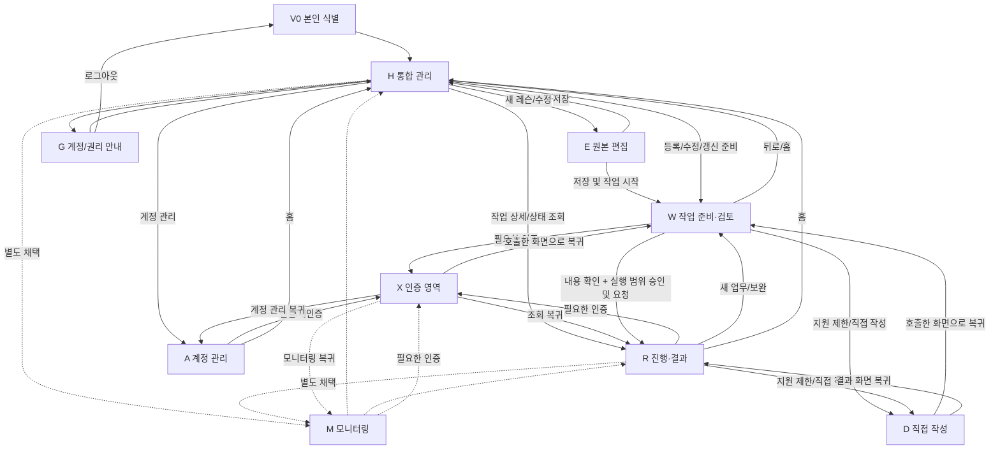

# 찾아you — User Story V2.2 (팀 검토용)

<!-- Generated by tools/project_docs.py. Source: docs/artifacts/planning/lesson-registration-20261126/integrated/v2.2/user-stories.json -->
[작업 원본 JSON](../../artifacts/planning/lesson-registration-20261126/integrated/v2.2/user-stories.json) · 기준 migration blob `e11ee0e0c02bc2b0fd2f50743d1db520901c48d1` · R01 검토 후보(미승인). 변경은 JSON 원본에 반영 후 기존 생성기로 재생성한다.

[화면 및 업무별 흐름도](USER-STORY-FLOWS-V2.2.md)

- **정상적인 상황 Golden Path**
- **비정상적인 상황 : <u>에러 → 예외처리</u>** — 정상 흐름 승인 후 해당 행동 바로 아래에 추가

> 멘토님 참고 자료 형식의 이용 상황 → 번호 화면 → 사용자 행동 → case를 사용한다. 기존 [V2.1](../../artifacts/planning/lesson-registration-20261126/integrated/v2.1/USER-STORY.md), [V2.0](../../artifacts/planning/lesson-registration-20261126/integrated/v2.0/USER-STORY.md)은 보존한다. 목적은 강사의 반복 정보 준비(P01), 반복 업무 실행(P02), 분산 상태 관리(P03)를 줄이는 것이다. 실제 사용자 조작만 행동으로 구분하고, 화면의 표시/자동 처리는 사용자의 별도 클릭을 뜻하지 않는다. 화면 ID와 행동 ID는 이 문서에서 이동·오류 대응을 지칭하기 위한 짧은 태그이다. 기존 N/P ID의 범위 표기는 [상세 근거](../../artifacts/planning/lesson-registration-20261126/integrated/v2.0/COMMON-NORMAL-FLOWS.md), [플랫폼 근거](../../artifacts/planning/lesson-registration-20261126/integrated/v2.0/PLATFORM-NORMAL-FLOWS.md), [기존 추적표](../../artifacts/planning/lesson-registration-20261126/integrated/v2.0/README.md)의 단계 연결이며 사용자가 읽을 필요는 없다.
>
> **검토 후보, 미승인.** 아래는 기능 영역/논리 화면이고 실제 페이지 수·URL·디자인·기술 선택을 확정하지 않는다. 7개 플랫폼 설계 범위, 기존 44개 업무(우선/후순위/보류/내부 안내/조건부), 기존 5개 제외 및 14개 오류 이월 유지. 외부 플랫폼 접근·인증 연결·입력·첨부·제출·읽기·지속 접근 모두 현재 mock-only. 운영사 정책·법률·권한·단계별 허용·실제 효과 검증 전 실사용하지 않는다. 외부 가입·본인인증·전문가 자격·약관 동의·결제/정산은 사용자가 직접 한다. 비밀번호·인증코드 수집/저장 및 외부 효과 원복은 제공하지 않는다. 자체 계정 방식, 장기 인증 연결, 통합 승인 UX, 준비값 보존·이탈 정책, 임의 중단은 채택 전 별도 결정 후보이다. 사용자의 직접 제출만으로 앞선 자동화가 허용되는 것은 아니다.

## 화면 연결 (논리 화면)

| ID | 화면/영역 | 제공 목적 | 진입 | 종료 또는 이동 |
|---|---|---|---|---|
| V0 | 메인·서비스 로그인 | 최초 이용, 본인 식별 | 비로그인 방문/재인증 | H 또는 복구 안내, 기존 인증이면 생략 |
| H | 통합 관리 | 내 레슨·등록 상태·진행 작업 | 인증 성공/공통 홈 | E, W, R, A, G, 필요시 M |
| E | 원본 작성·편집 | 원문/자료 → AI 추출 → 사실 확인·저장 | H의 새 레슨/원본 편집 | H 또는 W(저장 및 작업 시작) |
| W | 작업 준비·검토 | 플랫폼/대상 선택 → 변환·검증 → 최종 승인/실행 | H 또는 E, R의 후속 작업 | 같은 W에서 보완/대상 선택, X, D, R, H |
| R | 업무 진행·결과 | 진행·실제 결과·근거·이력 | W의 실행 요청, H의 작업/등록 상세 | H, W(새 요청), X(필요한 조회 인증) |
| A | 외부 계정 관리 | 연결·재연결·해제·권한 상태 | H의 계정 관리 | X, H |
| X | 외부 인증 (하위 영역) | 사용자 직접 인증·계정 확인 | W/R/A에서 필요한 계정만 | 호출한 화면의 같은 작업/선택 상태, 취소 시 해당 대상 보류 |
| D | 직접 작성 안내 (W 하위 영역) | 내부 입력안 제공 | W/R의 지원 제한/직접 작성 | 호출 화면 |
| G | 서비스 계정·개인정보 안내 (설정 영역) | 권리 행사 경로, 서비스 로그아웃 | H 공통 메뉴 | H 또는 V0 |
| M | 자동 모니터링 (조건부) | 설정·상태·알림·종료 | 별도 채택 시 H/R | H/R, X(필요한 경우) |

**5개 기본 업무 화면 H/E/W/R/A**를 중심으로 한다. V0는 진입, G는 공통 설정, X/D는 하위 영역, M은 미채택 조건부이다. W와 R의 상태 변화는 독립 페이지나 다음 버튼을 요구하지 않는다. H는 레슨 목록과 등록물/업무 목록을 함께 제공하고 선택한 대상의 상세를 열 수 있게 한다. R은 상세 진행/결과의 동일 화면이며 홈에 요약을 표시한다.

**최소 조작 판단:** 자료·업무·계정·변경 조건·승인처럼 사용자의 의사나 사실이 필요한 경우에만 입력/선택/버튼이 필요하다. 데이터 조회, 내부 변환, 검증, 진행 상태 표시, 결과 기록 및 폐기는 시스템 처리다. 읽기 및 외부 효과는 별도의 허용/권한 조건을 적용한다. 같은 화면에서 자동 표시되는 정보를 다시 여는 행동을 정상 필수 단계로 넣지 않는다.

## 자주 이용하는 정상 경로 (후보)

| 상황 | 사용자 조작 순서 | 생략 가능한 것 |
|---|---|---|
| 기존 원본 신규/추가 등록 | H 등록 시작 → W 플랫폼 선택 → 준비 요청 → 내용 확인 → 실행 범위 승인 및 요청 → R 자동 진입 | E, X(유효 연결), 보완(정보 충분), 개별 상세 열기 |
| 신규 원본 등록 | H 새 레슨 → E 자료 제공 → 정보 추출 요청 → 필요한 정정 → 저장 및 작업 시작 → W 등록 경로 | 기존 원본 입력 반복, 별도 저장 완료 페이지 |
| 기존 등록물 수정 | H 해당 등록물 수정 준비 → W 현재 대상/값 자동 확인 → 변경 항목 편집 → 내용 확인 → 실행 범위 승인 및 요청 → R | 레슨/같은 대상 재선택, 준비 요청 반복, 변경 없는 항목 별도 클릭 |
| 기존 공고 갱신 | H 해당 등록물 갱신 준비 → W 동일 공고와 효과/조건 자동 표시 → 내용 확인 → 실행 범위 승인 및 요청 → R | 내용 재입력, 준비 요청 반복, 별도 갱신 화면 |
| 통합 상태 확인 | H 자동 표시된 마지막 상태 확인; 최신 값 필요시 조회 대상 선택 → 상태 갱신 요청 → R 최신 관측 | 원본 편집, 업무 준비, 내용/쓰기 승인, 유효한 인증의 반복 로그인 |

각 경로는 허용·권한·사실·정확한 대상이 모두 확인되는 목표 상황을 전제로 한다. 클릭 수 실측이나 최적성 입증이 아니다. 사용자에게 읽기 요청 의도가 명확한 업무 준비/상태 갱신 동작을 사용하고 단순 페이지 열기만으로 외부 접근을 시작하지 않는다.

## 📌 유저스토리1 : 처음 방문하거나 다시 접속하는 경우

1. **V0 · 메인·서비스 로그인**
   - 진입: 비로그인 상태로 접속. 이미 유효하게 인증된 회원은 H로 직접 이동.
   - 기본 표시: 서비스 목적·지원 범위·개인정보 처리 안내, 로그인/가입 동작. 인증 제공자는 미정.
   - `V0-01` [표시] 강사는 메인페이지에서 이용 안내를 읽을 수 있다. 매 방문 시 별도의 안내 확인 버튼을 누르지 않는다. → **V0** `N01.01~02`
   - `V0-02` [필수] 강사는 로그인/가입 동작을 누르고 채택된 인증 방법을 선택하여 직접 인증한다. → **V0 인증 결과** `N01.03~04` `N02.01~02`
   - **case1. 신규 사용자**
     - `V0-03` [필수] 강사는 필요한 최소 등록 정보와 안내를 확인하고 필요한 동의를 직접 선택하여 가입을 완료한다. 동일 인증 주체가 이미 연결되어 있으면 신규 계정을 만들지 않는다. → **H** `N01.05~06`
   - **case2. 기존 사용자**
     - `V0-04` [자동 처리] 서비스는 검증된 기존 본인과 연결된 자료 영역을 연다. 같은 사용자가 다시 가입하지 않는다. → **H** `N02.03`
   - **case3. 인증 수단 복구가 필요한 경우 (지원 후보)**
     - `V0-05` [선택/조건부] 강사는 재인증 또는 채택된 공식 복구 경로를 선택한다. 본인 식별 성공 전에는 원본·작업을 표시하지 않는다. → **V0 → 인증 성공 시 H** `N08.01~04`

2. **H · 통합 관리 (모든 기본 업무의 시작점)**
   - 진입: V0 인증 성공 또는 공통 홈.
   - 기본 표시: 내 레슨 카드/목록, 최신 저장 버전 표시, 연결된 플랫폼별 마지막 등록/공개/모집 상태 및 확인 시각, 작업 요약, 진행/보류 업무, 계정 연결 요약. 처음이면 빈 목록+새 레슨 버튼.
   - `H-01` [자동 처리] 서비스는 본인 소유 목록·작업을 조회한다. 빈 목록이면 새 레슨 버튼을 제공한다. 외부 사이트 조회를 자동 시작하지 않는다. → **H** `N01.07` `N03.01`
   - `H-02` [선택/조건부] 강사는 진행/보류 작업 행을 선택하여 저장된 준비 내용 또는 진행·결과 상세를 열 수 있다. → **준비/보류는 W(기존 준비 상태), 진행/결과는 R** `N02.04~05`
   - `H-03` [선택/조건부] 강사는 공통 메뉴에서 원본 관리, 업무 결과, 계정 연결, 계정·개인정보 안내를 선택한다. 현재 로그인과 소유권을 유지한다. → **H/R/A/G 중 선택**
   - `H-04` [선택/조건부] 강사는 홈 또는 뒤로 동작을 선택한다. 작성/준비 중이면 저장 상태와 돌아갈 곳을 표시하고, 미저장 변경이 있으면 보존/폐기 정책에 따른 선택을 제공한다. 실행 요청 이후에는 화면 이동만으로 중복 실행·취소가 발생하지 않는다. 준비값 보존 및 실행 중 이탈 세부 정책은 검토 후보이다. → **호출 화면 또는 H**

3. **G · 서비스 계정·개인정보 안내**
   - 진입: H의 공통 메뉴 또는 필요한 계정 안내.
   - 기본 표시: 서비스 계정과 외부 연결 구분, 수집 목적·보유/파기·권리 행사·문의 경로, 로그아웃.
   - `G-01` [선택/조건부] 강사는 본인 보관 정보 및 열람·정정·삭제 등 권리 행사 안내를 열고 필요한 요청 경로를 선택한다. 본인 확인·접수·결과 확인은 채택된 운영 절차에 따른다. 독립 회원탈퇴 UI는 미채택이며 권리 자체는 제외하지 않는다. → **G의 안내/채택된 요청 경로 → H** `N07.01~04`
   - `G-02` [선택/조건부] 강사는 로그아웃을 누른다. 진행 업무가 있을 때만 종료/보류 및 기발생 효과에 대한 안내를 확인한다. → **V0** `N24.01~02`
   - `G-03` [자동 처리] 서비스 세션을 종료하고 새 외부 요청을 차단한다. 기존 효과·기록과 미확인 결과를 보존하며 업무용 인증 세션을 종료 정책에 맞게 처리한다. 별도 허용 장기 연결/모니터링 처리 정책은 미확정이다. 재방문 시 동일 본인 확인. → **V0** `N24.03~04`

## 📌 유저스토리2 : 새 레슨을 만들거나 기존 원본을 관리하는 경우

강사가 기존 정보를 제공하면 서비스가 구조화한다. 직접 필드 입력은 사실 보완 또는 사용자가 원할 때만 수행한다.

1. **H · 레슨 목록 및 선택 상세**
   - 진입: H의 원본 목록.
   - 기본 표시: 원본 이름, 최신 버전, 제목·소개·레슨 분류/대상·시간/가격·첨부, 외부 등록물 연결 및 상태; 자세한 사실은 선택한 카드에서 펼칠 수 있다. 카드/행에 새 레슨·등록 시작·수정·관리 동작.
   - `H-05` [필수] 강사는 새 레슨 버튼을 누르거나 기존 레슨을 선택한다. → **새 레슨 E, 기존 레슨 H 선택 상세** `N03.02`
   - `H-06` [표시] 서비스는 선택 원본과 저장 사실·첨부·연결 등록물 및 버전을 보여준다. 등록 시작 동작에서 기존 원본을 바로 재사용할 수 있다. 모든 상세를 각각 열 필요는 없다. → **H** `N03.03~07`
   - `H-07` [선택/조건부] 강사는 기존 레슨의 수정 동작을 누른다. → **E(현재 원본 및 기준 버전)**
   - `H-08` [선택/조건부] 강사는 원본 삭제 동작을 선택한다. 삭제 대상, 보존 기록, 진행/미확인 작업, 연결 외부 게시물에 미치는 영향을 확인한 뒤 삭제 확인 또는 취소를 선택한다. 내부 삭제만 허용 범위에서 처리하고 결과와 목록을 표시한다. 외부 게시물 삭제·원복이 아니다. → **H** `N06.01~04`
   - `H-09` [선택/조건부] 강사는 특정 외부 등록물의 관리 연결 해제를 선택하고 해당 플랫폼·계정·객체 및 해제 범위를 확인한다. 허용된 내부 연결만 해제하고 남은 목록을 표시한다. 외부 글과 계정은 삭제하지 않는다. → **H** `N06.05~07`

2. **E · 원본 작성·편집**
   - 진입: H-05(신규) 또는 H-07(기존 수정).
   - 기본 표시: 새 원문 입력 영역 또는 저장 원문/구조화된 사실, 파일 첨부, 권리/공개 범위, 추출 상태, 사실 확인 및 수정 영역, 저장/저장 및 작업 시작/취소. 처음과 수정에 같은 화면을 재사용.
   - **case1. 새 원본**
     - `E-01` [필수] 강사는 보유한 소개글 등 원문을 입력하거나 붙여넣는다. 별도 제목·시간·가격 필드 전체를 먼저 작성하지 않는다. → **E** `N04.01~02`
     - `E-02` [선택/조건부] 강사는 필요한 파일을 첨부한다. 서비스는 파일별 수신·규격 결과를 표시한다. 강사는 공개 범위와 사용 권리를 확인하며 필요하면 첨부를 제거한다. 파일 선택, 권리 확인, 제거는 각각 독립 조작이다. → **E** `N04.11~13`
     - `E-03` [필수] 강사는 정보 추출 동작을 누른다. 서비스는 제공 자료에서 확인된 사실과 근거, 불확실 항목을 추출하여 같은 화면에 표시한다. → **E 추출 완료** `N04.14`
     - `E-04` [표시] 서비스는 제목/소개·분류/대상·방식/장소·시간/횟수/가격 단위 및 원문 근거를 일괄 표시한다. 확인을 위해 항목별 클릭을 요구하지 않는다. → **E** `N04.15~18`
     - `E-05` [선택/조건부] 강사는 부족하거나 잘못된 사실만 편집한다. 직접 입력 방식이 채택되면 동일 편집 영역에서 제목·레슨 종류/대상·방식·장소·회당 시간·회차·가격/통화/단위를 직접 작성할 수 있다. 가격 단위 등 사실을 추정하지 않는다. → **E** `N04.03~10` `N04.19`
     - `E-06` [필수] 강사는 사실이 맞는지 확인한 뒤 저장 또는 저장 및 작업 시작 중 하나를 누른다. 서비스는 검토한 사실·첨부를 소유자/원본 ID/버전으로 저장하고 결과를 표시한다. 성공 후만 이동한다. 별도 저장 확인 버튼은 없다. → **저장 H, 저장 및 작업 시작 W** `N04.20~21`
   - **case2. 기존 원본 수정**
     - `E-07` [표시] 서비스는 현재 저장 버전의 기존 원문·사실·첨부 및 편집 영역을 표시한다. → **E** `N05.01`
     - `E-08` [선택/조건부] 강사는 수정할 사실과 값, 추가할 파일, 제거할 파일 중 필요한 것만 선택해 편집한다. 첨부별 권리 확인 및 제거 결과를 표시한다. → **E** `N05.02~05`
     - `E-09` [필수] 강사는 변경 전후·미실행 준비본 영향 안내를 확인한 뒤 변경 저장, 저장 및 작업 시작 또는 취소를 선택한다. 저장하면 새 버전과 결과를 표시하고 기존 외부 게시물·과거 승인본은 자동 수정하지 않는다. 취소 시 이전 저장값 유지. → **저장 H, 저장 및 작업 시작 W, 취소 H** `N05.06~08`

## 📌 유저스토리3 : 기존 외부 계정을 연결하거나 재사용하는 경우 (인증 정책 후보)

업무마다 계정 관리 화면 방문을 강제하지 않는다. A는 연결 관리 목적일 때만 진입한다. W/R에서 필요한 경우 X를 직접 열고 원래 화면으로 복귀한다.

1. **A · 외부 계정 관리**
   - 진입: H 계정 관리 메뉴.
   - 기본 표시: 플랫폼별 연결 계정 표시명·마지막 확인·연결/만료/철회/미확인 상태·허용 업무 범위·보유 만료·연결/재인증/해제 동작. 로그인 상태의 실제 유효 여부는 확인되지 않으면 미확인 표시.
   - `A-01` [선택/조건부] 강사는 새 계정 연결 또는 특정 계정 재인증을 누른다. 플랫폼/계정 후보와 호출 목적을 유지한다. → **X(복귀 A)**
   - `A-02` [선택/조건부] 강사는 연결 해제를 선택하고 대상·접근 중단·보유 인증 상태 폐기 범위를 확인한 뒤 해제를 요청한다. 서비스는 해당 인증의 새 접근을 차단하고 가능한 외부 권한 철회 및 내부 폐기를 수행한다. 기존 등록물/이력은 유지한다. → **A(해제 결과)** `N19.09`
   - `A-03` [선택/조건부] 강사는 계정 연결 목록을 확인하고 홈으로 돌아간다. → **H**

2. **X · 외부 인증 하위 영역**
   - 진입: W(업무 준비), R(조회), A(계정 관리), M(조건부)에서 허용 확인 후 필요한 대상만. 원래 화면, 작업 ID, 원본 버전, 대상 선택을 보존.
   - 기본 표시: 플랫폼·호출 목적·계정 후보·허용된 인증 방식/범위·유효 기간·종료/유지 안내, 사용자 직접 인증 화면, 인증 완료/취소 동작, 결과 및 계정 표시. 서비스 비밀번호/인증코드 수집 영역 없음.
   - `X-01` [필수] 강사는 인증이 필요한 대상에서 연결/재인증 동작을 누른 경우 인증 안내 및 직접 로그인 화면을 연다. 접근 단계가 불허/미확인인 경우 인증 화면을 제공하지 않는다. → **X 또는 호출 화면 제한 안내** `N12.01`
   - `X-02` [필수] 강사는 외부 사이트 인증 화면에서 직접 로그인하고 필요한 추가 본인인증을 직접 수행한다. 외부 가입·약관 동의·전문가 인증·정산 등은 사용자 직접이며 서비스가 입력 비밀을 기록하거나 AI에 전달하지 않는다. → **X 인증 결과** `N12.02~03`
   - `X-03` [자동 처리] 서비스는 인증 결과, 실제 계정, 필요한 접근 권한을 확인한다. 인증 성공·유효 권한이 확인되지 않으면 업무에 사용하지 않는다. → **X 계정 결과** `N12.05`
   - **case1. 동일 계정 및 업무 한정 인증**
     - `X-04` [자동 처리] 정확한 인증 계정이 요청 대상과 일치하면 별도 계정 재선택 없이 호출한 화면의 기존 상태를 유지한다. 사용자가 인증 완료를 확인해야 하는 인증 방식이면 그 동작을 제공하되 결과를 서비스가 검증한다. → **호출 W/R/A/M의 해당 대상**
   - **case2. 여러 계정 또는 예상 계정과 다른 경우**
     - `X-05` [선택/조건부] 강사는 실제 인증 계정을 확인하고 현재 업무의 대상 계정을 명시적으로 선택하거나 취소한다. 이전 대상 및 관련 승인과 일치하지 않으면 다시 식별·승인한다. → **호출 화면 해당 대상 재검토**
   - **case3. 장기 연결을 선택할 수 있는 경우 (별도 정책 후보)**
     - `X-06` [선택/조건부] 강사는 유지 목적·범위·기간·위험·해제 방법을 확인하고 유지 여부를 선택한다. 정책 채택과 단계별 실제 허용을 확인한 경우에만 공식 위임 토큰 또는 보호된 로그인 상태를 보유한다. 거절/미확인 시 업무 한정 인증으로 처리한다. → **호출 화면**
   - **case4. 만료 또는 권한 변경으로 재인증하는 경우**
     - `X-07` [선택/조건부] 강사는 해당 대상만 다시 인증한다. 이전 계정·현재 대상·권한을 재검증한다. 다른 유효한 연결에는 추가 인증을 요구하지 않는다. → **호출 화면 해당 대상** `N12.04`
   - **case5. 인증 취소**
     - `X-08` [선택/조건부] 강사는 인증 취소를 누른다. 해당 인증 연결을 종료하고 새 접근을 차단·정리한다. 작업 선택과 이미 준비한 내부 정보는 채택된 보존 정책에 따라 유지하고 해당 대상만 보류한다. → **호출 화면(해당 대상 보류)** `N19.08`

   - **인증 재사용 원칙:** 채택·허용된 연결 상태가 현재 유효하고 계정/권한/업무 범위가 일치하면 W/R에서 X로 이동하지 않는다. OAuth 로그인 자체는 레슨 업무 위임이 아니다. 공식 해당 업무 위임 API, 또는 허용된 원격 브라우저 인증 상태 재사용을 검토한다. 저장/재사용의 정책·법률·보안·기술 조건 및 실제 플랫폼 지원은 미확인. 기본 업무용 세션은 종료 시 폐기하고 별도 장기 연결 후보는 독립 승인·격리·암호화·기간·접근 기록·철회·폐기 검증 이후에만 채택한다. 자동 조회·쓰기 승인은 포함하지 않는다.

## 📌 유저스토리4 : 레슨을 신규/추가 등록하거나 기존 등록물을 수정·갱신하려는 경우

W는 단일 작업 화면이다. 선택 영역, 준비 상태, 추가 확인 영역, 최종 검토 영역, 실행 버튼이 같은 화면에서 상태에 따라 바뀐다. 플랫폼별 별도 페이지, 준비 완료 페이지, 승인 완료 페이지를 필수로 만들지 않는다.

1. **H · 업무 진입**
   - 진입: H 통합 관리 또는 E 저장 및 작업 시작.
   - 기본 표시: 레슨 카드에 등록 시작, 기존 등록물 행에 조회·수정 준비·갱신 준비 후보, 완료/진행·미확인 상태 및 지원 제한. 지원이 없는 업무는 실행 버튼이 아니라 안내. 연결된 원본·계정·대상을 기본 표시.
   - `H-10` [필수] 강사는 레슨의 등록 시작 또는 기존 등록물 행의 수정 준비/갱신 준비를 누른다. 기존 등록물 행에는 해당 객체와 준비용 읽기 요청 범위를 먼저 표시한다. 이미 선택한 원본/업무/계정·객체 후보와 사용자 준비 의사를 W에 전달한다. 기존 등록물에서 해당 범위를 확인하고 준비를 요청한 경우 W-06을 반복하지 않는다. E에서 저장 및 작업 시작을 눌렀다면 이 동작을 다시 하지 않는다. → **신규 W 선택 영역, 기존 등록물 W 준비 상태** `N09.01`

2. **W · 작업 준비·검토 (선택 영역)**
   - 진입: H-10, E-06/E-09 저장 및 작업 시작, R 후속 업무.
   - 기본 표시: 원본 이름·버전, 7개 플랫폼의 실제 지원 후보/보류/조건부, 수행 방식, 계정 연결 및 마지막 확인 상태, 기존 등록 연결, 선택된 업무 목록, 준비 요청 버튼. 동일 레슨·기존 등록물에서 시작한 경우 이미 선택한 값 표시.
   - `W-01` [표시] 서비스는 전달된 원본·계정/객체 후보·업무를 표시하고 이전 선택과 설정을 불러온다. 후보를 실제 권한/대상으로 단정하지 않는다. 상세 지원 제한은 필요한 때만 펼친다. → **W** `N09.02~04`
   - **case1. 신규 또는 추가 플랫폼 등록**
     - `W-02` [필수] 강사는 신규 등록할 플랫폼을 하나 이상 선택한다. 필요 없는 선택은 해제할 수 있다. 이미 성공한 대상은 새 등록으로 자동 포함하지 않는다. 플랫폼별 다른 업무가 필요하면 해당 행에서 선택한다. 연결 계정이 둘 이상이면 업무에 사용할 계정을 선택하며 유일하고 검증 가능한 연결 후보는 미리 표시한다. → **W 선택 목록** `N09.05~07` `N14.07`
   - **case2. 기존 등록물 수정·갱신**
     - `W-03` [표시] 선택한 기존 등록물에서 시작한 경우 서비스는 원본·계정·객체·수정/갱신 업무 후보를 자동 표시한다. H-10에서 요청한 범위에 맞으면 W-06을 생략하고 준비 상태를 바로 표시한다. 연결된 등록물이 없는 경우 필요한 조회 및 식별 영역을 제공한다. → **W**
     - `W-04` [선택/조건부] 강사는 대상이 여러 개이거나 다른 기존 등록물에 적용할 경우 필요한 행/업무를 선택한다. 정확 대상 확인 전에는 변경 항목/갱신 효과를 확정하지 않는다. → **W**
   - **case3. 해당 업무 미지원 또는 사용자가 제외하려는 경우**
     - `W-05` [선택/조건부] 강사는 제한 안내에서 해당 대상의 이유와 가능한 대안을 확인한다. 해당 대상만 제외·보류하거나 직접 작성 안내를 선택한다. 다른 대상은 유지한다. → **W 또는 D** `N19.01~02`
   - `W-06` [필수] 강사는 신규/추가 등록에서 플랫폼 선택을 마쳤거나 기존 준비 요청의 범위를 변경한 경우 준비 요청을 누른다. 화면에는 준비에 필요한 내부 변환과 허용된 계정·대상 읽기 요청 범위가 미리 표시된다. H-10에서 동일 범위 준비를 명시적으로 요청한 경우에는 이 버튼을 요구하지 않는다. 서비스는 원본/업무/계정 후보별 준비 작업을 저장한다. 사용자가 선택하지 않은 대상의 외부 접근/쓰기를 시작하지 않는다. → **W 준비 상태** `N09.08`

3. **W · 작업 준비·검토 (준비/추가 확인 영역)**
   - 진입: H-10 기존 등록물 준비 요청 또는 W-06 준비 요청; W 수정/재검증; X 복귀.
   - 기본 표시: 대상별 준비 중/준비 완료/정보 보완/인증 필요/대상 확인/지원 제한, 원본·이전 설정·변환안과 확인 근거. 사용자가 해결해야 할 항목만 별도 표시. 내부 변환과 허용된 대상 확인은 필요한 순서로 실행하며 준비 자체는 외부 쓰기를 하지 않는다.
   - `W-07` [자동 처리] 서비스는 신규 작업의 원본/유효한 플랫폼 설정으로 입력안을 자동 변환·검증한다. 기존 변경은 정확 대상과 현재값 확인 후 변경안 확정. 준비 상태와 규칙·원본 버전·변환 근거를 표시한다. 별도 생성/재검증 버튼을 필수로 두지 않는다. → **W** `N10.01~03`
   - `W-08` [자동 처리] 서비스는 사용자가 요청한 범위에서 읽기 단계 허용·계정·권한·이전 효과를 확인한다. 허용된 유효 인증이 있으면 재사용하고, 없으면 해당 대상만 인증 필요로 표시한다. 신규 효과 중복 여부와 기존 객체 식별·관측값을 확인한다. 업무용 읽기 세션을 승인된 작업 범위 밖으로 사용하지 않는다. → **W** `N12.06~08`
   - **case1. 인증이 필요한 대상만**
     - `W-09` [선택/조건부] 강사는 인증 필요 표시가 있는 대상에서 연결/재인증 동작을 누른다. 유효한 연결을 쓰는 대상은 아무 조작도 필요하지 않다. → **X → W의 같은 대상/준비 상태**
   - **case2. 기존 대상이 여러 개이거나 아직 연결되지 않은 경우**
     - `W-10` [선택/조건부] 강사는 필요할 때 검색하거나 조회된 기존 객체 중 실제 관리할 대상을 선택한다. 계정/객체/하위 객체 관계·현재값을 확인하고 필요한 최소한의 비민감 소유권 자료를 제공한다. 소유권이나 이전 효과가 미확인인 경우 실행으로 진행하지 않는다. → **W 대상 확인** `N12.09~11`
     - `W-11` [선택/조건부] 강사는 직접 등록했던 대상의 내부 관리 연결이 필요한 경우 연결을 요청한다. 이미 확인된 정확 관계는 재사용하며 외부 글 변경은 없다. 서비스는 연결 결과와 관측 시각을 표시한다. → **W** `N12.12~13`
   - **case3. 기존 등록물 변경/동일 공고 갱신**
     - `W-12` [선택/조건부] 강사는 정확히 식별된 기존 등록물에서 변경할 항목을 선택한다. 수정 가능 조건·현재값과 공유 필드 영향이 표시된다. 갱신이면 실제 갱신 방식·간격·횟수·비용·정책·예정 효과를 표시한다. 동일 갱신과 신규 재등록을 구분한다. → **W 변경안** `N15.01~02` `N16.01~03`
   - **case4. 부족하거나 불확실한 사실**
     - `W-13` [선택/조건부] 강사는 강조된 보완 항목에서 실제 사실을 입력하거나 원문 근거를 확인해 정정한다. 공통 원본 보완과 해당 플랫폼 전용 값의 적용 범위를 명확히 선택한다. → **W 자동 재검증** `N10.04~07`
   - **case5. 플랫폼 제약 충돌**
     - `W-14` [선택/조건부] 강사는 충돌 사실·표현 대안·실제 제공 조건 변경 대안을 보고 가능한 조건을 선택하거나 거절한다. 거절/유효 대안 없음이면 해당 업무만 보류한다. 임의 사실 변경 없음. → **W 재검증/해당 대상 보류** `N10.08~09` `N19.03`
   - **case6. 특정 플랫폼의 설정 변경**
     - `W-15` [선택/조건부] 강사는 선택 플랫폼의 가격·시간·제공 조건 등 필요한 값만 편집한다. 이전 설정이 있으면 원본과 구분해 불러오고 재사용 값·현재 규칙을 표시한다. 설정 저장 및 재사용 정책은 후보이며 과거 승인 자동 재사용은 하지 않는다. → **W 자동 재검증** `N10.10`
   - `W-16` [자동 처리] 서비스는 입력/권한/규칙 변경에 따라 관련 대상만 재변환·검증한다. 필수 정보·형식·규격·가격 단위·사실·공개 범위·정확 대상·정책을 확인한다. 완료된 대상은 같은 화면의 최종 검토 영역에 자동 표시한다. 보류/미확인은 실행 가능한 대상과 구분한다. 사용자가 검토할 실행 대상 목록을 표시하며 준비 미완료 대상이 있으면 그 대상까지 해결하거나 명시적으로 제외/보류해야 한다. 시스템이 대상 목록을 임의로 줄인 뒤 실행하지 않는다. → **W 최종 검토** `N10.11~12`

4. **W · 작업 준비·검토 (최종 검토·승인 영역)**
   - 진입: W-16에서 준비 완료된 대상. W의 같은 화면에 자동 표시.
   - 기본 표시: 선택 원본/버전, 대상별 플랫폼·실제 계정·객체·업무·현재 입력안 및 완료 기준, 원본과 차이/변경 전후/공유 영향, 제목·설명·가격·시간·회차·공개 자료·고유 필드 전체 미리보기. 중요한 차이·조건 변경·권리 확인·불확실을 앞에 표시한다. 대상별 실행 가능/보류 상태, 실행 범위·비용·제약·되돌리기 불가 안내. 내용 확인란과 실행 범위 승인 및 요청 버튼.
   - `W-17` [표시] 서비스는 실제 플랫폼별 최종 입력안 및 신규/변경 효과를 보여준다. 변경 없는 항목의 개별 클릭을 강제하지 않는다. 전체 내용 열기/플랫폼 고유 상세는 필요할 때 선택 가능하다. → **W** `N11.01~09` `N13.01~03` `N13.05~06`
   - `W-18` [선택/조건부] 강사는 수정할 항목을 선택한다. 해당 항목의 편집/보완 영역이 열리고 수정된 대상만 재검증된다. 내용이나 대상/범위가 달라진 기존 승인은 유효한 것으로 취급하지 않는다. → **W 준비/최종 검토** `N11.10`
   - `W-19` [선택/조건부] 강사는 내용 또는 실행 범위에 동의하지 않는 대상의 선택을 해제하거나 승인 거절한다. 해당 대상은 실행하지 않고 필요한 경우 수정/보류로 돌아간다. → **W** `N19.04~05`
   - `W-20` [필수] 강사는 전체 입력안과 강조된 차이를 확인한 뒤 선택 대상의 내용 확인란을 명시적으로 선택한다. 서비스는 대상별 검토한 내용/버전/사용자/시각을 연결한다. 현재 확인된 사실·권리·중요 변경 동의만 인정한다. → **W 내용 승인 상태** `N13.04`
   - `W-21` [필수] 강사는 표시된 실행 범위(계정·대상·업무·외부 효과·제약)를 확인하고 **실행 범위 승인 및 선택 업무 실행 요청**을 누른다. 실행 범위 승인과 실행 요청을 한 사용자 조작으로 연결하는 후보이다. 내용 승인과 별개의 범위 승인 기록을 먼저 저장한다. 준비·권한·이전 효과·두 승인 일치를 다시 검증하고 대상별 요청을 중복 없이 기록한다. 조건이 충족되지 않은 대상은 실행하지 않는다. 요청 수락 전에 선택 대상·범위가 변경되면 변경 사실을 표시하고 현재 실행 대상에 대한 사용자의 재확인을 요구한다. 이미 수락된 독립 요청의 후속 조건 변경은 해당 대상만 새 효과를 차단하고 R에 표시한다. → **승인·요청 수락 시 R, 보완/변경 필요 시 W** `N13.07~08` `N14.01~02` `N15.03~04` `N16.04`
   - `W-22` [선택/조건부] 강사는 실행 전 업무 보류, 승인 철회 또는 홈 복귀를 선택할 수 있다. 해당 새 실행을 차단하고 준비 상태 및 기존 효과/이력을 보존한다. 보류된 업무는 다시 선택했을 때 현재 조건을 검토하고 필요한 새 승인을 받는다. 임의 실행 중단/재개는 별도 결정. → **H 또는 W** `N19.06~07` `N19.10` `N19.13~14`

## 📌 유저스토리5 : 업무 진행과 실제 결과를 확인하는 경우

실행 요청 이후 결과까지 별도 다음 버튼이나 확인 버튼을 요구하지 않는다. 조회 업무는 쓰기 승인 화면을 거치지 않는다.

1. **R · 업무 진행·결과**
   - 진입: W-21 요청 수락, H 진행/결과 행, H 상태 조회 요청, R 새 관측 요청. 화면 재진입만으로 새 외부 실행 없음.
   - 기본 표시: 작업 그룹·플랫폼별 계정/원본·업무·대상, 대기/진행/완료/실패/미실행/효과 미확인, 실제 저장·심사 접수·승인·게시·모집 가능 및 확인 시각, 근거와 세션 처리 상태, 상세/이력/링크/홈/후속 업무. 실행 중 일부 대상만 완료되는 정상 상황도 표시.
   - `R-01` [자동 처리] 서비스는 기록된 대상별 요청의 승인·권한·정책·이전 효과·입력값을 다시 확인하여 허용된 단계만 처리한다. 외부 효과 전 기록·검증, 플랫폼별 입력/첨부/저장/제출의 허용을 각각 확인한다. 실제 외부 접근은 현재 차단. 플랫폼별 흐름은 아래 참조. → **R 진행** `N14.03`
   - `R-02` [표시] 서비스는 대상별 진행 및 완료 여부를 갱신해 표시한다. 사용자는 화면을 유지하거나 홈에서 작업을 다시 열 수 있다. 계속 실행/보류의 화면 이탈 정책은 별도 후보이며 단순 이탈로 재실행하지 않는다. → **R**
   - **case1. 진행 중인 작업의 승인/접근 철회·중단**
     - `R-03` [선택/조건부] 강사는 내용/범위 승인 철회나 접근 권한 해제를 선택할 수 있다. 관련 새 접근/쓰기를 차단하고 이미 발생한 효과와 미확인 상태를 유지한다. 사용자 임의 중단 기능은 승인 전 후보이며 외부 원복을 보장하지 않는다. → **R 결과 상태** `N19.11~12`
   - `R-04` [자동 처리] 서비스는 정확한 신규/기존 객체에서 승인 내용의 저장·심사 접수·동일 공고 갱신 효과를 독립 확인하고 대상별 결과와 근거를 기록한다. 확인된 신규 등록물은 소유자·원본 버전·외부 계정·객체 식별자와 관리 연결을 저장하며 중복 연결을 검사한다. 실패와 외부 효과 미확인을 구분한다. 새 글을 동일 객체 변경으로 대체하지 않는다. → **R 결과 기록** `N14.04` `N15.05` `N16.05`
   - `R-05` [자동 처리] 서비스는 작업용 접근을 종료하고 업무용 세션을 폐기한다. 장기 연결 재사용이 별도 채택·허용된 경우에만 그 최소 인증 상태의 보유를 분리한다. 만료·철회·미허용 시 보유하지 않는다. 사용자의 결과 클릭을 기다리지 않는다. → **R 처리 완료/확인 상태** `N14.06` `N15.07`
   - `R-06` [표시] 서비스는 신규/수정/갱신 결과 및 확인 시각·근거·세션 처리 결과를 표시하고 H 요약에 반영한다. 접수와 실제 게시/모집 가능은 구분한다. 결과 확인 동작을 완료 조건으로 요구하지 않는다. → **R 및 H** `N14.05` `N15.06` `N16.06`
   - `R-07` [선택/조건부] 강사는 특정 플랫폼의 상세, 독립 확인 근거, 확인된 외부 링크 또는 업무 이력을 열 수 있다. 확인된 링크만 제공한다. → **R 상세/외부 링크** `N17.03~05`
   - `R-08` [선택/조건부] 강사는 홈 또는 다른 원본 관리로 돌아간다. → **H** `N17.11`

## 📌 유저스토리6 : 등록 상태를 확인하거나 후속 업무를 선택하는 경우

1. **H · 통합 상태 관리**
   - 진입: H 인증된 이용, R 결과에서 홈 복귀.
   - 기본 표시: 원본/등록물별 플랫폼·외부 계정·마지막 관측 상태/시각·근거 수준, 최신 조회 동작, 등록물 선택 및 후속 업무 동작. 실제 현재 외부 상태와 저장된 마지막 관측을 구분.
   - `H-11` [표시] 서비스는 본인의 저장 결과와 마지막 관측을 자동 표시한다. 사용자는 플랫폼별 상세를 각각 방문하지 않고 확인할 수 있다. → **H** `N17.01~02`
   - `H-12` [선택/조건부] 강사는 전체 또는 필요한 등록물만 선택하여 최신 상태 조회를 요청한다. 읽기 범위가 표시되며 원본 편집·내용 승인·쓰기 승인을 요구하지 않는다. → **R 조회 진행/결과**

2. **R · 조회 진행·결과 및 후속 안내**
   - 진입: H-12 또는 R에서 명시적인 상태 갱신.
   - 기본 표시: 조회 요청 대상·계정·마지막 관측과 현재 조회 상태, 새 관측·차이·시각, 반려/지원 제한, 필요한 후속 업무. 최신 조회 요청 없이 열면 저장 상태만 표시.
   - `R-09` [자동 처리] 서비스는 요청 대상의 허용된 읽기 경로·정확 객체·현재 인증과 접근 권한을 검증하고 최신 상태를 조회한다. 유효한 인증이면 재로그인 없이 처리한다. 인증 필요 대상만 표시하고 완료·불가·미확인 및 마지막 관측을 구분해 저장한다. 업무용 세션은 종료한다. → **R** `N17.06~08`
   - `R-10` [선택/조건부] 강사는 인증이 필요한 조회 대상에서 재인증/연결을 선택한다. 이미 확인된 다른 대상에 영향을 주지 않는다. → **X → R의 해당 조회**
   - **case1. 외부 정보 변경 또는 심사 승인 이후 후속 업무**
     - `R-11` [표시] 서비스는 새 관측과 이전 관측의 차이, 원본·미실행 승인본에 미치는 영향 및 추가 모집 준비의 필요/지원 여부를 표시한다. 원본 및 승인값을 자동 변경하지 않는다. → **R** `N17.09~10`
     - `R-12` [선택/조건부] 강사는 변경이 필요한 대상의 수정, 허용된 최초 모집 일정 등록 등 후속 업무를 선택한다. → **W(대상·업무가 선택된 상태)**
   - **case2. 이미 심사 반려가 확인된 경우**
     - `R-13` [표시] 서비스는 해당 반려 사유·확인 시각·근거와 가능한 보완 제안을 표시한다. 사유 미확인은 추정하지 않는다. → **R** `N18.01~03`
     - `R-14` [선택/조건부] 강사는 보완 후 재접수 준비 또는 보류를 선택한다. 재접수 준비는 정확 객체·수정 가능 항목·현재 내용 및 범위를 검토하는 새 작업이다. 자동 재제출하지 않는다. → **W(보완/새 승인) 또는 R 보류** `N18.04~06`
   - **case3. 일부 성공·실패·외부 효과 미확인**
     - `R-15` [표시] 서비스는 대상별 성공·실패·미실행·미확인을 구분한다. 성공한 대상을 재처리 후보로 넣지 않는다. → **R** `N20.01~02`
     - `R-16` [선택/조건부] 강사는 미확인 대상의 기존 효과 확인을 요청한다. 허용된 읽기만 수행하고 여전히 미확인이면 새 쓰기를 차단한다. → **R 조회 진행/결과** `N20.03~04`
     - `R-17` [선택/조건부] 강사는 실패 또는 미실행이 확인된 대상만 새 재처리 준비를 선택하거나 보류한다. 새 요청의 대상·권한·정보·승인을 다시 검토한다. → **W(새 준비) 또는 R 보류** `N20.05~06`

## 📌 유저스토리7 : 외부 대행이 제공되지 않아 작성안을 직접 이용하는 경우

1. **D · 직접 작성 지원 하위 영역**
   - 진입: W-05 또는 R 제한 안내에서 직접 작성 선택. 호출 화면 및 작업 선택 상태 보존.
   - 기본 표시: 선택 플랫폼·업무·현재 지원 제한, 내부 입력안 텍스트/가격·단위·첨부/공개 범위·근거, 현재 작성안의 검토 상태, 돌아가기. 외부 접근 없이 제공.
   - `D-01` [표시] 서비스는 준비된 내부 작성안과 사용자가 직접 확인할 항목을 표시한다. 내용 준비 완료는 외부 등록 성공이 아니다. → **D** `N21.01~02`
   - `D-02` [선택/조건부] 강사는 작성안을 참고해 자신의 외부 브라우저에서 직접 업무를 수행하거나 내부 작성안만 이용한다. 외부 자동 복붙·자동 첨부·제출을 기본 제공한다고 가정하지 않는다. → **D/외부 사용자 직접 영역** `N21.03`
   - **case1. 직접 수행 기록 기능 별도 채택**
     - `D-03` [선택/조건부] 강사는 필요할 때 직접 수행 결과 및 비민감 확인 자료를 제공한다. 사용자 보고와 자료 출처/시각 및 독립 관측을 구분한다. 기록/자료 제출을 의무로 하지 않는다. → **D 결과** `N21.04~05`
   - `D-04` [표시] 서비스는 내부 준비 완료 또는 조건부 사용자 보고 기록을 표시한다. 대행 완료·독립 확인으로 승격하지 않는다. → **D** `N21.06`
   - `D-05` [선택/조건부] 강사는 돌아가기를 누른다. 기존 내부 준비 상태는 채택된 보존 정책에 따른다. → **호출 W/R**

## 📌 유저스토리8 : 자동 상태 모니터링을 이용하는 경우 (별도 조건부)

계정 연결이나 수동 조회와 구분한다. 미채택 시 M 진입 동작과 실행은 미제공. 사용자 요청·운영사 허용·권한·비용·보안 검토 전 미제공.

1. **M · 모니터링 설정·상태**
   - 진입: 별도 채택 시 H/R에서 진입.
   - 기본 표시: 대상/조회 항목/읽기 범위, 연결 상태·조회 방식·주기·기간·알림 조건/채널, 위험 안내, 설정·시작·변경·중단/철회 동작, 마지막 관측/다음 조회·종료 조건·근거. 별도 조건부.
   - `M-01` [필수] 강사는 모니터링 대상을 선택하고 조회 상태/범위·허용된 방식·주기·기간·알림 조건/채널을 지정한다. 이전 설정 재사용이 가능하면 표시하고 변경할 값만 선택한다. → **M 설정** `N22.01~08`
   - `M-02` [선택/조건부] 강사는 지속 인증이 필요한 경우 유지 위험·기간·종료 조건을 확인하고 해당 범위의 별도 승인을 선택한다. 거절 시 해당 인증 기반 모니터링을 시작하지 않는다. 필요한 인증은 X를 호출한다. → **M 또는 X → M** `N22.09~10`
   - `M-03` [필수] 강사는 미지원 대상을 제외하고 최종 설정 및 승인 범위를 확인하여 시작을 요청한다. 허용된 읽기만 시작한다. → **M 운영 상태** `N22.11~13`
   - `M-04` [자동 처리] 서비스는 승인된 기간·주기·읽기 범위 내에서 매 접근 권한·허용을 재검증하고 상태 및 근거를 기록한다. 자동 등록·수정·갱신은 수행하지 않는다. → **M** `N23.01`
   - `M-05` [표시] 서비스는 운영 상태 및 알림을 표시한다. 사용자는 필요할 때 변화 근거를 열 수 있다. → **M** `N23.02~04`
   - `M-06` [선택/조건부] 강사는 설정 변경을 선택하고 바꿀 항목을 수정한다. 변경 범위에 맞는 새 승인 확인을 거친다. → **M 설정** `N23.05`
   - `M-07` [선택/조건부] 강사는 모니터링 중단 또는 지속 조회 권한 철회를 선택할 수 있다. → **M 종료 상태** `N23.06~07`
   - `M-08` [자동 처리] 서비스는 중단·철회·기간 만료 시 새 조회를 차단하고 관련 접근·세션을 폐기한다. 사용자 결과 클릭에 의존하지 않고 종료/폐기 확인 상태를 표시한다. → **M** `N23.08~09`
   - `M-09` [선택/조건부] 강사는 다시 시작하려면 새 설정과 필요한 별도 승인을 요청하거나 홈/호출 결과 화면으로 돌아간다. → **M 설정 또는 H/R** `N23.10`

---

## 플랫폼별 case (W/R 화면의 하위 내용, 독립 필수 화면 아님)

아래 각 플랫폼은 W의 같은 선택·보완·검토 영역 및 R의 결과 영역에 표시되는 정보/동작을 구체화한다. 사용자가 플랫폼별 별도 준비·검토 버튼을 다시 누르는 것이 아니다. W-06과 W-20/21, R-09 등의 공통 요청을 사용한다. **공통 단계의 내부 처리와 플랫폼별 외부 효과를 구분**한다. 실제 UI 순서·서버 규격·쓰기 허용을 확인하지 못한 것은 목표 동작 후보 또는 제한으로 남긴다. 각 항목의 자세한 실제 라벨·규격/근거 수준은 [V2.0 플랫폼 상세](../../artifacts/planning/lesson-registration-20261126/integrated/v2.0/PLATFORM-NORMAL-FLOWS.md), [업무 원장](../../artifacts/planning/lesson-registration-20261126/integrated/platform-service-scope.json) 참조. 아래 필드는 사용자에게 제공할 항목이며 하나씩 클릭하는 필수 행동이 아니다.

## 📌 유저스토리9 : 크몽에서 레슨 업무를 선택하는 경우

심사 접수와 승인·실제 판매 가능 구분. 전문가 가입/자격·정산·약관은 사용자 직접.

1. **W · 크몽 선택/검토 영역**
   - 진입: 공통 W에서 해당 플랫폼 선택.
   - 기본 표시: 전문가 레슨 상품·가격 옵션와 계정/대상 후보, 해당 업무 및 지원 여부, 실제 플랫폼별 필드·제약·입력안과 변경 전후·효과·승인. 아래 항목을 W-17에서 표시하며 차이/누락만 보완 행동을 제공한다.
   - `P01-FIELDS` [표시] 서비스는 아래 항목의 값·근거·단위·공개 범위 및 확인된 제약을 일괄 표시한다. 상품 제목 (원본 소개 및 레슨 종류와 일치하는 제목); 카테고리 (음악 레슨의 실제 분류); 모집 형태 (개인 레슨 등 실제 모집 형태); 서비스 제공 방식 (대면·비대면 등 실제 제공 조건); 서비스 설명 (원문 사실 및 강사 소개와 일치); 레슨 대상자 (실제 대상 및 수준); 서비스 제공 절차 (실제 진행 절차); 준비물·의뢰인 준비사항 (실제 필요 물품, 제공 비용과 분리); 커리큘럼 (실제 수업 구성); 지역 (실제 제공 지역, 주소 공개 여부·협의 가능 여부); 메인 이미지 (승인된 이미지 및 권리); 상세 이미지 (선택 자료별 권리·규격); 동영상 (선택 자료 및 허용 형식); 가격 옵션 제목 (승인된 옵션 구성 및 설명과 연결); 가격 옵션 설명 (실제 제공 범위와 포함 항목); 1회당 레슨시간 (원본의 분 단위 수업 시간); 레슨 횟수 (실제 제공 회차); 패키지 가격 (총액·회당·추가 비용을 혼동하지 않는 승인 가격); 작업 기간 (레슨 시간 또는 기간과 혼동 금지; 공식 의미 미확인 시 확정 금지); 수정 횟수 (실제 의미·적용 여부 확인 필요); 기본 포함 항목 (기본 서비스와 추가 옵션 구분); 검색 키워드 (해당 시 실제 레슨 관련 키워드); 자주 묻는 질문 (확인된 답변만 사용); 작업 전 요청사항 (실제 레슨 준비 사항); 가능일 (실제 가능 조건); 추가 옵션 (추가 시간·횟수·준비물·장소·맞춤 옵션의 적용 여부와 개별 금액/단위; 미지원·미확인 옵션 제외). 필드의 실제 필수 여부와 서버 규격은 확인된 근거만 적용한다. → **W** `P01-V.01~26`
   - **case1. 신규 등록 (우선 후보)**
     - `P01-CREATE-FLOW` [자동 처리] 서비스가 W-21의 승인된 신규 요청을 받아 처리할 목표 동작: 상품 작성 대상 식별 → 확인된 카테고리·모집 형태·제공 방식과 기본 정보/설명 입력 → 해당 가격 옵션·시간·회차 입력 → 승인된 자료 첨부 → 실제 입력값 및 부수 효과 확인 → 허용된 상품 심사 접수 → 동일 계정의 신규 상품 식별·저장값·접수/진행 상태 재조회. 실제 작성 UI의 세부 순서 및 필수 규격과 접수 결과 검증은 미확인. 완료 기준: 동일 계정의 신규 상품 식별과 심사 접수/심사 진행 상태, 승인 입력안과 일치하는 저장값 확인. 제공 제외: 전문가 가입·인증·약관 동의·정산 설정 직접 수행; 심사 승인 대행·판매 보장·임시저장만으로 성공 금지 → **R 결과** `P01-CREATE.01~07`
   - **case2. 기존 대상 조회/연결 (우선 후보)**
     - `P01-READ-FLOW` [자동 처리] 서비스는 W-08/R-09의 명시적인 조회 요청 범위에서 허용된 읽기로 전문가 레슨 상품·가격 옵션의 정확 계정·객체/하위 객체 식별·현재값을 확인한다. 대상이 불명확한 경우만 W-10 선택/자료 확인, 내부 연결이 필요한 경우만 W-11. 완료 기준: 정확 계정·상품 식별 근거, 관측값·시각 확보; 링크 불명 별도. 제3자 상품 소유 추정·외부 변경 금지 → **W 대상 확인 또는 R 조회 결과** `P01-READ.01~04`
   - **case3. 기존 정보 수정 (우선 후보)**
     - `P01-UPDATE-FLOW` [자동 처리] 서비스는 식별된 동일 전문가 레슨 상품·가격 옵션의 수정 가능 항목만 W-12에서 제공한다. 강사는 변경하려는 값만 수정하고 W-20/21에서 승인·요청한다. 서비스는 승인된 변경값·공유 필드 영향을 확인하고 허용된 저장/필요 재심사 후 동일 객체를 독립 재조회한다. 완료 기준: 동일 상품의 승인 변경값 저장 확인 및 필요한 경우 재심사 접수 확인. 심사 중 편집 우회·삭제 재등록·미허용 필드 변경 금지 → **R 결과** `P01-UPDATE.01~07`
   - **case4. 동일 공고 갱신 (지원 보류)**
     - `P01-RENEW-FLOW` [자동 처리] 서비스는 동일 공고 갱신의 현재 지원 보류 이유와 가능한 내부 대안을 표시한다. 독립 갱신 기능·조건 미확인 외부 효과를 실행하지 않는다. 수정·삭제·재등록을 갱신으로 대체 금지 → **W 제한 안내 또는 D** `P01-RENEW.01~03`
   - **case5. 최신 상태 확인 (우선 후보)**
     - `P01-STATUS-FLOW` [자동 처리] 서비스는 R-09에서 요청한 최신 상태를 허용된 방식으로 조회하고 정확 객체·관측 시각·마지막 상태와 새 상태/조회 불가를 구분한다. 완료 기준: 정확 상품의 최신 관측 또는 조회 불가·마지막 관측 반환; 조회 불가는 성공 상태 아님. 자동 모니터링·상태 변경 금지 → **R 조회 결과** `P01-STATUS.01~04`
   - **case6. 후속 안내 (우선 후보)**
     - `P01-RESPOND-FLOW` [자동 처리] 서비스는 R의 확인된 반려·제한·오류 상세에 실제 사유/근거/불명을 구분하여 가능한 보완·보류·허용된 재접수 여부를 제시한다. 강사가 후속 업무를 선택하는 경우만 W로 이동한다. 완료 기준: 근거 있는 안내와 선택 가능한 조치 제공; 사유 미확인 구분. 반려 원인 추정·자동 재제출·외부 취소 금지 → **R 또는 W** `P01-RESPOND.01~04`

## 📌 유저스토리10 : 탈잉에서 레슨 업무를 선택하는 경우

공유 튜터 프로필과 클래스 구분. 실제 수업시간/회차의 변경 제한, 승인 후 최초 일정은 별도 후보. 온라인 클래스 최초 지원 아님.

1. **W · 탈잉 선택/검토 영역**
   - 진입: 공통 W에서 해당 플랫폼 선택.
   - 기본 표시: 튜터 프로필·오프라인 클래스 및 회차와 계정/대상 후보, 해당 업무 및 지원 여부, 실제 플랫폼별 필드·제약·입력안과 변경 전후·효과·승인. 아래 항목을 W-17에서 표시하며 차이/누락만 보완 행동을 제공한다.
   - `P02-FIELDS` [표시] 서비스는 아래 항목의 값·근거·단위·공개 범위 및 확인된 제약을 일괄 표시한다. 운영 방식 (실제 오프라인/온라인 방식; 지원 유형 구별); 클래스 카테고리 (실제 레슨 분류 및 승인 후 변경 제한); 클래스명 (실제 제목 및 관찰된 30자 제약); 클래스 썸네일 (권리 확인된 이미지); 클래스 대상 (레슨 대상·수준); 클래스 요약 (선택 입력); 클래스 상세 소개 (원본에 근거한 상세 설명); 회당 수업시간 (분 단위 원본 수업시간 및 수정 가능 여부); 회차 수 (원본 회차); 회차별 커리큘럼 (각 회차 실제 진행 내용); 참여 인원 (1:1 또는 실제 인원 조건); 수강료 (시간당 환산값과 총 결제금액의 대응; 실제 적용 규칙 미확인 구분); 승인 메시지 (선택 입력과 심사 승인 상태를 혼동하지 않음); 태그 (선택 입력); 영상 (권리·공개 범위); 클래스 공지사항 (실제 공지 내용); 튜터명·소개·이력 (공유 프로필 영향 및 실제 소유자 정보); 프로필 이미지 (공유 프로필 적용 대상); 장소 (공개 가능 범위와 실제 모집 장소; 최초 일정은 별도); 튜터 채널 (공개 허용이 확인된 채널만). 필드의 실제 필수 여부와 서버 규격은 확인된 근거만 적용한다. → **W** `P02-V.01~20`
   - **case1. 신규 등록 (우선 후보)**
     - `P02-CREATE-FLOW` [자동 처리] 서비스가 W-21의 승인된 신규 요청을 받아 처리할 목표 동작: 정확 튜터 및 신규 클래스 대상 식별 → 확인된 클래스 분류·명칭·대상·소개·썸네일 입력 → 회차/커리큘럼·시간·참여 인원·가격 표현 검증 및 입력 → 허용된 심사 접수 → 동일 클래스의 승인 저장값·접수/진행 상태 독립 확인. 실제 승인 이후 일정/장소 및 신청 가능 상태 별도. 완료 기준: 동일 계정 신규 클래스 식별, 저장값 및 심사 접수/진행 확인. 제공 제외: 온라인 클래스 동작 미확인으로 최초 지원 대상 아님; 정산·증빙·약관 대행 금지; 임의 시간 환산 금지 → **R 결과** `P02-CREATE.01~07`
   - **case2. 기존 대상 조회/연결 (우선 후보)**
     - `P02-READ-FLOW` [자동 처리] 서비스는 W-08/R-09의 명시적인 조회 요청 범위에서 허용된 읽기로 튜터 프로필·오프라인 클래스 및 회차의 정확 계정·객체/하위 객체 식별·현재값을 확인한다. 대상이 불명확한 경우만 W-10 선택/자료 확인, 내부 연결이 필요한 경우만 W-11. 완료 기준: 계정·클래스 식별 근거 및 현재 관측값·시각 확보. 튜터 프로필 수정·다른 클래스 변경 금지 → **W 대상 확인 또는 R 조회 결과** `P02-READ.01~04`
   - **case3. 기존 정보 수정 (우선 후보)**
     - `P02-UPDATE-FLOW` [자동 처리] 서비스는 식별된 동일 튜터 프로필·오프라인 클래스 및 회차의 수정 가능 항목만 W-12에서 제공한다. 강사는 변경하려는 값만 수정하고 W-20/21에서 승인·요청한다. 서비스는 승인된 변경값·공유 필드 영향을 확인하고 허용된 저장/필요 재심사 후 동일 객체를 독립 재조회한다. 완료 기준: 동일 클래스 승인 변경값 저장 및 필요 시 재심사 접수 확인. 불변 시간/회차 등의 강제 변경·공유 프로필 자동 변경·재등록 금지 → **R 결과** `P02-UPDATE.01~07`
   - **case4. 동일 공고 갱신 (지원 보류)**
     - `P02-RENEW-FLOW` [자동 처리] 서비스는 동일 공고 갱신의 현재 지원 보류 이유와 가능한 내부 대안을 표시한다. 기능·정책·효과 미확인 외부 효과를 실행하지 않는다. 유료 끌어올리기·일정 등록을 갱신으로 대체 금지 → **W 제한 안내 또는 D** `P02-RENEW.01~03`
   - **case5. 최초 모집 일정 등록 (별도 조건부)**
     - `P02-FIRST-OPEN-SCHEDULE-FLOW` [자동 처리] R-12에서 승인된 클래스의 최초 모집 준비를 선택할 때 W에 해당 클래스·최초 일정·장소 입력/확인 영역을 표시한다. 사용자 일정/장소 입력 및 현재 내용/실행 범위 승인 후 별도 채택·허용된 최초 일정만 등록한다. 완료 기준: 해당 클래스의 승인된 최초 일정·장소 저장 및 실제 신청 가능 확인(조건별 구분). 지속 일정 운영·예약·출결·수업 관리·수강생 있는 일정 변경/삭제 제외 → **R 결과** `P02-FIRST-OPEN-SCHEDULE.01~07`
   - **case6. 최신 상태 확인 (우선 후보)**
     - `P02-STATUS-FLOW` [자동 처리] 서비스는 R-09에서 요청한 최신 상태를 허용된 방식으로 조회하고 정확 객체·관측 시각·마지막 상태와 새 상태/조회 불가를 구분한다. 완료 기준: 최신 실제 상태 또는 조회 불가 및 마지막 관측 반환. 심사 승인=신청 가능으로 단정 금지, 일정 자동 생성 금지 → **R 조회 결과** `P02-STATUS.01~04`
   - **case7. 후속 안내 (우선 후보)**
     - `P02-RESPOND-FLOW` [자동 처리] 서비스는 R의 확인된 반려·제한·오류 상세에 실제 사유/근거/불명을 구분하여 가능한 보완·보류·허용된 재접수 여부를 제시한다. 강사가 후속 업무를 선택하는 경우만 W로 이동한다. 완료 기준: 실제 사유 또는 미확인과 가능한 조치 반환. 자동 재심사·심사 제출 취소·삭제·반려 추정 금지 → **R 또는 W** `P02-RESPOND.01~04`

## 📌 유저스토리11 : 숨고에서 레슨 업무를 선택하는 경우

프로필 전체와 서비스별 설정 분리. 대표 서비스 설정 조건부. 유료 견적·고객 요청·채팅 제외.

1. **W · 숨고 선택/검토 영역**
   - 진입: 공통 W에서 해당 플랫폼 선택.
   - 기본 표시: 고수 프로필·연결된 제공 서비스와 계정/대상 후보, 해당 업무 및 지원 여부, 실제 플랫폼별 필드·제약·입력안과 변경 전후·효과·승인. 아래 항목을 W-17에서 표시하며 차이/누락만 보완 행동을 제공한다.
   - `P03-FIELDS` [표시] 서비스는 아래 항목의 값·근거·단위·공개 범위 및 확인된 제약을 일괄 표시한다. 고수 활동명 (공유 프로필 및 관찰된 30자 제약); 한 줄 소개 (공유 프로필 및 관찰된 80자 제약); 프로필 이미지 (사용 권리와 공개 범위); 활동 지역 (실제 지역); 활동 가능 범위 (실제 이동/활동 범위); 제공 서비스 카테고리 (해당 고수 프로필에 연결할 레슨 분야); 서비스 세부 항목 (선택 서비스의 제공 가능 항목; 타 서비스에 자동 적용하지 않음); 서비스 상세 설명 (해당 프로필/서비스의 실제 설명 대상 확인); 매칭 조건 (실제 제공 조건과 선택 항목); 연락 가능 시간 (사실에 근거한 공개 가능 시간); 이벤트 (실제 제공할 경우에만); 직원수 (사실 확인, 강사 개인/사업 범위와 구분); 경력 (실제 경력); 학력 (실제 학력); 사진 (승인된 공개 자료); 동영상 (승인된 공개 자료); 포트폴리오 (실제 보유 자료); 질문답변 (각 질문 답변을 개별 확인; 관찰된 고정 5개·각 500자 범위는 서버 실증 아님); 외부 링크 (공개·정책 허용 범위); 대표 서비스 (별도 조건부 관계 변경; 기본 자동 선택 제외). 필드의 실제 필수 여부와 서버 규격은 확인된 근거만 적용한다. → **W** `P03-V.01~20`
   - **case1. 신규 등록 (우선 후보)**
     - `P03-CREATE-FLOW` [자동 처리] 서비스가 W-21의 승인된 신규 요청을 받아 처리할 목표 동작: 정확한 고수 프로필 식별 → 선택한 서비스 카테고리/제공 항목의 신규 연결 준비 → 승인된 서비스별 세부 정보만 입력·저장 → 공유 프로필 변경이 필요한 경우 별도 범위로 비교/승인 후만 변경 → 신규 연결 및 승인 설정값 재조회 확인. 프로필 공개·실제 매칭 가능은 별도. 완료 기준: 정확 프로필에 서비스가 새로 연결되고 승인된 모집 항목이 재조회에서 확인. 제공 제외: 고수 계정 가입/자격·유료 견적/채팅·요청 수신 처리·대표 서비스 지정 자동 포함 금지 → **R 결과** `P03-CREATE.01~07`
   - **case2. 기존 대상 조회/연결 (우선 후보)**
     - `P03-READ-FLOW` [자동 처리] 서비스는 W-08/R-09의 명시적인 조회 요청 범위에서 허용된 읽기로 고수 프로필·연결된 제공 서비스의 정확 계정·객체/하위 객체 식별·현재값을 확인한다. 대상이 불명확한 경우만 W-10 선택/자료 확인, 내부 연결이 필요한 경우만 W-11. 완료 기준: 정확 프로필과 서비스의 식별 근거·현재 설정·시각 확보. 타 고수 데이터 소유 추정·견적/수강생 요청 읽기 금지 → **W 대상 확인 또는 R 조회 결과** `P03-READ.01~04`
   - **case3. 기존 정보 수정 (우선 후보)**
     - `P03-UPDATE-FLOW` [자동 처리] 서비스는 식별된 동일 고수 프로필·연결된 제공 서비스의 수정 가능 항목만 W-12에서 제공한다. 강사는 변경하려는 값만 수정하고 W-20/21에서 승인·요청한다. 서비스는 승인된 변경값·공유 필드 영향을 확인하고 허용된 저장/필요 재심사 후 동일 객체를 독립 재조회한다. 완료 기준: 정확 프로필/서비스의 승인 변경값 저장·반영 확인; 공유 필드 영향 명시. 대표 서비스 변경은 별도 조건부; 유료 견적·수강생 상담/정보·정산·다른 서비스 자동 변경 제외 → **R 결과** `P03-UPDATE.01~07`
   - **case4. 동일 공고 갱신 (지원 보류)**
     - `P03-RENEW-FLOW` [자동 처리] 서비스는 동일 공고 갱신의 현재 지원 보류 이유와 가능한 내부 대안을 표시한다. 독립 갱신 기능 미확인 외부 효과를 실행하지 않는다. 프로필 수정·서비스 삭제 재추가를 갱신으로 대체 금지 → **W 제한 안내 또는 D** `P03-RENEW.01~03`
   - **case5. 대표 제공 서비스 변경 (별도 조건부)**
     - `P03-REPRESENTATIVE-SERVICE-FLOW` [자동 처리] W에서 정확 고수 프로필의 기존 대표 서비스와 연결 서비스 목록을 표시한다. 사용자가 새 대표 대상을 선택하고 공유 영향·변경 관계를 검토 및 새 승인한 경우만 대표 관계를 변경한다. 완료 기준: 정확 프로필의 대표 서비스 관계가 승인된 대상으로 반영됨을 독립 확인. 등록·일반 프로필 수정에 대표 설정 자동 포함 금지 → **R 결과** `P03-REPRESENTATIVE-SERVICE.01~06`
   - **case6. 최신 상태 확인 (우선 후보)**
     - `P03-STATUS-FLOW` [자동 처리] 서비스는 R-09에서 요청한 최신 상태를 허용된 방식으로 조회하고 정확 객체·관측 시각·마지막 상태와 새 상태/조회 불가를 구분한다. 완료 기준: 선택 서비스의 등록/설정/공개 관측과 시각 또는 조회 불가 반환. 미리보기만으로 공개·요청 수신 성공 판정 금지 → **R 조회 결과** `P03-STATUS.01~04`
   - **case7. 후속 안내 (우선 후보)**
     - `P03-RESPOND-FLOW` [자동 처리] 서비스는 R의 확인된 반려·제한·오류 상세에 실제 사유/근거/불명을 구분하여 가능한 보완·보류·허용된 재접수 여부를 제시한다. 강사가 후속 업무를 선택하는 경우만 W로 이동한다. 완료 기준: 확인 근거와 해결 가능 조치 또는 불명 안내. 숨고의 반려/제재 절차 자동 대행·다른 카테고리 정책 일반화 금지 → **R 또는 W** `P03-RESPOND.01~04`

## 📌 유저스토리12 : 프람피에서 레슨 업무를 선택하는 경우

후순위. 프로필/하위 객체 구분, 실제 저장·연결·공개 및 허용 미확인.

1. **W · 프람피 선택/검토 영역**
   - 진입: 공통 W에서 해당 플랫폼 선택.
   - 기본 표시: 전문가 프로필·레슨 분야·커리큘럼·비용와 계정/대상 후보, 해당 업무 및 지원 여부, 실제 플랫폼별 필드·제약·입력안과 변경 전후·효과·승인. 아래 항목을 W-17에서 표시하며 차이/누락만 보완 행동을 제공한다.
   - `P04-FIELDS` [표시] 서비스는 아래 항목의 값·근거·단위·공개 범위 및 확인된 제약을 일괄 표시한다. 프로필 제목 (전문가 프로필의 실제 제목); 전문가 활동명 (실제 비즈니스명); 프로필 사진 (사용 권리); 주소 및 공개 표시 (필요 정보 및 공개 범위 분리); 제안이력 가격 공개 여부 (원본 공개 의사, 견적 발송은 제외); 연령대 공개 여부 (사용자 직접 본인인증·공개 의사); 진행 방식 (실제 수업 방식); 전문가 소개 (프로필 전체 소개); 이력 분류 (실제 분류); 학력 (실제 학력); 교육 이수 이력 (실제 교육); 제공 레슨 분야 (프로필에 연결할 분야); 분야별 서비스 소개 (선택 분야에 한정); 커리큘럼 기본정보 (선택 커리큘럼 식별); 커리큘럼 모집 형태 (실제 형태); 1회당 수업시간 (시간 단위); 1회당 레슨비용 (회당 비용과 시간당 환산값 구분); 커리큘럼 레슨 설명 (실제 레슨 설명); 레슨 계획 단계 (단계별 실제 내용); 시간·가격 묶음 (커리큘럼별 실제 조합); 비용 참고 사항 (추가 조건과 가격 기준); 포트폴리오 이미지 (권리 확인); 포트폴리오 영상 (권리 확인); 포트폴리오 영상 설명 (실제 자료 설명); 웹사이트·외부 링크 (공개 및 정책 허용 범위); FAQ (실제 질문·답변). 필드의 실제 필수 여부와 서버 규격은 확인된 근거만 적용한다. → **W** `P04-V.01~26`
   - **case1. 신규 등록 (후순위 후보)**
     - `P04-CREATE-FLOW` [자동 처리] 서비스가 W-21의 승인된 신규 요청을 받아 처리할 목표 동작: 정확 전문가 프로필과 선택 분야/커리큘럼 확인 → 확인된 편집 항목에서 승인된 분야·소개·커리큘럼·비용 등 입력 목표 → 허용된 저장 및 독립 재조회 검증이 완료된 경우에만 완료로 기록. 실제 등록 경로·효과 미확인으로 현재 실행 없음. 완료 기준: 프로필 식별 및 실제 저장/분야 연결 재조회 증거 확보 시만. 제공 제외: 최종 경로/권한 미확인으로 현재 미제공; 유료 제안/고객 요청 제외 → **R 결과** `P04-CREATE.01~07`
   - **case2. 기존 대상 조회/연결 (후순위 후보)**
     - `P04-READ-FLOW` [자동 처리] 서비스는 W-08/R-09의 명시적인 조회 요청 범위에서 허용된 읽기로 전문가 프로필·레슨 분야·커리큘럼·비용의 정확 계정·객체/하위 객체 식별·현재값을 확인한다. 대상이 불명확한 경우만 W-10 선택/자료 확인, 내부 연결이 필요한 경우만 W-11. 완료 기준: 정확 계정·프로필·하위 객체 식별 근거와 현재 내용·관측 시각 확인. 식별/조회 실패는 미확인.. 정책/권한·정확 대상·실제 효과 확인 전 외부 실행 없음; 임의 삭제·재등록·결제·견적/상담 제외. → **W 대상 확인 또는 R 조회 결과** `P04-READ.01~04`
   - **case3. 기존 정보 수정 (후순위 후보)**
     - `P04-UPDATE-FLOW` [자동 처리] 서비스는 식별된 동일 전문가 프로필·레슨 분야·커리큘럼·비용의 수정 가능 항목만 W-12에서 제공한다. 강사는 변경하려는 값만 수정하고 W-20/21에서 승인·요청한다. 서비스는 승인된 변경값·공유 필드 영향을 확인하고 허용된 저장/필요 재심사 후 동일 객체를 독립 재조회한다. 완료 기준: 정확 프로필 및 선택한 하위 객체의 승인 변경값 저장 및 관측 확인; 공개 반영 별도.. 정책/권한·정확 대상·실제 효과 확인 전 외부 실행 없음; 임의 삭제·재등록·결제·견적/상담 제외. → **R 결과** `P04-UPDATE.01~07`
   - **case4. 동일 공고 갱신 (지원 보류)**
     - `P04-RENEW-FLOW` [자동 처리] 서비스는 동일 공고 갱신의 현재 지원 보류 이유와 가능한 내부 대안을 표시한다. 독립 갱신 기능 미확인 외부 효과를 실행하지 않는다. 유료 제안·요청 수신으로 대체 금지 → **W 제한 안내 또는 D** `P04-RENEW.01~03`
   - **case5. 최신 상태 확인 (후순위 후보)**
     - `P04-STATUS-FLOW` [자동 처리] 서비스는 R-09에서 요청한 최신 상태를 허용된 방식으로 조회하고 정확 객체·관측 시각·마지막 상태와 새 상태/조회 불가를 구분한다. 완료 기준: 정확 대상의 최신 관측 상태 및 시각 반환, 또는 조회 불가와 마지막 관측 반환. 공개/모집 가능은 별도 확인.. 정책/권한·정확 대상·실제 효과 확인 전 외부 실행 없음; 임의 삭제·재등록·결제·견적/상담 제외. → **R 조회 결과** `P04-STATUS.01~04`
   - **case6. 후속 안내 (내부 안내)**
     - `P04-RESPOND-FLOW` [자동 처리] 서비스는 확인된 제한/내부 준비 결과와 가능한 보완·직접 작성·보류를 표시한다. 확인되지 않은 외부 사유는 불명으로 표시한다. 외부 반려 조회/재접수 자동 대행 없음 → **R 또는 D** `P04-RESPOND.01~04`

## 📌 유저스토리13 : 뮬에서 레슨 업무를 선택하는 경우

별도 신규 글·동일 글 수정·동일 공고 최신글 올리기 구분. 갱신 간격/비용/효과 미확인. 결제·프리미엄·삭제 재게시·자동 반복 제외.

1. **W · 뮬 선택/검토 영역**
   - 진입: 공통 W에서 해당 플랫폼 선택.
   - 기본 표시: 개인레슨 게시판의 글와 계정/대상 후보, 해당 업무 및 지원 여부, 실제 플랫폼별 필드·제약·입력안과 변경 전후·효과·승인. 아래 항목을 W-17에서 표시하며 차이/누락만 보완 행동을 제공한다.
   - `P05-FIELDS` [표시] 서비스는 아래 항목의 값·근거·단위·공개 범위 및 확인된 제약을 일괄 표시한다. 레슨 구분 (실제 개인레슨 분류); 지역 (실제 레슨 지역); 주소 (공개 가능 주소 범위와 상세주소 구분); 홈페이지 (허용된 공개 링크); 전화번호 (공개 동의·정책 허용 확인); 팩스 (실제 공개 필요 여부); 수강료 (별도 원 단위 필드와 본문 가격의 의미 일치; 회당/총액 미확인 표시); 메인 사진 (권리·형식 확인); 사운드클라우드 (사용 권리와 허용 링크); 게시글 제목 (실제 모집 내용); 게시글 본문 (실제 레슨 조건 및 가격 단위); 본문 이미지 (공개 자료 및 규격); 본문 동영상 (공개 자료 및 규격). 필드의 실제 필수 여부와 서버 규격은 확인된 근거만 적용한다. → **W** `P05-V.01~13`
   - **case1. 신규 등록 (후순위 후보)**
     - `P05-CREATE-FLOW` [자동 처리] 서비스가 W-21의 승인된 신규 요청을 받아 처리할 목표 동작: 확인된 개인레슨 작성 대상에서 레슨 구분·지역·공개 연락처·수강료 단위·제목·본문·미디어 입력/첨부 목표 → 약관 동의는 강사 직접 → 허용된 신규 등록 → 정확 신규 글의 식별·승인 내용·게시 상태 독립 재조회. 단위·정확 서버 검증 및 등록 결과 미확인. 완료 기준: 신규 게시물 정확 식별 및 승인 내용·게시 상태 재조회 확인. 제공 제외: 가입·약관 동의·중복 게시·삭제 재등록 금지 → **R 결과** `P05-CREATE.01~07`
   - **case2. 기존 대상 조회/연결 (후순위 후보)**
     - `P05-READ-FLOW` [자동 처리] 서비스는 W-08/R-09의 명시적인 조회 요청 범위에서 허용된 읽기로 개인레슨 게시판의 글의 정확 계정·객체/하위 객체 식별·현재값을 확인한다. 대상이 불명확한 경우만 W-10 선택/자료 확인, 내부 연결이 필요한 경우만 W-11. 완료 기준: 게시물 식별 근거·내용·시각 및 확인된 링크 확보. 공개 글만으로 본인 소유/관리 권한 추정 금지 → **W 대상 확인 또는 R 조회 결과** `P05-READ.01~04`
   - **case3. 기존 정보 수정 (후순위 후보)**
     - `P05-UPDATE-FLOW` [자동 처리] 서비스는 식별된 동일 개인레슨 게시판의 글의 수정 가능 항목만 W-12에서 제공한다. 강사는 변경하려는 값만 수정하고 W-20/21에서 승인·요청한다. 서비스는 승인된 변경값·공유 필드 영향을 확인하고 허용된 저장/필요 재심사 후 동일 객체를 독립 재조회한다. 완료 기준: 같은 게시물 식별 및 승인 변경값의 저장 확인, 공개 노출 별도; 새 글 생성으로 대체하지 않음.. 정책/권한·정확 대상·실제 효과 확인 전 외부 실행 없음; 임의 삭제·재등록·결제·견적/상담 제외. → **R 결과** `P05-UPDATE.01~07`
   - **case4. 동일 공고 갱신 (후순위 후보)**
     - `P05-RENEW-FLOW` [자동 처리] 서비스는 W-12에서 기존 동일 글의 최신글 올리기 효과·간격·횟수·비용·허용을 표시한다. 강사는 현재 효과를 확인 후 W-20/21을 수행한다. 허용된 동일 객체 갱신 및 독립 관측만 수행한다. 완료 기준: 허용 갱신으로 대상 공고의 의도된 효과가 관측될 때만 완료. 복제·삭제 재게시·제한 회피·중복 갱신 금지 → **R 결과** `P05-RENEW.01~06`
   - **case5. 최신 상태 확인 (후순위 후보)**
     - `P05-STATUS-FLOW` [자동 처리] 서비스는 R-09에서 요청한 최신 상태를 허용된 방식으로 조회하고 정확 객체·관측 시각·마지막 상태와 새 상태/조회 불가를 구분한다. 완료 기준: 최신 관측 및 시각 또는 조회 불가 반환. 미노출 원인/제재/삭제 추정 금지 → **R 조회 결과** `P05-STATUS.01~04`
   - **case6. 후속 안내 (내부 안내)**
     - `P05-RESPOND-FLOW` [자동 처리] 서비스는 확인된 제한/내부 준비 결과와 가능한 보완·직접 작성·보류를 표시한다. 확인되지 않은 외부 사유는 불명으로 표시한다. 제재 해제·삭제·자동 재게시 금지 → **R 또는 D** `P05-RESPOND.01~04`

## 📌 유저스토리14 : 힙합플레이야에서 레슨 업무를 선택하는 경우

제목·본문·분류·미디어 화면 관찰, 실제 저장/업로드 제약·자동저장 부수 효과·허용 미확인. 수정/갱신 보류.

1. **W · 힙합플레이야 선택/검토 영역**
   - 진입: 공통 W에서 해당 플랫폼 선택.
   - 기본 표시: 홍보 게시판 게시물와 계정/대상 후보, 해당 업무 및 지원 여부, 실제 플랫폼별 필드·제약·입력안과 변경 전후·효과·승인. 아래 항목을 W-17에서 표시하며 차이/누락만 보완 행동을 제공한다.
   - `P06-FIELDS` [표시] 서비스는 아래 항목의 값·근거·단위·공개 범위 및 확인된 제약을 일괄 표시한다. 게시글 제목 (실제 레슨 홍보 제목; 글자 제약 미확인); 게시글 카테고리 (홍보 글의 실제 분류); 게시글 본문 (실제 레슨 대상·조건·가격 단위 및 허용된 공개 정보); 첨부 미디어 (사용 권리·실제 업로드 제약); 외부 이미지·동영상 링크 (붙여넣기가 외부 저장 효과를 가질 수 있어 별도 허용 확인). 필드의 실제 필수 여부와 서버 규격은 확인된 근거만 적용한다. → **W** `P06-V.01~05`
   - **case1. 신규 등록 (후순위 후보)**
     - `P06-CREATE-FLOW` [자동 처리] 서비스가 W-21의 승인된 신규 요청을 받아 처리할 목표 동작: 확인된 홍보 게시판 작성안 제목·분류·본문·미디어를 준비한다. 자동 입력/첨부/자동저장/제출 단계의 실제 허용과 결과 검증 후에만 외부 단계 수행 후보. 정확 신규 글과 승인값·저장/게시 상태 독립 확인이 목표. 완료 기준: 정확 신규 게시물 식별 및 승인 내용·저장/게시 상태 확인. 제공 제외: 가입 대기/게시 제한 회피·무단 옵션 적용·중복 등록 금지 → **R 결과** `P06-CREATE.01~07`
   - **case2. 기존 대상 조회/연결 (후순위 후보)**
     - `P06-READ-FLOW` [자동 처리] 서비스는 W-08/R-09의 명시적인 조회 요청 범위에서 허용된 읽기로 홍보 게시판 게시물의 정확 계정·객체/하위 객체 식별·현재값을 확인한다. 대상이 불명확한 경우만 W-10 선택/자료 확인, 내부 연결이 필요한 경우만 W-11. 완료 기준: 정확 글 식별 근거·내용·시각 확보. 공개 글의 소유권 추정 금지 → **W 대상 확인 또는 R 조회 결과** `P06-READ.01~04`
   - **case3. 기존 정보 수정 (지원 보류)**
     - `P06-UPDATE-FLOW` [자동 처리] 서비스는 기존 정보 수정의 현재 지원 보류 이유와 가능한 내부 대안을 표시한다. 수정 권한·반영 미확인 외부 효과를 실행하지 않는다. 삭제 재등록 금지 → **W 제한 안내 또는 D** `P06-UPDATE.01~03`
   - **case4. 동일 공고 갱신 (지원 보류)**
     - `P06-RENEW-FLOW` [자동 처리] 서비스는 동일 공고 갱신의 현재 지원 보류 이유와 가능한 내부 대안을 표시한다. 현행 게시 제한 및 갱신 결과 미확인 외부 효과를 실행하지 않는다. 과거 안내를 현행 규칙으로 단정·재게시 금지 → **W 제한 안내 또는 D** `P06-RENEW.01~03`
   - **case5. 최신 상태 확인 (후순위 후보)**
     - `P06-STATUS-FLOW` [자동 처리] 서비스는 R-09에서 요청한 최신 상태를 허용된 방식으로 조회하고 정확 객체·관측 시각·마지막 상태와 새 상태/조회 불가를 구분한다. 완료 기준: 최신 공개 관측 또는 조회 불가와 마지막 관측 반환. 숨김/심사 상태 추정 금지 → **R 조회 결과** `P06-STATUS.01~04`
   - **case6. 후속 안내 (내부 안내)**
     - `P06-RESPOND-FLOW` [자동 처리] 서비스는 확인된 제한/내부 준비 결과와 가능한 보완·직접 작성·보류를 표시한다. 확인되지 않은 외부 사유는 불명으로 표시한다. 외부 거부 처리·계정 제한 해제 대행 없음 → **R 또는 D** `P06-RESPOND.01~04`

## 📌 유저스토리15 : 힙합LE에서 레슨 업무를 선택하는 경우

로그인 후 작성 양식 미관찰, 공지 본문 2일/하단 3일 상충 및 집행 미확인. 수정/갱신 보류.

1. **W · 힙합LE 선택/검토 영역**
   - 진입: 공통 W에서 해당 플랫폼 선택.
   - 기본 표시: 레슨 장터 게시물와 계정/대상 후보, 해당 업무 및 지원 여부, 실제 플랫폼별 필드·제약·입력안과 변경 전후·효과·승인. 아래 항목을 W-17에서 표시하며 차이/누락만 보완 행동을 제공한다.
   - `P07-FIELDS` [표시] 서비스는 아래 항목의 값·근거·단위·공개 범위 및 확인된 제약을 일괄 표시한다. 레슨 분류 (공개 목록의 분류를 기준으로 내부 후보 표시; 작성 선택값 미확인); 게시글 제목 (공개 관측 필드 기반 내부 작성안; 입력 규격 미확인); 썸네일 (공개 관측 필드; 첨부 입력/규격 미확인); 가격 (공개 표시와 실제 입력 기준 미확인; 원본 단위 유지); 게시글 본문 (공개 관측 본문 기반 내부 작성안; 편집기/필수 규격 미확인). 필드의 실제 필수 여부와 서버 규격은 확인된 근거만 적용한다. → **W** `P07-V.01~05`
   - **case1. 신규 등록 (후순위 후보)**
     - `P07-CREATE-FLOW` [자동 처리] 서비스가 W-21의 승인된 신규 요청을 받아 처리할 목표 동작: 공개 관측된 분류·제목·가격·썸네일·본문으로 내부 작성안을 제공한다. 외부 작성 순서·필수값은 추정하지 않는다. 실제 작성·첨부·제출 단계 및 권한/효과 확인 후만 외부 실행 후보이며 신규 글의 식별·승인 내용·게시 상태 독립 확인이 목표. 완료 기준: 정확 게시물 식별 및 승인 내용·게시 상태 확인. 제공 제외: 게시 제한 회피·동일 유사 글 중복·가격 임의 단위 변경 금지 → **R 결과** `P07-CREATE.01~07`
   - **case2. 기존 대상 조회/연결 (후순위 후보)**
     - `P07-READ-FLOW` [자동 처리] 서비스는 W-08/R-09의 명시적인 조회 요청 범위에서 허용된 읽기로 레슨 장터 게시물의 정확 계정·객체/하위 객체 식별·현재값을 확인한다. 대상이 불명확한 경우만 W-10 선택/자료 확인, 내부 연결이 필요한 경우만 W-11. 완료 기준: 정확 게시물 식별 근거·내용·시각 및 확인된 링크 확보. 가격 미표시를 0원/무료로 추정·타인 글 연결 금지 → **W 대상 확인 또는 R 조회 결과** `P07-READ.01~04`
   - **case3. 기존 정보 수정 (지원 보류)**
     - `P07-UPDATE-FLOW` [자동 처리] 서비스는 기존 정보 수정의 현재 지원 보류 이유와 가능한 내부 대안을 표시한다. 수정 가능 범위·저장 결과 미확인 외부 효과를 실행하지 않는다. 삭제 재등록 금지 → **W 제한 안내 또는 D** `P07-UPDATE.01~03`
   - **case4. 동일 공고 갱신 (지원 보류)**
     - `P07-RENEW-FLOW` [자동 처리] 서비스는 동일 공고 갱신의 현재 지원 보류 이유와 가능한 내부 대안을 표시한다. 갱신 기능·간격 실제 집행 미확인 외부 효과를 실행하지 않는다. 2일 규칙을 자동 재게시 일정으로 사용 금지 → **W 제한 안내 또는 D** `P07-RENEW.01~03`
   - **case5. 최신 상태 확인 (후순위 후보)**
     - `P07-STATUS-FLOW` [자동 처리] 서비스는 R-09에서 요청한 최신 상태를 허용된 방식으로 조회하고 정확 객체·관측 시각·마지막 상태와 새 상태/조회 불가를 구분한다. 완료 기준: 최신 관측 또는 조회 불가와 마지막 관측 반환. 숨김·심사 상태·공개 설정 효과 추정 금지 → **R 조회 결과** `P07-STATUS.01~04`
   - **case6. 후속 안내 (내부 안내)**
     - `P07-RESPOND-FLOW` [자동 처리] 서비스는 확인된 제한/내부 준비 결과와 가능한 보완·직접 작성·보류를 표시한다. 확인되지 않은 외부 사유는 불명으로 표시한다. 제한 회피·재등록·계정 차단 해제 대행 없음 → **R 또는 D** `P07-RESPOND.01~04`

## 📌 유저스토리16 : 기존 게시글 유지 후 별도 새 글 등록을 원하는 경우 (미결정 후보)

R02-US-036에 따른 별도 효과. 동일 공고 갱신으로 처리하지 않는다. 힙합플레이야·힙합LE만 관련 후보로 검토하며 현재 미제공.

1. **W · 기존 게시글 신규 등록 지원 안내**
   - 진입: H/R 기존 게시글의 관련 지원 안내.
   - 기본 표시: 기존 글과 원본, 기존 글 수정/동일 갱신/별도 신규 생성의 차이, 중복·간격 정책과 지원 결정, 미확인 근거.
   - `REPOST-01` [표시] 서비스는 기존 게시글 및 원본, 신규 글 효과와 현재 지원 미결정 상태를 표시한다. 힙합플레이야 동일글 재등록 공식 허용 미확인, 힙합LE 2일/3일 공지 상충 및 집행 미확인. → **W** `REPOST.01~03`
   - `REPOST-02` [선택/조건부] 강사는 미제공 상태에서 해당 업무를 제외하거나 내부 작성안을 이용한다. → **W/D** `REPOST.04`
   - **case1. 별도 채택 및 신규 효과·중복/간격·정책·권한 검증을 마친 경우 (현재 비활성)**
     - `REPOST-03` [선택/조건부] 강사는 기존 글 유지와 별도 신규 글 생성 대상을 확인하고 W-20/21에서 현재 내용과 범위를 별도 승인한다. 허용된 경우에만 신규 글을 실행하고 이전 글 유지·새 객체 식별·승인값·게시 상태를 독립 확인한다. 자동 반복 없음. → **R(별도 채택 시)** `REPOST.05~06`

---

**비정상적인 상황 : <u>에러 → 예외처리</u>**

정상 경로와 화면별 제공 기능/이동을 먼저 검토하고 승인한다. 다음에는 각 `화면-행동 ID` 및 자동 처리 단계 바로 아래에 Error, 원인·서비스 대응·사용자 후속 행동·복귀 화면/종료 상태·외부 효과 미확인 시 재실행 제한을 추가한다. V1.3의 기존 693개 분기, 14개 오류 이월, 42개 시스템 책임 및 대표 시나리오는 [기존 추적표](../../artifacts/planning/lesson-registration-20261126/integrated/v2.0/README.md)와 원장으로 대조한다. 현 버전은 정상 흐름 후보만 작성했다.

## 검토 기록

- 화면 연결·필수/선택/자동·표시를 구분했다. 사용자 작업이 없으면 독립 화면이나 확인 버튼을 요구하지 않도록 했다. 기존 원본/계정/정확 대상/설정 재사용은 유효 및 허용 조건을 검증한다.
- 인증 유지 정책, 내용 확인과 실행 범위 승인/요청 UX의 통합, 사용자 임의 중단, 화면 이탈/초안 보존, 계정 복구는 승인 전 후보이다. 기존 법률/정책/기술 제한을 변경하지 않는다.
- 기존 단계 태그는 추적 관계이며, 사용자의 행동 수가 아니다. 기존 상세 자료를 대체하지 않는다. 사용자/내부 처리를 구분한 관계의 의미 완전성·화면 내 상태 전이·실제 외부 규칙·사용성은 검토 및 mock 비교 후 판단한다.
- 기준 blob: V2.1 7c6f6d68800f857b5245187c19de97f1681e7ab1, V2.0 e512bb7007542fab1ec1d6b3905102b74f744eb0, 공통 상세 4de732dc266be7464fbc02451690b80ecb283b5e, 플랫폼 상세 194fc5edce10c7aa0f8c6dbaa7af4fbc181d2e89, 업무 원장 f680405426c082c696b93512e275a980b18848db.
- 작성 시 정적 대조: 기존 ID 536/536 (누락 0, 중복 0, 미등록 0), 플랫폼 업무 44/44, 이용 상황 16개, 논리 화면/영역 10개(기본 5개), 고유 화면-행동 ID 147개(필수 16, 선택/조건부 49, 자동 처리 58, 표시 24; 여러 업무별 분기 포함하며 실제 클릭 수가 아님). 공식 검증기 및 실제 플랫폼/사용자 시험 미실행. 개별 범위 확정·정본 교체·main 병합 없음.
