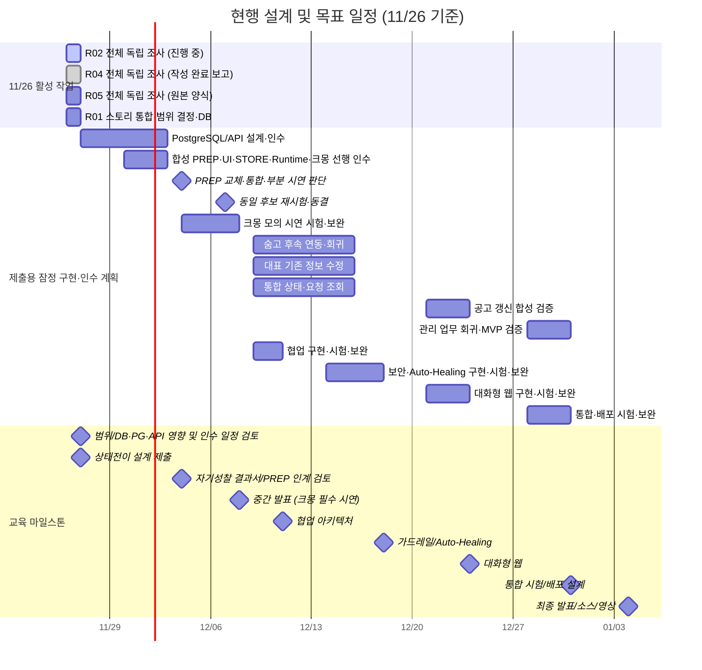

# 음악 레슨 강사 다중 플랫폼 등록·관리 지원 서비스 · WBS

<!-- Generated by tools/project_docs.py. Source: docs/artifacts/planning/lesson-registration-20261126/submission-review-source.json -->
> DLV-02 · 제출용 검토 기준 S1.0 · 2026-11-26. 실제 진척 기준 ef6ca8d. [현행 작업·이전 일정 입력 V0.8](../artifacts/planning/lesson-registration-20261123/wbs-v0.8-candidate.json) · [피드백](../artifacts/planning/lesson-registration-20261123/instructor-feedback-20261126.json). 아래 일정은 제출용 잠정 계획이고 기존 담당자 TASK·가용성·구현 재개를 변경하지 않는다.

## 1. 간트 차트와 현재 진척

11/26 막대는 당일 설계 목표 및 원본에서 확인한 상태, 미래 마일스톤은 기존 교육 제출일/내부 목표이다. 새로운 전체 공수·실행 일정이 아니다. 별도 [이전 V0.7 계획](../artifacts/planning/lesson-registration-20261123/wbs-v0.7-candidate.json)의 구현 기간은 새 설계 확정 후 재산정한다.

| 담당/작업 | 현재 원본에서 확인된 실적 | 계획 대비 잔여 |
| --- | --- | --- |
| R02 TASK-055 | 스토리 26·시스템 이벤트 14·근거 16. 크몽 사용자 확인 추가. 7개 조사 추가 진행·양방향 연결 및 A1–A5 미확정 | 완전성/공수 미확인 |
| R04 TASK-056 | 스토리 26·이벤트 16·7개 조사·근거 15·교차 연결 11, A1–A5 자체 통과 보고 | R01 검토 및 실제 공수 미확인 |
| R05 TASK-057 | 지정 독립 원본 초기 양식, 실적 미확인 | 공수·착수 확인 필요 |
| R01 TASK-058 | 공통 작업 계약·피드백 설계 입력, 통합 범위/DB 원본 미작성 | 3개 조사 수신·비교 이후 확정 |
| 기존 구현 TASK-048–054 | 이전 독립 시험 및 계획 보존, 현재 구현 보류 | 전환·재개 결정 후 재산정 |

[R02 원본](https://github.com/ik-e/chaja-you/blob/ef6ca8d1cbf3feb7a162e14be7d72dea685ebf97/docs/artifacts/planning/lesson-registration-20261126/R02/independent-result.json) · [R04 원본](https://github.com/ik-e/chaja-you/blob/ef6ca8d1cbf3feb7a162e14be7d72dea685ebf97/docs/artifacts/planning/lesson-registration-20261126/R04/independent-result.json) · [현재 작업 공간](../artifacts/planning/lesson-registration-20261126/README.md) · [실제 설계 입력](../artifacts/planning/lesson-registration-20261126/instructor-api-db-design-inputs.json). 팀원 보고·코드·검증 없는 진척/잔여는 추정하지 않는다. 당일 이후 새 결과에 맞춰 갱신.

## 2. 작업 및 의존성

### 2.0 재개 및 인수 판정

12/8 첫 시연: 크몽형 한 건 D01–D06 전체, 재접속 저장 결과까지 필수. 제품 MVP: 두 플랫폼 신규/추가 등록·대표 수정·통합 조회·요청 상태 확인. 후속: 공고 갱신 합성 검증 및 조건부 모니터링(필수 MVP 제외). 모든 외부 효과는 mock-only. 11/27 재개 결정, 12/3 선행 인수, 12/4 PREP 교체 및 통합 판정. 불합격 시 12/4에 검증된 연속 단계까지만 부분 시연을 선택하고 12/7 동일 후보 재시험 후 동결. 미완료 흐름은 필수 시연 합격으로 표시하지 않음.

| 시연 ID | 기능 | 행동 | 합격 조건 |
| --- | --- | --- | --- |
| D01 | F01, F05 | 원본·사진 저장 | 원본·첨부·version_id 저장 및 owner 조회 |
| D02 | F03, F06–F11 | 크몽형 준비·가격 확인 | 가격 충돌 질문, ready=false에서 실행 0; 확인값·출처 및 revision 보존 |
| D03 | F12, F13 | 직접 인증 | 강사 직접 인증, 동일 계정·권한 확인, 외부 비밀 미저장 |
| D04 | F16–F18 | 정보·범위 승인 | 명시 승인 두 항목, revision/digest/key 검증, job_id 반환 |
| D05 | F19, F22 | 모의 접수·독립 확인 | 접수 1회, 별도 조회로 대상·값·첨부·receipt 확인; 유실 시 재접수 0, 근거 없으면 unknown |
| D06 | F02, F23, F24, F29 | 재접속 저장 결과 | 재접속 후 같은 owner의 job·결과·근거 표시, 추가 효과 0 |

| 일자 | 담당/검토 | 인수·판정 조건 |
| --- | --- | --- |
| 11/27 | R01, 기존 담당 확인 | DLV-05 상태전이 제출, TASK-058 중 크몽형 D01–D06 및 DB/API 우선 검토. 각 실제 담당자 잔여 공수·가능일·선행 확인, R01의 재개 결정 기록 후 실제 TASK/WBS 갱신; 제출안에서 재개 승인하지 않음. |
| 12/3 | R03 조립 / R01, R04·R05 | PG 빈/기존 DB·FK·owner/경합, /v2 HTTP 실제 응답, UI/STORE/runtime/adapter 입력 출력·scope·receipt. 합성 PREP로 D01–D06 선행 인수; 실패하면 예비 축소 범위 기록. |
| 12/4 | R02→R03 / R01 | PREP 실제 모듈 교체, 가격 충돌/출처·30초·201/503·late CAS, 전체 D01–D06 재시험. 미충족 시 검증된 연속 단계만 시연; 합성 여부 표시. |
| 12/7 | R01 | 후보 commit/tree·schema/profile/fixture 및 연결 모듈 고정, 동일 후보 재시험·최종 부분/완료 판정. |

현재 새 /v2 동일 후보 D01–D06 제품 시험 0/6(미실행). 이전 제품 22개 gate와 별도 집계. 

| ID / 담당 | 작업 | 선행/완료 기준 | 목표 |
| --- | --- | --- | --- |
| TASK-055 / R02 | 독립 스토리·7개 플랫폼 | F01–F29/E01–E05 및 7개 × 6업무 근거·관계·오류·완료 증거, 지정 원본·자체 A1–A5 | 11/26 목표 |
| TASK-056 / R04 | 동일 전체 독립 조사 | 동일, 플랫폼을 나누지 않음 | 11/26 목표 |
| TASK-057 / R05 | 동일 전체 독립 조사 | 동일, 출처 및 불명 구분 | 11/26 목표 |
| TASK-058 / R01 | 통합·서비스 범위 결정 및 DB | 세 원본 비교/차이·누락, 범위 승인, 논리 DB/ERD·권한/상태/증빙·보존·7개 표현 검증(I1–I7), API 입력 | 11/26 목표, 근거 부족 시 미확정 |
| PG-PLAN / R01 | PostgreSQL 물리 설계·이관/실행 시험 계획 | 확정 범위/논리 DB, 기존 SQLite 차이·타입/FK/owner/state/관측·원자성/환경/공수 확인 | 11/27–30 잠정 설계·인수 |
| API-NEXT / R01 | 새 API·프로토콜 설계 | 스토리/DB 확정 후 actor/권한·응답·오류·timeout·버전 정합 | 11/27–30 잠정 계약 |
| RESUME-PLAN / R01 | 기존 구현 재개 및 통합 인수 계획 | DB/API 영향·담당자 공수/가용성 확인, 변경 계약·테스트 재기준화, 승인 | 11/27 일정 검토 후보 |

기존 R03 App/STORE/API, R02 PREP, R04 UI/숨고, R05 runtime/크몽, R01 공통 통합 작업 및 코드·검증·미충족 의무는 보류 보존. 현재 R03 신규 TASK 없음. 실제 구현 재개 이후 아래 인수 조건을 담당자와 확인한다.

## 3. 이전 구현 근거와 재개 시 인수·검증 계획

| 시험 | 실행일·기준 | 결과·제한 |
| --- | --- | --- |
| R03 HTTP | 11/25 fa40128 + 미커밋 worktree, [실행 기록](../artifacts/runs/TASK-050-s8-http-20261125.json) | 191 테스트(14 HTTP), 합성 PREP/SQLite; /v2·전체 제품 아님. |
| R04 UI/숨고 | 11/25 366cea92, [CI](https://github.com/ik-e/chaja-you/actions/runs/45565527174/job/139039245388) | 독립 9/6, 전체 연결 미확인. |
| R05 Runtime/크몽 | 11/25 main 366cea92 + c3fa0b19 + a3718a90, tree 10096b0f, [CI](https://github.com/ik-e/chaja-you/actions/runs/45568163241/job/139047965594) | 30/37 독립 조합, 합성 PREP, 전체 UI/HTTP 미연결. |
| R02 PREP | 11/25 [체크포인트](../../product/lesson-registration/evidence/team-integration-checkpoint-20261125.json) PR49/50 main, PR51/52 보고 | 44 합성 및 모델 3/5·4/5 보고, 가격 충돌 오류; 정확한 모델 실행 판/비용 미확인. |
| 새 통합 | 12/3, 12/4, 12/7 | 동일 commit/tree, PG 버전, OpenAPI hash, fixture, 실제 연결 모듈, 실행일/명령/로그. D01–D06과 제품 gate 별도. |

| 담당 | 11/25 기존 부분 실적 | 이전 공수/잔여(재산정 전) |
| --- | --- | --- |
| R01 | 공통 계약, 독립 조합 CI, 제품 preflight | 미확인 |
| R02 | 44개 합성 CI 및 실제 합성 모델 각 5건 보고(3/5, 4/5, 가격 충돌 오류), 후속 61개 합성 담당 보고 | 미확인 |
| R03 | HTTP 포함 191 독립 CI, 합성 launcher | 최초 11인일, 이전 잔여 3인일 |
| R04 | UI 9·숨고 6 독립 CI | 최초 4+3인일, 잔여 미확인 |
| R05 | Runtime 30/30·크몽 37/37 독립 조합 CI | 최초 7근무일, 이전 합산 잔여 3–3.5근무일 |
| 제품 | 기존 전체 22개 gate 0/22(not_run), preflight는 지원 근거 | 미확인 |

[이전 팀 통합 체크포인트](../../product/lesson-registration/evidence/team-integration-checkpoint-20261125.json) · [제품 시험 실행기](../../product/lesson-registration/evidence/PRODUCT-GATE.md). 위 관측값은 이전 후보·SQLite/모의 환경의 부분 시험이며 새 설계, PostgreSQL 및 전체 제품의 통과를 뜻하지 않는다.

| 검토/인수 목표 (후속 제안) | 전달→인수 | 입출력·검증 조건 |
| --- | --- | --- |
| 11/27 설계·가용성 검토 | R01↔기존 담당 | 확정 스토리/DB, 새 API 영향, PostgreSQL migration/환경/owner/state/증거, 실제 잔여와 재개 승인 |
| 12/4 PREP 인계 목표 (위험, 재산정) | R02→R03, R01 검토 | 준비 입력/출력·근거·누락/충돌·timeout/late revision, 코드/fixture·실험 비용·재현 명령·인수자가 확인 |
| 11/30–12/3 통합 선행 인수 | R03↔R04/R05 | 실제 HTTP/WS owner 및 새 DB, 등록/작업/권한·첨부·permit/lease/fence, UI·adapter/runtime 연결. 합성 provider로 선행 검토 가능하나 실제 시험과 구분 |
| 12/3 PostgreSQL 인수 목표 | R03 기존 담당 협의, R01 검토 | 빈 DB 초기 migration + 기존 합성 DB 이관, 앱 FK 위반 거절, owner·상태/CAS·중복·경합·rollback·증거/backup 시험 |
| 12/4 크몽 수직 통합 목표 | 기존 담당→R01 | 새 범위와 동일 후보에서 원본→준비/승인→실행→독립 증빙/저장 조회, 실제 PREP·UI/STORE/runtime 여부 표시 |
| 12/8 첫 시연 목표 | R01·기존 담당 재개 후 | 크몽 최초 등록 전체 흐름 필수 목표, 실제 연결 부족 시 합성/부분만 시연. 숨고 및 전체 제품 회귀 기준 별도 재검토 |

제품 완료는 새 범위의 수용 조건 및 기존 22개 gate의 적용/보강을 R01이 결정한 뒤 동일 후보 commit/환경/fixture/contract에서 실행. 각 독립 모듈 결과와 전체 제품 gate를 구분한다. 12/8 시연 성공을 제품 전체 통과로 주장하지 않는다. 실패/미실행/부분 통과/unknown 구분, 실제 모델 별도 승인, 승인되지 않은 외부 접근 금지.

## 4. 교육 마일스톤별 산출물 및 작업 창

| 마감/목표 | 산출물·작업 | 구현/시험/보완 계획 (재개·공수 확인 전 후보) |
| --- | --- | --- |
| 11/13 기존 | 기획서/WBS | 11/26 1차 보완, 2차 검토 후 최종 PDF 및 WBS 간트 캡처/편집 원본 |
| 11/20 기존 | API/DB | 11/26 제출 개정, 확정 스토리/DB→API 및 PostgreSQL 시험·검토 결과 후 동기화 |
| 11/27 | 상태전이 설계서 DLV-05 | 11/26–27 기존 상태전이 초안 대조·정상/충돌/실패 및 AI/코드 구분·검토. 신규 범위 영향 명시 |
| 12/4 | 자기성찰 결과서 DLV-06, PREP 인계 | 11/30–12/4 근거 있는 1회 보정 후보/기존 비교→합성 시험·실제 비용 승인 검토→보완/결과/인계; 과거 R02 실제 모델 시험과 자기성찰 시험 구분 |
| 12/8 | 중간 발표 및 첫 시연 | 새 범위·실제 인수에 따라 12/4–8 검토/시험/보완 후보, 크몽 우선 시연; 숨고 후속 |
| 12/11 | 협업 아키텍처 | 12/9 설계·역할/인계 → 12/10 구현·비교 시험 → 12/11 보완/검토 후보 |
| 12/18 | 가드레일/Auto-Healing | 12/14–15 권한·근거·실패 처리 → 12/16–17 오류/응답 유실·중복/조회 시험 → 12/18 보완/문서 후보 |
| 12/24 | 대화형 웹 | 12/21–22 연결 → 12/23 정상·예외·접근 시험 → 12/24 수정/시연 후보 |
| 12/31 | 통합 시험·배포 아키텍처 | 12/28–29 조립/배포 설계 → 12/30 회귀·보안/복원 시험 → 12/31 보완/재시험·문서 후보 |
| 2027/1/4 | 최종 발표·소스·영상 | 12/31–1/4 검증된 범위 발표/영상·고정 commit·열람/제출 확인 |

교육 마감·설계/문서 준비·실제 구현·시험·공식 접수 상태를 분리한다. 담당별 잔여 공수/가용성 및 새 설계 영향이 확인되면 작업 창과 간트를 갱신한다. 일정·기능 변경은 R01 판단, 제출 계획이며 신규 배정이나 보류 해제가 아님. [API·DB 설계 입력](../artifacts/planning/lesson-registration-20261126/instructor-api-db-design-inputs.json) · [기획서](기획서_제출본.md).

### 4.1 독립 산출물 및 인수 작업(제출용 잠정 일정)

| 작업 | 작성·실행 책임 / 검토 | 시작–완료 목표 | 완료 기준 |
| --- | --- | --- | --- |
| DLV-05 상태전이 설계 | R01 / R02·R03 | 11/26–27 | 대표 정상·가격 충돌·모델 실패 상태/전이·종료, 팀 검토 및 링크 확인 |
| PG/API 인수 | R01·R03 기존 책임 협의 / R01 | 11/27–12/3 | 빈/기존 가상 DB, FK·owner·state·경합 시험, 계약·UI/STORE 입력출력 확인 |
| PREP 인계 | R02 / R03 인수·R01 검토 | 11/30–12/4 | 입력·출력·fixture·오류·timeout 및 비용/실제 모델 근거, 12/3 사전 인수 |
| DLV-06 자기성찰 결과서 | R01 작성, R02 실험 / R03 검토 | 11/30–12/4 | 1회 보정 후보와 기존 비교, 결과/비용/미실행 구분, 검토 링크 |
| UI/Runtime/크몽 인수 | R04/R05, R03 조립 / R01 | 11/30–12/3 | 실제 UI·HTTP/WS·STORE·auth binding·adapter/receipt; 합성 응답과 구분 |
| I01 크몽 통합 | R03 조립 / R01 | 12/4–8 | 동일 후보 원본→승인→모의 접수→독립 재조회, 실제 PREP·DB·UI 연결; 미충족 시 합성/부분 시연 표시 |
| I02 숨고 후속 | R04/R03/R05 / R01 | 12/9–16 | 모의 설정/독립 조회 및 교차 회귀, 제품 전체 시험 별도 |
| GATE 제품 동일 후보 | R01 판정, 기존 담당 증빙 | 12/16–18 중간 회귀 및 12/28–31 최종 | 기존 22개 회귀 + MG-GATE 새 범위/PG 테스트, 코드·fixture·환경·실제 모델 고정, 독립 시험과 제품 완료 구분 |

위 날짜는 강사 검토를 위한 목표 배치이며 실제 공수/재개 승인을 뜻하지 않는다. 지연 시 크몽에서 확인한 범위만 시연하고 숨고 및 전체 제품 시험을 성공으로 표시하지 않는다.

### 4.2 V1.2 관리 기능의 개발·시험·인수 계획

제출용 잠정 작업 창이다. 신규 실제 TASK 배정 또는 보류 해제가 아니다. 12/8 크몽 시연을 우선하며 복수 플랫폼·대표 수정·통합 상태는 제품 MVP, 갱신은 제품 확장 시험으로 분리한다. 정책 근거 없는 실제 자동 실행은 제외하고 합성 fixture로 검증한다. R02 PREP는 12/4까지 기존 인계 목표를 유지하고 이후 관리 구현의 신규 책임으로 배정하지 않는다. 모든 담당·공수는 재개 전 협의한다.

| 작업/기능 | 선행 | 담당 후보·검토 | 목표/구현·시험·보완 | 완료 기준 |
| --- | --- | --- | --- | --- |
| MG-UPDATE / F14, F15, F16, F17, F18, F20, F22, F23, F24 | I01, PG/API 인수 | R03·R05 구현 협의, R04 UI / R01 검토 | 12/9–16 / 12/9–10 대상/전후 비교·계약, 12/11–14 구현, 12/15 시험, 12/16 보완 | 크몽형 합성 기존 객체 동일 ID, 승인값만 수정 1회·독립 확인; 대상 변경·권한·유실 시 0회 재실행 |
| MG-STATUS / F22, F23, F24, F25, F26, F27, F28, F29 | I01, PG/API 인수, I02 (복수 플랫폼 확인) | R03 저장/API, R04 UI, R05 조회 / R01 검토 | 12/9–16 / 12/9–10 저장 관측/상태 UI, 12/11–14 읽기 전용 실행, 12/15 시험, 12/16 보완 | 두 모의 플랫폼 저장 상태 통합, 요청 조회·실패/마지막 확인 구분, 미확인 후 별도 증거·원래 작업 불변·변경 효과 0 |
| MG-RENEW / F14, F15, F16, F17, F18, F21, F22, F23, F24, F29 | MG-UPDATE, MG-STATUS | R05/R03 합성 adapter·저장, R04 UI 협의 / R01 검토 | 12/21–24 / 12/21 설계·합성 게시판 규칙, 12/22 구현, 12/23 시험, 12/24 보완 | 합성 게시판 같은 native ID·갱신 시점 확인, 불허/미확인 차단, 중복 갱신 0. 제품 확장 검증이며 실제 뮬 허용 미확인 |
| MG-GATE / F19, F20, F21, F22, F23, F24, F25, F26, F27, F28, F29 | I02, MG-UPDATE, MG-STATUS, MG-RENEW | R01 판정, 기존 담당 증빙·회귀 | 12/28–31 / 12/28 조립·고정, 12/29–30 회귀·정상/오류 시험, 12/31 수정·재시험·결과 | 같은 원본 2개 플랫폼 신규/추가·대표 수정·통합 결과 MVP 및 별도 갱신/조회 관리 회귀. PG·API·증거·가치 측정 계획, 부분 통과 분리 |

관리 기능별 합성 API 정상/오류 사례와 게시 객체/업무/관측 연결은 [API 설계서](../step2/API_설계_문서.md) 및 [DB 설계서](../step2/데이터베이스_스키마_설계서.md)에서 고정한다. 새 설계의 실제 검증 완료를 기존 22개 gate의 이전 결과로 대체하지 않는다. 실제 공수/권한/가용성에 따른 축소 시 누락 기능을 표시하고 전체 MVP 완료를 주장하지 않는다.
