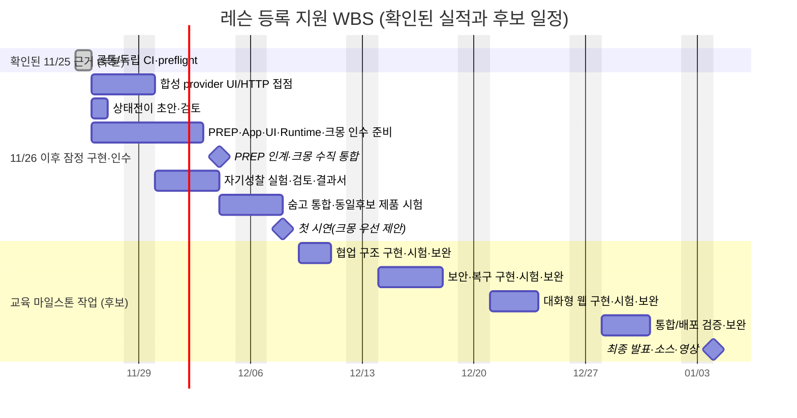

# 음악 레슨 강사 등록 지원 서비스 · WBS

> DLV-02 · 2026-11-26 · 기준 main d0ef345 · 강사 1차 의견 반영 개정 후보. [편집 원본 WBS V0.7](../artifacts/planning/lesson-registration-20261123/wbs-v0.7-candidate.json) · [이전 V0.6](../artifacts/planning/lesson-registration-20261123/wbs-v0.6-candidate.json) · [작업 공간](../../product/lesson-registration/WORKSPACE.json) · [피드백 대응](../artifacts/planning/lesson-registration-20261123/instructor-feedback-20261126.json). 배정 유지, 일정 창과 문서 담당/검토 제안은 팀 확인 전. PDF·2차 피드백·공식 제출 미완료.

## 1. 간트 차트 및 계획·실적

간트에서 **완료 막대는 11/25에 관측한 부분 근거**만 의미한다. 미래 막대는 인수·검토·통합 목표 창이며 확정 공수/가용성 또는 교육 마감 변경이 아니다. 기존 11/13·11/20 마감은 4절에 보존. 12/4와 12/8은 일정 위험 상태.

| 담당 | 확인된 부분 실적(11/25) | 초기/잔여 추정(일) | 다음 확인 |
| --- | --- | --- | --- |
| R01 | 공통 계약·독립 조합 CI·제품 preflight | 잔여 미확인 | 11/26~27 실제 후보 및 gate 등록 |
| R02 | 합성 PREP 44 독립 CI; 실제 모델 각 5건 보고(3/5, 4/5), 둘 다 가격 충돌 오류; 실제 모델 독립 재현 아님 | 잔여 미확인 | 11/27 I2/실험·비용, 12/3 사전 인수 |
| R03 | App/HTTP 등 191 CI, 합성 provider launcher | 최초 11인일, 이전 잔여 3인일(재확인) | 11/27 실제 App/WS/STORE/asset/slot 및 잔여 |
| R04 | UI 9, 숨고 6 독립 CI; 실제 화면·서버/독립 조회 연결 미완료 | 최초 UI 4+숨고 3인일, 잔여 미확인 | 11/27 양 작업 잔여·UI/adapter 접점 |
| R05 | Runtime 30/30·크몽 37/37 독립 조합 CI, 실제 App/권한·asset 연결 미확인 | 최초 7근무일, 이전 잔여 3~3.5근무일(두 TASK 합계, 최신 재추정 필요) | 11/27 잔여/실제 연결 |
| 제품 | preflight 통과 / 전체 수용 시험 0/22(not_run) | 전체 제품 공수 미확인 | 12/4 동일 후보 인수, 12/8 시연 및 gate 판정 별도 |

근거: [팀 통합 체크포인트](../../product/lesson-registration/evidence/team-integration-checkpoint-20261125.json) · [R05 조합 CI](https://github.com/ik-e/chaja-you/actions/runs/45568163241/job/139047965594) · [제품 수용 시험](../../product/lesson-registration/evidence/PRODUCT-GATE.md). 실제 실적 및 추정의 관측 기준일을 유지하며 이후 owner 보고로만 갱신한다.

## 2. 일정 관리 규칙

- 기존 TASK-048~054와 작업 공간의 단일 owner 및 코드 경계를 유지한다. 아래 문서 및 인수 검토 담당은 기존 역할에 따른 **일정 후보**이며 신규 TASK 배정, 제품/공통 계약 변경이 아니다. 독립 개발은 가능하며 선행 조건은 실제 통합 인수에 적용한다.
- 11/25 실질 설계·구현 착수. 매일 PLAN·코드·실행 근거·잔여 공수·가용성·막힘·다음 목표를 확인한다. 담당자 확인 없는 잔여 차감/완료일 약속 금지. R01 중요 범위·배정·공식 마감 변경 결정.
- 12/8 우선 시연은 크몽형 원본부터 독립 접수 결과 재조회까지 제안. 숨고형 후속 연결은 전체 제품 요구에서 제외하지 않는다. 모의 접수/실제 접수/심사 승인/공개를 구별한다. 동일 후보 22/22 제품 수용 시험을 통과해야 전체 완료.
- [기획서](기획서_제출본.md)의 핵심 사용자 가치 및 [판단 우선순위](../human/INTENT.md#intent-design-003--사용자-문제와-가치-중심의-기획설계-판단-우선순위)에 따라 사용자 스토리→DB→API 영향 검토, 기술 도입은 핵심 기능·가치에 기여할 때. [R01 일일 조정](../human/responses/HRESP-20261125-06_pain-first-rolling-plan.md).
- 교육 마감, 개정 문서 준비/검토, PDF 업로드·접수는 별도 상태로 관리한다. 간트/표 원본 편집 가능 링크는 위 JSON, 제출용 PDF·간트 캡처 및 열람 링크는 2차 피드백 반영 후 확인(현재 미완료).

## 3. 작업 계획표

### 3.1 제품 구현과 점진 통합

| ID / TASK | 담당 | 작업 | 통합 선행 | 목표 창(잠정) | 확인 실적 및 완료 근거 |
| --- | --- | --- | --- | --- | --- |
| C01 / TASK-048 | R01 | 공통 계약/lock/통합 | — | 11/26~27 확인 | 조합 CI와 preflight 있음; 전체 gate 미실행 |
| P01 / TASK-049 | R02 | PREP 실제 모델·검증 | C01 | 11/26~12/3 후보 | 44 독립 CI; PR51/52 draft, 실제 모델 3/5·4/5 보고(가격 충돌 실패); 잔여 미확인 |
| A01 / TASK-050 | R03 | App/저장/결과 조립 | C01 | 11/26~12/3 인수 후보 | 191 CI; 합성 launcher; 이전 잔여 3인일, 갱신 필요 |
| U01 / TASK-051 | R04 | UI 및 viewer 실제 연동 | C01 | 11/26~12/3 인수 후보 | UI 9 CI; 최초 4인일, 잔여 미확인 |
| S01 / TASK-052 | R04 | 숨고 adapter 및 독립 상태 조회 | C01 | 11/27~12/8 후보 | 숨고 6 CI; 최초 3인일, 잔여 미확인 |
| R00/R01/R02 / TASK-053 | R05 | Runtime/Viewer/STORE 연결 | C01,A01 | 11/26~12/3 인수 후보 | Runtime 30/30 독립 조합 CI, 실제 App/권한 연결 남음 |
| K01 / TASK-054 | R05 | 크몽 adapter/실제 모의 통합 | R00,A01 | 11/26~12/3 인수 후보 | 크몽 37/37 독립 조합 CI; R05 2 TASK 합계 이전 잔여 3~3.5근무일 |
| I01 / TASK-048 | R01(통합 검토), R03(조립) | 크몽 수직 통합 | C01,P-HAND,A01,U01,K01,R02 | 12/4 목표(위험) | 실제 I2·UI·저장·runtime/adapter 및 독립 접수 확인 |
| I02 / TASK-048 | R01(통합 검토), R04/R03/R05(연결) | 숨고 후속 통합·회귀 | I01,S01 | 12/8 목표(위험) | 두 플랫폼 별도 상태/증거, 교차 회귀; 전체 gate 유지 |

WBS 내부 ID R01/R02는 사람 역할과 별개. R05 잔여 3~3.5일은 합산 보고값이다. 실제 가용성에 따라 목표 창을 다시 검토한다.

### 3.2 모듈별 인수 조건과 확인일

| 확인일(후보) | 전달→인수 | 입력·출력 및 인수 경계 | 확인 조건 |
| --- | --- | --- | --- |
| 11/27 | R02→R03 | I2: SourceView/Profile/ResolvedAnswer → Preparation/typed Error, missing/conflict/ready, H5 revision/timeout | 계약·합성 사례 확인, 실제 모델 대기 |
| 11/27 | R04↔R03 | H1~H9: revision·review digest·result/status, 오류 응답·owner | 합성 launcher로 요청/응답 확인 |
| 11/27 | R05↔R03·R04 | I3 인증 binding·generation/lease, 동일 origin viewer mount/dispose; I4 permit/fence/approved asset | 모의 브라우저 및 인터페이스 확인 |
| 11/30~12/3 | R03→R05·R04 | 실제 App/STORE: 안정 slot·owner·asset bytes/digest·permit/fence·readback → 저장된 증거/조회 | 실제 구성 인수와 오류·타 owner 차단; 합성은 별도 |
| 12/3 사전, 12/4 목표 | R02→R03 | 실제 PREP/모델 구성·실행법·정확한 값/질문/오류·실험 비용 | R03 재현, R01 검토; 미인수 항목 명시 |
| 12/4 목표 | R03/R04/R05→R01 | 크몽 UI→I2→승인→실제 runtime/adapter+mock→독립 receipt→저장 결과 조회 | 같은 후보 고정, 실패/unknown/중복 방지 관측 |
| 12/8 목표 | R04/R03/R05→R01 | 숨고 category/question 저장 및 독립 readback, 두 대상 독립 승인·결과 | 후속 통합·회귀, 전체 gate와 시연 별도 |

**선행 검증 분리:** 합성 응답으로 H1~H9 화면·HTTP 계약·에러/조회부터 확인한다. 실제 모델 I2, 실제 저장·권한·세션·asset·adapter 접수/독립 조회는 해당 모듈 인수 후 검증하며 합성 성공으로 대체하지 않는다.

**12/4 지연 시 12/8 시연 분기:** (1) 실제 PREP/저장/UI/runtime/크몽 연결이 맞으면 원본~독립 receipt까지, (2) 실제 모델 미인수면 합성 PREP라고 표시한 연결 시연 및 준비/충돌 시나리오 별도 제시, (3) 연결/권한/증거가 불완전하면 확인된 모듈/준비만 부분 시연하고 접수·제품 완료를 주장하지 않음. 숨고는 후속 연결·회귀, 전체 22개 gate 유지. 안전 조건 미충족 시 해당 동작 중단.

### 3.3 교육 제출물·검증 작업(담당/검토 및 일정 후보)

| ID | 작성/통합 책임 | 검토/지원 | 작업 기간(후보) | 작업·완료 기준 |
| --- | --- | --- | --- | --- |
| DOC-05 | R01 | R02 기술 대조, R03 상태 경계 검토 | 11/26~11/27 | 11/26 대표 정상/충돌/누락/모델 실패 흐름·AI/코드·종료 정리 및 현행 코드 대조; 11/27 R02/R03 검토, R01 문서/제출 링크·열람 확인. 실행 결과를 설계 승인으로 대체하지 않음 |
| I-STUB | R03 | R04/R05; R01 인수 검토 | 11/26~11/30 | 합성 PREP/runtime 표기, H1~H9 요청/응답, revision 및 오류/owner/조회 확인; 실제 모델·런타임 통과로 계산하지 않음 |
| P-HAND | R02 | R03 인수, R01 검토 | 11/30~12/04 | I2 입력(SourceView/Profile/ResolvedAnswer)과 출력(Preparation facts/values/provenance/issues/ready)·오류·timeout/revision, 실행법/고정 fixture/모델 비용·반례, 인수자가 재현 및 미확인 목록 수령. 12/3 사전 인수 확인, 12/4 최종 인계 목표 |
| DOC-06 | R01 | R02 실험·결과, R03 인수 검토 | 11/30~12/04 | 현행 1회 생성/검증과 추가 보정 후보를 동일 합성 자료로 비교; 가격 충돌은 질문으로 종료, 원본 임의 변경 0; 실제 실행·비용·미실행을 구분하고 12/4 검토/링크 확인 |
| GATE-ALL | R01 | R02~R05 각 모듈 증빙, R03 조립 | 12/04~12/08 | 고정 commit/계약/fixture/environment에서 실제 모델(T5-08 별도 승인 실행), UI·저장·두 mock 플랫폼, 정상/오류/권한/독립 조회를 전부 시험. 22/22 pass만 제품 완료; 미실행/실패/부분 시연 별도 |
| DOC-07 | R01 | R02/R03 기술 검토 | 12/09~12/11 | 12/9 작업 분해·데이터 계약 및 적용 결정, 12/10 구현/동일 자료 비교 시험, 12/11 보완·검토/문서. 다중 모듈을 다중 AI로 과장 금지; 추가 모델 효과 별도 검증 |
| DOC-08-09 | R01 | R03/R04/R05 기존 owner 영역 | 12/14~12/18 | 12/14~15 권한·출처·오류 처리 구현/보완, 12/16~17 응답 유실·권한·이미지·중복/재조회 시험(DV-01/02/03, AT-03), 12/18 수정·재시험·문서. 외부 효과 재실행/자동 재개 금지 유지 |
| DOC-10 | R04 | R03 API, R05 viewer, R01 제출 검토 | 12/21~12/24 | 12/21~22 질문·정정·승인·상태 UI 연동/보완, 12/23 정상·예외·권한/접근성 시험, 12/24 수정·시연/링크 확인 |
| DOC-11-12 | R01 | R03/R04/R05 각 영역 | 12/28~12/31 | 12/28~29 고정 후보 통합/배포 설계, 12/30 회귀·보안·재현 시험, 12/31 보완·재시험·문서/링크. 실제 배포와 설계 구분 |
| FINAL | R01 | 전원 | 12/31~01/04 | 검증된 범위로 발표·영상·재현 가능한 고정 코드 및 제출 링크 확인; 미검증은 표시 |

**동일 후보 전체 시험:** R03 실제 조립 후보에 R02 실제 모델과 R04 UI/숨고·R05 runtime/크몽 연결. R01 검토 후 고정 commit, contract/fixture, 환경에서 22개 gate 실행. 각 owner는 입력·관측 상태·효과 수·독립 증빙을 제공하고 R01은 fail/incomplete/not_run/pass 구분. 12/8 부분 시연의 관측 범위와 제품 완료를 별도 기록. R02 실제 모델(T5-08)은 승인된 합성 시험만 별도 실행. [실행기 및 검토 규칙](../../product/lesson-registration/evidence/PRODUCT-GATE.md).

## 4. 마일스톤 및 제출 상태

| 교육 마감/목표 | 산출물 | 개정·검토 상태 |
| --- | --- | --- |
| 11/13 (기존) | 기획서·WBS | 11/26 1차 의견 보완 후보; 2차 요청·PDF·접수 전 |
| 11/20 (기존) | API·DB | 현행 후보, 사용자 스토리와 대조 및 검토 필요 |
| 11/27 | DLV-05 단일 에이전트 상태 전이 | 11/26~27 초안·기술 검토·링크 확인 |
| 12/4 | DLV-06 자기 성찰, PREP 인계·크몽 통합 목표 | 11/30~12/4 시험/결과·인계, 일정 위험 |
| 12/8 | 중간 발표·모의 MVP | 크몽 우선 시연 제안, 숨고 후속; 전체 gate 별도 |
| 12/11 | 협업 아키텍처 | 12/9~11 구현/검증/보완 |
| 12/18 | 보안·Auto-Healing | 12/14~18 구현/응답 유실·중복 방지 시험/보완 |
| 12/24 | 대화형 웹 앱 | 12/21~24 연동/시험/보완 |
| 12/31 | 통합 테스트·배포 설계 | 12/28~31 통합/회귀/배포 설계·검토 |
| 2027/1/4 | 최종 발표·소스·시연영상 | 검증된 범위와 재현 가능한 제출 링크 확인 |

[강사 OUTPUT-GUIDE](https://github.com/ik-e/chaja-you/blob/f5e685716a5ed4fb36159d215b3cc861ef3d5e79/docs/guidelines/instructor-snapshots/snapshots/299a7016748aab57c2de9f03fd38a8b09df4c07e/Lecture/FinalProject/OUTPUT-GUIDE.md) · [공식 문서 상태](../design/lesson-registration/CURRENT-DOCUMENTS.md). 1차 개정의 내용 보완은 2차 의견/공식 접수와 다르다.
