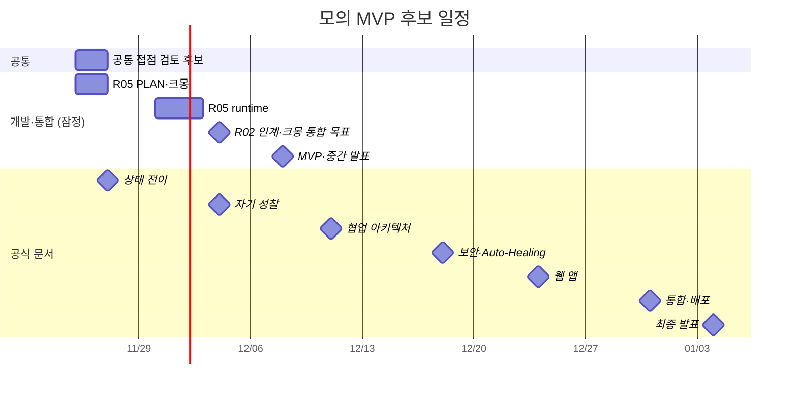

# 음악 레슨 강사 등록 지원 서비스 · WBS

> DLV-02 · 2026-11-25 · 기준 main f5e6857. [WBS V0.6 후보](https://github.com/ik-e/chaja-you/blob/f5e685716a5ed4fb36159d215b3cc861ef3d5e79/docs/artifacts/planning/lesson-registration-20261123/wbs-v0.6-candidate.json)와 [TASK/WORKSPACE](https://github.com/ik-e/chaja-you/blob/f5e685716a5ed4fb36159d215b3cc861ef3d5e79/product/lesson-registration/WORKSPACE.json) 반영. 배정 확정, 일정/잔여 공수 미확정, 공식 제출·접수 미확인. [11/23 이전 후보](https://github.com/ik-e/chaja-you/blob/f5e685716a5ed4fb36159d215b3cc861ef3d5e79/docs/step1/WBS_제출본.md).

## 1. 간트 차트 및 계획·실적

담당자별 잔여 기간·가용성은 일일 확인 사항이므로 확정되지 않은 기간의 임의 막대를 넣지 않았다. 공통 논리·물리 방향, lock, 독립 기술 검증은 main 반영. R03 S8/H1~H9 구현 main 반영, 담당자 run 기준 191개(HTTP 14개 포함) 통과·경로 검사 실패 1건(일일 문서 경로); 잔여 3인일 추정, 실제 provider/제품 통합 미확인. R05 7근무일 초기 추정, R02 12/4 인계 목표, R04 UI·숨고 PLAN main 반영(초기 4+3인일 추정), 실제 잔여 공수·가용성 미확인. 12/4 vertical 및 12/8 MVP 목표는 일정 위험 상태.

## 2. 일정 관리 규칙

- 실제 담당은 TASK-048~054 및 WORKSPACE의 단일 책임자. 독립 구현은 접점 검토와 병행 가능하며 표의 선행은 실제 통합 의존성이다.
- PLAN·코드·시험 및 실행 근거로 실적 판단. 담당 보고와 독립 재현, 제품 완료, 제출·접수 구별.
- 최초 공수와 잔여 공수 분리. 11/25를 실질 설계·구현 착수로 보고 초기 변경을 허용한다. 매일 PLAN/코드/검증·남은 공수·알려진 가용성/부재·막힘·다음 목표를 확인하고 필요한 일정/선행관계/자원 조정 후보만 갱신한다. 커밋 부재만으로 부재 판단 또는 개인 사유 기록 금지. 배정·범위·공식 마감·안전 조건 영향은 R01 판단 후 반영. [R01 운영 방향](../human/responses/HRESP-20261125-06_pain-first-rolling-plan.md).
- 22개 제품 gate 미충족 시 부분 시연·일정 조정 판단을 R01에 요청, 안전 시험 삭제 금지. W10/W16/PREP 인계 후 유지보수는 아직 추가 배정 아님.

## 3. 작업 계획표

| 후보 ID / TASK | 담당 | 작업 | 통합 선행 | 잠정 목표/공수 | 완료 근거 |
| --- | --- | --- | --- | --- | --- |
| C01 / TASK-048 | R01 | 공통 계약·lock·통합 | 없음 | 11/27 후보 | 공통 pin/ownership·CI·정합성 |
| P01 / TASK-049 | R02 | PREP 실제 모델·근거·검증·인계 | C01 | 12/4 목표, 공수 미확인 | I2, AT-01/T5-08/T6-02 |
| A01 / TASK-050 | R03 | App/KNOW/STORE/RESULT | C01 | 초기 11인일, 최신 보고 잔여 3인일(미확정) | H1~H9·S8·실제 저장/권한/판정 |
| U01 / TASK-051 | R04 | UI 및 viewer | C01 | PLAN 4인일 추정, 잔여/가용성 미확인 | 정상/오류·권한·detach |
| S01 / TASK-052 | R04 | 숨고 mock/adapter | C01 | PLAN 3인일 추정, UI 우선 및 stub 병행 후보 | S1~S6, AT-05 |
| R00 / TASK-053 | R05 | PLAN·runtime 접점 | 없음 | 11/25~27, 0.5일 | 권한·viewer·lease 검토 |
| K01 / TASK-054 | R05 | 크몽 독립 mock/adapter | R00 | 11/25~27, 2.5일 후보 | K1~K7, AT-04 |
| R01 / TASK-053 | R05 | runtime/fake STORE | R00 | 11/30~12/2, 3일 후보 | 격리·실행·관측·실패 |
| R02 / TASK-053 | R05 | 실제 STORE 연결 | R01,K01,A01 | 12/3, 1일 후보·12/4 버퍼 | 실제 binding·권한·원자성 |
| I01 / TASK-048 | R01 | 크몽 vertical 통합 | C01,P01,A01,U01,K01,R02 | 12/4 위험 | 실제 provider 동일 후보 |
| I02 / TASK-048 | R01 | 숨고 통합·회귀 | I01,S01 | 12/8 위험 | 22개 gate 전체 |

WBS 내부 ID R01/R02는 담당자명과 별개. [R03 보고 근거](https://github.com/ik-e/chaja-you/blob/f5e685716a5ed4fb36159d215b3cc861ef3d5e79/product/lesson-registration/evidence/r03-progress-20261125.json).

## 4. 마일스톤

| 날짜(가이드/후보) | 산출물 |
| --- | --- |
| 11/13 | 기획서·WBS, 개정 후보 |
| 11/20 | API·DB 설계서, 개정 후보 |
| 11/27 | 단일 에이전트 상태 전이 그래프, 공통 접점 후보 |
| 12/4 | 자기 성찰 테스트 결과서, PREP 인계·vertical 목표 |
| 12/8 | 중간 발표·모의 MVP 목표 |
| 12/11 | 협업 아키텍처 |
| 12/18 | 보안 가드레일·Auto-Healing |
| 12/24 | 대화형 웹 앱 |
| 12/31 | 통합 테스트·배포 아키텍처 |
| 2027/1/4 | 최종 발표·코드·시연영상 |

[11/24 보존 가이드](https://github.com/ik-e/chaja-you/blob/f5e685716a5ed4fb36159d215b3cc861ef3d5e79/docs/guidelines/instructor-snapshots/snapshots/299a7016748aab57c2de9f03fd38a8b09df4c07e/Lecture/FinalProject/Doc/README.md) 및 V0.6 후보 기준. 최신 대시보드 마감/접수와 WBS 별도 Projects/시트 캡처 확인 필요. 이 Markdown/Gantt는 실제 캡처를 대체하지 않는다.

**추가 최신 진행 근거 (main 4992959):** [R03 S8 run](https://github.com/ik-e/chaja-you/blob/4992959c08a12ad81a983ea4a89fed0837c0f1f8/docs/artifacts/runs/TASK-050-s8-http-20261125.json) · [TASK-050](https://github.com/ik-e/chaja-you/blob/4992959c08a12ad81a983ea4a89fed0837c0f1f8/docs/artifacts/tasks/TASK-050.json). V0.6 일정 원본은 수정하지 않으며 최신 잔여 공수 보고를 다음 일정 조정의 입력으로 구분한다. 독립 run은 당시 worktree에서 합성 provider로 실행, 실제 22개 제품 시험은 미실행.

**R04 최신 계획 근거 (main 117f14d):** [UI PLAN](https://github.com/ik-e/chaja-you/blob/117f14d4d375efd767cd7f2097f721ce255f73f1/product/lesson-registration/tests/modules/web/PLAN.md) · [숨고 PLAN](https://github.com/ik-e/chaja-you/blob/117f14d4d375efd767cd7f2097f721ce255f73f1/product/lesson-registration/tests/modules/soomgo/PLAN.md). TASK-051/052 진행 중·배정 수신 확인. 초기 4/3 MD는 합산 후보 7 MD이지 잔여 공수나 확정 일자가 아니다. 실제 진행·가용성 및 R02/R05 계획을 일일 확인한다. WBS V0.6 원본의 일정은 이 작업에서 확정하지 않는다.

**R04 추가 진행 근거 (main 4ab3285):** [API client](https://github.com/ik-e/chaja-you/blob/4ab3285f3cb767fb8c36ec3b54d5c4e61e9a9fb3/product/lesson-registration/web/api/client.py) · [workflow](https://github.com/ik-e/chaja-you/blob/4ab3285f3cb767fb8c36ec3b54d5c4e61e9a9fb3/product/lesson-registration/web/workflow.py) · [단위 시험](https://github.com/ik-e/chaja-you/blob/4ab3285f3cb767fb8c36ec3b54d5c4e61e9a9fb3/product/lesson-registration/tests/modules/web/test_api_client.py) · [일일 보고](https://github.com/ik-e/chaja-you/blob/4ab3285f3cb767fb8c36ec3b54d5c4e61e9a9fb3/docs/members/R04/daily/2026-11-25.md). API client/workflow 구현 및 7개 단위 시험 통과는 담당자 보고. 실제 화면·viewer·provider 통합과 숨고 adapter 구현 완료/잔여 공수는 미확인. 계획표의 추정 공수를 임의 차감하지 않는다.

**R05 최신 진행 근거 (11/25):** [Runtime PLAN·시험 8e506e1](https://github.com/ik-e/chaja-you/blob/8e506e1a7a27756909b0ca40b074bc37bc0dc58c/product/lesson-registration/tests/modules/remote/PLAN.md) · [크몽 PLAN·시험 ae582bf](https://github.com/ik-e/chaja-you/blob/ae582bf7ff04435f4f2876d72a916c141282d85f/product/lesson-registration/tests/modules/kmong/PLAN.md) · [R01 고정 검토](https://github.com/ik-e/chaja-you/blob/main/product/lesson-registration/evidence/r05-progress-20261125.json). 기존 7근무일은 초기 추정, **잔여 3~3.5근무일(두 TASK 합계)** 보고: Viewer WS 1일, 크몽/runtime 1일, CI 0.5일, R03 협의 0.5~1일. R05 Windows Chromium 15개 및 크몽 32개 담당자 보고·코드 확인, 독립 CI 및 D01~04 정합성/실제 모듈 연결 미완료. [갱신 V0.6 후보](../artifacts/planning/lesson-registration-20261123/wbs-v0.6-candidate.json). 기존 간트는 잠정 일정 이력이며 확정 날짜로 변경하지 않음. 12/4·12/8 목표와 22개 gate 유지.

**R05 독립 검증 추가 (11/25):** [고정 커밋 CI](https://github.com/ik-e/chaja-you/actions/runs/45558575503)에서 Runtime 15/15(Chromium 143.0.7499.4), 크몽 32/32 통과. 최초/잔여 공수 추정과 실제 통합 및 D01~04 보완은 별도 유지; 제품 22개 gate 미실행.

**팀 후속 검토 (11/25):** [고정 검토·실제 근거](../../product/lesson-registration/evidence/team-checkpoint-20261125.json) · [R02 PR51](https://github.com/ik-e/chaja-you/pull/51)·[PR52](https://github.com/ik-e/chaja-you/pull/52) draft, 44개 합성 CI 및 실제 5×2 사례 보고(양 모델 가격 충돌 오류). R03 합성 API 실행기 main 31fe0c5, 잔여 3 MD 보고. R04 UI/숨고 9/6 독립 CI, 실제 연동/정합성 보완 필요, 초기 4+3 MD 보존·잔여 미확인. R05 15/32 CI 재현 및 잔여 3~3.5일 보고 유지(갱신 대기). [제품 gate 실행 체계](../../product/lesson-registration/evidence/PRODUCT-GATE.md) 준비, 전체 case 0/22. 목표 날짜/공식 제출 여부/가용성은 미확정.

**공통 preflight 검증:** [독립 CI](https://github.com/ik-e/chaja-you/actions/runs/45562142407/job/139028150937)에서 runner 4, 합성 HTTP 14, launcher 1개(두 플랫폼) 통과. 제품 gate 22개 전체 미실행 및 release gate 차단 확인. [근거](../../product/lesson-registration/evidence/product-gate-preflight-20261125.json).
