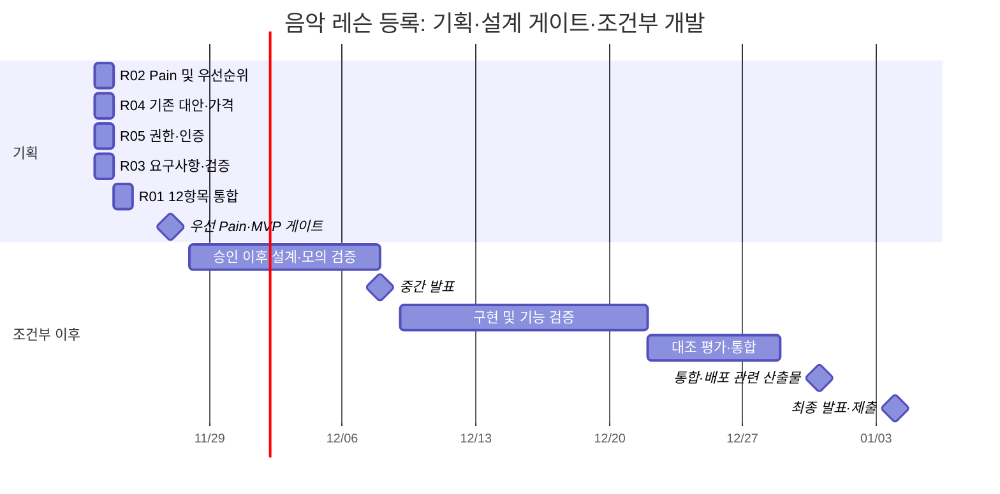

# 음악 레슨 강사 등록 지원 서비스 WBS — 개정 제출 후보

> **Step 1 · DLV-02 · 2026-11-23 개정 · 조건부 계획 · 실제 제출/접수 미확인.** [현재 Phase](../human/phase-intents/PHASE-20261123-01.md)와 [TASK-028~032](../artifacts/planning/lesson-registration-20261123/README.md) 기준의 계획안입니다. 과거 찾아you APP-A/C WBS는 [11/19 이력](../submissions/step1-step2-20261119/README.md)과 Git 이력에 보존합니다. 이후 개발 일정·공수·담당은 **미승인**입니다.

## 1. 간트 차트 (주차별 계획·실적)

### 1.1 전체 8주 일정 프레임

| 구간 | 목표·산출물 | 현재 판정 |
| --- | --- | --- |
| 1주차 11/10~11/16 | 사용자 문제 및 멘토 피드백 탐색 | 이전 조사 이력 보존, 신규 제품 구현 실적 아님 |
| 2주차 11/17~11/23 | 후보 검토→11/23 기획 방향 채택, R02~R05 근거 조사 | 방향·TASK 계약 반영, 개인 신규 결과 미확인 |
| 3주차 11/24~11/30 | R01 12항목 통합, 첫 Pain/플랫폼/가치/권한 검증, MVP 결정 | 계획·선행 미충족 |
| 4주차 12/01~12/07 | 승인 범위의 흐름·설계·모의 검증 및 발표 준비 | 조건부, 미승인 |
| 5주차 12/08~12/14 | 12/08 중간 발표·피드백·재계획 | 교육일정 참고, 실적 미확인 |
| 6주차 12/15~12/21 | 허용된 범위 MVP/기능 시험 | 정책·보안·가치 게이트 조건부 |
| 7주차 12/22~12/28 | 직접 작업·범용 AI·전용 서비스 대조, 통합·실패 사례 | 조건부 |
| 8주차 12/29~01/04 | 12/31 통합·배포 산출물, 01/04 최종 발표·제출 | 공식 마감 참고, 실적 미확인 |

### 1.2 간트: 아래 모든 막대는 계획이며 실제 진척 표시가 아닙니다

| 실제 기록 (2026-11-23 기준) | 관찰 | 완료로 판정하지 않는 항목 |
| --- | --- | --- |
| 현재 Phase 및 TASK 계약 | GitHub main 반영 | 사용자 수요·정책 검증이 끝난 것은 아님 |
| TASK-028~031 | 지정 결과 파일 및 result 확인 전 | 개인별 착수 여부 단정 금지 |
| TASK-032 | R01 V0.1 초안 작성 | 팀원 조사 반영·완료 기준 검증 전 |
| Step1·2 개정 문서 | 제출 **후보 문서** 준비 | PDF/DOCX 렌더·대시보드 등록·접수는 미확인 |
| 앱/에이전트/자동 등록 | 구현 기록 없음 | 옛 찾아you 진척을 재사용하지 않음 |

## 2. 일정 관리 규칙

1. 현재 작업 판단은 장기 Intent → 활성 Phase → CURRENT → TASK → 담당 결과·근거 순서로 확인합니다.
2. **실적**은 지정된 파일·commit·TASK result와 검증 판정이 확인된 경우에만 기록합니다. 기획 초안과 실제 기능 구현·서류 제출은 구분합니다.
3. TASK-028~032는 현재 지정된 owner가 관리합니다. 이후 구현/설계 작업은 결과에 따라 별도 TASK로 승인·배분하며 이 WBS가 자동 할당하지 않습니다.
4. 선행 게이트: 실제 사용자 Pain·강한 대안 대비 가치, 등록 허용 플랫폼과 안전한 인증, F1~F3 성공/미확인 조건. 허용 경로가 없으면 자동 게시를 보류하고 가치 제안을 재검증합니다.
5. 지연·막힘은 제출 미확인, 외부 정책 차단, 사용자 가치 반증, 기술 불확실성을 구분합니다. 추정 사유로 팀원을 지연 처리하지 않습니다.
6. 범위 변경 시 영향받는 후속 작업만 재산정합니다. 담당·검토자·1~3일 작업 단위·버퍼·핵심 경로는 MVP가 결정된 뒤 상세 WBS에 확정합니다.
7. 문서 작성/리뷰, 공식 제출, 실제 접수, 구현·테스트·시연은 분리해 기록합니다. 기존 찾아you의 W01~W34는 이력이며 이번 완료율 계산에서 제외합니다.

## 3. 작업 계획표

### 3.1 현재 TASK (담당과 내부 목표일은 기존 계약 유지)

| ID | 담당 | 선행 | 목표 | 산출물과 완료 판단 | 상태 |
| --- | --- | --- | --- | --- | --- |
| [028](../artifacts/tasks/TASK-028.json) | R02 | 없음 | 11/23 | 업무 4종의 빈도·손실·근거, 첫 Pain·타깃 제안 | 결과 미확인 |
| [029](../artifacts/tasks/TASK-029.json) | R04 | 없음 | 11/23 | 대안 3~5개, 가격/실제 해결/남은 부담 대조 | 결과 미확인 |
| [030](../artifacts/tasks/TASK-030.json) | R05 | 없음 | 11/23 | 서버/로컬/API·인증/세션·플랫폼 위임 가능성 | 결과 미확인 |
| [031](../artifacts/tasks/TASK-031.json) | R03 | 없음 | 11/23 | F1~F3 계약·실패 상태, 동일 조건 비교 계획 | 결과 미확인 |
| [032](../artifacts/tasks/TASK-032.json) | R01 | 028~031 | 11/24 | 12항목·BM·MVP·설계 착수/차단 조건 통합 | V0.1만 존재 |

### 3.2 후속 작업 후보 (미배정·일정 유동)

| 계획 ID | 작업 | 선행 조건 | 산출/완료 증거 | 담당 |
| --- | --- | --- | --- | --- |
| P01 | 업무별 실측과 추가 강사 수요·가격 조사 | 028·029 | 실측·진술·추정 구분 표 | 미배정 |
| P02 | 실제 등록 허용 경로/세션 안전성 확인 | 030 | 허용·차단·미확인 및 공식 근거 | 미배정 |
| P03 | 핵심 Pain·MVP·첫 플랫폼 승인 | 031·032·P01·P02 | R01 의도/결정·재검토 조건 | R01 판단 |
| P04 | 승인 범위의 사용자 흐름/예외/검증 케이스 | P03 | 계약·시나리오·정답 사례 | 미배정 |
| P05 | API·DB·보안·권한 논리 설계 확정 | P02~04 | 실제 채택 구조 및 교차 검토 | 미배정 |
| P06 | 모의 플랫폼·동일 조건 평가 환경 | P03~05 | 샘플 원본·양식·시작 조건 | 미배정 |
| P07 | 승인된 최소 기능 구현·단위/통합 검증 | P02~06 | 코드·실행/검증 기록 | 미배정 |
| P08 | 직접 등록 / Codex / 전용 서비스 대조 | P06~07 | 직접 작업 시간·개입·정확도·비용 | 미배정 |
| P09 | 실패·중복·인증·정책 안전 검증 | P07 | 실행 근거·차단/복구 판정 | 미배정 |
| P10 | 발표·배포·최종 제출 준비/검토 | 단계 결과 | 산출물·가독성·공유/접수 증거 | 미배정 |

**작업 분해 상태:** P01~10은 전체 산출물 누락 방지용 상위 구조입니다. 아직 1~3일 상세 단위의 100% WBS·개발 공수·담당 합의가 끝나지 않았으며 이를 숨기지 않습니다.

## 4. 마일스톤

| ID | 목표일 | 통과 조건 | 11/23 판정 |
| --- | --- | --- | --- |
| M0 | 11/23 | 기획 방향 채택·Phase/TASK 반영 | **의도/계약 반영 완료** |
| M1 | 11/24 내부 | 담당 근거 수합·12항목 통합·열린 결정 정리 | 아직 미완료 |
| M2 | 11/27 제안 | 첫 Pain·기존 대안 대비 가치·등록 허용 경로·MVP 게이트 | 일정/결정 조건부 |
| M3 | 12/08 공식 | 중간 발표 및 가용 범위 검증 결과 | 준비·제출 미확인 |
| M4 | 12/31 공식 | 통합 시험·배포 아키텍처 관련 산출물 | 미확인 |
| M5 | 2027/01/04 공식 | 최종 발표·산출물/접수 | 미확인 |

### 제출 전 남은 확인

WBS 제출은 **GitHub Projects 또는 시트 화면의 가독성 있는 캡처**가 별도로 요구됩니다. 이 문서의 Mermaid 간트는 캡처 대체물이 아닙니다. [공식 가이드](../guidelines/instructor-snapshots/reviews/STEP1-STEP2-V2-GUIDE-AUDIT-20261118.md)대로 실제 화면·문서 렌더, 매니저/강사 열람, 대시보드 링크 등록·제출완료·접수 확인을 별도로 수행해야 합니다.
