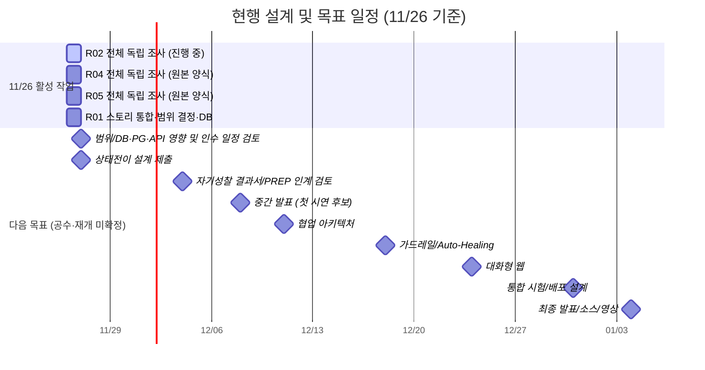

# 음악 레슨 강사 다중 플랫폼 등록·관리 지원 서비스 · WBS

> DLV-02 · 2026-11-26 · 강사 1차 피드백 반영 개정 후보 V0.8. 실제 작업 스냅샷 bb73955. [구조화 원본](../artifacts/planning/lesson-registration-20261123/wbs-v0.8-candidate.json) · [이전 V0.7 계획](../artifacts/planning/lesson-registration-20261123/wbs-v0.7-candidate.json) · [피드백](../artifacts/planning/lesson-registration-20261123/instructor-feedback-20261126.json). 기존 교육 마감 및 12/8·1/4 목표 보존; 담당 수신·신규 일정/공수·구현 재개 미확정.

## 1. 간트 차트와 현재 진척

11/26 막대는 당일 설계 목표 및 원본에서 확인한 상태, 미래 마일스톤은 기존 교육 제출일/내부 목표이다. 새로운 전체 공수·실행 일정이 아니다. 별도 [이전 V0.7 계획](../artifacts/planning/lesson-registration-20261123/wbs-v0.7-candidate.json)의 구현 기간은 새 설계 확정 후 재산정한다.

| 담당/작업 | 현재 원본에서 확인된 실적 | 계획 대비 잔여 |
| --- | --- | --- |
| R02 TASK-055 | 스토리 26·시스템 이벤트 14·근거 15. 7개 조사 추가 진행·양방향 연결 및 A1~A5 미확정 | 완전성/공수 미확인 |
| R04 TASK-056 | 지정 독립 원본 초기 양식, 실적 미확인 | 공수·착수 확인 필요 |
| R05 TASK-057 | 지정 독립 원본 초기 양식, 실적 미확인 | 공수·착수 확인 필요 |
| R01 TASK-058 | 공통 작업 계약·피드백 설계 입력, 통합 범위/DB 원본 미작성 | 3개 조사 수신·비교 이후 확정 |
| 기존 구현 TASK-048~054 | 이전 독립 시험 및 계획 보존, 현재 구현 보류 | 전환·재개 결정 후 재산정 |

[R02 원본](https://github.com/ik-e/chaja-you/blob/bb73955af88c4c7b41255f0d8b5c5c2de213d2cd/docs/artifacts/planning/lesson-registration-20261126/R02/independent-result.json) · [현재 작업 공간](../artifacts/planning/lesson-registration-20261126/README.md) · [실제 설계 입력](../artifacts/planning/lesson-registration-20261126/instructor-api-db-design-inputs.json). 팀원 보고·코드·검증 없는 진척/잔여는 추정하지 않는다. 당일 이후 새 결과에 맞춰 갱신.

## 2. 작업 및 의존성

| ID / 담당 | 작업 | 선행/완료 기준 | 목표 |
| --- | --- | --- | --- |
| TASK-055 / R02 | 독립 스토리·7개 플랫폼 | F01~F29/E01~E05 및 7개 × 6업무 근거·관계·오류·완료 증거, 지정 원본·자체 A1~A5 | 11/26 목표 |
| TASK-056 / R04 | 동일 전체 독립 조사 | 동일, 플랫폼을 나누지 않음 | 11/26 목표 |
| TASK-057 / R05 | 동일 전체 독립 조사 | 동일, 출처 및 불명 구분 | 11/26 목표 |
| TASK-058 / R01 | 통합·서비스 범위 결정 및 DB | 세 원본 비교/차이·누락, 범위 승인, 논리 DB/ERD·권한/상태/증빙·보존·7개 표현 검증(I1~I7), API 입력 | 11/26 목표, 근거 부족 시 미확정 |
| PG-PLAN / R01 | PostgreSQL 물리 설계·이관/실행 시험 계획 | 확정 범위/논리 DB, 기존 SQLite 차이·타입/FK/owner/state/관측·원자성/환경/공수 확인 | 11/27 검토 후보, 구체 일정 미확정 |
| API-NEXT / R01 | 새 API·프로토콜 설계 | 스토리/DB 확정 후 actor/권한·응답·오류·timeout·버전 정합 | 후속, 날짜 미확정 |
| RESUME-PLAN / R01 | 기존 구현 재개 및 통합 인수 계획 | DB/API 영향·담당자 공수/가용성 확인, 변경 계약·테스트 재기준화, 승인 | 11/27 일정 검토 후보 |

기존 R03 App/STORE/API, R02 PREP, R04 UI/숨고, R05 runtime/크몽, R01 공통 통합 작업 및 코드·검증·미충족 의무는 보류 보존. 현재 R03 신규 TASK 없음. 실제 구현 재개 이후 아래 인수 조건을 담당자와 확인한다.

## 3. 이전 구현 근거와 재개 시 인수·검증 계획

| 담당 | 11/25 기존 부분 실적 | 이전 공수/잔여(재산정 전) |
| --- | --- | --- |
| R01 | 공통 계약, 독립 조합 CI, 제품 preflight | 미확인 |
| R02 | 44개 합성 CI 및 실제 합성 모델 각 5건 보고(3/5, 4/5, 가격 충돌 오류), 후속 61개 합성 담당 보고 | 미확인 |
| R03 | HTTP 포함 191 독립 CI, 합성 launcher | 최초 11인일, 이전 잔여 3인일 |
| R04 | UI 9·숨고 6 독립 CI | 최초 4+3인일, 잔여 미확인 |
| R05 | Runtime 30/30·크몽 37/37 독립 조합 CI | 최초 7근무일, 이전 합산 잔여 3~3.5근무일 |
| 제품 | 기존 전체 22개 gate 0/22(not_run), preflight는 지원 근거 | 미확인 |

[이전 팀 통합 체크포인트](../../product/lesson-registration/evidence/team-integration-checkpoint-20261125.json) · [제품 시험 실행기](../../product/lesson-registration/evidence/PRODUCT-GATE.md). 위 관측값은 이전 후보·SQLite/모의 환경의 부분 시험이며 새 설계, PostgreSQL 및 전체 제품의 통과를 뜻하지 않는다.

| 검토/인수 목표 (후속 제안) | 전달→인수 | 입출력·검증 조건 |
| --- | --- | --- |
| 11/27 설계·가용성 검토 후보 | R01↔기존 담당 | 확정 스토리/DB, 새 API 영향, PostgreSQL migration/환경/owner/state/증거, 실제 잔여와 재개 승인 |
| 12/4 PREP 인계 목표 (위험, 재산정) | R02→R03, R01 검토 | 준비 입력/출력·근거·누락/충돌·timeout/late revision, 코드/fixture·실험 비용·재현 명령·인수자가 확인 |
| 통합 선행(날짜 재산정) | R03↔R04/R05 | 실제 HTTP/WS owner 및 새 DB, 등록/작업/권한·첨부·permit/lease/fence, UI·adapter/runtime 연결. 합성 provider로 선행 검토 가능하나 실제 시험과 구분 |
| 실제 PostgreSQL 인수(재개 이후) | R03 기존 담당 협의, R01 검토 | 빈 DB 초기 migration + 기존 합성 DB 이관, 앱 FK 위반 거절, owner·상태/CAS·중복·경합·rollback·증거/backup 시험 |
| 12/4 크몽 수직 통합 검토 목표(이전 후보) | 기존 담당→R01 | 새 범위와 동일 후보에서 원본→준비/승인→실행→독립 증빙/저장 조회, 실제 PREP·UI/STORE/runtime 여부 표시 |
| 12/8 첫 시연 목표 | R01·기존 담당 재개 후 | 크몽 최초 등록 전체 흐름 우선 제안, 실제 연결 부족 시 합성/부분만 시연. 숨고 및 전체 제품 회귀 기준 별도 재검토 |

제품 완료는 새 범위의 수용 조건 및 기존 22개 gate의 적용/보강을 R01이 결정한 뒤 동일 후보 commit/환경/fixture/contract에서 실행. 각 독립 모듈 결과와 전체 제품 gate를 구분한다. 12/8 시연 성공을 제품 전체 통과로 주장하지 않는다. 실패/미실행/부분 통과/unknown 구분, 실제 모델 별도 승인, 승인되지 않은 외부 접근 금지.

## 4. 교육 마일스톤별 산출물 및 작업 창

| 마감/목표 | 산출물·작업 | 구현/시험/보완 계획 (재개·공수 확인 전 후보) |
| --- | --- | --- |
| 11/13 기존 | 기획서/WBS | 11/26 1차 보완, 2차 검토 후 최종 PDF 및 WBS 간트 캡처/편집 원본 |
| 11/20 기존 | API/DB | 11/26 제출 개정, 확정 스토리/DB→API 및 PostgreSQL 시험·검토 결과 후 동기화 |
| 11/27 | 상태전이 설계서 DLV-05 | 11/26~27 기존 상태전이 초안 대조·정상/충돌/실패 및 AI/코드 구분·검토. 신규 범위 영향 명시 |
| 12/4 | 자기성찰 결과서 DLV-06, PREP 인계 | 11/30~12/4 근거 있는 1회 보정 후보/기존 비교→합성 시험·실제 비용 승인 검토→보완/결과/인계; 과거 R02 실제 모델 시험과 자기성찰 시험 구분 |
| 12/8 | 중간 발표 및 첫 시연 | 새 범위·실제 인수에 따라 12/4~8 검토/시험/보완 후보, 크몽 우선 시연 제안 |
| 12/11 | 협업 아키텍처 | 12/9 설계·역할/인계 → 12/10 구현·비교 시험 → 12/11 보완/검토 후보 |
| 12/18 | 가드레일/Auto-Healing | 12/14~15 권한·근거·실패 처리 → 12/16~17 오류/응답 유실·중복/조회 시험 → 12/18 보완/문서 후보 |
| 12/24 | 대화형 웹 | 12/21~22 연결 → 12/23 정상·예외·접근 시험 → 12/24 수정/시연 후보 |
| 12/31 | 통합 시험·배포 아키텍처 | 12/28~29 조립/배포 설계 → 12/30 회귀·보안/복원 시험 → 12/31 보완/재시험·문서 후보 |
| 2027/1/4 | 최종 발표·소스·영상 | 12/31~1/4 검증된 범위 발표/영상·고정 commit·열람/제출 확인 |

교육 마감·설계/문서 준비·실제 구현·시험·공식 접수 상태를 분리한다. 담당별 잔여 공수/가용성 및 새 설계 영향이 확인되면 작업 창과 간트를 갱신한다. 일정·기능 변경은 R01 판단, 신규 배정이나 보류 해제가 아님. [API·DB 설계 입력](../artifacts/planning/lesson-registration-20261126/instructor-api-db-design-inputs.json) · [기획서](기획서_제출본.md).
