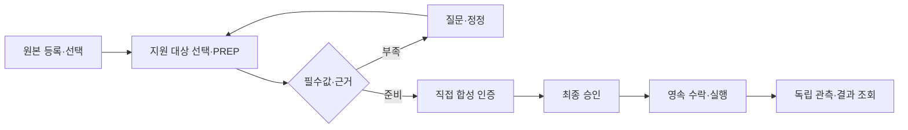

# 음악 레슨 강사 신규 채널 등록 지원 서비스 · 기획서 및 요구사항 명세서

> DLV-01 · 2026-11-25 · 기준 main f5e6857 · 개정 제출 후보, 공식 제출·접수 미확인. [11/23 이전 제출 후보](https://github.com/ik-e/chaja-you/blob/f5e685716a5ed4fb36159d215b3cc861ef3d5e79/docs/step1/기획서_제출본.md).

[기획 V1.1](https://github.com/ik-e/chaja-you/blob/f5e685716a5ed4fb36159d215b3cc861ef3d5e79/docs/artifacts/planning/lesson-registration-20261123/proposal-v1.1.md) · [채택 기록](https://github.com/ik-e/chaja-you/blob/f5e685716a5ed4fb36159d215b3cc861ef3d5e79/docs/artifacts/design/lesson-registration-20261124/adoption-20261125.json) · [현행 설계](../design/lesson-registration/CURRENT-DESIGN.md) · [공통 V1](https://github.com/ik-e/chaja-you/blob/f5e685716a5ed4fb36159d215b3cc861ef3d5e79/docs/artifacts/design/lesson-registration-20261124/common-integration-v1.json) · [REQ 원본](https://github.com/ik-e/chaja-you/blob/f5e685716a5ed4fb36159d215b3cc861ef3d5e79/docs/artifacts/design/lesson-registration-20261124/implementation-v0.4.json).

## 1. 서비스 정의

### 1.1 타깃 사용자와 이용 상황

이미 소개글·사진·수업 조건을 보유하고 새로운 모집 채널에 처음 등록하려는 개인 음악 레슨 강사. 원본을 제공하고, 누락과 충돌을 확인하고, 플랫폼에 직접 인증하고, 등록할 정확한 내용과 대상을 한 번 최종 승인하는 업무를 대상으로 한다. 수강생 모집·상담·수업 자체를 대신하지 않는다.

### 1.2 페인포인트와 근거

| Pain | 관찰 근거 | 한계 |
| --- | --- | --- |
| 자료 재가공·검수 | R02의 직접 경험: 플랫폼별 제목·가격·패키지·이미지 등 재입력 | 시장 대표성 미확인 |
| 직접 조작·등록 부담 | 최초 크몽 작성·접수 약 1~2시간, 반려 수정 약 5~10분; 가입/인증/심사 대기 제외 | 회상 기반, 실측 아님 |
| 사실 오류·결과 불확실 | AI가 추가 비용·변경 규정을 임의 작성한 경험, 접수와 공개의 구분 필요 | 사용자 확인 및 결과 근거 필요 |

R02 개인 경험 1건과 동료 강사 2명의 간접 진술에 기반한다. 가격 경쟁 때문에 입점을 주저하는 문제는 해결하지 못한다. 최초 등록이 반복 게시·상담보다 더 큰 시장 Pain인지, 실제 시간 절감과 지불 의향은 미실증. [기획 조사·대안 근거](https://github.com/ik-e/chaja-you/blob/f5e685716a5ed4fb36159d215b3cc861ef3d5e79/docs/artifacts/planning/lesson-registration-20261123/proposal-v1.1.md).

### 1.3 문제 정의와 기존 대안

서로 다른 플랫폼의 정보 구조와 규칙, 문안 생성·실행·접수 확인의 단절 때문에 이미 정해진 수업 조건을 반복 재가공·직접 입력·검수해야 한다. 직접 등록은 사실과 제어권 확인에 유리하지만 반복 노동이 남는다. 범용 AI는 문안 작성에 도움을 주어도 실행 권한과 독립 결과 확인을 별도로 구성해야 한다. 플랫폼 자체 도구는 해당 채널에 최적화되지만 채널 간 원본 재사용 부담이 남을 수 있다. 대안별 실제 효과는 동일 조건으로 비교해야 한다.

### 1.4 핵심 기능·사용자 가치·BM

| 원인 | 핵심 기능의 작동 | 사용자 업무 변화 | 가치 가설 및 측정 |
| --- | --- | --- | --- |
| 필드 차이·임의 사실 생성 | F1 원본/출처 구조화, 플랫폼별 변환·검증 | 반복 재작성 → 근거 있는 초안 검토 | 검수시간·오류 감소 |
| 생성과 실행의 단절 | F2 직접 인증·정확한 승인 후 등록된 동작 실행 | 직접 조작 → 승인 후 진행 조회 | 능동 작업·개입 감소 |
| 결과 불명확·응답 유실 | F3 독립 readback·증거·unknown 및 다음 조치 | 반복 확인·중복 시도 → 근거 확인 | 불확실성·재작업 감소 |

사용자 가치란 기능 존재가 아니라 실제 업무 부담 감소에서 발생한다. 등록 결과가 확인되는 건별/복수 채널 대행 과금은 BM 가설이며 가격·지불의향 미검증. 신규 수강생 및 매출 증가를 보장하지 않는다.

### 1.5 MVP와 이용 흐름

- 크몽형 신규 서비스 상품 K1~K7: 가격·필드·첨부 입력, 모의 심사 접수 및 독립 receipt 조회. 실제 심사 접수/승인/공개 아님.
- 숨고형 기존 합성 고수 서비스 카테고리·질문지 S1~S6: 모의 저장과 독립 조회. 신규 고수 전환·프로필 공개·견적 발송 제외.
- 탈잉·당근·기타 플랫폼은 조사/확장 후보. 임의 사이트 적응과 실제 사이트/계정/자격증명 사용 금지. 수락 뒤 사용자 취소·변경·재개·rollback 제외.
- 하나의 불변 Source를 여러 플랫폼 등록에 재사용하되 값·대상·승인·결과는 독립. 원본 사실 변경은 새 Source.

### 1.6 기술 환경과 책임

모듈형 모놀리스, 격리된 browser runtime. R01 공통 계약·조립·통합, R02 PREP, R03 CO/KNOW/STORE/RESULT/App, R04 UI/숨고, R05 runtime/크몽. Python 3.12, FastAPI/ASGI, SQLite, Playwright Chromium, jsonschema, CDP+WebSocket 기술 방향과 제품 lock 채택. 프런트 상세·모델·실제 provider 연결 및 설정 수치 확인 중. [PD 원본](https://github.com/ik-e/chaja-you/blob/f5e685716a5ed4fb36159d215b3cc861ef3d5e79/product/lesson-registration/contracts/PHYSICAL-BINDING.json) · [WORKSPACE](https://github.com/ik-e/chaja-you/blob/f5e685716a5ed4fb36159d215b3cc861ef3d5e79/product/lesson-registration/WORKSPACE.json). PR #44의 세부 계약 및 원격 인증 세션 보안은 검토 후보.

## 2. 기능 요구사항

| ID | 기능 | 수용 조건 | 구현 경계 | 대표 시험 |
| --- | --- | --- | --- | --- |
| REQ-01 | 원본·필수 정보·자료 준비 | 불변 원본/첨부, 출처·버전·누락/충돌 질문; 90/180/270분 월4회 25/40/50만원 유지 | H1~H5, I2 | AT-01, T5-08, T5-11, T6-01 |
| REQ-02 | 등록 대상 식별 | 지원 registry만 허용, 미지원/권한 불명/임의 URL 차단 | H4, I1 | T5-07 |
| REQ-03 | 플랫폼별 변환·검토 | 사실·단위·VAT·권리·필수값, 출처 및 사용자 확인값 구분; 미확인이면 ready=false | H4/H5, I2 | AT-01, T5-08, T6-02 |
| REQ-04 | 원격 직접 인증·인계 | 동일 검증 binding, human/worker 상호배타, viewer detach 후 수락 작업 계속, 타 계정 거절 | H6, I3, Viewer | AT-02, T5-02, DV-02 |
| REQ-05 | 승인·실행 권한 | 현재 revision·review·대상·profile·connection·permission 원자 검증; 등록 operation만, 동일 효과 차단 | H7, I4, STORE | AT-03, T5-01, T5-12 |
| REQ-06 | 크몽 모의 최초 등록 | K1~K7 합성 상품·이미지·가격, 모의 접수 후 독립 receipt 일치 | I4/I5, K1~K7 | AT-04, T5-13 |
| REQ-07 | 숨고 모의 최초 등록 | 기존 합성 고수 서비스 category·문항 저장, 독립 조회 일치; 신규 고수 전환 제외 | I4/I5, S1~S6 | AT-05, T5-13 |
| REQ-08 | 결과·부분 효과·실패 | 오류 전용 중단, 확인/미도달/unknown·증거·다음 조치, 중복 차단; 취소/변경/재개/rollback 금지 | H7~H9, I4/I5 | T5-05, DV-01, DV-03 |
| REQ-09 | 플랫폼 확장 | 고정 registry/profile/adapter/시험, 플랫폼별 정정·승인·결과 독립; 범용 자동 적응 제외 | I1~I5, 조립 | T5-03, T5-06, T5-13 |
| REQ-10 | 격리·개인정보·안전 | owner 격리, mock-only, 비밀·입력 미기록, 세션 만료·폐기, 권리 확인 자료 | H1~H9, Runtime | AT-02, AT-03, T6-01, DV-02, DV-05 |
| REQ-11 | 재현성·서비스 가치 | 고정 후보/환경/fixture/실행 근거, 직접시간·대기·개입·비용 분리, T5-08 실제 모델 | 검증 | 22개 gate |

REQ-08의 과거 재개 문구는 채택 A2 및 CS-05/06으로 대체되었다. 오류에만 stopping→stopped, terminal 읽기 근거 추가는 가능하지만 작업 재개 금지. 동일 key 요청 조회와 실제 외부 동작 재실행은 다르다.

## 3. 비기능 요구사항

| 품질/제약 | 판정 기준 | 현재 상태 |
| --- | --- | --- |
| 정확성·일관성 | named/profile schema, 가격·단위·VAT·출처·revision·digest 검증 | 공통 계약/합성 검증, 실제 모델 미검증 |
| 인증·개인정보·최소권한 | owner/verified binding/operation 권한, 비밀 및 로그인 입력 미기록, 세션 폐기 | mock 기본 계약, PR #44 세부 보안 후보 |
| 안전한 실행·중복 방지 | 원자 accept/admit/observe/fence/finalize; 외부 효과 불명확 시 unknown, 재실행 금지 | 실제 연동 미검증 |
| 응답·가용성 | H7 durable accept 후 202; viewer detach 독립, 조회는 저장 상태 | timeout·자원·SLA 실측 후 |
| 확장·유지보수 | 고정 profile 및 adapter, 명시 provider 주입, implicit fake fallback 금지 | 공통 경계/lock 채택 |
| 운영 정책·보안 | mock-only; 실제 허용·동의·격리·운영 검증 별도 | live 미승인 |
| 재현·가치 | 동일 후보 22개 gate(T5-08 실제 모델 포함), 직접 등록/범용 AI/전용 서비스의 시간·오류·개입·비용 비교 | 제품 gate 미실행, 가치 미실증 |

기능 수용과 사용자 가치 실증은 별개다. 20~30분 희망 목표는 실측값이 아니다. 현재 제품 구현 완료나 공식 제출·접수로 표시하지 않는다.

**교육 기술 적용 방향 (R01 11/25):** 기획안의 핵심 Pain 해결을 우선하고 교육 기술은 핵심 기능에 실질적으로 기여할 때 적용한다. 남은 교육 요구는 핵심 범위·안전 계약·일정을 해치지 않는 추가 기능으로 검토한다. 실제 기술 적용·시험을 증거로 확인하며 강의 목표를 위해 기능을 무리하게 확대하거나 결정적 검증을 AI로 대체하지 않는다. [R01 방향](../human/responses/HRESP-20261125-06_pain-first-rolling-plan.md).
