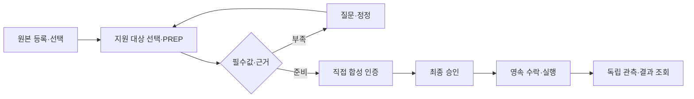

# 음악 레슨 강사 신규 채널 등록 지원 서비스 · 기획서 및 요구사항 명세서

> DLV-01 · 2026-11-26 · 강사 1차 의견 반영 개정 후보 · 기준 main d0ef345 · 2차 피드백 및 공식 PDF 제출 전. [1차 의견 반영 기록](../artifacts/planning/lesson-registration-20261123/instructor-feedback-20261126.json).

[기획 V1.1](https://github.com/ik-e/chaja-you/blob/f5e685716a5ed4fb36159d215b3cc861ef3d5e79/docs/artifacts/planning/lesson-registration-20261123/proposal-v1.1.md) · [채택 기록](https://github.com/ik-e/chaja-you/blob/f5e685716a5ed4fb36159d215b3cc861ef3d5e79/docs/artifacts/design/lesson-registration-20261124/adoption-20261125.json) · [현행 설계](../design/lesson-registration/CURRENT-DESIGN.md) · [공통 V1](https://github.com/ik-e/chaja-you/blob/f5e685716a5ed4fb36159d215b3cc861ef3d5e79/docs/artifacts/design/lesson-registration-20261124/common-integration-v1.json) · [REQ 원본](https://github.com/ik-e/chaja-you/blob/f5e685716a5ed4fb36159d215b3cc861ef3d5e79/docs/artifacts/design/lesson-registration-20261124/implementation-v0.4.json).

## 1. 서비스 정의

### 1.1 타깃 사용자와 이용 상황

이미 소개글·사진·수업 조건을 보유하고 새로운 모집 채널에 처음 등록하려는 개인 음악 레슨 강사. 원본을 제공하고, 누락과 충돌을 확인하고, 플랫폼에 직접 인증하고, 등록할 정확한 내용과 대상을 한 번 최종 승인하는 업무를 대상으로 한다. 수강생 모집·상담·수업 자체를 대신하지 않는다.

### 1.2 페인포인트와 근거

| Pain | 관찰 근거 | 한계 |
| --- | --- | --- |
| 자료 재가공·검수 | R02의 직접 경험: 플랫폼별 제목·가격·패키지·이미지 등 재입력 | 시장 대표성 미확인 |
| 직접 조작·등록 부담 | 최초 크몽 작성·접수 약 1~2시간, 반려 수정 약 5~10분; 가입/인증/심사 대기 제외 | 회상 기반, 실측 아님 |
| 사실 오류·결과 불확실 | AI가 추가 비용·변경 규정을 임의 작성한 경험, 접수와 공개의 구분 필요 | 사용자 확인 및 결과 근거 필요 |

R02 개인 경험 1건과 동료 강사 2명의 간접 진술에 기반한다. 가격 경쟁 때문에 입점을 주저하는 문제는 해결하지 못한다. 최초 등록이 반복 게시·상담보다 더 큰 시장 Pain인지, 실제 시간 절감과 지불 의향은 미실증. [기획 조사·대안 근거](https://github.com/ik-e/chaja-you/blob/f5e685716a5ed4fb36159d215b3cc861ef3d5e79/docs/artifacts/planning/lesson-registration-20261123/proposal-v1.1.md).

### 1.3 문제 정의와 기존 대안

서로 다른 플랫폼의 정보 구조와 규칙, 문안 생성·실행·접수 확인의 단절 때문에 이미 정해진 수업 조건을 반복 재가공·직접 입력·검수해야 한다. 직접 등록은 사실과 제어권 확인에 유리하지만 반복 노동이 남는다. 범용 AI는 문안 작성에 도움을 주어도 실행 권한과 독립 결과 확인을 별도로 구성해야 한다. 플랫폼 자체 도구는 해당 채널에 최적화되지만 채널 간 원본 재사용 부담이 남을 수 있다. 대안별 실제 효과는 동일 조건으로 비교해야 한다.

### 1.4 핵심 기능·사용자 가치·BM

| 원인 | 핵심 기능의 작동 | 사용자 업무 변화 | 가치 가설 및 측정 |
| --- | --- | --- | --- |
| 필드 차이·임의 사실 생성 | F1 원본/출처 구조화, 플랫폼별 변환·검증 | 반복 재작성 → 근거 있는 초안 검토 | 검수시간·오류 감소 |
| 생성과 실행의 단절 | F2 직접 인증·정확한 승인 후 등록된 동작 실행 | 직접 조작 → 승인 후 진행 조회 | 능동 작업·개입 감소 |
| 결과 불명확·응답 유실 | F3 독립 readback·증거·unknown 및 다음 조치 | 반복 확인·중복 시도 → 근거 확인 | 불확실성·재작업 감소 |

사용자 가치란 기능 존재가 아니라 실제 업무 부담 감소에서 발생한다. 등록 결과가 확인되는 건별/복수 채널 대행 과금은 BM 가설이며 가격·지불의향 미검증. 신규 수강생 및 매출 증가를 보장하지 않는다.

### 1.5 MVP와 이용 흐름 (12/8 첫 시연 후보)

- **시연 우선 1 — 크몽형 신규 서비스 상품 K1~K7:** 가격·필드·첨부 입력, 모의 심사 접수 및 독립 receipt 조회. 실제 심사 접수/승인/공개 아님.
- **후속 통합·회귀 2 — 숨고형 기존 합성 고수 서비스 카테고리·질문지 S1~S6:** 모의 저장과 독립 조회. 신규 고수 전환·프로필 공개·견적 발송 제외.
- 탈잉·당근·기타 플랫폼은 조사/확장 후보. 임의 사이트 적응과 실제 사이트/계정/자격증명 사용 금지. 수락 뒤 사용자 취소·변경·재개·rollback 제외.
- 하나의 불변 Source를 여러 플랫폼 등록에 재사용하되 값·대상·승인·결과는 독립. 원본 사실 변경은 새 Source.

**12/8 첫 시연 완료 조건(우선순위 제안):** 합성 레슨 원본·사진 제공 → 플랫폼별 정보 준비 → 누락/가격 충돌 확인·정정 → 모의 환경 직접 인증 → 정확한 내용·대상 최종 승인 → 크몽형 모의 등록 → 저장된 접수 증빙을 독립 조회하여 승인 내용·대상·첨부와 일치할 때만 접수 확인을 표시한다. 화면 재접속 후 저장 결과를 다시 볼 수 있어야 한다. 숨고형은 기존 TASK 및 전체 제품 기준에 남기고 연결이 검증되면 후속 시연한다. 첫 시연 우선순위는 팀 확인 전 제안이며 두 플랫폼 전체 제품 수용(22개 시험)을 축소하지 않는다. 지연 시 합성 모듈/부분 경로를 명시하고 완료를 주장하지 않는다.

**사용자 스토리와 범위 결정:** 강사는 ① 원본 등록/선택 및 지원 대상 선택 ② 누락·충돌·권리 확인/정정 ③ 직접 인증 ④ 승인 ⑤ 상태·결과 확인을 수행한다. 자료 부족/미지원 대상/권한 불일치/인증 만료는 실행 전 차단하고, 수락 이후 오류는 중단·독립 조회·다음 조치 안내로 종결한다. 사용자 취소·변경·재개·자동 재등록은 현행 범위 밖이다. 정상·예외·반복 행동의 전체 사용자 스토리를 확정한 뒤 DB 및 API·프로토콜과 대조한다. [설계 판단 우선순위](../human/INTENT.md#intent-design-003--사용자-문제와-가치-중심의-기획설계-판단-우선순위).

### 1.6 기술 환경과 책임

모듈형 모놀리스, 격리된 browser runtime. R01 공통 계약·조립·통합, R02 PREP, R03 CO/KNOW/STORE/RESULT/App, R04 UI/숨고, R05 runtime/크몽. Python 3.12, FastAPI/ASGI, SQLite, Playwright Chromium, jsonschema, CDP+WebSocket 기술 방향과 제품 lock 채택. 프런트 상세·모델·실제 provider 연결 및 설정 수치 확인 중. [PD 원본](https://github.com/ik-e/chaja-you/blob/f5e685716a5ed4fb36159d215b3cc861ef3d5e79/product/lesson-registration/contracts/PHYSICAL-BINDING.json) · [WORKSPACE](https://github.com/ik-e/chaja-you/blob/f5e685716a5ed4fb36159d215b3cc861ef3d5e79/product/lesson-registration/WORKSPACE.json). PR #44는 main에 반영되었으며 실제 통합 시 세부 정합성·원격 세션 보안을 검증한다.

### 1.7 AI의 판단과 코드의 검증

PREP(등록 정보 준비)는 원본과 플랫폼 규칙을 입력받아 등록안을 반환하는 모듈이다. AI는 문안·구조화된 사실 및 필드 후보를 제안하며 등록 승인이나 외부 동작 권한이 없다.

| 단계 | AI의 역할 | 코드의 역할 / 사용자 행동 |
| --- | --- | --- |
| F1 원본→등록안 | 원문에서 수업 사실을 추출하고 플랫폼용 문안·필드 후보를 작성 | 필수 항목·원문 근거·가격/횟수/시간/VAT·권리·형식·revision을 검증 |
| F1 누락·충돌 | 근거를 설명할 질문 후보 | 가격이 다르거나 근거가 없으면 ready=false, 실행 준비 중단. 강사에게 질문하고 확인값으로 새 revision을 준비; 추측·임의 조건 생성 금지 |
| F2 인증·승인·실행 | 승인된 등록안 이외 의사결정 없음 | 직접 인증, 현재 review digest/대상/권한을 검사; 등록된 작업만 실행 |
| F3 결과 | 결과 설명에 도움을 줄 수 있으나 성공 판정 권한 없음 | 별도 조회로 저장된 대상·값·첨부 증거 대조; 응답 유실 시 확인/미확인 분리 및 자동 재등록 차단 |

11/27 [단일 에이전트 상태 전이 설계](../step3/단일에이전트_상태전이그래프_설계서.md)의 입력→추출→결정적 검증→ready/질문/실패와 연결한다. 현행은 주입 모델 1회 호출+검증이며 자기 성찰(근거 있는 후보 보정 후 재검증)은 12/4 별도 시험할 후보이다. 12/11 멀티 에이전트 협업은 사용자 문제 해결에 기여하는 준비·검증·실행 역할의 명확한 인계 및 필요 시 복수 AI의 효과 비교로 검증한다(현행 여러 코드 모듈이 곧 여러 AI라는 의미 아님). 12/18 Auto-Healing은 응답 유실 시 무단 재제출 없이 독립 증빙을 조회하고 안전 종료하는 기능에 적용한다. 12/24 대화형 웹은 질문·정정·승인·진행/실패 확인을 제공한다. 교육 기술의 채택·실제 효과는 별도 시험하며 핵심 가치와 안전 계약을 우선한다.

## 2. 기능 요구사항

| ID | 기능 | 수용 조건 | 구현 경계 | 대표 시험 |
| --- | --- | --- | --- | --- |
| REQ-01 | 원본·필수 정보·자료 준비 | 불변 원본/첨부, 출처·버전·누락/충돌 질문; 90/180/270분 월4회 25/40/50만원 유지 | H1~H5, I2 | AT-01, T5-08, T5-11, T6-01 |
| REQ-02 | 등록 대상 식별 | 지원 registry만 허용, 미지원/권한 불명/임의 URL 차단 | H4, I1 | T5-07 |
| REQ-03 | 플랫폼별 변환·검토 | 사실·단위·VAT·권리·필수값, 출처 및 사용자 확인값 구분; 미확인이면 ready=false | H4/H5, I2 | AT-01, T5-08, T6-02 |
| REQ-04 | 원격 직접 인증·인계 | 동일 검증 binding, human/worker 상호배타, viewer detach 후 수락 작업 계속, 타 계정 거절 | H6, I3, Viewer | AT-02, T5-02, DV-02 |
| REQ-05 | 승인·실행 권한 | 현재 revision·review·대상·profile·connection·permission 원자 검증; 등록 operation만, 동일 효과 차단 | H7, I4, STORE | AT-03, T5-01, T5-12 |
| REQ-06 | 크몽 모의 최초 등록 | K1~K7 합성 상품·이미지·가격, 모의 접수 후 독립 receipt 일치 | I4/I5, K1~K7 | AT-04, T5-13 |
| REQ-07 | 숨고 모의 최초 등록 | 기존 합성 고수 서비스 category·문항 저장, 독립 조회 일치; 신규 고수 전환 제외 | I4/I5, S1~S6 | AT-05, T5-13 |
| REQ-08 | 결과·부분 효과·실패 | 오류 전용 중단, 확인/미도달/unknown·증거·다음 조치, 중복 차단; 취소/변경/재개/rollback 금지 | H7~H9, I4/I5 | T5-05, DV-01, DV-03 |
| REQ-09 | 플랫폼 확장 | 고정 registry/profile/adapter/시험, 플랫폼별 정정·승인·결과 독립; 범용 자동 적응 제외 | I1~I5, 조립 | T5-03, T5-06, T5-13 |
| REQ-10 | 격리·개인정보·안전 | owner 격리, mock-only, 비밀·입력 미기록, 세션 만료·폐기, 권리 확인 자료 | H1~H9, Runtime | AT-02, AT-03, T6-01, DV-02, DV-05 |
| REQ-11 | 재현성·서비스 가치 | 고정 후보/환경/fixture/실행 근거, 직접시간·대기·개입·비용 분리, T5-08 실제 모델 | 검증 | 22개 gate |

### 대표 수용 시험: 입력 → 기대 결과

| 시험 ID / 요구사항 | 시험 입력·상황 | 관측 가능한 기대 결과 |
| --- | --- | --- |
| AT-01 / REQ-01·03 | 월 4회, 90/180/270분, 25/40/50만원 원본, VAT 누락 또는 임의 무료 제공 문안 | 원본 사실 유지, 누락 질문·준비 중단; 미승인 사실 0, 실행 0 |
| T5-08 / REQ-01·03·11 | 실제 모델에 정상·가격/VAT 충돌·모델 불가 합성 자료 | 출처 연결·정확한 단위/값·충돌 질문; 모델 불가 ready=false, stub 통과 불인정 |
| T6-02 / REQ-03·05 | 현재 충돌 질문에 강사가 가격 정정, 또는 오래된 revision/원본 충돌 | 확인값은 새 revision으로 반영, 이전 승인 무효; stale/원본 충돌 및 수락 이후 수정 차단 |
| AT-02 / REQ-04·10 | 모의 계정 인증 후 다른 계정·이전 generation·viewer 종료 | 승인된 동일 세션만 실행; 타 세션 거절, 화면 종료와 작업 분리, 인증정보 기록 금지 |
| AT-03 / REQ-05·10 | 승인값 위조, 권한 없음, 대상 불일치 | 실행 거절, 외부 효과 0 |
| AT-04 / REQ-06·08 | 크몽형 승인 원본·사진·가격으로 합성 등록 | 독립 접수 조회에서 실제 저장 대상·값·첨부가 승인과 일치할 때만 접수 확인; 실제 플랫폼 성과 아님 |
| AT-05 / REQ-07·08·09 | 숨고형 합성 고수의 카테고리와 문항 | 저장된 카테고리·답변 독립 조회 일치, 미존재 사진/가격 생성 금지 |
| DV-01 / REQ-08 | 접수 응답 유실(효과 전/후), 이미지 실패, 동일 요청 재호출 | 저장된 접수 결과 독립 조회·대조, 증빙 없으면 결과 미확인(unknown), 이후 동작 중단·자동 재등록 0; 동일 key는 기존 작업 조회 |
| DV-03 / REQ-08·10 | 잘못된 대상·값·첨부·방법 또는 근거 없음, 실서비스 요청 | 확인된 목표만 성공, 그 외 미도달/unknown·오류 종료; live 거절 |
| T5-06 / REQ-09 | 한 원본으로 크몽/숨고 각각 요청, 한쪽 정정 | 값·대상·승인·결과는 독립, 원본 불변 |

전체 22개 수용 시험의 정의는 [공통 V1 gate](../artifacts/design/lesson-registration-20261124/common-integration-v1.json) 및 [제품 시험 실행기](../../product/lesson-registration/evidence/PRODUCT-GATE.md)에 있다. 위 표는 읽기용 대표 예이며 정본 판정 기준을 완화하지 않는다. 11/25 기준 전체 제품 시험 0/22(not_run), 모듈 독립 시험 및 preflight는 지원 근거다.

REQ-08의 과거 재개 문구는 채택 A2 및 CS-05/06으로 대체되었다. 오류에만 stopping→stopped, terminal 읽기 근거 추가는 가능하지만 작업 재개 금지. 동일 key 요청 조회와 실제 외부 동작 재실행은 다르다.

## 3. 비기능 요구사항

| 품질/제약 | 판정 기준 | 현재 상태 |
| --- | --- | --- |
| 정확성·일관성 | named/profile schema, 가격·단위·VAT·출처·revision·digest 검증 | 공통 계약/합성 검증, 실제 모델 미검증 |
| 인증·개인정보·최소권한 | owner/verified binding/operation 권한, 비밀 및 로그인 입력 미기록, 세션 폐기 | mock 기본 계약, PR #44 세부 보안 후보 |
| 안전한 실행·중복 방지 | 원자 accept/admit/observe/fence/finalize; 외부 효과 불명확 시 unknown, 재실행 금지 | 실제 연동 미검증 |
| 응답·가용성 | H7 durable accept 후 202; viewer detach 독립, 조회는 저장 상태 | timeout·자원·SLA 실측 후 |
| 확장·유지보수 | 고정 profile 및 adapter, 명시 provider 주입, implicit fake fallback 금지 | 공통 경계/lock 채택 |
| 운영 정책·보안 | mock-only; 실제 허용·동의·격리·운영 검증 별도 | live 미승인 |
| 재현·가치 | 동일 후보 22개 gate(T5-08 실제 모델 포함), 직접 등록/범용 AI/전용 서비스의 시간·오류·개입·비용 비교 | 제품 gate 미실행, 가치 미실증 |

기능 수용과 사용자 가치 실증은 별개다. 20~30분 희망 목표는 실측값이 아니다. 현재 제품 구현 완료나 공식 제출·접수로 표시하지 않는다.

**교육 기술 적용 방향 (R01 11/25):** 기획안의 핵심 Pain 해결을 우선하고 교육 기술은 핵심 기능에 실질적으로 기여할 때 적용한다. 남은 교육 요구는 핵심 범위·안전 계약·일정을 해치지 않는 추가 기능으로 검토한다. 실제 기술 적용·시험을 증거로 확인하며 강의 목표를 위해 기능을 무리하게 확대하거나 결정적 검증을 AI로 대체하지 않는다. [R01 방향](../human/responses/HRESP-20261125-06_pain-first-rolling-plan.md).

### 3.1 실제 플랫폼 허용 범위 및 제한 시 대안

| 대상 / 담당 | 자동 입력·제출 | 계정 이용 | 사진·글 재사용 |
| --- | --- | --- | --- |
| 크몽 / R02 조사, R05 기술 확인 | 공식 등록·심사 안내 및 비정상 등록 제한은 기존 조사에서 확인; 외부 자동 입력/대리 제출 허용은 미확인 | 제3자 사용 관련 약관·명의자 위임과 운영사 허용을 별도 확인, 계정 비밀 수집 금지 | 강사 제공 자료의 이용·제공 승인 및 플랫폼별 업로드 조건 확인 필요 |
| 숨고 / R02 조사, R04 기술 확인 | 고수 프로필·서비스 설정·견적의 구별, 외부 자동 입력/저장 허용은 미확인 | 제3자 계정 이용 조건·본인 인증 범위 및 운영사 허용 미확인 | 프로필/포트폴리오/서비스 자료별 이용 권한 및 입력 규격 확인 필요 |

[기존 R02 법령·약관 근거](../artifacts/research/R02_LESSON_POSTING_RIGHTS_20261120.json) (11/20 조사, 허용 결론 아님). 추가 플랫폼 조사에서 공식 약관/도움말 또는 운영사 답변의 URL·조항·확인일·허용/제한/미확인·담당을 기록하고 R01이 범위를 판단한다. 확인 전에는 합성 계정·가상 자료·mock만 사용한다. 자동 입력 불허/불명 시 원본 추출·플랫폼별 초안·필수값/권리 검수·복사 가능한 입력 안내까지만 제공하고 강사가 직접 제출하도록 하는 후보를 별도 가치 검증한다. 실제 외부 제출/계정 사용 승인이 아님.

### 3.2 사용자 가치의 동일 자료 비교 계획

- 기존 최초 등록 1~2시간, 반려 수정 5~10분은 **R02 회상치**(가입/인증/심사 대기 제외); 3플랫폼 직접 20~30분은 **희망 목표**(미실측). 동일 범위의 수동 기준선이 없으므로 절감률을 계산하지 않는다.
- 같은 합성 원본·승인 사진·가격/시간/횟수·플랫폼 규칙 및 시작 상태를 고정하고 A 수동 등록, B 범용 AI와 충분한 지시/도구, C 팀 서비스로 비교한다. 크몽형 1건의 동일 접수 확인 조건을 적용하고 다중 채널은 별도 비교한다. 자동 입력 제한 시 세 방식 모두 초안/직접 제출 동일 범위로 비교한다.
- 활동별 원본 준비·검수·인증·승인·입력/첨부·정정·결과 조회 직접 작업 시간, 오류·사용자 개입 횟수·확인된 목표 수를 기록한다. 시스템 대기·심사 대기·초기 설치·모델/운영비는 분리한다. 동일한 완료 품질일 때만 가치 차이를 판단한다.
- R02 사용자/자료 확인, R03 시험 조건 및 기록, R04 사용자 행동, R05 실행 근거, R01 비교 및 가치 판정은 기존 역할에 따른 검토 제안이다. 표본/반복 수·측정 방법은 실험 전 고정하고 결과 미실행/미실측으로 표시한다.

[WBS 1차 보완 일정 후보](WBS_제출본.md) · [피드백 추적](../artifacts/planning/lesson-registration-20261123/instructor-feedback-20261126.json).
