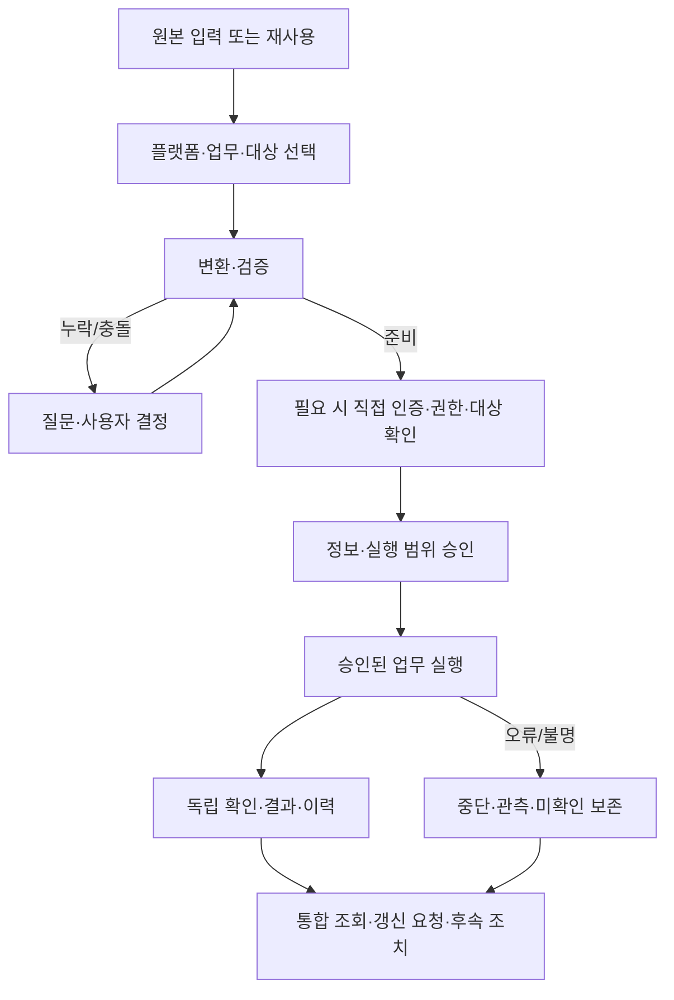

# 음악 레슨 강사 다중 플랫폼 등록·관리 지원 서비스 · 기획서 및 요구사항 명세서

<!-- Generated by tools/project_docs.py. Source: docs/artifacts/planning/lesson-registration-20261126/submission-review-source.json -->
> DLV-01 · 제출용 검토 기준 S1.0 · 2026-11-26. [기획 V1.2](../artifacts/planning/lesson-registration-20261123/proposal-v1.2.md) 및 11/26 조사·기존 기술 검증 근거. 본문 설계값은 잠정 제출 기준으로 선택했으며 실제 구현·시험·플랫폼 허용·가치 실측과 구분한다. [피드백 추적](../artifacts/planning/lesson-registration-20261123/instructor-feedback-20261126.json).

## 1. 서비스 정의

### 1.1 타깃 사용자와 이용 목적

여러 플랫폼에서 수강생을 모집하고 레슨 모집 정보를 관리하는 개인 음악 레슨 강사. 초기 검증 대상은 이미 레슨 소개글·사진·수업 조건이 있고 새로운 모집 채널을 추가하거나 기존 채널을 유지하려는 강사이다. 수업·창작과 모집 정보 관리를 병행하면서 시간과 수고를 최소화하고 정확한 모집 정보를 유지하는 것이 목적이다.

### 1.2 페인포인트 및 근거

| ID | 페인포인트 | 관찰 근거와 한계 |
| --- | --- | --- |
| P01 | 정보 재작성·검수 | 기존 소개글을 플랫폼별 제목·가격·패키지·사진 규격에 맞게 작성. 범용 AI의 사실 오류 사례. |
| P02 | 반복 등록·수정·갱신 | 크몽 최초 작성·제출 1–2시간, 반려 수정 5–10분, 뮬 갱신 회당 2–3분은 사용자 회상. 추가 등록을 번거로워한 동료 사례. |
| P03 | 상태 확인 및 대응 | 플랫폼마다 정보와 결과가 분산. 크몽 자체 승인 알림 사례가 있어 알림 이후 남는 업무 부담과 반복 조회 빈도는 검증 필요. |

직접 사용자 1명과 동료 강사 2명의 간접 진술을 중심으로 한 기존 조사로, 시간은 실측값이 아니며 대표성·업무 빈도·누적 부담은 미검증이다. 가격 경쟁 때문에 채널 확대를 원하지 않는 강사에게 모집 대행을 강요하지 않는다. [R02 최신 검토](https://github.com/ik-e/chaja-you/blob/bb73955af88c4c7b41255f0d8b5c5c2de213d2cd/docs/artifacts/planning/lesson-registration-20261126/R02/proposal-v1.2-review.json)는 최초 등록 우선 검증을 제안하되 관리 기능의 빈도·잔여 가치를 추가 확인하도록 요청한다. 이는 범위 확정이 아니다.

### 1.3 원인과 문제 정의

| 원인 | 관련 Pain | 사용자 문제 |
| --- | --- | --- |
| C01 플랫폼별 정보 구조·제약의 차이 | P01 | 같은 레슨을 각 플랫폼에 맞게 재작성·검수 |
| C02 플랫폼별 업무 절차의 독립성 | P02 | 등록·수정·갱신을 개별 수행 |
| C03 정보·상태의 분산 | P03 | 개별 확인 및 대응 |

여러 플랫폼에서 수강생을 모집하는 개인 음악 레슨 강사가 동일한 레슨 정보의 준비·등록·수정·갱신·확인·대응을 반복 수행해야 하므로, 시간과 수고가 소모되고 모집 채널 확대 및 유지가 어렵다. 기존 AI의 잘못된 정보 생성·실행 단절은 원래 문제의 원인이 아니라 기존 해결 방식의 한계다.

### 1.4 핵심 피처 → 문제 해결 → 가치 → 비즈니스 모델

| 문제 원인 | 핵심 피처의 작동 (V1.2 ID) | 실제로 해결할 부담 | 사용자 가치 및 측정 |
| --- | --- | --- | --- |
| C01 | 원본 저장/재사용·구조화·플랫폼별 변환/검증/질문(F01–F11) | 정보 재작성·검수 감소 | 직접 준비 시간·오류·개입 감소 |
| C02 | 대상·권한 확인, 정보/실행 승인 후 신규·추가 등록·수정·갱신(F12–F21) | 플랫폼별 조작 감소 | 직접 작업·감독 시간 감소 |
| C03 | 실제 결과 확인·이력·통합 상태 조회·사용자 요청 기반 갱신·대응(F22–F29) | 반복 조회·대응 감소 | 조회 시간·재작업·결과 불확실성 감소 |

가치는 기능 존재 자체가 아니라 동일 품질의 업무를 더 적은 직접 시간과 수고로 완료할 때 발생한다. BM은 최초·추가 등록 건별/묶음 과금, 수정·갱신 건별 과금, 지속 관리 이용권/구독의 가설이다. 동료 한 명의 10개 플랫폼 대행 약 5만원 지불 의향은 실제 구매 가격이 아니며, 완료 기준·부분 성공·운영비·지불 의향을 검증 후 결정한다. 신규 수강생·매출 증가를 보장하지 않는다.

**기존 대안:** 직접 등록/템플릿, 범용 대화형 AI 및 브라우저 에이전트, 플랫폼 자체 관리 기능, 사람 대행. 기존 대안이 해결하는 부분을 인정하고 동일 자료·완료 품질에서 남는 부담과 비용을 비교한다.

### 1.5 이용 시나리오 및 단계별 제품 범위

- 기본 기획 범위: 원본 입력/재사용/수정, 지원 업무 및 대상 선택, 플랫폼별 변환·질문·검증, 인증·권한·대상 확인, 정보/실행 승인, 신규·추가 등록, 기존 게시물 수정, 허용된 공고 갱신, 결과/이력·통합 조회, 사용자 요청 기반 상태 갱신 및 오류·반려 대응.
- 조건부 확장: 공개 정보 또는 별도 승인·권한·보안 조건을 충족하는 인증 기반 자동 모니터링과 알림(E01–E05). 기본 및 필수 MVP에서 제외.
- 제외: 사용자 미승인 외부 변경/재등록/삭제, 보안 절차 우회, 기본 업무 후 불필요한 인증 유지, 상담·유료 견적·수업 운영·결제·마케팅 콘텐츠 제작. 실제 지원 플랫폼과 업무는 확인된 허용·권한·기술·가치·공수에 따라 결정한다.

**12/8 첫 시연의 제출 기준:** 기존 두 모의 플랫폼 중 크몽형 신규 서비스 상품 K1–K7의 원본·사진 → 필드 준비/가격 충돌 질문 → 모의 직접 인증 → 정확한 정보·대상 승인 → 1회 모의 접수 → 별도 독립 접수 조회 → 화면 재접속 후 저장 결과 조회. 승인한 대상·값·첨부가 일치할 때만 모의 접수 확인을 표시한다. 실제 플랫폼 접수/심사 승인/공개와 다르다. 숨고형(S1–S6) 기존 합성 고수 서비스 설정/독립 조회는 기존 검증 근거를 보존하고 새 범위 결정 후 연결·회귀를 검토한다. 12/8 시연은 크몽형 신규 등록의 독립 접수 조회까지를 필수 목표로 선택하고 숨고형은 후속 통합으로 둔다. 실제 연결이 부족하면 부분 시연 범위와 실패 이유를 명시한다.

V1.2 제품 MVP의 제출 기준은 최소 2개 플랫폼에서 원본 재사용·신규/추가 등록·대표 수정·통합 결과의 사용자 가치 검증이다. 첫 시연과 제품 MVP를 구분하고, 갱신·사용자 요청 상태 관리는 설계 범위에 포함하고 실제 지원 여부는 플랫폼별 허용·가치·공수로 제한한다. 7개 조사 플랫폼의 전 기능 구현을 MVP로 간주하지 않는다. 제출용 일정은 12/8 크몽 최초 등록 시연, 12/9–16 숨고 후속 등록·대표 기존 정보 수정 및 통합/요청 상태 조회, 12/21–24 공고 갱신 합성 검증, 12/28–31 동일 후보 통합 검증으로 구체화한다. 실제 갱신 지원은 권한과 수요 검증을 전제로 하고 필수 MVP와 분리한다.

### 1.6 실제 설계 단계 및 기술 방향

[현행 설계 단계](../human/phase-intents/PHASE-20261126-01.md): R02·R04·R05 각각 전체 F01–F29/E01–E05 사용자 스토리와 7개 플랫폼 독립 조사(TASK-055–057), R01 비교·서비스 범위 결정·논리 DB/ERD 설계(TASK-058), 이후 API·프로토콜·물리 구현. 기존 구현 TASK-048–054는 보류, 코드·증거 보존. R03 신규 배정 없음.

기존 mock 기술 검증은 Python/FastAPI, SQLite, 격리 원격 Chromium/Playwright, CDP+WebSocket 및 공통 V1/V4.1 기준이었다. 최종 제품/통합 DB 목표는 PostgreSQL; 제출용은 PostgreSQL 16, 별도 외부 객체 및 독립 job, 서버 세션·소유권·독립 증거의 잠정 설계를 적용한다. 초기/기존 DB 이관·동시성·권한·상태·증빙·FK 시험은 실제 구현 시 실행한다. 기존 mock 계약은 재사용/영향 검토 대상이며 새 설계·실제 지원 권한이 확정된 것이 아니다.

### 1.7 AI와 코드의 책임 및 교육 요구 연결

| 단계 | AI | 결정적 코드 및 사용자 |
| --- | --- | --- |
| F03/F08–F11 | 원문 사실·출처·필드/문안 후보, 확인 질문·유효 대안 제안 | 규격·근거·금액/시간/단위/VAT·첨부 권리·revision 검증; 충돌은 사용자 결정, 임의 값 금지 |
| F12–F21 | 승인할 내용의 준비 보조; 외부 실행 승인 권한 없음 | 직접 인증·계정·대상·범위 확인, 정보 및 실행 승인·원자 수락·등록된 동작·중복 방지 |
| F22–F29 | 결과·문제 및 후속 조치 설명 보조 | 독립 증거에 기반한 판정/조회, 미확인 보존·재실행 금지·최신 확인 시점 표시 |

11/27 상태 전이 설계는 PREP 입력→추출→결정적 검증→ready/질문/오류. 12/4 자기성찰은 근거 기반 후보 보정과 재검증의 효과를 시험한다(전송 retry와 별개). 12/11 협업은 준비·검증·실행 역할·인계와 복수 AI의 필요성/효과 검증, 12/18 가드레일/Auto-Healing은 권한·오류·응답 유실·독립 조회 및 안전 종료, 12/24 대화형 웹은 질문·정정·승인·결과 안내에 적용하는 후보. 여러 코드 모듈을 여러 AI라고 주장하지 않고 핵심 Pain 해결 기여도를 확인한다.

## 2. 기능 요구사항

### 2.0 단계별 범위 및 필수 시연 조건

12/8 첫 시연: 크몽형 한 건 D01–D06 전체, 재접속 저장 결과까지 필수. 제품 MVP: 두 플랫폼 신규/추가 등록·대표 수정·통합 조회·요청 상태 확인. 후속: 공고 갱신 합성 검증 및 조건부 모니터링(필수 MVP 제외). 모든 외부 효과는 mock-only. 11/27 재개 결정, 12/3 선행 인수, 12/4 PREP 교체 및 통합 판정. 불합격 시 12/4에 검증된 연속 단계까지만 부분 시연을 선택하고 12/7 동일 후보 재시험 후 동결. 미완료 흐름은 필수 시연 합격으로 표시하지 않음.

| 시연 ID | 기능 | 행동 | 합격 조건 |
| --- | --- | --- | --- |
| D01 | F01, F05 | 원본·사진 저장 | 원본·첨부·version_id 저장 및 owner 조회 |
| D02 | F03, F06–F11 | 크몽형 준비·가격 확인 | 가격 충돌 질문, ready=false에서 실행 0; 확인값·출처 및 revision 보존 |
| D03 | F12, F13 | 직접 인증 | 강사 직접 인증, 동일 계정·권한 확인, 외부 비밀 미저장 |
| D04 | F16–F18 | 정보·범위 승인 | 명시 승인 두 항목, revision/digest/key 검증, job_id 반환 |
| D05 | F19, F22 | 모의 접수·독립 확인 | 접수 1회, 별도 조회로 대상·값·첨부·receipt 확인; 유실 시 재접수 0, 근거 없으면 unknown |
| D06 | F02, F23, F24, F29 | 재접속 저장 결과 | 재접속 후 같은 owner의 job·결과·근거 표시, 추가 효과 0 |

아래 F01–F29 요구사항 표의 첫 시연 열은 D01–D06 연결을 나타낸다. [WBS 동일 조건](WBS_제출본.md) · [API 호출 순서](../step2/API_설계_문서.md).

아래는 V1.2의 기능 정의를 그대로 연결한 **서비스 범위 설계 입력**이며 모두 구현 확정 또는 MVP 완료를 뜻하지 않는다. 정상·예외·반복 분기는 제출용 DB/API 및 아래 대표 수용 조건에 연결한다. 실제 TASK-058 결과가 달라지면 원본을 갱신한다.

| ID | 기능 | 관측 가능한 결과 | 12/8 필수 |
| --- | --- | --- | --- |
| F01 | 사용자로부터 원본 레슨 정보를 입력받는다. | 소개글·사진·수업 조건 등의 원본 확보 | D01 |
| F02 | 저장된 원본 레슨 정보를 불러온다. | 재사용할 원본 확보 | D06 |
| F03 | 원본 레슨 정보를 구조화한다. | 근거와 연결된 레슨 사실 및 항목별 정보 | D02 |
| F04 | 사용자가 기존 원본 정보를 수정할 수 있도록 한다. | 변경된 원본 정보 | — |
| F05 | 원본 레슨 정보를 저장한다. | 재사용 및 버전 관리가 가능한 원본 | D01 |
| F06 | 플랫폼별 지원 가능한 업무와 제약을 사용자에게 제공한다. | 등록·수정·갱신·조회 가능 여부 및 선행 조건 | D02 |
| F07 | 사용자로부터 작업 대상과 업무 종류를 선택받는다. | 대상 플랫폼 및 수행하려는 업무 범위 | D02 |
| F08 | 원본 정보를 대상 플랫폼에 맞게 변환한다. | 플랫폼별 입력안 | D02 |
| F09 | 입력안의 정확성과 유효성을 검증한다. | 누락·불확실·충돌·규격 위반 확인 | D02 |
| F10 | 부족하거나 불확실한 정보를 사용자에게 요청한다. | 추가 정보 및 확인된 사실 | D02 |
| F11 | 플랫폼 제약과 충돌하는 정보에 대한 해결 방안 및 선택지를 제공하고 사용자 결정을 요청한다. | 승인된 대체 조건 또는 업무 수행 불가 판단 | D02 |
| F12 | 대상 플랫폼에 대한 사용자 인증을 요청한다. | 사용자가 직접 수행한 인증 결과 | D03 |
| F13 | 인증된 계정과 작업에 필요한 접근 권한을 확인한다. | 확인된 계정 및 접근 가능 범위 | D03 |
| F14 | 기존 게시물을 조회하고 관리할 대상을 식별한다. | 확인된 기존 게시 객체 및 원본과의 연결 | — |
| F15 | 기존 게시 정보와 변경 예정 정보를 비교하여 사용자에게 제공한다. | 변경 대상·변경 전후 정보 및 변경 범위 | — |
| F16 | 사용자에게 최종 등록·변경 정보의 승인을 요청한다. | 사용자가 승인한 최종 정보 | D04 |
| F17 | 사용자에게 업무 실행 범위의 승인을 요청한다. | 승인된 플랫폼·계정·게시 객체·업무·실행 범위 | D04 |
| F18 | 현재 실행 조건과 사용자 승인 내용의 일치 여부를 확인한다. | 실행 가능 또는 실행 제한 판단 | D04 |
| F19 | 승인된 레슨 정보를 플랫폼에 신규 등록한다. | 신규 등록 실행 결과 | D05 |
| F20 | 기존 게시물의 정보를 승인된 내용으로 수정한다. | 정보 수정 실행 결과 | — |
| F21 | 기존 모집 공고를 승인된 방식으로 갱신한다. | 공고 갱신 실행 결과 | — |
| F22 | 수행한 업무의 실제 결과를 확인한다. | 확인된 성공·실패·미확인 상태 및 근거 | D05 |
| F23 | 업무 실행 및 결과 이력을 저장한다. | 작업 대상·승인·실행·관측 결과의 추적 기록 | D06 |
| F24 | 수행한 업무의 결과를 사용자에게 전달한다. | 플랫폼별 작업 결과와 필요한 후속 조치 | D06 |
| F25 | 플랫폼별 마지막 확인 정보와 상태를 통합하여 제공한다. | 확인된 등록 정보·상태·확인 시점·게시 링크 등의 관리 정보 | — |
| F26 | 사용자로부터 상태 갱신 요청을 받는다. | 조회 대상 및 요청 범위 | — |
| F27 | 허용된 방법으로 현재 상태를 확인하고 저장된 상태를 갱신한다. | 새로운 관측 정보 또는 조회 불가 상태 | — |
| F28 | 확인된 상태 변화 및 갱신 결과를 사용자에게 전달한다. | 최신 확인 결과와 대응 필요 여부 | — |
| F29 | 실패·반려·정보 불일치에 필요한 대응을 안내한다. | 확인된 문제 사유 및 가능한 후속 조치 | D06 |

**조건부(기본 및 필수 MVP 제외)**

| ID | 기능 | 관측 가능한 결과 |
| --- | --- | --- |
| E01 | 자동 모니터링의 대상과 조건을 설정받는다. | 모니터링 대상·조회 범위·기간·알림 조건 |
| E02 | 인증 유지가 필요한 경우 위험성을 안내하고 별도의 승인을 요청한다. | 위험성 인지 및 명시적인 인증 유지 승인 |
| E03 | 허용된 범위에서 플랫폼별 상태 변화를 자동으로 확인한다. | 새로운 관측 상태와 변화 정보 |
| E04 | 대응이 필요한 상태 변화를 사용자에게 알린다. | 상태 변화 및 문제 발생 알림 |
| E05 | 자동 모니터링을 종료하고 관련 접근 권한과 세션을 해제한다. | 모니터링 종료 및 인증 세션 폐기 |

### 2.1 대표 수용 조건과 시험 입력(실행 전)

| 관련 피처 | 입력·상황 | 관측 가능한 기대 결과 |
| --- | --- | --- |
| F01–F11 | 월 4회, 90/180/270분, 25/40/50만원 및 VAT 불명·충돌 | 사실·단위 유지, 출처 및 확인 질문, ready=false·외부 효과 0 |
| F08–F11 | 실제 90분을 플랫폼이 표현 못하는 조건 | 임의 60/120분 변경 0, 가능한 대안의 사용자 결정 또는 실행 불가 |
| F12–F18 | 타 owner, 타 계정, 오래된 승인·revision, 대상 불명·권한 미확인 | 현재 승인 검증, 부적절한 요청 차단·외부 효과 0 |
| F19/F22–F24 | 크몽형 모의 신규 등록, 승인 가격·첨부와 독립 receipt | 승인한 값·대상·사진 일치 시에만 모의 접수 확인 |
| F20/F21 | 기존 객체 ID, 독립 조회 before, 승인된 변경값 또는 갱신 동작; 합성 fixture | 같은 native_id에 변경/갱신 1회, 독립 조회로 승인 값/갱신 시점과 그 외 불변 확인. 대상 변경/불허/미확인 시 중단 및 재실행 0 |
| F22–F29 | 접수 응답 유실, 독립 조회 실패, 다중 플랫폼 부분 성공 또는 상태 갱신 실패 | confirmed/not_reached/unknown 및 외부 상태/시점 구분, 기존 관측 보존·자동 재등록 0 |
| F04/F05/F23/F25 | 같은 원본으로 서로 다른 플랫폼·업무 실행, 한쪽 수정 | 원본 버전 및 승인·외부 객체/작업·결과 관계 추적, 독립 결과 및 타 owner 접근 차단 |
| F26–F29 | 사용자 요청 조회, 인증 만료·반려, 이전 접수 미확인 | 읽기 전용 별도 status 업무, 변경 효과 0. 마지막 성공 snapshot/시각과 최신 실패 분리; 별도 독립 증거로만 이전 미확인 해소, 원래 업무 기록 유지·자동 재등록 0 |

기존 mock 최초 등록 요구 [REQ-01–11/공통 V1](../artifacts/design/lesson-registration-20261124/common-integration-v1.json) 및 [22개 시험](../../product/lesson-registration/evidence/PRODUCT-GATE.md)은 기존 구현의 구체적인 회귀/기술 검증 입력이다. 예: AT-01·T5-08 가격/모델, AT-02/03 권한·승인, AT-04/05 모의 접수/저장, DV-01 응답 유실/중복, T5-06 두 플랫폼. 기존 11/25 전체 제품 gate 0/22(not_run). 새 V1.2 범위는 제출용 API/DB의 구체적인 시험 계획에 연결하며 기존 안전 조건을 근거 없이 완화하지 않는다.

## 3. 비기능 요구사항 및 검증

| 요구 | 검증/완료 조건 |
| --- | --- |
| 정보 정확성·권리 | 임의 생성/변경 0, 출처 및 승인/사진·글 재사용 권리 확인 |
| 인증·소유권 | 서비스 계정과 외부 인증 분리, 타 owner 목록/상세/연결 거절, 비밀·입력 미저장 |
| 안전성·상태 | 승인되지 않은 계정·객체·범위 외부 효과 0, 모호한 효과는 미확인, 자동 재실행 0, 상태 정본·독립 근거 |
| 저장·확장성 | PostgreSQL 목표; 7개 플랫폼의 공통/고유 필드·객체·업무/상태 표현과 기존 모델 이관·FK/경합 검증 |
| 비용·성능·사용성 | 제한된 PREP 처리·오류/질문/승인 UX, 대기·직접 업무·비용 분리, 동일 조건 실측 전 수치 미확정 |
| 재현성 | 계약/DB 버전·고정 후보 commit·입력·기대·실제 관측·판정 연결 |

### 3.1 플랫폼 조사와 실제 허용 범위

[11/26 크몽 사용자 화면·경험 확인](https://github.com/ik-e/chaja-you/blob/ef6ca8d1cbf3feb7a162e14be7d72dea685ebf97/docs/artifacts/planning/lesson-registration-20261126/R02/kmong-user-confirmation.json): 해당 레슨 카테고리 제목 10–30자, 설명 100–20,000자, 메인 PNG/JPG 1–4장, 제공 절차와 의뢰인 준비사항 50–20,000자, VAT 포함 패키지 전체 금액 최소 5,000원 및 1,000원 단위, 레슨 30–540분/15분 단위·횟수 1–50회. 기존 조사와 다른 조건은 최신 화면 범위에서 우선한다. 작업 기간/수정 횟수의 공식 의미 및 운영사 대행·자동화 허용은 미확인. 모의 profile 시험의 규칙 후보로만 사용한다.

| 플랫폼 | 조사 대상 | 근거/범위 상태 |
| --- | --- | --- |
| 크몽 | 전문가 서비스 상품·가격/패키지·심사 | 기존 등록 안내/비정상 등록 제한 조사, 자동 입력·대리 접수 허용 미확인 |
| 탈잉 | 튜터 클래스·회차/일정·심사 | 기존 PC 스튜디오/입력 제약 조사, 실제 자동화 허용 미확인 |
| 숨고 | 고수 프로필·서비스 카테고리·공개 | 기존 등록 절차, 견적과 구분; 자동 입력/저장 허용 미확인 |
| 프람피 | 전문가 프로필 및 레슨 분야 | 공개 자료 검토 대상; 유료 제안서 제외 |
| 뮬 | 음악 레슨 공고·갱신 | 사용자 회상 및 조사 대상; 갱신 조건·대행 허용 검증 |
| 힙합플레이야 | 레슨 모집 게시물·첨부 | 게시물 사례/공개 자료 기반 조사 |
| 힙합LE | 레슨 게시물·분류·게시 제한 | 공개 게시물 사례 기반 조사 |

각 플랫폼의 업무별 공식 약관/도움말·확인일·계정/접근/자동 입력·제출 허용 여부·사진/글 권한·객체/필드·완료 근거를 확인한다. 운영사 허용 미확인은 허용이 아니다. [기존 R02 법령·약관 조사](../artifacts/research/R02_LESSON_POSTING_RIGHTS_20261120.json). 자동 입력 불허/불명 시 플랫폼별 초안·필수값/권리 검수·복사 가능한 입력 안내 후 강사 직접 제출 후보를 동일 범위로 비교한다. 현재 공개 자료의 제한적 조사 및 합성 mock만 허용; 실제 로그인·등록·수정·갱신·자동화/자격증명 취급 금지. 당근·소모임은 V1.2의 7개 우선 조사 대상에 포함되지 않는다.

### 3.2 동일 자료의 가치 비교 — 크몽형 한 건 우선

동일 원문·사진·가격 확인값·규칙/권리·시작 상태, 동일 D01–D06 완료 기준(모의 접수 1회와 독립 확인 및 재접속)을 세 방식에 적용한다. 직접/범용 AI 방식도 같은 모의 환경에서 필요한 검수·인증·승인·제출·조회 완료. 자동화 불허 시 세 방식 모두 준비/검수/직접 제출로 범위를 맞춘다. R01이 12/4 입력·반복 수·기록표를 고정하고 12/7 측정 및 검토한다. 아래는 미측정 값이며 1–2시간 사용자 회상 및 이전 목표 20–30분과 구분한다.

| 방식 | 직접 작업 시간 | 검수 | 재작업 | 개입 | 시스템/심사 대기 | 완료 조건 |
| --- | --- | --- | --- | --- | --- | --- |
| 직접 | 미측정 | 미측정 | 미측정 | 미측정 | 미측정 | 미측정 |
| 범용 AI | 미측정 | 미측정 | 미측정 | 미측정 | 미측정 | 미측정 |
| 팀 서비스 | 미측정 | 미측정 | 미측정 | 미측정 | 미측정 | 미측정 |

A 직접 업무/템플릿, B 충분한 자료와 재사용 지시를 제공한 범용 AI·브라우저 에이전트, C 팀 서비스. 동일 합성 원본·사진·시작 조건·플랫폼 규칙·승인 범위·완료 조건을 고정한다. 우선 크몽형 1건과 이후 동일 원본 추가 채널/대표 관리 업무를 분리해 비교한다. 자동화 제한이 있으면 세 방식 모두 동일한 준비·직접 제출 범위로 비교한다.

측정 항목은 자료 제공·검수·인증·승인·입력·첨부·질문·정정·조회·대응의 사용자 직접 작업 시간, 개입·오류·재작업·확인된 목표 수, 시스템 대기/심사 대기, 초기 설정·모델·운영비이다. 같은 품질/완료 수준에서 순절감 시간과 부담을 판단한다. 표본/반복 수와 조건은 시험 전 고정. 3플랫폼 직접 업무 20–30분은 희망치이며 절감률·매출·사업성 실측 결과가 아니다.

### 3.3 현재 실제 작업 및 미확정

11/26 ef6ca8d 기준 R02 스토리 26·이벤트 14·근거 16, 크몽 사용자 화면·경험 확인 추가(교차 연결·자체 검사 미확정). R04 스토리 26·이벤트 16·7개 플랫폼·근거 15·교차 연결 11, 자체 검사 A1–A5 통과 보고(R01 검토 전). R05는 초기 양식. [R02 원본](https://github.com/ik-e/chaja-you/blob/ef6ca8d1cbf3feb7a162e14be7d72dea685ebf97/docs/artifacts/planning/lesson-registration-20261126/R02/independent-result.json) · [R04 원본](https://github.com/ik-e/chaja-you/blob/ef6ca8d1cbf3feb7a162e14be7d72dea685ebf97/docs/artifacts/planning/lesson-registration-20261126/R04/independent-result.json) · [크몽 확인](https://github.com/ik-e/chaja-you/blob/ef6ca8d1cbf3feb7a162e14be7d72dea685ebf97/docs/artifacts/planning/lesson-registration-20261126/R02/kmong-user-confirmation.json). TASK-058 실제 범위 확정 후 기획·WBS 함께 갱신. 권한·가치·실제 제품 시험 및 PDF 제출 전.

**제출용 설계 기준:** [PostgreSQL 스키마 설계](../step2/데이터베이스_스키마_설계서.md) · [V1.2 API 계약](../step2/API_설계_문서.md). E01–E05는 기본 설계·필수 MVP 밖. 잠정 설계가 실제 플랫폼 실행 승인이나 구현 완료를 의미하지 않는다.
