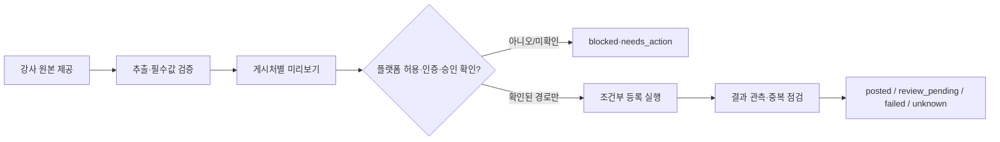

# 음악 레슨 강사 등록 지원 서비스 API 설계 문서 — 조건부 개정 제출 후보

> **Step 2 · DLV-03 · 2026-11-23 / 설계 가설, 미승인·미구현 · 실제 제출/접수 미확인.** 이 문서는 [기획 12항목 V0.1](../artifacts/planning/lesson-registration-20261123/proposal-v0.1.md)과 [Step1 요구사항](../step1/기획서_제출본.md)을 바탕으로 공식 가이드의 6개 항목에 맞춰 작성한 **제출용 논리 API 후보**입니다. [TASK-030](../artifacts/tasks/TASK-030.json)의 플랫폼 정책/인증, [TASK-031](../artifacts/tasks/TASK-031.json)의 기능 완료 조건 및 R01의 설계 착수 결정 **전에는 개발 지시가 아닙니다**. 과거 찾아you API 및 실제 이력은 [11/19 스냅샷](../submissions/step1-step2-20261119/README.md)에 보존합니다.

## 1. 공통 정보·인증 및 API 정책

| 항목 | 후보 설계 / 현재 판단 |
| --- | --- |
| 문서 버전 | LESSON-API-PREVIEW-0.1 / 2026-11-23 / 작성 중 |
| 서비스 업무 경계 | 강사 제공 공고 1건 → 필드 구조화 → 게시처별 미리보기·누락 확인 → 등록 지원(허용 시에만) → 증거 기반 결과 상태 |
| 개발 주소 | `http://localhost:8000/api/v1` **예시**, 서버 없음 |
| 배포 서버 | 없음. 실제 URL·호스트·전송 구간 암호화 설정은 미정 |
| 자동 명세 | OpenAPI `/docs`, `/openapi.json`은 **FastAPI 채택 시 가설**, 동작하지 않음 |
| 인증 | 사용자 소유 확인이 필요하나 로그인·Bearer/JWT 방식 **미결정**; 사용자 인증과 외부 플랫폼 세션은 분리 |
| 외부 인증정보 | 외부 비밀번호·쿠키·세션을 요청 JSON과 로그에 수집/저장하지 않음. 향후 실제 경로는 R05의 권한 검토를 통과해야 함 |
| 응답 공통 형태 | 성공 시 `request_id`와 처리 자원 ID·증거 상태; 오류 시 `error.code/message/request_id/retryable` (제안) |
| 업데이트 | 정책·접근 권한 변경 시 API 상태·도메인 모델 재검토. 신규 외부 등록 API 확정 전 |

**논리 상태:** `drafted`(초안) → `prepared`(필수 정보 준비) → `needs_action`(확인·인증 필요) → 조건 충족 시 `submitted`(제출 관찰) → `review_pending`(심사 대기) 또는 `posted`(실제 게시 확인). `blocked`/ `failed`/ `unknown`은 독립 종료·대기 상태입니다. **API 202/작업 생성은 외부 사이트 게시 완료가 아닙니다.**

**완료 정의 차이:** 당근 모임은 '모임 개설'과 '첫 레슨 글 게시'를 구분하며, 크몽은 '상품 정보 입력'과 '심사 접수'를 구분합니다. 실제 UI·정책 검증 전 현재 예시 값으로 인수 기준을 확정하지 않습니다.

## 2. API 목록 및 요구사항 매핑

| ID | Method / Path (제안) | 목적 | 대상 FR | 인증·실행 범위 |
| --- | --- | --- | --- | --- |
| API-L01 | `POST /api/v1/lesson-drafts` | 사용자 공고·레슨 조건·사진 참조 등록 및 검증 | FR-01,05,06 | 사용자 인증 후보, **내부 초안만** |
| API-L02 | `GET /api/v1/lesson-drafts/{draft_id}/previews/{platform_id}` | 게시처 필드 변환 미리보기와 부족 조건 반환 | FR-02,05,06 | 소유자 조회, **외부 제출 없음** |
| API-L03 | `POST /api/v1/registration-jobs` | 준비/승인 가능 여부 평가 및 등록 작업 생성 | FR-03,04,06 | 기본 `plan_only`; 실제 제출은 **정책 허용+사용자 권한 확인 후 별도 조건** |
| API-L04 | `GET /api/v1/registration-jobs/{job_id}` | 준비·접수·게시·실패·불명확 상태와 관측 근거 조회 | FR-04,06 | 소유자 조회, 읽기 전용 |

**설계가 해결하지 못한 것:** 범용 AI/Codex가 강사 직접 로그인 뒤 동일한 등록을 수행할 때 전용 서비스의 추가 가치, 실제 외부 플랫폼 위임 허용, 사이트별 인증 방식·API 제공 여부. 이 세 사항은 API 존재와 무관하게 검증해야 합니다.

## 3. 엔드포인트별 상세 계약 (공식 가이드 8개 항목)

### API-L01 · POST /api/v1/lesson-drafts

| 항목 | 설계 초안 (실제 엔드포인트 아님) |
| --- | --- |
| 1. 호출 목적 | 강사가 보유한 레슨 원본·가격·이미지 참조를 수령해 미리보기 가능한 초안을 기록 |
| 2. Method/Path | `POST /api/v1/lesson-drafts` |
| 3. Headers | `Content-Type: application/json`, 서비스 인증 주체(방식 미정), `Idempotency-Key` 후보 |
| 4. Path/Query | 없음. 서버가 인증된 강사 소유권을 부여, body의 임의 owner 값은 신뢰하지 않음 |
| 5. Body | `source_text`, `lesson.monthly_fee_krw`, `sessions_per_month`, `minutes_per_session`, `media_asset_refs[]`, `target_platform_ids[]` |
| 6. 검증·권한 | 원본·금액 양수·횟수/시간 단위·미디어 권리·선택한 플랫폼 확인; 체험가·할인은 누락 시 추정하지 않음 |
| 7. 정상 응답 | `201 {draft_id, status:"drafted", missing_fields:[], request_id}` (예시, 실데이터 없음) |
| 8. 오류·실행 규칙 | 401/403 인증·소유권, 422 입력 불일치, 409 멱등 충돌. 외부 플랫폼 접근 없음 |

**요청 예시(합성):**
```json
{
  "source_text": "1:1 랩 레슨 안내 (강사 제공 원문이라고 가정)",
  "lesson": {
    "monthly_fee_krw": 300000,
    "sessions_per_month": 4,
    "minutes_per_session": 90
  },
  "media_asset_refs": ["media:sample-01"],
  "target_platform_ids": ["carrot-group", "kmong"]
}
```

**주의:** 월 300,000원·4회·회당 90분은 [R02 기존 기획의 예시](../members/R02/workspace/2026-11-18_음악_레슨_등록_지원_1차_기획안.md)와 맞추기 위한 합성 요청입니다. 1회 유료 체험 상품 가격은 입력되지 않았으며 자동 산정하지 않습니다.

### API-L02 · GET /api/v1/lesson-drafts/{draft_id}/previews/{platform_id}

| 항목 | 설계 초안 |
| --- | --- |
| 1. 호출 목적 | 게시처에 필요한 제목·설명·절차·가격·이미지 등의 표시값 및 누락 항목 미리보기 |
| 2. Method/Path | `GET /api/v1/lesson-drafts/{draft_id}/previews/{platform_id}` |
| 3. Headers | 서비스 인증(방식 미정), 외부 사이트 자격증명 불필요 |
| 4. Path/Query | `draft_id`(소유 초안), `platform_id`(등록한 규칙); 조회시 규칙 버전도 반환 |
| 5. Body | 없음 |
| 6. 검증·권한 | 강사 소유권, 규칙 최신 확인일, 공고 가격 단위·이미지 규격·미확인 필드 |
| 7. 정상 응답 | `200 {draft_id, platform_id, preview, missing_fields, rule_checked_at, policy_status, status:"prepared"|"needs_action"}` |
| 8. 오류·실행 규칙 | 404 소유권 없음/대상 없음, 409 규칙 미확인, 422 변환 불가능; GET 호출이 실제 게시를 하지 않음 |

### API-L03 · POST /api/v1/registration-jobs

| 항목 | 설계 초안 |
| --- | --- |
| 1. 호출 목적 | 게시처별 등록 작업을 계획하고 실행 가능 조건을 점검. **자동 제출 자체는 조건부 미승인** |
| 2. Method/Path | `POST /api/v1/registration-jobs` |
| 3. Headers | 서비스 인증 + `Idempotency-Key` 필수 후보; 외부 비밀번호/세션 전달 금지 |
| 4. Path/Query | 없음 |
| 5. Body | `draft_id`, `platform_id`, `execution_mode:"plan_only"`, `user_approval_ref`(있을 때만, 인증 대체 불가) |
| 6. 검증·권한 | 소유자·초안 완결성·게시처 자동화 허용 근거·업무 위임·세션 안전·최종 승인 필요 여부. 통과하지 않으면 외부 실행 호출 금지 |
| 7. 정상 응답 | `202 {job_id, status:"prepared"|"needs_action"|"blocked", policy_status, next_action, request_id}` |
| 8. 오류·실행 규칙 | 정책 미확인/권한 부족이면 `blocked`; 중복 key는 기존 작업 식별자를 재사용. `submitted`/ `posted`를 가정해 반환 금지 |

**등록 완료 조건부 경로:** 향후 정책 허용, 사용자 확인, 설치형/공식 API 등 허가된 실행 주체를 결정할 때만 별도 `approved_connector` 모드를 요구사항·권한·서버 통제와 함께 명세 변경합니다. **이번 문서로 원격 브라우저나 최종 등록 권한을 승인하지 않습니다.**

### API-L04 · GET /api/v1/registration-jobs/{job_id}

| 항목 | 설계 초안 |
| --- | --- |
| 1. 호출 목적 | 등록 작업의 현재 상태·확실성·필요한 사용자 행동·최종 증거를 조회 |
| 2. Method/Path | `GET /api/v1/registration-jobs/{job_id}` |
| 3. Headers | 서비스 인증(미정) |
| 4. Path/Query | `job_id`(소유자 범위). 결과 접근에도 초안·작업 소유권 검증 |
| 5. Body | 없음 |
| 6. 검증·권한 | 외부 이벤트의 출처/시각/관측 수준 확인. "제출 시도"와 "사이트가 접수"를 구분 |
| 7. 정상 응답 | `200 {job_id, platform_id, status, completion_kind, evidence_refs, observed_at, retry_allowed, next_action}` |
| 8. 오류·실행 규칙 | 404 타인/없는 작업, 상태 관측 실패 시 200+ `status:"unknown"` 또는 외부 접근 오류 기록; 자동 중복 제출 금지 |

## 4. 입력·권한 검증과 공통 오류

| 검증 계층 | 검사 대상 | 처리 |
| --- | --- | --- |
| 사용자/소유권 | 강사 ID·draft/job 관계 | 서비스의 인증 주체 기준 조회; 타인 요청은 404/403, 임의 owner 전달 무시 |
| 원본 진실성 | 소개글/사진의 권한, 시간·횟수·가격·옵션 | 출처와 사용자 입력 분리; 불명확값은 needs_action |
| 플랫폼 양식 | 당근 모임·크몽의 실제 입력 필수값·정책 변경 | 규칙 버전·확인일 없으면 자동 제출 불가 |
| 외부 실행 허용 | 운영사 약관/공식 위임·사용자 승인·세션 위험 | **모든 조건 충족 전 외부 게시 실행 금지** |
| 결과 검증 | 모임 개설 vs 첫 글 게시, 상품 입력 vs 심사 접수 | 완료 유형과 관찰 증거를 함께 보존 |

| HTTP / 코드(설계값) | 의미·예시 |
| --- | --- |
| 400/422 `INVALID_LISTING` | 잘못된 단위·필수값·체험가 미지정 |
| 401 `AUTH_REQUIRED` | 서비스 인증 부재 (외부 플랫폼 로그인 실패와 다름) |
| 403/404 `NOT_OWNED` | 소유권 불일치·없는 자원 |
| 409 `POLICY_NOT_CONFIRMED` | 사용자 위임은 있지만 운영사 허용 경로 미확인 |
| 409 `DUPLICATE_OR_UNKNOWN` | 기존 제출의 성공 여부 불명확·중복 위험 |
| 503 `UPSTREAM_UNAVAILABLE` | 허용된 외부 조회의 일시 장애. 게시 실패 판정과 구별 |

## 5. Tool 정의 및 실행·실패 흐름 (구현 전)

| 논리 Tool | 입력 | 출력·검증 | 안전한 실행 경계 |
| --- | --- | --- | --- |
| `extract_listing_fields` | 강사 제공 원문·사진 참조 | 구조화된 항목, 근거 원문, 충돌·누락 | 임의 금액/동의 생성 금지 |
| `validate_platform_rules` | 게시처·필드·규칙 확인일 | 필수값 충족/누락/미확인 | 미확인 정책을 허용으로 변경 금지 |
| `prepare_registration` | 승인된 초안·게시처 | 제출 전 미리보기·예외·필요 행동 | 외부 접근 전 read-only |
| `submit_via_authorized_route` | 허용된 커넥터·명시적 승인 범위 | 외부 접수/게시 결과·증거 | **미승인·미구현**. 운영사 허용/인증 격리 없으면 실행 불가 |
| `observe_registration_status` | 허용된 결과 확인 경로·작업 ID | submitted/review_pending/posted/unknown과 관측근거 | 미확인 성공 처리·자동 재제출 금지 |



## 6. 타임아웃·재시도·멱등성 및 평가 계획

| 실행 단계 | 보수적 초기 **제안값** (R05 재검토 대상) | 장애 시 원칙 |
| --- | --- | --- |
| 내부 원본 추출·검증 | 요청당 15초 예산 후보, 사용자 수정 가능 | 재실행 시 동일 key/원본 버전 구분; 원문 보존 |
| 게시처 규칙·허용 정보 조회 | 10초/요청, 읽기 작업 1회 한정 재시도·2초 backoff 후보 | 자료 부재·권한 제한은 미확인/blocked |
| 허용된 업로드/실제 제출 | 환경별 타임아웃 미정; **쓰기 자동 재시도 0회**를 기본값 후보로 검토 | 타임아웃은 성공/실패 미확인, 결과 재조회 후 사람 판단 |
| 멱등성 | `owner+draft+platform+logical_attempt` 기준 고유 key 후보 | 같은 키로 다른 payload면 409, 중복 게시 시도 차단 |
| 기록·관측 | 상태 전이·원인·증거·시각을 별도 이벤트로 남기는 구조 후보 | 입력/준비/접수/게시 단계 혼동 방지 |

**측정 전에 정할 대조:** 동일 원본·사진·처음 상태·완료 기준에서 (1) 직접 수동 등록 (2) 충분한 지시를 받은 Codex/브라우저 (3) 전용 서비스의 사용자 직접 시간·추가 개입·가격 오류·완결 상태·건당 비용을 관측. **실제 실행 결과·성능/시간 기준선·승인된 기술 스택은 없습니다.**

**실제 설계 착수의 차단 조건:** [TASK-030](../artifacts/tasks/TASK-030.json)의 공식 권한/인증 경로 검토, [TASK-031](../artifacts/tasks/TASK-031.json)의 수용 기준, R01 MVP 범위 결정. 이는 [Step2 DB 제출 초안](데이터베이스_스키마_설계서.md)과 교차 대조해야 합니다.

[공식 가이드 6영역 감사](../guidelines/instructor-snapshots/reviews/STEP1-STEP2-V2-GUIDE-AUDIT-20261118.md) · [현재 상태](../../CURRENT.md) · [제출 준비·접수 구분](README.md).
