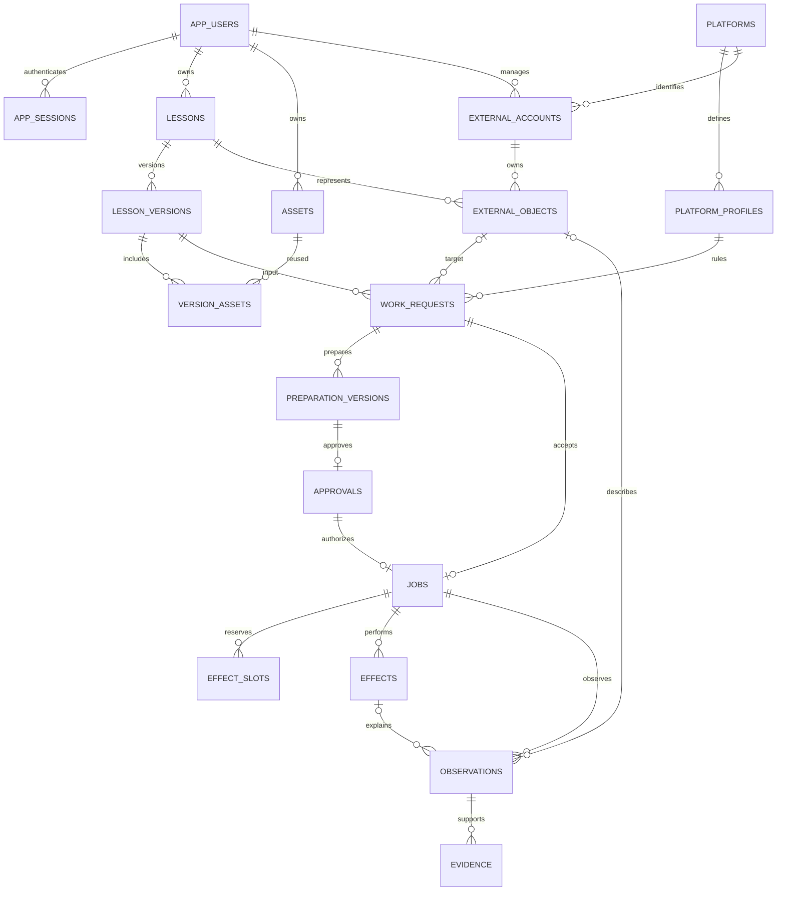

# 음악 레슨 강사 다중 플랫폼 등록·관리 지원 서비스 · 데이터베이스 스키마 설계서

<!-- Generated by tools/project_docs.py. Source: docs/artifacts/planning/lesson-registration-20261126/submission-review-source.json -->
> DLV-04 · 제출용 검토 기준 S1.0 · 2026-11-26. PostgreSQL 16을 제출용 물리 설계 기준으로 선택한다. V1.2 및 현재 조사 근거로 작성한 잠정 설계이며 활성 TASK의 SQLite 코드·계약을 바꾸지 않는다. 실제 DB 생성·이관·앱 시험 전.

[기획 V1.2](../artifacts/planning/lesson-registration-20261123/proposal-v1.2.md) · [API 설계서](API_설계_문서.md) · [data-model.json](submission-v1/data-model.json) · [001_init.sql](submission-v1/001_init.sql) · [002_observation.sql](submission-v1/002_observation.sql) · [피드백](../artifacts/planning/lesson-registration-20261123/instructor-feedback-20261126.json).

## 1. ERD와 관계 명세

원본 레슨과 그 불변 버전, 외부 계정, 외부 게시 객체, 독립 업무 요청/실행 작업을 분리한다. 원본 1:N 게시 객체, 객체 1:N 등록 이후 수정·갱신·조회 업무, 요청당 0..1 job. 기존 등록이 없는 create 요청의 object_id는 null; 확인된 신규 객체만 연결. 독립 업무와 플랫폼 상태를 혼합하지 않는다.

업무 요청의 관련 job(related_job_id)은 과거 unknown을 새 status 업무로 확인하기 위한 선택적 연결이다. 원래 terminal job을 변경하지 않는다. 플랫폼 고유 필드는 버전별 profile의 rules와 preparation.values_json, 관측 snapshot에 보존하고 공통 FK/상태/승인/소유자·시간은 관계형 컬럼을 사용한다.

| 플랫폼 | 객체 유형·고유 데이터 표현 (조사 기반 후보) |
| --- | --- |
| 크몽 | service_listing, 가격 옵션·서비스 문안·심사/접수 상태 |
| 탈잉 | tutor_class, 회차·커리큘럼·일정·썸네일 |
| 숨고 | expert_profile/service_category, 카테고리·서비스 상세·질문답변 |
| 프람피 | expert_profile/lesson_category, 전문가 분야 |
| 뮬 | community_post, 제목·본문·첨부 및 갱신 시각 |
| 힙합플레이야 | community_post, 모집 글·첨부 |
| 힙합LE | community_post, 분류·글·게시 제한 |

R02 11/26 조사에는 7개 플랫폼 객체 후보/공개 자료 근거와 일부 관측 필드가 있으나 실제 타입·필수·최신 절차·허용은 미확인이다. 규칙 버전은 확인된 근거에 한해 등록하고 policy_status=unknown이면 실제 동작 금지. 7개 등록 객체를 표현할 수 있다는 가설과 실제 자동화 가능 여부는 별개. R04/R05 추가 조사 및 TASK-058 결과는 다음 원본 갱신의 근거다.

## 2. 테이블별 컬럼·타입·제약·설명

18개 도메인 테이블 및 schema_migrations 관리 테이블, 두 읽기 뷰(request_status, object_status)를 사용한다. ID는 UUID, revision bigint, UTC timestamptz, 구조화 확장 jsonb, 첨부 bytea. digest는 canonical 입력/bytes에 대해 애플리케이션에서 SHA-256을 검증한다. 다음은 [data-model.json](submission-v1/data-model.json) 및 SQL의 정확한 컬럼/제약 정의이다.

### app_users

OIDC 식별 사용자

| 컬럼 | PostgreSQL 타입·제약 |
| --- | --- |
| user_id | uuid PRIMARY KEY |
| issuer | text NOT NULL |
| subject | text NOT NULL |
| created_at | timestamptz NOT NULL DEFAULT now() |
| deletion_requested_at | timestamptz |

관계·추가 제약: `UNIQUE (issuer,subject)`

### app_sessions

서버 검증 서비스 세션(토큰 해시만)

| 컬럼 | PostgreSQL 타입·제약 |
| --- | --- |
| session_hash | text PRIMARY KEY |
| owner_id | uuid NOT NULL REFERENCES app_users(user_id) |
| csrf_hash | text NOT NULL |
| expires_at | timestamptz NOT NULL |
| revoked_at | timestamptz |

관계·추가 제약: `CHECK (length(session_hash)=64 AND length(csrf_hash)=64)`

### platforms

7개 조사 플랫폼 레지스트리

| 컬럼 | PostgreSQL 타입·제약 |
| --- | --- |
| platform_id | text PRIMARY KEY |
| name | text NOT NULL |

### platform_profiles

플랫폼별 객체·업무·규칙 버전 및 허용 근거

| 컬럼 | PostgreSQL 타입·제약 |
| --- | --- |
| profile_id | uuid PRIMARY KEY |
| platform_id | text NOT NULL REFERENCES platforms(platform_id) |
| object_kind | text NOT NULL |
| operation | text NOT NULL CHECK (operation IN ('create','update','renew','status')) |
| version | text NOT NULL |
| rules_digest | text NOT NULL |
| rules | jsonb NOT NULL |
| policy_status | text NOT NULL CHECK (policy_status IN ('allowed','prohibited','unknown')) |
| policy_evidence | jsonb NOT NULL DEFAULT '[]' |
| mock_supported | boolean NOT NULL DEFAULT false |

관계·추가 제약: `UNIQUE (platform_id,object_kind,operation,version)`; `UNIQUE (profile_id,platform_id,object_kind,operation)`

### lessons

소유자별 재사용 원본 레슨

| 컬럼 | PostgreSQL 타입·제약 |
| --- | --- |
| lesson_id | uuid PRIMARY KEY |
| owner_id | uuid NOT NULL REFERENCES app_users(user_id) |
| title | text NOT NULL |
| created_at | timestamptz NOT NULL DEFAULT now() |
| deletion_requested_at | timestamptz |

관계·추가 제약: `UNIQUE (owner_id,lesson_id)`

### lesson_versions

원본 버전(불변) 및 공통 사실·출처

| 컬럼 | PostgreSQL 타입·제약 |
| --- | --- |
| version_id | uuid PRIMARY KEY |
| owner_id | uuid NOT NULL |
| lesson_id | uuid NOT NULL |
| version_no | bigint NOT NULL CHECK (version_no>=1) |
| raw_text | text NOT NULL |
| facts | jsonb NOT NULL DEFAULT '[]' |
| content_digest | text NOT NULL |
| created_at | timestamptz NOT NULL DEFAULT now() |

관계·추가 제약: `UNIQUE (owner_id,version_id)`; `UNIQUE (owner_id,lesson_id,version_id)`; `UNIQUE (lesson_id,version_no)`; `FOREIGN KEY (owner_id,lesson_id) REFERENCES lessons(owner_id,lesson_id)`

### assets

첨부 bytes·사용 권리·digest

| 컬럼 | PostgreSQL 타입·제약 |
| --- | --- |
| asset_id | uuid PRIMARY KEY |
| owner_id | uuid NOT NULL REFERENCES app_users(user_id) |
| digest | text NOT NULL |
| mime | text NOT NULL |
| content | bytea NOT NULL |
| byte_count | bigint NOT NULL CHECK (byte_count>=0) |
| rights_confirmed | boolean NOT NULL |
| created_at | timestamptz NOT NULL DEFAULT now() |

관계·추가 제약: `UNIQUE (owner_id,asset_id)`; `CHECK (byte_count=octet_length(content))`

### version_assets

원본 버전별 순서가 있는 첨부 연결

| 컬럼 | PostgreSQL 타입·제약 |
| --- | --- |
| owner_id | uuid NOT NULL |
| version_id | uuid NOT NULL |
| asset_id | uuid NOT NULL |
| position | integer NOT NULL CHECK (position>=0) |

관계·추가 제약: `PRIMARY KEY (version_id,asset_id)`; `UNIQUE (version_id,position)`; `FOREIGN KEY (owner_id,version_id) REFERENCES lesson_versions(owner_id,version_id)`; `FOREIGN KEY (owner_id,asset_id) REFERENCES assets(owner_id,asset_id)`

### external_accounts

직접 인증한 외부 계정 식별만 저장(비밀 미저장)

| 컬럼 | PostgreSQL 타입·제약 |
| --- | --- |
| account_id | uuid PRIMARY KEY |
| owner_id | uuid NOT NULL REFERENCES app_users(user_id) |
| platform_id | text NOT NULL REFERENCES platforms(platform_id) |
| external_ref | text NOT NULL |
| label | text NOT NULL |
| verified_at | timestamptz NOT NULL DEFAULT now() |
| unlinked_at | timestamptz |

관계·추가 제약: `UNIQUE (owner_id,account_id)`; `UNIQUE (owner_id,account_id,platform_id)`; `UNIQUE (owner_id,platform_id,external_ref)`

### external_objects

확인된 외부 게시 객체; 상태는 관측에서 파생

| 컬럼 | PostgreSQL 타입·제약 |
| --- | --- |
| object_id | uuid PRIMARY KEY |
| owner_id | uuid NOT NULL |
| lesson_id | uuid NOT NULL |
| account_id | uuid NOT NULL |
| platform_id | text NOT NULL |
| object_kind | text NOT NULL |
| native_id | text NOT NULL |
| public_url | text |
| linked_at | timestamptz NOT NULL DEFAULT now() |
| unlinked_at | timestamptz |

관계·추가 제약: `UNIQUE (owner_id,object_id)`; `UNIQUE (owner_id,object_id,lesson_id,account_id,platform_id,object_kind)`; `UNIQUE (owner_id,account_id,object_kind,native_id)`; `FOREIGN KEY (owner_id,lesson_id) REFERENCES lessons(owner_id,lesson_id)`; `FOREIGN KEY (owner_id,account_id,platform_id) REFERENCES external_accounts(owner_id,account_id,platform_id)`

### work_requests

업무 초안. 한 외부 객체에 독립적인 복수 업무 요청 가능

| 컬럼 | PostgreSQL 타입·제약 |
| --- | --- |
| request_id | uuid PRIMARY KEY |
| owner_id | uuid NOT NULL |
| lesson_id | uuid NOT NULL |
| version_id | uuid NOT NULL |
| profile_id | uuid NOT NULL |
| platform_id | text NOT NULL |
| object_kind | text NOT NULL |
| operation | text NOT NULL CHECK (operation IN ('create','update','renew','status')) |
| account_id | uuid |
| object_id | uuid |
| related_job_id | uuid |
| before_snapshot | jsonb |
| target_slot | text NOT NULL |
| revision | bigint NOT NULL CHECK (revision>=1) |
| draft_status | text NOT NULL CHECK (draft_status IN ('blocked','ready','rejected')) |
| created_at | timestamptz NOT NULL DEFAULT now() |
| updated_at | timestamptz NOT NULL DEFAULT now() |

관계·추가 제약: `UNIQUE (owner_id,request_id)`; `FOREIGN KEY (owner_id,lesson_id,version_id) REFERENCES lesson_versions(owner_id,lesson_id,version_id)`; `FOREIGN KEY (profile_id,platform_id,object_kind,operation) REFERENCES platform_profiles(profile_id,platform_id,object_kind,operation)`; `FOREIGN KEY (owner_id,account_id,platform_id) REFERENCES external_accounts(owner_id,account_id,platform_id)`; `FOREIGN KEY (owner_id,object_id,lesson_id,account_id,platform_id,object_kind) REFERENCES external_objects(owner_id,object_id,lesson_id,account_id,platform_id,object_kind)`; `CHECK (object_id IS NULL OR account_id IS NOT NULL)`; `CHECK (operation<>'create' OR object_id IS NULL)`; `FOREIGN KEY (owner_id,related_job_id) REFERENCES jobs(owner_id,job_id) -- added after jobs`

### preparation_versions

revision별 준비 결과·질문·확인 근거

| 컬럼 | PostgreSQL 타입·제약 |
| --- | --- |
| owner_id | uuid NOT NULL |
| request_id | uuid NOT NULL |
| revision | bigint NOT NULL CHECK (revision>=1) |
| ready | boolean NOT NULL |
| values_json | jsonb NOT NULL DEFAULT '{}' |
| facts | jsonb NOT NULL DEFAULT '[]' |
| issues | jsonb NOT NULL DEFAULT '[]' |
| provenance | jsonb NOT NULL DEFAULT '[]' |
| answers | jsonb NOT NULL DEFAULT '[]' |
| created_at | timestamptz NOT NULL DEFAULT now() |

관계·추가 제약: `PRIMARY KEY (request_id,revision)`; `UNIQUE (owner_id,request_id,revision)`; `FOREIGN KEY (owner_id,request_id) REFERENCES work_requests(owner_id,request_id)`; `CHECK (jsonb_typeof(values_json)='object' AND jsonb_typeof(issues)='array')`; `CHECK (NOT ready OR NOT jsonb_path_exists(issues, '$[*] ? (@.blocking == true)'))`

### approvals

정보 및 실행 범위 승인 snapshot

| 컬럼 | PostgreSQL 타입·제약 |
| --- | --- |
| approval_id | uuid PRIMARY KEY |
| owner_id | uuid NOT NULL |
| request_id | uuid NOT NULL |
| revision | bigint NOT NULL |
| account_id | uuid NOT NULL |
| object_id | uuid |
| target_slot | text NOT NULL |
| review_digest | text NOT NULL |
| scope | jsonb NOT NULL |
| approved_at | timestamptz NOT NULL DEFAULT now() |

관계·추가 제약: `UNIQUE (owner_id,request_id,approval_id,revision)`; `UNIQUE (request_id,revision)`; `FOREIGN KEY (owner_id,request_id,revision) REFERENCES preparation_versions(owner_id,request_id,revision)`; `FOREIGN KEY (owner_id,account_id) REFERENCES external_accounts(owner_id,account_id)`; `FOREIGN KEY (owner_id,object_id) REFERENCES external_objects(owner_id,object_id)`

### jobs

작업 상태의 유일한 저장 정본

| 컬럼 | PostgreSQL 타입·제약 |
| --- | --- |
| job_id | uuid PRIMARY KEY |
| owner_id | uuid NOT NULL |
| request_id | uuid NOT NULL UNIQUE |
| revision | bigint NOT NULL |
| approval_id | uuid NOT NULL |
| request_key | text NOT NULL |
| request_digest | text NOT NULL |
| state | text NOT NULL CHECK (state IN ('active','stopping','done','stopped')) |
| goal_verdict | text CHECK (goal_verdict IN ('confirmed','not_reached','unknown')) |
| final_evidence_id | uuid |
| next_action | text |
| progress_json | jsonb NOT NULL DEFAULT '{"step_index":0,"step_count":1,"confirmed_steps":[],"current_step":null}'::jsonb |
| error_json | jsonb |
| lease_epoch | bigint NOT NULL DEFAULT 0 CHECK (lease_epoch>=0) |
| accepted_at | timestamptz NOT NULL DEFAULT now() |
| updated_at | timestamptz NOT NULL DEFAULT now() |

관계·추가 제약: `UNIQUE (owner_id,job_id)`; `UNIQUE (owner_id,request_key)`; `FOREIGN KEY (owner_id,request_id,approval_id,revision) REFERENCES approvals(owner_id,request_id,approval_id,revision)`; `CHECK ((state IN ('active','stopping') AND goal_verdict IS NULL AND final_evidence_id IS NULL AND next_action IS NULL) OR (state='done' AND goal_verdict IS NOT DISTINCT FROM 'confirmed' AND final_evidence_id IS NOT NULL AND next_action IS NOT NULL) OR (state='stopped' AND goal_verdict IS NOT NULL AND goal_verdict IN ('not_reached','unknown') AND next_action IS NOT NULL))`; `FOREIGN KEY (owner_id,job_id,final_evidence_id) REFERENCES evidence(owner_id,job_id,evidence_id) -- added after evidence`

### effect_slots

계정별 안정 논리 슬롯 및 중복/미확인 효과 차단

| 컬럼 | PostgreSQL 타입·제약 |
| --- | --- |
| owner_id | uuid NOT NULL |
| account_id | uuid NOT NULL |
| slot_key | text NOT NULL |
| job_id | uuid NOT NULL |
| state | text NOT NULL CHECK (state IN ('reserved','confirmed','unknown','absent')) |

관계·추가 제약: `PRIMARY KEY (owner_id,account_id,slot_key)`; `FOREIGN KEY (owner_id,account_id) REFERENCES external_accounts(owner_id,account_id)`; `FOREIGN KEY (owner_id,job_id) REFERENCES jobs(owner_id,job_id)`

### effects

등록된 operation별 durable admission/효과 상태

| 컬럼 | PostgreSQL 타입·제약 |
| --- | --- |
| effect_id | uuid PRIMARY KEY |
| owner_id | uuid NOT NULL |
| job_id | uuid NOT NULL |
| operation_id | text NOT NULL |
| effect_key | text NOT NULL |
| lease_epoch | bigint NOT NULL CHECK (lease_epoch>=0) |
| state | text NOT NULL CHECK (state IN ('admitted','confirmed','absent','unknown')) |
| admitted_at | timestamptz NOT NULL DEFAULT now() |
| dispatched_at | timestamptz |
| resolved_at | timestamptz |

관계·추가 제약: `UNIQUE (owner_id,job_id,effect_id)`; `UNIQUE (job_id,effect_key)`; `FOREIGN KEY (owner_id,job_id) REFERENCES jobs(owner_id,job_id)`

### observations

관측 성공과 실패를 별도 저장; 외부 상태/시간

| 컬럼 | PostgreSQL 타입·제약 |
| --- | --- |
| observation_id | uuid PRIMARY KEY |
| owner_id | uuid NOT NULL |
| job_id | uuid NOT NULL |
| effect_id | uuid |
| object_id | uuid |
| method | text NOT NULL CHECK (method IN ('independent_readback','submission_response','form_read','runtime_observation')) |
| outcome | text NOT NULL CHECK (outcome IN ('observed','unavailable')) |
| native_status | text |
| snapshot | jsonb NOT NULL DEFAULT '{}' |
| observed_at | timestamptz NOT NULL DEFAULT now() |

관계·추가 제약: `UNIQUE (owner_id,job_id,observation_id)`; `FOREIGN KEY (owner_id,job_id) REFERENCES jobs(owner_id,job_id)`; `FOREIGN KEY (owner_id,job_id,effect_id) REFERENCES effects(owner_id,job_id,effect_id)`; `FOREIGN KEY (owner_id,object_id) REFERENCES external_objects(owner_id,object_id)`; `CHECK (outcome<>'unavailable' OR native_status IS NULL)`

### evidence

작업·관측에 연결된 redacted 증거

| 컬럼 | PostgreSQL 타입·제약 |
| --- | --- |
| evidence_id | uuid PRIMARY KEY |
| owner_id | uuid NOT NULL |
| job_id | uuid NOT NULL |
| observation_id | uuid NOT NULL |
| kind | text NOT NULL CHECK (kind IN ('goal','operation','error')) |
| payload_digest | text NOT NULL |
| record | jsonb NOT NULL |
| created_at | timestamptz NOT NULL DEFAULT now() |

관계·추가 제약: `UNIQUE (owner_id,job_id,evidence_id)`; `FOREIGN KEY (owner_id,job_id,observation_id) REFERENCES observations(owner_id,job_id,observation_id)`

### 2.1 초기 생성 및 기존 DB 변경

| 버전 | 적용 |
| --- | --- |
| 001 | PostgreSQL 빈 DB: schema_migrations, 도메인 테이블·FK/UNIQUE/CHECK, 상태/효과 admission trigger, 조회 뷰·인덱스, 7개 레지스트리 |
| 002 | 기존 PostgreSQL v1 DB의 observations에 failure_code 추가 및 job 조회 인덱스, schema_migrations 2 기록 |
| SQLite 기존 모의 자료 | 백업 사본의 source/asset/registration/job/effect/observation/evidence를 새 ID·관계로 변환. 원본 보존, 부모→자식 순서, UUID 매핑 및 hash/단위·시간·권한/상태 비교, credential/기존 실행 lease/permit 이전 금지 |

빈 시험 DB: `psql -X -v ON_ERROR_STOP=1 -f 001_init.sql` → `002_observation.sql`. 기존 가상 자료 DB: 별도 빈 DB에서 001 → `003_fixture_v1.sql` → 사전 backup/count/digest → 002 → `004_verify.sql` → count/관계 및 상태/근거 동일성 확인. 002는 additive 변경 예시이고 SQLite→PG는 별도 이관 계획(실제 변환 미실행). 파일은 [003_fixture_v1.sql](submission-v1/003_fixture_v1.sql)·[004_verify.sql](submission-v1/004_verify.sql). 각 migration은 transaction; 실패 시 rollback 및 사본 복원. 앱 연결에 쓰는 role에서 FK 위반을 실제 INSERT하여 SQLSTATE 23503 확인(기본 FK 제약을 끄지 않음). 빈 DB/기존 합성 DB 적용 결과·명령·commit·schema version·row count·digest·복원 결과는 실행 후 기록한다. 현재 모두 미실행이다.

## 3. API·DB 매핑 및 정합성

| API 행동 | 데이터 | 정합성 |
| --- | --- | --- |
| 서비스 로그인/세션 | app_users, app_sessions | issuer+subject, 서버 검증 owner |
| 원본 입력/수정/조회 | lessons, lesson_versions, assets, version_assets | 불변 버전, owner FK, expected_version CAS |
| 플랫폼 선택/준비/정정 | platform_profiles, work_requests, preparation_versions | 고정 규칙·업무, 현재 revision FK(지연 검사), 답변·출처·검증 |
| 외부 인증·객체 선택·승인 | external_accounts, external_objects, work_requests, approvals | 계정/객체 owner 및 플랫폼 일치, before_snapshot/target_slot·review digest |
| 실행 수락/진행 | jobs, effect_slots, effects | 승인 snapshot+job 원자 저장, owner/request_key UNIQUE, 상태/lease/일회성 dispatch |
| 결과/상태 조회 | request_status, object_status, jobs, observations, evidence | owner filter, stored job state, last confirmed/latest attempt 분리 |
| 삭제/연결 해제 | lessons.deletion_requested_at, external_objects.unlinked_at | 내부 데이터만; 진행 작업 충돌 시 차단 |

### 3.1 FK와 소유권

| 대상 | DB 관계 제약 | 앱 검증 및 시험 |
| --- | --- | --- |
| 원본·첨부 | owner+lesson/version, owner+asset 복합 FK | 세션 owner의 목록/상세/첨부 연결. 타 owner/없는 ID 404, 연결·효과 0 |
| 외부 계정·객체 | owner/account/platform 및 object 복합 FK | 검증된 외부 인증·권한·대상 일치; 타 계정/객체 선택 차단 |
| 요청·승인·job | owner/request/revision/approval FK 및 unique | 현재 revision·ready·scope·target_slot·review_digest 동시 확인 |
| effect·관측·증거 | owner/job/effect/observation/evidence 복합 FK | 상위 job을 owner로 조회; 타 사용자 증거 ID/오류 원문·비밀 미노출 |

FK는 유효한 연결만 검사하며 사용자 인증을 보장하지 않는다. 앱의 모든 목록·상세·연결·업무 실행은 서버 session owner predicate 필수. DB 직접 노출 금지. RLS는 추가 방어 선택지이지 이 설계의 필수 구현으로 주장하지 않는다.

### 3.2 상태 정본 및 전이

jobs.state를 유일한 실행 상태 정본으로 사용한다. work_requests.draft_status(blocked/ready/rejected)는 수락 이전 준비 상태이며 job 상태를 저장하지 않는다. request_status 뷰의 job_id/job_state는 jobs LEFT JOIN에서 파생, 작업 없음은 null. job.progress_json, goal_verdict, error_json, final_evidence_id 및 next_action은 같은 작업에서 저장하며 API Job/Result로 투영한다. 외부 객체 상태는 object_status에서 독립 관측의 last_confirmed_at/native_status와 latest_attempt_outcome/at를 분리한다.

| 전이 | 원자 처리 및 제약 |
| --- | --- |
| job 없음 → active | 현재 revision/ready/권한/승인·대상 검증, 동일 owner/key·body 검사, 승인+job+생성 슬롯 예약을 하나의 transaction으로 commit |
| active → done | 필수 효과 확인 및 독립 goal 증거 일치, final_evidence FK, confirmed/result/progress 원자 저장 |
| active → stopping → stopped | 오류/worker 상실 시 fence·admission 직렬화, unresolved effect unknown, 판정 not_reached 또는 unknown과 안내 저장 |
| done/stopped | DB trigger로 terminal 불변; 이전 unknown은 새 read-only status 업무로 별도 관측 |

row lock/CAS, lease_epoch, unique effect_key와 dispatched_at IS NULL 조건의 일회성 UPDATE로 중복 외부 동작 차단. 신규 등록 슬롯은 같은 계정/원본/규칙의 안정 논리 대상으로 예약하고 unknown/confirmed이면 새 create 금지; absent 확증·새 승인으로만 새 요청 검토. 수정/갱신은 동일 객체의 상호배타 잠금과 이전 미확인 효과 차단을 앱 transaction으로 검사. DB trigger는 허용 전이 및 독립 evidence 존재를 검사하고, 내용·첨부·실제 대상 일치 및 승인/업무별 정책은 결정적 앱 검사로 보장한다. 승인 데이터/원본/증거 불변성은 서비스 권한·transaction 정책으로 강제한다. 실제 경쟁/rollback/재기동/중복/부정 전이 시험은 미실행.

## 4. 서비스 인증·보안·세션 경계

OIDC와 서버 세션(토큰·CSRF hash, 8시간 상한)을 사용한다. 서비스 계정과 외부 플랫폼 인증 분리. PostgreSQL 앱 role 최소 권한, migration role 분리, TLS/비밀은 런타임 설정; 외부 계정 credential/cookie/OTP/viewer grant·민감 화면은 업무 DB, 로그, 증거, 백업에 저장하지 않는다. 외부 인증 binding/lease의 실행 권한은 격리 런타임 메모리에서 검증하고 작업 종료·만료·철회 때 폐기. Redis/pgvector는 필수 기능에 필요하지 않아 채택하지 않는다.

## 5. 결과 추적·보존·삭제 및 백업

작업 ID → effects.effect_id/operation_id → observations.observation_id/method/outcome → evidence.evidence_id → jobs.goal_verdict/final_evidence_id → GET /v2/jobs/{job_id}. 결과는 같은 승인 target/값/첨부 digest/완료 조건과 대조한다.

| 합성 사례 | 관측 및 저장 | 결과 |
| --- | --- | --- |
| 접수 응답 유실 후 독립 receipt 확인 | effect confirmed, independent_readback + observed, goal evidence ID 저장 | done / confirmed; 모의 접수이지 심사 승인/게시 아님 |
| 응답 유실 후 조회 불가 | effect unknown, independent_readback + unavailable, error evidence·final_evidence 없음 | stopped / unknown; 사용자 확인 안내, 자동 재등록 금지 |
| 신뢰 증거로 미도달 | effect absent 및 독립 근거 | stopped / not_reached |

**제출 설계의 데이터 수명:** 원본·첨부는 활성 계정의 재사용 동안 보존하고 삭제 요청 시 즉시 신규 업무 차단, 미종료 업무가 없으면 30일 이내 삭제/비식별화. 작업·증거는 결과 확인·중복 방지 목적으로 업무 종료 후 90일 보존, unknown은 확인 완료/별도 R01 판단 전 보존; 법적 보존 의무와 분쟁은 별도 확인. 삭제 시 최소 비식별 중복 방지 정보와 참조 관계의 안전한 정리 필요, 외부 게시물은 삭제하지 않는다. 합성 개발 자료는 평가 종료 30일 내 삭제 후보. 백업은 암호화·접근 제한·30일 순환 삭제, 삭제 요청은 복원 시 재적용. 서비스 세션 해시 만료/철회 후 24시간 내 제거; 외부 인증 비밀은 처음부터 저장하지 않는다. 이는 잠정 설계값이며 실서비스 법적 검토/삭제·복원 실제 시험 전이다.

## 6. 인덱스·성능 및 검증

owner/created_at, job/accepted_at, object/observed_at, evidence/job 인덱스; owner-filter cursor 목록. PostgreSQL 16, schema version 2를 제출안으로 선택. 초기 및 기존 DB migration, FK/owner, state, duplicate race, evidence 및 backup/secret canary를 다음과 같이 검증한다.

| 시험 | 입력 / 기대 결과 | 현재 |
| --- | --- | --- |
| PG-01 빈 DB | 001+002, 앱 role 정상/존재하지 않는 참조 23503 | 미실행 |
| PG-02 기존 합성 DB | 001+fixture+002+004, row/관계/상태/근거 보존 | 미실행 |
| PG-03 SQLite 이관 | 사본, UUID 매핑, hash 및 known/unknown 비교, rollback | 미실행 |
| PG-04 owner | 합성 A/B 목록·상세·연결·증거·job start, 404 및 외부 효과 0 | 미실행 |
| PG-05 상태/경쟁 | 동일 key 동시, stale, admission/fence, terminal 재개, duplicate 0 | 미실행 |
| PG-06 증거/백업 | 응답 유실·독립 readback 불가, secret canary 및 복원·삭제 | 미실행 |

기존 SQLite 및 공통 V1의 자료는 [이전 제출본](https://github.com/ik-e/chaja-you/blob/6bd597ed858cfa9f29391079e43ba9eba5fb6afa/docs/step2/데이터베이스_스키마_설계서.md)과 [공통 V1](../artifacts/design/lesson-registration-20261124/common-integration-v1.json)에 보존한다. 해당 CI 결과는 PostgreSQL 통과가 아니다. 새 실제 설계에서 확인된 변경은 원본에 기록 후 재프로젝션한다.
