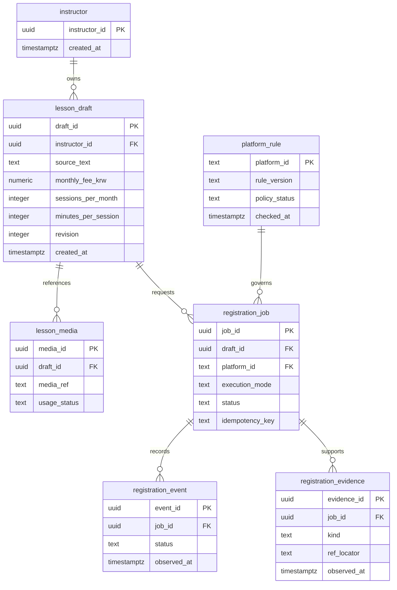

# 음악 레슨 강사 등록 지원 서비스 DB 스키마 설계서 — 조건부 개정 제출 후보

> **Step 2 · DLV-04 · 2026-11-23 / 논리 설계 가설·DB 미구현·DBMS 및 스택 미선정 / 실제 제출·접수 미확인.** [R01 기획 12항목](../artifacts/planning/lesson-registration-20261123/proposal-v0.1.json)과 [Step1 요구사항](../step1/기획서_제출본.md)을 [API 후보](API_설계_문서.md)와 일치시키기 위한 제출 준비 초안입니다. 다음 구조를 현재 개발 DB 지시로 해석하지 않으며, 플랫폼 이용조건/인증 검토([TASK-030](../artifacts/tasks/TASK-030.json)), F1~F3 완료 기준([TASK-031](../artifacts/tasks/TASK-031.json)), R01 MVP 승인이 선행돼야 합니다. 기존 찾아you APP-A/C DB 설계는 [11/19 이력](../submissions/step1-step2-20261119/README.md)과 Git 이력으로 보존합니다.

## 1. 개념 ERD와 관계 명세표



| 자식 FK / 참조 | 부모 PK | 관계·도메인 의미 / 무결성 |
| --- | --- | --- |
| lesson_draft.instructor_id | instructor.instructor_id | 1명의 강사에 공고 초안 다수. 서비스 인증 주체와 일치 |
| lesson_media.draft_id | lesson_draft.draft_id | 강사가 제공할 권리가 있는 이미지 참조. 원본 바이너리 저장 여부 미정 |
| registration_job.draft_id | lesson_draft.draft_id | 동일 공고를 게시처별로 별도 처리·추적 |
| registration_job.platform_id | platform_rule.platform_id | 규칙 버전·허용 수준·확인 시점과 연결. 규칙 존재는 실행 허가가 아님 |
| registration_event.job_id | registration_job.job_id | 상태 전이·실패·미확인 기록. 기존 이벤트를 덮어쓰지 않음 |
| registration_evidence.job_id | registration_job.job_id | 실제 제출·심사·게시 관측의 출처와 시각. 단순 요청 성공과 게시 성공 분리 |

**설계 경계:** 강사의 외부 플랫폼 아이디/비밀번호·브라우저 쿠키·세션 토큰은 위 테이블에 **저장하지 않는 것**을 초기 제안으로 삼습니다. 제품이 구현되거나 정책상 자동 등록이 허용된 것처럼 해석하지 않습니다.

## 2. 엔터티별 컬럼 타입·제약·설명

표의 SQL 타입은 **PostgreSQL 채택을 가정한 임시 표기**입니다. DBMS가 결정되면 실제 타입·인덱스·migration/보존 기간을 재검토합니다.

### instructor

| 컬럼 | 타입(가설) | 제약/기본 | 의미 |
| --- | --- | --- | --- |
| instructor_id | UUID | PK, NOT NULL | 서비스 내부 강사 주체 식별 |
| created_at | TIMESTAMPTZ | NOT NULL, DEFAULT now() | 계정 생성·감사 시각 |

### lesson_draft

| 컬럼 | 타입(가설) | 제약/기본 | 의미 |
| --- | --- | --- | --- |
| draft_id | UUID | PK, NOT NULL | 초안 ID, API-L01 반환 |
| instructor_id | UUID | FK instructor, NOT NULL | 초안 소유자 |
| source_text | TEXT | NOT NULL | 강사 제공 원본 공고 |
| monthly_fee_krw | NUMERIC(12,0) | NULL, CHECK >= 0 | 월 정규 과정 총액; 미정일 땐 NULL |
| sessions_per_month | INTEGER | NULL, CHECK > 0 | 월 수업 횟수 |
| minutes_per_session | INTEGER | NULL, CHECK > 0 | 회당 분 |
| lesson_metadata | JSONB | NULL | 강사 입력 지역·수업 방식 등; 검증되지 않은 확장 필드 |
| missing_fields | JSONB | NOT NULL, DEFAULT '[]' | 요청 재확인이 필요한 항목; 임의 값을 채우지 않음 |
| revision | INTEGER | NOT NULL, DEFAULT 1, CHECK > 0 | 변환·작업 연결 시 사용한 원본 버전 |
| created_at | TIMESTAMPTZ | NOT NULL, DEFAULT now() | 생성 시각 |
| updated_at | TIMESTAMPTZ | NOT NULL, DEFAULT now() | 마지막 수정 시각 |

**가격 제약:** 월 300,000원 / 4회 / 회당 90분에서 환산액을 표시할 수 있지만, 유료 체험 1회 판매가를 생성하는 필드 규칙은 존재하지 않습니다. 사용자가 별도 제공하지 않은 가격/할인/약관 동의는 NULL/미확인입니다.

### lesson_media

| 컬럼 | 타입(가설) | 제약/기본 | 의미 |
| --- | --- | --- | --- |
| media_id | UUID | PK, NOT NULL | 사진/동영상 참조 |
| draft_id | UUID | FK lesson_draft, NOT NULL | 강사 공고 |
| media_ref | TEXT | NOT NULL | 권한 통제 가능한 **내부** 미디어 참조. 임의 외부 URL 아님 |
| media_kind | TEXT | NOT NULL, enum 후보: image/video | 자료 종류 |
| usage_status | TEXT | NOT NULL, default unverified | 강사 제공/권한 미확인/사용 허용 여부 |
| created_at | TIMESTAMPTZ | NOT NULL | 참조 생성 시각 |

### platform_rule

| 컬럼 | 타입(가설) | 제약/기본 | 의미 |
| --- | --- | --- | --- |
| platform_id | TEXT | PK, NOT NULL | 플랫폼/게시처 코드 (예: carrot-group, kmong) |
| rule_version | TEXT | NOT NULL | UI 필드 규칙 버전 |
| field_schema | JSONB | NOT NULL | 필수 입력/형식/가격/사진 규칙 |
| policy_status | TEXT | NOT NULL, enum proposed: allowed/forbidden/unknown | **운영사 권한 상태** (기술 가능성 별도) |
| permission_evidence_ref | TEXT | NULL | 공식 허용/제한 근거 참조 |
| checked_at | TIMESTAMPTZ | NULL | 화면/정책 최종 확인 시각 |
| completion_kind | TEXT | NOT NULL | 모임 개설+첫 글 vs 상품 심사 접수 등 완료 조건 |
| updated_at | TIMESTAMPTZ | NOT NULL | 규칙 수정 시각 |

### registration_job

| 컬럼 | 타입(가설) | 제약/기본 | 의미 |
| --- | --- | --- | --- |
| job_id | UUID | PK, NOT NULL | 등록 작업 ID, API-L03/L04 |
| draft_id | UUID | FK lesson_draft, NOT NULL | 입력 공고 |
| draft_revision | INTEGER | NOT NULL, CHECK > 0 | 변환 기준 공고 버전 |
| platform_id | TEXT | FK platform_rule, NOT NULL | 목적 게시처 |
| execution_mode | TEXT | NOT NULL, DEFAULT plan_only | 'plan_only' 외 **조건부 미승인** |
| status | TEXT | NOT NULL | drafted/prepared/needs_action/submitted/review_pending/posted/blocked/failed/unknown |
| idempotency_key | TEXT | NOT NULL | 사용자/공고/게시처 논리 시도 중복 방지 |
| approval_ref | TEXT | NULL | 명시적 사용자 승인 증거 참조; 외부 운영사 허가 대체 불가 |
| policy_snapshot | TEXT | NOT NULL | 실행 판단에 사용한 플랫폼 규칙 버전/허용 상태 |
| next_action | TEXT | NULL | 강사에게 요청할 조치/막힌 이유 |
| created_at | TIMESTAMPTZ | NOT NULL | 생성 시각 |
| updated_at | TIMESTAMPTZ | NOT NULL | 상태 갱신 시각 |

**등록 제약:** (draft owner, platform, logical attempt)의 동일 작업을 새로 게시할 때는 유일성 보장이 필요합니다. 실제 SQL UNIQUE 키/인덱스 설계는 authenticated owner와 키 범위를 확정한 뒤 정합니다. 작업 생성 성공은 실제 플랫폼 제출 완료가 아닙니다.

### registration_event

| 컬럼 | 타입(가설) | 제약/기본 | 의미 |
| --- | --- | --- | --- |
| event_id | UUID | PK | 불변 상태 변경/관찰 이벤트 |
| job_id | UUID | FK registration_job, NOT NULL | 대상 작업 |
| status | TEXT | NOT NULL | 관찰된 상태/실패/미확인 |
| actor_kind | TEXT | NOT NULL | 사용자/허용된 커넥터/시스템 관찰 |
| observation_kind | TEXT | NOT NULL | 자체 요청/외부 접수/실제 게시 관찰을 구분 |
| observed_at | TIMESTAMPTZ | NOT NULL | 상태를 관찰한 시각 |
| detail | JSONB | NULL | 비민감 요약, 인증정보·개인비밀값 금지 |

### registration_evidence

| 컬럼 | 타입(가설) | 제약/기본 | 의미 |
| --- | --- | --- | --- |
| evidence_id | UUID | PK | 관측 증거 |
| job_id | UUID | FK registration_job, NOT NULL | 해당 등록 작업 |
| evidence_kind | TEXT | NOT NULL | prepared/submission_receipt/review_status/published_page/unknown |
| ref_locator | TEXT | NULL | 허용된 경로의 확인 위치; 비공개 세션 URL 저장 금지 |
| confidence_level | TEXT | NOT NULL | verified/indicated/unknown |
| observed_at | TIMESTAMPTZ | NOT NULL | 판정에 쓰는 시각 |

## 3. API·DB 매핑·정합성 검사

| API 후보 | DB 읽기·쓰기 | 완료·권한 검사 |
| --- | --- | --- |
| API-L01 POST /lesson-drafts | instructor 소유 확인 → lesson_draft/lesson_media INSERT | 원본·사진·단위 검증, draft_id 반환; 외부 사이트 접근 X |
| API-L02 GET /lesson-drafts/{draft_id}/previews/{platform_id} | lesson_draft + platform_rule READ | 강사 소유권, rule 버전·필수값/미확인 반환; 외부 쓰기 X |
| API-L03 POST /registration-jobs | lesson_draft+platform_rule READ, registration_job INSERT, registration_event INSERT | 정책·인증/허용 미확인이면 blocked/needs_action; 실제 자동 제출 금지 |
| API-L04 GET /registration-jobs/{job_id} | registration_job + registration_event + registration_evidence READ | 강사 소유 확인, submitted/review_pending/posted/unknown 증거 구별 |

### 일관성 점검 예시 (합성, DB 미실행)

```sql
-- 반드시 인증 주체와 해당 공고 소유자 일치 조건으로 제한해야 함 (예시 SQL)
SELECT j.job_id, j.platform_id, j.status, j.updated_at
FROM registration_job AS j
JOIN lesson_draft AS d ON d.draft_id = j.draft_id
WHERE d.instructor_id = :authenticated_instructor_id
  AND j.job_id = :job_id;
```

위 SQL은 인증·정책이 구현된 것이 아니라 소유권 필터가 요구된다는 **문서 예시**입니다.

## 4. RLS·JWT·Redis: 적용 판단과 세션 경계

| 주체 / 정책(가설) | SELECT | INSERT | UPDATE | DELETE |
| --- | --- | --- | --- | --- |
| 인증된 강사 | 자신의 lesson_draft/job/event/evidence만 | 자기 공고·등록 계획(외부 제출 제외) | 자기 공고 수정; 제출 승인 이벤트는 별도 보호 | 보존/삭제 정책 충족 범위 |
| 허용된 등록 실행자(조건부) | 승인된 job 범위만 | 허용된 결과·이벤트만 | 검증된 상태 전이만 | 외부 인증·증거 임의 삭제 금지 |
| 운영자(필요 시) | 감사 목적 최소 범위 | 권한 관리 승인 범위 | 사고 대응에 한정 | 과도한 읽기/삭제 금지 |
| 비인증 사용자 | 거부 | 거부 | 거부 | 거부 |

**RLS는 PostgreSQL 등 실제 스택 채택 후 적용 여부를 결정합니다.** JWT도 인증 전략 확정 전 제안이며 외부 플랫폼의 로그인 세션과 동일하지 않습니다. Redis 세션/큐/캐시 사용 여부는 미결정입니다. **"일회성 비밀번호 삭제"만으로 쿠키·세션 종료가 되는 것은 아닙니다.** 실제 외부 등록이 허용될 때는 세션 격리·폐기·만료·로그 비수집·이상 종료 복구를 별도 시험해야 합니다.

## 5. pgvector·문서/청크 및 보관 정책

| 교육 가이드 항목 | 현재 설계 판단 | 적용/비적용 결정 기준 |
| --- | --- | --- |
| pgvector | 레슨 공고 1건의 필드 변환·등록 상태 추적에는 **필수성이 아직 확인되지 않음** | 실제 유사 공고 검색/RAG 필요성을 증명할 때만 적용 검토, 비적용 최종 확인은 강사·매니저와 협의 |
| 문서/청크 | 원본 레슨 소개글은 lesson_draft.source_text로 추적; 근거/규칙 자료의 벡터 청킹은 미설계 | 대규모 지식 검색·근거 추적 기능을 Must로 선택할 경우 도입 |
| Redis | 큐·캐시·세션에 사용 가능하나 도입 전 | 서버 실행/비동기 모델·운영 제약·보안 필요성 확인 |
| RLS/JWT | 서비스 이용자 분리가 필요하나 구현 방식 미정 | 사용자 계정/권한/DBMS 확정 후 결정 |
| 자료 보관/삭제 | 공고 원본·사진·실행 이벤트의 최소 보존·삭제 정책 필요 | 법적/운영 요구 및 강사 동의 범위 확인 후 기간 설정 |

**가이드 항목을 임의 삭제하지 않습니다.** 각 기술을 사용하지 않으면 이유·대안·강사 확인 여부를 남긴 뒤 공식 문서에서 N/A 또는 다른 구현으로 반영합니다.

## 6. 인덱스·조회 성능 및 검증 계획

| 인덱스 후보(미구현) | Key | 예상 질의·검증 |
| --- | --- | --- |
| lesson_draft | (instructor_id, created_at DESC) | 자기 공고 목록. 타인 공고 0건 노출 |
| lesson_media | (draft_id, media_id) | 공고별 미디어 연결 정확성 |
| registration_job | (draft_id, platform_id, created_at DESC) | 동일 공고의 게시처별 작업/중복 조회 |
| registration_job | (idempotency_key) UNIQUE 후보 | 동일 논리 시도 중복 방지; 키 범위/동시성 설계 전 |
| registration_event | (job_id, observed_at DESC) | 최신 상태/이전 이벤트 확인 |
| registration_evidence | (job_id, observed_at DESC) | submitted/review_pending/posted 근거 탐색 |
| platform_rule | (platform_id, checked_at DESC) | 규칙 버전/검증 시점 접근; 이력 테이블 분리 여부 미정 |

| 시험 ID(계획) | 실패/성공 조건 | 현재 |
| --- | --- | --- |
| DB-T01 | 타인의 draft/job 조회·수정 차단 | 설계만 존재 |
| DB-T02 | 가격 단위·누락/체험가 미지정이 임의 값으로 저장되지 않음 | 미실행 |
| DB-T03 | 같은 Idempotency-Key 반복 요청의 중복 job/외부 게시 차단 | 미실행 |
| DB-T04 | submitted와 posted를 별도 근거 없이 같은 상태로 취급하지 않음 | 미실행 |
| DB-T05 | blocked/unknown 결과에서 승인되지 않은 재제출 실행 금지 | 미실행 |
| DB-T06 | 세션·비밀번호·비공개 자료가 테이블·이벤트/로그에 저장되지 않음 | 미실행 |
| DB-T07 | 실제 MVP 쿼리·부하가 정의된 뒤 EXPLAIN/인덱스 검증 | 측정 기준 미정 |

**후속 차단 게이트:** [TASK-030·031 결과](../artifacts/planning/lesson-registration-20261123/README.md), 실제 플랫폼 정책 증거, R01 MVP/실행 위치/인증 결정, 사용자 가치 비교. 아직 **테이블 생성·마이그레이션·인덱스 시험·API–DB 통합·최종 승인 모두 미실행**입니다.

[공식 Step2 6영역 가이드 감사](../guidelines/instructor-snapshots/reviews/STEP1-STEP2-V2-GUIDE-AUDIT-20261118.md) · [현재 Phase](../human/phase-intents/PHASE-20261123-01.md) · [전체 제출 상태](../submissions/README.md).
