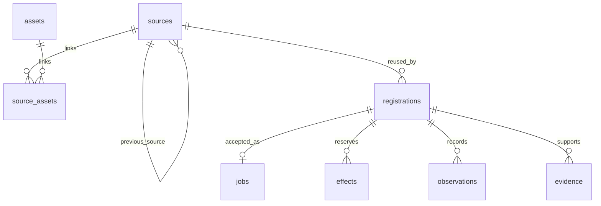

# 음악 레슨 강사 등록 지원 서비스 · 데이터베이스 스키마 설계서

> DLV-04 · 2026-11-26 · 강사 1차 의견 반영 개정 후보. **목표 PostgreSQL**, 기존 SQLite main DDL은 이전 mock 구현 관측/이관 기준. 사용자 스토리·7개 플랫폼 기반 최종 DB는 TASK-058에서 확정; PostgreSQL DDL/실행·마이그레이션/공식 접수 미완료. 기준 ced14b6.

[데이터 계약](https://github.com/ik-e/chaja-you/blob/f5e685716a5ed4fb36159d215b3cc861ef3d5e79/docs/artifacts/design/lesson-registration-20261124/data-contract-v4.json) · [V4.1](https://github.com/ik-e/chaja-you/blob/f5e685716a5ed4fb36159d215b3cc861ef3d5e79/docs/artifacts/design/lesson-registration-20261124/data-schema-v4.1.json) · [PD](https://github.com/ik-e/chaja-you/blob/f5e685716a5ed4fb36159d215b3cc861ef3d5e79/product/lesson-registration/contracts/PHYSICAL-BINDING.json) · [R03 schema.sql](https://github.com/ik-e/chaja-you/blob/4992959c08a12ad81a983ea4a89fed0837c0f1f8/product/lesson-registration/src/lesson_registration/app/store/schema.sql) · [작성 가이드](https://github.com/ik-e/chaja-you/blob/f5e685716a5ed4fb36159d215b3cc861ef3d5e79/docs/guidelines/instructor-snapshots/snapshots/299a7016748aab57c2de9f03fd38a8b09df4c07e/Lecture/FinalProject/Doc/Step2/DB스키마설계서_작성법.html).

## 0. V1.2 요구에서 도출한 논리 데이터 검토 입력

새 DB는 TASK-058의 확정 스토리 및 7개 플랫폼의 공통/고유 객체, 업무, 상태, 권한 근거에서 설계한다. 현재 논리 검토 입력은 아래와 같다. **후보 개념 관계이지 확정 ERD/DDL이 아니다.** 기존 최초 등록 모델은 1절 이하에 비교/이관 대상으로 둔다.

| 사용자 행동/피처 | 필요한 논리 정보 | 확인할 관계·제약 |
| --- | --- | --- |
| F01~F05 원본 재사용·수정 | 서비스 사용자/원본 레슨·버전·첨부·권리 | 사용자 1:N 원본, 불변 버전·소유권·자료 사용 승인 |
| F06~F11 플랫폼/업무 선택·변환/질문 | 플랫폼·업무/규칙 버전·필드·입력안·근거·확인값 | 플랫폼별 고유 타입/필수 조건, 원본/답변 출처, 수정 revision |
| F12~F18 인증·대상/차이·승인 | 외부 계정의 식별/권한, 외부 게시 객체, 변경 전후 snapshot, 정보·범위 승인 | 사용자와 외부 계정·객체 소유/관리 권한, 인증 비밀 비저장 |
| F19~F21 등록·수정·갱신 | 독립 업무/operation·승인 scope, 외부 객체 식별 | 한 원본→복수 플랫폼/객체, 하나의 객체→여러 시점 업무 가능성 검토; 현행 registration 0..1 job은 기존 최초 등록 사례 |
| F22~F29 결과·상태·대응 | 업무 상태/효과·관측·증거·판정, 외부 고유 상태 및 마지막 확인·실패/대응 이력 | 업무 lifecycle과 플랫폼 상태 분리, 단일 상태 정본·소유권/보존·미확인/중복 방지 |

7개 플랫폼을 지원한다고 가정하지 않으며 데이터 표현 가능성과 실제 실행 허용을 별도 검증한다. R02 진행 중 원본(26개 사용자 스토리·14개 시스템 이벤트), R04/R05 초기 양식은 bb73955 기준. 확정 사용자 스토리·플랫폼 비교·통합 DB 설계 원본은 미완성이다. [실제 작업](../artifacts/planning/lesson-registration-20261126/README.md) · [설계 입력](../artifacts/planning/lesson-registration-20261126/instructor-api-db-design-inputs.json). 아래 PostgreSQL 변환·migration 계획은 현행 관측과 새 설계 목표에 대한 후보이며 사용자 스토리 확정 후 물리 DDL을 작성한다.

## 1. ERD와 관계 명세 (이전 최초 등록 mock 모델; 이관 기준)

| 논리 객체 | 저장 위치 | 규칙 |
| --- | --- | --- |
| Source/Asset | sources, assets, source_assets | owner, 불변 원본/이전 버전, 첨부 순서·권리 |
| ProfileRef/Profile | 고정 registry + registrations.profile_json/AcceptedScope | 환경/플랫폼/객체/버전/digest 정확 일치 |
| Preparation/Fact/Provenance/Issue | registrations.preparation_json, answers_json | 원본·답변 근거 및 등록별 revision |
| Auth/Target/Review | registrations auth/target/connection/review JSON | opaque binding만, 실제 credential 금지 |
| AcceptedScope/Job | jobs | 원자 수락·멱등성, CO 상태 소유 |
| Operation/Observation/Evidence/Result | effects, observations, evidence, jobs.result_json | durable admission·실제 관측·독립 readback |

ERD는 물리 FK 관찰을 반영. owner·lease·target·evidence 연결 등의 업무 제약은 추가 관계 검증이 필요하다.

## 2. 기존 테이블별 컬럼·타입·제약·설명 (SQLite 관측값)

기준 main의 [실제 SQLite DDL](https://github.com/ik-e/chaja-you/blob/ced14b622dca5b1c96aeb0e8cf73b5668bfba458/product/lesson-registration/src/lesson_registration/app/store/schema.sql) 관측값이다. 아래 타입·제약은 PostgreSQL 구현 완료를 뜻하지 않는다. V4.1 semantic guards 및 PR #44 병합 이후 실제 관계·제약을 별도 대조한다. 최신 DDL에는 dispatch_permits도 존재한다(아래).

### meta

DB 메타/시퀀스; 비밀 저장 금지.

| 컬럼 | SQLite 타입 | 현재 SQL 제약 |
| --- | --- | --- |
| key | TEXT | PRIMARY KEY |
| value | TEXT | NOT NULL |

### sources

owner별 불변 원본 및 이전 버전; 수정은 새 Source.

| 컬럼 | SQLite 타입 | 현재 SQL 제약 |
| --- | --- | --- |
| source_id | TEXT | PRIMARY KEY |
| owner_ref | TEXT | NOT NULL |
| previous_source_id | TEXT | REFERENCES sources(source_id) |
| raw_text | TEXT | NOT NULL |
| created_at | TEXT | NOT NULL |
| seq | INTEGER | NOT NULL |

### assets

권리 확인 첨부 raw bytes와 메타/digest; 인증 화면·쿠키 저장 대상 아님.

| 컬럼 | SQLite 타입 | 현재 SQL 제약 |
| --- | --- | --- |
| asset_id | TEXT | PRIMARY KEY |
| owner_ref | TEXT | NOT NULL |
| digest | TEXT | NOT NULL |
| mime | TEXT | NOT NULL |
| bytes | INTEGER | NOT NULL |
| width | INTEGER | NOT NULL |
| height | INTEGER | NOT NULL |
| rights_confirmed | INTEGER | NOT NULL |
| blob | BLOB | NOT NULL |
| created_at | TEXT | NOT NULL |

### source_assets

N:M, ord로 첨부 순서; PK는 중복 링크 제한, 순서/owner 업무 가드 별도.

| 컬럼 | SQLite 타입 | 현재 SQL 제약 |
| --- | --- | --- |
| source_id | TEXT | NOT NULL REFERENCES sources(source_id) |
| asset_id | TEXT | NOT NULL REFERENCES assets(asset_id) |
| ord | INTEGER | NOT NULL |
| 테이블 제약 | — | PRIMARY KEY (source_id, asset_id) |

### registrations

지원/profile/preparation/답변/revision/auth/target/connection/review/job_state. connection_json은 opaque 참조만.

| 컬럼 | SQLite 타입 | 현재 SQL 제약 |
| --- | --- | --- |
| registration_id | TEXT | PRIMARY KEY |
| owner_ref | TEXT | NOT NULL |
| source_id | TEXT | NOT NULL REFERENCES sources(source_id) |
| selector | TEXT | NOT NULL |
| support | TEXT | NOT NULL |
| profile_json | TEXT | 별도 SQL 제약 없음 |
| preparation_json | TEXT | NOT NULL |
| answers_json | TEXT | NOT NULL |
| revision | INTEGER | NOT NULL |
| auth_json | TEXT | NOT NULL |
| target_json | TEXT | 별도 SQL 제약 없음 |
| connection_json | TEXT | 별도 SQL 제약 없음 |
| review_json | TEXT | 별도 SQL 제약 없음 |
| job_state | TEXT | 별도 SQL 제약 없음 |
| created_at | TEXT | NOT NULL |
| updated_at | TEXT | NOT NULL |
| seq | INTEGER | NOT NULL |

### jobs

등록당 0..1 영속 수락, owner/request key 유일성, immutable scope, 상태/결과, 내부 lease.

| 컬럼 | SQLite 타입 | 현재 SQL 제약 |
| --- | --- | --- |
| registration_id | TEXT | PRIMARY KEY REFERENCES registrations(registration_id) |
| owner_ref | TEXT | NOT NULL |
| request_key | TEXT | NOT NULL |
| request_digest | TEXT | NOT NULL |
| accepted_scope_json | TEXT | NOT NULL |
| state | TEXT | NOT NULL |
| result_json | TEXT | 별도 SQL 제약 없음 |
| worker_lease | TEXT | 별도 SQL 제약 없음 |
| accepted_at | TEXT | NOT NULL |
| updated_at | TEXT | NOT NULL |
| 테이블 제약 | — | UNIQUE (owner_ref, request_key) |

### effects

stable effect key 유일성, operation/step/action/class/binding/상태. 외부 효과 exactly-once 주장 금지.

| 컬럼 | SQLite 타입 | 현재 SQL 제약 |
| --- | --- | --- |
| effect_key | TEXT | PRIMARY KEY |
| registration_id | TEXT | NOT NULL REFERENCES registrations(registration_id) |
| operation_id | TEXT | NOT NULL |
| step_id | TEXT | NOT NULL |
| action_key | TEXT | NOT NULL |
| effect_class | TEXT | NOT NULL |
| binding_digest | TEXT | NOT NULL |
| status | TEXT | NOT NULL |
| admitted_at | TEXT | NOT NULL |
| resolved_at | TEXT | 별도 SQL 제약 없음 |

### observations

등록·operation 관측, admission/lease/target과의 업무 관계는 SQL만으로 보장되지 않음.

| 컬럼 | SQLite 타입 | 현재 SQL 제약 |
| --- | --- | --- |
| observation_id | TEXT | PRIMARY KEY |
| registration_id | TEXT | NOT NULL REFERENCES registrations(registration_id) |
| operation_id | TEXT | NOT NULL |
| verdict | TEXT | NOT NULL |
| method | TEXT | NOT NULL |
| evidence_refs_json | TEXT | NOT NULL |
| observed_at | TEXT | NOT NULL |

### evidence

신뢰 근거 JSON과 시간, public redaction, 인증정보/비밀 제외.

| 컬럼 | SQLite 타입 | 현재 SQL 제약 |
| --- | --- | --- |
| evidence_id | TEXT | PRIMARY KEY |
| registration_id | TEXT | NOT NULL REFERENCES registrations(registration_id) |
| record_json | TEXT | NOT NULL |
| observed_at | TEXT | NOT NULL |

### dispatch_permits (최신 관측 추가)

| 컬럼 | SQLite 타입 | 현재 SQL 제약 |
| --- | --- | --- |
| token | TEXT | PRIMARY KEY |
| registration_id | TEXT | NOT NULL (현재 FK 없음) |
| lease | TEXT | NOT NULL |
| operation_json | TEXT | NOT NULL |
| consumed | INTEGER | NOT NULL DEFAULT 0 |

내부 일회성 dispatch 권한의 구현 기록. 외부 계정 credential이 아니며, 공개 응답·증거·로그·백업의 비밀 유출 방지 및 만료·폐기 설계를 따로 검토한다. 현재 FK/owner 제약 보완 필요.

### 2.1 목표 PostgreSQL 물리 설계 방향 및 migration 계획

R01 방향은 최종 제품 및 통합 DB를 PostgreSQL로 전환하는 것이다. 현행 V4.1/SQLite 모델은 이관·비교 입력이며, V1.2 스토리의 등록/수정/갱신/조회·실행 이력 요구에 따라 논리 구조를 먼저 확정한다. 아래는 **기존 모델 이관 후보**로서 새 구조를 자동 확정하지 않는다.

| 기존 자료형/관계 | PostgreSQL 후보 | 설계·이관 확인 |
| --- | --- | --- |
| TEXT ID, owner | text (기존 ID 유지) | PK/FK·owner 복합 관계, 길이/형식 검사 |
| TEXT JSON | jsonb 또는 canonical text | 구조 검증·검색 필요성·canonical digest byte 동일성; raw 원본 및 hash 기준을 임의 변경하지 않음 |
| INTEGER revision/seq | bigint | 범위·순서·CAS/DB sequence 전략, 이관 충돌 |
| INTEGER rights_confirmed/consumed | boolean | 0/1만 변환, 잘못된 값은 이관 차단 |
| BLOB | bytea | byte 길이/digest/승인된 첨부 동일성 |
| TEXT UTC timestamps | timestamptz | UTC 의미·정렬/동일 시점 검증 |
| owner/request_key 및 effect_key unique | UNIQUE/PK 유지 | 동일 요청 조회·중복 효과 방지·경합 |
| FK·state·owner 관계 | FK, UNIQUE, CHECK, 필요 시 복합 FK 및 서비스 transaction | 상태 의미/소유자 일치, permit/observation/evidence의 업무 관계 |

**초기 생성:** 승인된 PostgreSQL 버전·드라이버·migration 도구/앱 role 및 고정 설정을 기록 → 빈 시험 DB 생성 → 순서가 있는 migration으로 계정/원본/첨부·링크/등록 또는 외부 객체/작업/효과/관측·증거·권한/인덱스 적용 → 앱 실제 연결로 FK 위반·UNIQUE·CHECK 및 정상 저장/조회 시험 → schema version/DDL hash·command·commit·결과 보존.

**기존 DB 변경/이관:** 합성 SQLite 사본(원본 불변) 및 승인된 PostgreSQL 이전 버전 시험 DB를 구분 → migration 전 백업·schema version·row count·ID·hash·state 점검 → 기존 데이터 export/타입 변환·부모→자식 순서 import 또는 PostgreSQL 버전 migration 적용(필요 시 transaction) → FK/owner/상태·첨부 hash·결과/키 일치 검증 → 앱 연결과 경합 시험 → 실패 시 미완료 변경 rollback/별도 사본 복원, 기존 원본 유지. 실행 중 작업·lease·permit을 새 worker로 자동 재개하지 않는다. 실제 데이터나 외부 계정 사용 금지.

| 시험 환경 | 입력·관측 | 합격 기준 | 실행 |
| --- | --- | --- | --- |
| 빈 PostgreSQL DB | versioned 초기 migration 및 앱 연결 정상 생성 | 모든 테이블·제약 적용, 정상 source/registration 조회 | 미실행 |
| 빈/이관 DB FK | 앱이 사용하는 동일 role/연결에서 존재하지 않는 source/registration 참조 INSERT | FK violation(SQLSTATE 23503) 거절·rollback, 정상 참조 성공 | 미실행 |
| 가상 자료가 든 기존 DB | 원본·첨부·작업·증거·known/unknown 결과·멱등키 | 행/관계·의미·byte digest·조회 결과 대조, 중복/누락 0 | 미실행 |
| 실패·경쟁 | 잘못된 FK/중복키/상태·실패 migration·동시 요청 | 부분 반영 방지, 기존 데이터 보존, duplicate effect 0 | 미실행 |

PostgreSQL FK는 기본 제약이지만 실제 migration으로 설치되고 앱 연결에서 위반이 거부되는지 증명해야 한다. SQLite PRAGMA를 PostgreSQL에 옮기지 않는다. FK constraint 확인 및 실제 위반 시험, migration 전후 count/digest/schema version/재현 명령 기록. 구체 버전·드라이버·DDL/이관 공수는 범위/DB 확정 후 R03과 협의하며 현재 구현·CI·lock은 수정하지 않았다.

## 3. API·DB 매핑 및 정합성

| API/포트 | 저장·조회 | 검증 |
| --- | --- | --- |
| H1~H3 | sources/assets/source_assets | owner, previous_source, byte digest/MIME/rights/ord |
| H4/H5·I1/I2 | registrations + 고정 Profile | 현재 revision, source/profile/answer/provenance, prestart |
| H6/I3 | registrations auth/target/connection/review | generation, 계정·target, 인간 입력 차단, opaque binding |
| H7 | jobs + registrations | owner/key/digest, exact scope/review/revision/permission/target/binding 원자 수락 |
| I4/STORE | effects, observations, evidence | durable 예약, operation/lease/target, fence 및 unknown |
| I5/H8/H9 | jobs.result_json + registrations/evidence | 독립 readback, CO terminal, owner persisted view |

동일 key+요청은 기존 작업 조회, 다른 요청/같은 효과 중복 거절. 원본 변형·타 owner 연결 금지. 실제 브라우저 효과와 DB 기록은 하나의 원자 commit이 아니므로 미확인 효과는 unknown 보존. 실제 SQL만으로 전 관계·권한·불변식을 증명하지 못한다.

### 3.1 FK와 소유권 검증의 구분

| 데이터/동작 | DB의 관계 제약(현재 또는 후보) | 앱/STORE가 확인할 권한 | 실패 시험 |
| --- | --- | --- | --- |
| source/previous_source | source PK, self FK; owner 일치 복합 FK 후보 | 서버 owner의 원본만 목록·상세, 이전 원본도 같은 owner | 타 owner/없는 ID 404, 외래키 위반 거절 |
| source_assets | source_id/asset_id FK와 복합 PK | source·asset 모두 같은 owner, 승인된 권리/bytes | 타 owner 첨부 연결 거절, 저장/외부 효과 0 |
| registrations.source_id | FK; owner 일치 복합 FK 후보 | 서버 owner의 Source만 등록 연결 | 타 owner source로 H4 시도 404, 생성 0 |
| jobs | registration_id FK/PK 및 owner/request_key UNIQUE (기존) | 등록의 owner에서 job/result의 접근 권한 확인; jobs.owner_ref 일치 | H8/H9 타 owner 상세 404·목록 미노출, 수락 0 |
| effects/observations/evidence | registration FK, operation/observation/evidence 관계 제약 후보 | 연결된 등록의 owner·scope·operation 확인, public redaction | 타 owner ID 및 foreign evidence 주입 거절, 내용 미노출 |
| dispatch_permits | 현행 registration FK 없음; 후보 FK/one-shot 제약 | 내부 lease·owner/scope/operation 및 현재 상태 확인 | stale/타 owner/consumed 거절, 외부 효과 0 |

FK는 행 존재·관계 무결성을 확인하며 요청자의 권한을 자동 증명하지 않는다. 서버 검증 서비스 계정→owner를 모든 읽기·쓰기·조회에 적용하고 DB direct access 금지. 테스트는 두 합성 owner A/B, 각 원본·첨부·등록·효과·증거, cross-owner ID/목록 cursor/연결을 사용. 401/404/403과 실제 저장·외부 효과 0을 관측한다. PostgreSQL RLS는 defense-in-depth 후보이며 앱 검증 대체 아님; 채택·role·context 검증은 후속 결정.

### 3.2 작업 상태의 정본과 전이

현행 최초 등록 mock은 registrations.job_state와 jobs.state를 각각 저장한다. CO가 단일 업무 전이를 관리하고 STORE가 transaction으로 정합성을 보장한다. **목표 설계 후보:** 작업의 저장 정본은 jobs.state, 등록 조회 job_state는 연결 job에서 파생하며 job 없으면 null. 중복 저장을 없애는 것이 우선; 불가피한 조회 캐시라면 같은 transaction에서 갱신·제약/불일치 탐지·재구성하고 정본을 따르도록 한다. V1.2의 등록·수정·갱신은 외부 객체와 작업 1:N 요구가 생길 수 있으므로 기존 0..1을 그대로 채택하지 않고 스토리 범위 확정 후 관계·정본/조회 표현 결정.

| 전이 (현행 공통 V1) | 조건·원자 처리 후보 |
| --- | --- |
| null → active | 승인된 scope/revision/권한/대상 검증, 유일 요청키와 job을 원자 수락 |
| active → done | 신뢰 가능한 goal 확인 + 요구 효과 해결, result/상태 원자 commit |
| active → stopping → stopped | 오류 또는 worker 상실; admit/fence serialize, unknown 보존 후 terminal result 기록 |
| done/stopped | lifecycle 재개/재실행 없음; 승인된 read-only 신뢰 근거로 verdict 정밀화만 가능 |

허용 jobs.state CHECK(active,stopping,done,stopped) 후보, prestart null은 job 부재로 표현. DB 제약만으로 상태 전이를 증명하지 못하므로 조건부 UPDATE/CAS 또는 행 잠금+transaction 및 UNIQUE가 전이/lease/permit/중복을 강제하도록 구현한다. 외부 접수·심사·공개 상태와 Result.goal_verdict(confirmed/not_reached/unknown)는 별도이며 API H8/H9는 정본에서 파생된 저장된 상태와 결과를 읽는다. 시험: 두 동시 H7, stale revision, fence/admit race, 실패 transaction/rollback, 앱 재기동, 응답 유실, H8/H9 상태 불일치 및 terminal 재개 거절. 결과는 미실행; 기존 SQLite 독립 CI와 구별한다.

## 4. RLS·JWT·Redis·세션 경계

| 항목 | 적용 판단 |
| --- | --- |
| PostgreSQL | 최종 제품·통합 DB 목표; 기존 SQLite mock/독립 증거 보존, 실제 migration 전 |
| RLS | PostgreSQL 추가 방어 후보, 실제 채택/정책 미확정; app/STORE owner 검증 필수, 직접 DB 노출 금지 |
| JWT | 제품 서비스 인증 방식 미확정; 테스트 헤더 독립 시험 전용 |
| Redis | 분산 큐·캐시 필요 근거 없어 미채택 |
| 외부 세션 | BrowserContext 임시, DB에는 내부 binding 참조만. 쿠키/password/token/input/frame 저장·내보내기 금지 |
| 폐기 | 종료/만료/장애 시 격리 자원 폐기, 실제 플랫폼 token revoke 별도. [PR #44 보안 후보](https://github.com/ik-e/chaja-you/pull/44) |

## 5. 결과 추적·보관·삭제 및 pgvector

### 5.1 결과의 근거 추적

현재 mock 등록 ID는 job 식별자와 연결(등록당 0..1). 업무 ID/registration_id → effect_key·operation_id → observations.observation_id/operation_id → evidence_refs → evidence.record_json → jobs.result_json 및 API H8의 result로 추적한다. 새 설계에서는 등록/수정/갱신의 독립 작업 ID 필요 여부를 사용자 스토리 기반으로 결정한다.

| 합성 사례(시험 전) | 저장 관측/근거 | 최종 판정 및 사용자 안내 |
| --- | --- | --- |
| 접수 응답 유실 뒤 독립 조회에서 승인한 대상·payload·사진 digest 일치 | 등록 registration-kmong, operation mock-op-K6, 독립 조회 mock-goal-kmong(method=independent_readback), target/observed_at/environment=mock 및 digest 대조 | 필요한 전체 증거 충족 시 goal_verdict=confirmed, done (실제 외부 승인/게시 아님) |
| 응답 유실 뒤 독립 조회 불가 | 동일 operation의 admission 및 unknown effect, observation에 근거 부재/미확인 기록, 신뢰할 접수 근거 없음 | error fence/stopped, goal_verdict=unknown; 성공·실패 단정 및 자동 재등록 금지 |
| 확인된 미도달 | 독립 조회 또는 신뢰 관측으로 효과 absent/목표 미도달 확인 | goal_verdict=not_reached, stopped; 다음 조치 안내 |

[API 예시 JSON](api-feedback-examples-20261126.json)과 대응. 실제 결과와 예시를 구분하며 모든 관측을 입력·후보 commit·effect 수·evidence ID와 함께 기록한다.

### 5.2 보존·삭제·백업 정책

| 데이터 | 설계 후보 보존/삭제 기준 | 검증 |
| --- | --- | --- |
| 원본·첨부 | 업무 참조와 사용자 권한이 필요한 동안 보존; 사용자 삭제/계정 종료 요청 및 참조 중인 작업/권리 처리 후 삭제 정책 결정. 수정은 새 버전 | 타 owner 접근 차단, 첨부 hash 및 참조 보존, 삭제·복원 테스트 |
| 승인·작업·effect·관측·증거 | 결과 확인·감사 및 중복 방지 의무가 있는 동안 최소 보존. 삭제 시 dedup 보존/비식별 tombstone 필요성과 법적 근거 검토, 미확인 작업의 기록 무단 제거 금지 | 동일 key/effect 재등록 방지, known/unknown 및 감사 관계 추적 |
| 인증정보 | 외부 password/OTP/cookie/token/session 화면·입력은 업무 DB·증거·로그·백업에 미저장; BrowserContext 임시, 종료/만료/장애 시 폐기. 내부 opaque binding만 필요한 범위 | 합성 canary로 DB/로그/증거/백업에 비밀 없음 확인, 만료·폐기 시험 |
| 합성 개발·평가 자료 | 실제 개인정보 없는 합성 데이터에 한해 평가 종료 후 30일 이내 삭제를 초기 후보로 제안(교육 제출·재현/증빙 보존 요구 확인 후 확정) | 시험용 backup 포함 삭제/복원 주기 및 비밀 배제 확인 |
| 실제 서비스 데이터/백업 | 보존기간·삭제권·권한/법적 근거·backup 수명·암호화/복원 정책은 별도 운영 결정 전 미확정, 현행 mock-only | 사용자 스토리·운영 근거 확정 및 실제 환경 검증 |

위 기간과 삭제 흐름은 설계 후보이며 실제 운영 정책·삭제 기능 구현·승인으로 보지 않는다. 계정 삭제, 작업/증거 보존·재사용, 외부 연결 해제 등은 TASK-058에서 사용자 스토리 및 범위를 확정한다.

### 5.3 기타 저장 기술

벡터 검색/pgvector는 현재 요구에 필요 근거 없어 미채택. 원본/승인/효과/증거의 최소 업무 데이터만 유지. 보존 기간·삭제·백업·암호화·실제 서비스 개인정보 관리는 운영 정책/실측과 별도 승인 후 결정. 인증 화면/입력/자격증명을 evidence로 저장하지 않는다.

## 6. 인덱스·성능 및 검증

관찰된 DDL: sources_owner_order(owner_ref, created_at DESC, source_id DESC), 각 PK, jobs UNIQUE(owner_ref, request_key). 추가 인덱스는 조회·부하 실측 뒤. FK 활성화/트랜잭션/불변·owner·경쟁·응답 유실·독립 증거 검증은 R03 실제 구현과 제품 시험으로 확인(T5-11, T6-01, T6-02, T5-01, T5-12, T5-05, DV-01, DV-03 등). 제품 22개 미실행. PostgreSQL 초기/기존 DB migration·FK·owner·상태/경쟁·증빙·backup 실제 시험은 미실행. [실제 설계 입력](../artifacts/planning/lesson-registration-20261126/instructor-api-db-design-inputs.json) · [TASK-058](../artifacts/tasks/TASK-058.json). 최종 물리 스키마·보존 정책·성능 수치는 범위 및 실제 검증 후 확정.
