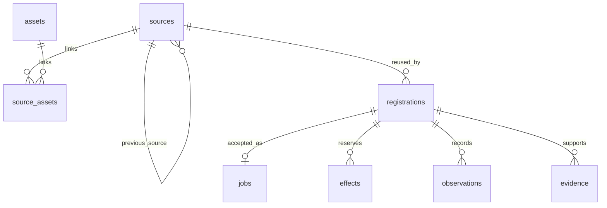

# 음악 레슨 강사 등록 지원 서비스 · 데이터베이스 스키마 설계서

> DLV-04 · 2026-11-25 · 기준 main f5e6857 · V4.1·SQLite 채택 반영. 물리 컬럼은 R03 e29fb69와 최신 main 4992959에서 동일한 schema.sql 관찰값이며 최종 제품 연동·공식 제출 미확인. [11/23 이전 후보](https://github.com/ik-e/chaja-you/blob/f5e685716a5ed4fb36159d215b3cc861ef3d5e79/docs/step2/데이터베이스_스키마_설계서.md).

[데이터 계약](https://github.com/ik-e/chaja-you/blob/f5e685716a5ed4fb36159d215b3cc861ef3d5e79/docs/artifacts/design/lesson-registration-20261124/data-contract-v4.json) · [V4.1](https://github.com/ik-e/chaja-you/blob/f5e685716a5ed4fb36159d215b3cc861ef3d5e79/docs/artifacts/design/lesson-registration-20261124/data-schema-v4.1.json) · [PD](https://github.com/ik-e/chaja-you/blob/f5e685716a5ed4fb36159d215b3cc861ef3d5e79/product/lesson-registration/contracts/PHYSICAL-BINDING.json) · [R03 schema.sql](https://github.com/ik-e/chaja-you/blob/4992959c08a12ad81a983ea4a89fed0837c0f1f8/product/lesson-registration/src/lesson_registration/app/store/schema.sql) · [작성 가이드](https://github.com/ik-e/chaja-you/blob/f5e685716a5ed4fb36159d215b3cc861ef3d5e79/docs/guidelines/instructor-snapshots/snapshots/299a7016748aab57c2de9f03fd38a8b09df4c07e/Lecture/FinalProject/Doc/Step2/DB스키마설계서_작성법.html).

## 1. ERD와 관계 명세

| 논리 객체 | 저장 위치 | 규칙 |
| --- | --- | --- |
| Source/Asset | sources, assets, source_assets | owner, 불변 원본/이전 버전, 첨부 순서·권리 |
| ProfileRef/Profile | 고정 registry + registrations.profile_json/AcceptedScope | 환경/플랫폼/객체/버전/digest 정확 일치 |
| Preparation/Fact/Provenance/Issue | registrations.preparation_json, answers_json | 원본·답변 근거 및 등록별 revision |
| Auth/Target/Review | registrations auth/target/connection/review JSON | opaque binding만, 실제 credential 금지 |
| AcceptedScope/Job | jobs | 원자 수락·멱등성, CO 상태 소유 |
| Operation/Observation/Evidence/Result | effects, observations, evidence, jobs.result_json | durable admission·실제 관측·독립 readback |

ERD는 물리 FK 관찰을 반영. owner·lease·target·evidence 연결 등의 업무 제약은 추가 관계 검증이 필요하다.

## 2. 테이블별 컬럼·타입·제약·설명

실제 main DDL을 읽어 투영. TEXT JSON 필드는 V4.1과 semantic guards 적용. 명시되지 않은 SQL CHECK/FK/UNIQUE를 구현된 것으로 표현하지 않는다. PR #44의 claim/permit/evidence CAS 후보 채택 뒤 실제 DDL 변경을 대조한다.

### meta

DB 메타/시퀀스; 비밀 저장 금지.

| 컬럼 | SQLite 타입 | 현재 SQL 제약 |
| --- | --- | --- |
| key | TEXT | PRIMARY KEY |
| value | TEXT | NOT NULL |

### sources

owner별 불변 원본 및 이전 버전; 수정은 새 Source.

| 컬럼 | SQLite 타입 | 현재 SQL 제약 |
| --- | --- | --- |
| source_id | TEXT | PRIMARY KEY |
| owner_ref | TEXT | NOT NULL |
| previous_source_id | TEXT | REFERENCES sources(source_id) |
| raw_text | TEXT | NOT NULL |
| created_at | TEXT | NOT NULL |
| seq | INTEGER | NOT NULL |

### assets

권리 확인 첨부 raw bytes와 메타/digest; 인증 화면·쿠키 저장 대상 아님.

| 컬럼 | SQLite 타입 | 현재 SQL 제약 |
| --- | --- | --- |
| asset_id | TEXT | PRIMARY KEY |
| owner_ref | TEXT | NOT NULL |
| digest | TEXT | NOT NULL |
| mime | TEXT | NOT NULL |
| bytes | INTEGER | NOT NULL |
| width | INTEGER | NOT NULL |
| height | INTEGER | NOT NULL |
| rights_confirmed | INTEGER | NOT NULL |
| blob | BLOB | NOT NULL |
| created_at | TEXT | NOT NULL |

### source_assets

N:M, ord로 첨부 순서; PK는 중복 링크 제한, 순서/owner 업무 가드 별도.

| 컬럼 | SQLite 타입 | 현재 SQL 제약 |
| --- | --- | --- |
| source_id | TEXT | NOT NULL REFERENCES sources(source_id) |
| asset_id | TEXT | NOT NULL REFERENCES assets(asset_id) |
| ord | INTEGER | NOT NULL |
| 테이블 제약 | — | PRIMARY KEY (source_id, asset_id) |

### registrations

지원/profile/preparation/답변/revision/auth/target/connection/review/job_state. connection_json은 opaque 참조만.

| 컬럼 | SQLite 타입 | 현재 SQL 제약 |
| --- | --- | --- |
| registration_id | TEXT | PRIMARY KEY |
| owner_ref | TEXT | NOT NULL |
| source_id | TEXT | NOT NULL REFERENCES sources(source_id) |
| selector | TEXT | NOT NULL |
| support | TEXT | NOT NULL |
| profile_json | TEXT | 별도 SQL 제약 없음 |
| preparation_json | TEXT | NOT NULL |
| answers_json | TEXT | NOT NULL |
| revision | INTEGER | NOT NULL |
| auth_json | TEXT | NOT NULL |
| target_json | TEXT | 별도 SQL 제약 없음 |
| connection_json | TEXT | 별도 SQL 제약 없음 |
| review_json | TEXT | 별도 SQL 제약 없음 |
| job_state | TEXT | 별도 SQL 제약 없음 |
| created_at | TEXT | NOT NULL |
| updated_at | TEXT | NOT NULL |
| seq | INTEGER | NOT NULL |

### jobs

등록당 0..1 영속 수락, owner/request key 유일성, immutable scope, 상태/결과, 내부 lease.

| 컬럼 | SQLite 타입 | 현재 SQL 제약 |
| --- | --- | --- |
| registration_id | TEXT | PRIMARY KEY REFERENCES registrations(registration_id) |
| owner_ref | TEXT | NOT NULL |
| request_key | TEXT | NOT NULL |
| request_digest | TEXT | NOT NULL |
| accepted_scope_json | TEXT | NOT NULL |
| state | TEXT | NOT NULL |
| result_json | TEXT | 별도 SQL 제약 없음 |
| worker_lease | TEXT | 별도 SQL 제약 없음 |
| accepted_at | TEXT | NOT NULL |
| updated_at | TEXT | NOT NULL |
| 테이블 제약 | — | UNIQUE (owner_ref, request_key) |

### effects

stable effect key 유일성, operation/step/action/class/binding/상태. 외부 효과 exactly-once 주장 금지.

| 컬럼 | SQLite 타입 | 현재 SQL 제약 |
| --- | --- | --- |
| effect_key | TEXT | PRIMARY KEY |
| registration_id | TEXT | NOT NULL REFERENCES registrations(registration_id) |
| operation_id | TEXT | NOT NULL |
| step_id | TEXT | NOT NULL |
| action_key | TEXT | NOT NULL |
| effect_class | TEXT | NOT NULL |
| binding_digest | TEXT | NOT NULL |
| status | TEXT | NOT NULL |
| admitted_at | TEXT | NOT NULL |
| resolved_at | TEXT | 별도 SQL 제약 없음 |

### observations

등록·operation 관측, admission/lease/target과의 업무 관계는 SQL만으로 보장되지 않음.

| 컬럼 | SQLite 타입 | 현재 SQL 제약 |
| --- | --- | --- |
| observation_id | TEXT | PRIMARY KEY |
| registration_id | TEXT | NOT NULL REFERENCES registrations(registration_id) |
| operation_id | TEXT | NOT NULL |
| verdict | TEXT | NOT NULL |
| method | TEXT | NOT NULL |
| evidence_refs_json | TEXT | NOT NULL |
| observed_at | TEXT | NOT NULL |

### evidence

신뢰 근거 JSON과 시간, public redaction, 인증정보/비밀 제외.

| 컬럼 | SQLite 타입 | 현재 SQL 제약 |
| --- | --- | --- |
| evidence_id | TEXT | PRIMARY KEY |
| registration_id | TEXT | NOT NULL REFERENCES registrations(registration_id) |
| record_json | TEXT | NOT NULL |
| observed_at | TEXT | NOT NULL |

## 3. API·DB 매핑 및 정합성

| API/포트 | 저장·조회 | 검증 |
| --- | --- | --- |
| H1~H3 | sources/assets/source_assets | owner, previous_source, byte digest/MIME/rights/ord |
| H4/H5·I1/I2 | registrations + 고정 Profile | 현재 revision, source/profile/answer/provenance, prestart |
| H6/I3 | registrations auth/target/connection/review | generation, 계정·target, 인간 입력 차단, opaque binding |
| H7 | jobs + registrations | owner/key/digest, exact scope/review/revision/permission/target/binding 원자 수락 |
| I4/STORE | effects, observations, evidence | durable 예약, operation/lease/target, fence 및 unknown |
| I5/H8/H9 | jobs.result_json + registrations/evidence | 독립 readback, CO terminal, owner persisted view |

동일 key+요청은 기존 작업 조회, 다른 요청/같은 효과 중복 거절. 원본 변형·타 owner 연결 금지. 실제 브라우저 효과와 DB 기록은 하나의 원자 commit이 아니므로 미확인 효과는 unknown 보존. 실제 SQL만으로 전 관계·권한·불변식을 증명하지 못한다.

## 4. RLS·JWT·Redis·세션 경계

| 항목 | 적용 판단 |
| --- | --- |
| SQLite | 채택, 초기 단일 앱/논리 STORE |
| RLS | PostgreSQL RLS 미적용, app/STORE owner 검증; 직접 DB 노출 금지 |
| JWT | 제품 서비스 인증 방식 미확정; 테스트 헤더 독립 시험 전용 |
| Redis | 분산 큐·캐시 필요 근거 없어 미채택 |
| 외부 세션 | BrowserContext 임시, DB에는 내부 binding 참조만. 쿠키/password/token/input/frame 저장·내보내기 금지 |
| 폐기 | 종료/만료/장애 시 격리 자원 폐기, 실제 플랫폼 token revoke 별도. [PR #44 보안 후보](https://github.com/ik-e/chaja-you/pull/44) |

## 5. pgvector 및 보관 정책

벡터 검색/pgvector는 현재 요구에 필요 근거 없어 미채택. 원본/승인/효과/증거의 최소 업무 데이터만 유지. 보존 기간·삭제·백업·암호화·실제 서비스 개인정보 관리는 운영 정책/실측과 별도 승인 후 결정. 인증 화면/입력/자격증명을 evidence로 저장하지 않는다.

## 6. 인덱스·성능 및 검증

관찰된 DDL: sources_owner_order(owner_ref, created_at DESC, source_id DESC), 각 PK, jobs UNIQUE(owner_ref, request_key). 추가 인덱스는 조회·부하 실측 뒤. FK 활성화/트랜잭션/불변·owner·경쟁·응답 유실·독립 증거 검증은 R03 실제 구현과 제품 시험으로 확인(T5-11, T6-01, T6-02, T5-01, T5-12, T5-05, DV-01, DV-03 등). 제품 22개 미실행. 최종 migration·retention·성능 수치 미확정.
