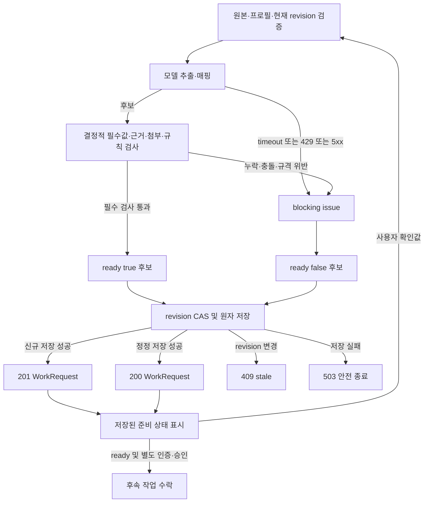

# 단일 에이전트 상태 전이 그래프 설계서 · PREP

<!-- Generated by tools/project_docs.py. Source: docs/artifacts/planning/lesson-registration-20261126/submission-review-source.json -->
> DLV-05 · 제출용 검토 기준 S1.0 · 2026-11-26. 11/25 main `366cea92` PREP 구현 대조를 보존하고 현행 코드 설명과 V1.2 제출용 /v2 잠정 계약을 구분한다. 실제 구현 변경·재개 승인·모델 선정 및 실제 시험·공식 제출 전.

[강사 9개 항목 가이드](https://github.com/ik-e/chaja-you/blob/f5e685716a5ed4fb36159d215b3cc861ef3d5e79/docs/guidelines/instructor-snapshots/snapshots/299a7016748aab57c2de9f03fd38a8b09df4c07e/Lecture/FinalProject/Doc/Step3/단일에이전트_상태전이그래프_설계서_가이드.html) · [TASK-049](https://github.com/ik-e/chaja-you/blob/f5e685716a5ed4fb36159d215b3cc861ef3d5e79/docs/artifacts/tasks/TASK-049.json) · [공통 V1](https://github.com/ik-e/chaja-you/blob/f5e685716a5ed4fb36159d215b3cc861ef3d5e79/docs/artifacts/design/lesson-registration-20261124/common-integration-v1.json) · [V4.1](https://github.com/ik-e/chaja-you/blob/f5e685716a5ed4fb36159d215b3cc861ef3d5e79/docs/artifacts/design/lesson-registration-20261124/data-schema-v4.1.json)

## 1. 목적과 범위

PREP은 SourceView, 고정 Profile, 현재 ResolvedAnswer[]에서 사실·출처·플랫폼 값·검증 이슈를 생성해 Preparation을 반환한다. 누락·충돌·권리/VAT 불명은 질문으로 표시하고 임의 사실을 만들지 않는다. H4/H5에서 CO가 I2로 호출하며 외부 등록·인증·브라우저 조작·최종 승인·업무 DB 상태 전이 권한은 없다. REQ-01/03/11 및 AT-01/T5-08/T6-02와 연결한다.

## 2. 상태·노드·전이

현행 Python `PreparationProvider.prepare`의 동기 I2 흐름을 논리 노드로 표현한다. 실제 그래프 프레임워크나 별도 checkpoint 구현을 주장하지 않는다. CO job_state(null/active/stopping/done/stopped)와 구별한다.

 ```mermaid
flowchart TD
 A[입력·고정 Profile 검증] -->|유효| B[주입 Extractor 1회 호출]
 A -->|위반| X[typed Error]
 B -->|후보 응답| C[후보 구조·원문 근거 확인]
 B -->|모델 불가| M[MODEL_UNAVAILABLE]
 B -->|형식·시스템 오류| X
 M --> Q[CO에서 blocking issue]
 C -->|유효 후보| D[답변·사실·값·출처 구성]
 C -->|잘못된 형식·필드| X
 D --> E[누락·충돌·VAT·profile 검사]
 E -->|필수 검사 통과| R[ready true]
 E -->|blocking issue| S[ready false]
 E -->|계약 위반| X
 S -.->|사용자 H5 수정, 별도 I2 호출| A
 ```

[현행 PREP](https://github.com/ik-e/chaja-you/blob/366cea92a497ff68176107766b1314ab75d5c59f/product/lesson-registration/src/lesson_registration/preparation/provider.py) · [OpenAI 추출기](https://github.com/ik-e/chaja-you/blob/366cea92a497ff68176107766b1314ab75d5c59f/product/lesson-registration/src/lesson_registration/preparation/openai_extractor.py) · [R02 PLAN](https://github.com/ik-e/chaja-you/blob/366cea92a497ff68176107766b1314ab75d5c59f/product/lesson-registration/tests/modules/preparation/PLAN.md) · [PR51](https://github.com/ik-e/chaja-you/pull/51) · [PR52](https://github.com/ik-e/chaja-you/pull/52).

**추가 설계 후보(현행 미구현):** verify → correct → verify. 기존 근거로 해결할 수 있는 후보 오류만 보정하고, 원본의 누락·충돌은 사용자 확인으로 종료한다. 원본·승인 사실을 수정하지 않는다. H5 재호출은 내부 자기 성찰이 아니다. R02가 실험 설계·비용을 제안하고 R01이 검토한다.

### 2.1 제출용 V1.2 /v2 PREP 상태 전이

[API 설계](../step2/API_설계_문서.md) · [모의 필수값](../step2/submission-v1/kmong-demo-profile.json) · [합성 사례](../step2/submission-v1/examples.json).



PREP 전체 30초(추출·검증·후보 교정 포함), 자동 전송 재시도 0회(SDK retry 비활성화). 근거 있는 후보 교정 최대 1회는 30초 내에서 시험할 자기성찰 후보이며 실제 구현 승인 전. 가격 충돌·누락·권리 불명은 추측하지 않고 질문한다. 외부 모델 호출은 DB transaction 밖, 저장 전 base revision CAS. 늦은 모델 후보는 폐기한다. PREP 자체의 외부 플랫폼 변경 효과는 0.

| 상황 | 제출용 전이 및 응답 | 합성 사례/실제 시험 |
| --- | --- | --- |
| 신규 가격 충돌 또는 모델 불가 | 차단 초안 저장 성공 201, ready=false, review/job=null | price_conflict, model_blocked / HTTP-06 |
| 필수값 누락·단위 위반 | 차단, 정정 저장 성공 200, 실행 0 | demo_missing_description, demo_invalid_amount / D02 |
| 사용자 확인·필수값 충족 | 새 revision CAS→200 ready, 별도 인증·승인 전 실행 0 | demo_price_resolved / D02 |
| 초안 저장 실패 | 503, 성공 표시 금지, PATCH 실패 시 기존 revision 보존 | model_storage_failed / HTTP-06 |
| 늦은 결과·stale revision | 후보 폐기, 409 또는 최신 상태 유지 | stale_revision / HTTP-06 |

11/27 R01 상태전이/계약 검토, 12/3 R03 합성 PREP·실제 HTTP/DB 인수, 12/4 R02→R03 실제 PREP 교체 후 R01 검토. timeout/429/5xx·저장 가능/불가·late revision·필수값 오류·비용 시험으로 수치 재평가. 현재 합성 계약 검사만 수행, 실제 앱/모델 시험 미실행. 접수 후 독립 확인은 PREP 밖의 실행 단계(15초, 자동 읽기 재시도 0회, 근거 없으면 stopped/unknown 및 재접수 금지).

## 3. LLM 및 프롬프트 정책

모델에 합성 원본·현재 답변·고정 프로필 중 필요한 정보만 제공. 사용자 원문은 비신뢰 자료로 구분하고 지시로 취급하지 않는다. 인증정보 제외. 후보는 named/profile schema 및 source/answer 근거 관계를 검증한 후 Preparation의 values/facts/provenance/issues/ready로 반환. model_unavailable은 blocking issue와 ready=false, malformed output/시스템 실패는 typed Error(RUNTIME_ERROR). main은 주입 Extractor와 선택적 OpenAI Responses 구조화 출력 추출기를 사용한다. PR51/52의 실제 합성 초기 비교(각 5사례, 3/5·4/5, 양 모델 가격 충돌 오류)는 담당 보고이며, 품질·전체 비용·모델 선정·실제 App 연동은 미확정.

## 4. CoT·ReAct 매핑 및 기록

| 개념 | 노드 | 관측 가능한 기록 |
| --- | --- | --- |
| 입력·근거 확보 | receive, extract | source/profile 참조, fact/origin 후보 |
| 규칙 적용 | map_values | field path, provenance, 적용 규칙 |
| 검증 | verify | validation code, blocking issue, 판정 |
| 보정(추가 후보) | correct | 오류 요약, 수정 후보, 보정 횟수(미구현) |
| 종료 | return_ready/return_blocked/fail | ready/issue/error, 종료 사유 |

모델 내부 비공개 추론 원문 저장/노출 금지. 단계·근거 ID·검증 가능한 판단 요약만 기록. I4 브라우저 Action/Observation은 별도 계약이다.

## 5. Tool 선택 및 재추론

| 상황 | 도구/처리 | 상한·실패 처리 |
| --- | --- | --- |
| 원본·프로필 확보 | I2 입력/고정 registry | 임의 URL·외부 서비스 호출 금지, 잘못된 profile 거절 |
| 후보 추출·매핑 | 실제 모델 | 제한된 호출·출력, model_unavailable/typed error |
| 검증 | SchemaCatalog + 사실/단위/권리 관계 검사 | 결정적 가드, 허위값 차단 |
| 근거가 있는 후보 오류(추가 후보) | correct | 현행 내부 보정 0회. 최대 1회 제안은 미채택, R02 설계/비용 검토 후 결정 |
| 원본 정보 자체 부족 | H5 사용자 답변 | I2 종료; 새 revision에서 재준비, 값 추측 금지 |

Timeout 재시도, 자기 성찰, 외부 실행 복구는 다른 개념. 승인 뒤 외부 등록 재실행 금지. 현행 코드의 제한은 미확정이었다. 제출용 계약은 2.1의 30초·자동 전송 재시도 0회·후보 교정 최대 1회 시험안으로 고정하며 실제 적용은 인수 시험 및 재개 결정에 따른다.

## 6. 메모리 및 체크포인트

I2 내부 후보는 임시 메모리. CO가 검증된 Preparation·source/profile/answers/revision을 저장한다. 장기 정보는 immutable Source/Asset, 확인된 Facts/ResolvedAnswer와 고정 Profile. 별도 벡터 DB/내부 graph checkpoint 저장은 미채택. [DB 설계](../step2/데이터베이스_스키마_설계서.md)와 연계. H5 정정은 현재 revision에서 새 호출, timeout/stale 결과 저장 금지(PR #44 main 반영, D05 actual timeout/late CAS 및 중첩 값 보존은 R02·R03 협의). 수락된 외부 작업은 서버 재시작 후 자동 재개하지 않는다.

## 7. State 정의

| 필드 | 타입/정본 | 의미 |
| --- | --- | --- |
| source | SourceView | 불변 원본 |
| profile | Profile | 고정 필드/규칙 |
| answers | ResolvedAnswer[] | 현재 source/profile 답변 |
| values | Values | 플랫폼 값 후보 |
| facts | Fact[] | source/answer 출처 |
| provenance | Provenance[] | 필드-근거 참조 |
| issues | Issue[] | missing/conflict/invalid 등 |
| ready | boolean | 필수 검증 통과 여부 |
| correction_count, deadline, verdict | 추가 설계 후보 | 현행 내부 loop 미구현; I2 wire·DB 신규 필드 아님 |
| base_revision | CO 내부 컨텍스트 | stale 결과 차단, PrepareInput 변경 아님 |

Preparation 다섯 필수 필드는 V4.1 그대로 유지.

## 8. 노드 및 전이

| 노드 | 입력/출력·처리 | 다음 조건 |
| --- | --- | --- |
| receive | PrepareInput 검증 | 유효→extract, 입력 오류→fail |
| extract | source/answers → Fact·origin 후보 | 생성→map_values, 모델 불가→CO에서 blocking issue, 형식/시스템 오류→fail |
| map_values | facts/profile → values/provenance | 생성→verify, 시스템 오류→fail |
| verify | schema·업무·근거 검사 | 통과→return_ready, 누락/충돌/권리 불명→return_blocked, 현행 blocking 또는 오류로 종료; 추가 후보만 보정 가능+예산→correct, 검증 장애→fail |
| correct(추가 후보) | 구체적 피드백과 기존 근거 → 후보 | 미구현: R02 실험 설계 검토 후 결정 |
| return_ready | 검증된 Preparation ready=true | 종료 |
| return_blocked | Preparation ready=false 및 blocking issue | 종료, 필요한 경우 사용자 확인 |
| fail | 안전한 typed Error | 종료, 후보 수락 금지 |

예시(설계상 기대, 미실행): 합성 90/180/270분 월4회 25/40/50만원의 VAT 미상 → extract → map_values → verify에서 누락/충돌 탐지 → return_blocked → H5 사용자 확인 후 새 I2. VAT를 추측하여 ready로 만들지 않는다.

## 9. 종료 조건

정상: 필수값/사실·단위/출처/권리·profile 검사 통과. 확인 필요: blocking issue/모델 불가/한도 초과, ready=false. 시스템 실패: typed Error 및 안전 종료. 현행 I2는 추출 1회·결정적 검증. 현행 추가 자기성찰은 미채택. 제출용 계약은 2.1의 별도 기준을 따른다. [자기 성찰 시험 계획](자기성찰_테스트결과서.md)과 전이를 연결한다.

**남은 검토:** main 코드와 PLAN 대조 완료. R02 후속 실험 설계, 자기 성찰 적용 여부와 실제 품질·비용·timeout/late revision 공동 검증은 미확정. 교육 가이드의 LangGraph·메모리·자기 성찰·추적 목표를 PREP의 실제 품질 개선과 연결하고, 남은 교육 요구는 핵심 범위에 영향 없는 추가 기능으로 검토한다. 특정 기술의 필수 여부와 실제 적용·시험 증거는 별도 확인. [R01 교육 적용 방향](../human/responses/HRESP-20261125-06_pain-first-rolling-plan.md). 기존 담당 범위·I2·mock-only·22개 gate 변경 없음.
