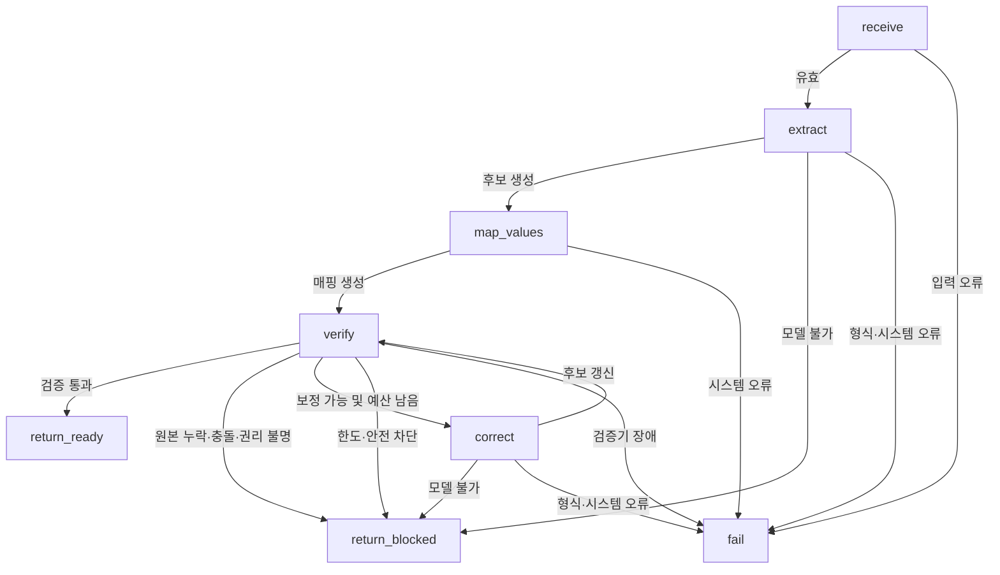

# 단일 에이전트 상태 전이 그래프 설계서 · PREP

> DLV-05 · 2026-11-25 · 기준 main f5e6857. **I2 PREP 내부 흐름 후보**; R02의 상세 PLAN·모델·프레임워크·보정 방식 확인 전. 현행 CO 업무 상태/공통 계약은 변경하지 않는다. 공식 제출·접수 미확인.

[강사 9개 항목 가이드](https://github.com/ik-e/chaja-you/blob/f5e685716a5ed4fb36159d215b3cc861ef3d5e79/docs/guidelines/instructor-snapshots/snapshots/299a7016748aab57c2de9f03fd38a8b09df4c07e/Lecture/FinalProject/Doc/Step3/단일에이전트_상태전이그래프_설계서_가이드.html) · [TASK-049](https://github.com/ik-e/chaja-you/blob/f5e685716a5ed4fb36159d215b3cc861ef3d5e79/docs/artifacts/tasks/TASK-049.json) · [공통 V1](https://github.com/ik-e/chaja-you/blob/f5e685716a5ed4fb36159d215b3cc861ef3d5e79/docs/artifacts/design/lesson-registration-20261124/common-integration-v1.json) · [V4.1](https://github.com/ik-e/chaja-you/blob/f5e685716a5ed4fb36159d215b3cc861ef3d5e79/docs/artifacts/design/lesson-registration-20261124/data-schema-v4.1.json)

## 1. 목적과 범위

PREP은 SourceView, 고정 Profile, 현재 ResolvedAnswer[]에서 사실·출처·플랫폼 값·검증 이슈를 생성해 Preparation을 반환한다. 누락·충돌·권리/VAT 불명은 질문으로 표시하고 임의 사실을 만들지 않는다. H4/H5에서 CO가 I2로 호출하며 외부 등록·인증·브라우저 조작·최종 승인·업무 DB 상태 전이 권한은 없다. REQ-01/03/11 및 AT-01/T5-08/T6-02와 연결한다.

## 2. 상태·노드·전이

후보 노드 8개와 전이. CO의 job_state(null/active/stopping/done/stopped)와 PREP 노드 이름을 구별한다. 내부 상태 전이는 담당자와 구현 검토 후 확정하며 LangGraph 사용을 강제하는 변경이 아니다.

자체 보정은 기존 근거로 해결 가능한 후보 오류만 대상으로 한다. 원본 자체의 누락·충돌은 사용자 확인으로 종료. 보정으로 원본이나 승인 사실을 수정하지 않는다.

## 3. LLM 및 프롬프트 정책

모델에 합성 원본·현재 답변·고정 프로필 중 필요한 정보만 제공. 사용자 원문은 비신뢰 자료로 구분하고 지시로 취급하지 않는다. 인증정보 제외. 후보는 named/profile schema 및 source/answer 근거 관계를 검증한 후 Preparation의 values/facts/provenance/issues/ready로 반환. model_unavailable은 blocking issue와 ready=false, malformed output/시스템 실패는 typed Error(RUNTIME_ERROR). 실제 모델 ID·프롬프트·토큰·timeout·비용은 R02 PLAN/실측 후 확정. 모델 품질을 미리 주장하지 않는다.

## 4. CoT·ReAct 매핑 및 기록

| 개념 | 노드 | 관측 가능한 기록 |
| --- | --- | --- |
| 입력·근거 확보 | receive, extract | source/profile 참조, fact/origin 후보 |
| 규칙 적용 | map_values | field path, provenance, 적용 규칙 |
| 검증 | verify | validation code, blocking issue, 판정 |
| 보정 | correct | 오류 요약, 수정 후보, 보정 횟수 |
| 종료 | return_ready/return_blocked/fail | ready/issue/error, 종료 사유 |

모델 내부 비공개 추론 원문 저장/노출 금지. 단계·근거 ID·검증 가능한 판단 요약만 기록. I4 브라우저 Action/Observation은 별도 계약이다.

## 5. Tool 선택 및 재추론

| 상황 | 도구/처리 | 상한·실패 처리 |
| --- | --- | --- |
| 원본·프로필 확보 | I2 입력/고정 registry | 임의 URL·외부 서비스 호출 금지, 잘못된 profile 거절 |
| 후보 추출·매핑 | 실제 모델 | 제한된 호출·출력, model_unavailable/typed error |
| 검증 | SchemaCatalog + 사실/단위/권리 관계 검사 | 결정적 가드, 허위값 차단 |
| 근거가 있는 후보 오류 | correct | **최대 1회 보정 제안**, 총 호출/시간 예산 별도. 한도 초과 blocking 또는 Error |
| 원본 정보 자체 부족 | H5 사용자 답변 | I2 종료; 새 revision에서 재준비, 값 추측 금지 |

Timeout 재시도, 자기 성찰, 외부 실행 복구는 다른 개념. 승인 뒤 외부 등록 재실행 금지. 보정 횟수 및 실제 모델 시간 제한은 R02 확인 후 실험 전에 고정한다.

## 6. 메모리 및 체크포인트

I2 내부 후보는 임시 메모리. CO가 검증된 Preparation·source/profile/answers/revision을 저장한다. 장기 정보는 immutable Source/Asset, 확인된 Facts/ResolvedAnswer와 고정 Profile. 별도 벡터 DB/내부 graph checkpoint 저장은 미채택. [DB 설계](../step2/데이터베이스_스키마_설계서.md)와 연계. H5 정정은 현재 revision에서 새 호출, timeout/stale 결과 저장 금지(세부 D05 후보는 PR #44 검토 중). 수락된 외부 작업은 서버 재시작 후 자동 재개하지 않는다.

## 7. State 정의

| 필드 | 타입/정본 | 의미 |
| --- | --- | --- |
| source | SourceView | 불변 원본 |
| profile | Profile | 고정 필드/규칙 |
| answers | ResolvedAnswer[] | 현재 source/profile 답변 |
| values | Values | 플랫폼 값 후보 |
| facts | Fact[] | source/answer 출처 |
| provenance | Provenance[] | 필드-근거 참조 |
| issues | Issue[] | missing/conflict/invalid 등 |
| ready | boolean | 필수 검증 통과 여부 |
| correction_count, deadline, verdict | 내부 후보 | 보정 한도/판정; I2 wire·DB 신규 필드 아님 |
| base_revision | CO 내부 컨텍스트 | stale 결과 차단, PrepareInput 변경 아님 |

Preparation 다섯 필수 필드는 V4.1 그대로 유지.

## 8. 노드 및 전이

| 노드 | 입력/출력·처리 | 다음 조건 |
| --- | --- | --- |
| receive | PrepareInput 검증 | 유효→extract, 입력 오류→fail |
| extract | source/answers → Fact·origin 후보 | 생성→map_values, 모델 불가→return_blocked, 형식/시스템 오류→fail |
| map_values | facts/profile → values/provenance | 생성→verify, 시스템 오류→fail |
| verify | schema·업무·근거 검사 | 통과→return_ready, 누락/충돌/권리 불명→return_blocked, 보정 가능+예산→correct, 한도/안전 차단→return_blocked, 검증 장애→fail |
| correct | 구체적 피드백과 기존 근거 → 후보 | 갱신→verify, 모델 불가→return_blocked, 형식/시스템 오류→fail |
| return_ready | 검증된 Preparation ready=true | 종료 |
| return_blocked | Preparation ready=false 및 blocking issue | 종료, 필요한 경우 사용자 확인 |
| fail | 안전한 typed Error | 종료, 후보 수락 금지 |

예시(설계상 기대, 미실행): 합성 90/180/270분 월4회 25/40/50만원의 VAT 미상 → extract → map_values → verify에서 누락/충돌 탐지 → return_blocked → H5 사용자 확인 후 새 I2. VAT를 추측하여 ready로 만들지 않는다.

## 9. 종료 조건

정상: 필수값/사실·단위/출처/권리·profile 검사 통과. 확인 필요: blocking issue/모델 불가/한도 초과, ready=false. 시스템 실패: typed Error 및 안전 종료. 반복과 시간 상한은 실험 전에 확정. [자기 성찰 시험 계획](자기성찰_테스트결과서.md)과 전이를 연결한다.

**남은 검토:** R02 실제 PLAN과 내부 노드/모델/보정 방식 대조. 교육기관에서 LangGraph·메모리·자기 성찰의 특정 기술 적용을 필수로 요구하는지 최신 안내/강사 확인 필요. 기존 담당 범위·I2·mock-only·22개 gate 변경 없음.
