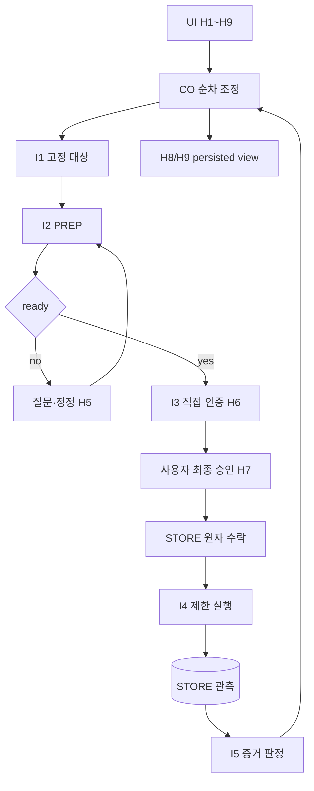

# 멀티 에이전트 협업 아키텍처 설계서 · 레슨 등록 지원

> DLV-07 · 12/11 제출 예정 · 2026-11-25 현재 기준으로 작성한 **설계 초안**. 채택된 시스템 협업 구조와 향후 AI 역할 분리 후보를 구분한다. 실제 멀티 에이전트 구현·실행은 미확인. 공식 제공 양식 최종 대조/제출·접수 전.

[현행 시스템 구조](../design/lesson-registration/SYSTEM-OVERVIEW.md) · [공통 V1](https://github.com/ik-e/chaja-you/blob/ec8917c63eb13a3d81d3234220bb346cb666028f/docs/artifacts/design/lesson-registration-20261124/common-integration-v1.json) · [I1~I5 Protocol](https://github.com/ik-e/chaja-you/blob/ec8917c63eb13a3d81d3234220bb346cb666028f/product/lesson-registration/contracts/interfaces.py) · [Step3 PREP 그래프](../step3/단일에이전트_상태전이그래프_설계서.md) · [강사 협업 가이드](https://github.com/ik-e/chaja-you/blob/ec8917c63eb13a3d81d3234220bb346cb666028f/docs/guidelines/instructor-snapshots/snapshots/299a7016748aab57c2de9f03fd38a8b09df4c07e/Lecture/FinalProject/Doc/Step4/멀티에이전트_AutoHealing_적용가이드.html) · [R01 교육 기술 방향](../human/responses/HRESP-20261125-06_pain-first-rolling-plan.md).

## 1. 협업 목표와 필요성

핵심 문제는 기존 레슨 원본을 플랫폼별로 다시 가공·입력·검증하는 부담. 준비·권한·실행·판정 책임을 분리해 근거 없는 입력과 승인 범위 밖의 실행, 성공 오판을 줄인다. PREP에서 판단이 필요한 정보 추출·변환을 AI로 수행하고 상태/권한/동작 제한과 결과 판정은 결정적 코드로 보장하는 것이 현행 방향이다. 모듈 수와 AI 에이전트 수는 동일하지 않다.

단일 PREP 방식 대비 멀티 에이전트의 추가 이득은 미실증. 필요 시 PREP 내부의 후보 생성과 별도 근거 검토를 역할 분리하는 추가 기능 후보를 실험할 수 있다. 독립적인 모델 호출/책임/평가를 실제 구현한 경우에만 별도 에이전트라고 기록한다. 교육 요구를 이유로 외부 실행 권한을 확대하지 않는다.

## 2. 역할·책임·권한

| 역할 | 입력→출력 | 하는 일 / 하지 않는 일 | 현재 유형 |
| --- | --- | --- | --- |
| CO | HTTP 요청·저장 상태→포트 호출·View | 승인·수락·lifecycle 소유; LLM 임의 결정을 실행 권한으로 사용하지 않음 | 결정적 조정자 |
| KNOW | selector→ResolveOutput | 고정 registry 선택; 임의 URL 탐색 안 함 | 결정적 조회 |
| PREP | PrepareInput→Preparation | 사실·근거·후보/질문·검증; 인증·외부 등록·DB 전이 없음 | AI 판단 역할 |
| EXEC/Runtime | AuthInput/AcceptedScope→AuthOutput/ExecutionReport | 검증 연결·등록 동작·실제 관측; 승인 밖 실행/재개 금지 | 제한 실행 |
| Adapter | BoundGateway→등록 step/관측 | 크몽 K1~K7, 숨고 S1~S6; 원시 driver/임의 command 금지 | 플랫폼별 구현 |
| RESULT | EvaluateInput→Result | 독립 증거 대조; 브라우저 권한 없음 | 결정적 판정 |
| STORE | accept/admit/observe/fence/finalize | 영속 상태·원자성; AI 직접 DB 수정 금지 | 데이터·권한 가드 |

실제 담당은 R02 PREP, R03 CO/KNOW/RESULT/STORE, R04 UI/숨고, R05 runtime/크몽, R01 공통·통합. 신규 에이전트/역할 배정 아님.

## 3. 협업 패턴 및 상태 전달

패턴: 결정적 조정자 기반 순차 인계, 대상별 adapter routing, 조건 분기(ready/new/verified/승인), 사용자 확인. 등록 단위 독립 작업은 현재 승인 범위 및 worker/세션 권한을 지킨다. 공통 상태는 Source/Profile/Preparation/Review/AcceptedScope/Operation/Observation/Evidence/Result. PREP 내부 후보 생성↔검증↔보정 흐름은 Step3에 연결. 사용자/인증/등록 권한은 에이전트 사이 자유 공유하지 않는다.

## 4. 메시지·도구·실행 계약

I1~I5와 H1~H9의 named schema 및 관계 가드로 전달. [API 명세](../step2/API_설계_문서.md)·[DB 명세](../step2/데이터베이스_스키마_설계서.md). I4는 immutable 승인 Scope와 현재 검증된 연결에서 등록 operation만 허가받아 실행한다. 사용자 화면 detach는 H7 수락 작업과 독립. D01~D06의 claim/permit/evidence/Viewer 세부안은 [PR #44](https://github.com/ik-e/chaja-you/pull/44) 검토 중으로 현행 확정 인터페이스와 구분한다. R04의 postMessage/추가 grant 필드는 [담당 검토 보고](https://github.com/ik-e/chaja-you/blob/ec8917c63eb13a3d81d3234220bb346cb666028f/docs/members/R04/workspace/2026-11-25_R04_주요검토사항_보고서_Viewer규격_숨고_operation_readback.md)이며 채택 전.

## 5. 실패·반복·종료

| 실패 | 처리 |
| --- | --- |
| 필수값/근거 부족 | PREP ready=false 및 질문, 사용자 답변 전 실행 없음 |
| 모델 불가/출력 위반 | 안전한 issue/error, 제한된 보정 후보; 승인 사실 임의 변경 금지 |
| 인증/대상/권한 실패 | prestart 차단, 자동 우회 금지 |
| 수락 뒤 실행 실패/응답 유실 | fence, 알려진 효과/unknown 보존, stopped; 외부 재제출·재개 금지 |
| 조회/화면 연결 장애 | UI 상태 재조회; 외부 작업 재실행과 구분 |
| 증거 부족 | confirmed 판정 금지 |

반복 상한·시간·deadlock/경쟁 검증은 실제 구현 및 담당자 합의 후 결정. DB 트랜잭션 동안 외부 모델/브라우저 대기 금지 방향. 안전한 중단과 복구 성공은 별개.

## 6. 검증 및 추가 역할 채택 조건

동일 입력·모델 설정에서 단일 PREP 대비 후보 생성/별도 검토 역할 분리의 근거 충실도·최종 정확성·질문 적절성·호출 비용·시간 비교. 기존 결정적 가드는 유지한다. 역할 분리가 실제 가치 또는 교육 요구에 기여하고 공수·안전 조건을 만족할 때만 채택. 제품 gate 22개, T5-08 실제 모델 및 권한/중복/실패 시험 유지. 현재 R03 합성 HTTP 독립 시험과 공통 후보 시험은 실제 다중 에이전트 협업 시험이 아니다. 모델/추적 도구 및 협업 추가 기능은 별도 확인.
