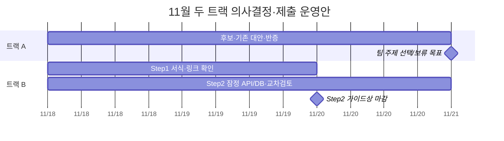

# Step1 WBS V3 — 현재 두 트랙과 조건부 8주 일정

> **2026-11-19 제출 대응 주의:** 이 문서는 교육기관 원본 샘플/Step2 HTML 가이드에 맞춰 검토 중인 **조건부 제출 후보**입니다. 제출·접수 완료나 제품·기술 채택을 의미하지 않습니다. 2026-11-21의 예정된 제품 선택/보류에 따라 재작성할 수 있습니다. 상세 설계의 시스템 경계·컴포넌트·계약 해석은 [main의 설계 정보 모델](https://github.com/ik-e/chaja-you/blob/main/docs/deliverables/PLANNING-DESIGN-INFO-MODEL.md)을 참고합니다.

> **제출 준비용 잠정 문서 · 미제출 · 실제 제품 미선정** · 기준일 2026-11-19 · DLV-02
> 기존 찾아you의 **잠정 제출용 설계**로 실제 제품 선정·구현·실측·공식 제출·접수를 뜻하지 않습니다.

- **기준:** 현재 두 트랙 + 원본 강사 가이드 + 산출물별 최신 피드백에 따른 찾아you 잠정 예시 (제품 승인/구현 아님)
- **가이드/목차 근거:** 원본 WBS DOCX 4개 장 및 Step1 WBS 작성 가이드
- **검증 범위:** Gitea 원본 DOCX 샘플 대항목 비교; 이후 수정 양식 미확인
- **단일 프로젝션 입력:** [model.json](https://github.com/ik-e/chaja-you/blob/main/docs/deliverables/pilots/2026-11-18-v3/model.json) · [API-DB 계약](https://github.com/ik-e/chaja-you/blob/main/docs/deliverables/pilots/2026-11-18-v3/contract.json)
- **기준 커밋:** `53b73584069042225298c97c6c5688f8b429f56b` · [현재 두 트랙 Phase](https://github.com/ik-e/chaja-you/blob/main/docs/human/phase-intents/PHASE-20261118-01.md)

## 제출용 사용 기준

- 교육용 샘플/HTML 가이드와 실제 공식 필수 양식의 구분: 확인 기록은 [가이드 감사](https://github.com/ik-e/chaja-you/blob/main/docs/guidelines/instructor-snapshots/reviews/STEP1-STEP2-V2-GUIDE-AUDIT-20261118.md)를 참조합니다.
- 정보 정본과 샘플의 세부 계약/필드 예시는 [원본 V3](https://github.com/ik-e/chaja-you/blob/main/docs/deliverables/pilots/2026-11-18-v3/STEP1-WBS.md)에 연결됩니다. 본 파일은 검토용 제출 후보이며 정본을 변경하지 않습니다.
- 실제 제출 전 문서 렌더 가독성·공식 목차 최종본·교원 열람권한·대시보드 상태를 별도 검증해야 합니다.

## 문서 근거와 적용 제한

아래 원본은 당시 저장소의 **고정 참조**입니다. 사실·가설·합성 검증·실측을 구분하며 과거 정본이나 타인 TASK를 수정하지 않습니다.

| 참조 원본 | 커밋 |
| --- | --- |
| [`docs/artifacts/planning/WBS.json`](https://github.com/ik-e/chaja-you/blob/53b73584069042225298c97c6c5688f8b429f56b/docs/artifacts/planning/WBS.json) | `53b735840690` |
| [`docs/artifacts/state/current.json`](https://github.com/ik-e/chaja-you/blob/53b73584069042225298c97c6c5688f8b429f56b/docs/artifacts/state/current.json) | `53b735840690` |
| [`docs/artifacts/state/legacy_task_closeout_20261118.json`](https://github.com/ik-e/chaja-you/blob/53b73584069042225298c97c6c5688f8b429f56b/docs/artifacts/state/legacy_task_closeout_20261118.json) | `53b735840690` |
| [`docs/artifacts/tasks/TASK-026.json`](https://github.com/ik-e/chaja-you/blob/53b73584069042225298c97c6c5688f8b429f56b/docs/artifacts/tasks/TASK-026.json) | `53b735840690` |
| [`docs/artifacts/tasks/TASK-027.json`](https://github.com/ik-e/chaja-you/blob/53b73584069042225298c97c6c5688f8b429f56b/docs/artifacts/tasks/TASK-027.json) | `53b735840690` |

## 1. 간트 차트 (주차별 계획·실적)

### 기존 계획의 효력과 현재 실행을 구분

| 분류 | 현재 적용 | 원본·상태 |
| --- | --- | --- |
| 구 찾아you W01~W34 | **이력 보존**. W01/W04/W06 완료는 당시 범위에 한정, W07/W09 등 구현 계획 자동 재개 금지 | 기존 WBS JSON |
| 트랙 A: R02~R05 | 11/21 주제 선택을 위한 후보 조사·반증 (TASK-022~025) | 현 TASK 소유권 유지 |
| 트랙 B: R01 | Step1·2 제출 대응 및 의도/상태 관리 (TASK-026/027) | 실제 제출/접수 별도 확인 |
| 선정 후 구현 | 제품·가용 공수·검토자를 정한 뒤 재계획 | 현재 미배정·미산정 |

### 현재 운영 계획 간트 (아래는 **계획**, 실적 그래프 아님)

### 8주 전체 상위 산출물 WBS (실행 확정이 아닌 누락 방지 프레임)

| 결과물 묶음 | 해당 교육 산출물(중복 계산하지 않음) | 계획 마감 | 개발 작업 세분화 조건 |
| --- | --- | --- | --- |
| Step1 기획·계획 | DLV-01, DLV-02 | 11/13 (경과) | 현재 가이드·상태 재검토 |
| Step2 API·DB | DLV-03, DLV-04 | 11/20 | 잠정 사용자 흐름 하나로 문서 설계 |
| Step3 단일 Agent·성찰 시험 | DLV-05, DLV-06 | 11/27, 12/04 | 주제·상태/평가 환경 결정 |
| 중간 발표 | DLV-13 | 12/08 | 실제 결과·미확인 분리 |
| Step4 협업·보안·Auto-Healing | DLV-07, DLV-08, DLV-09 | 12/11, 12/18 | 선정 제품의 에러/권한/재검증 시나리오 |
| Step5 웹·통합·배포 | DLV-10, DLV-11, DLV-12 | 12/24, 12/31 | 구현·배포/테스트 환경 |
| 최종 발표·소스·영상 | DLV-14, DLV-15, DLV-16 | 2027/01/04 | 실제 릴리스/실측/시연 |

이 상위 결과물은 [16개 산출물 레지스트리](https://github.com/ik-e/chaja-you/blob/main/docs/deliverables/registry.json)를 참조하며, **현재 제품이 없는 미래 구현을 가상으로 작업 완료/담당 배정하지 않습니다.**

## 2. 일정 관리 규칙

1. **100% 규칙(적용 단계 구분):** 상위 결과물 16개의 누락·중복을 검사합니다. 선정 전에는 후속 개발의 1~3일짜리 하위 작업을 확정하지 않고 `조건부/미산정`으로 둡니다.
2. **작업별 DoD:** 실제 신규 배정 시 owner 1명·reviewer 1명·예상 공수·선행·출력·검사 기준·버퍼를 기록합니다. 현재 임시 패키지 목록은 TASK가 아닙니다.
3. **예상 vs 실제:** 계획 시작·종료/실제 시작·종료/작업 상태/PR·증거를 분리하고, 변경 시 이유·영향·확인일 기록. 과거 WBS의 예정일을 오늘 완료일로 소급하지 않습니다.
4. **검토 시간:** 11/18~19 초안·교차 확인, 11/20 문서 가독성·링크·접수 확인을 **운영 권고**로 잡고, 지연 시 담당자·매니저와 실제 영향 확인.
5. **선정 후 의존성:** 사용자 문제→요구사항→설계→구현→단위/실기기/장애 시험→통합→결과서·시연의 순서와 병렬 가능 범위, 사람별 가용 시간을 다시 계산합니다.
6. **WBS 제출 형식:** 강사 가이드에는 GitHub Projects/시트 화면의 가독성 있는 **캡처 제출**이 안내되어 있습니다. 이 Markdown 간트는 캡처를 대체하지 않습니다.
7. **의사소통:** R01이 강사님·매니저님께 프로젝트 방향을 공유했다고 밝힌 사실은 반영하지만 승인·기한 연기 자체를 주장하지 않습니다.

## 3. 작업 계획표

| 현재 TASK | owner(변경 없음) | 현재 작업 범위 | 선행·기간 | 완료 증거 | 정본 상태 |
| --- | --- | --- | --- | --- | --- |
| TASK-022 | R02 | 후보 Pain·대안·반증 | 11/18 기획 탐색 | 후보 결과와 근거 | 별도 TASK 확인 |
| TASK-023 | R03 | 후보 검증·기술 제약 | 11/18 기획 탐색 | 후보 근거와 비교 | 별도 TASK 확인 |
| TASK-024 | R04 | 사용자 장면·화면/대안 | 11/18 기획 탐색 | 후보·사용자 시나리오 | 별도 TASK 확인 |
| TASK-025 | R05 | 후보 요구·구현 가능성 | 11/18 기획 탐색 | 후보 의사결정 자료 | 별도 TASK 확인 |
| TASK-026 | R01 | 운영·가이드·기존 작업 정산 | 팀 판단 이전 | 결정/의도·이력 링크 | 별도 TASK 확인 |
| TASK-027 | R01 | 잠정 API·DB 제출 관리 | 11/20 가이드 마감 | 문서·열람·대시보드/접수 각 증빙 | 현재 파일럿 자체는 미제출 |

**TASK-027 내부 검토 순서 (새 TASK/담당 지정 아님):**

| 단계 | 출력 | 의존 | 운영상 목표 시점 | 검증 조건 |
| --- | --- | --- | --- | --- |
| D-1 | 사용자 요청·FR 연결 | 이전 기획 근거 | 11/18 | 요구↔요청 필드 연결 |
| D-2 | API 입력·응답·권한·오류 | D-1 | 11/19 | 계약표·예시·종료 규칙 |
| D-3 | ERD·FK·컬럼·RLS·데이터 수명 | D-2 | 11/19 | ID/owner/상태 교차 검토 |
| D-4 | 가이드·렌더·링크·제출 확인 | D-2,D-3 | 11/20 | 각 실제 증거에 한해서만 완료 기록 |

**현재 공식 교육 마감과 제품 선정 지연의 충돌은 명시적 위험입니다.** 진행 중인 작업을 가상 완료로 처리하지 않습니다. 주제 선택 후 모든 개발·테스트·발표 작업을 사람별로 배정하고 실제 가용 공수와 버퍼를 검토합니다.

## 4. 마일스톤

| ID | 기준일 | 평가·결정 기준 | 현재 증빙 |
| --- | --- | --- | --- |
| M1 Step1 | 11/13 | 기획서·WBS 최신 링크·양식/접수 | H26/H27=`작성중`, P26/P27=`매니저 확인 TRUE`; 접수와 별개 |
| M2 Step2 | 11/20 | API/DB 요청 1개 계약·형식·검토/제출 | H28/H29=`미착수`(11/18 당시), 직접 L28/L29 피드백 없음 |
| M3 팀 결정 | 11/21 목표 | 제품 선택 또는 보류 이유·후속 정본 갱신 결정 | 아직 확정 없음 |
| M4 Step3 | 11/27·12/04 | 상태 전이·자기 평가 | 주제 선정 뒤 설계/시험 |
| M5 중간발표 | 12/08 | 실측·미확인 구분 | 향후 |
| M6 Step4 | 12/11·12/18 | 협업·가드레일·복구 검증 | 향후 |
| M7 Step5 | 12/24·12/31 | 웹앱·통합·배포 결과 | 향후 |
| M8 최종 | 2027/01/04 | 발표·코드·영상 재현 | 향후 |

**핵심 위험:** 11/20 API/DB 제출이 팀 제품 선정일(11/21)보다 앞섭니다. 지금은 이전 찾아you를 가정한 잠정 문서로 제출을 대비하고, 실제 제품이 선택되면 재계획과 제출본 변경 가능성을 별도 판단합니다. 현재 WBS는 미래 일정 변경/팀 배정이 확정된 기록이 아닙니다.

---

**현재 완료 판정:** V3 내용/계약/렌더 검토 대상 · 실제 제품 미선정/미구현 · 산출물 미제출 · 공식 제출 전 최종 검토 별도
