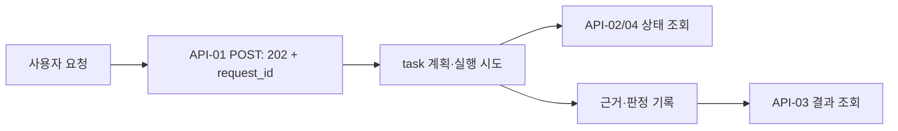
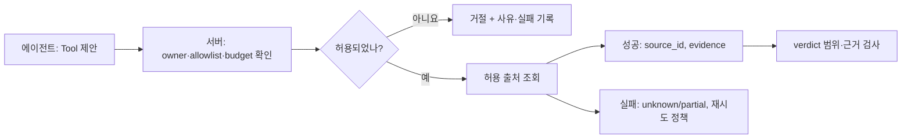

# Step2 API 설계 V3 — 요청·인증·상태·Tool 실행 계약

> **2026-11-19 제출 대응 주의:** 이 문서는 교육기관 원본 샘플/Step2 HTML 가이드에 맞춰 검토 중인 **조건부 제출 후보**입니다. 제출·접수 완료나 제품·기술 채택을 의미하지 않습니다. 2026-11-21의 예정된 제품 선택/보류에 따라 재작성할 수 있습니다. 상세 설계의 시스템 경계·컴포넌트·계약 해석은 [main의 설계 정보 모델](https://github.com/ik-e/chaja-you/blob/main/docs/deliverables/PLANNING-DESIGN-INFO-MODEL.md)을 참고합니다.


> **제출 준비용 잠정 문서 · 미제출 · 실제 제품 미선정** · 기준일 2026-11-19 · DLV-03
> 기존 찾아you의 **잠정 제출용 설계**로 실제 제품 선정·구현·실측·공식 제출·접수를 뜻하지 않습니다.

- **기준:** 현재 두 트랙 + 원본 강사 가이드 + 산출물별 최신 피드백에 따른 찾아you 잠정 예시 (제품 승인/구현 아님)
- **가이드/목차 근거:** Step2 API 작성 가이드 6개 영역 (개별 산출물 피드백 없음)
- **검증 범위:** 원본 HTML 작성 가이드 비교; 단독 DOCX 샘플 없음
- **단일 프로젝션 입력:** [model.json](https://github.com/ik-e/chaja-you/blob/main/docs/deliverables/pilots/2026-11-18-v3/model.json) · [API-DB 계약](https://github.com/ik-e/chaja-you/blob/main/docs/deliverables/pilots/2026-11-18-v3/contract.json)
- **기준 커밋:** `53b73584069042225298c97c6c5688f8b429f56b` · [현재 두 트랙 Phase](https://github.com/ik-e/chaja-you/blob/main/docs/human/phase-intents/PHASE-20261118-01.md)

## 제출용 사용 기준

- 교육용 샘플/HTML 가이드와 실제 공식 필수 양식의 구분: 확인 기록은 [가이드 감사](https://github.com/ik-e/chaja-you/blob/main/docs/guidelines/instructor-snapshots/reviews/STEP1-STEP2-V2-GUIDE-AUDIT-20261118.md)를 참조합니다.
- 정보 정본과 샘플의 세부 계약/필드 예시는 [원본 V3](https://github.com/ik-e/chaja-you/blob/main/docs/deliverables/pilots/2026-11-18-v3/STEP2-API-설계.md)에 연결됩니다. 본 파일은 검토용 제출 후보이며 정본을 변경하지 않습니다.
- 실제 제출 전 문서 렌더 가독성·공식 목차 최종본·교원 열람권한·대시보드 상태를 별도 검증해야 합니다.

## 문서 근거와 적용 제한

아래 원본은 당시 저장소의 **고정 참조**입니다. 사실·가설·합성 검증·실측을 구분하며 과거 정본이나 타인 TASK를 수정하지 않습니다.

| 참조 원본 | 커밋 |
| --- | --- |
| [`docs/artifacts/planning/기획서_초안.json`](https://github.com/ik-e/chaja-you/blob/53b73584069042225298c97c6c5688f8b429f56b/docs/artifacts/planning/%EA%B8%B0%ED%9A%8D%EC%84%9C_%EC%B4%88%EC%95%88.json) | `53b735840690` |
| [`docs/artifacts/tasks/TASK-006.json`](https://github.com/ik-e/chaja-you/blob/53b73584069042225298c97c6c5688f8b429f56b/docs/artifacts/tasks/TASK-006.json) | `53b735840690` |
| [`docs/artifacts/specs/focus_apps.json`](https://github.com/ik-e/chaja-you/blob/53b73584069042225298c97c6c5688f8b429f56b/docs/artifacts/specs/focus_apps.json) | `53b735840690` |
| [`docs/artifacts/planning/WBS.json`](https://github.com/ik-e/chaja-you/blob/53b73584069042225298c97c6c5688f8b429f56b/docs/artifacts/planning/WBS.json) | `53b735840690` |

## 1. 공통 정보·인증과 권한 경계

**문서 상태:** 찾아you APP-A 임시 다중 사용자 모델의 제안 API, 서버 미구현·기술 미승인. API와 DB가 공유하는 유일한 구조화 의미 기준은 [contract.json](https://github.com/ik-e/chaja-you/blob/main/docs/deliverables/pilots/2026-11-18-v3/contract.json)입니다. 제품 방향은 강사님·매니저님께 공유됐으나 특정 기술·기간 연기 승인으로 간주하지 않습니다.

| 항목 | 내용 |
| --- | --- |
| 문서 버전 | V3 잠정 설계 / 2026-11-18, 이전 V2는 보존 |
| 개발 기본 주소 | `http://localhost:8000/api/v1` (**구현 전 예시**) |
| 배포 서버 | 미정·배포되지 않음. 배포 전 실제 URL 기록 |
| 자동 문서 | `/docs`, `/openapi.json` (**FastAPI 선택 시 위치 제안**, 현재 미동작) |
| 인증 | 임시 설계: `Authorization: Bearer <JWT>`; 서명·만료·주체 검증 필요 |
| 자원 소유권 | 인증된 `JWT.sub = research_request.owner_id` 일 때 조회, 그렇지 않으면 404로 자원 존재 은닉 |
| 데이터 저장 | request/owner/task/attempt/source/evidence/verdict 7개 테이블의 개념 계약 |
| 공통 오류 | 모든 API에서 `error.code/message/request_id/retryable` |

**신뢰 경계:** client에서 `owner_id`를 받거나 믿지 않고 서버의 검증된 인증 주체로 할당합니다. 모든 하위 task/verdict/source/evidence 조회는 대상 request의 owner 확인을 거쳐야 합니다. 인증 방식 미선정 상태로 공개 배포하는 것을 허용하는 설계가 아닙니다.

**변경 이력:** V1 일반 구상 → V2 4개 경로 초안 → **V3 owner_id 명시, 작업/판정 참조 통일, 멱등성과 재시도 계약 및 정식 Markdown 예시 보완**. 실제 채택/구현 이력은 아닙니다.

## 2. API 목록·요구사항 연결

| API ID | Method | Path | 인증(가설) | 목적 | 요구사항 |
| --- | --- | --- | --- | --- | --- |
| API-01 | POST | `/api/v1/research-requests` | Bearer JWT (provisional) | create an APP-A request and enqueue allowed work | FR-01, FR-02 |
| API-02 | GET | `/api/v1/research-requests/{request_id}` | Bearer JWT (provisional) | read request state and task count | FR-03 |
| API-03 | GET | `/api/v1/research-requests/{request_id}/results` | Bearer JWT (provisional) | read evidence-linked comparison results including unknown and partial | FR-04 |
| API-04 | GET | `/api/v1/research-requests/{request_id}/tasks` | Bearer JWT (provisional) | read task/attempt execution history | FR-02, FR-03 |

사용자 요청은 조건/대상 입력 → 검증과 request_id 부여 → task 제안·task_id 확정 → attempt 상태 기록 → 근거 있는 verdict 반환으로 흐릅니다. FR-01~04와의 연결은 **문서상 계약**이며 실제 엔드포인트가 배포됐다는 뜻이 아닙니다.



## 3. 엔드포인트별 8항목 상세·JSON 예시

### API-01 POST `/api/v1/research-requests`

| 상세 계약 항목 | 설계안 (현재 구현 아님) |
| --- | --- |
| 1. 호출 목적 | create an APP-A request and enqueue allowed work |
| 2. 요청 헤더·인증 | Bearer JWT (provisional), `Idempotency-Key` (권장; 실제 반복시 필수) |
| 3. 경로·쿼리 | 없음 |
| 4. 요청 본문·필드 | ResearchRequestCreate |
| 5. 서버 검증·권한 | owner_id from verified JWT sub; never accepted from request JSON |
| 6. 정상 응답·상태 | HTTP 202; 상태는 응답 JSON에 포함 |
| 7. 오류·실패 | 401, 409, 422, 429, 503. 세부 의미는 공통 오류표 참조 |
| 8. 실행·재시도 | Idempotency-Key optional for test but required before production retries; unique (owner_id,idempotency_key), same key same input returns same request_id; same key/different input 409 |

**요청 JSON 예시 (가상, 실측 아님)**

```json
{
  "domain": "focus_apps",
  "targets": [
    "PomoToki",
    "Focus To-Do"
  ],
  "criteria": [
    {
      "id": "C-OFFLINE",
      "name": "offline_timer",
      "importance": "must"
    },
    {
      "id": "C-ACCOUNT",
      "name": "no_account",
      "importance": "prefer"
    }
  ],
  "discovery_rule": "specified_candidates_only"
}
```

**응답 예시 (가상, 실제 호출 아님)**

```json
{
  "request_id": "req_example_001",
  "status": "queued",
  "result_url": "/api/v1/research-requests/req_example_001/results"
}
```

### API-02 GET `/api/v1/research-requests/{request_id}`

| 상세 계약 항목 | 설계안 (현재 구현 아님) |
| --- | --- |
| 1. 호출 목적 | read request state and task count |
| 2. 요청 헤더·인증 | Bearer JWT (provisional) |
| 3. 경로·쿼리 | `request_id`: opaque text, required |
| 4. 요청 본문·필드 | 조회 전용, JSON 본문 없음 |
| 5. 서버 검증·권한 | server resolves owner_id and checks JWT sub before returning state |
| 6. 정상 응답·상태 | HTTP 200; 상태는 응답 JSON에 포함 |
| 7. 오류·실패 | 401, 404, 503. 세부 의미는 공통 오류표 참조 |
| 8. 실행·재시도 | read-only |

**응답 예시 (가상, 실제 호출 아님)**

```json
{
  "request_id": "req_example_001",
  "status": "running",
  "task_count": 2,
  "completed_count": 1
}
```

### API-03 GET `/api/v1/research-requests/{request_id}/results`

| 상세 계약 항목 | 설계안 (현재 구현 아님) |
| --- | --- |
| 1. 호출 목적 | read evidence-linked comparison results including unknown and partial |
| 2. 요청 헤더·인증 | Bearer JWT (provisional) |
| 3. 경로·쿼리 | `request_id`: opaque text, required |
| 4. 요청 본문·필드 | 조회 전용, JSON 본문 없음 |
| 5. 서버 검증·권한 | same request ownership applied to every nested verdict/source/evidence |
| 6. 정상 응답·상태 | HTTP 200; 상태는 응답 JSON에 포함 |
| 7. 오류·실패 | 401, 404, 503. 세부 의미는 공통 오류표 참조 |
| 8. 실행·재시도 | read-only |

**응답 예시 (가상, 실제 호출 아님)**

```json
{
  "request_id": "req_example_001",
  "status": "partial",
  "verdicts": [
    {
      "verdict_id": "verdict_example_001",
      "task_id": "task_example_001",
      "candidate_id": "PomoToki",
      "condition_id": "C-OFFLINE",
      "status": "unknown",
      "evidence_ids": [],
      "unknown_reason": "source_access_failed"
    }
  ],
  "sources": [],
  "failures": [
    {
      "task_id": "task_example_001",
      "error_code": "SOURCE_UNAVAILABLE"
    }
  ]
}
```

### API-04 GET `/api/v1/research-requests/{request_id}/tasks`

| 상세 계약 항목 | 설계안 (현재 구현 아님) |
| --- | --- |
| 1. 호출 목적 | read task/attempt execution history |
| 2. 요청 헤더·인증 | Bearer JWT (provisional) |
| 3. 경로·쿼리 | `request_id`: opaque text, required |
| 4. 요청 본문·필드 | 조회 전용, JSON 본문 없음 |
| 5. 서버 검증·권한 | task/request linkage must be checked before nested attempt output |
| 6. 정상 응답·상태 | HTTP 200; 상태는 응답 JSON에 포함 |
| 7. 오류·실패 | 401, 404, 503. 세부 의미는 공통 오류표 참조 |
| 8. 실행·재시도 | read-only |

**응답 예시 (가상, 실제 호출 아님)**

```json
{
  "request_id": "req_example_001",
  "tasks": [
    {
      "task_id": "task_example_001",
      "request_id": "req_example_001",
      "status": "failed",
      "attempts": [
        {
          "attempt_id": "attempt_example_001",
          "status": "failed",
          "error_code": "SOURCE_UNAVAILABLE"
        }
      ]
    }
  ]
}
```

## 4. 필드 검증·권한 및 오류 정책

### 입력·출력의 형식 검증

| 필드 | 형식·검증(잠정) | 실패 코드 |
| --- | --- | --- |
| `domain` | 허용 도메인 `focus_apps` 등 명시 허용 목록 | 422 |
| `targets` | APP-A는 서로 다른 2개 비공백 문자열 | 422 |
| `criteria[].id` | 요청 내 유일·비공백; 중요도 `must`/`prefer` | 422 |
| `discovery_rule` | `specified_candidates_only` 또는 `conditional_discovery` | 422 |
| `request_id` | 서버 발급 opaque TEXT, 클라이언트 자유 지정 불가 | 404 |
| `verdict.status` | fulfilled, not_fulfilled, unknown | 잘못된 전이 409/검증 422 |

**형식 검사와 서버 권한 검사는 다릅니다.** Pydantic을 사용하는 백엔드라면 Literal/Field로 422를 검사할 수 있으나, 실제 owner·자료 접근·Tool 실행 허가는 DB 조회와 서버 로직이 판단합니다. 계약 구조는 JSON에서도 검증할 수 있도록 둡니다.

### 공통 오류 HTTP 의미

| HTTP | 의미(제안) |
| --- | --- |
| 400 | malformed JSON or unsupported syntax |
| 401 | missing or invalid authentication |
| 404 | request not found or not authorized (mask owner existence) |
| 409 | invalid transition or idempotency key reused with different payload |
| 422 | invalid input semantics |
| 429 | request budget/rate exceeded |
| 503 | external source/tool failure; prefer partial with explanation when possible |

```json
{
  "error": {
    "code": "EXAMPLE",
    "message": "safe end-user message",
    "request_id": null,
    "retryable": false
  }
}
```

**보안 조항:** 오류 응답에는 다른 사용자 ID·토큰·외부 인증키·민감한 자료 위치를 노출하지 않습니다. 미인증은 401, 타인의 request는 404(존재 은닉)로 고정하고 실제 API 시험으로 확인해야 합니다.

## 5. 에이전트 Tool 정의와 실행·실패

**아래 Tool은 제안이지 실제 연결된 기능이 아닙니다.** 허가된 공식 API/정보만 사용하며 무단 웹 스크래핑을 수행하지 않습니다. 모델이 Tool을 제안하더라도 서버가 요청 소유권·allowlist·예산·자료 이용 범위를 재검사합니다.

### Tool `read_allowed_source`

- **용도·실행 주체:** retrieve a source using an approved provider/official API under explicit permission; researcher proposal
- **권한·서버 검사:** server checks owning request, tool allowlist, budget and source terms before execution; no arbitrary scraping
- **실패·재시도 정책:** maximum one retry on eligible transient access errors, with bounded backoff; not a currently deployed tool

입력 제안:

```json
{
  "request_id": "req_example_001",
  "task_id": "task_example_001",
  "source_locator": "approved provider reference"
}
```

성공 결과 제안:

```json
{
  "ok": true,
  "source_id": "source_example_001",
  "access_status": "retrieved",
  "retrieved_at": "ISO-8601"
}
```

실패 결과 제안:

```json
{
  "ok": false,
  "code": "SOURCE_UNAVAILABLE",
  "retryable": true
}
```

### Tool `link_verdict_evidence`

- **용도·실행 주체:** write only evidence-backed condition verdict or mark unknown; verifier proposal
- **권한·서버 검사:** server verifies task/request ownership and that all evidence belongs to same request; model cannot authorize its own writes
- **실패·재시도 정책:** do not replay non-idempotent write without stable unique command id

입력 제안:

```json
{
  "request_id": "req_example_001",
  "task_id": "task_example_001",
  "candidate_id": "PomoToki",
  "condition_id": "C-OFFLINE",
  "evidence_ids": []
}
```

성공 결과 제안:

```json
{
  "ok": true,
  "verdict_id": "verdict_example_001",
  "status": "unknown"
}
```

실패 결과 제안:

```json
{
  "ok": false,
  "code": "EVIDENCE_SCOPE_MISMATCH",
  "retryable": false
}
```


### Tool 실행 흐름



재검증되지 않은 결과를 근거 있는 fulfilled로 저장할 수 없고, 다른 요청의 evidence를 연결하는 쓰기는 서버에서 거부해야 합니다.

## 6. 타임아웃·재시도·멱등성 및 검증 계획

| 실행 정책 | 값·상태 | 검증 조건 |
| --- | --- | --- |
| 요청 전체 제한 | **90초 제안값, 미측정** | 한도 시 실패/부분 결과와 이유를 반환·기록 |
| 외부 Tool timeout | **20초 제안값, 미측정** | timeout과 영구적 조건 미충족 구분 |
| 최대 Tool 호출 | **요청당 6회 제안값, 미측정** | 도구 무한 반복 금지 |
| 일시적 오류 재시도 | **최대 1회**, backoff 1초 제안 | 권한 거절/404/입력오류는 재시도하지 않음 |
| POST 멱등성 | `Idempotency-Key` + (owner_id,key) 유일성 | 같은 주체·키·본문이면 동일 request_id, 키 재사용·본문 변경은 409 |
| 부작용 Tool | 안정적인 command ID 없이 무조건 재실행하지 않음 | 중복 작업·외부 부작용 방지 |
| 실제 적용 | 백엔드/도구 연결 미구현 | 실측으로 값 검증하고 제품 선정 후 승인 |

**확인할 시험(모두 미실행):** T-INPUT 422, T-OWNER 타인 조회 404, T-TRACE 요청/근거 범위 위반 거절, T-UNKNOWN 실패한 접근의 확정 판정 금지, T-IDEMPOTENCY 동일키 중복 제한. 이 표는 테스트 수행 결과서가 아니라 **수용 시험 계획**입니다.

**주제 선정 이후:** FastAPI/개발 URL/인증·호스팅/검색 공급자/예산 등을 채택·변경하고, 강사 가이드의 기술과 다르면 협의 여부를 기록합니다. 제출용 문서는 제품 실행·시험 완료 증거가 아닙니다.

---

**현재 완료 판정:** V3 내용/계약/렌더 검토 대상 · 실제 제품 미선정/미구현 · 산출물 미제출 · 공식 제출 전 최종 검토 별도
